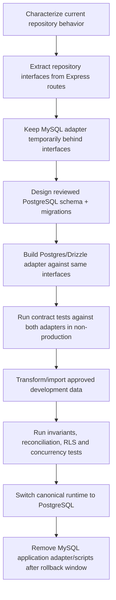
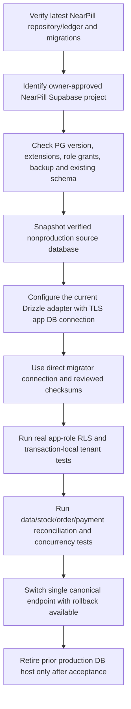
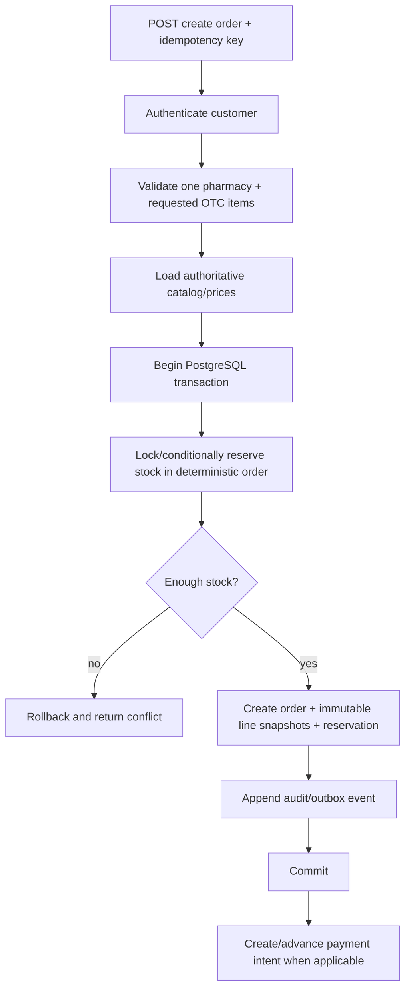
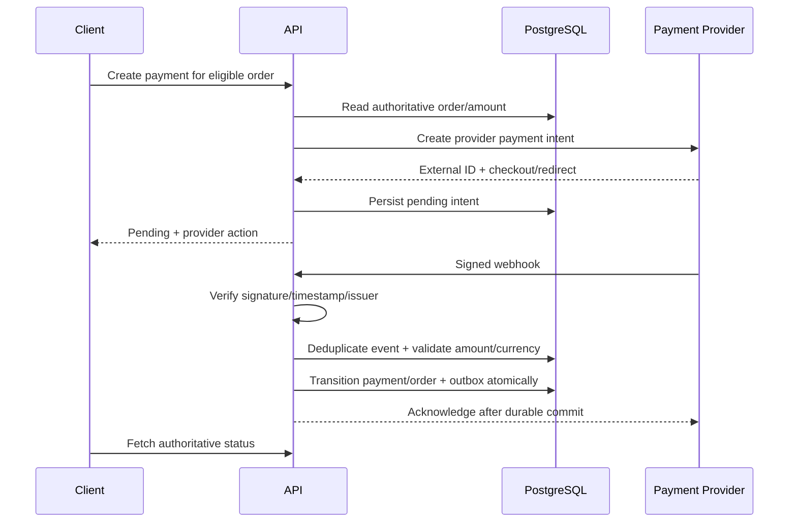
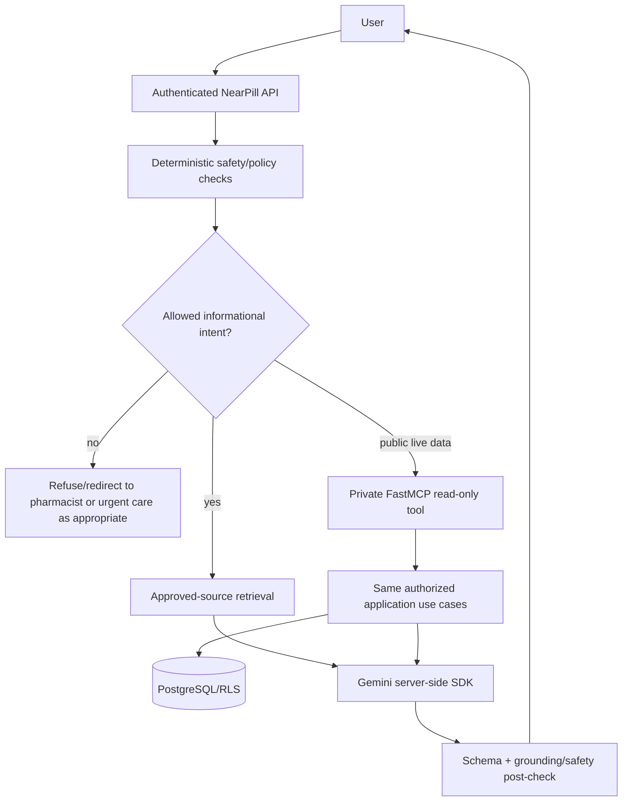
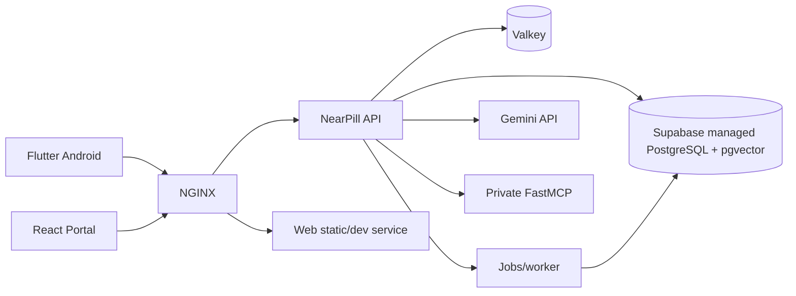
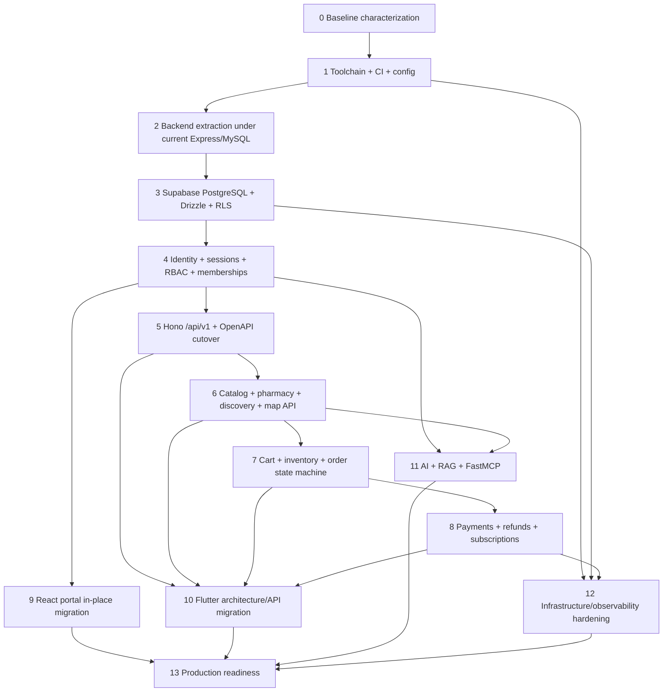
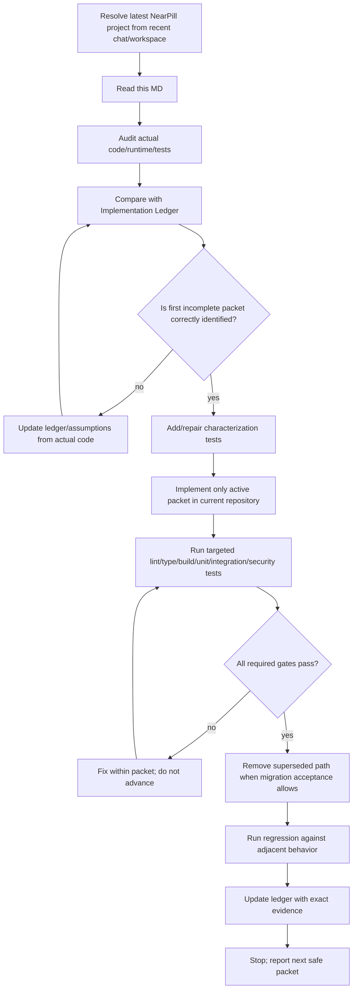

# NearPill — Master In-Place Whole-Codebase Refactor & Engineering Implementation Plan

**Status:** Engineering source of truth; **Supabase-hosted PostgreSQL is the selected database provider (decision 20 October 2026)**. Latest supplied source archive reconciled and reverified on 31 October 2026; Git revision, live deployment and Supabase provider cutover remain unverified.  
**Plan date:** 17 October 2026 (Asia/Manila)  
**Strategy:** Audit first, refactor the current project in place, preserve one canonical implementation, and prove every migration step with executable evidence.  
**Implementation target:** The most recent NearPill project resolved from the current/recent chat or active workspace at execution time. **Do not bind implementation to a hardcoded ZIP, folder, commit, version suffix, or previously generated project copy.** The provider decision does not authorize creation of a second application/database or application of migrations to an unrelated Supabase project.

> This document is an engineering implementation plan. It is not evidence of deployment, regulatory approval, clinical validation, pharmacy authorization, payment-provider approval, or production readiness.

---

## Approved database-provider decision — 20 October 2026

**Supabase is the chosen managed PostgreSQL provider for NearPill.** This supersedes the plan's assumption that production needs a self-hosted `postgres`/pgvector container; local disposable PostgreSQL may remain for development and integration testing. Supabase is a *hosting/provider decision*, **not** a replacement for the existing NearPill Hono backend, Drizzle repository/migration interfaces, sessions, RBAC, row-level tenant authorization, payment/order/inventory ownership or Flutter/React API contracts.

- Keep exactly **one canonical NearPill PostgreSQL database**. Do not run dual production databases, add a browser/mobile Supabase Data API authority or introduce a parallel Supabase Auth system.
- Treat the previous plan's PostgreSQL **18** as a target to verify against the **actual NearPill-owned Supabase project's supported engine**; do not claim that an unrelated PostgreSQL 17 project satisfies the requirement or silently change the schema's version assumptions.
- Configure the persistent Hono/Drizzle backend with a provider-supplied **direct TLS PostgreSQL connection**, or a **session-mode pooler** when network/IP constraints require it. Migration, `pg_dump` and restore tooling use a separately authorized direct connection. Transaction pooling is not the default for session-sensitive tenant context or Drizzle prepared statements.
- Use a non-owner, non-`BYPASSRLS`, least-privilege application role; verify trusted actor/tenant state **inside each transaction** (`SET LOCAL` / `set_config(..., true)`) and enforce PostgreSQL RLS on the intended private tables. Do not use privileged Supabase service keys for ordinary queries.
- Apply the **existing reviewed migration history** only after verifying the latest canonical repository, a dedicated NearPill Supabase project, schema/version compatibility, backup/rollback route, tenant negative tests and concurrency integrity checks. No production SQL/secret change is authorized by this document update alone.

**Updated audit limitation — 28 October 2026:** A newer uploaded Flutter/Hono/React source archive **is now accessible** and was audited as the current codebase (the latest archive fingerprint is recorded in the newest Packet 0 ledger entry). It has no Git metadata, lockfiles, or verifiable live deployment connection. Its backend already contains PostgreSQL/Drizzle/RLS modules and seven SQL migrations; **it has not been demonstrated to be connected to a NearPill-owned Supabase project**. Older notes claiming source unavailable or Express/MySQL to be the current code describe historical runs. Packet 0 remains active, with supported-runtime and Flutter tests blocked; no unrelated Supabase project was changed.

## 0. Executive engineering directive

The objective is **not to create NearPill again**. The objective is to transform the existing NearPill codebase into the intended production architecture while preserving valid work and removing unsafe or obsolete implementations.

The implementation must:

1. resolve and audit the latest NearPill project first;
2. keep that project as the single canonical repository;
3. refactor the full stack and its layering **inside the current codebase**;
4. preserve behavior with characterization/contract tests before structural changes;
5. remove duplicated or superseded code after the replacement path passes parity, security and data-integrity checks;
6. modernize runtime, backend, database, web portal, Flutter client, infrastructure, testing, security, observability and AI boundaries in dependency order;
7. never mark an implementation packet complete without command/test evidence;
8. never treat client state, fixture data, AI output, UI totals or local payment status as system authority;
9. keep the initial medicine scope **OTC-only** unless product/legal/clinical scope is formally changed;
10. block live customer data and real money movement until the release gates in this document are satisfied.

### Non-negotiable in-place rule

Do **not** create:

- `nearpill-v2/`;
- `NearPill-new/`;
- a sibling replacement repository;
- a cloned backend;
- a second web portal;
- a second Flutter application;
- duplicate auth/order/payment/inventory/tenant systems.

New folders/modules are allowed only **inside the current repository** when they are part of decomposing or reorganizing the existing implementation. The correct migration pattern is:

```text
characterize current behavior
        ↓
extract stable contract / interface
        ↓
move logic behind the contract
        ↓
replace one infrastructure adapter
        ↓
prove parity + security + data correctness
        ↓
switch canonical path
        ↓
remove superseded implementation
```

A folder restructure is not an implementation result by itself.

---

## 1. Baseline resolution and source-of-truth order

### 1.1 Dynamic recent-chat baseline

At the beginning of every implementation run, resolve the latest NearPill project using this order:

1. the project the user most recently identified as current/latest;
2. otherwise, the newest NearPill codebase/artifact supplied in the current chat;
3. otherwise, the newest NearPill project available from recent project context/workspace history;
4. older archives are comparison evidence only.

Never downgrade to an older project because this document mentions a familiar path or filename.

Record in the Implementation Ledger:

| Field | Required evidence |
|---|---|
| Active project | Why it is the latest NearPill project |
| Source type | live repository/workspace, archive, generated artifact, etc. |
| Observable revision | Git HEAD/branch when available; artifact fingerprint only when relevant |
| Audit timestamp | current execution timestamp |
| Runtime declarations | read from the actual project |
| Architecture inventory | generated from the project, not assumed from this MD |
| Test baseline | actual commands + pass/fail/skip |
| Plan deltas | any current code that differs from this plan |

### 1.2 Source-of-truth hierarchy

When information conflicts, use:

1. **Latest resolved NearPill codebase** — what actually exists now.
2. **Executable tests and runtime behavior** — what the code demonstrably does.
3. **This implementation plan** — approved target architecture and sequencing.
4. **Earlier NearPill audits/plans** — historical rationale only.
5. **Academic/product source documents** — product scope and evidence where still applicable.
6. **Current official runtime/framework/security/provider documentation**.
7. **Approved business, legal, clinical and payment decisions** for live operation.

Do not silently reconcile contradictions. Add them to the ledger and decide explicitly.

---

## 2. Re-audit method and current verified engineering snapshot

### 2.0 Current source reconciliation — 20 October 2026

The latest uploaded archive supersedes the historical Express/MySQL inventory that follows. Its **actual source** contains a 61-contract Hono `/api/v1` route register; Drizzle PostgreSQL schema and 7 reviewed `backend/migrations/postgres/0001`–`0007` SQL files; server-owned auth/session, RLS actor-context and application/domain/repository layers; React/TypeScript/Vite in `web/`; and a single layered Flutter application. There are no `web/js` legacy globals or original Express `backend/server.js` active entrypoint. The legacy MySQL adapter remains for migration/reference, not as the bootstrap database adapter. Code presence is **not** equivalent to executable acceptance, production deployment, or Supabase adoption. The current Packet 0 evidence and cleanup map are in `docs/packet-0-baseline-characterization.md` inside the same source archive.


This plan was rebuilt after re-inspecting the currently supplied project snapshot. The coding agent must repeat the audit against the latest recent-chat project before making changes.

### 2.1 Historical inventory inspected during plan creation

**This table describes the original older Express/MySQL project snapshot, not the latest reported Flutter/Hono/React codebase and not the deployed Supabase state.** Excluding dependency caches and generated/build output, the historical inspected snapshot contained roughly:

| Area | Reverified condition |
|---|---|
| First-party files | 117 files in the inspected source snapshot excluding `node_modules`/metadata noise |
| Flutter | 38 Dart files, ~8.4k lines |
| Backend | 20 `.js` + 5 `.mjs` + 2 `.cjs` first-party files; `backend/server.js` = 6,612 lines |
| Web portal | static HTML/CSS/vanilla JS; `web/js/app.js` ~1,066 lines; CSS ~1,166 lines |
| HTTP routes | 49 Express route registrations / 47 unique method-path combinations in the inspected server |
| Legacy DB schema | MySQL, 10 core tables in initial migration |
| Backend runtime | package declares Node `>=24.7.0` |
| TypeScript | not present in backend/web |
| React/Vite | not present in current portal |
| Docker/Compose | not present |
| NGINX | not present |
| CI | no repository CI workflow discovered in the inspected snapshot |
| Map | maps package installed but current map screen is a placeholder |
| Rx/prescription footprint | roughly 152 static Rx/prescription-related references found across first-party code |

### 2.2 Current backend route families

The inspected Express server exposes these families:

| Family | Approx. unique endpoints | Current concern |
|---|---:|---|
| Authentication/profile | 10 | in-memory sessions/OTP, refresh semantics, no durable expiry model |
| Admin | 19 | large monolith, mixed SQL/business/authorization concerns |
| Orders/payments | 7 | lifecycle/payment logic mixed with route handlers |
| Catalog/stores/inventory | 6 | direct SQL and mixed public/admin responsibilities |
| Partner | 2 | partner-to-pharmacy ownership mapping is not implemented |
| Health/root/recovery UI | 3 | mixed application/static concerns |

### 2.3 Test re-run during this audit

Executed against the available audit runtime:

```bash
node --test backend/test/*.test.mjs test/web_service_information.test.cjs
```

Available Node runtime: `v22.16.0`.

Observed result:

- 15 tests counted;
- 13 passed;
- 2 failed;
- both failed because `backend/passwords.js` imports `node:crypto` `argon2`, unavailable in Node 22;
- the repository itself declares Node `>=24.7.0`.

Therefore the two failures are a **runtime mismatch finding**, not proof that the implementation fails under its declared supported Node 24 runtime. The first implementation packet must rerun the suite on the pinned runtime.

Flutter was not available in this audit environment, so no new Flutter build/test result is claimed here.

### 2.4 Stale audit artifact warning

The historical audit described a checked-in `analyze-output.txt` referencing older screen names absent from that snapshot's `lib/` tree. Treat this file as historical output, not a reliable current build signal. Replace stale captured analyzer output with reproducible CI commands and current artifacts.

### 2.5 Source-package hygiene

The supplied source archive contains `backend/node_modules` even though dependency caches should be excluded from source artifacts. Do not audit vendored dependency cache as application code. Future source packages/releases should be generated from lockfiles, not ship `node_modules`.

---

## 3. Current technology and layering audit

### 3.1 Backend — current state

**Current stack:** Node.js ESM + Express 4 + `mysql2/promise` + CORS + dotenv.

Verified architecture issues:

- `backend/server.js` owns HTTP routing, SQL, validation fragments, authorization checks, transactions, domain rules, payment state changes, audit writes, partner/admin behavior and scheduled behavior in one very large file;
- SQL is embedded directly throughout route handlers;
- session/token storage is process-local `Map` state;
- OTP/email verification state is process-local `Map` state;
- access and refresh tokens are created by the same generic token function;
- no durable expiry, token-family or multi-instance session model exists;
- CORS permits broad localhost origins and all origins in non-production behavior;
- route schemas are inconsistent; only auth has focused validation middleware;
- no versioned `/api/v1` contract exists;
- no OpenAPI source of truth exists;
- no TypeScript compiler boundary exists;
- no centralized application/domain layer exists.

### 3.2 Database — current state

**Current stack:** MySQL schema/scripts + direct SQL.

Current schema includes:

- `users`;
- `drugstores`;
- `medicines`;
- `inventory`;
- `orders`;
- `order_drugstores`;
- `order_items`;
- `audit_logs`;
- `payments`;
- `subscriptions`.

Verified design issues:

- tenancy is implied by store IDs rather than a durable membership model;
- the partner routes explicitly state that `users` has no safe pharmacy/store mapping;
- schema scripts are duplicated between the migration and `init-db.js`;
- `migrations_add_columns.js` performs ad-hoc schema mutation outside a single migration history;
- `orders` includes both `user_id` and a nullable `userId` legacy column;
- money uses SQL `DECIMAL` but is converted to JavaScript numbers/floating arithmetic in application code;
- inventory, order state, payment state and audit behavior are coupled to route handlers;
- no RLS or tenant-level database defense exists;
- current MySQL migration semantics are not directly compatible with the intended PostgreSQL design.

### 3.3 Web portal — current state

**Current stack:** static HTML + CSS + vanilla JavaScript + global objects + CDN-loaded Google Fonts, Font Awesome and Chart.js.

Verified issues:

- login ignores the entered password and can fall back to admin access;
- role and branch are persisted in editable `localStorage`;
- demo credentials are client-visible;
- API requests do not send a real authenticated portal session;
- partner filtering occurs in the browser after retrieving admin orders;
- API base URL is hardcoded to localhost;
- `innerHTML` is used repeatedly for dynamic view rendering;
- a browser-only `CoreDB` and event engine model tenant/audit behavior independently of the backend;
- browser data includes fabricated/demo pharmacy credentials/ratings/licence-like values;
- no bundler, typechecker or component test architecture exists.

### 3.4 Flutter mobile — current state

**Current stack:** Flutter/Dart + Provider/ChangeNotifier + Dio + `http` + `flutter_secure_storage` + `shared_preferences` dependency + Google Maps package.

Verified issues:

- two HTTP stacks (`dio` and `http`) are used;
- auth/client, repositories, domain logic and views are not consistently separated;
- refresh handling stores the old refresh token even after the backend returns a rotated one;
- cart is globally keyed as `nearpill_cart`, not scoped to the authenticated account;
- cart price is a display string parsed using floating-point math;
- some screens directly call HTTP rather than a repository/service boundary;
- map screen is a placeholder despite the maps dependency;
- Android manifest has internet permission only; a complete runtime location-permission path is not implemented;
- Android application ID is still `com.example.nearpill`;
- release build currently points to the debug signing configuration;
- Rx/prescription language and placeholder features remain in multiple screens despite the intended OTC-only target.

### 3.5 Infrastructure/operations — current state

Missing or incomplete in the inspected snapshot:

- version-controlled Docker runtime;
- PostgreSQL/pgvector service;
- Valkey service;
- NGINX reverse proxy;
- health/readiness model beyond a basic backend endpoint;
- migration job separation;
- structured production logs/metrics/traces;
- CI gates for all surfaces;
- reproducible secret mounts;
- production/staging environment model;
- backup/restore drill;
- browser E2E suite;
- dependency/security scanning workflow.

---

## 4. Re-audited risk register

| ID | Severity | Verified or strongly evidenced condition | Required engineering outcome |
|---|---|---|---|
| NP-001 | **P0** | `web/js/app.js` login ignores password and unknown/admin-like inputs can become admin | Eliminate demo auth; server-owned web session only |
| NP-002 | **P0** | Portal stores `role`/branch in `localStorage` | Client role becomes display-only; authorization server-owned |
| NP-003 | **P0** | Portal calls admin APIs without authenticated token/session and filters tenant data client-side | Tenant-specific APIs + RBAC + RLS; never return cross-tenant private data |
| NP-004 | **P0** | Sessions are process-memory `Map`s with no durable expiry | Durable hashed sessions, rotation, expiry, revocation, replay protection |
| NP-005 | **P1** | OTP/verification records live in process-memory maps | Durable hashed challenges with TTL/attempt/one-time rules |
| NP-006 | **P1** | Mobile refresh saves the old refresh token after backend rotation | Single-flight refresh and save both newly returned credentials |
| NP-007 | **P0** | `server.js` is 6,612 lines and mixes routes, SQL, domain, auth and infrastructure | Extract route → application → domain → repository/adapters |
| NP-008 | **P0** | Direct MySQL architecture cannot provide intended PostgreSQL RLS model | Controlled Postgres/Drizzle migration inside current repo |
| NP-009 | **P1** | Initial schema, init script and ad-hoc column migration create migration drift risk | One reviewed versioned migration history |
| NP-010 | **P0** | No explicit pharmacy membership table; partner API admits mapping cannot be resolved | `pharmacy_memberships`/scoped permissions + RLS |
| NP-011 | **P0** | Inventory is decremented at order creation and lifecycle logic is spread across routes | Explicit reservation invariant + centralized state machine + concurrency tests |
| NP-012 | **P0** | Orders may span multiple drugstores while target first-release policy should be simpler | Enforce one-pharmacy-per-order or formally approve/test split checkout |
| NP-013 | **P0** | Backend creates local `GCash` pending records but no provider integration exists | Provider adapter + verified webhook + reconciliation; truthful UI |
| NP-014 | **P0** | Cancellation can set local `paid` payment records to `refunded` without moving money | Provider-confirmed refund workflow; `refund_pending` vs confirmed refund |
| NP-015 | **P1** | Admin payment endpoint can directly edit amount/status/reference | Replace with controlled reconciliation/exception workflow and audit |
| NP-016 | **P1** | Money crosses JS as floating numbers and cart prices are display strings | Integer centavos end-to-end for authoritative amounts |
| NP-017 | **P0** | Rx/prescription logic remains throughout backend/web/mobile while target scope is OTC-only | Remove Rx queues/routes/fields/UI unless scope is formally changed |
| NP-018 | **P1** | Browser `innerHTML` builds dynamic data-heavy interfaces | React-safe rendering; no unsafe HTML without audited sanitizer |
| NP-019 | **P1** | Browser-only CoreDB/event/audit system duplicates backend concepts | Remove client authority; server/domain/outbox become source of truth |
| NP-020 | **P1** | Hardcoded localhost API assumptions in web/mobile | typed environment config + NGINX single-origin/local routing |
| NP-021 | **P1** | Map feature is placeholder and Android location flow is incomplete | real permission/fallback/error behavior + bounded geo API |
| NP-022 | **P1** | Android uses example application ID and debug release signing | production package ID + secure signing/release config |
| NP-023 | **P1** | Flutter uses both Dio and `http`, with direct screen networking | one API client; repositories/services own I/O |
| NP-024 | **P1** | No root build orchestration, TS checks, Docker or CI | reproducible scripts + CI + local runtime |
| NP-025 | **P1** | Source archive includes dependency cache; stale analyzer output is checked in | clean source artifact policy + reproducible generated reports |
| NP-026 | **P1** | Demo ratings/licence-like data/credentials are mixed with application UI | synthetic fixture boundary; never present fixture evidence as verified fact |
| NP-027 | **P1** | No DB-level tenant defense | PostgreSQL RLS under non-owner application role |
| NP-028 | **P1** | Current CORS/deployment boundary assumes direct API access | single-origin NGINX web/API boundary; explicit CORS only when needed |
| NP-029 | **P1** | No authoritative versioned API contract | Zod schemas + OpenAPI + generated/typed client integration |
| NP-030 | **P1** | Existing tests do not cover real Postgres concurrency, tenant isolation, provider webhooks or E2E | add integration/security/E2E gates before release |
| NP-031 | **P0 — source-confirmed design gap; live exposure unverified** | `users` stores account/credential fields in `public`, and the seven reviewed migration files do not enable/force RLS on it; current preflight historically checked only 25 other tables | Verify actual NearPill Supabase table/schema grants and secure the account-data tenant/identity boundary using an approved, auth-compatible migration before any live customer data; do not use client Data API access as a substitute |
| NP-032 | **P1 — source-confirmed DB policy gap; live exposure unverified** | `0002_rls.sql` grants `nearpill_app` broad `orders` UPDATE and allows owner-row writes without a trusted mutation capability; `0006` adds `total_centavos`, with no column-specific restriction in the reviewed migrations | Characterize ordinary-customer own-order centavo mutation now; in the dependency-approved persistence/order packet review grants/policies and preserve backend domain transitions; require actual staging app-role negative tests before release |
| NP-033 | **P1 — source-confirmed order-state authorization gap; live exposure unverified** | The reviewed `orders_update` owner-row policy in `0002_rls.sql` has no trusted order mutation capability condition, and `0006_order_inventory.sql` permits `completed` as a status. A plain ordinary-customer SQL context may change its own order from `reserved` to `completed`, bypassing domain transitions if broad table UPDATE grants remain effective. | Add rollback-only customer-context own-order status mutation characterization in Packet 0; require staged app-role negative tests and an approved in-place policy/grant correction through the dependency-ready persistence/order packet, without breaking authorized backend transitions |
| NP-034 | **P1 — source-confirmed child-order state authorization gap; live exposure unverified** | `0002_rls.sql` grants broad table UPDATE and `0004_identity_security.sql` allows customer-owned `order_drugstores` UPDATE without trusted order-mutation capability; `0006_order_inventory.sql` recognizes `completed`. The existing verifier lacked child-order lifecycle negatives. | Characterize rollback-only child-order status changes for both customers in Packet 0; require reviewed, in-place least-privilege grants/policy fix and real NearPill staging app-role negatives before acceptance. |
| NP-035 | **P1 — source-confirmed order-line insertion authorization gap; live exposure unverified** | `0002_rls.sql` grants `nearpill_app` table INSERT on `order_items`, and `0004_identity_security.sql` allows an INSERT linked to a customer-owned order without requiring the trusted `order_mutation` capability. The order line has authoritative quantity and `unit_price_centavos` fields after migration `0006`. | Packet 0 probes a rollback-only cheap `order_items` INSERT against real synthetic owned pharmacy-order/medicine fixtures. Do not treat mock results as live security evidence; require approved grant/policy remediation and actual least-privilege staging negatives before acceptance. |

| NP-037 | **P1 — source-confirmed potential member DELETE policy gap; live exposure unverified** | `0002_rls.sql` uses `inventory_write FOR ALL` for an active pharmacy member and grants broad inventory privileges to the application role; the intended partner scope delegates availability/stock updates, not deletion of listings. Whether deployed Supabase permissions restrict DELETE is unverified. | Packet 0 rollback-only probe must deny member DELETE of own and foreign published inventory; investigate grants/policy under actual staging app role, preserve allowed availability updates, and remediate through reviewed in-place migration only after dependency gates. |
| NP-038 | **P1 — source-confirmed potential partner inventory INSERT/price authority gap; live exposure unverified** | `0002_rls.sql` gives `nearpill_app` broad INSERT privileges and applies `inventory_write FOR ALL` to active pharmacy members, potentially letting them create a listing with an arbitrary `price_centavos` despite admin-owned pricing. | Packet 0 uses separate rolled-back admin positive/member negative SQL INSERT controls for a newly published synthetic medicine, with exact inventory RLS denial only. On approved staging, remediate verified grants/policy issues through the canonical reviewed migration history while preserving authorized admin listing creation and member availability changes. |
| NP-039 | **P1 — source-confirmed potential reserved-quantity authority gap; live exposure unverified** | Existing `0002_rls.sql` `inventory_write FOR ALL` includes active pharmacy-member write scope without column restrictions; a member may be able to directly update `inventory.reserved_quantity`, bypassing order-owned reservation/stock-movement logic while satisfying nonnegative stock constraints. No live database outcome is claimed. | Packet 0 rollback-only app-role probe requires an effective, valid administrative update and denial of the same mutation by an active member with no `order_mutation` capability. Confirm under an approved NearPill Supabase staging non-owner role and remediate verified policy/grant exposure only through reviewed canonical migrations preserving order reservation and delegated availability behavior. |
| NP-040 | **P1 — source-confirmed potential active-reservation DELETE authorization gap; live exposure unverified** | Reviewed `0006_order_inventory.sql` gives `nearpill_app` DELETE on `reservations`, and a `reservations_app FOR ALL` `USING` predicate admits an active pharmacy member for that inventory row. `WITH CHECK` does not constrain DELETE, so a member may bypass order-owned release/stock-movement bookkeeping by deleting an active reservation. This is a source-backed concern only, not a verified Supabase exploit. | Packet 0 verifies a genuine active reservation with matching order-item/stock ledger, rollback-only real-admin DELETE parity and denial of the same DELETE under an active non-owner member. Correct confirmed exposure only through reviewed canonical grants/RLS preserving reservation reads, order-domain mutation authority and stock reconciliation. |
| NP-041 | **P1 — source-confirmed potential customer-owned reservation DELETE gap; live exposure unverified** | `0006_order_inventory.sql` grants app-role DELETE on `reservations`, and the `reservations_app FOR ALL USING` predicate admits a customer who owns the order. `WITH CHECK` does not restrict DELETE. A customer may be able to remove their own active reservation directly, bypassing server-owned release and stock-movement accounting. | Packet 0 verifies non-vacuous customer-owner SELECT, DELETE denial, foreign-customer read/delete denial and rollback on the existing NP-040 synthetic reservation. Execute under genuine staging app role and remediate confirmed exposure only via reviewed canonical grant/RLS changes that preserve trusted release workflows. |
| NP-042 | **SOURCE-MITIGATED / LIVE NOT VERIFIED (corrected 2026-10-23)** | Earlier Packet 0 entries evaluated `0002_rls.sql` alone. The **effective reviewed migration sequence** includes `0004_identity_security.sql`, which drops `order_drugstores_access FOR ALL` and installs only SELECT, INSERT and UPDATE policies for `nearpill_app`; no reviewed later migration reinstates DELETE/ALL on this table. Thus broad customer DELETE permission was **not established** by source. The distinct NP-034 UPDATE risk remains. | Retain the rollback-only own-child DELETE negative and add a canonical seven-migration source-order regression. Confirm actual policies/grants and the negative under the genuine NearPill-owned staging app role; do not draft a DELETE-policy fix unless real evidence warrants it. |

| NP-046 | **P1 — SOURCE MITIGATED / RUNTIME UNVERIFIED (2026-11-03)** | Original source read the full unauthenticated webhook clone before the configured 64 KiB middleware limit. Packet 0 now runs Hono `bodyLimit` first and independently performs a byte-bounded (64 KiB) raw-body capture, rejecting oversized or misleading-`Content-Length` webhooks before use-case dispatch. Focused source/stream tests pass; no supported-runtime Hono/NGINX/provider verification yet. | Run installed-Hono Node 24 HTTP negative tests for forged/missing/false Content-Length, chunked bodies, exact-limit signed events, and safe signature handling before external webhooks or release; retain blocker until evidence is recorded. |
| NP-047 | **P1 — SOURCE-MITIGATED / DEPLOYMENT & AVAILABILITY UNVERIFIED (2026-11-03)** | Previously, `clientIp()` took an unverified `X-Forwarded-For` value for durable login/recovery throttling. The narrow Packet 0 safety correction now defaults to the actual socket peer and permits exactly one validated forwarded address only when the peer matches a backend-configured exact `TRUSTED_PROXY_IPS` allowlist. No proxy is trusted by default, and the NGINX `/api/` route still overwrites XFF. All live ingress paths, trusted-peer identities and per-customer availability remain unverified. | On approved Node24/installed-Hono staging, exercise direct spoofing, verified NGINX peer, invalid/multi-hop XFF, proxy rotation, shared-bucket behavior and login/recovery throttling. Configure exact trusted peers only after observing the owned deployment; never silently enable a private CIDR. Keep NP-047 open until network isolation, parity and negative tests are accepted; Packet 0 source tests are not production security evidence. |

| NP-048 | **P1 — SOURCE MITIGATED / INSTALLED Hono & PROVIDER UNVERIFIED (2026-11-03)** | The 64 KiB webhook reader used default non-fatal UTF-8 decoding: malformed input silently became U+FFFD, and a leading UTF-8 BOM was stripped, changing the content supplied as the signed raw-body string. Packet 0 red-first regressions reproduced both. The existing reader now fails closed on malformed bytes and preserves BOM; the existing middleware returns HTTP 400 on malformed encoding and HTTP 413 on excessive size. | Verify installed-Hono Node24 integration with authentic provider-signed payloads, malformed/multibyte/BOM/false-length/streaming cases and event de-duplication under the approved staging connection. Do not claim provider-grade cryptographic parity or production acceptance from source tests alone. |
| NP-049 | **P1 — SOURCE MITIGATED / INSTALLED Hono UNVERIFIED (2026-11-03)** | The existing 64 KiB payment-webhook reader let an upload stream error escape from `reader.read()` after reading a partial payload. Packet 0 reproduced the thrown exception with a synthetic interrupted upload, then made the existing reader return `read-error` and the shared Hono middleware respond with HTTP 400 without payment dispatch or exposing the internal exception. The 64 KiB limit and UTF-8/BOM behavior are unchanged. | Verify actual Node 24/installed-Hono behavior for aborted/chunked request streams, zero provider dispatch, and successful valid signed payloads before external webhook acceptance. Source-only 400 handling is not live acceptance. |

| NP-050 | **P1 — SOURCE MITIGATED / INSTALLED Hono UNVERIFIED (2026-11-03)** | The canonical JSON body parser in `backend/src/http/transport.ts` awaited `c.req.text()` outside error handling. A prematurely aborted/failed request stream could throw an internal exception before schema validation; the shared Hono error handler could then report HTTP 500 rather than an input error. A red-first Packet 0 test reproduced the throw. The existing parser now converts read failures into the same generic 400 invalid-JSON response used for malformed input, without leaking the stream exception. | On supported Node 24 with installed Hono/NGINX, verify partial/aborted/chunked JSON uploads return controlled errors, no downstream use case or database mutation, while valid requests, 4 KiB authentication limits and 64 KiB general limits maintain parity. Source-only evidence does not close the live ingress gate. |
| NP-051 | **P1 — SOURCE MITIGATED / INSTALLED Hono UNVERIFIED (2026-11-04)** | A previously consumed webhook `Request` makes `Request.clone()` throw `TypeError: unusable` before the bounded raw-body reader's existing `reader.read()` catch, potentially escalating malformed ingress to generic HTTP 500. Red-first actual Web Request test reproduced the throw. The existing bounded reader now returns `read-error`, which current source-evaluated Hono middleware maps to HTTP 400 before payment dispatch. Signed-body byte limits and UTF-8/BOM handling are unchanged. | Run installed-Hono Node 24 and real provider-signature tests for consumed, aborted, locked and normal webhook bodies; confirm controlled HTTP 400, no side effects, and valid-signature parity. Do not accept this from source-only tests. |

P0 findings block production operation until resolved or explicitly removed from scope.

---

## 5. Refactor principles

### 5.1 One canonical implementation

For each concern there must be one production authority:

| Concern | Authority after refactor |
|---|---|
| Authentication/session | backend identity/session module |
| Authorization | backend permission policy + PostgreSQL RLS |
| Catalog/price | backend catalog domain + PostgreSQL |
| Availability/stock | backend inventory domain + PostgreSQL transactions |
| Orders | backend order state machine |
| Payments/refunds | provider adapter + payment domain + provider events |
| Subscriptions/entitlements | backend entitlement service |
| Audit | append-only DB audit/outbox |
| Web state | API-derived; browser is never authority |
| Mobile state | repository/cache for UX; backend remains business authority |
| AI tools | authorized application use cases; model never accesses DB directly |

### 5.2 Strangler-style refactor without duplicate business logic

Temporary old/new adapters are allowed only when both call the **same extracted use case/domain logic**.

Allowed temporary state:

```text
Express route ─┐
               ├─> same application use case ─> same repository interface
Hono route ────┘
```

Not allowed:

```text
Express business logic -> MySQL implementation A
Hono business logic    -> PostgreSQL implementation B
```

The second pattern creates two products and is prohibited.

### 5.3 Characterize before changing

Before moving a high-risk behavior:

- add/repair tests around current behavior;
- decide which behavior is valid versus intentionally removed;
- document the intended contract;
- refactor structure while behavior tests remain green;
- only then make policy/security changes with new acceptance tests.

### 5.4 Technology changes must reduce a verified problem

Do not replace a library purely because it is newer. For example, Provider can remain as the Flutter composition/state mechanism while the mobile architecture is corrected; the critical change is clean views/view-models/repositories/services and one network stack, not state-management churn.

---

## 6. Selected target technology stack

These are target decisions unless the latest codebase already contains an equivalent approved implementation.

| Layer | Selected direction | Reason |
|---|---|---|
| Node runtime | **Node 24 LTS** | current LTS line; repository already requires Node 24-era Argon2 API |
| Backend language | **TypeScript, strict** | boundary typing and safer refactor |
| HTTP adapter | **Hono + Node adapter** | small typed adapter; keep domain runtime-agnostic |
| Input/contracts | **Zod + generated OpenAPI** | one explicit API boundary |
| Database | **Supabase-managed PostgreSQL** (target PostgreSQL 18, verify project-engine compatibility) | single NearPill database with managed operations, transactions, constraints and native RLS; retain local disposable Postgres for tests |
| ORM/query | **Existing Drizzle ORM + reviewed SQL migrations** | preserve one existing repository/migration history and typed queries; swap database hosting/connection, not business logic |
| Vector search | **Supabase PostgreSQL pgvector extension**, when approved | embed/retrieve approved knowledge only; verify extension availability/version in NearPill-owned project |
| Cache/rate-limit | **Valkey** | public cache and bounded operational counters; not source of truth |
| Web | **React + TypeScript + Vite** in existing `web/` surface | remove global/innerHTML/demo-auth architecture |
| Web server-state | **TanStack Query or equivalent focused query layer** | server state/cache/retry separation; avoid global mutable data store |
| Web routing | **React Router or equivalent lightweight router** | explicit routes/layouts/guards |
| Flutter | existing Flutter app, refactored to UI + view models + repositories + services | preserves current app while aligning with Flutter architecture guidance |
| Flutter HTTP | **Dio only** | eliminate duplicate HTTP stacks |
| Mobile secure tokens | `flutter_secure_storage` | platform secure storage for credentials |
| Reverse proxy | **NGINX** | one published local/staging boundary and streaming proxy |
| Containers | **Docker Compose** for API/web/jobs/local tests; **managed Supabase PostgreSQL** for staging/production | local reproducibility without creating a second live production database |
| AI model SDK | **`@google/genai`**, server-only | current Google JS/TS Gemini SDK |
| MCP | **`@prefecthq/fastmcp-ts`**, private service boundary | typed MCP tools; no public/raw SQL access |
| Unit/integration tests | **Vitest** for TS + Postgres integration tests | typed backend/web test foundation |
| Browser E2E | **Playwright** | real portal/auth/tenant/checkout regression |
| Mobile tests | Flutter unit/widget + `integration_test` for critical flows | aligns with Flutter test categories |
| Security baseline | **OWASP ASVS 5.0.0 + API Top 10 + MASVS** | concrete verification requirements |
| CI | repository-native pipeline (GitHub Actions if hosted on GitHub) | repeatable gates, not local claims |

### 6.1 Version policy

- Pin major/minor versions intentionally in lockfiles.
- Pin container images to reviewed tags and later digests for staging/production.
- Do not copy version numbers from this document blindly; verify current supported releases during the implementation packet.
- Node 24 is an LTS line through April 2028 according to current Node migration documentation.

---

## 7. Target layering — backend

```text
backend/
├── src/
│   ├── bootstrap/              # composition root, process startup/shutdown
│   ├── http/
│   │   ├── app.ts              # Hono app assembly
│   │   ├── middleware/         # request ID, auth, CSRF, rate-limit, validation
│   │   ├── routes/v1/          # thin HTTP adapters only
│   │   └── presenters/         # stable API response mapping
│   ├── modules/
│   │   ├── identity/
│   │   ├── pharmacy/
│   │   ├── catalog/
│   │   ├── inventory/
│   │   ├── orders/
│   │   ├── payments/
│   │   ├── subscriptions/
│   │   ├── reports/
│   │   ├── ai/
│   │   └── settings/
│   ├── domain/                 # pure entities/policies/state transitions
│   ├── application/            # use cases / orchestration
│   ├── ports/                  # repository/provider/cache/event interfaces
│   ├── infrastructure/
│   │   ├── postgres/
│   │   ├── valkey/
│   │   ├── mail/
│   │   ├── payments/
│   │   ├── gemini/
│   │   └── observability/
│   └── config/                 # typed env validation
├── migrations/                 # one Postgres history
├── test/
└── package.json
```

This is an **internal refactor of the existing backend**, not a second backend.

### 7.1 Dependency rule

```text
HTTP adapter
   ↓
application use case
   ↓
domain policy/state machine
   ↓
ports/interfaces
   ↓
infrastructure adapters
```

The domain layer must not import Hono, Drizzle, NGINX, Gemini, Valkey or payment-provider SDKs.

### 7.2 Route rule

Routes may:

- parse transport input;
- call authenticated middleware;
- invoke a use case;
- map result/error to an HTTP response.

Routes may **not**:

- build SQL;
- calculate authoritative prices;
- mutate stock directly;
- choose payment/refund truth;
- infer tenant from a client-provided role;
- implement order state transition logic.

---

## 8. Target layering — web portal

Refactor the current `web/` surface in place.

```text
web/
├── src/
│   ├── app/                    # providers, router, shell
│   ├── features/
│   │   ├── auth/
│   │   ├── dashboard/
│   │   ├── pharmacies/
│   │   ├── catalog/
│   │   ├── availability/
│   │   ├── orders/
│   │   ├── payments/
│   │   ├── subscriptions/
│   │   ├── reports/
│   │   ├── knowledge/
│   │   └── settings/
│   ├── components/
│   ├── api/                    # typed API client; no direct business rules
│   ├── auth/                   # session bootstrap + CSRF client behavior
│   ├── routes/
│   ├── styles/
│   └── test/
├── index.html
├── package.json
└── vite.config.ts
```

Web rules:

- no client-visible demo passwords;
- no `localStorage` role authority;
- no client-side tenant security filtering;
- no raw `innerHTML` for business data;
- no separate browser database abstraction pretending to be tenant security;
- same-origin API through NGINX in normal web deployments;
- server data handled as server state, not copied into global mutable fixtures;
- destructive actions require explicit mutation state/error handling;
- every privileged screen is backed by server permissions, not menu visibility.

---

## 9. Target layering — Flutter mobile

Refactor the existing app rather than creating another Flutter project.

Recommended feature-oriented layering:

```text
lib/
├── app/                         # app bootstrap, navigation, theme, DI
├── core/
│   ├── api/                     # one Dio client/interceptors
│   ├── auth/                    # secure session/token coordinator
│   ├── config/
│   ├── errors/
│   └── utilities/
├── features/
│   ├── auth/
│   │   ├── data/               # services + repository implementation
│   │   ├── domain/             # models/use cases when warranted
│   │   └── presentation/       # views/view-models
│   ├── catalog/
│   ├── pharmacy/
│   ├── cart/
│   ├── orders/
│   ├── payments/
│   ├── profile/
│   └── map/
└── shared/
```

Flutter implementation rules:

- views contain rendering/user interaction, not network orchestration;
- view models expose UI state and commands;
- repositories are source-of-truth abstractions for features;
- services wrap external APIs/platform APIs;
- one Dio client owns auth headers, retry, timeout and response mapping;
- refresh is single-flight and saves both rotated tokens;
- cart is keyed/scoped by authenticated user or moved server-side;
- authoritative money is centavos from API; UI formats it only;
- remove `http` package calls after the last direct screen API call is migrated;
- keep Provider/ChangeNotifier initially if it cleanly provides dependency injection/view-model lifecycle; replacing Provider is not required to meet the architecture goal;
- Android release identity/signing and location permissions are explicit release work, not TODO comments.

---

## 10. Shared contracts and configuration

### 10.1 API versioning

Move to `/api/v1/*` during the HTTP adapter migration.

Maintain a short compatibility window only if current Flutter/web clients need it. Compatibility routes call the same use cases and must have a removal milestone.

### 10.2 Contract ownership

Boundary schemas must be explicit:

- inbound request → Zod;
- environment → typed runtime schema;
- DB → Drizzle schema + SQL constraints;
- HTTP → OpenAPI;
- web API client → generated/shared types where practical;
- Flutter DTOs → explicit parsing/validation generated or maintained from the API contract;
- MCP tools → Zod;
- Gemini structured output → schema validation.

### 10.3 Environment model

At minimum:

- local development;
- automated test;
- staging;
- production.

No code should infer security policy merely from a hostname.

Secrets never belong in:

- Flutter build constants;
- Vite browser environment;
- normal settings API responses;
- committed `.env`;
- client logs;
- fixture files.

---

### 10.4 Supabase connection and secret boundary

Configuration names must be reconciled with the **actual existing app** before edits; examples here are conventions, not a claim about the missing checkout:

| Configuration | Intended owner | Contract |
|---|---|---|
| `DATABASE_URL` (or the existing canonical DB URL setting) | Backend secret runtime only | NearPill Supabase direct/session-mode URI, least-privilege app role and TLS; never in Flutter/Vite bundles |
| `MIGRATION_DATABASE_URL` (if a separate migration setting is supported) | Protected migration job only | Direct PostgreSQL URI with narrowly approved migrator privileges; never used by API requests |
| Supabase project reference, host and region | Protected deployment metadata | Verify against explicitly NearPill-owned project; no hardcoded `renforge` connection string |
| Pool mode and app-side pool size | Backend DB adapter | Direct/session for long-lived Hono; transaction pooling only with explicit proven driver/transaction compatibility |
| RLS actor/tenant context | Authorized application transaction | Obtain from verified backend identity; set transaction-local; reset automatically on rollback/commit |

**Never** put service-role credentials, database passwords, provider keys or raw SQL access in React, Flutter, ordinary settings endpoints, logs or `.env` files committed to source control. For Supabase projects exposing `public` via the Data API, keep private NearPill tables in an unexposed schema where practicable; otherwise review/revoke default `anon`/`authenticated` grants and enable RLS and exact policies. A project-specific migration must prove this, not assume grants are safe by default.

## 11. PostgreSQL migration and data architecture

The database refactor happens **inside the existing NearPill project**. The chosen *provider* is **Supabase-hosted PostgreSQL**. If the latest codebase already runs the approved PostgreSQL/Drizzle adapter (as previously reported after Packet 3), **do not repeat the MySQL-to-PostgreSQL migration**: preserve the same domain/repository contracts and reviewed migrations, then change only the canonical connection/deployment provider after verification. The MySQL procedure below applies only if verified current code still uses MySQL.

### 11.1 Migration strategy

Do not mechanically translate MySQL DDL, replay already-applied PostgreSQL migrations, or keep indefinite dual writes. A Supabase connection change is **not** permission to create a second runtime schema or replicate orders/payments into a new database. The source-dependent flow below applies only when an actual MySQL adapter remains.



This temporary adapter overlap is permitted because business logic remains singular.

### 11.1.1 Supabase provider adaptation for an already-PostgreSQL NearPill codebase

When the current repo proves Packet 3 was already migrated to PostgreSQL, use this narrower in-place sequence **instead of** repeating the MySQL migration:



**No destructive migration or production cutover occurs without the prerequisite test and backup evidence.** Supabase managed PostgreSQL is not a replacement for the backend business layer. In particular, transaction-pooler mode cannot be assumed safe for prepared statements or session-local state; choose direct/session mode by default and keep tenant state transaction-local.


### 11.2 Proposed data groups

#### Identity/tenancy

- `users`
- `credentials`
- `sessions`
- `refresh_token_families` or equivalent lineage
- `email_verifications`
- `password_reset_challenges`
- `pharmacies`
- `pharmacy_memberships`
- `role_assignments`
- `pharmacy_verifications`

#### Catalog/availability

- `medicines`
- `categories`
- `medicine_evidence`
- `catalog_prices`
- `catalog_revisions`
- `pharmacy_medicines`
- `stock_balances`
- `stock_movements`
- `availability_events`

#### Orders/payment

- `orders`
- `order_items`
- `reservations`
- `pickup_events`
- `payment_intents`
- `payment_events`
- `refunds`
- `payment_reconciliation`

#### Partner business

- `plans`
- `subscription_contracts`
- `entitlements`
- `billing_events`

#### AI/knowledge

- `approved_sources`
- `source_versions`
- `knowledge_chunks`
- `embeddings`
- minimal `chat_sessions`/`chat_events` only if retention policy approves them
- `ai_usage`

#### Operations

- `audit_events`
- `outbox_events`
- `job_failures`
- non-secret `system_settings`

### 11.3 Core data rules

- use UUIDs for new internal entity IDs unless an interoperability reason says otherwise;
- `timestamptz` for persisted instants;
- store money as integer Philippine centavos (`BIGINT`), never floating-point authority;
- order lines preserve immutable product/price snapshots;
- stock quantities are integers and constrained nonnegative;
- every private record has explicit owner/tenant linkage;
- use database constraints to enforce invariants in addition to application validation;
- development fixtures are clearly synthetic;
- do not automatically import known plaintext/ambiguous legacy credentials into a live system; require controlled migration/reset policy.

### 11.4 RLS model

PostgreSQL RLS on **Supabase-managed PostgreSQL** is defense in depth, not a replacement for the existing backend authorization. Supabase `auth.uid()` and client JWT policies must **not** be substituted for NearPill backend-owned sessions unless an explicit, separate auth migration is approved and characterized.

Rules:

- app role is not owner/superuser/`BYPASSRLS`;
- enable and force RLS on tenant/private tables as appropriate;
- use transaction-local trusted actor context only after session verification;
- apply `USING` and `WITH CHECK` policies for the relevant operations;
- cross-tenant tests run using the actual application role;
- privileged admin workflows are explicit, audited exceptions, not blanket bypasses.

---

### 11.5 Supabase deployment and RLS acceptance checks

On a dedicated, explicitly approved NearPill staging Supabase project and with the **actual app role**, require all of the following before a provider cutover:

1. Project engine/extension inventory matches the reviewed NearPill schema and Drizzle migrations (or every compatibility delta is documented and tested).
2. Migrations run from the **canonical existing history**, are idempotent/checksum-accounted, and can be replayed into a disposable staging restore. A rollback or forward-fix strategy is documented.
3. `rolsuper`, `rolbypassrls` and schema ownership are all false for the ordinary application role; RLS/private grants are inspected, not assumed. The `anon`, `authenticated` and `service_role` roles are **not** the regular business-query authority.
4. Transaction-local verified actor/tenant context is set and consumed within one transaction; tests prove no leak across pooled connections, including after errors and retries.
5. Cross-pharmacy orders/stock/report reads and writes fail under the **actual application role**; a backend-admin exception requires a narrowly scoped audited policy.
6. One-pharmacy checkout, centavo accounting, nonnegative stock, reservation idempotency, and 100-way inventory contention tests pass on real staging PostgreSQL.
7. Reconciliation counts/hashes for approved migrated data, immutable price snapshots, payment event states and append-only audit/outbox invariants pass. No real customer/payment data are imported without separate approval.
8. Restore drill, secret scan, TLS connectivity, migration-role separation, network egress and observability succeed before the old production DB endpoint is retired.

**Environment-unavailable gates must remain `NOT RUN/BLOCKED` in the ledger; they cannot be reclassified as `PASS` through owner bypass.**

## 12. Identity, sessions, RBAC and tenant isolation

### 12.1 Password handling

Preserve the useful Argon2id work already present, but validate it on Node 24 and migrate it into the identity module.

Requirements:

- normalized unique email;
- modern password policy approved by product/security;
- timing-safe verification;
- legacy credential migration only through controlled successful authentication or reset;
- password reset revokes relevant sessions;
- no password/token values in logs.

### 12.2 Web session model

Use server-owned opaque sessions:

```text
browser
  -> POST /api/v1/auth/login
  -> backend verifies password + account state
  -> random session credential generated
  -> hash stored server-side with expiry/device metadata
  -> HttpOnly Secure SameSite cookie returned
  -> subsequent request resolves actor server-side
  -> RBAC + tenant scope + RLS transaction
```

For cookie-authenticated mutations add:

- CSRF token strategy;
- Origin/Referer validation where appropriate;
- Fetch Metadata defenses;
- logout/logout-all;
- idle and absolute expiration;
- session rotation after privilege/password changes.

### 12.3 Mobile token model

- short-lived access credential;
- single-use rotated refresh credential;
- hashed server-side storage;
- refresh family lineage;
- replay detection revokes the affected family;
- single-flight mobile refresh;
- secure storage only;
- no role from local preferences.

### 12.4 Permission model

Prefer explicit permissions, for example:

- `orders:create`
- `orders:read:own`
- `orders:read:pharmacy`
- `orders:update:pharmacy`
- `catalog:publish`
- `availability:update`
- `inventory:adjust`
- `pharmacy:manage`
- `subscriptions:manage`
- `reports:view:premium`
- `ai:knowledge:review`
- `ai:settings:update`

A client-supplied pharmacy ID is never sufficient proof of membership.

---

## 13. Product scope cleanup: OTC-only launch

The inspected code contains widespread Rx/prescription remnants. The intended launch scope in the prior product plan is OTC-only.

Unless product scope is formally changed, implementation must remove/disable:

- Rx verification queue;
- prescription review/approval/rejection portal actions;
- Rx upload placeholders;
- prescription-specific profile claims/fields that lack another approved purpose;
- Rx flags presented as supported transaction workflow;
- prescription tables/routes/tools proposed only for the legacy path.

Do not simply hide the navigation. Remove unsupported business logic and tests after confirming it is not required by the approved product scope.

---

## 14. Catalog, pharmacy discovery and map architecture

### 14.1 Catalog authority

- admin-controlled master OTC catalog;
- admin-controlled published price policy unless product rules explicitly delegate it;
- partner controls only approved availability/stock fields;
- provenance/evidence recorded for pharmacy/product verification claims;
- public API returns only published, allowed fields.

### 14.2 Search

Use:

- PostgreSQL full-text GIN indexes;
- optional trigram matching for tolerant search;
- bounded pagination and allowlisted sort/filter parameters;
- version/revision keys for public cache invalidation.

### 14.3 Geolocation

Flow:

```text
user opens nearby search
    ↓
ask permission only when needed
    ↓
permission granted? ── no ──> manual Cebu/location search
    │ yes
    ↓
obtain coarse/current coordinate
    ↓
backend bounded pharmacy search
    ↓
verified public partner records + availability freshness
    ↓
render markers/list
```

Handle permission denied, GPS unavailable, network failure, invalid coordinates, provider quota, stale location and outside-service-area states.

Do not claim that a map marker guarantees stock.

---

## 15. Cart, inventory and order domain

### 15.1 Cart

Initial rule:

- cart belongs to the signed-in user;
- one pharmacy per order;
- server reloads price/product/availability at checkout;
- mobile price strings are display-only;
- logout clears or rekeys local cart state.

### 15.2 Inventory invariant

Choose one invariant and enforce it everywhere. Recommended:

```text
stock_on_hand >= 0
reserved_quantity >= 0
reserved_quantity <= stock_on_hand
sellable = stock_on_hand - reserved_quantity
```

Every reservation/release/fulfillment writes a stock movement or equivalent ledger record.

### 15.3 Order creation



### 15.4 Order state machine

Example launch state model:

```text
Draft
  -> Reserved
  -> AwaitingPayment
  -> Confirmed
  -> Preparing
  -> ReadyForPickup
  -> Completed

Reserved/AwaitingPayment -> Cancelled | Expired
Confirmed/Preparing      -> CancellationPending -> Cancelled
ReadyForPickup           -> Completed | Expired (policy dependent)
```

All transitions:

- are centralized;
- have actor permissions;
- have valid predecessor states;
- are idempotent where retried;
- include inventory/payment side-effect rules;
- append audit/outbox events.

### 15.5 Concurrency acceptance test

For stock of 3, run at least 100 concurrent reservation attempts. Prove:

- at most 3 units are reserved according to policy;
- no negative stock;
- no duplicate reservation on idempotency replay;
- cancellation/expiry releases exactly once;
- database state reconciles after the test.

---

## 16. Payment, refunds and reconciliation

Do not make real charges before order/inventory correctness and provider/business approval.

### 16.1 Provider abstraction

```text
PaymentProvider
  createIntent(order, amount, returnContext)
  verifyWebhook(headers, rawBody)
  getPayment(externalId)
  requestRefund(payment, amount, reason)
  getRefund(externalId)
```

Do not hardcode a provider-specific truth into order code.

### 16.2 Authoritative payment workflow



### 16.3 Payment state integrity

UI/API must distinguish:

- pending;
- confirmed;
- failed;
- cancellation pending;
- refund pending;
- refunded/confirmed;
- reconciliation required.

A database string called `refunded` is not proof that money was returned.

### 16.4 Deposit/full payment

The 50%/100% business rule must be encoded only after approval. The backend computes amounts in centavos and persists the selected payment plan/policy version. The current behavior of always inserting the full order total must not survive the refactor if deposit mode remains a product requirement.

---

## 17. Subscriptions and entitlements

Basic/Premium access must be server-side entitlement logic, not hidden menu items.

Requirements:

- explicit plan/version;
- active/grace/suspended/expired/cancelled states as approved;
- pharmacy membership + entitlement check for reports;
- billing changes/audits recorded;
- partner cannot self-upgrade by editing client data;
- reporting endpoints re-check entitlement at request time.

---

## 18. React portal in-place migration

Start after stable identity/session/API contracts exist.

### 18.1 Migration method

Convert one feature slice at a time inside `web/`:

1. install Vite/React/TypeScript in current web surface;
2. create app shell/router/session bootstrap;
3. migrate login to real backend session;
4. migrate dashboard;
5. migrate pharmacies/catalog/availability;
6. migrate orders/payments;
7. migrate subscriptions/reports;
8. migrate settings/knowledge as implemented;
9. delete corresponding legacy global JS/data/CoreDB/event code after parity tests;
10. remove unused CDN/runtime dependencies.

### 18.2 Portal UX/security requirements

- no optimistic success when API mutation failed;
- loading/empty/error/permission states for every data view;
- accessible focus, labels, keyboard interactions and dialog behavior;
- no raw unsafe HTML rendering;
- permissions drive actions server-side;
- tenant selector cannot expose unauthorized data;
- private API responses use `Cache-Control: no-store` where appropriate;
- CSP and security headers applied at NGINX/API boundary.

---

## 19. Flutter application in-place refactor

Start client contract migration after `/api/v1` identity and relevant feature endpoints are stable.

### 19.1 Networking

- create one Dio client;
- remove direct `http.get` from screens;
- centralize auth/refresh/error mapping;
- generated/request DTOs use explicit validation;
- configure base URL by environment;
- emulator goes through NGINX rather than bypassing the deployment topology.

### 19.2 Authentication

Fix the current refresh bug immediately when the identity packet lands:

```text
backend refresh response = new access + new refresh
mobile atomically stores BOTH
old refresh cannot be reused
concurrent 401s share one refresh operation
```

### 19.3 Cart/order

- user-scoped local cart or server cart;
- integer centavos DTO;
- one-pharmacy order enforcement;
- idempotency key generation/persistence across retry;
- clear authoritative status labels.

### 19.4 Android release engineering

Before release:

- production application ID;
- release keystore/signing supplied securely;
- no debug signing for release artifacts;
- declared/runtime location permissions only when needed;
- network security configuration reviewed;
- no API/provider secrets in APK;
- MASVS checks for storage/auth/network/privacy.

---

## 20. Gemini, RAG and FastMCP architecture

AI is a late dependency. Do not add it before core authorization and catalog truth are stable.

### 20.1 Trust boundary



Gemini never receives unrestricted SQL/database credentials.

### 20.2 Initial MCP tools

Allow narrow read-only tools such as:

- `search_otc_medicines`;
- `find_verified_pharmacies`;
- `check_public_availability`;
- `get_approved_medicine_info`;
- `search_approved_knowledge`;
- `get_platform_faq`.

Do not launch tools for:

- arbitrary SQL;
- stock write;
- price/catalog write;
- payment status write;
- refund issuance;
- prescription creation/approval;
- reading another customer's order.

### 20.3 RAG governance

```text
source submitted
 -> validate/type/rights metadata
 -> quarantine
 -> qualified review
 -> approve/version
 -> chunk + citation + hash
 -> embed
 -> publish
 -> evaluate
 -> retract/re-embed when source changes
```

Retrieval filters only published approved versions. Embeddings never contain live stock/payment truth.

### 20.4 Medical safety

- informational only;
- no diagnosis;
- no patient-specific dosing/treatment recommendation;
- no prescription generation;
- emergency/prohibited intent handled by deterministic policy;
- abstain when evidence is insufficient;
- response cites approved evidence metadata where useful;
- minimize retention of health-related prompts and access to them.

---

## 21. Infrastructure and deployment architecture

### 21.1 Local/staging topology



Only NGINX should be published to the host by default. Database, Valkey and FastMCP remain private.

### 21.2 Compose services

- `nginx`;
- `web`;
- `api`;
- local **disposable** `postgres`/pgvector for integration tests when necessary; staging/production use the **single Supabase-managed NearPill PostgreSQL** database and do not start another production DB container;
- `valkey`;
- `jobs`;
- `fastmcp` when AI packet is enabled;
- one-shot `db-migrate` job using the **direct migration connection** to the approved Supabase target, with reviewed migrations and explicit approval; local test migrations remain local.

Use health checks and dependency conditions, but application processes must still tolerate dependency restarts.

### 21.3 NGINX responsibilities

- one origin for portal/API;
- `/api/*` proxying;
- web/static routing;
- AI streaming proxy settings when introduced;
- body/time limits;
- security headers where appropriate;
- trusted forwarding headers only;
- coarse rate limiting as secondary protection;
- no sensitive query/body logging.

### 21.4 Secrets

Local development can use gitignored secret files/mounts. Staging/production should use platform secret management. Never return secret values from a settings endpoint.

---

## 22. Caching, jobs and event consistency

### 22.1 Valkey

The single **Supabase-managed NearPill PostgreSQL** database remains the authoritative production source of truth.

Safe first caches:

- public OTC catalog queries;
- public verified pharmacy profiles;
- bounded area/search results;
- approved knowledge snippets;
- rate-limit counters.

Do not cache as authority:

- sessions for the first release unless explicitly designed as durable source;
- payment truth;
- inventory reservation writes;
- private order state.

### 22.2 Outbox/jobs

Use a transactional outbox for side effects such as:

- email;
- order status notifications;
- reservation expiry;
- payment reconciliation retries;
- analytics aggregation;
- approved knowledge embedding;
- cache invalidation.

Jobs are idempotent, restartable and observable.

---

## 23. Observability and operational controls

Implement structured, privacy-aware observability.

### Logs

Every request gets a request/correlation ID. Log:

- route/use case;
- status/error class;
- latency;
- actor/tenant pseudonymous IDs only when needed;
- provider event identifiers where appropriate.

Never log:

- passwords;
- raw session/refresh tokens;
- OTP/reset secrets;
- Gemini/payment secret keys;
- sensitive raw medical text by default.

### Metrics

At minimum:

- request rate/latency/error rate;
- auth failures/rate-limit events;
- DB pool/transaction failures;
- order reservation conflicts;
- payment webhook failures/reconciliation backlog;
- job backlog/failure;
- cache hit/error rate;
- AI latency/tool errors/token budget after AI launch.

### Audit

Append-only business audit events for privileged changes:

- user/role membership;
- catalog/price publication;
- inventory adjustment;
- order transition override;
- payment reconciliation/refund action;
- pharmacy verification;
- subscription/entitlement changes;
- AI knowledge approval/settings changes.

---

## 24. Security verification baseline

Use current OWASP ASVS 5.0.0, OWASP API Security Top 10 and OWASP MASVS as test requirements.

Required negative tests include:

| Security case | Acceptance |
|---|---|
| BOLA | tenant A cannot read/change tenant B order/stock/report by ID |
| BFLA | customer cannot call admin/partner privileged operation |
| session reuse | revoked/expired session rejected |
| refresh replay | old rotated refresh rejected; family action follows policy |
| CSRF | cookie-auth mutation without valid anti-CSRF context rejected |
| injection | SQL/filter/sort payloads cannot escape allowlisted/parameterized handling |
| stored XSS | malicious names/content render as data, not script |
| mass assignment | role/price/status/tenant fields cannot be changed unless schema explicitly allows |
| concurrency | stock invariant survives high contention |
| webhook forgery | unsigned/wrong amount/duplicate payment event has no paid effect |
| cache isolation | private/tenant response never leaks through cache |
| secret scan | web/mobile bundles contain no server/payment/Gemini secrets |
| AI tool abuse | model cannot invoke raw SQL/private write tool |
| retrieval poisoning | unapproved source/instructions cannot become active knowledge |
| backup restore | restored DB preserves roles/policies/required state |

---

## 25. Testing architecture

### 25.1 Test pyramid

#### Domain/unit

- state transitions;
- money/price policy;
- permission policy;
- reservation rules;
- payment transition policy;
- subscription entitlements;
- AI safety policy.

#### Repository/integration

Real PostgreSQL tests for:

- migrations;
- constraints;
- RLS;
- transactions;
- concurrency;
- idempotency;
- outbox;
- query plans for critical search/order paths.

#### HTTP contract

- Zod validation;
- status/error model;
- auth/CSRF/CORS;
- OpenAPI contract;
- legacy compatibility routes during migration.

#### Web

- component tests;
- query/mutation error states;
- session bootstrap;
- Playwright admin/partner tenant isolation flows.

#### Flutter

- DTO/repository tests;
- view-model tests;
- widget tests;
- integration flows for login/search/cart/order/status/location fallback.

### 25.2 Mandatory build gates

Target root commands should converge toward a predictable set, for example:

```bash
npm run format:check
npm run lint
npm run typecheck
npm run test
npm run test:integration
npm run test:e2e
npm run build
flutter analyze
flutter test
```

Use equivalent commands if repository tooling differs, but the gates must exist.

---

## 26. Implementation dependency graph



Some packets can overlap only when they do not duplicate a dependency or violate a gate.

---

## 27. Implementation packets

The coding agent implements **one active packet at a time** unless the project already proves it complete.

### Packet 0 — Baseline lock, characterization and cleanup map

**Goal:** establish trustworthy before-state.

Deliverables:

- resolve latest recent-chat project;
- inventory source/runtime/dependencies/routes/tables/screens;
- pin/reproduce declared Node/Flutter versions;
- run all supported existing tests;
- add characterization tests for auth, order/inventory, payment display and tenant-sensitive behavior;
- identify dead/stale generated artifacts;
- produce exact legacy-to-target module migration map;
- update ledger.

Acceptance:

- baseline commands reproducible;
- failures categorized as code, environment or missing dependency;
- no behavior changed except safe test/tooling fixes;
- no new V2 project created.

### Packet 1 — Engineering foundation and tooling

**Goal:** make the same repository safe to refactor.

Deliverables:

- Node 24 LTS pin;
- root JS orchestration using npm workspaces or equivalent without moving app roots;
- TypeScript strict config for new/migrated backend/web code;
- ESLint/Prettier;
- standardized scripts;
- typed environment validation;
- CI pipeline;
- clean source artifact rules; remove vendored `node_modules` from tracked/source package process;
- initial Compose/NGINX skeleton only to support subsequent database/runtime work.

Acceptance:

- clean install from lockfiles;
- lint/typecheck/test baseline command exists;
- secret scan passes;
- current application still starts through documented path.

### Packet 2 — Extract backend layers while keeping behavior

**Goal:** separate business logic before changing infrastructure.

Deliverables:

- composition root;
- application/use-case modules;
- domain policies/state machines;
- repository/provider interfaces;
- MySQL adapter temporarily implements repository interfaces;
- Express routes become thin adapters;
- central error/result model;
- no new SQL in routes.

Prioritize extraction order:

1. identity/profile;
2. catalog/stores;
3. inventory;
4. orders;
5. payments/subscriptions;
6. reports/audit.

Acceptance:

- characterization tests remain green;
- route files no longer contain business-critical SQL for migrated slices;
- one implementation of each use case.

### Packet 3 — PostgreSQL/Drizzle/RLS migration / Supabase provider adoption

**Goal:** reach one authoritative **Supabase-hosted PostgreSQL** database without rewriting domain logic. If verified current code already runs PostgreSQL/Drizzle/RLS, implement only the managed-provider connection/roles/operational switch, not another persistence or schema system.

Deliverables:

- dedicated NearPill-owned **Supabase PostgreSQL** project and required extensions (including pgvector when AI is enabled); disposable local Postgres only for integration tests;
- reviewed Drizzle schema/migrations;
- separate least-privilege non-owner app role and direct-connection migrator role;
- preserve/use the existing PostgreSQL repository adapter and Drizzle migration history; create one only if latest code proves it does not exist;
- tenant RLS policies;
- fixture/data transform scripts;
- reconciliation tests;
- concurrency tests;
- backup/restore script for development/staging.

Acceptance:

- all repository contract tests pass against the **NearPill Supabase-hosted staging PostgreSQL** project;
- RLS cross-tenant tests pass under the actual non-bypass application role;
- stock/order invariants pass;
- application switches to the **one approved Supabase-hosted PostgreSQL endpoint** with TLS;
- MySQL becomes read-only rollback/reference, then removed from active runtime after acceptance.

### Packet 4 — Identity, durable sessions, RBAC and pharmacy memberships

**Goal:** eliminate client/process-local authority.

Deliverables:

- durable sessions/challenges;
- web cookie session + CSRF;
- mobile rotating token family;
- email verification/reset durability;
- pharmacy memberships;
- permission policy;
- account/session revocation;
- rate-limit persistence/counters as designed;
- remove demo portal auth once React login path is ready or provide a temporary secure portal login adapter.

Acceptance:

- no editable browser role authority;
- refresh replay tests pass;
- restart does not silently lose valid security state contrary to policy;
- cross-tenant resource tests pass.

### Packet 5 — Hono `/api/v1` and OpenAPI cutover

**Goal:** replace Express as transport after domain/persistence are separated.

Deliverables:

- Hono app on Node 24;
- middleware chain;
- `/api/v1` routes calling existing use cases;
- Zod contracts/OpenAPI;
- compatibility mapping for clients where required;
- health/live/ready endpoints;
- Express removed after route parity.

Acceptance:

- API contract tests pass;
- no business logic duplicated between Express/Hono;
- old Express entrypoint removed or reduced to temporary redirect/compatibility shim with explicit deletion deadline;
- performance/error behavior measured.

### Packet 6 — OTC catalog, pharmacy, discovery and geolocation

**Goal:** establish truthful public discovery data.

Deliverables:

- remove Rx paths from launch scope;
- catalog publication/evidence model;
- pharmacy verification/public profile model;
- admin price/catalog authority;
- partner availability permissions;
- full-text/trigram indexes;
- nearby pharmacy API;
- public cache policy;
- map permission/error flow contract.

Acceptance:

- only published OTC content appears publicly;
- fixtures cannot appear as verified production evidence;
- unauthorized partner cannot edit global catalog/price;
- search/map fallback tests pass.

### Packet 7 — Cart, reservation, inventory and order state machine

**Goal:** make checkout transactionally correct.

Deliverables:

- user-scoped cart contract;
- one-pharmacy order rule;
- integer centavos;
- idempotency keys;
- reservation/stock movement model;
- centralized order transitions;
- expiry/release job;
- audit/outbox events;
- high-contention tests.

Acceptance:

- 100-way stock test passes;
- no negative/double-release inventory;
- client price manipulation has no effect;
- invalid transitions rejected.

### Packet 8 — Payments, refunds, subscriptions and reconciliation

**Goal:** replace simulated payment truth with provider-grade architecture.

Deliverables:

- provider interface;
- sandbox integration only after provider selected/approved;
- signed webhook verification;
- payment/refund events;
- reconciliation queue/workflow;
- deposit/full policy versioning if approved;
- subscription entitlement service;
- remove direct admin payment truth editing.

Acceptance:

- forged/duplicate/wrong-amount webhook tests pass;
- refund status only becomes confirmed from approved provider/manual reconciliation evidence;
- order/payment state cannot diverge silently;
- entitlement tests pass.

### Packet 9 — React/Vite portal migration in current `web/`

**Goal:** remove unsafe global/demo portal architecture.

Deliverables:

- React/TS/Vite in existing `web/`;
- session bootstrap/auth route;
- feature-by-feature migration;
- typed API client;
- server-state query layer;
- permission-aware UX;
- Playwright flows;
- remove `data.js`, browser CoreDB/event engine and superseded app logic after parity.

Acceptance:

- no client demo credentials;
- no localStorage role authority;
- tenant isolation E2E passes;
- legacy global portal scripts deleted when no longer used.

### Packet 10 — Flutter architecture and contract migration

**Goal:** turn current Flutter app into a layered API client without recreating UI.

Deliverables:

- feature/view-model/repository/service boundaries;
- Dio-only networking;
- refresh race fix;
- user-scoped cart;
- centavo DTOs;
- `/api/v1` migration;
- real map flow;
- release application ID/signing setup path;
- remove Rx UX from OTC launch.

Acceptance:

- `flutter analyze` clean to agreed threshold;
- unit/widget tests green;
- critical integration tests green;
- no hardcoded server secrets;
- Android release build configuration no longer uses debug signing.

### Packet 11 — Gemini/RAG/FastMCP

**Goal:** add bounded informational AI after system authority is secure.

Deliverables:

- approved source workflow;
- FTS + pgvector retrieval;
- Gemini provider adapter using `@google/genai`;
- deterministic safety policy;
- private FastMCP service/tools;
- quotas/budget/timeout;
- eval set and adversarial tests;
- minimal privacy-aware audit metrics.

Acceptance:

- unapproved documents excluded;
- tool cannot access raw SQL/private other-user data;
- unsafe/prescription/diagnostic prompts abstain/redirect per policy;
- answers are grounded in approved evidence or clearly abstain.

### Packet 12 — Infrastructure, observability and resilience hardening

**Goal:** make the full stack reproducible and operable.

Deliverables:

- complete Compose topology;
- NGINX routing/streaming/security headers;
- secret injection;
- health/readiness;
- structured logs/metrics;
- job monitoring;
- backup/restore drill;
- dependency/security scanning;
- performance/load tests;
- staging runbook.

Acceptance:

- `docker compose up` produces healthy local stack from documented prerequisites;
- DB/cache/tool ports are not exposed by default;
- restore drill succeeds;
- logs contain no credentials/secrets;
- restart/failure scenarios are tested.

### Packet 13 — Production readiness and legacy removal

**Goal:** prove the refactor is complete, not merely layered on top of legacy code.

Deliverables:

- dead-code/legacy path deletion;
- remove Express/MySQL/vanilla portal/duplicate HTTP dependencies when no longer required;
- full regression/security/E2E run;
- data/privacy/payment/clinical release decisions documented;
- operational procedures;
- deployment/rollback plan;
- final architecture docs.

Acceptance:

- one canonical implementation per concern;
- all P0/P1 release blockers closed or explicitly accepted by authorized owner;
- current source has no unsupported Rx/payment/demo behavior exposed;
- release checklist signed off before live data/money.

---

## 28. Implementation Ledger

The coding agent must maintain this ledger in this file or the project-designated implementation ledger section. Do not mark a packet complete based on code presence alone. **This ledger separates historical conversation reports from currently executable evidence. A Supabase provider choice is not evidence of a live database migration.**

| Packet | Status | Dependency | Completion evidence required |
|---|---|---|---|
| 0 Baseline characterization | **ACTIVE / 868/868 DIAGNOSTIC TESTS PASS; ACCEPTANCE BLOCKED — 2026-11-04 18:36 +0800** | none | Latest 1,308-file archive CRC verified; Node22 diagnostic 868/868 characterization PASS, 122/123 supplemental; 332/332 hashes, secret scan, mobile source 6/6. Node24/npm11, genuine lockfiles, Flutter SDK, authorized NearPill Supabase app-role RLS/concurrency/backup/restore remain NOT RUN/BLOCKED. Packet 1 NOT STARTED. |
| 1 Engineering foundation | CODE PRESENT / ACCEPTANCE UNVERIFIED | 0 | lockfiles missing in archive; Node 24, npm 11, CI/type/format/build not run |
| 2 Backend layer extraction | CODE PRESENT / ACCEPTANCE UNVERIFIED | 1 | source has application/domain/ports and separate adapters; runtime parity not accepted |
| 3 PostgreSQL/Drizzle/RLS / Supabase | **POSTGRES CODE PRESENT / SUPABASE PROVIDER NOT VERIFIED** | 2 | seven migrations present; need dedicated NearPill Supabase project, direct/session TLS, real app-role RLS, concurrency and restore tests |
| 4 Identity/RBAC/memberships | CODE PRESENT / ACCEPTANCE UNVERIFIED | 3 | durable session/replay/tenant negative tests against real DB still needed |
| 5 Hono/OpenAPI cutover | CODE PRESENT / ACCEPTANCE UNVERIFIED | 4 | 61 route contracts and OpenAPI source; runtime/HTTP parity still needed |
| 6 Catalog/discovery/map | CODE PRESENT / ACCEPTANCE UNVERIFIED | 5 | OTC source contracts pass; live publication/geolocation/tenant acceptance pending |
| 7 Inventory/order | CODE PRESENT / ACCEPTANCE UNVERIFIED | 6 | source invariants pass; real 100-way contention and reconciliation pending |
| 8 Payments/subscriptions | CODE PRESENT / ACCEPTANCE UNVERIFIED | 7 | local provider-fixture tests pass; sandbox/live reconciliation not verified |
| 9 React portal | CODE PRESENT / ACCEPTANCE UNVERIFIED | 4/5 | `web/src` exists; install, build, Playwright and tenant E2E still needed |
| 10 Flutter refactor | CODE PRESENT / ACCEPTANCE UNVERIFIED | 5/6/7/8 as applicable | `lib/core`/`lib/features` exist; Flutter analyze/widget/integration/release build still needed |
| 11 AI/RAG/FastMCP | NOT YET IMPLEMENTED / DEPENDENCIES UNACCEPTED | 4/6 | no AI packet started; authorized knowledge/tool/eval tests pending |
| 12 Infra/observability | PARTIAL CODE PRESENT / ACCEPTANCE UNVERIFIED | 1/3 and evolving stack | local Compose/NGINX present; deployment, Supabase topology, restore, security proof pending |
| 13 Production readiness | BLOCKED | all applicable | full release gates and approvals pending |


### 2026-11-03 15:36 Asia/Manila — Packet 0: canonical source recheck and blocked acceptance reconciliation

**Baseline resolved:** `NearPill_Packet0_2026-11-03_1522_Independent_Gate_Recheck.zip` (SHA-256 `2f39b7fd8cc3edcf895e81aaf326a274eb32ae8ff92ef6fe15e68e0a85998d1d`; 1,200/1,200 regular files byte-identical before editing; ZIP CRC PASS); latest user-supplied full NearPill archive. ZIP path/CRC and file-byte parity verified; no `.git` HEAD, deployment revision, or owner-authorized NearPill Supabase target. Supabase-hosted PostgreSQL remains the chosen provider while NearPill Hono auth, Drizzle and RLS remain authoritative. One source tree, not a new project.

**Packet:** First dependency-ready incomplete packet **Packet 0 ACTIVE / ACCEPTANCE BLOCKED**; Packet 1 NOT STARTED. Existing later-packet source presence does not prove runtime/security acceptance.

**Exactly changed:** Existing `docs/packet-0-baseline-characterization.md`, its one SHA-256 record in `docs/packet0-source-manifest-2026-10-21.sha256` (330 reviewed files), and this existing master plan/ledger. New dated source-independent evidence files: `docs/packet0-verification-2026-11-03-1536-{full-interrupted,focused,mobile,summary}.txt`. No application, test runner, authentication, Drizzle, migration, RLS, Supabase secrets, React/Flutter, inventory, order or payment behavior changed. No obsolete path retired without verified parity.

**Commands/results:** On unsupported Node `v22.16.0`/npm `10.9.2`, `bash scripts/verify-packet0.sh` **INTERRUPTED** during post-execution secret scan (overall exit status absent); its 52-file TAP phase completed **853/853 PASS** in three complete batches (307+294+252, no skip/fail) and unsupported-runtime supplemental subset **122 PASS/1 SKIP** (PARTIAL). Independently `node scripts/secret-scan.mjs` and `node scripts/verify-source-manifest.mjs` PASS; review SHA manifest **330/330 PASS** before edited documentation and recheck after. `node --test backend/test/packet0-acceptance-gates.test.mjs backend/test/packet0-webhook-ingress-beforestate.test.mjs` **43/43 PASS**. `bash scripts/verify-mobile.sh` **exit 2 BLOCKED**, mobile source **6/6 PASS**, Flutter analyze/test/build NOT RUN. Syntax **165 JS/11 JSON/8 shell PASS**. Exact raw transcripts, migration SHA-256 inventory and results are in `docs/packet0-verification-2026-11-03-1536-summary.txt` and linked raw logs. Official Supabase direct/session, direct migration, and RLS/grant guidance rechecked 2026-11-03. Nodejs.org DNS unavailable, and no replacement toolchain was installed.

**Security/data gates:** Authorized NearPill-owned Supabase staging, non-owner/non-`BYPASSRLS` app role, direct TLS migrator, and verified backup route are unavailable. NP-031–NP-042, R04 OTC eligibility and installed-Hono verification of NP-046 remain OPEN/UNVERIFIED; real tenant negative RLS, pool context isolation, 100-way stock contention, signed provider webhook, centavo/payment reconciliation, migration replay and restore **NOT RUN/BLOCKED**. The seven canonical SQL migrations remained byte-identical to input. No database/credential/payment operation performed or security requirement bypassed.

**Rollback:** Revert three existing documentation/manifest files and discard four new dated evidence logs; no runtime/data rollback is necessary. **Next safe packet: Packet 0 supported-toolchain and owner-authorized Supabase staging acceptance continuation**. Stop; Packet 1 NOT STARTED.

### 2026-11-03 15:22 Asia/Manila — Packet 0: independently attested current source, blocked runtime and Supabase acceptance

**Resolved baseline:** Latest supplied complete archive `NearPill_Packet0_2026-11-03_Current_Independent_Acceptance.zip` (SHA-256 `785d62933ed1095dce2a48e1b905f8eb8533d9a25dd225ceb8e797e3d5824297`), with 1,196 regular source/evidence files and 100 directory entries. CRC and path/symlink checks PASS. Archive is the single canonical working baseline for this pass; no Git branch/HEAD, owner-approved staging environment or deployed NearPill revision was verified.

**First dependency-ready incomplete packet:** **Packet 0 ACTIVE / ACCEPTANCE BLOCKED**. Packet 1 NOT STARTED. Existing single Hono/Drizzle backend, React portal, Flutter app and seven canonical migrations remain authoritative. Supabase-managed PostgreSQL is the selected database provider, not an observed deployment cutover; do not introduce Supabase Auth, browser/mobile Data API authority or a second database.

**Exact changes:** This master plan/Implementation Ledger, `docs/packet-0-baseline-characterization.md`, and its single reviewed SHA-256 entry in `docs/packet0-source-manifest-2026-10-21.sha256`; added `docs/packet0-verification-2026-11-03-1522-{full-interrupted,mobile,summary}.txt`. No application, test, migration, RLS/grant, auth, payment or inventory source changed; no obsolete code removed without verified parity.

**Commands and test evidence:** On unsupported Node v22.16.0/npm 10.9.2, `bash scripts/verify-packet0.sh` executed **all 52 Packet 0 files in 3 individually complete TAP batches, 307 + 294 + 252 = 853/853 PASS, 0 skipped/failed/cancelled/todo**; first-party JS 165, JSON 11 and shell 8 syntax checks PASS; remaining diagnostic Node subset 122/123 PASS with one skipped (**PARTIAL**, not supported-runtime acceptance). Pre-run 330/330 manifest and secret scan PASS. The overall shell invocation was **INTERRUPTED by the execution environment's 200s deadline during post-execution scanning**, without a final exit code; it is NOT recorded as a full verifier pass. Subsequent independent `node scripts/secret-scan.mjs` and `node scripts/verify-source-manifest.mjs` each exited 0, with 330/330 hashes PASS. `bash scripts/verify-mobile.sh` exited **2 BLOCKED** after 6/6 source-contract PASS; Flutter runtime NOT RUN. Raw transcripts and exact statuses appear in `docs/packet0-verification-2026-11-03-1522-summary.txt`.

**Data/security acceptance:** All 7 existing PostgreSQL SQL migration bytes unchanged. No owner-approved NearPill staging project/app non-owner non-`BYPASSRLS` role or direct TLS migrator, no Node 24/npm 11, authentic root/backend/web/Flutter lockfiles, Flutter SDK, psql/pg_dump or Docker. NP-031–NP-042 and R04 persist as OPEN/UNVERIFIED; NP-046 mitigated at source level only. Real pooled RLS/tenant negatives, 100-way contention, payment/centavo reconciliation, migration replay, backup/restore and installed-Hono provider webhook signatures remain **NOT RUN/BLOCKED**. Official Supabase connection/RLS docs checked; documentation research is not live acceptance.

**Rollback/forward fix:** Restore the three modified documentation/manifest files from the incoming ZIP and delete dated evidence; no production/data rollback. Require supported locked dependency builds, Flutter execution and explicit owner-approved NearPill staging least-privilege/RLS/integrity/restore tests before Packet 0 can be accepted. **Next safe packet: Packet 0 acceptance continuation. Stop; Packet 1 NOT STARTED.**

### 2026-11-03 — Packet 0: independent complete verification of the latest source (current handoff)

**Baseline:** Most recent user-supplied complete source archive `NearPill_Packet0_2026-11-03_Batch_Timeout_Verification.zip` (SHA-256 `9ce3ac0fb80e18b49be1c4660fe405953177806859b7eab7ae1eaba79005e635`), ZIP CRC PASS, **1,191/1,191 regular files** byte-identical to the same existing NearPill working tree before this run. No Git HEAD, production deployment or approved Supabase database project verified. Single Hono/Drizzle/RLS backend, React portal, Flutter app and the same seven migrations retained.

**Packet determination:** Packet 0 remains the **first dependency-ready incomplete packet**, with acceptance **BLOCKED**, not PASS. Packet 1 **NOT STARTED**. Existing later-packet source presence is not executable acceptance.

**Exact in-place changes:** Updated this master Implementation Ledger/status row and `docs/packet-0-baseline-characterization.md`; refreshed exactly its SHA-256 in `docs/packet0-source-manifest-2026-10-21.sha256` (330 reviewed files). Added `docs/packet0-verification-2026-11-03-current-acceptance-{full,mobile,focused,summary}.txt`. **No application, authentication, Drizzle, SQL, RLS, web/Flutter, inventory, order, payment, test runner or verification-script code modified. No code failures were reproducible within the supported source-only checks, so no speculative implementation change was made. No obsolete paths removed without accepted parity.** Supabase PostgreSQL remains the selected provider, not a live cutover.

**Exact commands/outcomes (diagnostic Node v22.16.0/npm 10.9.2):** `bash scripts/verify-packet0.sh` -> **exit 2 BLOCKED; normal completion**, **853/853** Packet 0 characterization tests passed across 52 files in three attested batches (307/307 + 294/294 + 252/252), no fails/skips; unsupported-runtime supplemental Node **122 pass / 1 skip**. Pre/post source manifest and secret scan PASS (330/330), 165 JS/11 JSON/8 shell syntax checks PASS. `bash scripts/verify-mobile.sh` -> **exit 2 BLOCKED**, mobile source contracts **6/6 PASS**, Flutter runtime gates NOT RUN. `node --test backend/test/packet0-webhook-ingress-beforestate.test.mjs backend/test/packet0-acceptance-gates.test.mjs` -> **43/43 PASS** (mocked Hono/Node stream characterization, not HTTP integration). Archive parity/CRC PASS; seven original PostgreSQL SQL migrations **byte-identical** (exact SHA-256 values in associated summary). Full unedited terminal transcripts stored in the four dated `docs/` evidence files.

**Blocked security/data gates:** Node >=24.7.0 <25/npm 11, three authentic npm lockfiles, Flutter 3.44.4/Dart 3.12.2 SDK and authentic `pubspec.lock`, `psql`/`pg_dump`/Docker are unavailable. No owner-authorized NearPill Supabase staging database or non-owner non-`BYPASSRLS` app role and separate direct-TLS migrator/restore path. NP-031–NP-042 and R04 remain open/unverified; NP-046 is **source-mitigated / installed Hono unverified**. Real application-role RLS/BOLA/BFLA, pooled tenant isolation, 100-way stock contention, migration replay, centavo/payment reconciliation, webhook signatures and restore are **NOT RUN**, never passed by bypass. Supabase's current direct/session pooling and grant/RLS guidance checked on 2026-11-03 (https://supabase.com/docs/guides/database/connecting-to-postgres ; https://supabase.com/docs/guides/database/postgres/row-level-security).

**Post-documentation checks:** Re-executed 53/53 adjacent baseline/auth/webhook tests PASS; 165 JS, 11 JSON, 8 shell syntax PASS; 330/330 current reviewed source hashes and secret scan PASS. Added the post-update focused transcript and appended these outcomes to the dated summary. Canonical full 853/853 suite was completed before these documentation-only updates, and is not misrepresented as a new post-update full-suite run.

**Rollback/forward-fix:** Revert this ledger, baseline note, single manifest hash and remove dated evidence files if needed; no database/application rollback. Next safe packet is **Packet 0 acceptance continuation** with the genuine supported toolchains/lockfiles and explicit NearPill staging authorization. Packet 1 not started. **Stop.**


### 2026-11-03 13:17 Asia/Manila — Packet 0 complete available verifier recheck and reconciliation

**Baseline resolved:** Most recent user-supplied `NearPill_Packet0_2026-11-03_Webhook_Bounded_Ingress.zip` (SHA-256 `e65fe0cc8fd8b50135d5c89bb68fec428e2e27f823991667d56552d3b9887036`, ZIP CRC PASS, 1,166 regular files). The same canonical Hono/Drizzle backend, React portal, Flutter app and seven reviewed PostgreSQL migrations are retained. No Git HEAD, live provider target or production deployment is asserted.

**Active packet / exact changes:** Packet 0 remains first dependency-ready incomplete, **ACCEPTANCE BLOCKED**. After independently executing the previously interrupted full verifier to normal completion, updated `docs/packet-0-baseline-characterization.md`, its single SHA-256 entry in `docs/packet0-source-manifest-2026-10-21.sha256`, and this existing ledger/status row. Added dated `docs/packet0-verification-2026-11-03-current-*` and `docs/packet0-verification-2026-11-03-postupdate-*` verification transcripts/inventory, isolated secret-gate evidence, and `docs/packet0-verification-2026-11-03-supported-runtime-recheck-summary.txt`. **No application/SQL/test/route/role/policy/Drizzle/auth/React/Flutter/payment/inventory runtime changes, no migration execution or obsolete-path deletion.** Supabase PostgreSQL remains the managed provider decision, not a second auth system or browser/mobile DB API.

**Executed test evidence:** `bash scripts/verify-packet0.sh` → **exit 2 BLOCKED, normal completion**; Packet 0 **851/851 PASS**, supplemental Node subset **122 PASS / 1 SKIP**, pre/post 330/330 SHA-256 manifest and secret scans PASS, syntax checks PASS. `bash scripts/verify-mobile.sh` → **exit 2 BLOCKED**, source contracts **6/6 PASS**, Flutter SDK unavailable. `node --test backend/test/packet0-webhook-ingress-beforestate.test.mjs` → **7/7 PASS** (bounded-reader and recording-adapter test, not installed Hono). Verified unchanged checksums of all **7/7 canonical migration SQL** files. No real PostgreSQL or Hono dependency integration is claimed. Raw transcripts preserved under `docs/` in the same source handoff.

**Security/data environment gates:** Node v22.16.0/npm v10.9.2 instead of Node >=24.7 <25/npm 11; authentic npm root/backend/web lockfiles and Flutter pubspec.lock absent; Flutter, psql, pg_dump, Docker unavailable. No approved NearPill-owned Supabase staging project/direct TLS migrator/non-owner non-BYPASSRLS app role. **NP-031–NP-042 and R04 OPEN/UNVERIFIED; NP-046 SOURCE-MITIGATED/LIVE-UNVERIFIED.** Real app-role RLS/BOLA/BFLA, 100-way stock concurrency, migration replay, centavo/payment reconciliation, backup/restore and real signed-webhook HTTP **NOT RUN / BLOCKED**. No bypass allowed.

**Post-update recheck note:** A second monolithic `bash scripts/verify-packet0.sh` was interrupted at subtest 654 (no final summary; **NOT ATTESTED**). The isolated secret-scan gate **73/73 PASS**. To avoid mistaking an execution timeout for a code defect, all **52** discovered Packet 0 test files were partitioned deterministically into three disjoint runner invocations using the canonical TAP verifier: **317/317**, **200/200**, and **334/334**, totaling **851/851 PASS** with zero failures/skips. Exact file lists, commands and raw TAP transcripts are in `docs/packet0-verification-2026-11-03-postupdate-shard-inventory.txt` and corresponding `-shard-{1,2,3}.txt` files. These are diagnostic Node 22 results and **do not** satisfy the original supported-runtime, lockfile, Flutter, live Supabase RLS, concurrency, replay or restore requirements. The source-manifest preflight and secret scan remain PASS.

**Rollback:** Revert only baseline doc, one manifest hash and this ledger; delete dated evidence. No production rollback. **Next safe packet: Packet 0 acceptance continuation** with verified toolchains/lockfiles and authorized NearPill-only staging role, migration, RLS, contention, reconciliation, restore and webhook tests. **Packet 1 NOT STARTED.**


### 2026-11-02 — Packet 0: independent complete acceptance-verifier recheck (10:27 Asia/Manila)

**Baseline resolved:** The newest complete NearPill artifact supplied in this conversation is `NearPill_Packet0_2026-11-02_R04_Behavior_Characterization.zip`, SHA-256 `7174394737b00e1a7a7811df5421fc95e0f5ce5e18a44dfa6671d7d6227ac3ec`; ZIP CRC PASS and **1,132/1,132** regular archive entries identical to the single existing workspace before modification (SHA-256 of file bytes). No Git checkout/branch/HEAD is present. The older Express/MySQL ZIPs are historical and were not promoted to the current codebase. Retain one Hono backend, backend sessions/auth, Drizzle/PostgreSQL migrations/RLS, React portal, Flutter app; **Supabase PostgreSQL remains the selected provider, not a verified live cutover**.

**Reconciled packet decision:** Packet 0 remains the **first incomplete dependency-ready packet**. The previous entry's combined verifier was interrupted during postflight, so it was *not* attested as a complete exit. This run independently finishes the same verifier normally, demonstrating its own postflight controls, but source/security acceptance is **still BLOCKED** by unavailable toolchain, source-authentic locks and authorized staging. Later packets' source presence is not completion. Packet 1 and Packet 3 provider cutover were not started.

**Exact changes:** Only this existing master engineering plan / Implementation Ledger, plus `docs/packet0-verification-2026-11-02-independent-acceptance-recheck.txt` and the complete unedited log `docs/packet0-verification-2026-11-02-independent-acceptance-recheck-full.txt` were added/edited. **No first-party application/test/verification scripts**, browser/mobile bundle source, Drizzle schema/migration, SQL policy, secret, production data or deployment setting changed. Source manifest retains **328/328** existing reviewed entries. Seven PostgreSQL SQL migrations retain their input SHA-256 digests. No duplicate implementation, production Supabase Auth or Data API authority, or legacy removal without parity.

**Commands and outcomes** (container host Node `v22.16.0` / npm `10.9.2`, below declared Node `>=24.7.0 <25` / npm 11):
- Python `zipfile.testzip()` and archive-to-workspace SHA-256 per file → **PASS, CRC and 1,132/1,132 byte parity** before edits; no `.git` HEAD.
- `bash scripts/verify-packet0.sh` → **exit 2 BLOCKED, normal completion**, Packet 0 **835/835 PASS** (0 fail/skip); partial remaining Node subset **122 PASS / 1 SKIP** (not full supported-runtime acceptance); syntax **163 JS / 11 JSON / 8 shell PASS**; both preflight and postflight heuristic secret scans PASS; both complete reviewed-manifest checks **328/328 PASS**, same SHA-256 manifest.
- `bash scripts/verify-mobile.sh` → **exit 2 BLOCKED**; mobile source contract **6/6 PASS**; Flutter analyze/unit/widget/integration/build **NOT RUN** (SDK unavailable); postflight integrity/secret checks PASS.
- Runtime inspection `node -v`, `npm -v`, `command -v flutter`; missing original `package-lock.json`, `backend/package-lock.json`, `web/package-lock.json`, `pubspec.lock` confirmed; no locked clean install/typecheck/web build claimed.

**Security/data acceptance NOT RUN/BLOCKED:** No approved NearPill-owned Supabase staging project/role/TLS connection has been identified; therefore real ordinary non-owner/non-`BYPASSRLS` app-role RLS (including **NP-031** `users`), `anon`/`authenticated` grants, verified transaction-local actor cleanup, reviewed migration checksums/replay, 100-way stock contention, payment/centavo reconciliation, backup/restore and **R04** persisted OTC eligibility enforcement remain **unproven**. Fixture/source tests are not a substitute. No SQL, deployment, secrets or money operations attempted. Do not connect to or mutate an unrelated Supabase project.

**Reviewed external guidance (documentation only):** Official Supabase connection guidance recommends direct persistent backend or shared session-mode when IPv4-only, with direct tools for migrations/restore, and distinguishes transaction-pooler limitations; RLS guidance requires grants and policies verified together. Node.js official release schedule confirms the pinned Node 24 is an LTS line. Links: `https://supabase.com/docs/guides/database/connecting-to-postgres`, `https://supabase.com/docs/guides/database/postgres/row-level-security`, `https://nodejs.org/en/about/previous-releases`.

**Rollback/forward-fix:** Revert this master-plan ledger row/entry and remove only the two new evidence files from the current archive; no source code or database rollback is needed. Obtain **source-authentic** locks and supported Node/npm/Flutter first, and separately authorized NearPill staging verification credentials and migration plan. Resolve NP-031 and R04 in reviewed downstream persistence/catalog work, never by bypassing security requirements.

**Next safe packet:** **Packet 0 acceptance continuation**, pending genuine runtime/lockfile provenance and owner-approved staging; **stop here**. Packet 1 remains blocked.

---

### 2026-10-31 — Packet 0: current continuation, inventory characterization and documentation parity (14:10 PHT)

**Baseline resolved:** Latest user-supplied complete source artifact `NearPill_Packet0_2026-10-31_Verified_Continuation.zip`, SHA-256 `81336806b7fa8c5170befd85c2edda1060fba02a6949888a2064e8f7b31cf6fe` (1,098 first-party regular files; ZIP CRC passed; exact source/archive parity verified before editing). No `.git` HEAD or authenticated current deployment is bundled. Newer than the older Express/MySQL and earlier Packet 0 archives. Existing one-project Hono, backend-owned auth/session/RBAC, Drizzle/PostgreSQL/RLS and seven reviewed SQL migrations, React portal and Flutter client retained. **Supabase PostgreSQL is the selected provider, not a verified cutover or authorization to mutate any Supabase target.**

**Reconciled active packet:** **Packet 0 ACTIVE / ACCEPTANCE BLOCKED** (first incomplete dependency-ready packet). The old ledger and baseline inventory still reflected an obsolete `nearpill_cart` global cart and two missing `lib/services/*` paths; the current Flutter `CartViewModel` uses per-user secure storage and an account-scoped idempotency key, and profile logout attempts to clear the user cart before session logout. This was a verified documentation/source-parity defect within Packet 0, not a product behavior change. The inventory's old policy link was also broken. Packet 1 and all downstream unaccepted packets were **NOT STARTED**.

**Exact in-place file changes:**
- `docs/data-inventory.md` — corrected stale cart scope, checkout-key and logout description; replaced two dead Dart links with the existing cart view-model and order repository; repaired policy link to `web/public/policies.json`; disclosed that no Flutter runtime check occurred.
- `backend/test/packet0-data-inventory-parity.test.mjs` — one new characterization test file with two cases that verify current mobile source versus inventory claims and that all relative inventory links resolve. Both cases failed on the original uncorrected inventory, then passed after the documentation correction (red→green). No application implementation changed.
- `docs/packet0-source-manifest-2026-10-21.sha256` — updated the SHA-256 of the corrected inventory and registered the new source test; **323/323** reviewed source files now match. The manifest is an in-repository integrity inventory, **not** an independent signature.
- This existing master plan's Section 28 Implementation Ledger status row and this entry. No other source path changed; no new application/repository/database/tenant system, Drizzle migration or role/policy alteration; no legacy runtime removal before parity.

**Commands and observed outcomes:** Host Node `v22.16.0`, npm `10.9.2` (**unsupported** relative to declared Node 24/npm 11), Flutter/PostgreSQL client/Docker unavailable.
- `node --test backend/test/packet0-data-inventory-parity.test.mjs` **before** inventory correction → exit **1**, **0 PASS/2 FAIL** (expected, confirmed stale links and scope). Same command **after** correction → exit **0**, **2 PASS/0 FAIL**.
- `node --test backend/test/packet0-supabase-target-config.test.mjs backend/test/packet0-rls-pool-cleanup.test.mjs backend/test/postgres-migration-contract.test.mjs backend/test/packet0-migration-source-inventory.test.mjs` (unchanged backend SQL/security contracts) → exit **0**, **57 PASS / 0 FAIL / 0 SKIP** before documentation change.
- `bash scripts/verify-packet0.sh` **after** correction → exit **2 BLOCKED**; **48** packet-0 test files / **782 PASS, 0 FAIL, 0 SKIP**; remaining runnable Node subset **122 PASS / 1 SKIP**; first-party JS/JSON/shell syntax **160/11/8 PASS**; pre/post source manifest **323/323 PASS** and heuristic source-secret screening PASS.
- `bash scripts/verify-mobile.sh` after correction → exit **2 BLOCKED**; **6/6** mobile source-architecture contracts PASS; actual Flutter analyzer/unit/widget/build **NOT RUN**.
- `node scripts/verify-source-manifest.mjs` → exit **0**, **323/323 PASS** (manifest SHA-256 `cf0c59ce120e3c354f4fe528d5c66d19b48fa95e63868dff57a67b3a332a63d7`); `node scripts/secret-scan.mjs` → exit **0**, heuristic PASS. Canonical PostgreSQL `0001`–`0007` migrations unchanged; exact digests recorded in accompanying external test transcripts.

**Acceptance/data/security gates NOT RUN / BLOCKED:** Original root/backend/web npm lockfiles and Flutter `pubspec.lock` absent; supported Node 24/npm 11, pinned Flutter 3.44.4/Dart 3.12.2 and Android build unavailable; no expressly authorized NearPill-owned Supabase staging target or direct migrator, least-privilege non-owner/non-`BYPASSRLS` application role and certificate-verifiable connection. Therefore actual tenant-grants and RLS allow/deny (including NP-031–NP-041), pooled actor-context isolation, reviewed migration replay, real 100-way stock contention, centavo/payment reconciliation and restore drill **NOT RUN**, not replaced with mocks/owner bypass. Existing R04 medicine-eligibility and live payment/regulatory release issues remain open. No live data, secrets, payment or production DB operation performed.

**Rollback/forward-fix:** Restore these four source files (the new test is removed, three edited documents including ledger restored) from the input archive; no application/database rollback required. Restore the corresponding reviewed manifest with source if reverting. Continue Packet 0 only after source-authentic locks, supported runtimes and owner-authorized dedicated Supabase staging become available; apply fixes only to reproduced failures. **Next safe packet: Packet 0 acceptance continuation. Stop here; Packet 1 is blocked.**


### 2026-10-31 — Packet 0: independent targeted database-security recheck; full verifier interrupted

**Canonical baseline:** `NearPill_Packet0_2026-10-31_Verified_Packet0_Continuation.zip`, SHA-256 `0f3c6cf378d5a02f4d990f4c243d4dbc815aa65683eb0083604cb74a191a25f1`, 1,098 regular files, ZIP CRC PASS; no Git branch or HEAD metadata in the supplied source. Packet 0 is the first incomplete dependency-ready packet; Packet 1 remains blocked. Supabase-managed PostgreSQL remains the *approved provider*, not an authenticated, owner-confirmed live target.

**Exact changes:** only this existing master plan / Implementation Ledger was modified. Hono backend, backend-owned authentication, Drizzle mappings, RLS, React, Flutter, inventory/order/payment logic and all seven reviewed SQL migrations were unchanged. No duplicate codebase, schema rewrite, privileged bypass, or legacy deletion. No newly failing runnable contract was reproduced; no speculative runtime fix was attempted.

**Commands and observed results (actual Node v22.16.0/npm 10.9.2):**
- `node --test backend/test/postgres-migration-contract.test.mjs backend/test/packet0-rls-pool-cleanup.test.mjs backend/test/packet0-migration-source-inventory.test.mjs` → exit **0**, **44 PASS / 0 FAIL / 0 SKIP**.
- `bash scripts/verify-packet0.sh` → **INCOMPLETE**: execution wrapper timed out during characterization, ending after test 140 without a final TAP summary or verifier exit. **No complete Packet 0 PASS is claimed for this run.**
- `bash scripts/verify-mobile.sh` → exit **2 (BLOCKED)**; **6/6** mobile source architecture contracts PASS, while Flutter SDK / locked dependencies are unavailable.
- `node scripts/verify-source-manifest.mjs` → exit 0, **322/322** reviewed source fingerprints PASS.
- `node scripts/secret-scan.mjs` → exit 0, heuristic secret check PASS.
- `node scripts/check-js-syntax.mjs`, `node scripts/check-json-syntax.mjs`, `bash scripts/check-shell-syntax.sh` → exits 0, **159 / 11 / 8** files checked.

**Migration SHA-256 evidence:**
- `backend/migrations/postgres/0001_core.sql` — `0462b1cc1d5b5bf01fcecd3b00a7354e40d371c569ff2b2b1312a5be90397260`
- `backend/migrations/postgres/0002_rls.sql` — `0f6d8cc35094245e07f6df5625046270735ab1869fe5ab5cf0fcc222fc3c2c17`
- `backend/migrations/postgres/0003_indexes.sql` — `cf98329c5a1ad8cc652bcad6df1e09a11b73787842a93a310006bae2b32a7597`
- `backend/migrations/postgres/0004_identity_security.sql` — `a8e83cdf2304ba2a0a563e400425dcd3f065a31a0c7e8551b00cdaf3898ac729`
- `backend/migrations/postgres/0005_catalog_discovery.sql` — `48eae5dda5672f94d9c56ec58dd6656ddb940f6aed409b477d58d2714013ecb1`
- `backend/migrations/postgres/0006_order_inventory.sql` — `a3fe4e1de81db0d006fafd963aa070dbc08861ec5b72fe937e3b387300f53422`
- `backend/migrations/postgres/0007_payment_reconciliation.sql` — `69fa8015117023cddd50e2b5e1281e0f4ed9ae4cae0a0af0952f39f712cf9cfd`

**Unexecuted acceptance and open findings:** Genuine Node >=24.7 <25/npm 11, authentic root/backend/web `package-lock.json` files and Flutter `pubspec.lock`, Flutter 3.44.4/Dart 3.12.2, owner-authorized NearPill Supabase staging credentials, non-owner/non-`BYPASSRLS` application-role allow/deny tests, effective grants and RLS, transaction-local actor isolation (NP-031–NP-041), reviewed migration replay, 100-way inventory contention, centavo financial reconciliation, certificate-verified TLS and backup/restore remain **BLOCKED / NOT RUN**. The R04 OTC medicine eligibility/republication concern remains **OPEN**; no unapproved medicine policy changes made. No live database or payment account accessed.

**Rollback and next safe packet:** Revert only this dated ledger entry and Packet 0 row to the supplied archive; no runtime or data rollback needed. Obtain the missing prerequisites and execute authorized acceptance in Packet 0, documenting actual allow/deny outcomes. Stop before Packet 1.


### 2026-10-30 — Packet 0: independent post-pool-guard acceptance verification (no speculative code changes)

**Baseline resolved:** The newest user-supplied canonical artifact is `NearPill_Packet0_Completed_Acceptance_Recheck_2026-10-30.zip` (SHA-256 `1487af9989cedef3a5854ef2322f9444beac07b432c25eccd33e7fefbdb9ab0b`, 1,097 regular files, ZIP CRC PASS). The archive contains no verifiable Git branch/HEAD. The current Hono backend, backend-owned identity, Drizzle/PostgreSQL + seven SQL migrations, RLS, React, Flutter, and existing inventory/order/payment business logic are preserved. **Packet 0 is the first incomplete packet.** Supabase remains the approved PostgreSQL hosting provider, not a verified live target.

**Scope / exact files modified:** Updated **only** this existing master-plan Implementation Ledger. The app code, test cases, configuration, original evidence, Drizzle schema, and all seven PostgreSQL migrations were not altered. No new project, adapter, database, parallel application or legacy-code removal. No new defect was reproduced in the runnable scope, so further changes without acceptance evidence would be speculative.

**Commands actually executed and results (Node v22.16.0, npm 10.9.2):**
- Python `zipfile.testzip()` and safe extraction of the exact supplied archive → **PASS** (1,097 regular files).
- `node scripts/verify-source-manifest.mjs` → **PASS 322/322** reviewed SHA-256 files.
- `node scripts/secret-scan.mjs` → **PASS** heuristic source screening (not a complete external secret scanner).
- `node --test backend/test/packet0-supabase-target-config.test.mjs backend/test/packet0-supabase-tls-runtime.test.mjs backend/test/postgres-migration-contract.test.mjs` → **exit 0, 32/32 PASS**, zero failures/skips.
- `bash scripts/verify-packet0.sh` → **exit 2 BLOCKED** after **780/780** characterization PASS with zero skips and **122 PASS / 1 SKIP** supplemental runnable Node tests. Its post-run source integrity and source secret scans passed. Full supported-runtime baseline, clean installs, TypeScript/web builds and Flutter builds did not execute.
- `bash scripts/verify-mobile.sh` → **exit 2 BLOCKED** after **6/6** source architecture contract PASS; `flutter analyze`, `flutter test` and Android build **NOT RUN**.
- Seven existing canonical PostgreSQL migration SHA-256 digests preserved from input; ZIP packaging file parity and CRC are separately documented in accompanying evidence.

**Security/data gates — NOT RUN / BLOCKED:** Node 24/npm 11 and authentic root/backend/web `package-lock.json` and `pubspec.lock` unavailable; pinned Flutter SDK unavailable; there is no explicitly owner-approved NearPill Supabase staging host, non-owner/non-`BYPASSRLS` runtime role, authorized direct migrator or credentials. No live app-role RLS negative tests (including NP-031–NP-041), transaction-local tenant leakage tests, migration replay, 100-way stock contention, centavo/payment reconciliation, real TLS certificate validation or backup/restore drill. The OTC eligibility/republished retired medicine issue remains an open release blocker. None is marked PASS based on mocks, local config validation or owner bypass. No live SQL or credentials were changed.

**Rollback / forward-fix and next safe packet:** Revert this single ledger entry/row to the supplied archive if necessary; no code or database rollback. Obtain the original source-matched lockfiles and supported toolchains plus an explicitly authorized NearPill-owned Supabase staging environment. Run real role/grant/RLS and data integrity acceptance before closing **Packet 0**. **Packet 1 remains blocked; stop here.**

### 2026-10-30 — Packet 0: reject Supabase transaction pooler behind a custom DNS alias

**Baseline resolved:** Latest user-supplied `NearPill_Packet0_Supabase_Pool_Mode_Guard_2026-10-30.zip` (SHA-256 `41f9cb5e2d62da715ebda68a6ae42083c1e420cb3c1442581c3f5e0c15810a2e`), 1,095 regular files, ZIP CRC PASS, no verifiable Git HEAD/branch. Master plan and Implementation Ledger were inspected inside the same archive. Existing Hono, backend-owned authentication, Drizzle/7 SQL migrations, PostgreSQL RLS, React, Flutter, order/inventory/payment modules remain canonical. Supabase PostgreSQL is the approved provider but no specific NearPill-owned deployment is verified.

**Selected packet:** Packet 0, the first incomplete dependency-ready packet. This continuation is limited to a source-level security/configuration characterization and correction; it does not begin Packet 1 or provider cutover.

**Reproduced issue:** `backend/src/config/env.ts` rejected port 6543 only for hostnames ending in `.supabase.co` or `.supabase.com`. Staging/production `DB_HOST=nearpill-db.example.invalid` with `DB_PORT=6543` was accepted even though a custom DNS alias can route to the unapproved Supabase transaction-pooling mode. The new regression failed before the fix (12 PASS, 1 FAIL in 13 tests). This is configuration defense in depth; actual DNS target, Supabase ownership, TLS identity, database privileges and tenant RLS were not verified.

**Exact changes:** `backend/src/config/env.ts` now rejects `DB_PORT=6543` in staging/production independently of hostname; the supplied error remains non-secret. `backend/test/packet0-supabase-target-config.test.mjs` adds a DNS-alias negative and explicitly confirms disposable local/test port configurability. `backend/README.md` documents alias behavior. The `docs/packet0-source-manifest-2026-10-21.sha256` hashes for these three reviewed files were refreshed. This master plan/Implementation Ledger records the change. No source modules duplicated, no business contracts or RLS policies changed, no database connected, and no legacy path removed without proven parity.

**Commands and evidence (Node v22.16.0, npm 10.9.2, below declared Node 24/npm 11):**
- `node --test backend/test/packet0-supabase-target-config.test.mjs` before fix: **FAIL as reproduced**, 12/13 pass, 1 expected regression failure.
- Same suite after fix and added local parity assertion: **PASS**, 13/13.
- `node --test backend/test/packet0-supabase-target-config.test.mjs backend/test/packet0-db-verification-preflight.test.mjs backend/test/packet0-supabase-tls-runtime.test.mjs`: **PASS**, 39/39, zero skips.
- `bash scripts/verify-packet0.sh`: **INCOMPLETE / execution limit**, 780/780 TAP characterization tests PASS; wrapper stopped at later first-party JS parse checks before a final exit code. Do not classify wrapper as PASS.
- `bash scripts/verify-mobile.sh`: **BLOCKED / exit 2**; 6/6 source-level mobile architecture contracts PASS; Flutter SDK unavailable, so Flutter analyze/test/build NOT RUN.
- `node scripts/verify-source-manifest.mjs`: **PASS**, 322/322 reviewed first-party source hashes; `node scripts/secret-scan.mjs`: **PASS**, heuristic screening only; `node scripts/check-js-syntax.mjs`, `node scripts/check-json-syntax.mjs`, `bash scripts/check-shell-syntax.sh`: **PASS** (159 JS, 11 JSON, 8 shell).

**Security/data integrity gates:** Local static contracts PASS as above. Actual owner-approved NearPill staging direct/session Supabase TLS connectivity, non-owner/non-BYPASSRLS application-role grants/policies and cross-tenant negatives (NP-031–NP-041), canonical migration replay, 100-way stock contention, price/payment reconciliation and backup/restore: **NOT RUN / BLOCKED**. OTC publication eligibility/provenance issue remains **OPEN**. No production SQL, credentials, provider keys or data modified. The new check does not establish hostname ownership or connection safety.

**Rollback / forward-fix:** Revert the three changed source/documentation/manifest entries together and this ledger entry if the guard needs redesign; use actual NearPill-owned Supabase staging and a non-privileged application login to verify direct/session mode, TLS certificate, RLS negative cases and data correctness. Avoid transaction pooling until explicit compatibility tests are accepted.

**Next safe packet:** **Packet 0 acceptance continuation** on supported Node 24/npm 11, authentic lockfiles, Flutter SDK and authorized Supabase staging. Packet 1 remains blocked / not started. Stop here.

### 2026-10-30 — Packet 0: independent post-staging-OTP acceptance evidence (no speculative runtime change)

**Baseline resolved:** The latest supplied canonical source is `NearPill_Packet0_Staging_OTP_Guard_2026-10-30.zip` (SHA-256 `a91759718f9b632218ee390d14b993bdbfd55a56c05a9a9e397bf7c2c8638179`, 1,089 unique regular files, ZIP CRC PASS, no `.git` revision metadata). This archive is newer than the historical Express/MySQL snapshots. The existing Hono backend, backend-owned sessions/RBAC, Drizzle/PostgreSQL + seven canonical SQL migrations/RLS, React, Flutter and order/inventory/payment logic remain the sole source paths. Supabase-managed PostgreSQL remains the approved *provider*, not a demonstrated staging/production endpoint.

**First incomplete dependency-ready packet:** **Packet 0 ACTIVE / ACCEPTANCE BLOCKED**. Packet 1 is **BLOCKED / NOT STARTED**. Rechecked the staging OTP fail-closed correction; no new runnable regression was reproduced. Changes are limited to the existing Implementation Ledger row/entry and one excluded-from-source-hashes evidence TXT. No code, migrations, authorization, OTC policy, business behavior or deployment configuration was changed. No duplicated modules or legacy deletion without parity.

**Commands and exact results** (diagnostic Node `v22.16.0`, npm `10.9.2`; no claimed supported-runtime acceptance):
- `node --test backend/test/packet0-staging-otp-guard.test.mjs backend/test/packet0-recovery-public-origin-runtime.test.mjs backend/test/packet0-cors-origin-runtime.test.mjs backend/test/packet0-supabase-tls-runtime.test.mjs backend/test/identity-security.test.mjs` → **exit 0; 28 PASS, 0 FAIL, 0 SKIP**.
- `node --test backend/test/packet0-transaction-characterization.test.mjs backend/test/packet0-rls-pool-cleanup.test.mjs backend/test/postgres-migration-contract.test.mjs` → **exit 0; 57 PASS, 0 FAIL, 0 SKIP**; recording/source contracts, not live RLS.
- `bash scripts/verify-packet0.sh` → **exit 2 BLOCKED**; **767/767 PASS** Packet 0 tests, supplementary **122 PASS / 1 SKIP**, syntax: 158 JS + 11 JSON + 8 shell PASS, pre/post manifest **321/321 PASS**, source heuristic secret scan PASS.
- `bash scripts/verify-mobile.sh` → **exit 2 BLOCKED**; **6/6 PASS** architecture contracts, pre/post source scans PASS; actual `flutter analyze`, `flutter test` and release build **NOT RUN**.
- ZIP CRC of the input source PASS. All seven Drizzle/Postgres migration SHA-256 fingerprints were recorded; migration content **unchanged**. Final archive parity is recorded in the standalone evidence after packaging.

**Blocked environment and data-security acceptance:** No authentic root/backend/web npm lockfiles or Flutter `pubspec.lock` in the supplied source; no supported Node >=24.7 <25/npm 11, Flutter SDK, approved NearPill-owned Supabase staging/project ownership evidence, direct/session TLS app connection and separate direct migrator, actual non-owner/non-`BYPASSRLS` role tests, effective grants/RLS checks, transaction-local context, migration replay/restore, 100-way stock contention, centavo/payment reconciliation, or production-ready TLS chain verification. **All remain NOT RUN/BLOCKED** rather than PASS. NP-031–NP-041 database authorization risks and the previously characterized R04 OTC eligibility/publication gap remain OPEN; no unsafe automatic medicine reclassification or privileged bypass attempted.

**Rollback and next safe packet:** Remove `docs/packet0-verification-2026-10-30-current-independent-evidence.txt` and revert only this row and ledger entry. No application or data rollback. Obtain genuine reviewed lockfiles, supported runtimes and an explicitly authorized NearPill Supabase staging database for real app-role allow/deny, migration/reconciliation/concurrency and restore acceptance. Fix only demonstrated implementation failures. **Next safe work: Packet 0 acceptance continuation; Packet 1 remains BLOCKED. Stop at Packet 0.**

### 2026-10-28 — Packet 0: verified 1,056-file canonical baseline and acceptance handoff

**Baseline resolved:** Latest user-supplied complete source is `NearPill_Packet0_Independent_Recheck_2026-10-28.zip` with SHA-256 `d456f7833062db4f6b93ba202b204601a54f2f6ddada7e6dc645f9e43c316a19`. Independent Python ZIP inspection passed CRC, unique regular-file count **1,056**, no symlinks and exact extracted member-byte parity **1,056/1,056**. No `.git` HEAD or owner-approved NearPill Supabase environment verified; older artifacts are historical only.

**First incomplete dependency-ready packet:** **Packet 0 ACTIVE / ACCEPTANCE BLOCKED**. Packet 1 NOT STARTED. Existing Hono/backend-owned identity, Drizzle, seven PostgreSQL SQL/RLS migrations, React, Flutter and inventory/order/payment logic remain canonical. Supabase PostgreSQL is the selected **provider**, not proof of live cutover.

**Implemented in place / exact files:** Reconciled the current row and added this entry in the existing master Implementation Ledger; updated the current source header of `docs/packet-0-baseline-characterization.md` and its single digest in `docs/packet0-source-manifest-2026-10-21.sha256`; added one `docs/packet0-verification-2026-10-28-1056-checkpoint.txt` containing raw test evidence, seven migration fingerprints and an explicit prerequisite handoff. No application source, tests, SQL migrations, secrets, web/Flutter or business logic modified; no speculative fix, duplicate system or unverified legacy deletion.

**Actual executed checks:** `node --test backend/test/packet0-transaction-characterization.test.mjs backend/test/postgres-migration-contract.test.mjs backend/test/packet0-inventory-pool-isolation.test.mjs backend/test/packet0-rls-pool-cleanup.test.mjs` → **64 PASS, 0 FAIL, 0 SKIP**, diagnostic Node 22. `bash scripts/verify-packet0.sh` produced complete **735 PASS, 0 FAIL, 0 SKIP** runnable characterization and **122 PASS, 1 SKIP** supplemental TAP, final result **BLOCKED**; an independent post-update rerun of `bash scripts/verify-packet0.sh` exited **2 BLOCKED** (735/735 PASS, supplemental 122 PASS/1 SKIP, 313/313 source PASS). Independent `bash scripts/verify-mobile.sh` → **exit 2 BLOCKED**, with **6 PASS, 0 FAIL, 0 SKIP** architecture tests and pre/post first-party source/secret integrity PASS. `node scripts/verify-source-manifest.mjs` → **313 reviewed hashes PASS** after updating the one characterized doc digest; heuristic source secret checks PASS. These are source/recording tests, not Supabase staging tests.

**External security and data-integrity gates:** Node >=24.7 <25/npm 11, original root/backend/web npm and Flutter locks, Flutter/Dart SDK, psql/container toolchain and owner-authorized NearPill Supabase staging with direct TLS migrator, non-owner non-`BYPASSRLS` app role, effective grants/RLS and restore target are unavailable. NP-031–NP-041 source risks remain OPEN; NP-042 source-mitigated/live unverified. Real app-role cross-tenant/order/inventory positive+negative tests, connection-state isolation, seven migration replay, 100-way contention, reconciliation, TLS verification and backup restore **NOT RUN / BLOCKED**, not PASS. No production DB, keys, migrations or deployments touched.

**Rollback/forward-fix and next safe packet:** Revert the ledger/current-header and its one manifest hash, delete the one new evidence file. No code/data rollback. Obtain supported toolchains, authentic locks and explicit NearPill staging authorization; verify real grants+RLS and data integrity without privileged bypass. Fix only evidence-backed failures within dependency order. **Continue Packet 0 acceptance; Packet 1 remains blocked. Stop here.**

### 2026-10-28 — Packet 0: independent 1,055-file acceptance rerun (source preserved)

**Baseline and provenance:** Latest uploaded full source artifact `NearPill_Packet0_Independent_Acceptance_2026-10-28.zip` (SHA-256 `f95d35993f4489b50b7ea723dcf34f16d2106a3a7cb03278d35130ac1e8d547a`), **1,055** unique regular files, ZIP CRC and 1,055/1,055 SHA-256 member-to-source parity PASS. No Git branch or HEAD is represented by the archive, and no live NearPill-owned Supabase environment was verified. Older project archives are comparison history, not alternative production repositories.

**Packet determination:** Packet **0 ACTIVE / ACCEPTANCE BLOCKED**, first dependency-ready incomplete packet. Packet 1 not started. Existing Hono and backend-owned authentication, Drizzle/PostgreSQL schema and seven migrations with RLS, React web, Flutter mobile, inventory/order/payment business logic and OTC scope are preserved. Supabase PostgreSQL remains the selected **provider**, not a verified live cutover.

**Implementation scope / exact changed files:** Updated the existing §28 ledger row and added this entry in `NearPill_Master_In_Place_Whole_Codebase_Refactor_Engineering_Plan_2026-10-17.md`; added `docs/packet0-verification-2026-10-28-1055-independent-evidence.txt` with executable test transcripts, migration fingerprints and gate classification. **Zero first-party application, test, migration, auth, RLS, web, Flutter or payment source modifications; zero deletions or unverified legacy removals.** The runnable baseline did not show a new contract failure that warrants changing production logic. No duplicate application, database, provider adapter, tenant system or Supabase Auth was created.

**Executed checks (actual Node v22.16.0, npm 10.9.2):** Targeted recording-pool Postgres transaction/migration/RLS-cleanup contracts **64 PASS, 0 FAIL, 0 SKIP (exit 0)**. `bash scripts/verify-packet0.sh` **exit 2 BLOCKED**, with **735 PASS / 0 FAIL / 0 SKIP** runnable Packet 0 characterization tests and supplemental Node **122 PASS / 0 FAIL / 1 SKIP**; manifest **313/313 PASS** before and after, source secret scan and first-party JS/JSON/shell checks PASS. `bash scripts/verify-mobile.sh` **exit 2 BLOCKED**, **6 PASS / 0 FAIL / 0 SKIP** mobile architecture contracts, pre/post manifest and source secret scan PASS. Scripts reported unavailable acceptance prerequisites; no environment block was counted as a passed acceptance gate.

**Security/data/infrastructure acceptance — NOT RUN/BLOCKED:** Node >=24.7.0 <25 and npm >=11 <12; authentic root/backend/web npm lockfiles and mobile `pubspec.lock`; Flutter 3.44.4/Dart 3.12.2, psql/Docker; authorized dedicated NearPill Supabase staging endpoint with direct TLS migrator and actual least-privilege non-owner/non-`BYPASSRLS` application role; effective `GRANT` plus RLS policies/negative cross-user and tenant tests; pooled transaction-local actor isolation; seven SQL migration replay/checksum/restore; 100-way stock contention, centavo reconciliation and real backup restore. Source-level NP-031–NP-041 OPEN; NP-042 source-mitigated/live unverified. No credentials, production data, unrelated Supabase project or migration was accessed. Official Supabase direct/session-mode connection and grants/RLS documentation consulted only as deployment guidance.

**Rollback / forward fix:** Revert this ledger-row/entry amendment and delete `docs/packet0-verification-2026-10-28-1055-independent-evidence.txt`; no application or database rollback required. Preserve all seven existing canonical migration digests. Obtain approved supported toolchains, authentic lockfiles, explicitly owned NearPill staging with separated app/migrator roles, then execute the blocked security/data/build gates; repair only demonstrated regressions within dependency order. **Next safe packet: Packet 0 acceptance continuation. Packet 1 remains blocked. Stop after Packet 0.**

### 2026-10-28 — Packet 0: independent 1,054-file acceptance continuation (no speculative application edits)

**Baseline resolved:** Most recently supplied complete NearPill source `NearPill_Packet0_Trailing_Insert_Contract_2026-10-28.zip` (SHA-256 `63eb2227d49379b50c472094e009c0cd64f7c738086f03055b5cd937bfad1882`), **1,054 distinct regular members**, ZIP CRC PASS and **1,054/1,054** archive-to-extracted-tree SHA-256 parity PASS before edits. Source is an archive, not a verified live repository/branch/HEAD. Previous generated codebase archives are historical; no second implementation or database is created.

**Packet and actual stack:** First dependency-ready incomplete packet is **Packet 0, ACTIVE / ACCEPTANCE BLOCKED**. Hono, backend-owned authentication, Drizzle/PostgreSQL and the reviewed **seven** SQL/RLS migrations, React web and existing Flutter client are present. Supabase-hosted PostgreSQL remains the approved provider decision, **not** evidence of an actual cutover. No NearPill-owned staging target, direct TLS migrator or non-owner/non-`BYPASSRLS` app-role credential was available.

**Scope / exact changes:** Reconciled this Implementation Ledger, refreshed the existing `docs/packet-0-baseline-characterization.md` current-source header, and updated its **one** corresponding reviewed SHA-256 fingerprint in `docs/packet0-source-manifest-2026-10-21.sha256` (initial mismatch correctly failed closed); added **only** `docs/packet0-verification-2026-10-28-1054-evidence.txt` containing complete local test transcripts, runtime limitations, seven migration fingerprints and official provider references. **No production source, tests, lockfiles, migration SQL, authorization/RLS, business logic, web/Flutter code, database state, provider keys or secrets were modified.** No obsolete path was removed because replacement parity/live rollback acceptance remains unproved; no duplicate modules/systems were introduced. The existing trailing-INSERT SQL adapter fix was recharacterized, not reimplemented.

**Commands and executable evidence (2026-10-28 UTC; available Node v22.16.0/npm 10.9.2, unsupported relative to declared Node >=24.7.0 <25 and npm 11):**
- Incoming ZIP member/CRC and SHA-256 parity inspection (Python `zipfile`/`hashlib`) → **PASS 1,054/1,054**, CRC PASS; no duplicate regular filenames.
- `node --test backend/test/packet0-transaction-characterization.test.mjs backend/test/postgres-migration-contract.test.mjs backend/test/packet0-inventory-pool-isolation.test.mjs backend/test/packet0-rls-pool-cleanup.test.mjs` → **64 PASS / 0 FAIL / 0 SKIP** (recording transports/source contracts, not a live PostgreSQL result).
- `bash scripts/verify-packet0.sh` → **exit 2 BLOCKED** with **735 PASS / 0 FAIL / 0 SKIP** for runnable Packet 0 tests and supplemental Node **122 PASS / 0 FAIL / 1 SKIP**, and 313/313 reviewed file hashes, JS/JSON/shell checks and pre/post heuristic secret scans **PASS**.
- `bash scripts/verify-mobile.sh` → **exit 2 BLOCKED**, **6 PASS / 0 FAIL / 0 SKIP** for mobile architecture contracts, source/secret preflight/postflight PASS; Flutter analyze/unit/widget/integration/release build **NOT RUN**.
- Seven reviewed `backend/migrations/postgres/0001_core.sql` through `0007_payment_reconciliation.sql` SHA-256 checksums recorded and **byte-identical** to input; no SQL executed.

**Environment and security/data gates:** Installed Node 22/npm 10 is unsupported; authentic root/backend/web npm lockfiles and Flutter `pubspec.lock` are missing; Flutter SDK and `psql` unavailable. `DATABASE_URL`/`MIGRATION_DATABASE_URL` not supplied. No authorized NearPill Supabase staging database or backup/restore target was identified. Actual least-privilege app-role grants/RLS (NP-031–NP-041), transaction-local actor isolation with pooled connections, migration replay, 100-way inventory contention, centavo/payment reconciliation, TLS verification, and backup/restore **NOT RUN / BLOCKED**, not PASS. No owner/service-role bypass, unrelated Supabase connection or production mutations were attempted.

**Provider documentation verified:** Official Supabase connection recommendations: https://supabase.com/docs/guides/database/connecting-to-postgres (direct for persistent backend and migrations/backups, session pool for IPv4-only persistent backend; transaction pool constraints); https://supabase.com/docs/guides/database/postgres/row-level-security (review effective grants and non-bypass roles alongside RLS). Drizzle: https://orm.drizzle.team/docs/connect-supabase. These are documentary checks, not actual deployment tests.

**Rollback / forward-fix:** Revert the master ledger, baseline documentation and single reviewed manifest entry; remove the one new evidence report. No application or database rollback. For actual Packet 0 acceptance, provision owner-approved NearPill Supabase staging and proper least-privilege roles/restore target, recover genuine lockfiles and supported Node/npm/Flutter toolchains, then execute real DB and build acceptance. Fix only demonstrated failures. **Next safe work: Packet 0 acceptance continuation; Packet 1 remains BLOCKED / NOT STARTED. Stop here.**

### 2026-10-28 — Packet 0: trailing SQL trivia / implicit INSERT result contract (latest current handoff)

**Baseline resolved:** The latest user-supplied NearPill source is `NearPill_Packet0_Result_Row_Integrity_2026-10-28.zip`, SHA-256 `b379e2b6584e3240f46078155c531ec7fc15a32e9833ac314c91f21b3830d0af`, **1,053** distinct regular entries; ZIP CRC PASS, no source symlinks. No `.git` checkout/HEAD or authorized live NearPill Supabase project is established. The source already contains one Hono/backend-owned authentication architecture, Drizzle/PostgreSQL/RLS and SQL migration history, React portal and Flutter mobile app. Earlier archives are historical evidence only.

**Packet selection and scope:** Packet **0 ACTIVE / ACCEPTANCE BLOCKED**, first dependency-ready incomplete packet. Packet 1 not started. Corrected only the existing `backend/src/infrastructure/postgres/compat-pool.js` SQL compatibility adapter: an automatically added `RETURNING id` must precede trailing SQL line comments and statement semicolons so it is neither hidden inside `--` nor appended as a second SQL statement. SQL lexer now tracks the end of the last executable SQL token in the rewritten text; already valid trailing block-comment formatting and explicit `RETURNING` remain unchanged. This preserves intended INSERT `insertId` semantics without creating new persistence/auth/business modules.

**Red-first characterization:** Added three tests to the existing `backend/test/packet0-transaction-characterization.test.mjs`: trailing `--` comment; `; /* ... */` terminator/comment; explicit RETURNING not duplicated. On unchanged adapter: `node --test backend/test/packet0-transaction-characterization.test.mjs` → **30 PASS / 2 FAIL / 0 SKIP**, two exact SQL mismatches reproduced. After fix, `node --test backend/test/packet0-transaction-characterization.test.mjs backend/test/postgres-migration-contract.test.mjs backend/test/packet0-inventory-pool-isolation.test.mjs backend/test/packet0-rls-pool-cleanup.test.mjs` → **64 PASS / 0 FAIL / 0 SKIP**. These tests use a recording transport; they cannot prove real PostgreSQL SQL execution, RLS, or connection isolation.

**Exact in-place edits:** `backend/src/infrastructure/postgres/compat-pool.js` (SQL conversion only); `backend/test/packet0-transaction-characterization.test.mjs` (3 characterization cases); `docs/packet-0-baseline-characterization.md` (current-source findings); `docs/packet0-source-manifest-2026-10-21.sha256` (three reviewed hashes); this existing Master Plan/Implementation Ledger. **Added:** `docs/packet0-verification-2026-10-28-trailing-insert-evidence.txt` (raw test results, toolchain findings, source/migration integrity, and package results). No deleted files, duplicate application/backend/DB/auth/module, schema migration, role grant, customer data migration, provider cutover, or secret change. Original seven canonical PostgreSQL migrations unchanged byte-for-byte. Existing backend authentication, actor-context/RLS contract, Drizzle, Hono, OTC/catalog, inventory/orders/payment/subscriptions, React and Flutter functionality preserved; unverified legacy code not removed.

**Relevant executable checks (installed Node v22.16.0/npm 10.9.2 are below declared supported Node >=24.7 <25/npm 11):**
- Targeted PostgreSQL/transaction/RLS/source contracts: **64/64 PASS**, under unsupported diagnostic runtime.
- `bash scripts/verify-packet0.sh`: **exit 2 BLOCKED**, runnable Packet 0 characterization **735 PASS / 0 FAIL / 0 SKIP**; supplementary Node subset **122 PASS / 0 FAIL / 1 SKIP**; complete reviewed source fingerprints **313/313 PASS**, syntax gates and pre/post heuristic secret checks PASS.
- `bash scripts/verify-mobile.sh`: **exit 2 BLOCKED**, mobile architecture contracts **6 PASS / 0 FAIL / 0 SKIP**, pre/post source and secret checks PASS; Flutter analyze/test/build **NOT RUN**.
- `node scripts/verify-source-manifest.mjs`, `node scripts/secret-scan.mjs`, `node --check backend/src/infrastructure/postgres/compat-pool.js`: **PASS**. Exact transcripts and migration checksums are retained in the named evidence file; final packaging integrity is recorded separately.

**Security/data gates NOT RUN/BLOCKED:** Genuine root/backend/web `package-lock.json` and Flutter `pubspec.lock` absent; supported Node 24/npm 11 and Flutter/Dart SDK unavailable. No explicitly NearPill-owned Supabase staging direct TLS/migrator connection and non-owner/non-`BYPASSRLS` application role authorized. Therefore real application-role RLS/grants, pooled actor context and cross-tenant negative/positive tests, seven-migration replay, 100-way reservation contention, order/payment-centavo reconciliation, backup/restore and live deployment **NOT RUN**. Do not substitute mocks, service-role owner bypass, unrelated Supabase projects or assertion-free test counts for these requirements. Supabase-hosted PostgreSQL remains the selected provider, while Hono/backend-owned auth/Drizzle/RLS stay authoritative.

**Rollback / forward-fix:** Restore the five modified files from the exact input archive and delete one new report; no database rollback. Obtain authentic toolchains/locks and owner-authorized NearPill staging and rerun the blocked real-security/data gates before advancing. **Next safe packet: Packet 0 acceptance continuation only. Packet 1 remains blocked. Stop after the active packet.**

### 2026-10-28 — Packet 0: SQL result-shape and alias characterization (current handoff)

**Baseline resolved:** User's latest available `NearPill_Packet0_Async_Facade_Acceptance_2026-10-28.zip`; SHA-256 `ac98d48b5c4b74299c1fa3e75f3a97753639b49707117400b2c7146824435cbe`, CRC PASS, 1,051 distinct regular files. This is an archive baseline, not a verified Git checkout or production deployment. Existing Hono, backend-owned authentication, Drizzle, seven PostgreSQL/RLS migrations, React and Flutter remain the single implementation.

**Active packet / evidence:** Packet 0 ACTIVE / ACCEPTANCE BLOCKED. In the existing `backend/src/infrastructure/postgres/compat-pool.js` compatibility translator, the result classifier used a raw `^SELECT|WITH` regexp, the INSERT `RETURNING id` helper used raw `^INSERT`, and the alias remapper scanned quoted literals/comments. Three new recording-client characterization tests first failed under the original adapter (**24 PASS / 3 FAIL**), then all passed after reading leading SQL token and unquoted aliases from the already-existing SQL-code-span lexer. This fixes false mutation envelopes for comment-prefixed SELECT, missing insertId for comment-prefixed INSERT, and false key renaming caused by `AS` inside literals/comments. It makes no claims about SQL-server authorization or real PostgreSQL semantics.

**Exact files modified in the current codebase:** `backend/src/infrastructure/postgres/compat-pool.js`, `backend/test/packet0-transaction-characterization.test.mjs`, `docs/packet-0-baseline-characterization.md`, `docs/packet0-source-manifest-2026-10-21.sha256`, this existing master plan/ledger. **Added:** `docs/packet0-verification-2026-10-28-sql-result-shape.txt` (command transcripts, source integrity and migration fingerprints). No files deleted, no duplicate app/system, no auth/RLS migration/domain change, and no live SQL/secret/connection change. All seven PostgreSQL migration files are byte-identical to the incoming source.

**Executable local evidence (Node v22.16.0/npm 10.9.2, below supported version):**
- Before fix: `node --test backend/test/packet0-transaction-characterization.test.mjs` → expected RED, **24 PASS / 3 FAIL / 0 SKIP**.
- After fix: `node --test backend/test/packet0-transaction-characterization.test.mjs backend/test/postgres-migration-contract.test.mjs backend/test/packet0-inventory-pool-isolation.test.mjs backend/test/packet0-rls-pool-cleanup.test.mjs` → **59 PASS / 0 FAIL / 0 SKIP**.
- `bash scripts/verify-packet0.sh` → **exit 2 BLOCKED**, runnable Packet 0 suite **730 PASS / 0 FAIL / 0 SKIP**; separate diagnostic Node subset **122 PASS / 0 FAIL / 1 SKIP**; source manifest **313/313 PASS**, syntax and pre/post heuristic secret checks PASS.
- `bash scripts/verify-mobile.sh` → **exit 2 BLOCKED**, mobile architecture **6 PASS / 0 FAIL / 0 SKIP**; Flutter SDK-dependent commands NOT RUN. ZIP packaging/CRC/source parity recorded in final handoff evidence.

**Security/data tests:** Source-level SQL/Pg-pool contract regressions PASS; actual Supabase RLS/grants under a least-privilege, non-owner/non-`BYPASSRLS` application role, transaction-local tenant negatives, reviewed migration replay, 100-way inventory contention, financial reconciliation and backup/restore: **NOT RUN / BLOCKED**. Neither the available recording-pool tests nor owner-bypass credentials count as production proof.

**Known environment/source blockers:** Supported Node 24/npm 11 absent, all three genuine npm lockfiles and `pubspec.lock` absent, Flutter/Dart SDK absent, explicitly approved NearPill-owned Supabase staging app/migrator connections not verified. Full supported-runtime clean installs, TypeScript/web builds, Flutter analyze/test/build and real DB gates remain unavailable. Supabase PostgreSQL is the selected hosting provider, not a substitute for Hono auth/Drizzle/RLS.

**Rollback/forward fix:** Restore the five modified file bytes from the verified latest archive and remove the one new verification report; no live DB/SQL rollback. When source toolchain and approved staging prerequisites exist, rerun acceptance and remediate only newly proven failures. **Next safe packet: Packet 0 acceptance continuation; Packet 1 remains BLOCKED / NOT STARTED. Stop after Packet 0.**

### 2026-10-28 — Packet 0: PostgreSQL legacy SQL lexer and `RETURNING` source characterization (current)

**Baseline resolved:** The latest user-supplied accepted source is `NearPill_Packet0_Facade_Lifecycle_Acceptance_2026-10-28.zip`, verified SHA-256 `811305c6d874cb961c90be98d6a26ad8dd55b7d3931858ea34bde633f336d6e8`. Archive CRC passed, 1,049 regular files. The source archive is not a proven Git HEAD or deployed state. Older archives are historical only. The backend is Hono/Drizzle/PostgreSQL with explicit SQL migration files `0001_core.sql` through `0007_payment_reconciliation.sql`; React is under `web/` and Flutter is under `lib/`. The owner-approved provider remains **Supabase PostgreSQL**; no NearPill-owned live project/role verified.

**Active packet:** Packet 0 **ACTIVE / SOURCE-LEVEL CORRECTION COMPLETE / ACCEPTANCE BLOCKED**. Its test/runtime/database prerequisites are not satisfied, so Packet 1 is not dependency-ready. Implemented *only* a safe source-level characterization/correction on that packet; no broad refactor.

**Finding NP-045:** Existing compatibility SQL translator rewrote placeholder markers and `LIKE` inside SQL literals/quoted identifiers/comments, and treated `RETURNING` in quoted text/comments as a real SQL keyword. Five new red-first tests reproduce failures against the original ZIP adapter (21 tested, 16 PASS, 5 FAIL). Corrected parser preserves protected spans, converts bind placeholders and `LIKE` only in SQL code, and recognizes actual unquoted `RETURNING` in code when appending legacy `RETURNING id`.

**Exact files changed:** `backend/src/infrastructure/postgres/compat-pool.js`; `backend/test/packet0-transaction-characterization.test.mjs`; `docs/packet-0-baseline-characterization.md`; `docs/packet0-source-manifest-2026-10-21.sha256` (reviewed hashes only); this existing master plan/Implementation Ledger. Evidence file added inside existing `docs/` namespace, not a duplicate implementation.

**Preserved:** Hono backend sessions/auth/RBAC, actor-context transactions, Drizzle and seven SQL migrations, RLS policies/roles (unchanged), inventory/order/payment/centavo domain behavior, React/Flutter clients, approved OTC-only scope, one backend and one intended Supabase PostgreSQL provider. No legacy code removed because live parity is still unverified. No schema/data/production changes were authorized or made.

**Commands and evidence:**
- `node --test backend/test/packet0-transaction-characterization.test.mjs` with original source adapter and new regression tests → **EXPECTED RED: 16 PASS, 5 FAIL** (source defect reproduced).
- `node --test backend/test/packet0-transaction-characterization.test.mjs backend/test/postgres-migration-contract.test.mjs backend/test/packet0-inventory-pool-isolation.test.mjs backend/test/packet0-rls-pool-cleanup.test.mjs` → **53 PASS, 0 FAIL, 0 SKIP** after correction, on Node `v22.16.0` (not supported-runtime acceptance).
- `node --test backend/test/packet0-baseline-characterization.test.mjs backend/test/packet0-stable-runtime-policy.test.mjs backend/test/packet0-db-verification-preflight.test.mjs backend/test/packet0-source-manifest-completeness.test.mjs` → **59 PASS, 0 FAIL, 0 SKIP** on Node 22 (diagnostic).
- `node scripts/check-runtime.mjs` → **exit 2, BLOCKED**: Node 22.16.0 / npm 10.9.2, not the required Node 24.22.0 / npm 11.
- `bash scripts/verify-mobile.sh` → **exit 2, BLOCKED**: mobile architecture 6/6 PASS, Flutter SDK missing; 313/313 source/secret pre/post PASS.
- `node scripts/verify-source-manifest.mjs` → **313/313 PASS**; `node scripts/secret-scan.mjs` → PASS (heuristic, not full secret audit); JS/JSON/shell syntax → **152/11/8 PASS**. Packaged archive CRC/parity recorded in `docs/packet0-verification-2026-10-28-sql-lexer.txt`.

**Security/data gates:** Rewriting only source-derived SQL code avoids corrupting SQL literal strings, comments and identifier text. Recording transport tests do **not** verify live Supabase query semantics. Non-owner non-`BYPASSRLS` actual app-role cross-tenant negative tests, SET LOCAL isolation under pooling, migration replay/rollback, 100-way inventory contention, payment/centavo reconciliation and backup/restore: **NOT RUN / BLOCKED** (missing authorized NearPill-owned staging roles/direct TLS connection). Supported Node `>=24.7 <25`/npm 11, authentic npm/Flutter lockfiles and Flutter SDK: **NOT AVAILABLE**. Provider selected does not prove migration or release readiness.

**Rollback/forward-fix:** Revert the two changed source/test files, baseline note and reviewed manifest digests from this packet without touching production data. Once the owner provides a dedicated staging project and supported environment, verify these queries against real least-privilege Supabase PostgreSQL using existing canonical migration history and real concurrency/RLS tests. No other NearPill project or database was created.

**Next safe packet:** **Packet 0 acceptance continuation**. Do not begin Packet 1, Packet 11 or production cutover until the acceptance requirements and prerequisites are met.

### 2026-10-28 — Packet 0: pooled-connection facade lifecycle safety characterization (latest source)

**Baseline resolved:** Latest user-supplied `NearPill_Packet0_Pool_Cleanup_Acceptance_2026-10-28.zip`, SHA-256 `32e4c39aeaac126687edae2d1ed6fe63e5382d31f532bf413e906e930990b0b3`. Independent input ZIP CRC, 1,048 distinct regular entries, all 1,048/1,048 byte-for-byte worktree parity before edits PASS; no `.git` HEAD/branch. Only this source tree was modified, not the historical archives or a sibling application.

**Active packet / rationale:** Packet 0 (baseline characterization and gate safety), still **ACTIVE / ACCEPTANCE BLOCKED**; Packet 1 cannot start. NP-044 identifies the newly reproduced source-level PostgreSQL connection lifecycle risk: after facade `release()` a stale reference could run more SQL/COMMIT/ROLLBACK on a physical client potentially reassigned to a different request; calling release twice reused the pool client's release method; repeated `beginTransaction()` could invalidate the transaction-local actor context. Four regression assertions failed against original code (**16 tests: 12 PASS, 4 FAIL**) before narrow correction. This risk is related to, but not resolved by, previous NP-043 failed-rollback physical discard hardening.

**Exact in-place changes:** `backend/src/infrastructure/postgres/compat-pool.js` now tracks facade release state, rejects any post-release transaction/query operation and duplicate release before touching the physical client, and refuses nested `BEGIN` while a transaction is active. `backend/test/packet0-transaction-characterization.test.mjs` adds four red-first negative lifecycle cases. Updated `docs/packet-0-baseline-characterization.md`, its exact SHA-256 in `docs/packet0-source-manifest-2026-10-21.sha256`, this Section 28 ledger row/entry; added `docs/packet0-verification-2026-10-28-pool-facade-lifecycle.txt`. **No migrations, Drizzle adapter/schema, Hono auth/session, RLS policies, business logic, web or Flutter changed; no legacy path removed absent verified parity.** Clean committed pool reuse and existing rollback/discard behavior preserved.

**Executable security and contracts:** `node --test backend/test/packet0-transaction-characterization.test.mjs` before fix **EXPECTED RED: 12 PASS/4 FAIL**. After fix `node --test backend/test/packet0-transaction-characterization.test.mjs backend/test/postgres-migration-contract.test.mjs backend/test/packet0-inventory-pool-isolation.test.mjs backend/test/packet0-rls-pool-cleanup.test.mjs` **48 PASS, 0 FAIL, 0 SKIP**. `node scripts/verify-source-manifest.mjs`: **313/313 PASS**. `node scripts/secret-scan.mjs`: **PASS heuristic**. `node scripts/check-js-syntax.mjs`: **152 PASS**. All these execute under installed Node 22 **for diagnostics only**, not the supported Node 24 acceptance.

**Additional runnable checks:** `bash scripts/verify-mobile.sh` **exit 2 BLOCKED** (mobile architecture **6/6 PASS** with zero skips, source/secret postchecks PASS; actual Flutter analyzer/test/build NOT RUN). First-party JSON **11/11** and shell **8/8** syntax PASS.

**Broader verification:** `bash scripts/verify-packet0.sh` attempted, then **INTERRUPTED BY TIME LIMIT**, with numbered subtests progressing through #507 and no final TAP summary/exit-2 terminal status. **NOT PASS**; it reported known Node 22/npm 10 and missing genuine lockfile environment gates. Prior handoff 708/708 is historical evidence and cannot be reused as a fresh pass. No real PostgreSQL was used for recording-transport unit tests.

**Security/data gates NOT RUN / BLOCKED:** Exact supported Node 24/npm 11 clean installs, Flutter/Dart analyzer/widget/integration/build, dedicated approved NearPill Supabase staging direct TLS migration and least-privilege non-owner/non-`BYPASSRLS` app role, real transaction-local actor/RLS positive/negative and physical reuse isolation, migration replay/checksums, 100-way inventory contention, centavo/payment reconciliation and database backup/restore. No guessed Supabase project, credentials, migrations, secrets, production SQL or real money touched. NP-031–NP-041 still OPEN; NP-042/NP-043/NP-044 source mitigations require live proof and remain release-blocking.

**Rollback/forward fix:** Revert the existing compat facade and test changes, baseline doc, manifest digest, ledger row/entry, and delete the new evidence file; no data/migration rollback. Validate under supported toolchain and owner-approved NearPill-only Supabase app role; fix concrete findings in this same adapter. **Next safe work: Packet 0 acceptance continuation; Packet 1 remains blocked. Stop after Packet 0.**

### 2026-10-28 — Packet 0: current 1,044-file source verification and blocked acceptance

**Source of truth:** The newest supplied `NearPill_Packet0_1043_Independent_Audit_2026-10-28.zip` (SHA-256 `015767634867d1a2f5969d2bc0208a05dde6bfbdc57651264f3324a294080c04`), not a stale archive or an unverifiable live revision. Its 1,044 unique regular files pass ZIP CRC and 1,044/1,044 byte-for-byte extraction comparison. Git HEAD/branch and owner-authorized NearPill Supabase staging identity cannot be established from the archive. The existing Hono backend, backend-controlled authentication, Drizzle/PostgreSQL/RLS, React, Flutter, and inventory/order/payment logic remain canonical. No duplicate project or database introduced.

**First dependency-ready incomplete packet:** **Packet 0 ACTIVE / ACCEPTANCE BLOCKED**; Packet 1 NOT STARTED. Local characterization is not staging security acceptance. Existing source-level NP-031–NP-041 authorization findings remain OPEN, while NP-042 is SOURCE-MITIGATED / LIVE UNVERIFIED. Supabase is the selected managed PostgreSQL provider, not a verified deployment or a replacement for NearPill authentication.

**Exact changes:** Updated only the current-baseline row and inserted this entry in the existing Master Plan/Implementation Ledger. Added `docs/packet0-verification-2026-10-28-source-1044-acceptance.txt` containing exact transcripts, source provenance, blocked gates, rollback notes and seven SQL migration SHA-256 fingerprints. No application runtime code, authentication, Drizzle adapters, SQL/RLS migrations, React, Flutter, configurations or business logic changed. No obsolete code removed without verified parity.

**Executed tests:** `bash scripts/verify-packet0.sh` => **exit 2 BLOCKED**; Packet 0 **708/708 PASS / zero skip**, remaining Node subset **122 PASS / 1 SKIP PARTIAL**, reviewed source **313/313 PASS**, JS/JSON/shell syntax **152/11/8 PASS**, pre/post heuristic secret scans PASS. `bash scripts/verify-mobile.sh` => **exit 2 BLOCKED**; mobile architecture **6/6 PASS**, source/secret pre/post PASS, Flutter analyze/widget/integration/build NOT RUN. Full transcript is in the attached evidence file. All seven SQL migrations are byte-identical to the supplied source; no runnable application test failure justified a speculative change.

**Unresolved gates:** Node 22.16.0/npm 10.9.2 are unsupported (require Node >=24.7.0 <25/npm 11). Genuine root/backend/web `package-lock.json`, Flutter `pubspec.lock`, Flutter 3.44.4/Dart 3.12.2, and an expressly authorized NearPill-owned Supabase staging environment are absent. No real least-privilege non-owner/non-`BYPASSRLS` app-role RLS/grant tests, transaction-local actor isolation, ordered migration replay, 100-way stock contention, authoritative order/payment reconciliation or backup/restore were performed. No external database was accessed or changed.

**Handoff and rollback:** Revert only this ledger row/entry and delete the one added evidence file; there is no application/SQL rollback. **Handoff verified:** `bash scripts/package-source.sh /mnt/data/NearPill_Packet0_1044_Acceptance_2026-10-28.zip` PASS; independent ZIP CRC, unique regular members and **1,045/1,045** archive-to-working-tree byte parity PASS; one existing ledger modified, one evidence file added, zero deleted; seven SQL migrations byte-identical to the incoming source. This is a source handoff check, not Packet 0 acceptance. **Next safe work: Packet 0 acceptance continuation** with authentic lockfiles, supported toolchains, and owner-approved Supabase staging. **Do not start Packet 1.**

### 2026-10-28 — Packet 0: reviewed 1,043-file baseline and exact blocked acceptance (current)

**Baseline and packet decision:** `NearPill_Packet0_1042_Acceptance_Continuation_2026-10-28.zip`; SHA-256 `fdc77a785cc834d5402d2535cf5151170aaa0b65dc4b688f438ca47aea6c0977`; independent ZIP CRC, 1,043 unique regular files, and 1,043/1,043 byte parity with the sole extracted codebase PASS. Git HEAD/branch and a NearPill-owned Supabase deployment identity cannot be established from the ZIP. Packet 0 is the first dependency-ready incomplete packet: **ACTIVE / ACCEPTANCE BLOCKED**; Packet 1 and later work NOT STARTED.

**In-place changes and preserved systems:** Updated this existing Packet 0 ledger status and entry; refreshed the latest-source header in `docs/packet-0-baseline-characterization.md` and only its SHA-256 entry in `docs/packet0-source-manifest-2026-10-21.sha256`; added one report `docs/packet0-verification-2026-10-28-source-1043-independent.txt`. Existing Hono/backend-owned auth, Drizzle/PostgreSQL, transaction-local RLS, inventory, order/payment domain behavior, React, Flutter, all seven SQL migrations, and deployment configuration remain unchanged. No duplicate project, database, login system or unverified legacy deletion.

**Executed evidence:** `bash scripts/verify-packet0.sh`: **BLOCKED, exit 2** (708/708 Packet 0 tests PASS, no skipped; supplementary Node 122 PASS/1 SKIP PARTIAL, 313/313 source SHA-256, JS/JSON/shell syntax 152/11/8 and pre/post heuristic secret scans PASS). `bash scripts/verify-mobile.sh`: **BLOCKED, exit 2** (6/6 mobile architecture contracts PASS; Flutter analyzer/widget/integration/build NOT RUN). Seven PostgreSQL migration hashes checked and preserved. Exact raw transcripts and hashes in `docs/packet0-verification-2026-10-28-source-1043-independent.txt`. No local application assertion failure was reproduced; no speculative code or RLS migration fix.

**Unavailable acceptance gates:** Host Node 22.16.0/npm 10.9.2 are unsupported; authentic root/backend/web npm lockfiles and Flutter `pubspec.lock` missing, Flutter 3.44.4/Dart 3.12.2 unavailable. No authorized NearPill Supabase PostgreSQL staging with TLS, separate migrator/restore role, least-privilege non-owner/non-`BYPASSRLS` application role or effective grants and RLS evidence. **NP-031–NP-041 source concerns OPEN; NP-042 source-mitigated but live UNVERIFIED.** Real app-role tenant isolation, order/inventory unauthorized mutations, migration replay, 100-way stock contention, payment reconciliation and backup/restore NOT RUN. Supabase remains the provider choice, not an asserted live migration.

**Rollback / next safe packet:** Revert this ledger row/entry and the baseline doc/manifest hash, remove the one report; no application or database rollback necessary. Supply supported toolchains, genuine lockfiles, and owner-approved Supabase staging; execute real acceptance gates before fixing confirmed issues in place. **Next safe work: Packet 0 acceptance continuation. Packet 1 BLOCKED; stop after Packet 0.**

**Final source handoff verification:** `bash scripts/package-source.sh /mnt/data/NearPill_Packet0_1043_Independent_Audit_2026-10-28.zip` PASS. Independent ZIP CRC, **1,044 unique regular files**, **1,044/1,044** exact archive-to-current-working-tree byte parity PASS. Relative to 1,043-file input: **three modified files** (this ledger, baseline characterization, reviewed source manifest), **one added evidence TXT**, **zero deleted**; seven SQL migrations unchanged. This does not establish full Packet 0 acceptance.

### 2026-10-28 — Packet 0: independent 1,039-file source acceptance continuation (current)

**Resolved baseline:** `NearPill_Packet0_1038_Independent_Acceptance_2026-10-28.zip` (SHA-256 `73658ddb418c094810de6dda612ee4fbe1532db1c98eb56d839221dd8db5e19f`); independently verified ZIP CRC, 1039 unique regular members, and 1039/1039 extracted-byte parity. Archive has no authenticated Git HEAD/branch or confirmed NearPill-owned Supabase deployment. Previous archives are historical evidence only.

**Packet and changes:** First dependency-ready incomplete packet is **Packet 0 ACTIVE / ACCEPTANCE BLOCKED**. Updated this current Packet 0 ledger row and added a single consolidated evidence file `docs/packet0-verification-2026-10-28-source-1039-acceptance.txt`. No application code, backend authentication, Hono route, Drizzle adapter, SQL migration/RLS policy, web, Flutter, domain order/inventory/payment logic, environment secret or live database was modified. No duplicate or replacement system created; no legacy deletion without parity.

**Exact local checks:** `bash scripts/verify-packet0.sh` → **exit 2 BLOCKED**, Packet 0 **708/708 PASS** with zero skips, additional Node baseline **122 PASS / 1 SKIP PARTIAL**, source SHA-256 **313/313 PASS**, JS/JSON/shell parsing and pre/post heuristic secret scanning PASS. `bash scripts/verify-mobile.sh` → **exit 2 BLOCKED**, **6/6 mobile architecture contracts PASS**, pre/post source/secret checks PASS; Flutter analyze/test/build NOT RUN. Complete raw command transcripts and seven original SQL migration fingerprints are in the evidence file. No failing local application assertion was reproduced.

**Outstanding security, toolchain and data gates:** This host has Node v22.16.0/npm 10.9.2, outside required Node >=24.7.0 <25/npm 11; the three genuine npm lockfiles, Flutter `pubspec.lock` and Flutter/Dart SDK are absent. Owner-approved NearPill-only Supabase staging, non-owner non-`BYPASSRLS` least-privilege app role, separate direct TLS migrator/restore role, effective grants/policies and actor transaction scope unverified. Source NP-031–NP-041 OPEN; NP-042 SOURCE-MITIGATED / LIVE UNVERIFIED. Real tenant/RLS/order/inventory negative/positive probes, migration replay, 100-way stock contention, centavo/payment reconciliation and backup/restore **NOT RUN**, not accepted. No production database or third-party project touched.

**Rollback / next safe packet:** Revert only this ledger row/entry and remove the new `.txt` evidence file; no runtime/database rollback necessary. Restore authentic reviewed lockfiles and supported toolchains, then conduct authorized NearPill staging app-role/security/integrity/restore tests; fix failures actually reproduced there. **Next safe work: Packet 0 acceptance continuation. Packet 1 blocked, not started. Stop after active packet.**

### 2026-10-28 — Packet 0: independent 1,038-file acceptance continuation (current)

**Baseline:** `NearPill_Packet0_RLS_Risk_Ledger_Reconciliation_2026-10-28.zip`, SHA-256 `4c7941ccd5a605686165ae53a3eb12f0e7ea9ef94008707a73d46b9d438b3338`; 1,038 unique regular entries, CRC PASS, 1,038/1,038 extraction parity. Source archive is not a verified Git HEAD or deployed Supabase release.

**Active packet and changes:** Packet 0 ACTIVE / ACCEPTANCE BLOCKED; Packet 1 remains blocked. Updated only this Master Engineering Plan / Implementation Ledger; added `docs/packet0-verification-2026-10-28-source-1038-acceptance.txt`. No app/auth/Drizzle/PostgreSQL/RLS/React/Flutter behavior, secrets, migrations, or runtime config changed. No parallel system or legacy path deletion.

**Exact local tests:** `bash scripts/verify-packet0.sh` exit **2 BLOCKED**: **708/708** Packet 0 characterization executed and passed, 0 skipped; additional Node subset **122 PASS / 1 SKIP PARTIAL**; 313/313 reviewed source hashes plus pre/post source/secret scans and JS/JSON/shell syntax PASS. `bash scripts/verify-mobile.sh` exit **2 BLOCKED**, 6/6 mobile architecture PASS, Flutter analyzer/test/build NOT RUN. Separate `bash scripts/check-shell-syntax.sh`, `node scripts/verify-source-manifest.mjs`, and `node scripts/secret-scan.mjs` PASS. Full raw transcripts and seven SQL migration fingerprints in `docs/packet0-verification-2026-10-28-source-1038-acceptance.txt`.

**Security and unavailable gates:** Source-level NP-031–NP-041 OPEN; NP-042 SOURCE-MITIGATED only, real behavior NOT RUN. Node v22.16.0/npm 10.9.2 unsupported; authentic three npm and one Flutter lockfiles and Flutter SDK absent. Owner-approved NearPill Supabase staging, non-owner non-`BYPASSRLS` application role, direct-TLS migrator/restore, actual cross-tenant isolation, grants/policies, inventory and order negatives, migration replay, 100-way contention, payment reconciliation and restore all NOT RUN. Supabase is the selected database provider, not a verified live deployment.

**Handoff package evidence:** `bash scripts/package-source.sh /mnt/data/NearPill_Packet0_1038_Independent_Acceptance_2026-10-28.zip` PASS; independent ZIP CRC, **1,039/1,039** byte-for-byte archive-to-tree parity PASS. Compared with the incoming 1,038-file ZIP: **one modified** ledger, **one new** Packet 0 evidence `.txt`, **zero deleted**, **all seven SQL migrations byte-identical**. This archive is a source/evidence handoff, not a validated production release.

**Rollback and forward fix:** Revert only this ledger row/entry and remove `docs/packet0-verification-2026-10-28-source-1038-acceptance.txt`; no application/DB rollback. Obtain genuine reviewed locks, supported toolchains and approved NearPill staging, run the named real acceptance tests and fix any confirmed failures before advancing. **Next safe work: Packet 0 acceptance continuation. Packet 1 not started. Stop.**


### 2026-10-28 — Packet 0: 1,037-file canonical source; effective authorization finding reconciliation (current)

**Baseline resolved:** Latest user-supplied `NearPill_Packet0_1036_Acceptance_Evidence_2026-10-28.zip` (SHA-256 `4db0c5bcba31a7d489eef00172a70cb4bed32783a26aa13fbd8502ea93e584d5`), 1,037 regular ZIP entries, all unique, CRC and byte-for-byte extraction parity PASS. The archive has no verified Git branch/HEAD or approved deployed NearPill Supabase project. Earlier archive titles are historical.

**Active packet and exact changes:** Packet 0 remains **ACTIVE / ACCEPTANCE BLOCKED**. Updated `docs/packet-0-baseline-characterization.md` with the current-source heading and complete effective-policy risk map; refreshed its one reviewed digest in `docs/packet0-source-manifest-2026-10-21.sha256`; revised this ledger's Packet 0 row; added `docs/packet0-verification-2026-10-28-source-1037-risk-reconciliation.txt`. No backend, auth/session, Drizzle, SQL/RLS migration, React, Flutter, order/inventory/payment, infrastructure/secret or production database changed; no unverified legacy deletion.

**Ledger discrepancy corrected:** Prior current summaries listed NP-031–NP-035 but omitted still-open **NP-036–NP-041**, already documented and characterized in earlier sections of this SAME codebase. Preserve them as **source-level unresolved / live NOT RUN**. **NP-042** is **SOURCE-MITIGATED / LIVE UNVERIFIED** because `0004_identity_security.sql` removes the older `order_drugstores_access` ALL/DELETE policy from `0002_rls.sql`; direct owned-child UPDATE (NP-034) remains a separate open finding. This is not a claim of live privilege configuration or successful Supabase exploitation.

**Executed commands and evidence:** `bash scripts/verify-packet0.sh` → **exit 2 BLOCKED** with 708/708 Packet 0 characterization PASS (zero skips), supplementary Node 122 PASS / 1 SKIP PARTIAL, source 313/313, 152/11/8 JS/JSON/shell syntax and heuristic secret checks PASS pre/post. `bash scripts/verify-mobile.sh` → **exit 2 BLOCKED**, 6/6 architecture contracts PASS and postflight source checks PASS; Flutter analyze/widget/integration/release NOT RUN. Seven reviewed migration SHA-256 fingerprints and full command output recorded in the single evidence file. Documentation/manifest checks rerun after edits.

**Security/data/environment gates:** Node v22.16.0/npm 10.9.2 unsupported; original root/backend/web `package-lock.json`, Flutter `pubspec.lock`, Flutter 3.44.4/Dart 3.12.2 unavailable. No expressly authorized NearPill-owned Supabase staging, least-privilege non-owner/non-`BYPASSRLS` app role, distinct direct-TLS migrator/restore target. Actual NP-031–NP-041 app-role negative checks, NP-042 positive/negative confirmation, migration replay, 100-way stock contention, reconciliation and backup/restore all **NOT RUN/BLOCKED**; no security bypass or live SQL attempted. Supabase remains selected PostgreSQL provider, not a new Auth/Data API system.

**Final package evidence:** `bash scripts/package-source.sh /mnt/data/NearPill_Packet0_RLS_Risk_Ledger_Reconciliation_2026-10-28.zip` → PASS, independently verified CRC, **1,038 unique regular files and 1,038/1,038** ZIP-to-current-tree byte parity. Compared with the input: **3 modified** documentation/manifest files, **1 new** consolidated evidence report, **0 deleted**; seven SQL migrations preserved byte-for-byte. The archive is a source handoff, not a Git revision or deployed artifact.

**Rollback/forward fix:** Restore the two edited docs and the single baseline manifest hash from the verified input archive; remove the evidence report. No application, migration or database rollback needed. Obtain supported tools and authentic locks, then owner-approved staging real-role tests and fix only observed failures. **Next safe packet: Packet 0 acceptance continuation. Packet 1 remains BLOCKED. Stop.**

### 2026-10-28 — Packet 0: 1,036-file latest archive independent local recheck (current)

**Baseline resolved:** Most recent supplied canonical NearPill source is `NearPill_Packet0_1034_Independent_Acceptance_2026-10-28.zip` (SHA-256 `0deaafe0b3ab4ae64e3dcbdba05c2439c490dfeaa791e79468d42676a4364f4c`), with **1,036 regular ZIP members**, all unique, CRC valid, and **1,036/1,036** byte-identical to the selected existing workspace. Archive has no provable Git HEAD or approved NearPill Supabase deployment identity. Do not substitute an older Express/MySQL archive.

**Active packet and changes:** Packet 0 continues, **LOCAL VERIFICATION PASS / FULL ACCEPTANCE BLOCKED**. Updated only this existing Implementation Ledger and added `docs/packet0-verification-2026-10-28-source-1036-evidence.txt` (full raw command transcripts, migration hashes, environment/source/security evidence). This is an evidence-only Packet 0 continuation: no new failing local application test justified a code change; **no application, auth, Drizzle, React, Flutter, business logic, SQL, RLS, live database, provider connection or production credentials changed**. No obsolete implementation removed without parity, and no duplicate project/system created.

**Executed tests (actual exit status):** `bash scripts/verify-packet0.sh` → **exit 2 BLOCKED**: **708/708** Packet 0 characterization PASS, 0 skipped; additional unsupported-runtime Node subset **122 PASS / 1 SKIP (PARTIAL)**, 313/313 reviewed source hashes and syntax / heuristic secret pre/post-checks PASS. `bash scripts/verify-mobile.sh` → **exit 2 BLOCKED**: **6/6** architecture contracts PASS, Flutter analyze/tests/builds **NOT RUN**. Seven pre-existing SQL migration SHA-256 digests preserved; see evidence report. No runnable local assertion failed. Source archive and extraction comparison PASS.

**Final handoff verification:** `NearPill_Packet0_1036_Acceptance_Evidence_2026-10-28.zip` packages **1,037 regular files** with ZIP CRC/unique names and **1,037/1,037** archive-to-source byte parity PASS. Against the 1,036-file input, exactly this ledger was modified and `docs/packet0-verification-2026-10-28-source-1036-evidence.txt` added; no deletions. All **7/7** existing reviewed PostgreSQL migration digests remain byte-identical.

**Security and data integrity:** NP-031–NP-035 still **OPEN source-level findings**, not claims about deployed Supabase state. Node **v22.16.0**, npm **10.9.2** versus declared Node >=24.7.0 <25/npm 11; authentic three npm lockfiles and Flutter `pubspec.lock`, Flutter SDK missing. No approved NearPill Supabase staging project or actual least-privilege non-`BYPASSRLS` application role and separate direct-TLS migrator. Real RLS user/tenant and order-mutation negative tests, migration replay, 100-way contention, financial reconciliation and backup/restore: **NOT RUN / BLOCKED**, never PASS. Provider decision remains Supabase-managed PostgreSQL without Supabase Auth/Data API as a second business authority.

**Rollback / forward fix:** Revert this single ledger entry and remove its evidence file; no application/database rollback required. Obtain authentic source lockfiles, supported toolchains and explicitly authorized staging database, then complete real app-role RLS, integrity and restore acceptance before Packet 0 signoff.

**Next safe packet:** **Packet 0 acceptance continuation**. Packet 1 remains blocked; stop after this Packet 0 continuation.

### 2026-10-28 — Packet 0: independent 1,034-file latest-source rerun (current)

**Canonical baseline:** `NearPill_Packet0_1033_Acceptance_Checkpoint_2026-10-28.zip` (SHA-256 `356e79d986b6e77af9fc6243156871f309ed2b108d5f5425183cd5bd8896ddd1`), 1034 unique regular files, archive CRC and byte-for-byte extracted-source parity **PASS**. Archive has no verifiable Git HEAD, live deployment identity or owner-approved NearPill Supabase project. This entry supersedes previous *current source* labels, which remain historical evidence.

**Scope and source changes:** Packet 0 remains **ACTIVE / ACCEPTANCE BLOCKED**. Updated only this existing Implementation Ledger and added `docs/packet0-verification-2026-10-28-source-1034-summary.txt` plus `docs/packet0-verification-2026-10-28-source-1034-full.txt`. No Hono/authentication/Drizzle/RLS, React, Flutter, order/inventory/payment business logic, PostgreSQL migration, live database or credential changed. No obsolete paths removed without parity; no V2/parallel systems.

**Executed commands and outcomes:** `bash scripts/verify-packet0.sh` **exit 2 BLOCKED** (Packet 0 708/708 PASS, 0 skipped; supplementary unsupported-runtime Node 122 PASS/1 SKIP PARTIAL, 313/313 reviewed source hashes, JS/JSON/shell parsing and pre/post heuristic secrets PASS). `bash scripts/verify-mobile.sh` **exit 2 BLOCKED** (6/6 mobile architecture contracts PASS; Flutter SDK tests/build NOT RUN). ZIP integrity, unique-file inventory and file-by-file SHA-256 comparison 1034/1034 PASS; all seven existing migration SHA-256 digests preserved (recorded in evidence report). **No runnable local assertion failed; no speculative code change was made.**

**Environment and security/data gates:** Node v22.16.0/npm 10.9.2 instead of Node >=24.7.0 <25/npm 11; authentic npm locks and Flutter `pubspec.lock` absent; Flutter/Dart SDK unavailable. NP-031–NP-035 remain OPEN source-level authorization concerns. No approved NearPill-owned Supabase staging app-role/non-`BYPASSRLS`, separate TLS migrator, or restore target. Actual tenant/user/order RLS isolation, transaction-local session context, migration replay, 100-way inventory concurrency, reconciliation and restore **NOT RUN / BLOCKED**, never PASS.

**Rollback/next safe work:** Revert this documentation entry and remove the two evidence files; no runtime/database rollback needed. Obtain supported toolchains, authentic lockfiles and approved NearPill Supabase staging access; complete real app-role security/data-integrity/restore acceptance before marking Packet 0 complete. **Packet 1 not started.**

### 2026-10-28 — Packet 0 acceptance checkpoint, 1,033-file canonical archive

**Baseline provenance:** The most recent supplied complete source is `NearPill_Packet0_1031_Acceptance_2026-10-28.zip` (SHA-256 `798fd31369dd01b6ceea411c55fd0e6e4e3e8da14dc9d39adc5b4c180916252b`). Independent ZIP CRC, unique-member inventory and extracted-source byte parity: **1,033/1,033 PASS** before changes. No `.git`/HEAD or deployed NearPill Supabase database identity is established from this archive.

**Packet selected / changes:** Packet 0 remains the first dependency-ready incomplete packet, **ACTIVE / ACCEPTANCE BLOCKED**. Refreshed the current-source heading in `docs/packet-0-baseline-characterization.md`, its single reviewed SHA-256 manifest entry, and this ledger row/entry. Added one combined execution-evidence transcript: `docs/packet0-verification-2026-10-28-current-1033.txt`. No application/auth/business logic, PostgreSQL/Drizzle migration, RLS, React or Flutter source was modified; no old implementation was deleted without parity and no parallel system was created.

**Executed evidence:** `bash scripts/verify-packet0.sh` **EXIT 2 / BLOCKED**: Packet 0 characterization **708/708 PASS, zero skipped**, supplementary unsupported-runtime Node contracts **122 PASS, one SKIP (PARTIAL)**, source fingerprint **313/313 PASS**, JavaScript/JSON/shell syntax and heuristic secret checks PASS before and after tests. `bash scripts/verify-mobile.sh` **EXIT 2 / BLOCKED**: architecture contracts **6/6 PASS** and source integrity PASS; Flutter tests/build NOT RUN. All **7/7** SQL migration SHA-256 digests agree with the input archive. No newly failing runnable assertion was identified.

**Environment/security/data gates NOT RUN/BLOCKED:** This host has Node v22.16.0/npm 10.9.2 rather than declared Node >=24.7.0 <25/npm 11; authentic root/backend/web npm lockfiles, Flutter `pubspec.lock` and Flutter/Dart SDK are unavailable. No owner-approved dedicated NearPill Supabase staging project with a non-owner/non-`BYPASSRLS` app role, separate direct TLS migrator or restore target is available. Source-level findings **NP-031–NP-035** remain OPEN; real user/tenant RLS negatives, order mutation permissions, pooled transaction-local actor context, migration replay, 100-way stock contention, centavo/payment reconciliation and backup/restore are **NOT RUN**, never PASS. No live database, payment or customer data was accessed or modified.

**Rollback / forward-fix:** Revert this documentation update and reviewed manifest digest, and remove the combined evidence report; no application/database rollback needed. Obtain supported toolchains, provenance-verified lockfiles and an explicitly authorized NearPill Supabase staging project before executing real app-role security/integrity/recovery acceptance and resolving the known findings.

**Next safe work:** **Packet 0 acceptance continuation**; Packet 1 remains dependency-blocked. Stop at Packet 0.

### 2026-10-28 — Packet 0: canonical 1,031-file source independent acceptance rerun

**Baseline resolved:** Latest user-supplied `NearPill_Packet0_1029_Verification_2026-10-28.zip`; SHA-256 `11c3d332a52dfc6bf8653099c7e6c9754cc931bcfdb3a0cd5454d0a08ff28ee0`, unique regular ZIP members/CRC and extracted-source byte parity **1,031/1,031 PASS** before edits. Source is archive evidence only, not a verified Git revision or deployment.

**Active packet and exact changes:** Packet 0 remains **ACTIVE / ACCEPTANCE BLOCKED**. Reconciled `docs/packet-0-baseline-characterization.md` and its reviewed entry in `docs/packet0-source-manifest-2026-10-21.sha256`, and updated this existing implementation ledger. Added `docs/packet0-verification-2026-10-28-source-1031-summary.txt` and `docs/packet0-verification-2026-10-28-source-1031-full.txt` containing exact evidence. No application logic, sessions/auth, Drizzle, existing seven PostgreSQL SQL migrations, RLS, React, Flutter, order/inventory/payment behavior or live database changed. No parallel systems or legacy deletion.

**Commands and results:** `bash scripts/verify-packet0.sh` => **exit 2 BLOCKED**, 708/708 Packet 0 tests PASS (0 skip), additional Node 122 PASS/1 SKIP (PARTIAL), source SHA-256 313/313 and syntax/heuristic secret pre/post scans PASS. `bash scripts/verify-mobile.sh` => **exit 2 BLOCKED**, 6/6 mobile architecture PASS, Flutter-dependent gates NOT RUN. ZIP CRC, unique members and all 1,031 source bytes verified; seven SQL migration SHA-256 hashes recorded in summary. No runnable application assertion failed, so no speculative code fix.

**Security/data/environment blockers:** This host has Node v22.16.0/npm 10.9.2, lacks the authentic root/backend/web npm locks, Flutter `pubspec.lock` and Flutter/Dart SDK. No owner-approved NearPill Supabase project identity/least-privilege non-`BYPASSRLS` app role, direct TLS migrator or restore target. NP-031–NP-035 source-level findings remain OPEN; real app-role RLS cross-tenant negatives, order-mutation authorization, transaction-local context, migration replay, 100-way stock contention, payment reconciliation and restore **NOT RUN/BLOCKED**, never PASS. No SQL/privilege/secret change.

**Rollback/forward-fix:** Restore baseline doc, reviewed manifest and this ledger from the source archive and remove the two evidence files. No data/runtime rollback required. Secure supported tools, genuine lockfiles and authorized NearPill-owned Supabase staging to perform acceptance tests before changing migrations or starting Packet 1.

**Next safe packet:** **Packet 0 acceptance continuation only.** Stop; Packet 1 remains blocked.

**Final archive evidence:** `bash scripts/package-source.sh /mnt/data/NearPill_Packet0_1031_Acceptance_2026-10-28.zip` PASS. Independent ZIP CRC, unique members, and working-tree parity **1,033/1,033 PASS**. Against 1,031-file input, exactly three documentation/manifest files modified, two verification evidence files added, zero removed, and all seven canonical SQL migrations byte-identical. Packaging is not DB or release acceptance.


### 2026-10-28 — Packet 0: 1,029-file latest-source independent acceptance verification

**Baseline resolved:** Latest supplied `NearPill_Packet0_1027_Acceptance_2026-10-28.zip`; SHA-256 `3817838ca7fe28bcd0d404a78f224b14feb11028e0f4a5da720ec705f3a90fd6`, 1,029 regular ZIP files with no duplicate names, CRC and extracted-source byte-parity 1,029/1,029 PASS. Archive has no verifiable Git HEAD/branch or deployed NearPill-owned Supabase project identity. Older archive records remain historical only.

**Active scope and files updated:** Packet 0 remains ACTIVE / ACCEPTANCE BLOCKED. Updated `docs/packet-0-baseline-characterization.md`, refreshed its entry in `docs/packet0-source-manifest-2026-10-21.sha256`, and updated the current Packet 0 status/entry of this existing Master Plan and Implementation Ledger. Added `docs/packet0-verification-2026-10-28-source-1029-summary.txt` and `docs/packet0-verification-2026-10-28-source-1029-full.txt`. No application/runtime, Hono, backend sessions/auth, Drizzle/SQL/RLS, React/Flutter, orders, inventory, payments or secrets were changed. No duplicate systems or unaccepted legacy path deletion.

**Executed commands / evidence:** `bash scripts/verify-packet0.sh` -> exit **2 BLOCKED** with **708/708** Packet 0 characterization PASS, zero skips; additional Node **122 PASS / 1 SKIP** (PARTIAL), source **313/313** SHA-256, JS/JSON/shell syntax and heuristic secret checks PASS before and after. `bash scripts/verify-mobile.sh` -> exit **2 BLOCKED**, mobile architecture **6/6 PASS**; Flutter SDK-dependent checks NOT RUN. Input archive hash and all seven unchanged PostgreSQL SQL migration hashes are recorded in the evidence summary and complete transcripts. No runnable application assertion failed, therefore no speculative implementation fix.

**Final archive:** `NearPill_Packet0_1029_Verification_2026-10-28.zip`, 1,031 regular files, ZIP CRC and independently verified 1,031/1,031 byte parity PASS. Relative to the incoming 1,029-file archive, three documentation/manifest files changed, two verification files added, none removed; seven reviewed PostgreSQL SQL migration files are byte-identical. No application code changed.

**Security and environment:** Current Node v22.16.0/npm 10.9.2 outside Node >=24.7.0 <25/npm 11; authentic root, backend and web npm lockfiles, Flutter application `pubspec.lock`, Flutter/Dart SDK unavailable. No authorized NearPill Supabase staging connection, non-owner/non-`BYPASSRLS` ordinary app role, direct TLS migrator or restore drill. NP-031 through NP-035 remain OPEN **source-level** authorization findings; real least-privilege user/pharmacy RLS negatives, authorized order mutations, migration replay, 100-way stock contention, financial reconciliation and backup/restore are **NOT RUN**, not PASS. No unrelated Supabase project modified.

**Rollback and next safe packet:** Revert these three documentation/manifest files and delete the two evidence files; no SQL, runtime, or data rollback necessary. Obtain authentic toolchains/lockfiles and owner-approved NearPill staging then finish **Packet 0 acceptance continuation** before Packet 1. **Stop after Packet 0.**

### 2026-10-28 — Packet 0: 1,027-file latest-source acceptance audit (no speculative code changes)

**Baseline resolved:** Latest supplied `NearPill_Packet0_Current_Verified_2026-10-28.zip` (SHA-256 `9cfbda7eb7a1ec10c8f11fa40ccf66f4282392f89fda985750260cf363b567be`), 1,027 distinct regular ZIP entries; CRC and 1,027/1,027 byte parity PASS. No verifiable Git revision or approved NearPill Supabase deployment. Previous source archive handoffs are historical evidence only.

**Active scope and exact changes:** **Packet 0 ACTIVE / ACCEPTANCE BLOCKED**. Updated current-source record in `docs/packet-0-baseline-characterization.md`, its entry in `docs/packet0-source-manifest-2026-10-21.sha256`, and this existing ledger row/entry. Added `docs/packet0-verification-2026-10-28-source-1027-summary.txt` and `docs/packet0-verification-2026-10-28-source-1027-full.txt`. No backend Hono, sessions/auth, Drizzle/SQL/RLS, React, Flutter, domain rules, infrastructure, payment/inventory/order or production DB change; no legacy deletion absent verified parity. No duplicate systems.

**Reproducible commands:** `bash scripts/verify-packet0.sh` **exit 2 BLOCKED**: Packet 0 **708 PASS, 0 SKIP**, additional Node **122 PASS, 1 SKIP (PARTIAL)**, reviewed source **313/313 PASS**, syntax JS/JSON/shell and heuristic secret checks PASS before and after. `bash scripts/verify-mobile.sh` **exit 2 BLOCKED**: mobile architecture **6/6 PASS**, Flutter analyzer/test/build NOT RUN; source/secret postflight PASS. Evidence filenames above contain full stdout/stderr and exact seven reviewed SQL migration SHA-256 digests. No runnable implementation assertion failed, so no speculative code fix was introduced.

**Environment/data/security blockers:** Available Node v22.16.0/npm 10.9.2 unsupported; authentic root/backend/web package-lock.json and Flutter pubspec.lock plus Flutter/Dart SDK unavailable. No explicitly approved dedicated NearPill Supabase PostgreSQL staging identity, non-owner/non-BYPASSRLS application role, direct TLS migrator or restore destination. **NP-031–NP-035 are OPEN source-level** issues; actual app-role tenant/user/order RLS, order mutation denials, migration replay, 100-way stock contention, payment/financial reconciliation, rollback/restore **NOT RUN**. Never substitute unit tests for real DB/security acceptance or use Supabase Auth/service role for ordinary backend queries.

**Rollback / next safe packet:** Restore these three documentation/manifest files from the fingerprinted source and delete the two new evidence files; no runtime/data rollback is required. Continue **Packet 0 acceptance** only after supported tools, genuine lockfiles and approved Supabase staging security/integrity tests are executable. Packet 1 remains blocked. **Stop after Packet 0.**

**Final handoff verification:** `bash scripts/package-source.sh /mnt/data/NearPill_Packet0_1027_Acceptance_2026-10-28.zip` PASS. Independent ZIP CRC, 1,029 unique regular members, **1,029/1,029 exact archived-to-current-tree bytes PASS**. Relative to the 1,027-file supplied source: exactly three modified documentation/manifest files, two new `.txt` evidence files, zero deletions, and **7/7 original SQL migrations byte-identical**. Packaging does not establish live database or full Packet 0 acceptance.

### 2026-10-28 — Packet 0: 1,025-file latest-source acceptance continuation

**Baseline resolved:** Current user-supplied `NearPill_Packet0_1023_Acceptance_Evidence_2026-10-28.zip` (SHA-256 `74e92fd47db6837e843b26d705419698768d3b0c0662ce11a000f4fdde5a5177`); archive CRC, unique regular entries and **1,025/1,025** exact source bytes independently checked. Only the existing canonical Hono/Drizzle/React/Flutter source is used; the ZIP does not provide Git HEAD/branch. Supabase-managed PostgreSQL remains approved as the hosting provider, but no NearPill-owned staging endpoint or live migration was verified.

**Active packet / exact changes:** **Packet 0 ACTIVE / ACCEPTANCE BLOCKED**; Packet 1 NOT STARTED. Updated only this Master Plan's existing Packet 0 ledger row and appended this entry. Added `docs/packet0-verification-2026-10-28-source-1025-summary.txt` and `docs/packet0-verification-2026-10-28-source-1025-full.txt`. No backend, authentication, Drizzle repository, SQL/RLS migration, domain business logic, React, Flutter, CI, or infrastructure change. No obsolete code removed without parity; no duplicate app/database/auth system.

**Fresh commands / evidence:** `bash scripts/verify-packet0.sh` → **EXIT 2 BLOCKED**; 708/708 Packet 0 assertions PASS, 0 skipped, supplementary Node 122 PASS/1 SKIP PARTIAL, syntax JS/JSON/shell 152/11/8 PASS, 313/313 source digests and heuristic secret checks PASS pre/post. `bash scripts/verify-mobile.sh` → **EXIT 2 BLOCKED**, mobile architecture 6/6 PASS, source and secret checks PASS pre/post. Full outputs and seven migration fingerprints retained in the two evidence files; no runnable application failure reproduced.

**Security/data and environment gates:** Actual Node v22.16.0/npm 10.9.2 are unsupported; genuine root/backend/web npm lockfiles, Flutter application `pubspec.lock`, Flutter 3.44.4/Dart 3.12.2 missing. Supported installs/typecheck/build/E2E and Flutter analyze/test/build **NOT RUN**. Owner-authorized NearPill Supabase staging identity, least-privilege non-owner/non-`BYPASSRLS` application role, separate direct TLS migrator and restore target absent. NP-031–NP-035 remain **OPEN source-level** authorization issues. Actual user/tenant/order RLS negatives, transaction-local pool safety, migration replay, 100-way stock contention, financial reconciliation and backup/restore **NOT RUN/BLOCKED**, not PASS. No privileged bypass, live SQL, credentials or customer/payment data accessed.

**Rollback / forward-fix:** Revert this ledger row/entry and remove the two evidence files; no runtime/data rollback needed. Obtain supported toolchains, genuine reviewed locks and a dedicated owner-approved NearPill Supabase staging environment, then perform application-role security, migration, contention, financial and restore acceptance. Fix failures only after reproduction. **Next safe work: Packet 0 acceptance continuation. Packet 1 remains blocked. Stop.**

**Handoff package evidence:** `bash scripts/package-source.sh /mnt/data/NearPill_Packet0_Current_Verified_2026-10-28.zip` → PASS. Independently checked ZIP CRC, **1,027 unique regular files and 1,027/1,027 archive-to-worktree byte parity PASS**. Compared with the 1,025-file input: **one ledger file modified, two evidence files added, zero deleted**, and **7/7 SQL migrations byte-identical**. This documentation-only update is packaged in place; no executable application change.


### 2026-10-28 — Packet 0: 1,023-file current canonical-source evidence

**Baseline resolved:** Latest supplied `NearPill_Packet0_1021_Acceptance_2026-10-28.zip` (SHA-256 `7fd5059c87609a8b1815649b854007a792d7b45546b5645e875328561042c825`) has 1,023 unique regular ZIP members; ZIP CRC and 1,023/1,023 byte-for-byte workspace comparison passed. No Git HEAD or owner-approved NearPill Supabase project verified. The historical ZIPs below are not implementation targets.

**Active packet and exact changes:** Packet 0 **ACTIVE / ACCEPTANCE BLOCKED**. In this same repository updated `docs/packet-0-baseline-characterization.md`, its hash in `docs/packet0-source-manifest-2026-10-21.sha256` and this Master Plan's Packet 0 ledger; added `docs/packet0-verification-2026-10-28-source-1023-summary.txt` and `docs/packet0-verification-2026-10-28-source-1023-full.txt`. No application code, backend auth, Drizzle, RLS/SQL migrations, React, Flutter, orders/inventory/payment logic, secrets or deployment changed. No legacy path deleted without parity.

**Executed and acceptance evidence:** `bash scripts/verify-packet0.sh` exit **2 BLOCKED**; 708/708 Packet 0 characterization PASS (zero skipped), additional Node 122 PASS / 1 SKIP PARTIAL, first-party SHA-256 313/313, JS/JSON/shell syntax 152/11/8, pre/post heuristic secret scans PASS. `bash scripts/verify-mobile.sh` exit **2 BLOCKED**, 6/6 architecture contracts PASS and pre/post source/secret PASS. Original exact stdout/stderr captured with the seven SQL migration SHA-256 fingerprints. Supported builds/install/Flutter acceptance and any real database test **NOT RUN**. No local failing application assertion reproduced.

**Security/data blockers:** Actual Node v22.16.0/npm 10.9.2 versus required Node 24/npm 11; genuine root/backend/web npm locks, Flutter `pubspec.lock`, Flutter 3.44.4/Dart 3.12.2 unavailable. No dedicated authorized NearPill Supabase staging, non-owner/non-BYPASSRLS app role, direct TLS migrator, approved restore target. NP-031–NP-035 are **OPEN source-level authorization concerns**; real own/foreign user/pharmacy RLS, order mutations, migration replay, 100-way stock contention, financial reconciliation, backup/restore **NOT RUN/BLOCKED**. No live SQL, project, credentials or data accessed.

**Rollback/next safe work:** Revert these three documentation/manifest edits from the verified source archive and remove two new evidence files; no application/data rollback needed. Complete Packet 0 with supported toolchains/authentic lockfiles and real approved Supabase application-role, financial, concurrency and restore evidence before accepting. **Next safe packet: Packet 0 acceptance continuation. Packet 1 remains blocked. Stop.**

**Archive packaging:** `bash scripts/package-source.sh /mnt/data/NearPill_Packet0_1023_Acceptance_Evidence_2026-10-28.zip` PASS; independently verified ZIP CRC, 1,025 unique regular files and 1,025/1,025 byte parity against the working tree. Relative to 1,023-file input: modified only the ledger, baseline record and its manifest hash (3), added two evidence reports (2), deleted 0. All seven SQL migrations unchanged. The updated ledger is included in the repackaged archive.


### 2026-10-28 — Packet 0: 1,021-file canonical-source acceptance recheck

**Baseline resolved:** The newest user-supplied `NearPill_Packet0_1019_Acceptance_Reconciliation_2026-10-28.zip` has SHA-256 `4f07ed5f6a5853ff77d99487ea1051dd4a6b8321b7887e65cd2754f5e033ec5b`, 1,021 distinct regular files, CRC PASS, and 1,021/1,021 extracted byte parity PASS. This source archive has no Git HEAD/branch or approved NearPill Supabase staging identity. Older ZIPs are historical only. The first dependency-ready incomplete packet remains **Packet 0 ACTIVE / ACCEPTANCE BLOCKED**; no later packet started.

**Exact in-place scope:** Refreshed `docs/packet-0-baseline-characterization.md` current provenance and its single reviewed digest in `docs/packet0-source-manifest-2026-10-21.sha256`; updated this Packet 0 ledger row/entry; added `docs/packet0-verification-2026-10-28-source-1021-summary.txt` and `docs/packet0-verification-2026-10-28-source-1021-full.txt`. No Hono API, backend auth, RLS/Drizzle, React, Flutter, inventory/order/payment/business logic or deployment config changed. All seven canonical SQL migrations retained byte-identically; no legacy path deleted without parity. Supabase PostgreSQL remains the selected *provider*, not a new data/auth system or an attested live cutover.

**Commands and evidence:** `bash scripts/verify-packet0.sh` -> **exit 2 BLOCKED**, 708/708 Packet 0 tests PASS zero skips, additional Node 122 PASS/1 SKIP (PARTIAL), first-party SHA-256 313/313, JS/JSON/shell syntax 152/11/8 PASS and heuristic secrets PASS pre/post. `bash scripts/verify-mobile.sh` -> **exit 2 BLOCKED**, 6/6 architecture contracts PASS; source/secret pre/post PASS; Flutter analyze/test/build NOT RUN. Complete unmodified command outputs and seven original migration hashes in the attached evidence. No local application test failure reproduced.

**Security/data gates NOT RUN / BLOCKED:** Host Node v22.16.0/npm 10.9.2 is unsupported (required Node >=24.7.0 <25, npm 11); three genuine npm package lockfiles, reviewed Flutter `pubspec.lock`, Flutter 3.44.4/Dart 3.12.2 unavailable. Owner-approved dedicated NearPill Supabase staging, non-owner/non-`BYPASSRLS` least-privilege app role and separately authorized direct TLS migrator/restore route not verified. NP-031–NP-035 remain OPEN source-level concerns, not evidence of live exploitation or a passing DB check. Cross-tenant/user RLS negatives, transaction-local trusted context, order mutation controls, migration replay, 100-way reservation contention, financial reconciliation and backup/restore have NOT RUN. No production or unrelated Supabase project was accessed or changed; no security bypass.

**Final package validation:** `bash scripts/package-source.sh /mnt/data/NearPill_Packet0_1021_Acceptance_2026-10-28.zip` PASS; independent ZIP CRC, unique regular-file set and **1,023/1,023** file-to-worktree byte parity PASS. Compared with the 1,021-file input: 3 documentation/manifest files modified, 2 evidence files added, zero deleted; **7/7 SQL migrations unchanged**. Archive packaging is not Supabase/database acceptance.

**Rollback/forward fix:** Restore this ledger, the baseline file and its manifest hash from the fingerprinted source archive and remove the two new evidence files. No runtime/data rollback. Resume Packet 0 acceptance only when authentic lockfiles, supported toolchains and owner-approved NearPill staging app-role/security/integrity/restore tests are available. Fix observed failures only; **next safe packet: Packet 0 acceptance continuation; Packet 1 remains blocked. Stop.**


### 2026-10-28 — Packet 0: 1,019-file current-source acceptance continuation (no application changes)

**Baseline resolved:** Latest user-supplied `NearPill_Packet0_1017_Acceptance_Evidence_2026-10-28.zip`, SHA-256 `2aa427159b3f3196d2537166d92d6287f2295e548af6cf01841206932dd4900e`, 1,019 distinct regular ZIP files. ZIP CRC PASS; 1,019/1,019 bytes match the extracted canonical worktree before changes. Archive has no verifiable Git HEAD. Earlier ZIPs remain historical evidence, not alternative projects.

**Scope and exact changed files:** Packet 0 only, **ACTIVE / ACCEPTANCE BLOCKED**. Updated `docs/packet-0-baseline-characterization.md`, its single hash entry in `docs/packet0-source-manifest-2026-10-21.sha256`, and this same Implementation Ledger. Added `docs/packet0-verification-2026-10-28-source-1019-summary.txt` and `docs/packet0-verification-2026-10-28-source-1019-full.txt`. No code, dependency definitions, actual PostgreSQL/Drizzle migration, RLS/grant, auth/session, React, Flutter, inventory, order, payment, secrets or deployment changes. No obsolete runtime path removed without acceptance parity.

**Commands and evidence:** `bash scripts/verify-packet0.sh` -> **exit 2 BLOCKED**, Packet 0 **708 PASS/0 FAIL/0 SKIP**, other Node **122 PASS/1 SKIP (PARTIAL)**; reviewed source hashes **313/313 PASS**, first-party JavaScript/JSON/shell syntax **152/11/8 PASS**, heuristic secret scan pre/post PASS. `bash scripts/verify-mobile.sh` -> **exit 2 BLOCKED**, **6/6** mobile architecture PASS; Flutter analyze/widget/integration/build **NOT RUN**. Initial ZIP CRC and all 1,019 source bytes verified. Two new evidence reports contain the actual full stdout/stderr, input ZIP SHA-256 and SHA-256 fingerprints of all seven unchanged SQL migrations. Post-edit source scan, syntax and secret scan must pass before packaging; recorded in final summary.

**Security/data blockers:** Observed Node 22.16.0/npm 10.9.2 vs declared Node >=24.7.0 <25/npm 11; genuine root/backend/web npm locks and Flutter `pubspec.lock`, Flutter/Dart SDK missing. No authorized NearPill-only Supabase PostgreSQL staging role/TLS/migrator/backup credentials. NP-031–NP-035 are unresolved source-level authorization findings, not verified live outcomes. Real nonowner/non-`BYPASSRLS` app-role RLS negatives, trusted tenant transaction locality, order-write permissions, reviewed migration replay, 100-way stock contention, financial reconciliation and restore **NOT RUN/BLOCKED**. No live SQL or privileged bypass.

**Rollback / next safe packet:** Revert this status row and this ledger entry; delete two evidence files and revert the baseline header/source-manifest digest. No application or DB rollback needed. **Continue Packet 0 acceptance** with the genuine toolchain/locks and explicitly approved NearPill Supabase staging. **Packet 1 not started. Stop after Packet 0.**

**Handoff packaging evidence:** `bash scripts/package-source.sh /mnt/data/NearPill_Packet0_1019_Acceptance_Reconciliation_2026-10-28.zip` PASS. Independent ZIP CRC and SHA-256 comparison: 1,021 unique regular files, 1,021/1,021 matching working-tree bytes. Relative to the 1,019-file input: 3 existing documentation/manifest files modified, 2 new evidence files, 0 deleted; 7/7 SQL migrations byte-identical. No production DB access.

### 2026-10-28 — Packet 0: 1,015-file independent acceptance recheck (current)

**Baseline:** Latest supplied `NearPill_Packet0_Latest_Source_Acceptance_2026-10-28.zip` (SHA-256 `07105284c3b22ed07805fd44c6830e7078b6e5f71fc942fe4bbbe18756caa2b4`, 1015 archived regular files), treated as sole canonical source. Local archive extraction and CRC integrity passed. No Git HEAD or authorized NearPill-owned Supabase target was verified. Older archives are historical.

**Active packet:** Packet 0, **ACCEPTANCE BLOCKED**. No packet 1 work. Supabase-managed PostgreSQL stays the approved provider; existing backend-owned authentication, Hono, Drizzle, RLS, business logic, React and Flutter remain unchanged.

**Changes:** Added `docs/packet0-verification-2026-10-28-latest-1015-summary.txt` and `docs/packet0-verification-2026-10-28-latest-1015-full.txt`; updated only this rolling ledger. No application modules, PostgreSQL migrations, grants, deployed roles, secrets or data changed. No legacy path removed before parity.

**Executed checks:** `bash scripts/verify-packet0.sh` -> exit 2 BLOCKED; 708/708 Packet 0 characterization PASS, supplemental Node 122 PASS and 1 SKIP (PARTIAL), 313/313 reviewed source hashes PASS, source/syntax/heuristic secret preflight and postflight PASS. `bash scripts/verify-mobile.sh` -> exit 2 BLOCKED, 6/6 mobile architecture contracts PASS and Flutter build/analyze/test NOT RUN. Installed toolchain Node 22.16.0/npm 10.9.2; repository demands Node 24/npm 11. Authentic root, backend and web npm lockfiles and `pubspec.lock` absent. Independent logs in two named evidence files.

**Security/data gates:** NP-031–NP-035 source-level authorization findings still open; actual Supabase non-owner/non-BYPASSRLS app-role grants/RLS/transaction context, replay, 100-way inventory contention, order/payment reconciliation, TLS and backup/restore **NOT RUN** (no approved NearPill staging target). No inferred approval or bypass. Seven existing SQL migration hashes are recorded in the verification summary.

**Rollback / next safe work:** Remove the two new reports and this ledger entry to restore prior handoff. Continue **Packet 0 acceptance**, obtaining exact supported toolchains, genuine lockfiles and approved NearPill staging database evidence; stop before Packet 1.

### 2026-10-28 — Packet 0: 1,013-file latest-source acceptance continuation (current)

**Resolved baseline:** Latest user-supplied `NearPill_Packet0_1011_Acceptance_Handoff_2026-10-28.zip` (SHA-256 `bd7075121bb3c1598dbaff05c7ae82b33c483fa1597d464b2b5d6f81e93f76e4`), source artifact, 1,013 unique regular ZIP members, CRC PASS, exact 1,013/1,013 bytes equal to extracted canonical source before edits. No Git branch/HEAD, current deployment or owner-approved NearPill Supabase project proven. Earlier source archives remain historical evidence only.

**First dependency-ready incomplete packet and scope:** Packet 0 remains **ACTIVE / ACCEPTANCE BLOCKED** (dependency: none). Packet 1 is blocked; later work not started. Corrected this existing ledger row and current baseline characterization header; updated one reviewed SHA-256 line for that documentation file and added `docs/packet0-verification-2026-10-28-source-1013-summary.txt` and `docs/packet0-verification-2026-10-28-source-1013-full.txt`. No application, backend-owned authentication/session, Drizzle adapter, RLS/SQL migration, web, Flutter, catalog, order/inventory, payment or deployment code changed. No legacy code removed before verified parity and rollback acceptance. Supabase PostgreSQL remains the selected database **provider**, not an authorized live cutover.

**Commands actually executed:** `bash scripts/verify-packet0.sh` -> exit **2 BLOCKED**; **708/708** Packet 0 characterization PASS, zero skipped/failed; unsupported-runtime remaining Node subset **122 PASS/1 SKIP PARTIAL**. `bash scripts/verify-mobile.sh` -> exit **2 BLOCKED**, **6/6** mobile architecture contracts PASS; actual Flutter analyze/build/test NOT RUN. Reviewed first-party source SHA-256 **313/313 PASS** before/after, first-party JS/JSON/shell syntax **152/11/8 PASS**, heuristic secrets PASS. Full raw stdout/stderr, input ZIP fingerprint and seven SQL migration SHA-256 values are in the above two evidence files; no runnable local application failure found.

**Unmet environment/security/data gates:** Current Node v22.16.0/npm 10.9.2 versus declared Node >=24.7.0 <25/npm 11; authentic three npm lockfiles and Flutter application `pubspec.lock`, Flutter 3.44.4/Dart 3.12.2, PostgreSQL tooling and Docker absent. No owner-approved dedicated NearPill Supabase staging project with actual non-owner non-`BYPASSRLS` app role, direct TLS migrator/backup, PostgreSQL engine/grants inventory or restore target. NP-031–NP-035 source-level authorization findings remain OPEN; real app-role tenant/user RLS negatives, order amount/status/item write authorization, transaction-local actor context, canonical migration replay, 100-way stock contention, payment/accounting reconciliation and restore **NOT RUN/BLOCKED**, never PASS. No production SQL/secret change or privileged owner bypass.

**Rollback/forward-fix:** Revert this ledger row/entry, the baseline-header insertion and its reviewed source-manifest digest, and remove the two run-evidence files. No runtime/data rollback needed. Run authentic lockfile clean installs on supported Node/npm and Flutter SDK, then execute real positive/negative tests and restore drills against the explicitly approved NearPill Supabase staging role/endpoint. Fix observed issues inside Packet 0 and re-evaluate before advancing. **Next safe work: Packet 0 acceptance continuation; Packet 1 not started. Stop.**

**Final artifact verification:** `bash scripts/package-source.sh /mnt/data/NearPill_Packet0_Latest_Source_Acceptance_2026-10-28.zip` → PASS; independent ZIP CRC, duplicate-name check and 1,015/1,015 working-tree SHA-256 byte parity PASS. Incoming 1,013-file archive vs updated package: 3 modified documentation/manifest files, 2 added evidence files, 0 deletions. All 7 canonical PostgreSQL SQL migrations match input SHA-256 byte-for-byte. No release/DB acceptance is claimed from archive integrity.


### 2026-10-28 — Packet 0: 1,011-file canonical acceptance continuation (historical handoff)

**Resolved baseline:** Newest user-supplied `NearPill_Packet0_1009_Verified_Acceptance_2026-10-28.zip`, SHA-256 `269aa9dd86931389bfc0a650ab3218a14329eb4423ab882e3bf02e7b4833591d`. Independently verified 1,011 unique regular entries, ZIP CRC PASS and 1,011/1,011 content equality with the existing canonical source tree before edits. No Git branch/HEAD or live project reference available. Earlier ZIPs are historical comparisons only.

**Decision and implementation scope:** First dependency-ready incomplete packet is still **Packet 0 ACTIVE / ACCEPTANCE BLOCKED**. Reconciled its existing ledger row and added exactly `docs/packet0-verification-2026-10-28-source-1011-summary.txt` and `docs/packet0-verification-2026-10-28-source-1011-full.txt`. No application, backend-owned auth/sessions, Drizzle/SQL migrations, RLS, payment, order/inventory, web, Flutter, configuration or deployed database changes were warranted by the runnable tests; no parallel project/system created or obsolete code removed without parity. The selected managed provider remains Supabase PostgreSQL.

**Local reproducible evidence:** `bash scripts/verify-packet0.sh` → **exit 2 BLOCKED**, all **708/708** Packet 0 tests PASS with zero skip/fail; other Node subset **122 PASS, one SKIP** (explicitly PARTIAL); reviewed SHA-256 manifest **313/313**, syntax JS/JSON/shell **152/11/8**, heuristic secrets PASS pre/post. `bash scripts/verify-mobile.sh` → **exit 2 BLOCKED**, **6/6** mobile architecture TAP contracts PASS; source/secret pre/post PASS, Flutter SDK tests NOT RUN. Full transcripts in this run's two documentation files. Source migration SHA-256 values separately recorded there; seven existing SQL migration bytes unchanged.

**Blocking gates (NOT RUN, not PASS):** Node v22.16.0/npm 10.9.2 available vs declared Node >=24.7.0 <25/npm 11; authentic root/backend/web lockfiles, Flutter `pubspec.lock` and Flutter/Dart SDK missing. No owner-approved NearPill Supabase staging project or verified direct TLS migration endpoint/non-owner non-`BYPASSRLS` application role. Source-inferred NP-031–NP-035 unresolved; no actual app-role grants/RLS negative checks, actor-context pool tests, migration replay, 100-way stock contention, financial reconciliation or restore. There is no authority to touch an unrelated Supabase project or weaken the gates.

**Verified handoff:** `bash scripts/package-source.sh /mnt/data/NearPill_Packet0_1011_Acceptance_Handoff_2026-10-28.zip` → PASS. Independent ZIP CRC/unique-members and exact working-tree byte comparison: **1,013/1,013 PASS**. Compared to 1,011-file input: one existing ledger changed, two verification files added, none deleted. Seven SQL migrations byte-identical.

**Rollback and next safe work:** Revert this ledger row/entry and delete the two newly added evidence files; no application/database rollback required. Acquire reviewed lockfiles and supported SDKs, then explicitly approved NearPill-owned staging connection and non-bypass role; run migrations/security/concurrency/recovery gates, repair only observed failures, and re-evaluate Packet 0 acceptance. **Next safe packet: Packet 0 acceptance continuation. Packet 1 not started. Stop.**


### 2026-10-27 — Packet 0 current source/mobile missing-Node environment classification (latest handoff)

**Baseline resolved:** The latest user-supplied canonical source is `NearPill_Packet0_Mobile_Postexecution_Integrity_2026-10-27.zip`, SHA-256 `14a4583e23d7f3c6cc3f3a87437b93f67229ad6da04a9ca6fb3027c01786ac90`. Verified archive ZIP CRC and all **979/979** member SHA-256 values against the existing `/mnt/data/work_nearpill` tree before changes; no Git HEAD, branch or deployment revision available. Historical copies were not promoted. The selected database provider remains **one Supabase-managed NearPill PostgreSQL**; no external database was designated or touched.

**First incomplete dependency-ready packet:** **Packet 0 ACTIVE / ACCEPTANCE BLOCKED**; no preceding dependency. Later architecture code already exists but acceptance is unverified. Packet 1 remains dependent on Packet 0. Preserve existing Hono routes/identity, Drizzle schema/7 migrations, RLS, React, Flutter and domain logic.

**Defect and exact modifications:** Red-first synthetic no-Node PATH fixture proved `scripts/verify-mobile.sh` returned exit **1 SOURCE FAILURE** even though no JavaScript source scanner could execute. Updated **the existing** `scripts/verify-mobile.sh` with a Node command preflight **after** shell-only byte checks of its two reviewed checker files: absent Node => **NOT RUN/BLOCKED exit 2**, tampered checker still => **FAIL exit 1**. Added an isolated negative/positive regression to `backend/test/packet0-mobile-source-preflight.test.mjs`; refreshed only those two entries in `docs/packet0-source-manifest-2026-10-21.sha256`. Updated this ledger and added `docs/packet0-verification-2026-10-27-mobile-no-node-summary.txt` and `docs/packet0-verification-2026-10-27-mobile-no-node-full.txt`. No duplicated module/project, server/auth/Drizzle/RLS SQL changes, client/price/stock/order/payment behavior changes or obsolete code deletion. The seven existing migration SQL files remain byte-identical.

**Actual red/green and verification commands:** `node --test backend/test/packet0-mobile-source-preflight.test.mjs` before fix **3 PASS, 1 FAIL** (missing Node misclassified); after fix and extra tamper assertion **4/4 PASS**. `bash -n scripts/verify-mobile.sh` **PASS**. `bash scripts/verify-packet0.sh` **exit 2 BLOCKED** with **702/702** Packet 0 characterization PASS and 0 SKIP, remaining unsupported-runtime subset **122 PASS / 1 SKIP (PARTIAL)**, first-party source **313/313 SHA-256** PASS pre/post, first-party JS/JSON/shell **152/11/8 syntax PASS**, heuristic secret scan PASS pre/post. `bash scripts/verify-mobile.sh` independently **exit 2 BLOCKED** with **6/6** Node mobile architecture PASS and source/secret postflight PASS; Flutter was not run. Exact stdout/stderr, migration SHA-256 values and limitations in adjacent summary/full evidence.

**Security/integrity acceptance NOT RUN/BLOCKED:** The environment has Node `v22.16.0`/npm `10.9.2`, no authentic 3 npm lockfiles, Flutter/Dart, Docker or `psql`, and no explicitly owner-approved NearPill Supabase staging endpoint, TLS engine/grants inventory, least-privilege non-owner/non-BYPASSRLS application role or separate authorized direct migrator/backup path. Consequently genuine dependency installs/builds, Flutter analysis/release, actual cross-tenant RLS negatives, transaction-local verified actor reset, canonical migration replay, 100-way reservation test, money reconciliation and restore are **NOT RUN**, never PASS. NP-031–NP-035 remain unresolved source-level authorization findings, not assertions about a live deployment. No security bypass, database migration, credential, customer/payment data or production change.

**Rollback / next safe packet:** Revert this narrow shell verifier and characterization change, restore the two manifest hashes, remove two evidence files and revert ledger entry. No live rollback required. Obtain supported toolchains/real lockfiles and expressly approved NearPill-only Supabase staging role access; validate grants + FORCE RLS policies and real data/restore contracts before accepting Packet 0. **Next safe packet: Packet 0 acceptance continuation; Packet 1 blocked. Stop at Packet 0.**

### 2026-10-27 — Packet 0 current acceptance rerun (975-file input; no speculative changes)

**Baseline and dependency:** `NearPill_Packet0_974_Acceptance_Evidence_2026-10-27.zip`, SHA-256 `906b570e2cbe3a0875ea86f313cd2cb68f21d660c89114417f406d8dbd40765a`, 975/975 matching source files on entry, no Git revision available. Packet 0 remains the first incomplete packet with no dependencies; Packet 1 stays blocked. Only canonical source was audited, not historical archives as an implementation target.

**Exact changes and preserved behavior:** Refreshed Packet 0 summary row in this Implementation Ledger; added `docs/packet0-verification-2026-10-27-2105-summary.txt` and `docs/packet0-verification-2026-10-27-2105-full.txt`. No Hono backend/auth, Drizzle, PostgreSQL migrations/RLS, React, Flutter, inventory/order/payment or business logic changed; no duplicate systems or unverified legacy deletions. Supabase PostgreSQL remains approved as provider but no staging/prod database was accessed.

**Commands/results:** `bash scripts/verify-packet0.sh` **BLOCKED exit 2**; Packet 0 699 PASS / 0 SKIP; other Node subset 122 PASS / 1 SKIP (PARTIAL); source SHA-256 manifest 313 PASS; JS/JSON/shell parse checks 152/11/8 PASS; heuristic secret scan PASS. See precise verification summary and full transcript in the two evidence files. Input ZIP integrity / 975/975 byte parity PASS. Original 7 migration SHA-256 fingerprints recorded in summary and remain unchanged.

**NOT RUN/BLOCKED:** Required Node 24/npm 11, authentic lockfiles and clean installs/build, Flutter SDK/test/build, authorized NearPill Supabase least-privilege role/RLS tests (NP-031–NP-035), migrations, 100-way stock contention, reconciliation and restore drill. Absent environment gates were not accepted as PASS. No local code-test failure was reproducible, so no speculative application modification was made.

**Rollback, next safe packet:** Revert this ledger-only status/entry and remove its two evidence files. No application or SQL rollback. Continue **Packet 0 acceptance** using approved toolchains and NearPill-owned Supabase staging; do not start Packet 1 until all required evidence is available.

### 2026-10-27 — Packet 0: latest 973-file source and independent blocked-gate recheck

**Baseline resolved:** Latest user-supplied complete source `NearPill_Packet0_971_Source_Acceptance_Reconciliation_2026-10-27.zip` SHA-256 `e552daea6380b8f60fa5dab2e791f3eed5f37d54c57cac245f081f4b3affe03e`. Independently checked ZIP CRC, no duplicate regular entries and **973/973** archived file bytes match the existing canonical worktree prior to edits. No `.git` HEAD, deployed revision or dedicated approved NearPill Supabase project was evidenced. Older source archives are comparison history, not current implementation targets.

**First dependency-ready incomplete packet / scope:** **Packet 0 ACTIVE — ACCEPTANCE BLOCKED**. Packet 1 depends on its acceptance. Reconciled this existing ledger status to the current archive and added only `docs/packet0-verification-2026-10-27-source-973-evidence.txt` (full raw script transcript and source/migration fingerprints). Did **not** alter source code, Hono, backend-owned authentication, Drizzle repositories, original RLS/SQL migration lineage, web/mobile, inventory/order/payment rules, production configuration, data or credentials. No parallel project and no unverified legacy deletion. Selected provider remains **one Supabase-hosted NearPill PostgreSQL**, not a confirmed live cutover.

**Commands and observed results:** Independent input ZIP integrity and member-by-member file comparison **PASS 973/973**. `bash scripts/verify-packet0.sh` **BLOCKED (exit 2, NOT acceptance)**; **699/699 Packet 0 characterization tests PASS with zero skips**, **122/123 other runnable Node tests PASS (one SKIP, PARTIAL)**; complete source SHA-256 manifest **313/313 PASS before and after**, JS/JSON/shell syntax **152/11/8 PASS**, heuristic secret scan PASS. No runnable local application assertion failed; a business logic or SQL modification without staging evidence would be speculative. Original seven PostgreSQL migration SHA-256 values are in `docs/packet0-verification-2026-10-27-source-973-evidence.txt` and unchanged versus incoming archive. Fresh actual transcript recorded there rather than inferred from earlier runs.

**Security/data/test gates NOT RUN or BLOCKED:** Node v22.16.0/npm 10.9.2 instead of Node >=24.7.0 <25/npm 11; genuine root/backend/web lockfiles absent, so reproducible `npm ci`, backend/web type/build/E2E unverified; Flutter SDK missing. No authorized NearPill Supabase staging, actual non-owner non-`BYPASSRLS` app role and separate direct migrator, grants/`users` FORCE RLS, cross-user/tenant transaction negatives, migration replay, 100-way stock contention, centavo/payment reconciliation or backup/restore drill. **NP-031–NP-035 remain open source-level authorization findings; unknown deployment state is not a pass.** Documentation review of current Supabase direct/session connections and grants/RLS is not integration evidence. No external database or service modified.

**Rollback/forward-fix:** Revert this ledger change and remove the evidence file. Obtain authentic source locks and supported Node/npm/Flutter toolchains; secure explicit ownership/permission for a dedicated NearPill Supabase staging project; review NP-031–NP-035 within the existing migration/auth/domain layering; verify least-privilege RLS and tenant transaction isolation, replay, inventory concurrency, reconciliation, and restore before acceptance. **Next safe work: Packet 0 acceptance continuation only; Packet 1 not started. Stop after this packet.**

### 2026-10-27 — Packet 0 latest source audit and acceptance evidence refresh (971-file baseline)

**Baseline resolved:** User's latest complete NearPill source `NearPill_Packet0_Security_Gate_Reconciliation_2026-10-27.zip` SHA-256 `78f4038879bef671ed66763f3d3cabe4d9abcc9dc94005b216473de1d62a7b72`. Verified ZIP CRC, unique names and **971/971** regular-member byte equality with the existing `/mnt/data/work_nearpill` worktree **before edits**. The source archive provides no Git HEAD/branch or NearPill production deployment identity; older archives are historical comparison evidence only.

**Dependency decision and scope:** Packet 0 is the first incomplete, dependency-ready packet. Its **runnable local checks pass; complete acceptance is BLOCKED**. Updated only this existing master Implementation Ledger and added `docs/packet0-verification-2026-10-27-latest-971-source-summary.txt` plus `docs/packet0-verification-2026-10-27-latest-971-source-full.txt` (unmodified canonical verifier output). No app/backend/auth/Drizzle/RLS/SQL migration, web/Flutter, order/stock/payment logic, deployment, Supabase project/roles, customer records or provider secrets were changed. No duplicate project/system or unverified legacy removal. Supabase PostgreSQL remains the selected **one** database provider, not an asserted live cutover.

**Executed tests:** `bash scripts/verify-packet0.sh` → **BLOCKED exit 2** (not PASS), with 699/699 Packet 0 characterizations PASS, zero fail/skip; remaining runnable Node subset 122/123 PASS, one SKIP (PARTIAL on Node 22); first-party SHA-256 **313/313 PASS before and after**, JavaScript/JSON/shell syntax **152/11/8 PASS**, heuristic secret scanning PASS before/after. Native Node 24 Argon2 tests and dependency/Flutter builds could not execute. ZIP input integrity, source parity, and **7/7 migration-byte parity PASS**. Exact commands/outcomes and seven original migration SHA-256 fingerprints are in the two new evidence files. No failed runnable application assertion requiring a safe code fix was reproduced.

**Security/data/build gates NOT RUN/BLOCKED:** Runtime Node `v22.16.0`/npm `10.9.2` fails required Node >=24.7 <25/npm 11; three authentic npm lockfiles absent; Flutter/Dart SDK absent. No explicitly approved dedicated NearPill Supabase staging project, TLS access, separated direct migrator and non-owner/non-`BYPASSRLS` app role. Live source-identified NP-031–NP-035 database authorization gaps, grants/RLS negatives, migration checksums/replay, pooled tenant context, 100-way stock contention, monetary/payment reconciliation and backup/restore **NOT RUN**. Source characterizations or documentary Supabase guidance do not prove deployment protection. No database was contacted or modified.

**Rollback / forward-fix:** Revert this ledger entry/summary row and delete the two new `.txt` evidence files. No production rollback needed. Restore supported toolchains and authentic lockfiles; identify and authorize a NearPill-owned staging Supabase PostgreSQL project; review authentication/order compatibility and remediate NP-031–NP-035 in the **existing** migration/domain architecture with real non-bypass app-role negative tests, contention, reconciliation and restore evidence. **Next safe packet: Packet 0 acceptance continuation. Packet 1 remains blocked. Stop here.**

### 2026-10-27 — Packet 0 current source and outstanding PostgreSQL security-gate reconciliation

**Resolved baseline:** Newest user-supplied `NearPill_Packet0_Node_Absence_Gate_2026-10-27.zip` (SHA-256 `524e246303c1732e2dfa483715cbbac20d4cc2f65e1d4a485f6c9b7b5e11364a`), with archive CRC and 969/969 regular-member parity to the existing single workspace **before edits**; no Git HEAD or live deployment revision is visible. Earlier archives are historical evidence only.

**First dependency-ready incomplete packet:** Packet 0, **ACTIVE / ACCEPTANCE BLOCKED**. Packet 1 cannot start until acceptance. This run reconciled the current summary with the previously recorded **NP-031 through NP-035** source-level PostgreSQL authorization findings, rather than allowing the headline ledger to imply only `users` RLS is unresolved. Their detailed policy-to-test mapping is at the top of `docs/packet-0-baseline-characterization.md`. These do not establish a live breach; the actual grants/policies of any NearPill Supabase deployment are unknown.

**Exact files changed:** `docs/packet-0-baseline-characterization.md` (current 969-file provenance and five-finding acceptance matrix); `docs/packet0-source-manifest-2026-10-21.sha256` (updated one SHA-256 entry for that reviewed source document); this same master Markdown/Implementation Ledger; and two new source-excluded evidence files `docs/packet0-verification-2026-10-27-security-gate-summary.txt`, `docs/packet0-verification-2026-10-27-security-gate-full.txt`. **No application code, auth, SQL migration, RLS grant/policy, business logic, parallel V2 tree or live database object modified.** No legacy path removed without parity.

**Actual verification:** `bash scripts/verify-packet0.sh` → **exit 2 BLOCKED** (not PASS); Packet 0 characterization **699/699 PASS, zero skips**; unsupported-runtime remaining Node subset **122/123 PASS, one SKIP (PARTIAL)**; complete reviewed manifest **313/313 PASS**; JavaScript/JSON/shell syntax **152/11/8 PASS**; heuristic source secret scan PASS. Final post-edit rerun, manifest digest, SQL fingerprints and ZIP CRC/parity are recorded in the summary and complete transcript accompanying this entry. The seven original PostgreSQL SQL files have unchanged SHA-256 hashes. Supabase's current provider guidance on persistent direct/session-mode connections and grants+RLS was checked as documentary context, not deployment evidence.

**NOT RUN / BLOCKED:** Node >=24.7 <25 / npm 11 clean installs and builds, three authentic npm lockfiles, Flutter 3.44.4/Dart 3.12.2 analysis/tests, a dedicated expressly approved NearPill Supabase staging database with separately authorized migrator and non-owner/non-`BYPASSRLS` app role, actual NP-031–NP-035 positive and negative PostgreSQL authorization, migration idempotency, tenant context isolation, 100-way stock contention, centavo/payment reconciliation, and backup/restore. Do not infer permission to apply a migration to an unrelated project or use service role credentials for normal business queries.

**Rollback/forward-fix:** Revert only this baseline source document, its one manifest hash, this ledger entry and the two evidence files; no deployed-system rollback is required. With authentic toolchains and explicitly approved staging access, first review authorization compatibility of backend identity/order methods, then remediate within the **existing** reviewed migration lineage and prove positive/negative application-role security and integrity before accepting Packet 0. **Next safe work: Packet 0 acceptance continuation. Stop before Packet 1.**

### 2026-10-31 — Packet 0: latest canonical archive independent acceptance recheck (no application refactor)

**Baseline resolved:** User's latest supplied `NearPill_Packet0_2026-10-31_YAML_Escaped_Postgres_URL_Security_Continuation.zip` (SHA-256 `5c3d11c42bdd06b8ed2e3b68ebd6be11461ebc7ffb77771241df8f915c0250e6`), 1,107 regular files and no `.git` checkout/verified HEAD. ZIP CRC and all 1,107 existing source members match `/mnt/data/nearpill-work` byte-for-byte before changes. Seven canonical PostgreSQL SQL migrations are unchanged. The latest in-place Hono backend, Drizzle/PostgreSQL repository adapter and RLS source, backend authentication, React portal and Flutter app are the only project; older snapshots are historical evidence. Current ledger's Packet 0 remains first dependency-ready incomplete packet.

**Scope and exact changes:** Reaudited the current source and existing acceptance tooling; found **no new executable source failure that justifies mutating auth, business logic or migrations on an unsupported runtime**. Updated this exact master plan's Packet 0 status row/ledger entry and existing `docs/packet-0-baseline-characterization.md` with the current artifact fingerprint, source inventory, executed checks and dependency/cleanup map; refreshed only that document's SHA-256 in `docs/packet0-source-manifest-2026-10-21.sha256`. Added `docs/packet0-verification-2026-10-31-independent-acceptance-recheck.txt` as an excluded-from-source-hashes (but packaged) execution transcript. No new applications/modules. **Application files moved/replaced: none. Legacy path removed: none, parity not accepted.**

**Behavior intentionally preserved:** Hono business routes, backend-owned login/session and pharmacy RBAC, Drizzle and transaction-local RLS context, reviewed migrations, Flutter Dio, React portal, OTC launch scope, catalog, orders/inventory and payments. Supabase **provider choice** remains binding but is not evidence of a production migration. No direct DB connection, deployment, customer data, secret rotation or payment action was attempted. No behavior intentionally changed.

**Executed gate evidence (Node `v22.16.0`, npm `10.9.2`):**
- Before document-only edits: input archive CRC and 1,107/1,107 extracted-tree byte parity **PASS**; 7/7 SQL migration byte parity **PASS**.
- `bash scripts/verify-packet0.sh` → **BLOCKED (exit 2)** with **823/823** Packet 0 tests PASS (zero failed/skipped/cancelled/todo), supplemental partial Node **122 PASS, 1 SKIP**, JS/JSON/shell syntax **163/11/8 PASS**, reviewed SHA-256 manifest **327/327 PASS** and pre/post heuristic secret scanning **PASS**.
- `bash scripts/verify-mobile.sh` → **BLOCKED (exit 2)**, **6/6** source contracts PASS; actual Flutter analyzer/tests/build **NOT RUN**.
- Post-edit manifest and source-check results, final archive CRC/member parity and hashes are in the adjacent evidence transcript. No green production build or integration test is claimed.

**Security/data and environment blockers:** Source-authentic root/backend/web `package-lock.json`, `pubspec.lock`, Node >=24.7 <25/npm 11, Flutter 3.44.4/Dart 3.12.2 and supported clean installs are missing. No explicitly authorized NearPill-owned Supabase staging project with non-owner/non-superuser/non-`BYPASSRLS` app role, direct-TLS migrator and isolated disposable restore target. **NP-031 OPEN:** no verified forced `users` RLS protecting pre-auth and authorized actor transactions. Real app-role tenant/user allow-deny, connection reuse after rollback, migration replay/checksums, 100-way inventory contention, financial/data reconciliation and backup/restore **NOT RUN/BLOCKED**. Source-level tests are not substitutes; no bypass.

**Rollback/forward-fix:** Restore the two documentation files and corresponding manifest entry from the SHA-256-identified incoming archive; delete only the new evidence TXT. No DB or application rollback. Obtain approved prerequisites and continue live Packet 0 verification before starting Packet 1. **Next safe packet: Packet 0 acceptance continuation; Packet 1 NOT STARTED.**

### 2026-10-20 — Packet 0: baseline reconciliation and Supabase provider update

**Baseline resolved:** The latest *reported* NearPill source is the Packet 10 Flutter/Hono/React archive described in recent project history, but it is **not mounted** and there is no verifiable Git HEAD or executable code checkout. Verified mounted input: this October 17 engineering plan plus `OneDrive_1_10-17-2026.zip`, which contains exactly `CHAPTER I.docx`, `CHAPTER II.docx` and `CHAPTER III.docx`; no `.dart`, `.ts`, `.js`, `.sql` or application package files. The older Express/MySQL snapshot **is not silently substituted** for the latest current codebase.

**Scope:** Implemented the owner-approved **documentation/provider decision** in the **same master engineering plan**: Supabase-managed PostgreSQL replaces self-hosted production Postgres as the selected provider while retaining one canonical NearPill backend, DB model, Drizzle adapter, session/RBAC/tenant RLS, orders, inventory, payments and web/mobile clients. Updated schema/migration, secrets/connection, deployment, Packet 3 acceptance, roadmap and ledger text. No database migration or application refactor was possible against unverified source.

**Files/modules changed:** This master Markdown plan and its Implementation Ledger. **No application sources, live database objects, migrations, role grants, production credentials or deployment configuration changed.**

**Behavior intentionally preserved:** Business rules, OTC scope, server-owned identity, user/pharmacy security boundaries, current app architecture and existing migration lineage remain authoritative. Provider migration must be performed through the *existing* codebase only.

**Behavior intentionally changed/removed:** The production DB **provider target** is now expressly **Supabase PostgreSQL**. Previous production assumption of a self-hosted Postgres container is superseded. No live behavior/legacy runtime path was changed or removed.

**Legacy path removed:** No; no live deployment cutover occurred.

**Commands and evidence (this run):**
- `ls` and exact file-size inventory of `/mnt/data`; `zipfile.ZipFile(...).namelist()` for mounted OneDrive archive → **PASS**, only three DOCX chapter files.
- Connected GitHub `list_repositories` → **PASS, zero accessible repositories**, not evidence that the historical NearPill repository never existed.
- Connected Google Drive `search('NearPill')` → **PASS, zero matching files** in the connected account.
- Connected Supabase `list_projects` → **PASS, one connected project** named `renforge`, PostgreSQL `17.6.1.166`; this does **not** prove NearPill ownership.
- Connected Supabase `list_tables(public)` and `list_migrations` (read-only) → **PASS metadata**, 125 public tables and 219 migrations; observed `workspaces`, `companies`, `prospects`, `research_runs`, `knowledge_sources` and associated workspace/prospecting migrations. No recognizable NearPill pharmacy/medicine/order/payment table names. No rows, secrets or schema modifications requested.
- Official Supabase connection, Drizzle and RLS documentation checked → **PASS documentary review**. Direct/session pooler preferred for long-lived Hono; direct migration connections; transaction-pooler limitations recorded.
- Markdown provider/ledger semantic invariant checks → **PASS**; no application functionality or database correctness thereby verified.

**Security/data tests:** Real app-role tenant RLS, data reconciliation, migration idempotency/rollback, stock contention and release build/integration tests → **NOT RUN**, because latest canonical source and an identified NearPill-owned Supabase project are unavailable. **Bypass is not PASS.** No mutations were made to `renforge`.

**Known blockers:** Actual source archive/checkout missing; sole connected project appears unrelated and runs PostgreSQL 17 vs plan's target PostgreSQL 18; owner-selected release region/connection/roles and PostgreSQL compatibility remain to be confirmed from the real project.

**Rollback/forward-fix:** Documentation rollback is revert of this amendment. To proceed safely, restore the latest NearPill repository/archive, verify current in-repo migration status and prior packet acceptance, identify a dedicated NearPill-owned Supabase project, and implement the provider switch on the existing Drizzle/PostgreSQL adapter with direct TLS migration path. Validate database-level RLS and stock/financial correctness before switching the sole production endpoint. Never point migrations at `renforge` by inference.

**Next safe packet:** **Packet 0 continuation** until canonical source provenance, runtime inventory and characterization tests are executable. The *historical* next packet after Packet 10 is Packet 11, but that is not evidence that its dependencies can be verified now. A Supabase provider adaptation belongs within Packet 3's persistence contract or an evidence-based narrow update to an already completed Postgres adapter.


### 2026-10-20 — Packet 0 continuation: latest source available and static characterization repaired

**Baseline resolved:** The latest current-chat `NearPill-main-flutter-mobile (2).zip`, SHA-256 `1a1e58a20c17d10322ef95ef41e45e1948efdf5446a6387c52a11a9fcb475f93`, is the active canonical source; older archives are comparison-only. ZIP contents: 349 entries, 250 first-party source/config/document files on extraction. `.git` is absent, so branch, HEAD and uncommitted changes are **unverifiable**. Audit date: 20 October 2026 (Asia/Manila).

**Current architecture inventory:** Hono `/api/v1` has 61 distinct method/path contracts (auth 11; admin 28; medicines 2; stores 4; inventory 1; orders 7; partner 6; payments 2). Existing PostgreSQL/Drizzle model and 7 reviewed SQL migrations are present, with `pg` and transaction-local actor context. React/TypeScript/Vite is in the same `web/`; Flutter has 41 `lib/` Dart files and 4 Dart tests. The Express/MySQL/vanilla-web state in older audits is historical, **not** the latest source. Source uses `DB_HOST`/`DB_SSL` and local Postgres Compose; **Supabase provider is approved but not connected/deployed**.

**Scope:** Reconciled source availability and prior packet statuses, fixed only obsolete characterization-test references, refreshed the in-repository Packet 0 audit and same master ledger. **No new project, backend, portal, mobile app, auth system, schema or DB provider was created. No production runtime behavior was modified.**

**Exact changed paths:** `backend/test/catalog-discovery-security.test.mjs` (repoint retired vanilla-web/Flutter-path checks to existing React/feature sources; check legacy fixtures remain deleted); `backend/test/order-inventory-integrity.test.mjs` (reference existing Flutter cart/session modules); `docs/packet-0-baseline-characterization.md` (current audit, evidence, cleanup map); this master Markdown plan (§2/§28). No app module, SQL migration, roles, secrets or deployed database object changed. **Legacy path removal:** none; removed paths remain absent, and legacy MySQL reference/rollback artifacts remain untouched.

**Behavior preserved:** Backend-owned auth/session/CSRF, RLS context/permissions, inventory reservation/order centavos, provider-evidence payment state, OTC publication, server-owned React portal state and existing Flutter single-client architecture. **Behavior intentionally changed:** only static test fixtures/paths and documentation, not business/transport/data behavior.

**Commands and evidence on current host (Node v22.16.0; npm 10.9.2):**
- `node --test backend/test/catalog-discovery-security.test.mjs backend/test/order-inventory-integrity.test.mjs` → **PASS, 12/12** after repairing obsolete test targets.
- `node --test backend/test/packet0-baseline-characterization.test.mjs` → **PASS, 6/6**.
- `node --test <all backend test files except password-migration> test/*.test.mjs test/web_service_information.test.cjs` → **128 passed, 1 skipped, 0 failed**; partial runnable Node subset only.
- `node --test backend/test/*.test.mjs test/*.test.mjs test/web_service_information.test.cjs` → **128 passed, 1 failed to load, 1 skipped (130 counted)**. Failure: `backend/test/password-migration.test.mjs` imports absent `mysql2` via `backend/audit-passwords.js`; installed Node 22 also lacks Node 24 Argon2. These are **unsupported environment/missing dependency gates**, not evidence of a passing password test.
- `bash scripts/verify-packet0.sh` → **exit 2 ENVIRONMENT BLOCKED**; Packet 0 6/6 and JS parse pass; Node >=24.7 and Flutter unavailable.
- `npm run check:syntax` → **PASS**, 80 JavaScript-family files parsed.
- `npm run secret:scan` → **PASS** (high-confidence-pattern scan, not a comprehensive audit).
- `node --test test/mobile-architecture.test.mjs` → **PASS, 6/6 static source contracts**.
- `npm run check:lockfile` → **exit 2, BLOCKED**: `package-lock.json` absent at root; backend and web lockfiles likewise absent.
- Supported Node/npm clean install, JS/web build/typecheck, Flutter analyze/test/build, live app-role RLS, Supabase migration/backup, real inventory concurrency, provider sandbox, Playwright E2E → **NOT RUN/BLOCKED**. No bypass and no remote database change.

**Security/data findings:** The archive statically declares RLS policies, non-bypass roles, session-context transactions and server-owned permissions, but no test has proved them against a dedicated Supabase-hosted NearPill staging project. `backend/src/config/env.ts`, PostgreSQL client and migrate runner still use discrete local-style `DB_*` options; `compose.yaml` starts local PostgreSQL. Provider credentials, TLS endpoint, app/migrator role separation, schema extension/version fit, backup/restore, and privilege isolation require real staging verification. The Supabase selection must **not** be treated as a completed Packet 3 migration. Official connection and RLS docs support direct/session mode for persistent backends and require inspected grants/policies.

**Known blockers:** No Git metadata, missing npm lockfiles and installed dependencies, unsupported Node 22/npm 10, no Flutter/Dart/Docker, no approved NearPill-owned Supabase staging project or live data test access. Package acquisition was not possible from this sandbox (DNS unavailable). Previously connected unrelated `renforge` metadata is not evidence of NearPill ownership; it was not modified here.

**Rollback/forward-fix:** Revert the two test-only path/fixture assertion changes and the current-source audit/ledger text if necessary; no runtime or database rollback is required. In the canonical codebase, supply Node 24/npm 11, Flutter SDK and source lockfiles; run full baseline, then verify earlier packet acceptance. Once Packet 0 passes, the earliest unmet prerequisite packet must be resolved before **Packet 3 Supabase provider adaptation**, preserving existing Hono/Drizzle/RLS and migration history, without duplicating production systems.

**Next safe packet:** **Packet 0 acceptance continuation** (active incomplete packet). Stop here; do not start Packet 1, Packet 3 or Packet 11 on unverified dependency evidence.

### 2026-10-20 — Packet 0 continued: runnable transaction contracts and reproducible gate audit

**Baseline resolved:** Continue **in-place** from the prior Packet 0 reconciled NearPill ZIP (SHA-256 `b5e1e1c875d81f0c9bb6b32beace87d85be827a7ea4fc732e7e3ead16357a986`), itself derived from the most recent uploaded Hono/Drizzle/React/Flutter application. Same canonical source tree. `.git` metadata unavailable; no HEAD/branch claim. Source remains distinct from the older Express/MySQL snapshot.

**Scope and files changed:** Only active **Packet 0**. Added `backend/test/packet0-transaction-characterization.test.mjs` (5 dynamic recording-transport cases), updated `scripts/verify-packet0.sh` (Node/npm/lockfile prerequisites, included new tests and runnable unsupported-runtime subset), appended `docs/packet-0-baseline-characterization.md`, and updated this same master plan/ledger. **No production application sources, schema/migrations, RLS policies, data, secrets, Docker deployment, web/mobile code or Supabase projects changed.** No new backend/module/project or parallel authority was created.

**Behavior preserved:** Existing backend sessions/authentication, Drizzle/RLS actor context, order/inventory/payment business logic, canonical React/Flutter clients and single-DB principle. **Intentional behavior changes:** test assertions and local test runner diagnostic/gate behavior only; no application business behavior change. **Legacy path removed:** none; prior cleanup map remains conditioned on accepted parity.

**Actual command/test evidence:**
- `node --test backend/test/packet0-baseline-characterization.test.mjs backend/test/packet0-transaction-characterization.test.mjs` → **PASS 11/11** (includes five new recording-transport behavior tests).
- Targeted Packet 0, identity, postgres migration, order/inventory, payment and HTTP contract tests via `node --test ...` → **PASS 62/62** (source/fake-transport evidence, **not** live database proof).
- `bash scripts/verify-packet0.sh` → **exit 2 / BLOCKED**: runnable Node subset **133 passed, 1 skipped, 0 failed**; Packet 0 characterization 11/11 passed; JavaScript parse check passed. Exit 2 is deliberate for missing prerequisites, **not a passing gate**.
- `npm run check:syntax` → **PASS**, 81 first-party JS-family files.
- `npm run secret:scan` → **PASS** heuristic high-confidence scan only.
- `node scripts/check-lockfile.mjs` and `node scripts/check-backend-lockfile.mjs` → **exit 2 / BLOCKED**, corresponding npm lockfiles missing. `web/package-lock.json` also absent.
- Node 22 `--experimental-strip-types` inline env checks → **4 supplemental assertions passed**, explicitly not Node 24/build/typecheck acceptance.
- Installed host runtime: Node `v22.16.0`, npm `10.9.2`; required Node `>=24.7.0 <25`, npm `11`. No Flutter, Docker or psql. Dependency package acquisition was unavailable through local DNS.

**Security/data tests:** Actual Supabase non-owner app-role RLS, cross-tenant negative tests, schema migration replay/role grants, 100-way stock contention, reconciliation, backup/restore and TLS connectivity → **NOT RUN/BLOCKED** (no verified NearPill-owned Supabase staging connection). Test-client rollback, scoped actor-context sequencing and async identity separation **PASS under a recording transport** only; they cannot prove actual database isolation. Supabase documentation confirms direct/session pooler use for persistent backends and direct connections for migrations. Source permits `DB_SSL=false` when not configured; require and verify TLS at provider adoption before staging/production cutover (no claim of existing plaintext deployment).

**Known blockers:** Source ZIP has no Git revision or npm lockfiles; supported Node/npm toolchain, installed dependencies, Flutter, Docker/psql and dedicated owner-approved NearPill Supabase project are unavailable. These remain **blocked**, never bypassed. Earlier packet completion reports remain unverified until acceptance tests execute; do not add Supabase Auth, duplicate Drizzle history, browser Data API authority, or second database.

**Rollback/forward-fix:** Revert test/verifier/documentation changes only. No data or application rollback necessary. Acquire verified lockfiles and supported toolchains, run clean install/full gates on existing codebase, then verify tenant RLS/data correctness on explicitly owned staging before any future provider cutover.

**Next safe packet:** **Packet 0 acceptance continuation**, no subsequent packet started.

### 2026-10-20 — Packet 0 continuation: fail-closed fixture-verification safety and executable evidence

**Baseline resolved:** Used the **latest** prior Packet 0 continuation source archive (`NearPill_Current_Codebase_Packet0_Continuation_2026-10-20.zip`, SHA-256 `0eaf72f7c8b30ea3378e2e53c332ceae4bcaa09e8f4587bb9bc8daa4b0e79403`). The existing in-place working tree matched all 252 archived files by SHA-256 before edits. Source archive does not contain `.git`; no branch/HEAD can be verified. Older Express/MySQL archives are historical, not replacements.

**Active packet:** **Packet 0 ONLY**, still **ACTIVE / ACCEPTANCE BLOCKED**. Dependencies for subsequent packets are **not** considered verified merely because code is present. No migration/production cutover was attempted.

**Scope/files changed:**
- `backend/scripts/lib/verify-fixture-target.mjs` — pure fail-closed explicit target/operator safety preflight, no database access.
- `backend/scripts/verify-postgres-security.mjs`, `backend/scripts/verify-identity-security.mjs`, `backend/scripts/verify-order-inventory.mjs` — invoke preflight **before** constructing any PostgreSQL pools; the two verifiers missing explicit SSL options now honor `DB_SSL` with certificate verification. Verification SQL/business assertions unchanged.
- `backend/test/packet0-db-verification-preflight.test.mjs` — 9 runnable tests for accepted disposable/staging configuration, invalid/missing target/confirmation, production rejection, host/database mismatch, forbidden role, TLS/approval gaps and guard placement.
- `scripts/verify-packet0.sh` — include the guard test in the required Packet 0 characterization suite.
- `docs/packet-0-db-fixture-safety.md` — operator requirements, limitations and secure staging/local usage rules.
- `docs/packet-0-baseline-characterization.md` and **this same master engineering plan / Implementation Ledger** — append current execution evidence and blocked gates.

**Behavior preserved:** Existing Hono `/api/v1`, server-owned sessions/authentication, Drizzle/SQL migrations/RLS, tenant business logic, order/inventory/payment domain, React and Flutter application, single canonical PostgreSQL backend. **Intentional behavior change:** Three *test/verification commands* now reject implicit/unapproved fixture-writing targets before connections, and both app/migrator pools in the two affected verifiers now honor `DB_SSL` with `rejectUnauthorized: true`; no production API/runtime behavior was changed. **Obsolete production paths removed:** none (no verified parity/cutover authorizes deletion).

**Commands/tests executed (actual evidence, supported host Node `v22.16.0`, npm `10.9.2`):**
- `node --test backend/test/packet0-db-verification-preflight.test.mjs` → **PASS 9/9**, no DB connection.
- `node --test` of Packet 0 + identity, Postgres, order/inventory, payments and HTTP contract tests → **PASS 71/71**, static + fake-transport/domain evidence, **not real RLS**.
- `bash scripts/verify-packet0.sh` → **exit 2 / BLOCKED** as designed; required Packet 0 tests **20 passed / 0 failed**; runnable Node subset **142 passed / 1 skipped / 0 failed**; first-party parse PASS. Node 24, npm 11 and Flutter prerequisites missing.
- `npm run check:syntax` → **PASS**, 83 first-party JS-family files.
- `npm run secret:scan` → **PASS**, heuristic high-confidence patterns only.
- `package-lock.json`, `backend/package-lock.json`, `web/package-lock.json` → **ABSENT / SOURCE BLOCKER**; no reproducible `npm ci`, backend/web builds or TypeScript checks claimed.

**Security/data tests:** The preflight's local test cases **PASS**, but neither environment variables nor operator confirmation prove staging database ownership/role attributes. Live NearPill-owned Supabase project identification, database access/TLS, real non-owner/non-BYPASSRLS app-role tenant negative tests, live PostgreSQL constraints/100-way contention, transaction-context leakage, migration/checksum replay, data reconciliation, restore, Flutter analyses/builds and provider integration → **NOT RUN/BLOCKED**. **No Supabase project, row or schema was accessed or changed**. Supabase remains the approved hosting/provider decision, not a completed migration. Follow official guidance for persistent API direct/session pooling and direct migration/backup connections; never use `service_role` or add Supabase Auth in lieu of current backend-owned sessions.

**Known blockers:** No Git metadata, missing npm lockfiles, supported Node/npm/Flutter and Docker/psql, packages and verified NearPill-owned Supabase staging project/least-privilege roles/backup. The fixture-writing verifier preflight is an additional safety control only; it does not certify the SQL verifiers' eventual execution or target ownership.

**Rollback/forward-fix:** Revert the new preflight module, its three verification-command imports/calls, its tests, and documentation edits. No runtime/data rollback needed. Recreate/review package lockfiles on supported Node 24/npm 11, execute clean installs/builds/typechecks and Flutter checks, and separately verify app-role RLS/data-integrity on an owner-confirmed Supabase staging database **without bypassing failed gates**.

**Next safe packet:** **Packet 0 acceptance continuation**. Stop; do not advance to Packet 1, Packet 3 Supabase cutover, or Packet 11 AI without verified prerequisites.

### 2026-10-20 — Packet 0 continuation: connected-role/RLS/TLS fixture safety checks

**Baseline resolved:** Latest in-project source is `NearPill_Current_Codebase_Packet0_Fixture_Safety_2026-10-20.zip` (SHA-256 `c573d1cede46e449dd915ef561590468a927ce7a5afbf2f2bf2267f752f745db`). The 255 archived files matched the existing in-place workspace **byte-for-byte** before edits. No `.git` metadata/HEAD exists in that supplied source artifact. The latest project is still the one Hono/Drizzle/PostgreSQL backend, React portal and Flutter application, not the historical Express/MySQL archive.

**Active packet/dependencies:** **Packet 0 only; source characterized but acceptance blocked.** Code presence in packets 1–10 does not establish acceptance. No Supabase project identity or database credentials were available; Supabase remains the selected provider but was **not configured, deployed, or migrated**.

**Scope/exact changed files:**
- `backend/scripts/lib/verify-live-fixture-connection.mjs` (**new**) — side-effect-free *read-only SQL* preflight of actual current user/database, `rolsuper`/`rolbypassrls` attributes, `orders`/`inventory`/`pharmacy_memberships` FORCE RLS and ownership, staging `pg_stat_ssl`, app/migrator role separation.
- `backend/scripts/verify-postgres-security.mjs`, `backend/scripts/verify-identity-security.mjs`, `backend/scripts/verify-order-inventory.mjs` — call read-only preflight **after** existing operator preflight and **before** any fixture write; the first closes both pools if preflight rejects. Existing characterization/data assertions preserved.
- `backend/test/packet0-db-live-connection-preflight.test.mjs` (**new**) — nine successful read-only-stub tests including negative role, RLS, TLS, target and migrator cases. **These are not live PostgreSQL tests.**
- `scripts/verify-packet0.sh` — added new test to required Packet 0 characterization group.
- `docs/packet-0-db-fixture-safety.md`, `docs/packet-0-baseline-characterization.md`, `README.md` — record safety gates and clarify local Compose PostgreSQL is disposable; Supabase remains selected staging/production provider.
- This same master plan / **Implementation Ledger** — current status, evidence and blockers.

**Preserved behavior:** No changes to live Hono endpoints, existing authentication/session rules, business domain/repositories, Drizzle schemas or SQL migration history, RLS policies, inventory/order/payment states, React portal, Flutter client, secret values or database credentials. **Intentional behavior change:** existing *verification commands* now refuse to insert test records when the actual connected role/database/TLS or protected-table RLS does not meet read-only preflight conditions. **Obsolete paths removed:** none; verified parity and rollback conditions for production cleanup are not met. No new backend, database, tenant/auth/payment authority or parallel app created.

**Commands/evidence (host Node `v22.16.0`, npm `10.9.2`):**
- `node --test backend/test/packet0-baseline-characterization.test.mjs backend/test/packet0-transaction-characterization.test.mjs backend/test/packet0-db-verification-preflight.test.mjs backend/test/packet0-db-live-connection-preflight.test.mjs` → **PASS 29/29**.
- `node --test backend/test/identity-security.test.mjs backend/test/postgres-migration-contract.test.mjs backend/test/order-inventory*.test.mjs backend/test/payment*.test.mjs backend/test/http-transport-contract.test.mjs` → **PASS 56/56**.
- `npm run check:syntax` → **PASS**, 85 first-party JavaScript files parsed; `npm run secret:scan` → **PASS** heuristic patterns, not a full credential review.
- `bash scripts/verify-packet0.sh` → **exit 2 / BLOCKED** as intended: required 29 Packet 0 tests passed; runnable Node subset **151 passed, 1 skipped, 0 failed**; basic syntax passed. The skip is **not** a passing gate.
- Node 24/npm 11 clean install/full password-Argon2 test, dependency/build/typecheck, web E2E, Flutter analysis/build, PostgreSQL service integration, migrations/reconciliation, app-role cross-tenant RLS, TLS connection, 100-way stock contention, backup/restore and staging availability → **NOT RUN/BLOCKED** (missing runtime/lockfiles/Flutter/Docker/psql and an owner-confirmed dedicated NearPill Supabase project).

**Security/data limitations:** The nine new tests use mock query results and prove only verification-tool behavior; they do not prove real database grants, runtime isolation, TLS on an actual Supabase connection, schema validity, source-data equivalence or tenant order/inventory confidentiality. Environment flag/operator confirmation still does **not** establish Supabase project ownership. No staging/production SQL, secrets or data were touched; no bypass or privileged Supabase role was introduced. The docs confirm official direct connection for a persistent backend, session pooler when necessary, direct migrator connection and grants + RLS review; do not assume the hosting choice fulfills these gates.

**Rollback/forward-fix:** Revert only the new read-only preflight/test wiring and documentation edits. No application or database rollback needed. Retrieve reviewed npm lockfiles and supported toolchains for reproducible full baseline, then independently verify the identified NearPill-owned nonproduction Supabase project/roles, backup route, TLS and live tenant/stock/data-integrity checks before attempting a provider adaptation.

**Next safe packet:** **Packet 0 acceptance continuation** (still active; do not start Packet 1, 3 or 11). Stop after this single packet's work.

### 2026-10-20 — Packet 0 continuation: prevent identity verifier from touching existing users

**Baseline resolved:** The latest in-project source archive was `NearPill_Packet0_Live_Connection_Safety_2026-10-20.zip`, SHA-256 `4e3ca2172639516858a50c8385bd779f3c9f7c49a0d5b7ea85bd5ddd24e3433d`; all **257 files** matched the existing working tree byte-for-byte before this continuation. Source is an archive, not a Git checkout, and has no authenticated branch/HEAD. The older Express/MySQL source remains historical evidence. **Active packet: Packet 0 only, not accepted**.

**Confirmed current-code risk and scope:** `backend/scripts/verify-identity-security.mjs` previously ran a refresh-rotation/replay test using `SELECT id FROM users ORDER BY id LIMIT 1` whenever any account existed. Because the test creates credentials and triggers refresh-family revocation, this could affect an ordinary account in the selected environment. This is a **test-tooling risk**, not evidence of a production auth-service defect or of prior customer impact. Replaced this selection with a unique synthetic test identity through the already configured migration role, with unconditional cleanup; added binding of the staging Supabase project ref to direct hostname or session-mode pooler login. No production paths were changed.

**Exact files changed:**
- `backend/scripts/verify-identity-security.mjs` — uses migrator pool after the live preflight; scopes refresh replay to disposable fixture only, and closes both pools.
- `backend/scripts/lib/with-isolated-refresh-probe-user.mjs` — **new Packet 0 verification-only helper**, inserts synthetic user, runs assertions, deletes that ID + unique email in `finally` and refuses cleanup failure.
- `backend/test/packet0-isolated-auth-fixture.test.mjs` — **new**, five executable no-DB fixture-isolation/cleanup/negative tests.
- `backend/scripts/lib/verify-fixture-target.mjs` — project-reference-to-connection binding for approved staging direct/session-pooler configurations.
- `backend/test/packet0-db-verification-preflight.test.mjs` — tests mismatched Supabase reference/host, invalid suffix and valid session pooler roles.
- `scripts/verify-packet0.sh` — wires new characterization test into existing Packet 0 gate.
- `docs/packet-0-db-fixture-safety.md` and `docs/packet-0-baseline-characterization.md` — accurate safety limitation/verification documentation.
- This master plan/Implementation Ledger — status and evidence update.

**Behavior preserved:** Existing Hono auth, Drizzle SQL migrations and RLS, API contracts, inventory/orders, payment authority, React portal, Flutter and PostgreSQL data model. No new project, DB, duplicate auth, or alternative persistence was introduced. **Legacy paths removed:** none; the unsafe *verifier selection path* was removed, not any production code.

**Reproducible commands and observed results** (this container, Node v22.16.0, npm 10.9.2):
- `node --test backend/test/packet0-baseline-characterization.test.mjs backend/test/packet0-transaction-characterization.test.mjs backend/test/packet0-db-verification-preflight.test.mjs backend/test/packet0-db-live-connection-preflight.test.mjs backend/test/packet0-isolated-auth-fixture.test.mjs` → **PASS 35/35** (local JS/recording fakes; not live DB).
- `node --test backend/test/identity-security.test.mjs backend/test/postgres-migration-contract.test.mjs backend/test/order-inventory-integrity.test.mjs backend/test/payment-reconciliation-integrity.test.mjs backend/test/http-transport-contract.test.mjs` → **PASS 51/51** (contracts/fixtures).
- `bash scripts/verify-packet0.sh` → **exit 2 / BLOCKED**; Packet 0 35 PASS, runnable Node subset **157 PASS, 1 SKIP, 0 FAIL**; unsupported runtime intentionally excluded password-migration case.
- `npm run check:syntax` → **PASS: 87 JS-family source files parse**.
- `npm run secret:scan` → **PASS: heuristic pattern check only**.
- `bash -n scripts/verify-packet0.sh` → **PASS**.

**Security/data-integrity gates NOT RUN / BLOCKED:** Supported Node >=24.7 / npm 11 full clean installs, type/build checks and password migration; absent root/backend/web lockfiles; Flutter analysis/tests and Android builds (SDK unavailable); verified NearPill-owned Supabase staging identity and live application-role/RLS negative tests; Drizzle migration reconciliation, 100-way DB contention, payment provider sandbox and backup/restore drill (no approved DB/project access, Docker or psql). A CLI/source or recording-test success is not a live Supabase PASS. No external database accessed or modified, no credentials configured.

**Provider boundary:** Supabase-managed PostgreSQL remains selected; existing `pg`/Drizzle adapter, backend-owned auth, and RLS transaction-local context remain canonical. Direct TLS backend connection or session pooler when needed, direct migration connection, non-bypass app role, project ownership verification and staging tests are still prerequisite to any provider cutover. See official Supabase connection/RLS guides.

**Rollback/forward-fix:** Revert these nine Packet 0 changes if needed. No production deployment/database rollback needed. With a genuinely isolated and owner-approved NearPill staging project, regenerate/restore reviewed lockfiles in the *current* repository, run required supported toolchain and real app-role RLS/data tests, and validate deterministic fixture cleanup before accepting Packet 0.

**Next safe packet:** **Packet 0 acceptance continuation**, not Packet 3 Supabase deployment or Packet 11 AI. Stop after this Packet 0 safety patch.

### 2026-10-20 — Packet 0 continuation: stop unscoped verification expiry from mutating staging orders

**Baseline resolved:** Latest supplied in-project source is `NearPill_Packet0_Isolated_Identity_Safety_2026-10-20.zip`, SHA-256 `4cc964c9be5280fd448546bd384219dd066da8e87450e4e74daeaaca1292bc48` (**259 files**). Extracted this archive as the **only** active code tree. No `.git` checkout/HEAD is supplied; no branch or deployment revision is claimed. Older sources and ledger entries are historical evidence only. Existing Hono/React/Flutter, backend-auth, Drizzle/PostgreSQL and RLS code remain canonical. **First dependency-ready incomplete packet is still Packet 0**; subsequent packet acceptance has not been established by live tests.

**Confirmed risk:** `backend/scripts/verify-order-inventory.mjs` used the production `expireOldOrders()` use case in its fixture test. The service and PostgreSQL repository select all eligible expired orders, not only fixture-created orders. On a staging database, the verification could therefore expire or release **unrelated real/synthetic orders**, despite distinct fixture IDs, operator confirmation and a passing preflight. This is a **verification-tooling risk**; there is no evidence it was ever executed on live customer data.

**Packet 0 changes (exact files):**
- `backend/scripts/lib/verify-fixture-target.mjs`: added `assertIsolatedOrderVerifierTarget`, composed with the existing operator guard; fails closed for non-`local-test` targets and retains loopback/test-name/user/confirmation controls.
- `backend/scripts/verify-order-inventory.mjs`: calls the stricter guard **before `pg.Pool` construction**, making this broad expiry verification unavailable for staging or production; no SQL/business logic changed.
- `backend/test/packet0-db-verification-preflight.test.mjs`: added two local-only/staging-refusal and pre-connect ordering tests; adjusted the existing three-script guard assertion to distinguish this stricter order verifier.
- `backend/test/packet0-db-live-connection-preflight.test.mjs`: updated the existing preflight wiring assertion to identify the order verifier's stricter guard.
- `docs/packet-0-db-fixture-safety.md` and `docs/packet-0-baseline-characterization.md`: documented unscoped expiry hazard, test-target limitation and real staging blocker.
- This master engineering plan's **same Implementation Ledger**: evidence and next gate (no parallel ledger/project created in codebase).

**Preserved behavior:** Hono/auth/session, Drizzle/schema/seven existing PostgreSQL migrations and RLS, stock/order/payment rules, React, Flutter and all production expiry semantics untouched. **Removed behavior:** the unsafe verification-only ability to call global expiry on staging. **Legacy runtime removed:** none; no business-code deletion without parity, no duplicate systems.

**Commands executed on this host (Node `v22.16.0`; npm `10.9.2`):**
- `node --test backend/test/packet0-db-verification-preflight.test.mjs backend/test/packet0-db-live-connection-preflight.test.mjs` → **PASS 21/21**, no DB connections (includes 2 new negative tests).
- `node --test backend/test/packet0-baseline-characterization.test.mjs backend/test/packet0-transaction-characterization.test.mjs backend/test/packet0-db-verification-preflight.test.mjs backend/test/packet0-db-live-connection-preflight.test.mjs backend/test/packet0-isolated-auth-fixture.test.mjs` → **PASS 37/37**, source and fake/recording transport only.
- `node --test backend/test/identity-security.test.mjs backend/test/postgres-migration-contract.test.mjs backend/test/order-inventory-integrity.test.mjs backend/test/payment-reconciliation-integrity.test.mjs backend/test/http-transport-contract.test.mjs` → **PASS 51/51** adjacent contract/security checks.
- `bash scripts/verify-packet0.sh` → **exit 2 / BLOCKED** (Packet 0 **37 PASS**; runnable Node subset **159 PASS, 1 SKIP, 0 FAIL**, password migration excluded on unsupported Node). This is **not** a passing baseline acceptance gate.
- `npm run check:syntax` → **PASS**, 87 first-party JS/MJS/CJS files parsed; `npm run secret:scan` → **PASS**, heuristic patterns only; `bash -n scripts/verify-packet0.sh` → **PASS**.

**Security/data integrity:** No approved NearPill-owned Supabase endpoint, role or staging database was connected to; actual app-role RLS cross-tenant, grants, PostgreSQL contention/expiry, transaction/context isolation, restore/backup, migration replay, secrets and live payment checks → **NOT RUN/BLOCKED**. The local preflight tests do **not** prove database isolation. Also blocked: Node >=24.7/npm 11 and clean installs/type/build (root/backend/web lockfiles missing), Flutter SDK analyzer/build/test, Docker/psql and verified staging database. Restricted order-expiry verifier is local-test **only** until a reviewed fixture-ID-scoped expiry test exists. No DB writes or production cutover occurred.

**Supabase provider decision:** Still **Supabase-managed PostgreSQL**, not a completed migration. Preserve existing Drizzle migrations, existing backend authentication, RLS and domain authority; a dedicated owner-approved staging project, TLS direct/session backend, direct migrator, independent role/grant inspection, real negative tests and backups remain mandatory. Official provider connection/RLS docs reconfirmed 2026-10-20.

**Rollback/forward-fix:** Revert the above Packet 0 verification-tooling/tests/docs changes as a unit. No database rollback needed. For staging, design a fixture-ID-scoped expiry verification without changing canonical production transitions, or execute in an independently proven disposable isolated database. Complete supported-toolchain, lockfile, Flutter and live app-role security/data gates before accepting Packet 0.

**Next safe packet:** **Packet 0 acceptance continuation**, with the above gates **NOT RUN/BLOCKED**. Stop; do not start Packet 3 Supabase provider cutover or Packet 11 AI prematurely.

### 2026-10-20 — Packet 0 continuation: enforce effective PostgreSQL role-privilege isolation before fixture writes

**Baseline resolved:** Latest user-provided implementation artifact is `NearPill_Packet0_Expiry_Verifier_Isolation_2026-10-20.zip`, SHA-256 `ee9d535533635592a2a26d56ce4800afc91938ce077f3e52f0dff44bcfc3edd1` (259 files). Extraction was checked byte-for-byte against this existing working tree before edits; no Git metadata/branch/HEAD is available. Preserve this sole Hono/React/Flutter source, existing Drizzle/Postgres migrations, backend authentication and RLS. The first incomplete, dependency-ready packet is **Packet 0**; higher packets are not accepted by source presence alone.

**Finding:** `backend/scripts/lib/verify-live-fixture-connection.mjs` rejected directly privileged `rolsuper`/`rolbypassrls` roles but did not reject **indirect privilege escalation through PostgreSQL role membership**, or other dangerous role attributes. Per PostgreSQL role-membership semantics, a non-BYPASSRLS login can inherit object grants or assume an elevated role by `SET ROLE` when permitted. This is a fixture-verifier safety gap, not evidence of an exploited application or an affected Supabase project.

**Scope / exact changed files:**
- `backend/scripts/lib/verify-live-fixture-connection.mjs` — extended existing read-only role probe for `rolcreaterole`, `rolcreatedb`, `rolreplication` and direct/indirect membership via `pg_has_role(r.oid, privileged.oid, 'MEMBER')` in privileged or named Supabase administrative roles. App and migrator roles must return explicit `false` for every flag; null/unknown is rejected.
- `backend/test/packet0-db-live-connection-preflight.test.mjs` — two executable characterization tests: refusal for dangerous, null and missing privilege/membership results on **both** roles; assertion that the live query actually probes transitive membership.
- `docs/packet-0-db-fixture-safety.md` and `docs/packet-0-baseline-characterization.md` — scope, rationale, limitations and current evidence.
- This **same** in-repository master plan's Implementation Ledger — recorded changes and next packet; no duplicate application or ledger system.

**Behavior preserved:** No production Hono handlers, Drizzle schema/history, auth, tenant RLS, inventory/orders, payments, React or Flutter changed. The three existing test-fixture scripts still require both operator preflight and live checks; the order-expiry verifier remains local-disposable-DB-only. **Intentionally changed:** fixture-writing verification now fails closed on elevated inherited membership/direct role flags rather than permitting such logins. **Legacy code removed:** none; no unverified parity deletion.

**Commands actually executed:** (host Node `v22.16.0`, npm `10.9.2`):
- `node --test backend/test/packet0-db-live-connection-preflight.test.mjs` → **PASS 11/11** (includes 2 new tests; fake query responses, no database).
- `node --test backend/test/packet0-baseline-characterization.test.mjs backend/test/packet0-transaction-characterization.test.mjs backend/test/packet0-db-verification-preflight.test.mjs backend/test/packet0-db-live-connection-preflight.test.mjs backend/test/packet0-isolated-auth-fixture.test.mjs` → **PASS 39/39**.
- `node --test backend/test/identity-security.test.mjs backend/test/postgres-migration-contract.test.mjs backend/test/order-inventory-integrity.test.mjs backend/test/payment-reconciliation-integrity.test.mjs backend/test/http-transport-contract.test.mjs` → **PASS 51/51**.
- `bash scripts/verify-packet0.sh` → **exit 2 / BLOCKED**; runnable Node subset **161 PASS, 1 SKIP, 0 FAIL** (unsupported-Node Argon2 test excluded), not Packet 0 acceptance.
- `npm run check:syntax` → **PASS 87 JS-family files**; `npm run secret:scan` → **PASS heuristic pattern scan**; `bash -n scripts/verify-packet0.sh` → **PASS**.

**Security/data tests NOT RUN/BLOCKED:** No direct Supabase connection or real app/migrator role data: inherited privilege and function/sequence grant audit, actual RLS cross-tenant negative tests, 100-way PostgreSQL contention, migration hash/replay, data reconciliation and backup/restore are unverified. Node 24/npm 11 supported-runtime clean installs and build/type gates blocked by host version and missing root/backend/web lockfiles; Flutter SDK, Docker/psql and verified NearPill-owned staging target unavailable. None of these gates are bypassed or marked PASS. Test stubs do not prove live SQL runs successfully. No external database, customer data, payment or deployment changed.

**Supabase posture:** Supabase-managed PostgreSQL is approved *provider*, **not** a completed cutover. Keep existing Drizzle migrations, backend-owned authentication, RLS and one DB authority. Direct TLS backend/session mode where needed, separate direct migrator, least-privilege roles, role membership/grant review, real negative tests and rollback/restore evidence remain prerequisites. Consult PostgreSQL `pg_has_role` / role membership and official Supabase grants/RLS documentation for the real target.

**Rollback/forward-fix:** Revert only this role-probe/test/docs/ledger patch if needed; no runtime/DB rollback. Obtain toolchains and reviewed lockfiles in the *current* source tree, verify a dedicated owner-approved NearPill Supabase staging instance and its effective role privileges, and execute actual negative/data-integrity/restore checks before accepting Packet 0.

**Next safe packet:** **Packet 0 acceptance continuation**; do not start Packet 3 provider migration or Packet 11 AI without their dependencies. Stop here.

### 2026-10-20 — Packet 0 continuation: complete protected-table/owner-membership preflight

**Baseline resolved:** The most recent user-supplied application artifact, `NearPill_Packet0_Effective_Role_Safety_2026-10-20.zip`, has SHA-256 `5347360ccebfc014723a411cd56cb51130ffd72a411f18ef42c4c03e446f184b` and **259** first-party/project files. All 259 matched the in-place source tree byte-for-byte before this change. This is an archive snapshot, not a checked-out Git repository: branch, HEAD and pending upstream changes **cannot be verified**. This source, not historical Express/MySQL archives, is the active implementation target.

**Active packet / assessment:** **Packet 0 only — incomplete, acceptance blocked**. Earlier work already established Hono, Drizzle/PostgreSQL migrations/RLS, React and Flutter source. Their presence is **not** proof of runtime parity or accepted downstream packets. The owner decision selects Supabase-managed PostgreSQL but does not identify a NearPill-owned test project or authorize a new database/production cutover.

**Finding:** The existing fixture-writing command preflight checked `orders`, `inventory` and `pharmacy_memberships` only, even though the approved migration/reconciliation inventory enumerates **25** forced-RLS private tables. It rejected direct table ownership but did not reject an application role able to inherit/assume the **actual owner** of a protected table. Such a role could potentially alter table policy/ownership controls without being directly marked `BYPASSRLS`; this is an unproven deployment risk and a confirmed verification-coverage gap, not evidence of a live exploit.

**Files changed in place:**
- `backend/scripts/lib/verify-live-fixture-connection.mjs`: replaced the three-table scope with the **same 25-table inventory** used by the current PostgreSQL reconciliation command; each table must exist with enabled+forced RLS and a known owner. Added a read-only `pg_has_role(c.relowner, 'MEMBER')` check on the **actual application connection** to reject direct/indirect membership in protected table owners. `true`/unknown membership status is a refusal. No database write added.
- `backend/test/packet0-db-live-connection-preflight.test.mjs`: updated recording queries for all 25 protected tables; added **2 tests** for canonical inventory parity and negative owner-membership/missing-table scenarios, and expanded existing negative checks to auth, payments and billing tables and null/unknown values.
- `docs/packet-0-db-fixture-safety.md`: documented the new table coverage, owner-membership refusal and limits of recording-transport tests.
- `NearPill_Master_In_Place_Whole_Codebase_Refactor_Engineering_Plan_2026-10-17.md`: reconciled Packet 0 row and appended this evidence entry. No other app/repository/module changes. **No old path was removed** because tested parity/cutover evidence remains incomplete.

**Behavior preserved:** Existing production Hono identity, backend-owned sessions/RBAC, Drizzle migration checksums/SQL, transaction-local actor context, PostgreSQL RLS rules, inventory/order/payment logic and web/Flutter API clients are unchanged. Supabase remains the selected hosting provider, **not an already-connected or migrated production database**. Only a **read-only pre-fixture verification** decision becomes more conservative; fixture-writing commands now reject incomplete protected-table/owner-role boundaries before inserting any rows.

**Executed commands and outcomes on the available host:**
- Input/archive fingerprint + byte-wise file comparison → **PASS**, 259/259 existing files matched; no verifiable `.git` metadata.
- `node --test backend/test/packet0-baseline-characterization.test.mjs backend/test/packet0-transaction-characterization.test.mjs backend/test/packet0-db-verification-preflight.test.mjs backend/test/packet0-db-live-connection-preflight.test.mjs backend/test/packet0-isolated-auth-fixture.test.mjs` → **PASS 41 / FAIL 0 / SKIP 0**. New negative tests are recording-query stubs, not live SQL proof.
- `node --test backend/test/identity-security.test.mjs backend/test/postgres-migration-contract.test.mjs backend/test/order-inventory-integrity.test.mjs backend/test/payment-reconciliation-integrity.test.mjs backend/test/http-transport-contract.test.mjs` → **PASS 51 / FAIL 0 / SKIP 0** (adjacent domain/API/source-contract evidence).
- `bash scripts/verify-packet0.sh` → **exit 2 / BLOCKED**, not PASS; supported-runtime checks unavailable, but local Packet 0 suite **41 PASS** and runnable Node subset **163 PASS / 1 SKIP / 0 FAIL**; first-party JS parse checks PASS.
- `node scripts/secret-scan.mjs` → **PASS** heuristic/high-confidence pattern scan, not comprehensive secret assurance.

**Security/data gates NOT RUN/BLOCKED:** Node `v22.16.0`/npm `10.9.2` are below declared Node `>=24.7.0 <25`/npm 11. Root, backend and web `package-lock.json` files are missing (no reproducible `npm ci` or supported backend/web build/typecheck). Flutter SDK, Docker/psql, and a **verified owner-approved NearPill Supabase staging or disposable local PostgreSQL target** were unavailable. Therefore real `pg_has_role`/grant/RLS policy results, negative cross-tenant tests, 100-way database contention, migration checksums/rollback, backup/restore and live Flutter checks are **NOT RUN**. No Supabase credentials, production SQL, database fixtures or secrets were used or modified. The new SQL is read-only but has **not been executed against a live PostgreSQL server**.

**Rollback/forward-fix:** Revert only the preflight, its test/docs, and this ledger change if needed. No database rollback is needed. Run the supported toolchain with reviewed npm lockfiles; install/test existing mobile/web/backend packages; independently confirm a dedicated NearPill-owned Supabase PostgreSQL instance, least-privilege app/owner/migrator roles, TLS endpoint, actual role membership/forced-RLS and data/backup acceptance before attempting fixture writes or provider cutover.

**Next safe packet:** **Packet 0 acceptance continuation.** Stop without beginning Packet 1, Packet 3 provider cutover or Packet 11 AI; do not relabel blocked acceptance as complete.


### 2026-10-20 — Packet 0 continuation: verify Supabase client-role and PUBLIC table grants before fixture writes

**Baseline resolved:** The newest source supplied in the project is `NearPill_Packet0_Full_RLS_Preflight_2026-10-20.zip` (SHA-256 `976cf0b0d9a66f123ce23d080e8153f2c7a96467b620ca87b66843d3acdf3a54`). It contains **259 project files**, all matching the existing in-place working source tree byte-for-byte before this patch. Archive snapshot only: no verifiable Git HEAD/branch or upstream changes. This newer Hono/Drizzle/React/Flutter source overrides the historical Express/MySQL audit baseline.

**Active packet:** **Packet 0 characterization/verification only, acceptance BLOCKED.** Prior live-role and full protected-table RLS checks were executable as read-only recording-contract tests. Supabase provider adoption is an approved future *hosting* decision, not evidence of deployment or ownership of an actual staging project. No later packet has been newly accepted.

**Confirmed verification gap:** The existing pre-fixture read-only probe required enabled+forced RLS and safe PostgreSQL ownership on 25 protected tables, but did **not** inspect the table grants that Supabase may expose through `anon`, `authenticated`, or PostgreSQL `PUBLIC`. RLS alone is not sufficient evidence that its exposed-schema client roles have no table-level authority, especially if future policies are added. This is a confirmed **verification coverage gap**, **not** evidence that an actual Supabase project leaked records.

**Files modified in place:**
- `backend/scripts/lib/verify-live-fixture-connection.mjs` — extends its existing read-only 25-table query to detect effective `anon`/`authenticated` table privileges (including inherited grants) and `PUBLIC` ACL grants using `has_table_privilege` and `aclexplode`/`acldefault`. Fails closed for true, null or missing grant flags before fixture writes. Existing roles/TLS/RLS/owner checks remain intact.
- `backend/test/packet0-db-live-connection-preflight.test.mjs` — recording fixtures and **two new tests**: refuse true/null/missing exposure flags on selected private tables; assert read-only grant inspection SQL for effective client/PUBLIC grants.
- `docs/packet-0-db-fixture-safety.md` — records this scope, test command, Supabase reference, and the limits of source-level checks.
- `NearPill_Master_In_Place_Whole_Codebase_Refactor_Engineering_Plan_2026-10-17.md` — updates the active Packet 0 row and this ledger entry. **No new project, module, application authority, migration or database system was created.** No legacy code deleted without proven parity.

**Behavior preserved:** Production backend-owned Hono authentication, Drizzle migrations/PostgreSQL adapter, tenant RLS policies, transactions, payments/inventory/orders, portal and Flutter APIs; one backend-owned production authority. **Only fixture-verifier preflight behavior changed:** fixture-writing verification rejects unreviewed direct client/PUBLIC grants on protected tables.

**Executed tests (available runtime Node `v22.16.0`, npm `10.9.2`):**
- `node --test backend/test/packet0-baseline-characterization.test.mjs backend/test/packet0-transaction-characterization.test.mjs backend/test/packet0-db-verification-preflight.test.mjs backend/test/packet0-db-live-connection-preflight.test.mjs backend/test/packet0-isolated-auth-fixture.test.mjs` → **43 PASS / 0 FAIL / 0 SKIP**.
- `node --test backend/test/identity-security.test.mjs backend/test/postgres-migration-contract.test.mjs backend/test/order-inventory-integrity.test.mjs backend/test/payment-reconciliation-integrity.test.mjs backend/test/http-transport-contract.test.mjs` → **51 PASS / 0 FAIL / 0 SKIP**.
- `node scripts/check-js-syntax.mjs` → **PASS**, `node scripts/secret-scan.mjs` → **PASS (heuristic scan, not exhaustive)**.
- `bash scripts/verify-packet0.sh` → **exit 2 / BLOCKED**, runnable Node subset **165 PASS, 1 SKIP, 0 FAIL**; script does not mark Packet 0 accepted.
- Input ZIP SHA-256 and byte-wise comparison of **259/259** project files → **PASS before edits**. All command output saved in external Packet 0 test-evidence text artifact.

**NOT RUN / environment and safety blockers:** Supported Node 24/npm 11 not installed, root/backend/web npm lockfiles and `pubspec.lock` absent, Flutter SDK unavailable, Docker/psql unavailable, and no independently verified dedicated NearPill-owned Supabase staging credentials/project. Consequently clean `npm ci`, native Argon2-supported password tests, backend/web builds/typechecks, Flutter analysis, actual PostgreSQL roles/grants/RLS queries, tenant negative tests, 100-way contention, migration integrity and restore drills remain **BLOCKED / NOT RUN**, not PASS. `has_table_privilege`/`aclexplode` probes were **not executed against real PostgreSQL**. No Supabase or unrelated database was connected, and no credentials or real records were changed.

**Remaining audit scope:** Verify real table/sequence/function/schema privileges, the database's exposed schemas/views, role inheritance and actual tenant/financial tests under the *least-privilege application role*. An existing Drizzle RLS rule is not proof of safe deployment grants. The staging project identity, engine version, provider direct/session connection and rollback route must be owner-verified before any provider cutover; do not substitute Supabase Auth or client Data API for NearPill backend identity.

**Rollback:** Revert only the shared verifier's grant assertions, the two recording tests, the safety document update, and this ledger patch. No application runtime or SQL/data rollback applies.

**Next safe packet:** **Packet 0 acceptance continuation** — run supported-runtime clean installs/type/build/Flutter checks and real least-privilege PostgreSQL grant, negative RLS, migration/reconciliation/concurrency/restore tests on an owner-approved NearPill-only target. **Stop after this packet**; Packet 3 provider adoption and Packet 11 AI are not dependency-ready from this evidence.


### 2026-10-20 — Packet 0 continuation: include credential and migration tables in Supabase grant boundary

**Baseline resolved:** Latest user-supplied code artifact: `NearPill_Packet0_Supabase_Data_API_Grant_Preflight_2026-10-20.zip`, 259 files, SHA-256 `023fe4c4d87b4b698a3c6a0a6b5032706a20ac0f639b25b0687ac7be1cde56f8`. All 259 matched the sole in-place `/mnt/data/nearpill_working_source` tree byte-for-byte before changes. Archive lacks Git metadata; no HEAD/branch or deployed revision was verified. Earlier Express/MySQL source is only historical evidence.

**Active packet / reconciliation:** Packet 0 remains the first incomplete dependency-ready packet, **ACCEPTANCE BLOCKED**. Source contains the current Hono/Drizzle/PostgreSQL backend, server-owned authentication, React portal and Flutter client. This source-level verification work is not evidence of completed Supabase provider adoption, full packet acceptance, or any live tenant policy. Downstream code-present packets retain **acceptance unverified** status.

**Confirmed gap / evidence:** SQL inventory across `backend/migrations/postgres/0001_core.sql` through `0007_payment_reconciliation.sql` defines **27** application tables in `public`, but the current preflight and `scripts/reconcile-postgres.mjs` forced-RLS list covers **25**. The excluded tables are `users` and `nearpill_schema_migrations`. `users` stores account information and a password hash, the migrations do not force RLS on it, and `0002_rls.sql` grants the app role table access. This is **a confirmed missing database row-level tenant boundary for user data**; exploitation through Supabase's Data API is **unverified**, because no NearPill Supabase instance, deployed grants or exposed schemas were available. The migration journal must remain migrator-only. Added P0 risk **NP-031** above; any live deployment must resolve this by a reviewed, auth-compatible database boundary, not by untested ad hoc SQL.

**Files changed (in the existing repository only):**
- `backend/scripts/lib/verify-live-fixture-connection.mjs` — expands existing read-only application-role table check to both non-RLS public-schema exceptions and verifies no Supabase `anon`/`authenticated` or PostgreSQL `PUBLIC` effective grants, no app membership in table owners, and no ordinary app table privileges on the migration journal. Missing/unknown flags stop before fixture writes. No RLS requirement was silently asserted for these legacy exceptions.
- `backend/test/packet0-db-live-connection-preflight.test.mjs` — three new executable tests: migration SQL-to-preflight **27-table** parity, refusal of unsafe/unknown grants on `users` and migration journal, and characterization of the two tables' actual missing RLS (explicit exception, not PASS). Adjusted existing probe expectations from 25 to 27 without weakening required forced-RLS checks for the original 25.
- `docs/packet-0-db-fixture-safety.md` — documented coverage, known users-table RLS design gap and test limitations.
- `NearPill_Master_In_Place_Whole_Codebase_Refactor_Engineering_Plan_2026-10-17.md` — updated Packet 0 ledger evidence and risk register.

**Behavior preserved:** Unchanged backend authentication, business logic, Hono routes, Drizzle ORM/schema/SQL migrations, forced RLS policies on 25 existing tables, React and Flutter. No new app, backend, auth provider, Supabase Auth or client Data API authority. Only validation tooling became more conservative. **No obsolete code removed**, because migration parity/deletion acceptance was not in scope and not proven.

**Commands/tests actually executed (Node `v22.16.0`, npm `10.9.2`):**
- `node --test backend/test/packet0-baseline-characterization.test.mjs backend/test/packet0-transaction-characterization.test.mjs backend/test/packet0-db-verification-preflight.test.mjs backend/test/packet0-db-live-connection-preflight.test.mjs backend/test/packet0-isolated-auth-fixture.test.mjs` → **PASS 46/46**.
- `node --test backend/test/identity-security.test.mjs backend/test/postgres-migration-contract.test.mjs backend/test/order-inventory-integrity.test.mjs backend/test/payment-reconciliation-integrity.test.mjs backend/test/http-transport-contract.test.mjs` → **PASS 51/51**.
- `node scripts/check-js-syntax.mjs` → **PASS**, 87 first-party JavaScript files; `node scripts/secret-scan.mjs` → **PASS** (heuristic only).
- `bash scripts/verify-packet0.sh` → **exit 2, intentionally BLOCKED**; runnable Node subset **168 passed, 1 skipped, 0 failed**. Logs captured in companion text evidence.
- Official provider guidance: Supabase database connections and RLS/grants documentation rechecked on 2026-10-20. No unrelated Supabase target accessed.

**NOT RUN / unavailable gates:** Supported Node 24/npm 11; root/backend/web npm lockfiles and Flutter `pubspec.lock` absent; supported clean `npm ci`, backend/web type/build and native password tests blocked; Flutter SDK, Docker, `psql`, reviewed NearPill-owned Supabase staging credentials/project and real app-role role/grant/RLS/tenant negative/concurrency/migration/restore tests unavailable. The SQL privilege probe was unit tested with recording transport, **not executed against real PostgreSQL**. These are **NOT RUN/BLOCKED**, never PASS.

**Rollback/forward-fix:** Revert only the validation script's exception-table assertions, the three characterization tests, docs and ledger entries if the checks require revision; no application data or migration rollback is needed. Before Supabase adoption, review the `users` schema and backend identity contract together to establish a secure, tested tenant/identity boundary; verify actual role, grants, RLS, view/function and schema exposures with a dedicated app role and a separate direct migrator role in an owner-approved staging project.

**Next safe packet:** **Packet 0 acceptance continuation** after supported toolchain, reproducible lockfiles, Flutter and real PostgreSQL gates become available. Do not start Packet 3 provider cutover or Packet 11 AI or claim the full refactor complete on source-only proof.


### 2026-10-20 — Packet 0 continuation: public view/RPC/sequence verification boundary

**Baseline resolved:** Latest user-supplied continuation archive `NearPill_Packet0_Public_Schema_Grant_Characterization_2026-10-20.zip`, 259 files, SHA-256 `60aad7ae68ba8f2c7b7c15ccaf68dc171d4d1f322b0c1f46747a81dd39f40d15`. All 259 working files matched this archive byte-for-byte before edits; no `.git` checkout/HEAD was included. The current archive preserves Hono, Drizzle/PostgreSQL, RLS, backend-owned identity, React and Flutter. No older Express/MySQL repository was substituted.

**Active packet / status:** Packet 0 baseline characterization remains the first incomplete dependency-ready packet (**partial / acceptance blocked**). No later packet is opened and the Supabase *provider decision* is not mistaken for a live provider cutover.

**Gap:** Existing read-only live database preflight checked 27 public tables and effective client grants, but no `public` views/materialized views, callable routines or sequences. PostgreSQL default-owner views and `SECURITY DEFINER` routines may bypass the table-policy assumptions; sequence privileges are independent of table privileges. The seven reviewed NearPill migrations contain no `public` views/routines; any present on a dedicated Supabase project requires separate review. This is a **source-confirmed missing audit guard**, not evidence that exploitable objects exist in a deployed project.

**Exact in-place files modified:**
- `backend/scripts/lib/verify-live-fixture-connection.mjs`: adds a read-only `pg_class`/`pg_proc`/`pg_namespace` probe, rejecting any unreviewed `public` view/materialized view, function/procedure, or `public` sequence granting `USAGE`/`SELECT`/`UPDATE` to `anon`, `authenticated`, or PostgreSQL `PUBLIC`. Runs after existing table checks and **before** any test fixture mutations; empty result required.
- `backend/test/packet0-db-live-connection-preflight.test.mjs`: extends the recording pools and adds three tests proving rejection of each surface, the actual SQL catalog probes, and absence of migration-defined public views/RPC; updates the expected read-only probe count.
- `docs/packet-0-db-fixture-safety.md`: documents the newly inspected exposure surface, conservative refusal semantics and limits of mocked evidence.
- This master plan / Implementation Ledger: records this exact packet, tests, blockers, rollback and next action. **No files added/deleted**, business SQL migrated, production privileges changed, or legacy paths removed.

**Behavior preserved:** Existing Hono contracts, business logic, backend authentication and session handling, Drizzle persistence and seven SQL migrations, 25 forced-RLS table policies plus explicit `users`/journal exceptions, React portal, Flutter app, and existing test fixture behavior on a valid dedicated test database. Only verification tooling became stricter. Existing P0 `users` RLS gap NP-031 remains unresolved.

**Executed evidence** (host Node `v22.16.0`, npm `10.9.2`; no real PostgreSQL connected):
- `node --test backend/test/packet0-baseline-characterization.test.mjs backend/test/packet0-transaction-characterization.test.mjs backend/test/packet0-db-verification-preflight.test.mjs backend/test/packet0-db-live-connection-preflight.test.mjs backend/test/packet0-isolated-auth-fixture.test.mjs` → **PASS 49/49**.
- `node --test backend/test/identity-security.test.mjs backend/test/postgres-migration-contract.test.mjs backend/test/order-inventory-integrity.test.mjs backend/test/payment-reconciliation-integrity.test.mjs backend/test/http-transport-contract.test.mjs` → **PASS 51/51**.
- `node scripts/check-js-syntax.mjs` → **PASS 87 first-party JS files**; `node scripts/secret-scan.mjs` → **PASS heuristic scan**.
- `bash scripts/verify-packet0.sh` → **exit 2 / BLOCKED**: runnable Node subset **171 passed, 1 skipped, 0 failed**; unsupported-runtime native Argon2 test excluded, full acceptance **not** achieved.
- Source/archive SHA-256/file-by-file comparison and no-Git inventory → **PASS source integrity checks**.

**Unavailable acceptance/security/data gates (NOT RUN/BLOCKED):** Node 24/npm 11 and root/backend/web npm lockfiles, supported clean `npm ci`, TypeScript/backend/web build, full native Argon2 baseline, Flutter SDK/analyze/test/build, Docker/psql, and an owner-approved NearPill Supabase test project with verified roles/migration history. The new catalog SQL and real-role RLS/negative tests, tenant isolation, payment/inventory concurrency, data reconciliation, migration/restore and project ownership are **NOT RUN**, not passed. Network access to package registries was unavailable in this audit environment. No customer/health/payment records or unrelated Supabase project were accessed.

**Rollback/forward fix:** Revert the extra public-catalog probe and the three recording tests, plus this safety documentation and ledger entry. No DB/app rollback required. If a future authorized migration creates a legitimate `public` view/RPC, first review RLS/invoker/owner/grants with tests and explicitly extend the approved security contract; do not silently exempt unknown objects. Resolve the known `users` RLS design exception through a separate dependency-approved, auth-compatible database change and real app-role tests.

**Next safe packet:** **Packet 0 acceptance continuation**: make the toolchain/lockfiles reproducible, run Flutter and supported-runtime tests, and execute real RLS/grants/schema-surface/concurrency/reconciliation/restore checks on an independently verified NearPill-only Supabase staging project. Stop here; Packet 3 provider cutover and Packet 11 AI are not dependency-ready.


### 2026-10-20 — Packet 0 continuation: verify canonical migration journal checksums before test-fixture writes

**Baseline resolved:** The most recent user-supplied NearPill source is `NearPill_Packet0_Public_Surface_Verification_2026-10-20.zip` (SHA-256 `2d2fd729b0a746506859b2affe9833d61435d384370ad243b30f87ee28469f1d`, **259 files**). All archive members matched the single existing `/mnt/data/nearpill_working_source` tree **byte-for-byte before edits**; the package has no `.git` directory, so Git HEAD/branch cannot be verified. Runtime declarations are Node `>=24.7.0 <25` and npm 11 at the root, with Flutter in its existing `lib/` tree. Source inventory remains Hono backend, Drizzle PostgreSQL schema/seven migrations/RLS, backend-owned auth, React/Vite web portal and Flutter. The earliest incomplete packet is **Packet 0**; prior source-level completions do not establish live acceptance. No old Express/MySQL tree was selected.

**Finding:** The existing verification-only preflight checked live roles, the migration-defined 27-table inventory and client grants, and public view/routine/sequence surfaces, but **did not verify the live migration journal SHA-256 records against the seven reviewed source SQL migration files**. A stale or unreviewed database could reach fixture-writing integrity tests without proving migration provenance. This is a **source-confirmed missing verification gate**, not evidence of live drift or a vulnerable Supabase deployment.

**Changes in place (exact files):**
- `backend/scripts/lib/verify-live-fixture-connection.mjs`: require the separate already-verified migrator connection; compute SHA-256 for each canonical `backend/migrations/postgres/NNNN_*.sql`; query `public.nearpill_schema_migrations` with **SELECT only** and reject missing/extra/changed/unavailable rows before the fixture-writing scripts proceed. No Drizzle, RLS or migration SQL changed.
- `backend/test/packet0-db-live-connection-preflight.test.mjs`: recording transport derives expected SHA-256 digests from actual source SQL; adds three executable tests for complete history, drift/extra/missing/bad records and missing migration-role connection. Adjusts the normal read-only query count to five.
- `docs/packet-0-db-fixture-safety.md`: documents checksum guard and distinction between mock proof and real PostgreSQL acceptance.
- This `NearPill_Master_In_Place_Whole_Codebase_Refactor_Engineering_Plan_2026-10-17.md` ledger row and entry: reconciles current evidence. **Exactly four source files modified; none added/deleted.**

**Preserved behavior / removals:** Hono/backend authentication/session/RBAC, Drizzle schema and existing seven migration files, PostgreSQL RLS and tenant policies, inventory/order/payment rules, React and Flutter clients and original verifier fixture semantics remain unchanged on an approved safe database. Only the **unsafe verification path** allowing unreviewed live migration history is blocked. No superseded business implementation or production behavior removed, no duplicate app/database or production cutover.

**Executed commands / reproducible evidence** (Node `v22.16.0`, npm `10.9.2`, current container):
- `node --test backend/test/packet0-db-live-connection-preflight.test.mjs` → **PASS 24/24** (read-only recording transport, **NOT a live migration or security test**).
- `node --test backend/test/packet0-baseline-characterization.test.mjs backend/test/packet0-transaction-characterization.test.mjs backend/test/packet0-db-verification-preflight.test.mjs backend/test/packet0-db-live-connection-preflight.test.mjs backend/test/packet0-isolated-auth-fixture.test.mjs` → **PASS 52/52**.
- `node --test backend/test/identity-security.test.mjs backend/test/postgres-migration-contract.test.mjs backend/test/http-transport-contract.test.mjs backend/test/payment-reconciliation-integrity.test.mjs backend/test/order-inventory-integrity.test.mjs` → **PASS 51/51**.
- `node scripts/check-js-syntax.mjs` → **PASS 87 first-party JavaScript files**; `node scripts/secret-scan.mjs` → **PASS high-confidence pattern check** (not comprehensive secret assurance).
- `bash scripts/verify-packet0.sh` → **exit 2 / BLOCKED** (runnable Node subset **174 PASS, 1 SKIP, 0 FAIL**; unsupported-runtime native password test excluded). Environment blockers are **not** acceptance PASS.

**Security/data gates NOT RUN/BLOCKED:** Independent verification of a NearPill-owned Supabase staging project; real connected role/grant/schema/journal SHA-256, forced-RLS and tenant-isolation tests; migration idempotency, data reconciliation, 100-way PostgreSQL reservation contention, backup/restore; full Node 24/npm 11 clean install/TypeScript/backend/web builds (root/backend/web lockfiles missing); Flutter analyzer/tests/build, Docker/psql. NP-031 `users` RLS design gap remains a release blocker. No live database was contacted; no production SQL, fixtures, secrets or credentials modified.

**Rollback/forward-fix:** Revert only the four files above to the prior source archive; no DB rollback necessary. On a verified disposable or approved NearPill-only staging project, validate authentic migration journal checksums using a separate direct migration role; run actual app-role RLS and data tests, prove recovery and resolve NP-031 with an independently reviewed auth-compatible change in its dependency-approved persistence packet. Do not weaken or bypass preflight checks to force a pass.

**Next safe packet:** **Packet 0 acceptance continuation** until supported-runtime/lockfiles/Flutter and live PostgreSQL security/data acceptance are demonstrated. The Supabase provider choice does not authorize a Packet 3 database switch yet, and Packet 11 AI is not dependency-ready. **Stop at Packet 0.**


### 2026-10-20 — Packet 0 continuation: reject unreviewed public tables before test-fixture writes

**Baseline resolved:** The latest user-provided source is `NearPill_Packet0_Migration_Journal_Integrity_2026-10-20.zip`, whose **259 files** matched the single in-place `/mnt/data/nearpill_working_source` tree byte-for-byte before edits; it has no `.git` directory, so no Git HEAD/branch or deployed revision is claimed. The current architecture is Hono + backend-owned identity + Drizzle/PostgreSQL/25 forced-RLS tables + the seven existing migration files, React/Vite, and Flutter. **Packet 0 remains the first incomplete packet with no dependency.** A reported earlier packet completion is not proven by file presence alone.

**Finding:** The verification-only preflight used `c.relname = ANY($1)` when inspecting the 27 migration-defined tables. It would not notice a newly created, unreviewed `public` base/partitioned/foreign table, even though `public` can be Data API exposed on Supabase. This is a **source-confirmed verification coverage gap**, not evidence that any extra table is currently deployed or exposed.

**Files modified in place (exactly four; no additions/deletions):**
- `backend/scripts/lib/verify-live-fixture-connection.mjs`: added a read-only `pg_class`/`pg_namespace` query rejecting unreviewed `public` ordinary, partitioned or foreign tables (`relkind r/p/f`) before any synthetic fixture mutation. The expected 27-table list remains unchanged. Null/malformed catalog responses fail closed.
- `backend/test/packet0-db-live-connection-preflight.test.mjs`: added three tests for unexpected relation kinds, unavailable catalog responses and SQL coverage/query ordering; recording transport remains strictly read-only.
- `docs/packet-0-db-fixture-safety.md`: explained the boundary and its proof limitations.
- This master plan / Implementation Ledger: reconciled actual evidence and blockers.

**Preserved behavior:** Existing Hono backend, authentication/session/RBAC, domain use cases, Drizzle schema and migrations, 25 native forced-RLS tables, explicit `users` and journal exceptions, current fixture-writing scripts, React, Flutter, and current deployment settings. No existing production route, migration, database schema or provider endpoint changed. **Legacy paths removed:** none; parity/removal gate not reached. **Database connections/writes:** none.

**Executed commands (Node v22.16.0, npm 10.9.2):**
- `node --test backend/test/packet0-db-live-connection-preflight.test.mjs` → **PASS 27/27** (recording transport; not a live security test).
- `node --test backend/test/packet0-baseline-characterization.test.mjs backend/test/packet0-transaction-characterization.test.mjs backend/test/packet0-db-verification-preflight.test.mjs backend/test/packet0-db-live-connection-preflight.test.mjs backend/test/packet0-isolated-auth-fixture.test.mjs` → **PASS 55/55**.
- `node --test backend/test/identity-security.test.mjs backend/test/postgres-migration-contract.test.mjs backend/test/order-inventory-integrity.test.mjs backend/test/payment-reconciliation-integrity.test.mjs backend/test/http-transport-contract.test.mjs` → **PASS 51/51**.
- `npm run check:syntax` → **PASS 87 first-party JavaScript files**; `npm run secret:scan` → **PASS heuristic patterns**.
- `bash scripts/verify-packet0.sh` → **exit 2 / BLOCKED**, not PASS: Node subset **177 passed, 1 skipped, 0 failed**, but the required environment/source gates are missing.

**Not run / blocked:** Node >=24.7.0/npm 11 supported clean install and full native-Argon2 password tests; missing root/backend/web lockfiles and dependencies; Flutter SDK analyzer/widget/Android builds; Docker/psql; actual owner-verified NearPill Supabase staging connection with non-bypass app role and distinct migrator, live RLS and client grant verification, tenant negative tests, migration/checksum/schema reconciliation, 100-way PostgreSQL inventory contention and backup/restore. **NP-031 `users` RLS deficiency remains a P0 source-confirmed design gap; this verifier change does not resolve it.** No live Supabase project was accessed or changed.

**Rollback/forward-fix:** Revert the two verifier/test changes and the two documentation updates to this source archive if necessary; no database rollback required. Restore a verified Node 24/npm 11 and Flutter toolchain and genuine lockfiles; perform real app-role security/data tests only on an explicitly authorized, dedicated NearPill staging Supabase project, and resolve NP-031 through a reviewed auth-compatible migration in its proper dependency packet. Do not weaken fail-closed checks.

**Next safe packet:** **Packet 0 acceptance continuation**. Packet 3 Supabase provider adoption and Packet 11 AI remain gated. **Stop after Packet 0.**


### 2026-10-20 — Packet 0 continuation: fail-closed Supabase staging connection mode

**Baseline resolved:** The latest user-supplied canonical source is `NearPill_Packet0_Session_Role_Identity_2026-10-20.zip`, SHA-256 `22acba725102f3aa0386be09945e4f45cbdf7cc7cf942267235ec7295f9f74a3` (259 archive files). The working source was extracted from that exact archive; no Git metadata/HEAD or newer live repository was available. The declared runtime is Node `>=24.7.0 <25`, npm 11, with existing Hono + backend authentication, Drizzle/PostgreSQL/RLS, React/Vite and Flutter surfaces. The earliest unaccepted dependency-ready packet remains **Packet 0**. The historical Express/MySQL source is not substituted for this baseline.

**Scope and implemented change (Packet 0 verification tooling only):** A fixture-writing test could previously pass its staging operator preflight using Supabase port **6543**, the shared transaction-pooler endpoint. This is unsuitable for the current session-sensitive verification and prepared/session-state assumptions. `backend/scripts/lib/verify-fixture-target.mjs` now requires a **specified valid TCP `DB_PORT`** and, on approved Supabase staging tests, **exactly port 5432** (direct or session-mode pooler). The pre-existing project host/ref, roles, TLS and database checks remain unchanged. Local disposable test databases may use an explicitly named alternate valid port. The new guard runs before constructing any PostgreSQL pool; it does not prove real connection mode, TLS, RLS, or NearPill project ownership.

**Exact project files changed:**
- `backend/scripts/lib/verify-fixture-target.mjs` — explicit numeric port validation and staging 5432-only fail-closed check.
- `backend/test/packet0-db-verification-preflight.test.mjs` — two negative-test cases validating missing/malformed/out-of-range ports, staging direct/session success, and transaction pooler/other staging port rejection.
- `docs/packet-0-db-fixture-safety.md` — operator configuration requirements and precise non-proof caveats.
- `NearPill_Master_In_Place_Whole_Codebase_Refactor_Engineering_Plan_2026-10-17.md` — this reconciled ledger row and entry.

**Preserved:** Production Hono routes/auth, Drizzle schema/migrations and RLS, inventory/order/payment logic, React web and Flutter mobile, Supabase provider decision and test fixture behavior for explicitly approved direct/session staging connection. **Intentional change:** staging fixture checks reject an unsafe/unknown port; no database/production code changed. **Legacy removed:** none; no parity-tested cutover authorizes deletion. No parallel app/backend/DB/Auth system created.

**Commands and evidence in this run (sandbox Node `v22.16.0`, npm `10.9.2`):**
- Original ZIP member extraction and pre-edit checksum comparison → **PASS**, 259 archive members; source had no Git metadata.
- `node --test backend/test/packet0-db-verification-preflight.test.mjs` → **PASS: 14/14** (including 2 new port cases).
- Five Packet 0 suites (`packet0-baseline-characterization`, `packet0-transaction-characterization`, `packet0-db-verification-preflight`, `packet0-db-live-connection-preflight`, `packet0-isolated-auth-fixture`) → **PASS: 59/59**.
- Targeted `identity-security`, `postgres-migration-contract`, `order-inventory-integrity`, `payment-reconciliation-integrity`, `http-transport-contract` suites → **PASS: 51/51**.
- `bash scripts/verify-packet0.sh` → **exit 2 / BLOCKED**, runnable Node subset **181 passed, 1 skipped, 0 failed**. The supported Node 24 password migration test is excluded on Node 22; no full compatible-runtime acceptance is claimed.
- `node scripts/check-js-syntax.mjs` → **PASS**, 87 first-party JavaScript files parsed.
- `node scripts/secret-scan.mjs` → **PASS**, heuristic secret-pattern detection; not a comprehensive credential audit.
- `npm ping --fetch-retries=0 --fetch-timeout=4000` → **ENVIRONMENT BLOCKED**, registry DNS `EAI_AGAIN`; could not restore/generate authenticated npm lockfiles without making unsupported assumptions.
- Tool inventory (`node`, `npm`, `flutter`, `docker`, `psql`) → Node 22/npm 10 only; Flutter, Docker and psql unavailable (**ENVIRONMENT BLOCKED**).

**Security/data verification:** The new port behavior and adjacent contracts **PASS locally**; real Supabase direct/session connection identification, actual TLS trust chain, app-/migrator-role grants, user/tenant RLS (including unresolved **NP-031 `users` RLS design gap**), 100-way stock contention, migration checksum parity to a real database, reconciliation and backup/restore are **NOT RUN / BLOCKED**. No Supabase project was inferred, contacted or changed. Recording tests are not database integrity proof. Full Node/npm/Flutter/web builds are **NOT RUN / BLOCKED** by runtime, dependencies and missing source lockfiles.

**Rollback/forward-fix:** Revert the four verification/test/docs/ledger file changes to the latest source archive if necessary; no DB rollback is needed. In an authorized NearPill environment, provide Node 24/npm 11, restore reviewed dependency lockfiles and Flutter SDK, then prove app-role RLS, data and connection mode/SSL against the specific owner-approved Supabase staging project. Confirm the NP-031 security decision in a dependency-approved persistence/identity packet; no acceptance bypass.

**Next safe packet:** **Packet 0 acceptance continuation**, not Packet 3 migration/provider switch or Packet 11 AI. Stop after this active packet.


### 2026-10-20 — Packet 0 continuation: require clean-install and build evidence before baseline acceptance

**Baseline resolved:** The latest supplied source is `NearPill_Packet0_Supabase_Session_Port_Guard_2026-10-20.zip` (SHA-256 `c6d266b654ebe1a1a01d558d6b80e587f43cac08b812f2ce618b510e887bd2f5`, **259 first-party/source artifact members**). Its contents matched the single in-place `/mnt/data/nearpill_current` working tree byte-for-byte **before edits**. There is no `.git` metadata, so HEAD, branch and deployed environment cannot be attested. Existing Hono backend, backend-owned sessions/auth, Drizzle/PostgreSQL with seven migrations and RLS, React/Vite and Flutter remain the only application roots.

**Ledger reconciliation / active packet:** Packet 0 remains the earliest incomplete packet (no prerequisites); local source and recording-transport characterizations passed in earlier continuations, but **full acceptance has never been established**. No Packet 1, 3, or 11 work is initiated. The approved managed provider remains Supabase PostgreSQL without any provider cutover. Historical backend/web/Flutter feature completions are code-presence observations rather than accepted live deployment evidence.

**Scope:** Fixed a *false-green acceptance path* in the existing baseline verification script: previously it checked lockfile filenames and supported runtime but could finish its executable baseline without performing clean dependency installs, root/web typechecks or web build. It now conditionally runs `npm ci --ignore-scripts`, `npm ci --prefix backend --ignore-scripts`, `npm ci --prefix web`, `npm run typecheck`, `npm run typecheck:web` and `npm run build:web` **only when Node >=24.7 <25, npm 11 and all three real lockfiles are present**; the full Node baseline also requires successful clean installs. Otherwise it records `BLOCKED` rather than claiming build verification. It also verifies the pinned Flutter/Dart versions and requires successful `flutter pub get` before analyzer/tests. No production runtime module, business logic, auth flow, migration, database object or connection changed.

**Exact project files changed/added:**
- `scripts/verify-packet0.sh` — clean-install/build prerequisites and truthful Flutter/toolchain status; full Node baseline only after successful dependency resolution.
- `backend/test/packet0-acceptance-gates.test.mjs` — **new**, five regression tests for script syntax and fail-closed acceptance-path source contracts (not simulated successful builds).
- `docs/packet-0-baseline-characterization.md` — records updated verifier behavior and acceptance limitations.
- `NearPill_Master_In_Place_Whole_Codebase_Refactor_Engineering_Plan_2026-10-17.md` — updated Packet 0 row and this evidence entry.
**No previous files deleted, no parallel system created, no legacy runtime path removed** (not justified by live parity).

**Behavior intentionally preserved:** Hono/Drizzle/PostgreSQL adapter, backend auth/session/RBAC, 25 forced-RLS tables, source-level table/grant checks, order/inventory/payment/domain logic, React and Flutter, OTC-only scope, provider selection and existing verification fixture policies. **Intentionally changed:** Only the *criteria for reporting executable Packet 0 baseline acceptance*; missing prerequisites remain `BLOCKED` rather than a potential false PASS.

**Commands and outcomes (sandbox Node v22.16.0 / npm 10.9.2):**
- `bash -n scripts/verify-packet0.sh` → **PASS**.
- `node --test backend/test/packet0-acceptance-gates.test.mjs` → **5 PASS, 0 FAIL**.
- `node --test backend/test/packet0-*.test.mjs` → **64 PASS, 0 FAIL** (includes new tests).
- `node --test backend/test/identity-security.test.mjs backend/test/postgres-migration-contract.test.mjs backend/test/order-inventory-integrity.test.mjs backend/test/payment-reconciliation-integrity.test.mjs backend/test/http-transport-contract.test.mjs` → **51 PASS, 0 FAIL**.
- `bash scripts/verify-packet0.sh` → **exit 2 / BLOCKED**; runnable Node subset **186 passed, 1 skipped, 0 failed**; Node 24 password test excluded on unsupported Node 22; clean-install and web compilation gates skipped with explicit blocker.
- `node scripts/check-js-syntax.mjs` → **PASS**, 88 first-party JavaScript files parsed.
- `node scripts/secret-scan.mjs` → **PASS**, heuristic scan only.
- `node scripts/check-lockfile.mjs` and `node scripts/check-backend-lockfile.mjs` → **exit 2 / BLOCKED**, required lockfiles missing; web lockfile absent as well.
- `which node npm flutter docker psql`, `node -v`, `npm -v` → Node v22.16.0/npm 10.9.2 only; Flutter, Docker and psql unavailable.
- Source input ZIP comparison → **PASS: 259/259 matching files before edits**.

**Security/data tests:** Existing local auth/RLS/inventory/payment source contracts and fixture safety tests **PASS**. Live Supabase app-role ownership/permissions, actual table grants and tenant negative tests, seven-migration journal comparison against a real project, 100-way database contention, backup/restore, supported Node 24/web build and Flutter analyze/test **NOT RUN / BLOCKED**. Local mocks and scripts are not evidence that real data integrity, RLS or Supabase cutover succeeded. Previously documented **NP-031 `users` RLS gap** remains open and release-blocking.

**Known blockers:** no accepted Git HEAD; missing root/backend/web authentic npm lockfiles; required Node 24/npm 11, Flutter, Docker and psql unavailable; no verified NearPill-owned Supabase staging project/roles/TLS credentials/restore evidence. Do not invent lockfiles, bypass permissions or test unrelated Supabase projects.

**Rollback/forward-fix:** Revert the four Packet 0 verifier/test/documentation changes within this same source tree if required. No data or schema rollback. Restore approved toolchains and genuine lockfiles in a connected build environment; execute locked clean installs/builds and real isolated staging database negative/data/restore tests, then reconsider Packet 0 acceptance. Preserve the existing schema/Drizzle/history; NP-031 requires a separately reviewed, auth-compatible migration at its dependency-approved stage.

**Next safe packet:** **Packet 0 acceptance continuation** until the environmental and live database gates are proved; only then select the next dependency-ready incomplete packet. **Stop here.**

### 2026-10-20 — Packet 0 continuation: consistent read-only PostgreSQL reconciliation snapshot

**Baseline resolved:** The latest supplied canonical source was `NearPill_Packet0_Reconciliation_Integrity_2026-10-20.zip`, SHA-256 `86613bd1a1f485de2bbe7a9e6c93e27d1030a88a188602a323f50689fd05adee`; **263 of 263 members matched `/mnt/data/nearpill_current` byte-for-byte before this packet change**, with no extra files or verifiable Git HEAD. Hono backend/auth, Drizzle PostgreSQL, seven migration SQL files, existing PostgreSQL RLS, React/Vite and the single Flutter application remain in place. Reconciliation and runtime tests confirm that **Packet 0** is still the earliest incomplete packet; source presence is not acceptance evidence for later packets.

**Scope and data-integrity issue:** The existing read-only `reconcile-postgres.mjs` executed its invariant checks as successive `migratorPool.query()` calls, allowing each SELECT to observe a different committed database state during concurrent order/stock/payment operations. The verifier now checks all counts plus RLS/role/extension observations on **one checked-out migrator connection inside `BEGIN TRANSACTION ISOLATION LEVEL REPEATABLE READ READ ONLY`**, commits only after every check succeeds, rolls back on query/commit failures, and always releases the connection. `PASS` lines are emitted only after successful transaction completion. An isolated recording-pool helper characterizes the transaction boundary; this is **not** live concurrency or RLS proof. The operator and live connection/migration preflight still execute before reconciliation begins. No production transaction path or business logic changed.

**Exact files:**
- `backend/scripts/lib/read-only-reconciliation-snapshot.mjs` — **ADDED** single-snapshot, read-only transaction and rollback/release wrapper.
- `backend/scripts/reconcile-postgres.mjs` — **MODIFIED** routes existing reconciliation checks through the snapshot and delays success logs until commit.
- `backend/test/packet0-reconciliation-snapshot.test.mjs` — **ADDED** six regression cases for snapshot reuse, rollback, commit failure, rollback failure, invalid arguments, and verification-script preflight ordering.
- `backend/test/packet0-reconciliation-completeness.test.mjs` — **MODIFIED** canonical migrator-query assertion to match the transaction-scoped client.
- `backend/test/packet0-db-live-connection-preflight.test.mjs` — **MODIFIED** RLS inventory source assertion from the former pool query to the same transaction-scoped client; fixed after the first verification run identified the stale assertion.
- `scripts/verify-packet0.sh` — **MODIFIED** registers the new snapshot regression file in the Packet 0 test gate.
- `docs/packet-0-db-fixture-safety.md` — **MODIFIED** records consistent read-only reconciliation semantics and the remaining live-gate dependency.
- `NearPill_Master_In_Place_Whole_Codebase_Refactor_Engineering_Plan_2026-10-17.md` — **MODIFIED** status and this ledger entry.

**Behavior intentionally preserved:** one existing Hono backend/auth/session/RBAC, Drizzle schema and seven reviewed PostgreSQL migrations, RLS policies, order/inventory/payment functions and API contracts, React portal, Flutter mobile, OTC-only release policy and Supabase provider selection. No new application/backend/auth/database/payment/tenant system or parallel project. No production SQL, grants, credentials or live data changed. No legacy runtime path removed without acceptance.

**Commands/evidence executed on Node v22.16.0, npm 10.9.2:**
- `node --test backend/test/packet0-reconciliation-completeness.test.mjs backend/test/packet0-reconciliation-snapshot.test.mjs` → **8 PASS** initially.
- `bash scripts/verify-packet0.sh` → first execution **exit 1**, caused by one existing source-contract test expecting `migratorPool.query()`; updated that assertion and reran. Final execution **exit 2 BLOCKED**: **71/71 Packet 0**, **200 pass / 1 skip / 0 fail** runnable Node subset, first-party parse PASS. This remains deliberately non-accepted pending environment gates.
- `node --test backend/test/packet0-reconciliation*.test.mjs backend/test/packet0-db-live-connection-preflight.test.mjs` → **38/38 PASS**.
- `node --test backend/test/http-transport-contract.test.mjs backend/test/postgres-migration-contract.test.mjs backend/test/order-inventory-integrity.test.mjs backend/test/payment-reconciliation-integrity.test.mjs backend/test/identity-security.test.mjs` → **51/51 PASS**.
- `node scripts/check-js-syntax.mjs` → **93 JS files PASS**.
- `node scripts/secret-scan.mjs` → **PASS, heuristic pattern scan only**.

**Environment and security/data gates:** Node >=24.7.0/npm 11, genuine root/backend/web lockfiles and clean installs, strict TypeScript and web production builds, Flutter SDK analyze/test/build, Docker/psql, owner-verified NearPill Supabase staging roles/connection, real RLS cross-tenant and grants tests, full-row live reconciliation under the migration role, 100-way inventory contention, migration apply/restore, and provider readiness → **NOT RUN/BLOCKED**, not PASS. The source-confirmed NP-031 `users` table without RLS remains **OPEN P0** and no live deployment has been validated.

**Rollback/forward-fix:** Revert the one new helper, new test, and modifications listed above to the verified input archive; no database rollback needed. Run the unchanged existing migrator-role preflight plus this snapshot reconciliation on a separately authorized disposable/owner-approved NearPill test PostgreSQL environment; provide runtime/toolchain/lockfiles and live evidence before packet acceptance. A Supabase connection migration is **not** authorized by these source-only tests.

**Next safe packet:** **Packet 0 acceptance continuation** pending verified toolchain, Flutter, genuine lockfiles and live Supabase staging RLS, data-integrity and restore evidence. Do not advance to Packet 3 provider cutover or Packet 11 AI. **Stop after Packet 0.**

### 2026-10-20 — Packet 0 continuation: AI-conditional pgvector readiness classification

**Baseline resolved:** Reverified `/mnt/data/NearPill_Packet0_ReadOnly_Reconciliation_Snapshot_2026-10-20.zip` against the in-place `/mnt/data/nearpill_current/` working tree: all **265 file payloads matched SHA-256** before edits, zero missing/changed entries, no `.git` checkout. This is the most recent NearPill source in the project; earlier Express/MySQL work remains historical.

**Scope / first dependency-ready incomplete packet:** Packet 0 remains active. Corrected a *verification-only* false blocker: the read-only full-data reconciler required `pgvector` even though the approved engineering dependency plan makes vector search optional until the separately gated AI packet. Its existing PostgreSQL extension query is retained; an absent extension is now reported as **DEFERRED, NOT PASS** when AI is disabled. When `NEARPILL_AI_ENABLED=true` or `NEARPILL_REQUIRE_PGVECTOR=true`, an absent extension raises an error. Unknown catalog result shape/version and invalid requirement flags fail closed. The mandatory RLS, role, migration, integrity and read-only repeatable-read transaction checks are unchanged.

**Exact files added:** `backend/scripts/lib/reconciliation-extension-readiness.mjs`; `backend/test/packet0-reconciliation-extension-readiness.test.mjs`.

**Exact files modified:** `backend/scripts/reconcile-postgres.mjs`; `scripts/verify-packet0.sh`; `docs/packet-0-baseline-characterization.md`; `NearPill_Master_In_Place_Whole_Codebase_Refactor_Engineering_Plan_2026-10-17.md` (this ledger).

**Behavior preserved:** Existing single Hono/Drizzle/PostgreSQL adapter, backend-owned identity/sessions, 7 reviewed migration files, tenant RLS/actor context, OTC catalog, inventory/order/payment logic, React portal and Flutter application. No changes to production configuration or live database.

**Behavior intentionally changed:** Corrected reconciliation reporting to align pgvector prerequisite with AI enablement; successful installed-version reporting remains. A deferred extension is never recorded as present/passing. **Legacy paths removed:** None, because parity and rollback acceptance have not been proven. No parallel V2 application or Supabase Auth/Data API authority was created.

**Commands and evidence (local Node v22.16.0, npm 10.9.2):**
- `node --test backend/test/packet0-reconciliation-extension-readiness.test.mjs backend/test/packet0-reconciliation-snapshot.test.mjs backend/test/postgres-migration-contract.test.mjs` → **27 PASS / 0 FAIL**.
- `bash -n scripts/verify-packet0.sh` → **PASS**.
- `bash scripts/verify-packet0.sh` → **exit 2 BLOCKED** (expected): **77/77 Packet 0 characterization PASS**, first-party parse PASS, **206 passed / 1 skipped / 0 failed** runnable Node tests; supported toolchain, lockfiles and Flutter unavailable.
- `node --test backend/test/http-transport-contract.test.mjs backend/test/postgres-migration-contract.test.mjs backend/test/order-inventory-integrity.test.mjs backend/test/payment-reconciliation-integrity.test.mjs backend/test/identity-security.test.mjs` → **51 PASS / 0 FAIL**.
- `node scripts/check-js-syntax.mjs` → **95 first-party JS PASS**.
- `node scripts/secret-scan.mjs` → **PASS heuristic scan**; not a complete credentials/security audit.

**Security/data tests:** Mandatory source-level RLS/role/order/payment contracts PASS locally. Live Supabase test-role/grants/policies, transaction-local RLS, 100-way stock contention, migration checksum parity, restore/reconciliation, staging connection/TLS trust, Flutter analyze/test/build and Node 24/npm 11 locked clean builds → **NOT RUN/BLOCKED**, not PASS. The unprotected `users` table (NP-031) remains a confirmed source-level P0 risk needing a reviewed authorization-compatible change in its dependency-approved packet. No project ownership, deployment, or data integrity is inferred.

**Known blockers:** No verified NearPill-owned Supabase staging endpoint/roles/credentials; no PostgreSQL client/Docker/Flutter on audit host; missing three genuine npm lockfiles; installed Node/npm versions unsupported; no verifiable Git HEAD; no registry connectivity for locked dependencies.

**Rollback/forward-fix:** Revert only the six Packet 0 verification/test/documentation files to the verified input archive; no database rollback or application rollback required. Run supported-runtime builds and independently approved non-production Supabase role/RLS/grants, migration/reconciliation/concurrency and restore tests before accepting the packet. When AI is enabled, set an explicit vector requirement and verify the extension in the actual NearPill project.

**Next safe packet:** **Packet 0 acceptance continuation** until genuine locked builds, Flutter and real PostgreSQL security/data integrity gates pass; do not begin Supabase cutover (Packet 3) or AI (Packet 11) without dependency evidence. **Stop after Packet 0.**

### 2026-10-20 — Packet 0 continuation: public pg_trgm extension provenance in fixture preflight

**Baseline resolved:** Selected the most recent project-supplied `NearPill_Packet0_AI_Conditional_PGVector_Readiness_2026-10-20.zip` (SHA-256 `72061953c6b2b08e01b8aabfb6fb5d9dc19b1a65f86ff5f6e381591c0602a043`) as the sole working codebase. Before edits, **267/267 files** matched `/mnt/data/nearpill_current/` byte-for-byte, with no extra/missing files. The archive contains no Git metadata/HEAD and is not proof of deployment. It has one Hono backend with backend-owned auth, one Drizzle/PostgreSQL migration history (seven SQL files), existing RLS, React/Vite web and one Flutter app. The first dependency-ready incomplete packet is **Packet 0**, which remains unaccepted.

**Finding:** `backend/migrations/postgres/0005_catalog_discovery.sql` explicitly executes `CREATE EXTENSION IF NOT EXISTS pg_trgm WITH SCHEMA public`. PostgreSQL `pg_trgm` installs similarity functions. The prior Packet 0 public-schema preflight rejected *every* `public` routine, including extension-owned functions the canonical reviewed schema intentionally installs. This is a **false rejection of legitimate extension objects**, not an authorization decision to expose custom RPCs.

**Scope implemented (Packet 0 only):** In `backend/scripts/lib/verify-live-fixture-connection.mjs`, refined the read-only `PUBLIC_SURFACE_PROBE_SQL` to permit only non-`SECURITY DEFINER` functions that PostgreSQL's dependency catalog (`pg_depend`, `deptype='e'`, class/refclass catalog identifiers) positively links to the explicitly reviewed `pg_trgm` extension **in the same schema**. Names alone are never allowlisted; all other public routines/procedures, views/materialized views, and client-granted sequences still block fixture-verification. The production runtime and seven migration files were not changed.

**Files modified:** `backend/scripts/lib/verify-live-fixture-connection.mjs`; `backend/test/packet0-db-live-connection-preflight.test.mjs`; `docs/packet-0-db-fixture-safety.md`; this master plan's Implementation Ledger. **Files added/removed:** zero. **Legacy paths removed:** none; no parity/cutover acceptance was claimed.

**Behavior preserved:** Existing Hono/auth, Drizzle/RLS, transactions/tenant membership, OTC catalog, orders, inventory, payments, web, Flutter and Supabase provider decision; no new backend/database/auth system, no live connection, no production SQL or secret modification.

**Commands/evidence (Node v22.16.0, npm 10.9.2):**
- `node --test backend/test/packet0-db-live-connection-preflight.test.mjs` → **32 PASS, 0 FAIL**. Added 3 characterization cases asserting migration provenance, exact `pg_depend` extension ownership/dependency constraints, `prosecdef=false`, and refusal of unreviewed same-named RPCs or malformed results.
- `bash scripts/verify-packet0.sh` → **exit 2 BLOCKED**; its runnable **Packet 0 80/80 PASS**, JavaScript parsing PASS, and **209 PASS / 1 SKIP / 0 FAIL** runnable Node subset. Full Node24 locked build not executed.
- `node --test backend/test/identity-security.test.mjs backend/test/postgres-migration-contract.test.mjs backend/test/order-inventory-integrity.test.mjs backend/test/payment-reconciliation-integrity.test.mjs backend/test/http-transport-contract.test.mjs` → **51/51 PASS**.
- `node scripts/check-js-syntax.mjs` → **95 first-party JavaScript files PASS**.
- `node scripts/secret-scan.mjs` → **PASS heuristic scan**, not a complete security review.
- Source archive SHA-256 and byte comparison → **267/267 PASS** prior to changes.

**Security/data gates:** Local recording-response tests validate the query text and fail-closed control flow **only**. Actual PostgreSQL catalog execution of the `pg_trgm` exemption, Supabase grants/RLS and tenant negative tests, PostgreSQL 100-way inventory contention, reconciliation, migration history/restore, Node24/npm11 locked installs/builds, Flutter analysis/test/build and approved staging deployment → **NOT RUN / BLOCKED**. `users` RLS design gap NP-031 remains **OPEN P0**, no false PASS.

**Known blockers:** Node24/npm11 unavailable on this host; all root/backend/web lockfiles absent; Flutter SDK, PostgreSQL/psql and Docker unavailable; no verified NearPill-owned Supabase staging database, app/migrator credentials or rollback/restore evidence; no verifiable Git HEAD. The existing schema explicitly installs `pg_trgm` in `public`, and this narrow documented exemption does not approve user-created RPCs, Supabase service-role access or other exposed schemas.

**Rollback / next safe packet:** Revert the three code/test/docs files and this ledger entry against the recorded archive; no DB rollback needed. Re-run the preflight against an approved disposable NearPill-owned PostgreSQL database and independently verify extension ownership, grants/RLS, transaction isolation and the outstanding integration gates. **Next safe packet: Packet 0 acceptance continuation**, not Packet 3 migration/cutover or Packet 11 AI. **Stop after Packet 0.**

### 2026-10-20 — Packet 0 continuation: fail-closed source-artifact secret and packaging gate

**Baseline resolved:** Selected the newest user-supplied NearPill archive `NearPill_Packet0_Backup_Archive_Catalog_Gate_2026-10-20.zip` (SHA-256 `3f5f0afa90cfb8104e344808492599db2af4d6dd4d639162abd93a2727de34ad`). Verified **all 271 files byte-for-byte** against the existing `/mnt/data/nearpill_current` source tree before edits: zero mismatches, missing files, or extra files. Archive has no Git history/HEAD. Source contains the existing Hono API and backend-owned authentication, seven PostgreSQL/Drizzle migrations, RLS, React and Flutter; code presence is not proof of a deployed NearPill-owned Supabase database. Supabase remains the approved managed PostgreSQL provider.

**Active dependency-ready packet:** **Packet 0 — baseline characterization**, still unaccepted. During the source-package audit, `scripts/secret-scan.mjs` silently skipped non-example `.env` files, so a credential-bearing local environment file in an uploaded source artifact would not trigger its security check. It also ignored symlinks and private keystore file extensions and treated file-read errors as empty content. `scripts/verify-packet0.sh` did not require the secret scan for Packet 0 acceptance, while `scripts/package-source.sh` removed the previous output archive before performing its own checks.

**In-place changes (five source files total; four modified and one added):**
- `scripts/secret-scan.mjs` **MODIFIED:** now fails closed on `.env`/`.env.*` other than `.env.example`, symlinks, unreadable candidate source files, and private key/keystore filenames (`.pem`, `.key`, `.p12`, `.pfx`, `.jks`, `.keystore`); checks `.npmrc`; preserves existing high-confidence secret patterns and redacts contents in findings.
- `scripts/verify-packet0.sh` **MODIFIED:** makes the source secret scan a required code-failure gate and runs the new focused tests. Does not soften missing toolchain/database gates.
- `scripts/package-source.sh` **MODIFIED:** invokes the same scan before touching an existing output archive and before packaging. Its original environment-file guard remains defense in depth.
- `backend/test/packet0-secret-scan-gate.test.mjs` **ADDED:** nine executable regression tests covering accepted placeholders, forbidden `.env` variants, synthetic high-confidence token detection, symlinks, private binary credentials, and both script integration contracts, including preservation of an existing output ZIP when packaging is refused.
- `NearPill_Master_In_Place_Whole_Codebase_Refactor_Engineering_Plan_2026-10-17.md` **MODIFIED:** reconciles this Implementation Ledger entry and the active Packet 0 status. No application authentication, schema, migrations, tenant policies, inventory/order/payment, web, or Flutter runtime code changed.

**Behavior intentionally preserved:** All current API/auth/tenant/business behavior; only the pre-existing verification and packaging workflows are stricter. **Legacy path removed:** none; parity-based runtime deletion is not authorized by this packet.

**Executed local verification (environment Node `v22.16.0`, npm `10.9.2`):**
- `node --test backend/test/packet0-secret-scan-gate.test.mjs` → **PASS, 9/9**.
- `node --test backend/test/packet0-*.test.mjs` → **PASS, 113/113**.
- `node --test backend/test/identity-security.test.mjs backend/test/postgres-migration-contract.test.mjs backend/test/order-inventory-integrity.test.mjs backend/test/payment-reconciliation-integrity.test.mjs backend/test/http-transport-contract.test.mjs` → **PASS, 51/51**.
- `node scripts/secret-scan.mjs` → **PASS, heuristic/source-package scan**; `node scripts/check-js-syntax.mjs` → **PASS, 100 files**.
- `bash -n scripts/package-source.sh scripts/verify-packet0.sh` → **PASS**.
- `bash scripts/verify-packet0.sh` → **BLOCKED (exit 2)**, not code failure: its configured characterization and source-secret gates passed, runnable Node subset **235 PASS / 1 SKIP / 0 FAIL**. Native Argon2 test is excluded on unsupported Node 22. The source-artifact scanner is a heuristic and is **not** Git-history, dependency, binary-content, or production secret clearance.

**Security and data-integrity limitations:** The tests operate on temporary synthetic source files or existing source contracts. No actual Supabase connection, live RLS/grant isolation test, migration, data reconciliation, real `pg_dump`/restore drill, 100-way inventory contention test, or clinical/payment production activity was performed. The previously source-confirmed **NP-031 `users` RLS gap remains open**. Node 24/npm 11, all three genuine npm lockfiles, clean installs, TypeScript/Web build/Playwright, Flutter SDK/analyzer/tests, and explicitly approved NearPill-owned Supabase staging credentials/backup route remain **NOT RUN / BLOCKED**. A bypass is not a pass.

**Rollback/forward-fix:** Revert these four application-adjacent verification/tooling files and this ledger entry to the verified 271-file archive to roll back the local change. No database rollback or secret rotation is implicated by these edits. For full Packet 0 acceptance, obtain a source-traceable repository/lockfiles, supported Node/Flutter tooling, and an authorized NearPill-only disposable PostgreSQL/Supabase staging environment; independently run negative tenant/RLS, migration/restore, reconciliation and contention tests before marking any packet accepted.

**Next safe packet:** **Packet 0 acceptance continuation** (same active packet); stop here. Supabase provider migration belongs to existing Packet 3 once baseline/dependencies and NearPill ownership are verified, not to a duplicate DB/auth or premature production cutover.

### 2026-10-20 — Packet 0 continuation: automatic characterization-test discovery

**Baseline resolved:** The newest user-supplied NearPill source is `NearPill_Packet0_Complete_Policy_Catalog_2026-10-20.zip` (280 regular files; SHA-256 `405a14fe8ae6874e0627c34caa72c9157056b8635e0bb30d91d3a304e01d095a`). All 280 archive members matched the working tree before edits. There is no `.git` history or verifiable deployment checkout; the archive is the only canonical source for this run. Existing Hono/Drizzle/PostgreSQL/React/Flutter surfaces are retained. The first incomplete packet is still **Packet 0**, despite extensive local characterization and historically reported downstream work.

**Scope:** Fixed acceptance-gate coverage drift without refactoring business logic. The Packet 0 runner previously enumerated 16 test files manually, omitting `backend/test/packet0-acceptance-gates.test.mjs` even though the focused glob suite ran 17. It now discovers every `backend/test/packet0-*.test.mjs` file automatically and refuses an empty suite. New Packet 0 tests are thereby included without requiring manual edits to the acceptance script. This is verification-tooling repair under Packet 0, not a new implementation packet.

**Files modified (exactly three existing files):**
- `scripts/verify-packet0.sh` — discover Packet 0 tests using an existing-directory glob, fail closed when no test file matches, report the discovered file count and execute the complete suite.
- `backend/test/packet0-acceptance-gates.test.mjs` — update tests that previously required specific hard-coded filenames; assert dynamic discovery and no-empty-suite guard, and prove that the current source inventory includes the formerly omitted acceptance-gates and reconciliation tests.
- `docs/packet-0-baseline-characterization.md` — record the current source/test discovery contract and blocked acceptance prerequisites.
- **This master Markdown plan / Implementation Ledger** — status/evidence and next safe packet updated. (Four modified files total, counting the master plan.)

**Behavior preserved:** Single NearPill project; backend-owned Hono sessions/identity, Drizzle ORM, all seven SQL migrations, RLS policies, Supabase as selected database *provider*, React portal, Flutter app, OTC scope, existing order/inventory/payment rules and all non-Packet-0 test paths. No SQL, production application behavior, secrets, or live database objects changed; no legacy runtime path removed without parity.

**Commands and outcomes (current host Node v22.16.0 / npm 10.9.2):**
- `python` source ZIP CRC/hash and working-tree comparison → **PASS**, all 280 files matched before edits.
- `bash -n scripts/verify-packet0.sh` → **PASS**.
- `node --test backend/test/packet0-acceptance-gates.test.mjs` → **9 PASS / 0 FAIL**.
- `node --test backend/test/packet0-*.test.mjs` → **164 PASS / 0 FAIL** (all 17 files).
- `node --test backend/test/identity-security.test.mjs backend/test/http-transport-contract.test.mjs backend/test/order-inventory-integrity.test.mjs backend/test/payment-reconciliation-integrity.test.mjs backend/test/postgres-migration-contract.test.mjs` → **51 PASS / 0 FAIL**.
- `node scripts/check-js-syntax.mjs` → **108 first-party JS files parsed / PASS**.
- `node scripts/secret-scan.mjs` → **PASS heuristic source scan**.
- `bash scripts/verify-packet0.sh` → **exit 2 / BLOCKED**, dynamically discovered **17 Packet 0 files / 164 tests PASS**, runnable Node subset **286 PASS / 1 SKIP / 0 FAIL**.

**Security/data acceptance NOT RUN/BLOCKED:** No supported Node 24/npm 11 toolchain or three genuine lockfiles for clean installs/builds; Flutter SDK unavailable; no verified owner-approved NearPill Supabase staging project with a non-owner application role and direct migrator role. Actual `users` RLS/auth compatibility (NP-031), app-role tenant negatives, migration replay/locking, 100-way stock contention, full data reconciliation and real restore drill are unverified. Recording tests and the secret-pattern scan cannot count as live security acceptance. No production or staging database connection attempted.

**Rollback/forward-fix:** Restore the four modified files from the verified input archive; no SQL/data rollback necessary. With the approved runtime and database, run the dynamic full suite and real PostgreSQL/Flutter gates; do not weaken RLS or skip tests to clear the blocker.

**Next safe packet:** **Packet 0 acceptance continuation**; only after actual acceptance evidence should the ledger select the next dependency-ready packet. Stop here without implementing Packet 1, Packet 3 provider cutover, or Packet 11 AI.

### 2026-10-20 — Packet 0 continuation: scope global order-expiry verification

**Baseline resolved:** The newest provided source artifact was
`NearPill_Packet0_Order_Fixture_RowCount_2026-10-20.zip` with **291** files.
Its contents matched the existing current worktree byte-for-byte before edits;
no verified Git HEAD or connected NearPill production deployment was available.
Packet 0 remained first incomplete; historical downstream packet reports are
not executable acceptance proof.

**Finding:** The local-only `verify-order-inventory.mjs` invokes the canonical
`expireOldOrders()` use case, which deliberately processes every eligible due
order, and a database named `*_test` can still hold unrelated records. The
existing local-only operator preflight did not assert that this database was
actually free of other orders or that the synthetic fixture was the sole due
candidate. This is a **verification safety** issue, not a changed product rule.

**Implemented only within Packet 0:** Added read-only empty-order baseline and
exact synthetic due-order candidate checks before fixture creation and before
the global expiry call, respectively. Kept existing local disposable-only
operator controls, separate migration/application credentials, guarded fixture
cleanup and every production API/DB/RLS behavior unchanged. No legacy code
was removed: no replacement production path required retirement.

**Files added:**
- `backend/scripts/lib/verify-order-expiry-scope.mjs` — fail-closed database
  row-result and scoped synthetic candidate probes.
- `backend/test/packet0-order-expiry-scope.test.mjs` — 11 local recording-client
  and source-order negative tests.

**Files modified:**
- `backend/scripts/verify-order-inventory.mjs` — invoke the two guards before
  fixture creation and global expiry, retaining the same canonical use case.
- `docs/packet-0-db-fixture-safety.md` — document exclusivity and race limits.
- This master plan and Implementation Ledger — record exact evidence and
  unchanged blockers.

**Commands and outcomes (current Node v22.16.0, npm 10.9.2):**
- Archive SHA-256 and 291-file worktree comparison — **PASS** before edits.
- `node --test backend/test/packet0-order-expiry-scope.test.mjs` — **11 PASS / 0 FAIL**.
- `node --test backend/test/packet0-*.test.mjs` — **245 PASS / 0 FAIL**.
- `node --test backend/test/order-inventory-integrity.test.mjs backend/test/order-layer-extraction.test.mjs backend/test/inventory-layer-extraction.test.mjs backend/test/postgres-migration-contract.test.mjs backend/test/identity-security.test.mjs backend/test/payment-reconciliation-integrity.test.mjs` — **50 PASS / 0 FAIL**.
- `node scripts/check-js-syntax.mjs` — **121 first-party JS files parsed / PASS**.
- `node scripts/secret-scan.mjs` — **PASS** heuristic source scan.
- `bash scripts/verify-packet0.sh` — **exit 2 / BLOCKED**; local Packet 0
  **245 PASS**, fallback runnable Node **367 PASS / 1 SKIP / 0 FAIL**.

**Environment / data / security gates:** Node >=24.7 <25 and npm 11, three
authentic npm lockfiles, clean install/build/type checks, Flutter SDK, and an
approved NearPill-only Supabase staging/isolated disposable PostgreSQL database
are unavailable. No real PostgreSQL expiry, RLS/tenant-negative, concurrent
inventory, migration replay, reconciliation or restore test ran. The new
read-only checks cannot exclude concurrent external writers, so verification
still requires a truly exclusive local test DB. **NP-031 `users` table forced
RLS** remains an unresolved P0 blocker. **Supabase PostgreSQL provider remains
selected but not deployed or verified.** No production data, auth, Drizzle
schema, migrations, RLS, payment or inventory domain logic changed.

**Rollback:** Revert the three script/test files and this ledger/doc update to
the input archive; no database or production rollback is required. The added
checks will not be reported as live DB acceptance.

**Next safe packet:** **Packet 0 acceptance continuation** with real isolated
PostgreSQL/role and supported Node/Flutter evidence; stop before Packet 1,
Packet 3 provider cutover or Packet 11.


### 2026-10-21 — Packet 0 source and acceptance re-audit (verification-only continuation)

**Baseline resolved:** The newest user-supplied `NearPill_Packet0_Repeat_Expiry_Guard_2026-10-21.zip`, SHA-256 `0da1899fea5df0ba21f831d62160f0c386b57f88dda61a76d887c8d733538fc7`, unpacked into the sole NearPill application tree. It has 293 first-party files, 24 Packet 0 test files, and no `.git` metadata: HEAD, branch, and deployment state are **UNVERIFIED**. Earlier archives and reports are historical evidence, not alternative implementation roots.

**Ledger reconciliation / active packet:** Packet 0 remains the first incomplete dependency-ready packet, status **ACTIVE / ACCEPTANCE BLOCKED**. Verified existing source includes Hono, React/Vite, Flutter, Drizzle schema, and the seven PostgreSQL SQL migrations; code presence does not prove acceptance of historical Packets 1–10. Owner-selected Supabase PostgreSQL remains the target provider, but no authenticated NearPill-owned project or staging role/backup evidence is present. No Packet 1, Packet 3, or Packet 11 implementation was initiated.

**Files changed:** Only this master plan's Implementation Ledger and `docs/packet-0-baseline-characterization.md` for latest source and actual command outcomes. No application runtime, database migration, authorization/RLS, API, React, Flutter, or verifier code changed. No superseded code was removed without parity evidence.

**Commands/evidence (Node v22.16.0; npm v10.9.2):**
- `sha256sum <supplied archive>` and extracted first-party file/test inventory — **PASS**; no Git revision was inferred.
- `node --test backend/test/packet0-*.test.mjs` — **247 PASS, 0 FAIL**.
- `bash scripts/verify-packet0.sh` — **exit 2 / BLOCKED**, deliberately not a pass: Packet 0 **247 PASS**, runnable Node fallback **369 PASS / 1 SKIP / 0 FAIL**, first-party JS syntax check **PASS**, source-artifact heuristic secret scan **PASS**.
- Clean installs, strict root/web builds, Node 24/npm 11 full suite, Flutter analysis/tests, real Supabase app-role RLS negatives, migration idempotency, reconciliation, 100-way stock contention, backup/restore — **NOT RUN/BLOCKED**.

**Blockers:** Missing root/backend/web genuine npm lockfiles (source gap), required Node >=24.7.0 <25 and npm 11, required Flutter SDK, dedicated approved NearPill Supabase staging project/role/TLS and restore evidence. NP-031 users-table RLS remains an unresolved security gate. No migrations or SQL were applied; no credentials or production data accessed. Supabase provider guidance rechecked against official documentation for direct/session-mode connection, migration direct connections, and table grants/RLS; this is research evidence only.

**Rollback:** Revert the two documentation updates; no database, runtime or deployment rollback necessary. **Next safe packet:** Packet 0 acceptance continuation in a supported environment with complete lockfiles, Flutter and an owner-approved disposable/isolated NearPill PostgreSQL target. Stop within Packet 0; do not substitute simulated checks for real database acceptance.

### 2026-10-21 — Packet 0 continuation: bounded expiry-candidate probe

**Baseline resolved:** Most recent user-facing NearPill source artifact `NearPill_Packet0_Failure_Guards_2026-10-21.zip`, extracted as the sole existing working tree at `/mnt/data/nearpill_work`. No Git HEAD is provided by the archive. Previous packet reports are historical evidence only; Packet 0 is still the earliest incomplete acceptance gate.

**Scope:** Packet 0 safety-characterization/test-only improvement. Bound the read-only expiry-candidate probe with `ORDER BY id ASC LIMIT 2`: the guard only needs to distinguish zero, exactly the recorded synthetic order, and any competing order. Two rows suffice to reject multi-candidate expiry without scanning/transferring the full eligible candidate result set. Global expiry logic, application transactions, production APIs and authorization are unchanged.

**Files changed:** `backend/scripts/lib/verify-order-expiry-scope.mjs`, `backend/test/packet0-order-expiry-scope.test.mjs`, and this master ledger. No modules moved, production SQL executed, schema changed, or legacy path removed.

**Behavior preserved:** The verifier still fails closed for no/multiple/wrong candidates, malformed responses and connection failures; only the local disposable database verifier uses this check. The guard remains a read-only observation and does not eliminate concurrent external-writer races. Exclusive quiescent disposable local database use is still mandatory. Existing Hono auth, Drizzle migrations, RLS, domain/order logic, React and Flutter remain untouched.

**Test evidence (host Node v22.16.0 / npm 10.9.2):** `node --test backend/test/packet0-order-expiry-scope.test.mjs` → 16 PASS, 0 FAIL; `node --test backend/test/packet0-*.test.mjs` → 250 PASS, 0 FAIL; `bash scripts/verify-packet0.sh` → exit 2 BLOCKED, with runnable Node subset 372 PASS / 1 SKIP / 0 FAIL; `node --check` for both changed `.mjs` files → PASS; `node scripts/secret-scan.mjs` → PASS heuristic scan. These are local source/test checks, **not** live database acceptance evidence.

**Security/data gates:** Approved NearPill-owned Supabase staging project, app-role negative RLS tests, PostgreSQL migration/restore, data reconciliation, 100-way order contention, release integration/builds and Flutter tests → NOT RUN/BLOCKED, not waived. Host lacks Node >=24.7 <25, npm 11, root/backend/web lockfiles, Flutter SDK and approved DB connection. No live credentials, production migration or role grants were touched. Official Supabase direct/session pooling and grants/RLS guidance reconfirmed on 2026-10-21.

**Rollback/forward-fix:** Revert the `LIMIT 2` query and accompanying regression assertion/test; leave this ledger entry as audit evidence. On an approved ephemeral database, rerun real gate checks under intended least-privilege app role; never run fixtures on live/staging by inference.

**Next safe packet:** Packet 0 acceptance continuation. Do not advance to Packet 1 or higher until the documented prerequisites are met. Stopped after this Packet 0 change.

### 2026-10-21 — Packet 0 continuation: scope first-party syntax scanning to source files

**Baseline resolved:** Latest accessible user-provided `NearPill_Packet0_Verified_Baseline_2026-10-21.zip`, reconciled against the single in-place `/mnt/data/nearpill_work` source tree. Archive source has no verifiable Git HEAD. Older archives are comparison evidence only. No NearPill-owned Supabase staging connection is verified.

**Active packet and scope:** Packet 0 (baseline characterization), still the earliest incomplete dependency-ready packet. Fixed the verifier's first-party JavaScript syntax inventory: after a clean web install/build, `find backend web` could scan third-party `web/node_modules` and generated `web/dist` artifacts, risking false failures unrelated to application source. Restricted the scan to exclude all `*/node_modules/*` and `*/dist/*` paths. Added an executable regression characterization of both exclusions. No production application behavior changed.

**Exact files changed:** `scripts/verify-packet0.sh` (source-only syntax scan exclusions); `backend/test/packet0-acceptance-gates.test.mjs` (one regression test); this plan's Implementation Ledger. No migration, Supabase credentials, database grants, runtime auth or application business logic changed. **Legacy removed:** None; parity and security acceptance remain blocked.

**Commands/evidence:** `bash -n scripts/verify-packet0.sh` → PASS; `node --test backend/test/packet0-acceptance-gates.test.mjs` → 12 PASS; `bash scripts/verify-packet0.sh` → exit **2 BLOCKED** with **251 PASS, 0 FAIL** Packet 0 tests; runnable Node subset **373 PASS, 1 SKIP, 0 FAIL**. Full log included as `evidence/packet0-verifier-2026-10-21-latest.log` in the output archive. Node v22.16.0/npm 10.9.2, with source-declared Node >=24.7 <25 and npm 11. Source secret scan and first-party parse checks passed within the verifier.

**Security/data gate disposition:** No live PostgreSQL statements or destructive operations. Real NearPill-owned Supabase actual app-role RLS and `users` forced-RLS NP-031, migration replay/checksums, transaction-local tenant isolation, 100-way inventory contention, financial reconciliation and backup/restore → **NOT RUN/BLOCKED**; Node 24/npm 11 locked clean installs, full supported Node suite/typechecks/build, Flutter 3.44.4/Dart 3.12.2 analyzer/tests and E2E → **NOT RUN/BLOCKED**. Three genuine npm source lockfiles are absent. Local source characterization is **not** evidence of live Supabase security or a provider cutover.

**Rollback/forward-fix:** Revert the two narrow tooling/test edits if needed; no data rollback is necessary. Restore genuine lockfile provenance and supported toolchains, identify owner-approved NearPill staging Supabase with separate least-privilege app/migration roles, and satisfy live negative/security and restore gates without bypasses.

**Next safe packet:** **Packet 0 acceptance continuation**. Do not proceed to Packet 1/3/11 or perform a production database cutover until the dependency and environment gates are satisfied. Stopped within Packet 0.

### 2026-10-21 — Packet 0 continuation: include root verification sources in syntax gate

**Baseline resolved:** The most recent user-supplied full NearPill archive, `NearPill_Packet0_Source_Scan_Guard_2026-10-21.zip`, was audited against the existing single `nearpill_work/` source tree. The archive has no verifiable Git HEAD. Packet 0 remains the earliest incomplete dependency-ready packet based on its unsatisfied acceptance gates.

**Scope and exact changes:** Expanded first-party JavaScript syntax coverage in `scripts/verify-packet0.sh` from `backend web` to `backend web scripts test`, retaining dependency-cache and `dist` exclusions. Added one regression characterization test in `backend/test/packet0-acceptance-gates.test.mjs`. Updated this Implementation Ledger and added `evidence/packet0-verifier-2026-10-21-root-scan.log`. No production route/domain/identity/inventory/payment behavior changed; no duplicate system, migration, SQL, role policy, Supabase endpoint, or secret was introduced. **Legacy removed:** None; no obsolete runtime was proven safe to remove.

**Commands and outcome:** `bash -n scripts/verify-packet0.sh` → PASS; `node --test backend/test/packet0-acceptance-gates.test.mjs` → 13 PASS; `bash scripts/verify-packet0.sh` → exit **2/BLOCKED**, with **252 PASS, 0 FAIL** Packet 0 tests; runnable Node suite **374 PASS, 1 SKIP, 0 FAIL**, first-party JS syntax scan PASS, source secret-pattern scan PASS. Host Node `v22.16.0`, npm `10.9.2` rather than declared Node `>=24.7 <25`, npm `11`. The full verifier output is included in `evidence/packet0-verifier-2026-10-21-root-scan.log`.

**Security/data gates and blockers:** Real least-privilege app-role PostgreSQL/Supabase RLS tenant negatives, `users` FORCE RLS finding **NP-031**, migration checksum/replay, pool tenant-context isolation, 100-way stock contention, reconciliation and backup/restore → **NOT RUN/BLOCKED** pending an explicitly authorized NearPill-owned test project/connection. Node 24/npm 11, original three npm lockfiles, clean installation/typecheck/build, Flutter SDK/analyzer/tests and full supported-runtime integration remain **NOT RUN/BLOCKED**. No live/unrelated Supabase project was accessed or changed; source scans do not substitute for database acceptance.

**Rollback/forward-fix:** Revert the two narrow verifier/test file edits if necessary; no data rollback. Restore approved toolchains/lockfiles and establish a NearPill-owned disposable/staging PostgreSQL test target with proven non-bypass application role, then execute mandatory live data/security acceptance gates.

**Next safe packet:** Packet 0 acceptance continuation; do not begin Packet 1 or any later packet. Work stopped within Packet 0.

### 2026-10-21 — Packet 0 source-manifest integrity and acceptance verification

**Baseline resolved:** The newest user-supplied complete artifact is `NearPill_Packet0_Fingerprinted_Baseline_2026-10-21.zip` (archive SHA-256 `8cd37ae02033ad8023e30dcee1dbb087ce421d0a478875098d130a97657b638f`). Exactly one existing `nearpill_work/` application tree was extracted; Git HEAD/branch and live deployment could not be established from the archive. The existing ledger identifies Packet 0 as the first incomplete dependency-ready packet. Earlier claims of inaccessible code do not apply to this mounted archive.

**Scope / exact changes:** No backend, web, Flutter, migration, authentication, RLS, order, inventory or payment source changed. Updated this ledger entry and refreshed `docs/packet0-verification-2026-10-21-current.txt` only. Retained the existing `docs/packet0-source-manifest-2026-10-21.sha256` unchanged. No legacy code deleted without parity evidence and no duplicate systems or application roots created.

**Commands and evidence:** `sha256sum -c docs/packet0-source-manifest-2026-10-21.sha256` → **PASS, all 292 recorded hashes validated**. `node --version` → `v22.16.0`; `npm --version` → `10.9.2`. `bash scripts/verify-packet0.sh > docs/packet0-verification-2026-10-21-current.txt 2>&1` → **exit 2 / BLOCKED**; Packet 0 characterization **255 PASS / 0 FAIL**, first-party JS syntax **131 PASS**, source artifact secret-pattern scan **PASS**, runnable Node subset **377 PASS / 1 SKIP / 0 FAIL**. One runtime-dependent test is skipped rather than asserted passing.

**Blocked / not run:** Supported Node >=24.7.0 <25 with npm 11; genuine `package-lock.json`, `backend/package-lock.json`, `web/package-lock.json`; Flutter SDK and mobile tests/build; explicitly authorized NearPill-owned Supabase staging PostgreSQL, non-owner/non-BYPASSRLS app role, direct/session TLS connection validation, migration/restore evidence, tenant negative tests, real order/stock concurrency, and NP-031 `users` FORCE RLS review. No live SQL, migration, Supabase credentials or production endpoint was touched. These checks are **NOT RUN/BLOCKED**, not PASS.

**Behavior intentionally preserved:** Canonical Hono backend/authentication, Drizzle migration history, server-owned RBAC and tenant boundaries, React and Flutter surfaces, OTC scope and order/payment/inventory business rules. Supabase remains the selected managed PostgreSQL provider; no parallel database or client Supabase Auth introduced.

**Rollback / forward fix:** Revert only this ledger paragraph and refresh log to restore the prior documentation baseline; existing application source and prior manifest remain unchanged. Next execute source-controlled lockfile generation/verification with supported Node/npm toolchain, Flutter gates, and independent owner-authorized Supabase staging safety checks before accepting Packet 0.

**Next safe packet:** **Packet 0 acceptance continuation**. Packet 1 and later packets remain blocked; stop without crossing into later work.


### 2026-10-21 — Packet 0: current artifact verification (no runtime changes)

**Baseline resolved:** Most recently supplied complete artifact `NearPill_Packet0_Manifest_Reverified_2026-10-21.zip`, SHA-256 `68495639a949c0ab785302716d926568310c587f2325084fe1f64096cd919bba`. The archive has one `nearpill_work/` tree, 301 ZIP entries and a valid ZIP CRC check. No independently verified Git HEAD or deployed revision. Packet 0 remains the first incomplete packet; later packets are dependency-blocked.

**Scope / exact changes:** Added `docs/packet0-verification-2026-10-21-current.txt` with raw current canonical verifier output. Appended this entry to the existing master plan / Implementation Ledger. No application/runtime source, tests, auth, Drizzle migrations, PostgreSQL policies, payments, inventory, portal or Flutter code changed; no duplicate project, system or database created; no legacy production path deleted without parity evidence.

**Behavior preserved:** Existing Hono backend authentication and authorization, Drizzle-based PostgreSQL design, tenant RLS contracts, application business rules, React and Flutter clients, and Supabase PostgreSQL provider decision. No live Supabase operation was performed.

**Commands and results:**
- `unzip -t` (equivalent Python ZIP CRC `testzip`) → PASS; 301 entries, no corruption.
- `tail -n +2 docs/packet0-source-manifest-2026-10-21.sha256 | sha256sum -c -` → PASS, 292/292 SHA-256 checks.
- `bash scripts/verify-packet0.sh > docs/packet0-verification-2026-10-21-current.txt 2>&1` → exit 2, **BLOCKED (not PASS)**; Packet 0 characterization 255 PASS / 0 FAIL, 131 first-party JS files syntax PASS, source secret-pattern scan PASS, broader runnable Node suite 377 PASS / 1 SKIP / 0 FAIL.
- `node -v` → v22.16.0; `npm -v` → 10.9.2; actual required runtime is Node >=24.7.0 <25 and npm 11.
- Confirmed `package-lock.json`, `backend/package-lock.json`, `web/package-lock.json` absent. `flutter` and `docker` unavailable.

**Security / data tests:** Only local characterization and secret-pattern checks passed. Actual application-role RLS/NP-031 `users` forced-RLS, tenant negative tests, migration replay, 100-way stock contention, data reconciliation and backup/restore → NOT RUN / BLOCKED: no explicitly approved NearPill-owned Supabase staging project/role/credentials. Do not bypass with service-role access or assume unrelated projects are NearPill. This run does not establish supported builds, release readiness or production database safety.

**Known issues / blockers:** Node 24/npm 11 unavailable; three authentic npm lockfiles absent; Flutter SDK unavailable; dedicated approved NearPill Supabase staging DB and least-privilege app role unverified; NP-031 unverified.

**Rollback / forward-fix:** Revert this ledger entry and remove the new evidence log to return to the previous artifact; runtime state needs no rollback. Continue with supported toolchain and true lockfiles, then authorized staging RLS/integrity/restore acceptance; no SQL/role changes without explicit target confirmation.

**Next safe packet:** Packet 0 acceptance continuation; **do not start Packet 1** until Packet 0 acceptance is executable and satisfied.

### 2026-10-21 23:14 Asia/Manila — Packet 0: verify staged ZIP payload before atomic publication

**Baseline resolved:** Latest provided, user-selected full source archive `NearPill_Packet0_Atomic_Packaging_2026-10-21.zip` (SHA-256 `4ff459b23fff2dee0a01e0f22316b95642374f16055d3b04440aff970b775171`). A single current Hono/React/Flutter/Drizzle NearPill tree was extracted without replacing application architecture; Git HEAD, deployment revision and Supabase project ownership are not established by the archive. The existing 294-file manifest passed before edits. Packet 0 is still the first incomplete, dependency-ready packet; later packets retain unaccepted dependencies.

**Issue and limited scope:** `scripts/package-source.sh` already checked source bytes and required `unzip -tq` CRC/integrity before atomic rename. A file altered after preflight, or unexpectedly inserted into the staged ZIP, could still produce a CRC-valid archive and be published without proving parity with the reviewed source. The existing source packaging script now extracts the staged ZIP to its temporary directory, runs the **existing** complete manifest verifier and source secret scan on that extracted payload, then publishes only on success. Existing output remains untouched and temporary artifacts are cleaned on any failed check. No new packaging system, production runtime, duplicate backend or database was introduced.

**Exact files changed:**
- `scripts/package-source.sh` — after ZIP structural validation and before `mv -f`, extract and invoke the existing `scripts/verify-source-manifest.mjs` and `scripts/secret-scan.mjs` against the staged payload.
- `backend/test/packet0-source-manifest-completeness.test.mjs` — two new executable negative tests inject an unlisted JS file and modified listed `README.md` into an otherwise readable staged ZIP; both require rejection, preservation of the prior output and staging cleanup.
- `docs/packet-0-baseline-characterization.md` — document actual archive-byte parity, failure semantics and limits.
- `docs/packet0-source-manifest-2026-10-21.sha256` — updated the three affected first-party SHA-256 entries, retaining 294 entries; new manifest digest `4acf82ca3c29a6483f3f2842189ca427033985b600cc49f20a6906d8a4c58a2d`.
- `docs/packet0-verification-2026-10-21-staged-zip-parity.txt` — actual local verifier transcript (rolling evidence, excluded from canonical source checksum).
- This master plan/Implementation Ledger — Packet 0 status row refreshed and this exact-evidence entry appended.

**Commands / executable evidence:** `node --version` -> `v22.16.0`; `npm --version` -> `10.9.2`; `bash -n scripts/package-source.sh` -> **PASS**; `node --test backend/test/packet0-source-manifest-completeness.test.mjs` -> **15/15 PASS**, including both injected-archive negative tests; `node scripts/verify-source-manifest.mjs` -> **294/294 PASS**; `node scripts/secret-scan.mjs` -> **PASS**; `bash scripts/verify-packet0.sh` -> **exit 2/BLOCKED**, containing Packet 0 characterization **270/270 PASS**, first-party JS syntax **133 files PASS**, complete manifest/secret scans **PASS**, runnable Node subset **392 PASS / 1 SKIP / 0 FAIL**. Full local transcript recorded under `docs/packet0-verification-2026-10-21-staged-zip-parity.txt`. An actual `bash scripts/package-source.sh /mnt/data/NearPill_Packet0_Staged_ZIP_Parity_2026-10-21.zip` -> **PASS**: source preflight and independently extracted staged-payload SHA-256 parity (294/294) plus both preflight and payload heuristic secret scans passed; `unzip -tq` independently reported no archive errors. These checks do not establish a supported Node 24 run.

**Security/data-integrity and unavailable gates:** Source artifact integrity and heuristic secret scan **PASS**; no live customer, medicine, stock, order or payment data accessed. Supported Node >=24.7.0 <25/npm 11 and authentic root/backend/web npm lockfiles unavailable, so reproducible installs, strict TS/web production builds and the Node 24 native-crypto password test **NOT RUN/BLOCKED**. Flutter 3.44.4/Dart 3.12.2 absent: analyze/widget/integration/release **NOT RUN/BLOCKED**. A dedicated owner-approved NearPill Supabase staging database, app role (non-owner/non-BYPASSRLS) and separate direct migrator authorization have not been identified. Actual app-role RLS/NP-031 `users` FORCE RLS, cross-tenant negatives, transaction-local context/pool tests, replayed migrations, 100-way inventory concurrency, data reconciliation and backup/restore **NOT RUN/BLOCKED** — not waived or converted into PASS. No live Supabase changes or migrations.

**Behavior preserved / legacy removal:** Existing Hono authentication, Drizzle schemas and reviewed migration history, current RLS and business logic, OTC-only scope, web/Flutter contracts and one selected Supabase-hosted PostgreSQL provider unchanged. Only the source handoff gate is stricter. No superseded application code removed without parity evidence.

**Rollback/forward-fix:** Revert the three first-party changes, restore their prior reviewed manifest hashes, remove the new test log and revert this ledger entry. No database rollback required. For the next acceptance continuation, obtain the supported runtime, genuine lockfiles, Flutter and authorized staging Supabase project; verify grants and FORCE RLS for `users` under the real app role along with migration, concurrency, reconciliation and restore proof. Preserve the source verification gates rather than bypass them.

**Next safe packet:** **Packet 0 acceptance continuation**. Do not start Packet 1 or another incomplete packet until its dependencies pass. Stop after this active Packet 0 change.


### 2026-10-22 — Packet 0 continuation: scan reviewed npm lockfiles for credentials

**Baseline resolved:** Most recent supplied `NearPill_Packet0_Npmrc_Credential_Guard_2026-10-21.zip` (SHA-256 `257f0150abdb89b53f3da9390d03953b724498689f68316827bacc19f7b79d66`). Archive extracted into the *existing* NearPill source structure without creating a parallel backend, web or Flutter implementation. Current source has no Git checkout metadata; source manifest before modification verified **294/294** entries. Ledger and project plan select **Packet 0**, the earliest incomplete packet, with no evidence authorizing acceptance of later packets. Supabase-hosted PostgreSQL remains the approved provider but deployment ownership is not verified.

**Confirmed failure before fix:** `scripts/secret-scan.mjs` explicitly skipped `package-lock.json`, so packaged npm dependency lockfiles could contain recognizable secret tokens or registry URLs with HTTP userinfo undetected. An executable regression test failed **1/15** before the fix (scanner erroneously returned success on a synthetic token in the root lockfile). This is a *source artifact safety and characterization* defect; it is not evidence that NearPill previously shipped a real credential.

**Files changed (all in existing project):** `scripts/secret-scan.mjs` (scan distributable `package-lock.json`/`npm-shrinkwrap.json`; reject credential-bearing HTTP(S) registry userinfo with redacted, path-only diagnostics); `backend/test/packet0-secret-scan-gate.test.mjs` (one test covering root/backend/web lockfiles, high-confidence synthetic tokens, credential URL rejection, public URL allowance and redaction); `docs/packet-0-baseline-characterization.md` (coverage/limitations); corresponding three entries in the **same** `docs/packet0-source-manifest-2026-10-21.sha256` (still 294 records, manifest SHA-256 `8f6d7468a34307778b310f8147f7f9faf2bc580c7042f2a8e5d6c728578705f5`); `docs/packet0-verification-2026-10-22-lockfile-coverage.txt` (this run's generated test evidence, excluded from rolling manifest); and this canonical master plan/Implementation Ledger. No production module, migration, policy or DB role changed; no obsolete runtime code removed without parity.

**Commands and evidence:** `node --test backend/test/packet0-secret-scan-gate.test.mjs backend/test/packet0-source-manifest-completeness.test.mjs` → **32 PASS, 0 FAIL** after fix. `node scripts/check-js-syntax.mjs` → **133 PASS**; `node scripts/secret-scan.mjs` → **PASS heuristic source-only scan**; `node scripts/verify-source-manifest.mjs` → **294/294 PASS**. `bash scripts/verify-packet0.sh` → **exit 2 / BLOCKED** with **278/278 Packet 0 characterization PASS**, **400 PASS / 1 SKIP / 0 FAIL** wider runnable Node 22 subset. Exact transcript `docs/packet0-verification-2026-10-22-lockfile-coverage.txt`. No app endpoints or database data were exercised by this specific change.

**Remaining environment/security/data gates — NOT RUN/BLOCKED:** Node `v22.16.0`/npm `10.9.2` available, but source requires Node >=24.7.0 <25/npm 11; three genuine root/backend/web npm lockfiles are still missing, so clean installs/typecheck/production builds/native-crypto tests cannot be accepted. Flutter 3.44.4/Dart 3.12.2 SDK unavailable. No approved NearPill-owned Supabase staging PostgreSQL project, TLS role-separated connections or actual non-owner/non-`BYPASSRLS` app role was verified. NP-031 `users` FORCE RLS, real row/grant and tenant-negative tests, transaction context isolation, migration replay/checksums, 100-way stock reservation contention, payment/centavo/data reconciliation, and backup/restore remain untested. No Supabase/production SQL, secret or live customer/payment data were accessed or modified. The existing Hono auth, Drizzle migration lineage, RLS and business rules remain unchanged. Supported provider references: https://supabase.com/docs/guides/database/connecting-to-postgres and https://supabase.com/docs/guides/database/postgres/row-level-security.

**Rollback/forward-fix:** Revert the scanner, test and documentation edits; refresh their existing SHA-256 manifest records and remove this ledger append/log. No database rollback is necessary. Verify the provided lockfile provenance on an authorized Node 24/npm 11 environment, run the supported application/Flutter gates and the real NearPill-owned Supabase least-privilege tests. Do not infer a project identity or downgrade an unavailable security gate to pass.

**Next safe packet:** **Packet 0 acceptance continuation**. Packet 1 and all later packets remain unaccepted/blocked until dependency gates have executable evidence. Stop after this scope.

### 2026-10-22 — Packet 0 continuation: customer payment status and amount RLS characterization

**Baseline resolved / ledger reconciliation:** Latest uploaded `NearPill_Packet0_Order_Line_Delete_Guard_2026-10-22.zip` (SHA-256 `695f1f58b6f6d252f429800584df3cb1364279aa27327e108ae9b629eb8d4b35`) was extracted in-place for this execution as the current source artifact; there is no verified Git checkout or HEAD. The archive contains Hono/Drizzle, seven PostgreSQL migrations, React, Flutter and 294 reviewed first-party files. Packet 0 remains the earliest dependency-ready incomplete packet; existing later packet code does not demonstrate acceptance. Supabase PostgreSQL remains the approved provider, but no owner-authorized NearPill project was identified or accessed.

**Scope / source audit:** The effective payment policies in `backend/migrations/postgres/0007_payment_reconciliation.sql` require a trusted `payment_mutation` capability for non-admin customer payment UPDATEs, but the existing Packet 0 app-role negative verifier never checked that boundary. Extended its *existing* synthetic fixture flow with two `payments` rows (PHP, `pending`, `amount_centavos=1000`), each linked to its corresponding synthetic order. Fixture creation records and validates returned payment/order IDs before the two customer contexts are exercised. Each ordinary customer must see exactly their own payment and cannot confirm `payment_status` or lower `amount_centavos` directly. Probes use transaction-local actor context, empty capability, parameterized values, mandatory rollback and connection-reset checks. Only zero affected rows or narrowly matching SQLSTATE `42501` payment-table/column denials count as authorization rejection. A malformed response, missing owned fixture, visible foreign payment, an unexpectedly successful mutation or unrelated error fails closed. The existing checked deletion of synthetic parent orders cascades payment rows; no new cleanup authority or database system was added.

**Exact files changed:** `backend/scripts/lib/verify-order-tenant-isolation.mjs`, `backend/scripts/verify-postgres-security.mjs`, `backend/test/packet0-order-rls-write-negatives.test.mjs`, `backend/test/packet0-rls-pool-cleanup.test.mjs`, `docs/packet-0-baseline-characterization.md`, `docs/packet0-source-manifest-2026-10-21.sha256` (five reviewed SHA-256 entries refreshed, 294 entries retained), this master plan/Implementation Ledger; one new generated verification transcript `docs/packet0-verification-2026-10-22-payment-boundary.txt` excluded from the canonical manifest. No runtime application source, migration, grant or existing feature path was removed.

**Commands and evidence:** `node --version` → `v22.16.0`; `npm --version` → `10.9.2`; `node --test backend/test/packet0-order-rls-write-negatives.test.mjs backend/test/packet0-rls-pool-cleanup.test.mjs` → **53 PASS / 0 FAIL**; `node scripts/verify-source-manifest.mjs` → **294/294 PASS**, manifest digest `8063d87ed0876be67eec3a7440c94fb15a04e73d5363d6ac4197482da5640372`; `node scripts/check-js-syntax.mjs` → **133 PASS**; `node scripts/secret-scan.mjs` → **PASS** (heuristic); `bash scripts/verify-packet0.sh` → **exit 2/BLOCKED**, **320 Packet 0 PASS / 0 FAIL**, **442 runnable Node PASS / 1 SKIPPED / 0 FAIL**. Local recording-pool tests validate the test implementation, not real PostgreSQL payment permissions. Archive source/integrity checks recorded separately in the generated transcript.

**Blocked security/data/build gates:** Node >=24.7 <25/npm 11, genuine root/backend/web package lockfiles and supported clean installs/typecheck/build; Flutter analyzer, tests and Android release verification; expressly approved NearPill-owned Supabase staging, direct/session TLS non-owner/non-BYPASSRLS app role and separate direct migration role; live user/order/order-line/payment RLS grants and negative tests under that role (NP-031 through NP-035), migration replay, 100-way stock contention, payment reconciliation and backup/restore. All remain **NOT RUN / BLOCKED**, not PASS. No production SQL, user/payment data, customer secrets, or live database touched.

**Behavior preserved, rollback / forward-fix:** Existing Hono authentication, Drizzle migrations, Supabase provider decision, actual payment order/refund business rules, RLS policies, React and Flutter are unchanged. Revert the four verifier/test files plus characterization doc and their manifest digests, remove the rolling transcript, and revert this ledger change. No database rollback is necessary. Real payment security cannot be accepted without the approved application-role negative tests and supported toolchain.

**Next safe packet:** **Continue Packet 0 acceptance**; subsequent packets remain unaccepted/blocked. Stop after this active packet.

### 2026-10-22 — Packet 0 continuation: customer payment DELETE denial characterization

**Baseline/source provenance:** Most recent user-supplied existing NearPill archive `NearPill_Packet0_Payment_Insert_Guard_2026-10-22.zip`, SHA-256 `494183762d1a8e05d92d365c9f14424292c148a727f29b4ec94736438c699219`. Source contains one Hono/Drizzle/PostgreSQL backend, React portal and Flutter client, seven existing SQL migrations, a 294-file reviewed manifest and no `.git` revision. Packet 0 remains the first incomplete dependency-ready packet; prior source presence does not establish acceptance. Supabase PostgreSQL remains the selected provider, not an authenticated or approved staging deployment.

**Verified source finding and in-place Packet 0 scope:** `backend/migrations/postgres/0007_payment_reconciliation.sql` grants `SELECT, INSERT, UPDATE` on `payments` to `nearpill_app` but no `DELETE`. The existing rollback-only RLS verifier checked payment read, status/centavos UPDATE and confirmed INSERT boundaries, not deletion of an existing owned payment. In `backend/scripts/lib/verify-order-tenant-isolation.mjs`, added a parameterized `DELETE FROM payments WHERE id = $1 RETURNING id` probe for **each** synthetic customer *after positive own-payment and negative foreign-payment visibility checks*. A returned deleted row or malformed result fails; only zero affected rows or an object-specific SQLSTATE `42501` payments denial counts as blocked. Unrelated permission, FK/constraint and network errors cannot count as security proof. Every attempted write uses the established transaction-local customer identity, empty capability, mandatory rollback and pooled-connection reset check. This is characterization of an existing intended boundary, **not** a new observed production vulnerability, migration, or live policy remediation.

**Exact files modified:** `backend/scripts/lib/verify-order-tenant-isolation.mjs` (new payment DELETE denial probe); `backend/test/packet0-order-rls-write-negatives.test.mjs` (two failing-before/passing-after regression tests plus recording-pool responses and transaction assertions); `backend/test/packet0-rls-pool-cleanup.test.mjs` (50-cycle rollback/reset fixture); `docs/packet-0-baseline-characterization.md` (scope and limitation); `docs/packet0-source-manifest-2026-10-21.sha256` (four reviewed digest updates; 294 entries); this existing master plan/Implementation Ledger; new excluded execution evidence `docs/packet0-verification-2026-10-22-payment-delete.txt`. No source modules/projects or active production paths added/removed.

**Commands/test evidence:** Node `v22.16.0`, npm `10.9.2`. Before implementing the probe: `node --test backend/test/packet0-order-rls-write-negatives.test.mjs` => **50 PASS / 2 FAIL** (new regressions detect missing DELETE verification). After implementation and adjustment of the exact cleanup transaction counts: `node --test backend/test/packet0-order-rls-write-negatives.test.mjs backend/test/packet0-rls-pool-cleanup.test.mjs` => **57 PASS / 0 FAIL**. `node scripts/verify-source-manifest.mjs` => **294 PASS** (manifest SHA-256 `06c7b5456e211d055abeae029d5c6be32019528b9f3d70102d7272d194d429c3`); `node scripts/check-js-syntax.mjs` => **133 PASS**; `node scripts/secret-scan.mjs` => **PASS** heuristic scan. `bash scripts/verify-packet0.sh` => **exit 2/BLOCKED**, **324 Packet 0 PASS / 0 FAIL**, **446 broader runnable Node PASS / 1 SKIP / 0 FAIL**. Tests use recording-pool simulation, **not** real Supabase RLS or grant evidence.

**Preserved security/data behavior:** Existing backend-owned Hono sessions/RBAC, Drizzle schemas and migrations/RLS policies, checkout/stock/payment/provider logic, React, Flutter and the single intended Supabase PostgreSQL provider remain untouched. No production SQL, credentials, real customer data, payment state or database connection was changed. A generic error or a mock PASS does not prove live RLS enforcement.

**Blocked acceptance — NOT RUN:** Node >=24.7 <25 and npm 11 with authentic root/backend/web lockfiles, clean installed builds and typecheck; Flutter SDK 3.44.4 / Dart 3.12.2 tests/analyzer/release; explicit NearPill-owned approved Supabase staging TLS endpoint with separate direct migrator and non-owner non-`BYPASSRLS` actual application role; real app-role NP-031–NP-035 and payment DELETE/grant negative tests, migration replay, 100-way inventory contention, centavo/payment reconciliation and backup/restore drill. No security bypass; all remain BLOCKED, not PASS.

**Rollback and next safe packet:** Revert the three verifier/test changes, baseline note and four prior manifest digest replacements; remove the excluded transcript and revert this ledger entry. No data rollback applies. **Next safe packet is Packet 0 acceptance continuation**, not Packet 1 or later, until supported runtime and authorized staging evidence exists. Stop within the active packet.

**External guidance reviewed:** https://www.postgresql.org/docs/current/ddl-rowsecurity.html ; https://supabase.com/docs/guides/database/postgres/row-level-security ; https://supabase.com/docs/guides/database/connecting-to-postgres .

### 2026-10-22 — Packet 0 continuation: NP-038 cross-pharmacy inventory INSERT authorization

**Baseline resolved:** Latest owner-provided `NearPill_Packet0_NP038_Inventory_Insert_Authority_2026-10-22.zip`; SHA-256 `84e465feea04dbeea93b00964b29c76f5bb90522c5776b723ab6507cb0f10469`; ZIP integrity **PASS**, 355 regular members, all match the existing `/mnt/data/nearpill_current` working tree byte-for-byte. No Git metadata/HEAD or live repository checkout is supplied. Existing Hono + backend-auth, Drizzle PostgreSQL migrations/RLS, React portal and Flutter remain one canonical codebase. The current status table and prior ledger evidence establish **Packet 0 as the first incomplete dependency-ready packet**; prior packet code presence is not accepted implementation evidence.

**Source-backed concern and scope:** `backend/migrations/postgres/0002_rls.sql` currently grants application-role INSERT and contains an `inventory_write FOR ALL` policy; this may allow a pharmacy member to create inventory listings without approved central pricing. NP-038 previously characterized partner INSERT into **their own** pharmacy at an arbitrary price, but not into **another** pharmacy at the canonical price. This continuation strengthens *only the existing Packet 0 verification tooling*—not production RLS, grants, migrations, business logic or application runtime.

**Files changed in place:**
- `backend/scripts/lib/verify-order-tenant-isolation.mjs` — requires a distinct recorded `otherStoreId`, proves an actual published second pharmacy supports administrator INSERT of the new synthetic medicine at 1,000 centavos, rolls back, then checks the member has **no active membership** in that pharmacy and requires an inventory-specific `42501` RLS denial for the otherwise-valid member INSERT at 1,000 centavos. Unexpected success, wrong-table/ordinary grant/constraint errors, absent/inactive store, accidental membership, ineffective admin parity, rollback or context cleanup failure all fail closed. Both probes reuse the existing app-role pool and transaction-local actor/rollback helper.
- `backend/test/packet0-partner-inventory-insert-negative.test.mjs` — four additional recording-pool regression cases covering foreign INSERT denial, active/visible foreign tenant and absence of membership, admin parity, and wrong-error rejection; updated existing expectations to require four rollback-only INSERT probes and reject invalid foreign fixture IDs.
- `docs/packet-0-baseline-characterization.md` — records the added cross-pharmacy contract, scope limitations and staging requirements.
- `docs/packet0-source-manifest-2026-10-21.sha256` — refreshed exactly the three modified first-party hashes; full 298-file manifest retained. This master plan §28/status/ledger — updated current evidence. New excluded verification transcripts: `docs/packet0-verification-2026-10-22-np038-cross-insert-focused.txt` and `docs/packet0-verification-2026-10-22-np038-cross-insert.txt`.

**Behavior preserved / removed:** Hono API/auth, backend RBAC, Drizzle schema/migration history, inventory/order/payment business logic, existing PostgreSQL RLS SQL, OTC scope, React and Flutter clients, Supabase provider decision and privacy constraints **unchanged**. No production/app database connection performed, no migrations or permissions applied, no obsolete path removed without parity acceptance.

**Actual commands / evidence (Node v22.16.0, npm 10.9.2):**
- `node --test backend/test/packet0-partner-inventory-insert-negative.test.mjs backend/test/packet0-partner-cross-pharmacy-inventory.test.mjs backend/test/packet0-rls-fixture-cleanup.test.mjs` → **40 PASS, 0 FAIL** (recording-pool characterization, not live RLS).
- `bash scripts/verify-packet0.sh` → **exit 2 / BLOCKED** with **395/395 Packet 0 characterization PASS**, full runnable Node subset **517 PASS / 1 SKIP / 0 FAIL**; password migration excluded on unsupported Node 22 as explicitly logged.
- `node scripts/check-js-syntax.mjs` → **137 PASS**; `node scripts/secret-scan.mjs` → **PASS** (heuristic only); `node scripts/verify-source-manifest.mjs` → **298/298 PASS**; manifest SHA-256 `3bd449b003d34e90aa30a1458e925c5d348732237ef677bb837ab9453c29329e`.

**Security/data gate status — NOT RUN/BLOCKED:** This host lacks supported Node >=24.7.0 <25 and npm 11, the three authentic package-lock files, Flutter 3.44.4/Dart 3.12.2, and an explicitly owner-approved NearPill Supabase staging database with real non-owner non-`BYPASSRLS` app role and independent migrator/TLS connections. Therefore `npm ci`, real root/web builds/typechecks, Flutter analyze/tests, live NP-031–NP-038 RLS/BOLA/price/write negatives, seven-migration replay/checksum, 100-way inventory contention, centavo/payment reconciliation and backup/restore are **NOT RUN**, not PASS. No unrelated Supabase project touched.

**Rollback / forward-fix:** Revert only the two changed JS files and the characterization doc and matching SHA manifest entries, plus this ledger/status amendment; no production DB rollback exists. When authorized staging becomes available, execute both own-pharmacy arbitrary-price and foreign-pharmacy legitimate-price INSERT denials under the real least-privilege role, together with the administrator positive controls and prior NP-036/NP-037 tests; if denied only by unrelated SQL errors, do not accept. Review/fix any verified role/grant/RLS deficiencies via the existing canonical migration history in the appropriate separately accepted packet, never by modifying the historical applied migration in place. **Next safe packet: Packet 0 acceptance continuation only; Packet 1 and all later packets remain gated.**

### 2026-10-23 — Packet 0 correction: effective migration order for NP-042

**Baseline resolved:** Most recent owner-provided `NearPill_Packet0_NP042_Pharmacy_Order_Delete_Guard_2026-10-22.zip` (367 regular archive files; no Git HEAD). Matched the mounted plan and README byte-for-byte and extracted the remaining source **into the same** `/mnt/data/nearpill_current` working tree; no second application, database or replacement repository created. The ledger still correctly identifies Packet 0 as the first unaccepted dependency-ready packet.

**Source finding / reconciliation:** Reading `0002_rls.sql` without later migrations produced an incorrect NP-042 attribution. `0004_identity_security.sql` **drops** the original `order_drugstores_access FOR ALL` policy, replacing it with SELECT/INSERT/UPDATE policies. `0005`–`0007` do not recreate DELETE/ALL for `nearpill_app`. Thus a customer DELETE privilege is **not evidenced by the effective reviewed SQL**, despite the original broad table grant. NP-042 is corrected to **SOURCE-MITIGATED / LIVE NOT VERIFIED**, not fixed/accepted in production. The separate NP-034 direct UPDATE/status issue remains a source-level concern.

**Files changed:** `backend/test/packet0-order-rls-write-negatives.test.mjs` (canonical-source-order assertions plus later DELETE/ALL non-reintroduction guard; retained rollback-only live-negative probe); `docs/packet-0-baseline-characterization.md` (historical attribution correction); this master engineering plan, risk register and ledger; first-party SHA-256 manifest and generated verification transcript. No production code, migrations, RLS/grants, auth, domain rules, React or Flutter changed; no legacy path removed without parity.

**Commands and evidence (2026-10-23, Node v22.16.0 / npm 10.9.2):**
- `node --test backend/test/packet0-order-rls-write-negatives.test.mjs` → **84 PASS / 0 FAIL**.
- `bash scripts/verify-packet0.sh` → **exit 2 / BLOCKED**. Discovered 32 Packet 0 test suites: **425 PASS / 0 FAIL**; broader runnable Node subset **547 PASS / 1 SKIP / 0 FAIL**. Full transcript: `docs/packet0-verification-2026-10-23-np042-effective-policy-full.txt` (excluded as generated evidence from manifest).
- `node scripts/verify-source-manifest.mjs` → **301/301 PASS**, SHA-256 manifest `43baf1e985d9629c0fc712da2e114fe2c921e4ecba7cfba1460b5abd8f363c55`.
- `node scripts/check-js-syntax.mjs` → **140 parsed PASS**; `node scripts/secret-scan.mjs` → **PASS (heuristic, not a third-party attestation)**.
- Node >=24.7 <25/npm 11 clean installs, root/backend/web production builds, Flutter 3.44.4/Dart 3.12.2 analyze/build, real Supabase app-role migration/RLS/stock/financial/restore gates → **NOT RUN/BLOCKED**, not PASS. The test is source characterization, **not a live Supabase policy check**.

**Security/data acceptance:** Remains **NOT RUN / BLOCKED** for actual approved NearPill Supabase app-role grants/policies, tenant negatives, migration replay/restore, 100-way stock contention, payment reconciliation, and backup/restore. No connected Supabase resources were accessed or changed.

**Rollback/forward-fix:** Restore the prior archive's existing test, characterization doc and SHA-256 manifest, and revert this risk/ledger correction if necessary. Do **not** restore the inaccurate policy claim without new evidence. Run genuine non-owner/non-`BYPASSRLS` RLS checks on an owner-approved NearPill staging project; correct only confirmed policy defects using the existing reviewed migration lineage and keep backend ownership intact.

**Next safe packet:** **Packet 0 acceptance continuation**, not Packet 1 or later packets. Stop after the Packet 0 correction.

### 2026-10-23 — Packet 0 continuation: effective policy lineage across four tables

**Baseline resolved:** The newest supplied `NearPill_Packet0_NP042_Effective_Policy_Correction_2026-10-23.zip` was CRC-checked (368 regular archive entries) and all 368 source files were compared byte-for-byte against the same existing `/mnt/data/nearpill_current` working tree before edits (0 missing, 0 mismatches). This is an archive snapshot, not a Git checkout; branch, HEAD and deployment remain unverified. Current source contains the single Hono/auth, Drizzle/PostgreSQL seven-migration history, React portal and Flutter app. The ledger continues to designate Packet 0 as first unaccepted dependency-ready packet. Supabase PostgreSQL is the approved provider, but there is no authorized NearPill-owned connected staging database.

**Scope and findings:** Rather than inferring current DELETE authority from an early migration alone, extended the *existing Packet 0 migration-inventory test* to replay literal policy CREATE/DROP headers in reviewed migration-file order for `order_drugstores`, `order_items`, `inventory` and `reservations`. Source replay confirms `0004_identity_security.sql` retires the early broad `order_drugstores_access` and `order_items_access` policies, while `inventory_write FOR ALL` and `reservations_app FOR ALL` remain in reviewed files `0002` and `0006`. Later `0007` adds operation-specific access but does not remove the remaining broad policies. These are **source observations, not deployed access verdicts**. The test rejects unsupported/ALTER policy syntax, unreviewed roles, duplicate active names, and later reintroduced DELETE; it does **not** parse arbitrary PostgreSQL SQL, policy predicates, DO-generated migrator policies, grants or applied staging migrations. Current NP-042 status remains **SOURCE-MITIGATED / LIVE UNVERIFIED**, with prior inventory/reservation authorization concerns still open pending genuine app-role proof.

**Exact files changed:** `backend/test/packet0-migration-source-inventory.test.mjs` (three new tests plus test-local static replay helper); `docs/packet-0-baseline-characterization.md` (limitations and four-table effective-source findings); `docs/packet0-source-manifest-2026-10-21.sha256` (two changed first-party SHA-256 entries); this master engineering plan §28 ledger/status entry; generated test evidence `docs/packet0-verification-2026-10-23-policy-lineage-full.txt` (excluded from first-party source hashes by existing policy). **No application files, migrations, database credentials/grants, backend business logic, Hono/auth, Drizzle adapter, React, Flutter or production deployment changed.** No obsolete runtime path removed before verified parity; no parallel project or system created.

**Behavior preserved:** Existing source-owned backend authentication and RLS semantics, Drizzle migration history, inventory/checkout/payment policies, OTC-only launch boundary, and web/mobile contracts. The new code is read-only static test characterization; no SQL was executed on a live database.

**Commands and evidence (Node `v22.16.0`, npm `10.9.2`):**
- `node --test backend/test/packet0-migration-source-inventory.test.mjs` → **9 PASS / 0 FAIL**, including the three new source-order regressions. A first local test failed because the parser initially rejected the intentional `nearpill_migrator` policy; fixed test-only replay to exclude that reviewed role while rejecting unreviewed roles, then reran green.
- `bash scripts/verify-packet0.sh` → **exit 2 / BLOCKED**; **428/428 Packet 0 PASS / 0 FAIL**, broader runnable Node subset **550 PASS / 1 SKIP / 0 FAIL**. Transcript: `docs/packet0-verification-2026-10-23-policy-lineage-full.txt`.
- `node scripts/check-js-syntax.mjs` → **140 first-party JavaScript files parsed**; `node scripts/secret-scan.mjs` → **PASS heuristic only**; `node scripts/verify-source-manifest.mjs` → **301/301 PASS**, SHA-256 manifest `157743e3516d6bc824d08c15d1b816c91deef8eac8eb4c50868c835d17571971` (before final package check).
- Official PostgreSQL 18 row-security, Supabase RLS/grants and Drizzle migration documents reviewed for source-vs-applied-policy distinction; documentary review is not a database security test.

**Security/data tests blocked / NOT RUN:** Node >=24.7 <25 and npm 11; genuine root/backend/web lockfiles and supported clean `npm ci`/typecheck/build; Flutter 3.44.4/Dart 3.12.2 analyze/widget/integration/release; NearPill-owned staging Supabase direct/session TLS backend and independent direct migrator; real app-role non-owner non-`BYPASSRLS` grants/policies/actor context and negative tests (including NP-031–NP-042), seven-migration journal replay and restore, 100-way stock contention, centavo/payment reconciliation, backup/restore. No DB-related environment-variable names were present, and **no production SQL, customer data, funds or unrelated Supabase project was touched**. A recording-pool/source PASS does not satisfy these gates.

**Rollback/forward-fix:** Restore the one existing test and characterization Markdown from the input ZIP, restore their two entries in the source manifest and revert only this ledger entry/status update; remove the generated transcript. No database rollback applies. On explicitly approved NearPill staging, compare actual `pg_policies` and grants against the source-derived observations using the non-bypass application role, then run the existing positive/negative probes. If an unsafe permission is confirmed, make a separately reviewed canonical migration preserving legitimate server-owned order, reservation and inventory workflows; do not edit applied migrations in place.

**Next safe packet:** **Packet 0 acceptance continuation only**, contingent on the supported tools, genuine lockfiles and explicitly approved Supabase staging access. Do not advance to Packet 1 or downstream work until the acceptance gates pass. Stop after this Packet 0 continuation.

### 2026-10-23 — Packet 0 continuation: SQL-safe effective-policy source lineage

**Baseline resolved:** Latest supplied `NearPill_Packet0_Effective_Policy_Lineage_2026-10-23.zip` (SHA-256 `6193a6dbcc09298795d3ece099d542daf118aec5b7a56cba779c9a4496472175`) passed ZIP integrity inspection and all **369/369** regular ZIP members matched the existing `/mnt/data/nearpill_current/` working tree byte-for-byte before edits; no Git checkout/branch/HEAD is present. One canonical Hono/auth backend, existing Drizzle migrations and RLS history, React portal, and Flutter application remain. Packet 0 is the earliest incomplete/dependency-ready packet. Supabase PostgreSQL is approved only as managed provider; no authorized NearPill staging endpoint or app-role credentials were available.

**Defect characterized and change scope:** The preceding Packet 0 source-order helper in `backend/test/packet0-migration-source-inventory.test.mjs` inspected only leading per-line `CREATE/DROP POLICY` text; it could incorrectly count commented-out policies and miss multiple statements on a line or mis-handle quoted semicolons. Replaced that **test-local** scanner with statement-order splitting that respects line and nested block comments, single/double quotes, and tagged/double-dollar SQL literals (`DO $$`), while maintaining fail-closed unsupported policy role, suffix, duplicate and ALTER handling. The existing seven-migration source findings are unchanged: no effective reviewed app-role DELETE/ALL policy on `order_drugstores` and `order_items` after `0004_identity_security.sql`; broad `inventory_write` and `reservations_app` policies remain in `0002_rls.sql` and `0006_order_inventory.sql`. This is static characterization only, **not** a general SQL parser, SQL execution, effective role/grant proof, or deployed RLS attestation. Dynamic SQL, applied migration drift, predicates, grants, actual app-role behavior and the other real PostgreSQL acceptance gates remain unverified.

**Exact files changed:** `backend/test/packet0-migration-source-inventory.test.mjs` (scanner correction and three extra lexer/order regressions), `docs/packet-0-baseline-characterization.md` (source evidence, limitations), `docs/packet0-source-manifest-2026-10-21.sha256` (refreshed SHA-256 entries for the two changed first-party files), and **this master plan §28 Implementation Ledger**. New generated evidence transcript `docs/packet0-verification-2026-10-23-policy-lexer-full.txt` is excluded from the existing source-manifest policy. No new production source folder/module, migrations, SQL grants, credentials, Supabase database, Hono code, auth, Drizzle adapter, React, Flutter, pricing, reservations or payment logic was changed; no legacy path deleted before parity acceptance.

**Behavior preserved / intentionally changed:** Runtime and business behavior unchanged. Packet 0 test-only characterization now correctly handles commented policy DDL, policy commands split or joined across lines, dollar-quoted procedural bodies and semicolons in SQL predicates. This narrows false-confidence risk but cannot prove real access control.

**Commands and evidence (Node v22.16.0, npm 10.9.2):**
- `node --test backend/test/packet0-migration-source-inventory.test.mjs` → **12 PASS / 0 FAIL** (previous 9 + three targeted regressions).
- `bash scripts/verify-packet0.sh` → **exit 2 / BLOCKED**; **431 PASS / 0 FAIL** Packet 0 characterization; broader runnable Node subset **553 PASS / 1 SKIP / 0 FAIL**. Canonical evidence: `docs/packet0-verification-2026-10-23-policy-lexer-full.txt`.
- `node scripts/check-js-syntax.mjs` → **140 first-party JS source files PASS**.
- `node scripts/secret-scan.mjs` → **PASS heuristic scan** (not proof of a comprehensive independent secret audit).
- `node scripts/verify-source-manifest.mjs` → **301/301 verified**, SHA-256 manifest `5960c9c35be542825ceef916dca52842c3305a348f3f6ca3ce7d7263ab61733c`.

**Security/data acceptance NOT RUN / BLOCKED:** Node >=24.7 <25/npm 11 and authentic root/backend/web npm lockfiles (so no clean install, strict TS/web build), Flutter 3.44.4/Dart 3.12.2 SDK and analyzer/tests/release, owner-approved NearPill Supabase staging project with direct/session TLS least-privilege non-owner/non-`BYPASSRLS` app role and independently authorized direct migrator, real NP-031–NP-042 tenant/column RLS checks, seven migration journal/checksum replay, 100-way inventory contention, centavo/payment reconciliation and backup/restore. **No environment, secret, privilege or policy bypass was used.** No database contacted or production changes made.

**Rollback/forward-fix:** Revert the test helper and three new tests, restore the characterization doc and two SHA-256 manifest records from the input ZIP, and revert only this ledger entry/status. Delete the generated transcript if reverting. On approved staging, query actual `pg_policies`, app-role grants and migration journals, then run positive/negative authorization, reconciliation, contention and restore tests; remediate any confirmed unsafe policy through a separately reviewed canonical migration preserving backend session, Drizzle and trusted inventory/order operations.

**Next safe packet:** **Packet 0 acceptance continuation only** when required genuine lockfiles/toolchains and owner-approved NearPill Supabase staging are available. Do not advance to Packet 1 or later or claim the source-lineage result as database security acceptance. Stop after this active Packet 0 change.

### 2026-10-23 — Packet 0 continuation: effective RLS ENABLE/FORCE migration posture

**Baseline and ledger reconciliation:** The latest owner-provided `NearPill_Packet0_Policy_Lexer_2026-10-23.zip` (SHA-256 `aca2e7049f2ec745e8392a52c8c344fbc8d5abcea406957dfedbc0772871f549`; 370 regular archive files) passed CRC verification and matched all 370 files of the sole `/mnt/data/nearpill_current/` source tree byte-for-byte before editing. No `.git` metadata, branch, HEAD or approved Supabase staging deployment was available. The repository contains one existing Hono backend with backend-owned authentication, Drizzle/PostgreSQL history (seven numbered migrations), native RLS, React portal and Flutter app. The ledger shows **Packet 0 is the first dependency-ready incomplete packet**; prior successful static/recording tests are not packet acceptance. Supabase PostgreSQL remains the selected single managed provider, not an authorized live database target.

**Defect and limited Packet 0 scope:** Existing SQL lexical/source policy replay tracked CREATE/DROP POLICY but could still report an ostensibly secure policy lineage if a later migration **DISABLED RLS** or removed **FORCE ROW LEVEL SECURITY**. This is a source-level false-confidence gap, not a confirmed database vulnerability. Added a test-local ordered RLS-posture replay for `inventory`, `reservations`, `order_drugstores`, and `order_items`. It requires final `ENABLE ROW LEVEL SECURITY` **and** `FORCE ROW LEVEL SECURITY` in the reviewed migration sequence; recognizes literal `ENABLE`, `DISABLE`, `FORCE` and `NO FORCE`, rejects unfamiliar RLS-altering syntax instead of silently passing, and uses the existing comment/quote/dollar-body aware SQL statement splitter. Regression tests cover final posture, weakening/restoration, same-line commands, commented/procedural literals and fail-closed unsupported DDL. The existing policy findings (broad inventory/reservations `FOR ALL`; retired order-child `FOR ALL`) remain unchanged.

**Exact files changed in place:** `backend/test/packet0-migration-source-inventory.test.mjs` (one test-local helper and three targeted regressions); `docs/packet-0-baseline-characterization.md` (source findings and limits); `docs/packet0-source-manifest-2026-10-21.sha256` (two first-party SHA-256 entries updated; 301 total); this master Markdown's Packet 0 status and ledger entry; and generated/excluded test transcript `docs/packet0-verification-2026-10-23-rls-posture-full.txt`. No additional runtime module, parallel project, migration, role, policy, DB system or client app created; no legacy production path deleted without parity acceptance.

**Preserved behavior:** Existing backend auth/session/capabilities, Hono transport, Drizzle query/migrations, order/inventory/payment logic, React/Flutter and OTC scope. **Changed behavior:** Packet 0 source-characterization tests alone. Source-order `ENABLE/FORCE` is **not proof** of actual `pg_class.relrowsecurity`, `relforcerowsecurity`, grants/owner/BYPASSRLS, dynamic SQL, applied migration journal or real tenant isolation; those checks require authorized staging. No production SQL, customer data, secrets, payment operations or Supabase project was accessed or changed.

**Commands and observed results (Node `v22.16.0`, npm `10.9.2`):**
- `node --test backend/test/packet0-migration-source-inventory.test.mjs` → **15 PASS, 0 FAIL** (prior 12 plus three RLS-posture cases).
- `bash scripts/verify-packet0.sh` → **exit 2 / BLOCKED**; **434/434 Packet 0 characterization PASS**; broader runnable Node subset **556 PASS / 1 SKIP / 0 FAIL**. Exact transcript: `docs/packet0-verification-2026-10-23-rls-posture-full.txt`. The skip and unsupported toolchain are not acceptance PASS.
- `node scripts/check-js-syntax.mjs` → **140 JS sources parsed PASS**; `node scripts/secret-scan.mjs` → **PASS heuristic only**; `node scripts/verify-source-manifest.mjs` → **301/301 PASS**, manifest SHA-256 `da36510c01759b8bd2b3b910fc39f9a964a0ff025d899f051b3d6de48278959c`.

**Blocked security/data/build gates:** Node `>=24.7.0 <25`, npm 11 and genuine root/backend/web lockfiles for clean `npm ci`, TypeScript and production builds; Flutter 3.44.4/Dart 3.12.2 analysis/widget/release; specifically owner-approved NearPill Supabase staging with direct TLS migrator and separate non-owner/non-`BYPASSRLS` app role; real `pg_class` RLS/FORCE and effective policies/grants/negative-positive authorization, seven migration hashes/replay, 100-way stock contention, centavo/payment reconciliation and rollback/restore. These are **NOT RUN / BLOCKED**, never bypassed.

**Rollback / forward fix:** Restore the prior ZIP's migration-inventory test, characterization Markdown, manifest hashes and former status line; remove only this ledger entry and generated transcript. No database rollback required. On approved staging, verify actual effective RLS and privileges and run the existing real-role negatives/positive controls, migration replay, contention, reconciliation and restore. If a vulnerability is confirmed, implement a reviewed in-place canonical migration preserving backend-owned orders and authorized pharmacy availability. **Next safe packet:** Packet 0 acceptance continuation only; do not advance to Packet 1 or later packets until its gates pass. Stop after this change.

### 2026-10-23 — Packet 0 continuation: complete foreign-key catalog characterization

**Baseline resolved:** Latest supplied archive `NearPill_Packet0_Internal_Constraint_Trigger_Guard_2026-10-23.zip`, SHA-256 `3122c4da06e873e2a23c7c2a8c24c8eaefea09c78bf2eae09ff1aab42f2350e4`, contained 393 regular source files matching the existing single `/mnt/data/nearpill_current` working tree before editing. No Git HEAD or authorized NearPill Supabase staging endpoint was established. Packet 0 remains the first unaccepted dependency-ready packet; Packet 1 was not begun.

**Finding:** The existing internal constraint-trigger check fails on disabled or replica-only internal triggers but cannot detect a missing/unvalidated foreign key. An empty negative trigger result is not FK presence evidence. PostgreSQL's `pg_constraint.convalidated`, referenced table/column catalog fields, and deletion-action codes can independently characterize those relationships. PostgreSQL 17/18 catalog compatibility was checked against official documentation.

**Exact files changed:** `backend/scripts/lib/verify-live-fixture-connection.mjs` adds the read-only FK catalog query, source-derived reviewed FK inventory and fail-closed exact comparison before migrator access/fixture writes; `backend/test/packet0-db-live-connection-preflight.test.mjs` extends the existing recording pool and adds three focused regression tests; `docs/packet-0-baseline-characterization.md` documents scope/parity/rollback; `docs/packet0-source-manifest-2026-10-21.sha256` refreshes source hashes; this master plan/Implementation Ledger adds this entry; an excluded full verifier transcript is generated under `docs/`.

**Preserved behavior:** Existing single Hono backend authentication, Drizzle migrations, PostgreSQL RLS, inventory/orders/payment business logic, React portal, Flutter app, and OTC-only scope. Supabase PostgreSQL remains the chosen provider, **not** a confirmed active database connection. No parallel system or migration introduced and no obsolete runtime code removed without parity. No production SQL, grants, credentials, live data, customer payments or deployment changed.

**Focused tests:** `node --test backend/test/packet0-db-live-connection-preflight.test.mjs` → **89 PASS / 0 FAIL** (recording-pool characterization only); rejects missing, unvalidated, wrong reference/delete action, duplicate FK and unsupported FK DDL; checks all 34 FK declarations in the seven reviewed migrations and ensures preflight runs before journal reads/fixtures.

**Full canonical verification:** `bash scripts/verify-packet0.sh > docs/packet0-verification-2026-10-23-foreign-key-catalog-full.txt 2>&1` → **exit 2 / BLOCKED**, Packet 0 characterization **480/480 PASS**, broader runnable Node subset **602 PASS / 1 SKIP / 0 FAIL** (603 counted), **140** JavaScript syntax checks PASS, heuristic secret scan PASS, source manifest **301/301 PASS** (manifest SHA-256 `ad261d9259dc83398d4598426163723ebea89cc72a79d48f86a6f1efa4ea9f07`). These are local source/recording-pool results only; no live Supabase authorization or data-integrity gate passed.

**Blocking environment gates:** Node v22.16.0/npm 10.9.2 vs required Node 24/npm 11; authentic root/backend/web lockfiles absent; Flutter unavailable; no explicitly authorized NearPill Supabase staging project/least-privilege role access. Supported builds, live RLS and FK checks, migration replay, 100-way inventory contention, reconciliation and restore remain **NOT RUN/BLOCKED**, never PASS by bypass.

**Rollback/forward-fix:** Restore changed verification code/tests/docs from the immediately preceding verified NearPill ZIP; revert this ledger entry; regenerate source manifest. No DB rollback applies. A confirmed staging defect requires separately reviewed canonical in-place migration and parity/integrity tests.

**Next safe packet:** **Packet 0 acceptance continuation** (same packet); stop before Packet 1.


### 2026-10-23 — Packet 0 continuation: read-only live stock/centavo CHECK constraint attestation

**Baseline resolved / ledger reconciliation:** The most recent user-supplied NearPill code artifact was `NearPill_Packet0_Reservation_Unique_Constraint_Preflight_2026-10-23.zip` (SHA-256 `0d35b1546b1b1cbf14ea8afe2890e13698ca3dd8a89361f911dfd0f8ae8d0aab`, **408 regular members**). At intake, all 408 archive files matched `/mnt/data/nearpill_work` by SHA-256. This archive is the existing, single source tree, not a Git checkout: Git HEAD/branch and live deployment revision remain unverified. The inventory contains the canonical Hono backend with backend-owned auth, Drizzle/PostgreSQL with seven reviewed SQL migrations and RLS, React portal and Flutter app. Supabase-managed PostgreSQL is the approved database *provider*, not evidence of a connected or migrated NearPill-owned staging project. Prior ledger entries remain historical records, not superseded source code. The first unaccepted, dependency-ready packet is **Packet 0**; do not advance Packet 1–13 by inference.

**Source-confirmed gap / scoped change:** Migration `0006_order_inventory.sql` declares five named CHECK constraints: `inventory_stock_invariant` (nonnegative stock, nonnegative reserved, reserved not exceeding stock), `inventory_price_centavos_nonnegative`, `orders_total_centavos_nonnegative`, `order_items_unit_price_centavos_nonnegative`, and `payments_amount_centavos_nonnegative`. Existing live preflight attested FKs and UNIQUE constraints but did not check these physical database constraints. In `backend/scripts/lib/verify-live-fixture-connection.mjs` add one **SELECT-only PostgreSQL `pg_constraint`** inventory under the already-verified least-privilege app role, requiring each exact table/name, CHECK type, `convalidated`, enforced status (PG17 default / PG18 `conenforced`), no inheritance, and a reviewed, normalized `pg_get_constraintdef()` expression. Missing, relaxed, false, unknown or duplicate catalog entries fail closed **before migrator-journal access or any fixture write**. This is contract-hardening only, not an assertion of actual deployed schema drift.

**Files updated in the same source tree:**
- `backend/scripts/lib/verify-live-fixture-connection.mjs`: one added read-only constraint catalog probe plus strict assertion; no new database client or authority.
- `backend/test/packet0-db-live-connection-preflight.test.mjs`: reuse original recording pool, add RED→GREEN discovery regression, the reviewed migration-0006 source test, and table-driven negative cases across all five constraints (missing, renamed/relaxed, invalid/unverified/enforcement false, missing metadata, duplicate catalog entries). Test doubles are not live PostgreSQL acceptance evidence.
- `docs/packet-0-baseline-characterization.md`: finding, scope, limitations, rollback.
- `docs/packet0-source-manifest-2026-10-21.sha256`: refresh the three modified first-party hashes and comment, preserving **301 reviewed source files**; manifest SHA-256 `e242ab12cf14b8b2246bf4e8da84a4ff5bb64daa2c635e6abbb11b65e20094a4`.
- This same Master Plan's §28 Implementation Ledger: keep prior reports and update Packet 0 status/evidence. Generated transcripts (excluded by the existing evidence-file policy): `docs/packet0-verification-2026-10-23-check-constraints-red.txt`, `...-focused.txt`, `...-full.txt`.

**Behavior preserved / removal:** No production Hono/authentication, Drizzle schema, SQL migration, RLS/grant policy, tenant/order/inventory/payment domain, React, Flutter or OTC scope was modified. No live PostgreSQL objects, secrets, fixtures, customer data or money were touched; no legacy implementation was removed before parity. **No parallel NearPill app, Supabase Auth system, or second production database created.**

**Commands and actual evidence (2026-10-23 Asia/Manila; host Node 22.16.0 / npm 10.9.2):**
- ZIP CRC and per-file SHA-256 comparison against current tree **PASS 408/408** at intake; Git revision unverified.
- `node --test --test-name-pattern='Packet 0 must attest enforceable stock' backend/test/packet0-db-live-connection-preflight.test.mjs` **RED, exit 1 (one deliberate failing test)** before fix, establishing missing preflight catalog coverage.
- `node --test backend/test/packet0-db-live-connection-preflight.test.mjs backend/test/postgres-migration-contract.test.mjs` **PASS, 122/122**, zero failed/skipped after fix. All SQL queries in recording-pool tests are SELECT; all five CHECK families reject invalid metadata prior to migrator journal probe.
- `bash scripts/verify-packet0.sh > docs/packet0-verification-2026-10-23-check-constraints-full.txt 2>&1` **exit 2 / BLOCKED**, with **501/501 Packet 0 characterization PASS**, **623 PASS / 1 SKIP / 0 FAIL** in the runnable Node suite (624 total); **140 first-party JavaScript syntax PASS**, **301/301 source manifest PASS**, high-confidence heuristic secret scan PASS. The unsupported-Node `password-migration.test.mjs` remains excluded and cannot be counted as a pass.
- Official documentation reviewed: https://supabase.com/docs/guides/database/connecting-to-postgres ; https://www.postgresql.org/docs/18/catalog-pg-constraint.html ; https://www.postgresql.org/docs/18/sql-altertable.html . These are external reference sources, **not evidence of a NearPill deployment**.

**NOT RUN / acceptance blockers:** Required Node >=24.7 <25 and npm 11, three authentic npm lockfiles, clean install and TypeScript/web builds; Flutter SDK/analyzer/widget and integration tests; explicitly approved NearPill-owned Supabase PostgreSQL staging credentials, least-privilege non-owner/non-BYPASSRLS app role and distinct direct TLS migrator; live physical CHECK/index parity, users-RLS findings including NP-031, cross-tenant write negatives, checkout idempotency, 100-way stock contention, payment reconciliation, canonical migration replay, and restore drill. Current runner cannot access those systems. **No environment bypass is a PASS.** No SQL migrations or production cutover were attempted.

**Rollback / forward-fix:** Restore the three changed source/test/characterization files from the verified input archive, regenerate source manifest hashes, and revert this ledger entry and status line. No DB rollback is needed. To proceed, acquire supported toolchain + authentic lockfiles and approved dedicated NearPill staging project; verify actual `pg_constraint` output and real app-role RLS/concurrency/reconciliation/restore before declaring Packet 0 accepted or considering Packet 1/provider adoption.

**Next safe packet:** **Packet 0 acceptance continuation**, not Packet 1/3/11. Stop after this source-only active-packet improvement.

### 2026-10-23 — Packet 0 continuation: stock/centavo NOT NULL and integer storage catalog attestation

**Baseline resolved and ledger reconciliation:** The latest user-supplied NearPill source is `NearPill_Packet0_Stock_Centavo_Check_Constraint_Preflight_2026-10-23.zip` (SHA-256 `e5cba24269d4bf576e9b994072c0aaaf816035a2d9e5b0ac37fc264ffec73927`). Its **411 regular archived files** were ZIP-CRC verified and byte-for-byte equal to the existing sole `/mnt/data/nearpill_work` source tree before changes. No `.git` branch/HEAD or live deployment revision is included. Current source uses Hono + backend-owned auth, Drizzle/PostgreSQL + seven canonical reviewed migrations/RLS, React/Vite and Flutter. Supabase-managed PostgreSQL remains the **approved provider target**, not proof of a NearPill staging project or a completed production database cutover. The ledger's first unaccepted, dependency-ready packet remains **Packet 0 ACTIVE / ACCEPTANCE BLOCKED**. Packet 1 and later are not authorized for advancement by source-code presence alone.

**Source-confirmed finding and scope:** Canonical migrations `0006_order_inventory.sql`/`0007_payment_reconciliation.sql` declare non-null, typed integer stock/quantity and centavo columns. PostgreSQL CHECK predicates permit UNKNOWN for NULL input, so the five previously inspected physical CHECK definitions alone do not ensure the reviewed storage floor. The preflight lacked an app-role catalog assertion of critical `attnotnull`/`pg_type` metadata. This is a source verification coverage gap, **not** a confirmed live Supabase defect.

**Exact in-place files changed:**
- `backend/scripts/lib/verify-live-fixture-connection.mjs`: one new SELECT-only `pg_catalog.pg_attribute`, `pg_catalog.pg_type` query; exact eight expected public table/column/type pairs, NOT NULL/non-generated/non-identity assertions; fail closed before migrator journal access or fixture writes.
- `backend/test/packet0-db-live-connection-preflight.test.mjs`: recording-pool catalog rows, discovery test and negative tests for absent/nullable/wrong-type/renamed/duplicate/generated/identity columns; update read-only query count (19→20). This is test-double evidence, not live database proof.
- `docs/packet-0-baseline-characterization.md`: finding, scope, recorded results, rollback and blockers.
- `docs/packet0-source-manifest-2026-10-21.sha256`: refresh the three modified first-party source hashes, preserving **301/301** complete source inventory (manifest SHA-256 `94f4c4895043d4a60c2a0e5421e5f75983c8c0affd007bebf4995bbe1a4cd5d6`).
- This original master plan §28 Implementation Ledger, including status-line reconciliation and this entry. Excluded generated evidence transcripts: `docs/packet0-verification-2026-10-23-stock-money-columns-red.txt`, `...-focused.txt`, `...-contracts.txt`, `...-full.txt`.

**Behavior preserved and legacy paths:** No Hono authentication, Drizzle schema, SQL migrations, RLS policies/grants, tenant/order/inventory/payment authority, React, Flutter, OTC scope, live customer data, provider transactions or deployment endpoints modified. No duplicate app/auth/database system created and **no obsolete runtime code removed without verified parity**.

**Executed tests/evidence, 2026-10-23 (Asia/Manila):**
- Input ZIP SHA-256/CRC and 411 archived file-by-file SHA-256 parity → **PASS**; Git commit/branch → **UNVERIFIABLE**.
- `node --test --test-name-pattern='Packet 0 attests eight|Packet 0 refuses removed' backend/test/packet0-db-live-connection-preflight.test.mjs` before correction → **RED (exit 1, two intended failures)**. Regression detects missing coverage without weakening an existing check.
- `node --test backend/test/packet0-db-live-connection-preflight.test.mjs` → **109 PASS / 0 FAIL**.
- `node --test backend/test/packet0-db-live-connection-preflight.test.mjs backend/test/postgres-migration-contract.test.mjs` → **124 PASS / 0 FAIL**.
- `bash scripts/verify-packet0.sh > docs/packet0-verification-2026-10-23-stock-money-columns-full.txt 2>&1` → **exit 2 / BLOCKED**: Packet 0 **503/503 PASS**, broader runnable Node subset **625 PASS / 1 SKIP / 0 FAIL** (626 counted), JS syntax **140 PASS**, source manifest **301/301 PASS**, high-confidence heuristic secret scan **PASS**. The unsupported-Node password migration test remains excluded, not passed.
- Official PostgreSQL `CHECK`/NOT NULL catalog and Supabase persistent backend connection documentation reviewed. These are reference sources, not NearPill staging/test evidence.

**Security/data-integrity NOT RUN / blockers:** Host is Node `v22.16.0`/npm `10.9.2` rather than Node >=24.7 and npm 11; real root/backend/web lockfiles absent; Flutter SDK unavailable. No independently approved, dedicated NearPill Supabase staging DB, direct/session TLS app connection with non-owner/non-BYPASSRLS role, separate direct migrator connection or backup/restore authorization. Live catalog checks, cross-tenant RLS negatives including `users`-RLS gap NP-031, real check/null-negative writes, 100-way inventory contention, migration replay, payment event/reconciliation and restore → **NOT RUN/BLOCKED**. Do not bypass or claim PASS.

**Rollback and forward-fix:** Restore verifier, focused test and characterization files from the verified input ZIP, restore prior ledger/status, and regenerate the source manifest. No database rollback needed. On an approved NearPill staging environment, independently inspect physical column/constraint enforcement under the app role, then execute required RLS/data/concurrency/migration/restore gates before Packet 0 acceptance. Supabase remains the only approved **production provider**, and the current Drizzle migration history remains canonical.

**Next safe packet:** **Continue Packet 0 acceptance**, not Packet 1/3/11. Stop after this scoped Packet 0 continuation.

### 2026-10-23 — Packet 0 continuation: exact subscription entitlement reconciliation

**Baseline resolved:** The latest supplied full NearPill source is `NearPill_Packet0_Stale_Premium_Entitlement_Reconciliation_2026-10-23.zip` (SHA-256 `545cce11c5b255d802529c4aa0a05e8c7c813debd03839594cc075cbb89a605b`), with **480/480 regular files** passing ZIP CRC and matching the one canonical `/mnt/data/nearpill_work` tree byte-for-byte before editing. It has no `.git` HEAD/branch. No owner-approved NearPill Supabase staging/deployment connection is available. Historical archives are comparison evidence only. **Packet 0 is the first dependency-ready incomplete packet; acceptance remains BLOCKED.**

**Audit finding:** `backend/scripts/reconcile-postgres.mjs` previously accepted any unrevoked `reports:view:premium` entitlement for the same pharmacy when testing whether an eligible Premium subscription has its grant. The reviewed `0007_payment_reconciliation.sql` schema permits multiple subscription records per pharmacy, and the partial entitlement uniqueness key is `(drugstore_id, entitlement_key)`, not `subscription_id`. Thus a grant linked to subscription A could give a false reconciliation PASS for eligible subscription B.

**Scope and exact modified files:**
- `backend/scripts/reconcile-postgres.mjs`: require `e.subscription_id = s.id` within the existing `active premium subscriptions without entitlement` `NOT EXISTS` query. Preserve its role-bound read-only repeatable-read snapshot, approval guard and fail-closed result checks.
- `backend/test/packet0-reconciliation-completeness.test.mjs`: add a characterization test for exact subscription linkage and nonzero/malformed result handling.
- `docs/packet-0-baseline-characterization.md`: document schema rationale, limits and blocked acceptance.
- `docs/packet0-source-manifest-2026-10-21.sha256`: update the three changed first-party SHA-256 fingerprints and manifest description.
- This master plan, §28 packet status/ledger: reconcile the run and preserve release blockers.
- Added only three manifest-excluded test transcripts: `docs/packet0-verification-2026-10-23-premium-subscription-{red,focused,full}.txt`.

**Behavior intentionally preserved:** All backend auth/session, Hono transport, Drizzle schema/migrations, RLS grants/policies, subscription and payment use cases, React portal and Flutter client. No runtime entitlement decision or database record was changed. No second system was created. **Legacy paths removed:** none; no runtime replacement was accepted for removal.

**Verification commands and exact outcomes:**
- Input ZIP Python `zipfile.testzip` and 480 regular-member byte comparisons against `/mnt/data/nearpill_work` → **PASS** before changes; no source differences.
- `node --test backend/test/packet0-reconciliation-completeness.test.mjs` with regression only, before reconciliation code change → **FAIL as expected** (17 PASS / 1 FAIL: missing `e.subscription_id = s.id`).
- Same suite after code change → **18/18 PASS**.
- `node --test backend/test/packet0-reconciliation-completeness.test.mjs backend/test/packet0-reconciliation-snapshot.test.mjs backend/test/packet0-reconciliation-extension-readiness.test.mjs` → **30/30 PASS**.
- `node scripts/verify-source-manifest.mjs` → **301/301 PASS**, complete first-party SHA-256 file-set check.
- `bash scripts/verify-packet0.sh` → **exit 2 / BLOCKED (not accepted)**. Packet 0 characterization **528 PASS / 0 FAIL**; runnable Node subset **650 PASS / 1 SKIP / 0 FAIL** (651 tests counted). JavaScript parse **140 PASS**; first-party source manifest and heuristic secret scan **PASS**.

**Security/data integration gates — NOT RUN/BLOCKED:** Node `v22.16.0`/npm `10.9.2` are outside declared Node >=24.7.0 <25/npm 11; three authentic npm lockfiles missing; Flutter, Docker/psql and an independently approved NearPill-owned Supabase staging project/non-bypass app role/direct migrator endpoint unavailable. Clean installs/typechecks/build, real RLS/tenant-negative tests, live reconciliation of the exact-subscription check, 100-way contention, migrations/replay and backup/restore remain unverified. Passing source tests cannot be substituted for those checks. Existing refund-webhook cross-payment and stale-entitlement runtime authorization risks remain open; this detection-only change does not repair them.

**Rollback/forward-fix:** Revert only the targeted reconciler condition, matching regression, characterization note and fingerprints if necessary; retain the complete migration history. Forward-fix in approved staging by validating each eligible subscription's entitlement under a direct authorized migrator connection; any overlapping eligible subscriptions without matching grants require review, not an automatic entitlement write. No production cutover/SQL change authorized.

**Next safe packet:** **Packet 0 acceptance continuation** with the supported toolchain and approved NearPill-owned Supabase staging security/integrity/restore gates. Packet 1–13 remain gated. Stop after this single Packet 0 improvement.

### 2026-10-25 — Packet 0 continuation: reject opaque nested archives in verified source artifacts

**Baseline resolved:** Latest user-supplied `NearPill_Packet0_Complete_Node_Test_Inventory_2026-10-25.zip`, SHA-256 `395004c01496b2461dfdaaa8303ea7d12f4e2d42227e230b4be34e6bdf6cd0e0`, 786 ZIP entries with `ZipFile.testzip() = None`. The archive was safely extracted into the single canonical NearPill working tree. No Git HEAD or approved live Supabase project could be established. Packet 0 remains the first incomplete and dependency-ready packet; later packets stay gated.

**Confirmed security-verification gap / red-first evidence:** The source-artifact scanner excludes unreadable binary blobs from text matching. A ZIP/tarball stored *inside* the canonical source could contain credentials or signing material not visible to the text scanner while still matching the outer SHA-256 source manifest. A synthetic `backups/export.zip` passed the pre-change scanner (**expected regression FAIL**). The test also covers a gzip tarball, a JAR, a renamed ZIP header and a safe PNG. These are synthetic tests, not an inspection of any real user credentials.

**Files changed in place:**
- `scripts/secret-scan.mjs`: reject common first-party compressed archive/container extensions before text scanning and recognize ZIP, gzip, 7-Zip, RAR and zstd magic prefixes even under innocuous filenames; log only classification and path. No new scanning system or runtime library introduced.
- `backend/test/packet0-secret-scan-gate.test.mjs`: one deterministic red/green regression, verifying opaque archive rejection, renamed ZIP rejection and normal binary PNG preservation.
- `README.md`, `docs/packet-0-baseline-characterization.md`: explain the archive packaging boundary and its limits (not a scan *inside* archives).
- `docs/packet0-source-manifest-2026-10-21.sha256`: refresh exactly four changed source hashes; 305 first-party files remain covered; manifest SHA-256 `ab9230c88efd9b8adb9ba07821eee0d3e46309add94d9f84c2fc561bbd700af1`.
- This master plan and its Packet 0 status row; generated transcripts: `docs/packet0-verification-2026-10-25-nested-archive-{red,focused,full}.txt` (excluded by existing evidence policy).

**Commands actually run and outcomes:**
- Python `zipfile.ZipFile.testzip()` and SHA-256 fingerprint of latest input archive → **PASS** (786 entries, no ZIP corruption).
- `node --test --test-name-pattern='nested binary archives cannot hide' backend/test/packet0-secret-scan-gate.test.mjs` against old scanner with new regression → **EXPECTED RED / exit 1, 1 failing regression**.
- Same command after the fix → **PASS / 1 of 1**.
- `node --test --test-concurrency=2 backend/test/packet0-secret-scan-gate.test.mjs backend/test/packet0-source-manifest-completeness.test.mjs` → **PASS 46/46**.
- `node scripts/check-js-syntax.mjs` → **PASS 144 files**; `node scripts/check-json-syntax.mjs` → **PASS 11 files**; `bash scripts/check-shell-syntax.sh` → **PASS 8 scripts**.
- `node scripts/secret-scan.mjs` → **PASS heuristic source scan**; `node scripts/verify-source-manifest.mjs` → **PASS 305 source files**.
- `bash scripts/verify-packet0.sh` → **exit 2 / BLOCKED**, all runnable checks PASS: **614/614 Packet 0 characterizations**, **122 PASS / 1 SKIP / 0 FAIL** in the distinct runnable remaining Node group; JS/JSON/shell syntax, source integrity and heuristic secret scan all PASS. This is not the Node 24/full staging gate.

**Preserved behavior and obsolete paths:** Backend-owned authentication and sessions, Hono transport, existing Drizzle schema/migration lineage, tenant RLS policies, business logic for OTC/catalog/orders/inventory/payments, React/Vite and Flutter were untouched. No obsolete production paths were removed without verified parity. No second repository, auth provider, database, module hierarchy or business workflow was created. Supabase PostgreSQL stays selected as the managed provider, but no live provider cutover, SQL, role, RLS-policy, secret or customer-data change occurred.

**Security/data-integrity gates NOT RUN / BLOCKED:** Available runtime Node `v22.16.0`/npm `10.9.2` does not meet pinned Node >=24.7/npm 11. Genuine `package-lock.json` files at root/backend/web are absent, so supported clean `npm ci`, builds/typechecks and Node 24 Argon2 acceptance are not verified. Flutter, Docker, `psql`, `pg_restore`, and an owner-approved NearPill-owned Supabase staging project with direct TLS migrator and non-owner/non-BYPASSRLS application role are unavailable. NP-031 (`users` forced-RLS) remains open. Real app-role cross-tenant negative tests, migration replay/checksums, 100-way stock contention, payment/centavo reconciliation and restore drill were **NOT RUN**, never treated as PASS.

**Rollback/forward-fix:** Revert the four edited first-party files, source manifest, and ledger row from the SHA-verified input archive; remove only the three new evidence transcripts. No database rollback is necessary. Continue Packet 0 on supported runtimes and owner-approved staging resources; resolve NP-031 under its separately reviewed dependency-safe database change before any production cutover.

**Next safe packet:** **Packet 0 acceptance continuation**. Packet 1 and later packets remain blocked until prerequisites are proven. Stop after this scoped source-packaging guard.

**External provider reference:** Official Supabase database connection documentation: https://supabase.com/docs/guides/database/connecting-to-postgres (direct migrations/backup, persistent direct or session-mode connection as appropriate). This is documentation, not evidence that NearPill has a verified Supabase deployment.

### 2026-10-25 — Packet 0 continuation: fail-closed source preflight before test execution

**Baseline resolved and ledger reconciliation:** The newest user-provided NearPill codebase was `NearPill_Packet0_Installed_Npm_Binary_Gate_2026-10-25.zip` (SHA-256 `4d4a1e470d22e206e586a3fe120ba3b0283da40dd6e9d75a80144fcc7e86fb32`; 806 ZIP entries; CRC PASS). The archive was safely extracted into the single NearPill working tree. Git HEAD/branch cannot be asserted from the archive. Actual source includes the Hono backend, backend-owned authentication, seven reviewed PostgreSQL/Drizzle migrations and RLS, React/Vite portal and Flutter app; Supabase PostgreSQL is the approved provider target, **not** a verified live database cutover. Packet 0 remains the first dependency-ready unaccepted packet; later packets remain blocked.

**Confirmed finding and RED-first evidence:** The canonical `scripts/verify-packet0.sh` previously ran discovered first-party Node test modules **before** its source-artifact secret scan and full SHA-256 source-manifest verification. An unreviewed test-file symlink could execute code outside the canonical project before a later gate reported an integrity violation. A disposable synthetic regression created `backend/test/packet0-unreviewed.test.mjs` as a symlink to an outside test that wrote only a temporary marker; its baseline execution created the marker, reproducing the gap. The test explicitly removes Node's nested-test context in its isolated subprocess, so the runtime behavior is actually exercised. No credentials, genuine database or user data were accessed.

**Exact in-place changes:**
- `scripts/verify-packet0.sh`: move existing `Source artifact secret scan` and `Complete first-party source fingerprint` checks to an explicit **pre-execution source-integrity gate**, before Node tests or `npm ci`. Terminate immediately with exit 1 if either check fails. Remove duplicate late invocations, preserving one canonical scanner/manifest verifier and all existing runtime, contract, security and environment gates.
- `backend/test/packet0-acceptance-gates.test.mjs`: add one deterministic symlinked-test execution regression with a safe disposable source tree, a matching reviewed manifest, and negative confirmation that outside-tree code cannot execute before a source-inventory failure.
- `docs/packet-0-baseline-characterization.md`: document risk, mitigation, limitation and rollback.
- `docs/packet0-source-manifest-2026-10-21.sha256`: refresh three changed first-party hashes; existing complete inventory remains **307/307** (manifest SHA-256 `f19159cd238131d34fd0376f37263890141c6a9f1d1c6edd69209cf7debab0f9`).
- This same master plan, §28 Implementation Ledger: reconcile Packet 0 status and record the present evidence. Manifest-excluded test transcripts: `docs/packet0-verification-2026-10-25-preexecution-{red,green,focused,full}.txt`.

**Behavior preserved / legacy paths:** No changes to Hono routes, backend auth/session/CSRF, Drizzle schema or SQL migration history, RLS policies/grants, catalog, stock, orders, payments, React, Flutter, or OTC launch scope. No legacy runtime path was removed without parity. No new project, authentication authority or second database created; no live Supabase endpoint was contacted or modified.

**Commands run and actual evidence (local Node `v22.16.0`, npm `10.9.2`):**
- Python `zipfile.ZipFile.testzip()` and SHA-256 check of latest input → **PASS**, CRC intact, 806 entries.
- `node --test --test-name-pattern='rejects unreviewed test symlinks' backend/test/packet0-acceptance-gates.test.mjs` before the runner fix → **EXPECTED RED: exit 1**, marker was created (unreviewed test executed).
- The same regression after the fix → **PASS 1/1**, outside marker not created and fail-closed source preflight observed.
- `node --test --test-concurrency=2 backend/test/packet0-acceptance-gates.test.mjs backend/test/packet0-source-manifest-completeness.test.mjs backend/test/packet0-secret-scan-gate.test.mjs` → **PASS 68/68**, 0 failed/skipped.
- `node scripts/verify-source-manifest.mjs` → **PASS 307/307**; `node scripts/secret-scan.mjs` → **PASS**, heuristic-only scanner.
- `bash scripts/verify-packet0.sh` → **exit 2 / BLOCKED**, no executable test failures. Packet 0 characterization **622/622 PASS**; disjoint remaining Node contracts **122 PASS, 1 SKIP, 0 FAIL**; JavaScript syntax **146 files PASS**, JSON syntax **11 files PASS**, shell syntax **8 files PASS**, complete first-party manifest **307 PASS**, heuristic secret scan PASS. Both source checks occur before test execution and were run exactly once.

**Environment/security/data-integrity gates — NOT RUN/BLOCKED:** Required Node >=24.7.0 <25 / npm 11; authentic root/backend/web `package-lock.json` files; supported clean dependency installs/TypeScript and web builds; Flutter 3.44.4/Dart 3.12.2 analyzer/tests; and an explicitly approved NearPill-owned Supabase PostgreSQL staging project with distinct direct TLS migrator and least-privilege non-owner/non-BYPASSRLS app role were unavailable. NP-031 (`users` forced-RLS) remains open. Real tenant-negative RLS, migration replay, 100-way stock contention, provider/payment reconciliation, restoration and deployment verification **NOT RUN**. Static tests and manifest integrity cannot verify the authenticity of source provenance or acceptance of a live database.

**Rollback / forward-fix:** Restore the three changed first-party script/test/docs files, the original source manifest and master ledger entry from the SHA-verified input archive, and remove the four new excluded transcripts. No database rollback required. Advance Packet 0 acceptance only with supported toolchain, authentic lockfiles and approved NearPill Supabase staging under the genuine app role; do not bypass negative security tests. Provider documentation: https://supabase.com/docs/guides/database/connecting-to-postgres (direct migrations/backup, persistent direct/session mode as appropriate).

**Next safe packet:** **Packet 0 acceptance continuation**, not Packet 1. Stop after this single scoped verification fix.

### 2026-10-25 — Packet 0 continuation: standalone mobile pre-execution source-integrity parity

**Baseline resolved:** Latest user-supplied NearPill source is `NearPill_Packet0_PreExecution_Source_Integrity_2026-10-25.zip` (SHA-256 `4a0f1c1232a8b52a2b7fd7f4597b6837ae3a68c5c40f17aa7da6efd8e71c6968`, 10,045,325 bytes, 810 ZIP entries, CRC PASS, no unsafe archive paths). Extracted into a single working source tree, not a separate V2 project. No Git branch/HEAD or live Supabase deployment revision is asserted. Existing Hono/backend-owned authentication, PostgreSQL/Drizzle migration history/RLS, React portal and Flutter app remain canonical. The prior ledger and current code still make Packet 0 the first incomplete dependency-ready packet.

**Confirmed source-verification gap and RED-first test:** `scripts/verify-packet0.sh` previously gained fail-closed source secret and manifest checks **before** executing tests; the standalone `scripts/verify-mobile.sh` did not. It could execute an unreviewed/changed `test/mobile-architecture.test.mjs` before returning merely `BLOCKED` for the missing Flutter SDK. The new regression uses a disposable local source tree, matching reviewed manifest and then a synthetically modified mobile test that only writes a temporary marker. On the original standalone verifier, the regression failed as expected: the modified test executed and the process returned exit 2 rather than the required source failure exit 1. No real credentials, live database or network operation were involved.

**Exact changes in the existing project:**
- `scripts/verify-mobile.sh`: invoke the **existing** `scripts/secret-scan.mjs` and `scripts/verify-source-manifest.mjs` before `node --test` or `flutter pub get`; reject either failure with exit 1. Preserve pinned Flutter 3.44.4/Dart 3.12.2 checks and environment-blocked exit 2 on SDK absence. No bypass switches or parallel checker.
- `backend/test/packet0-mobile-source-preflight.test.mjs`: one red/green disposable-source regression checking that modified mobile code is never executed before source rejection.
- `README.md` and `docs/packet-0-baseline-characterization.md`: document standalone parity, scope and limitations.
- `docs/packet0-source-manifest-2026-10-21.sha256`: refresh three edited first-party checksums and include the new regression; **308** files tracked. This master plan's existing §28 ledger row and this entry reconciled in place.
- Existing evidence convention: `docs/packet0-verification-2026-10-25-mobile-source-{red,focused,full,standalone}.txt`, excluded from the first-party checksum manifest as non-authoritative generated transcripts.

**Commands and observed results (Node v22.16.0, npm 10.9.2):**
- Python `zipfile.ZipFile.testzip()` → **PASS**, 810 incoming entries; input SHA-256 above.
- `node --test backend/test/packet0-mobile-source-preflight.test.mjs` before fix → **EXPECTED RED: 1 failing test** (unreviewed synthetic mobile test executed, status 2 instead of 1); repeated after fix → **PASS 1/1**, no marker created.
- `node --test --test-concurrency=2 backend/test/packet0-mobile-source-preflight.test.mjs backend/test/packet0-acceptance-gates.test.mjs backend/test/packet0-source-manifest-completeness.test.mjs` → **PASS 41/41**.
- `node scripts/verify-source-manifest.mjs` → **PASS 308/308**, manifest SHA-256 `5306df3009b44c1fe8ca4bb07c821bcb4432cf46cd479641df6d95c4e5c17ee4`; `node scripts/secret-scan.mjs` → **PASS heuristic scan**; `node scripts/check-js-syntax.mjs` → **PASS 147 files**; `node scripts/check-json-syntax.mjs` → **PASS 11 files**; `bash scripts/check-shell-syntax.sh` → **PASS 8 scripts**.
- `bash scripts/verify-packet0.sh` → **exit 2 / BLOCKED**, runnable Packet 0 characterization **623/623 PASS**, remaining Node contracts **122 PASS, 1 SKIP, 0 FAIL**; source and syntax preflight PASS.
- `bash scripts/verify-mobile.sh` → **exit 2 / BLOCKED**, **6/6 mobile architecture contracts PASS** after the source preflight; Flutter SDK not installed, so Flutter dependency resolution, analyzer, widget and release builds **NOT RUN**.

**Behavior preserved / legacy removal:** Hono routes, NearPill backend sessions/authentication/CSRF, Drizzle schema/migrations, native PostgreSQL RLS policies and permissions, OTC catalog, inventory, orders, payments, React portal, Flutter feature code, and single Supabase PostgreSQL provider decision were unchanged. No obsolete production path removed without accepted parity. No second project, auth, database, or business system created. No live Supabase SQL, migration, credential, permission or deployment operation was attempted.

**Security/data/environment gates — NOT RUN/BLOCKED:** Supported Node >=24.7.0 <25 / npm 11, authentic root/backend/web npm lockfiles, clean installs, builds/typechecks, Flutter 3.44.4/Dart 3.12.2, Docker, PostgreSQL `psql`/`pg_restore`, and an owner-approved NearPill-owned Supabase staging project with independently verified app/migration roles are unavailable. NP-031 (`users` FORCE RLS) remains open. Real cross-tenant app-role RLS negatives, migration replay, 100-way contention, centavo/payment reconciliation, backup/restore and full integration/E2E tests were **NOT RUN**. Source hashing is not an external authenticity signature, and local static/mobile Node contracts are not a live database or Flutter build acceptance gate. Current provider connection guidance: https://supabase.com/docs/guides/database/connecting-to-postgres.

**Rollback/forward fix:** Restore `scripts/verify-mobile.sh`, `README.md`, `docs/packet-0-baseline-characterization.md`, the checksum manifest and master plan from the SHA-verified input archive; remove `backend/test/packet0-mobile-source-preflight.test.mjs` and the four new generated transcripts. No database rollback is required. Continue Packet 0 with genuine lockfiles/supported SDKs and then a separately approved NearPill Supabase staging target and actual non-owner/non-`BYPASSRLS` RLS, integrity and restore evidence. Never treat a missing gate as PASS.

**Next safe packet:** **Packet 0 acceptance continuation**; Packet 1 remains dependency-blocked. Stop after this one scoped verification improvement.


### 2026-10-26 — Packet 0 continuation: Python libpq environment credential source gate

**Baseline resolved / ledger reconciliation:** The latest supplied full NearPill source is `NearPill_Packet0_Plain_SQL_Dump_Source_Gate_2026-10-26.zip` (SHA-256 `17d508813820be56fa3d21d80b0d5924e03a70be07eb2da568fb6db5168134c4`). Its ZIP CRC passed, and all **840/840 regular archived files** matched the single existing `/mnt/data/nearpill_repo` working tree byte-for-byte before edits, without additional local files. The archive has no Git HEAD or authenticated deployment identity. The source/ledger still identify **Packet 0 as ACTIVE / acceptance BLOCKED**, first dependency-ready incomplete packet. No later packet is started.

**Verified security gap / scope:** The existing source scanner detects hard-coded `PGPASSWORD` in shell, CI, PowerShell, JavaScript and Windows CMD, but ignored the Python `os.environ[...]` assignment and `os.putenv(...)` setter syntaxes. A disposable Python helper fixture with a synthetic quoted value incorrectly passed before the change. This source-handoff heuristic prevents two common inadvertent credential placements but is not a Python parser or proof against all leaked secrets. Official Python `os` documentation describes these environment setters; PostgreSQL libpq accepts `PGPASSWORD`.

**Exact changes in the sole current codebase:**
- `scripts/secret-scan.mjs`: extend the **existing** `containsLiteralLibpqEnvironmentPassword` checker with quoted-inline Python setter patterns; keep dynamic externally supplied runtime values allowed and never print detected password values. No scanner fork or duplicate system.
- `backend/test/packet0-secret-scan-gate.test.mjs`: add one regression exercising two `os.environ` quote styles, two `os.putenv` styles, no printed values, and safe externally supplied values.
- `README.md`, `docs/packet-0-baseline-characterization.md`: document supported check and its limited assurance.
- `docs/packet0-source-manifest-2026-10-21.sha256`: refresh exactly the four changed first-party SHA-256 entries (source inventory remains **311**).
- This master engineering plan: reconcile Packet 0 ledger row and evidence. Added verification-only transcripts: `docs/packet0-verification-2026-10-26-python-libpq-{red,focused,full}.txt` (excluded from reviewed manifest by existing evidence policy).

**Commands and observed evidence (Node v22.16.0, npm 10.9.2):**
- Python archive `ZipFile.testzip()` / byte parity / SHA-256 check → **PASS**, 840/840 input source files.
- `node --test --test-name-pattern='Python database helpers cannot embed libpq' backend/test/packet0-secret-scan-gate.test.mjs` before the implementation → **EXPECTED RED (exit 1, 0/1 passed)**, proving a quoted Python assignment was not detected; after implementation → **PASS (1/1)**.
- `node --test backend/test/packet0-secret-scan-gate.test.mjs` → **PASS (42/42)**; combined with `packet0-source-manifest-completeness.test.mjs` → **PASS (67/67)**.
- `node scripts/verify-source-manifest.mjs` → **PASS (311/311)**; `node scripts/secret-scan.mjs` → **PASS**. Syntax scripts → **PASS (150 JS, 11 JSON, 8 shell)**.
- `bash scripts/verify-packet0.sh` → **BLOCKED (exit 2)**; **664/664 Packet 0 tests passed**, remaining **122 Node contracts passed / 1 skipped / 0 failed**; pre- and post-execution complete-source SHA-256/secret gates PASS. A documentation example temporarily triggered the new scanner; it was corrected, manifest hashes refreshed and all final gates rerun green.
- Incoming `backend/migrations/postgres/0001_core.sql`–`0007_payment_reconciliation.sql` SHA-256/byte comparison → **PASS (7/7 unchanged)**. No SQL execution or live database connection.
- `bash scripts/package-source.sh /mnt/data/NearPill_Packet0_Python_Libpq_Credential_Gate_2026-10-26.zip` → **PASS**; ZIP CRC, extracted scanner/manifest, and all **843/843 archived regular-file bytes** compared to the updated sole source tree → **PASS**; no omitted first-party files or additional working-tree files.

**Behavior preserved / legacy paths removed:** Hono HTTP routes, backend-owned sessions/auth, Drizzle repositories/migrations, RLS/tenant context, OTC catalog, inventory/order/payment and financial rules, React/Vite and Flutter unchanged. No new provider/auth/database/backend, no production behavior changed, and **no legacy code deleted** without accepted parity. Supabase PostgreSQL remains the chosen managed database provider; this run did not prove deployment.

**Security, data and environment gates — NOT RUN/BLOCKED:** Host has Node 22/npm 10, no genuine root/backend/web npm lockfiles, Flutter/Dart, Docker or `psql`; no expressly owner-approved NearPill-owned Supabase staging project, TLS non-owner non-`BYPASSRLS` application role or separate direct migrator connection was verified. NP-031 `users` FORCE RLS remains OPEN; actual cross-tenant RLS negatives, migration replay/rollback, 100-way inventory contention, payment/centavo reconciliation, backup/restore and supported clean builds are **NOT RUN/BLOCKED**, not PASS. No live credentials, tables, RLS grants, customer records or payment data were touched. Reference: https://supabase.com/docs/guides/database/connecting-to-postgres (persistent direct/session mode; migrations/backups direct).

**Rollback / forward-fix:** Revert the five changed non-ledger first-party files and this ledger amendment to their values in the verified input ZIP; delete the three new verification transcripts. No database rollback required. Progress only when supported toolchains, authentic lockfiles and a separately approved NearPill Supabase staging target permit full real app-role RLS/data/restore acceptance.

**Next safe packet:** **Packet 0 acceptance continuation**, not Packet 1. Stop after this one scoped Packet 0 improvement.


### 2026-10-27 — Packet 0 independent current-source acceptance execution (no speculative runtime change)

**Baseline resolved:** Latest uploaded full-source artifact `NearPill_Packet0_Reviewed_Acceptance_Recheck_2026-10-27.zip` (SHA-256 `b69d0aa148489f8478a1fcc8f73800c266c96fc1e44e73bb8575a615f5f52dce`). ZIP CRC and extracted path/content parity verified **936/936** before updates. Archive contains no `.git`, so a branch or HEAD cannot be attested. Older source archives are historical; the existing backend/Hono/Drizzle, React and Flutter are canonical. The approved provider remains one **NearPill-owned Supabase PostgreSQL** instance, but no actual project was identified or contacted.

**Packet decision / implementation scope:** Earliest dependency-ready incomplete packet is **Packet 0 — ACTIVE / ACCEPTANCE BLOCKED**. Completed its available baseline-source audit and independent executable characterization recheck. No code assertion failed and migration mutation cannot be tested safely against an unauthorized database; accordingly there was **no speculative application refactor, no second project, no business-policy/authorization change and no legacy deletion**. No subsequent packet was started.

**Exact files modified:** `NearPill_Master_In_Place_Whole_Codebase_Refactor_Engineering_Plan_2026-10-17.md` (only §28 status row and this entry). **Added:** `docs/packet0-verification-2026-10-27-independent-execution.txt` (baseline inventory, migration digests and gate disposition), `docs/packet0-verification-2026-10-27-independent-execution.log` (full command transcript). No application source, existing migration, `.env`, role, dependency, payment, mobile or web file modified.

**Observed current architecture:** `backend/src/http` Hono `/api/v1` contracts; `backend/src/application` and `domain`/ports; `backend/src/infrastructure/postgres` pg/Drizzle adapter; seven SQL migration files `0001`–`0007` (fingerprints in evidence report); React under `web/src`; 41 Flutter Dart source files under `lib`. Supabase connection/adoption acceptance remains unverified; retain the backend's existing auth, Drizzle, RLS boundary and business logic. The original MySQL/Express inventory is historical, not a reason to regress to older code.

**Commands and evidence:** `node --version` → `v22.16.0` (**UNSUPPORTED**; Node >=24.7 <25 required); `npm --version` → `10.9.2` (**UNSUPPORTED**; npm 11 required). `bash scripts/verify-packet0.sh` → **exit 2 BLOCKED**, no local test assertion failures; **691/691 Packet 0 characterization PASS, 122/123 additional Node tests PASS with 1 SKIP**, 150 JavaScript, 11 JSON and 8 shell syntax checks PASS, 311/311 canonical SHA-256 first-party source checks PASS before and after, and heuristic secret scans PASS. Raw stdout/stderr preserved exactly in the new `.log`. ZIP CRC plus 936/936 file hash parity PASS. Root, backend and web `package-lock.json` absent; supported clean installs, TypeScript/web build, Flutter analyze/tests and browser E2E → **NOT RUN / BLOCKED**. No lockfiles were fabricated.

**Security and data-integrity evidence:** `0002_rls.sql` grants broad privileges on public tables and does not contain an accepted forced-`users` RLS migration (**NP-031 P0 OPEN**). Existing characterization tests exercise the intended denial behavior but cannot stand in for a live app-role negative. Real NearPill-owned Supabase project/role/grant verification, migration replay, pooled transaction context, tenant isolation, 100-way stock contention, financial reconciliation, TLS and backup/restore → **NOT RUN / BLOCKED**; no production SQL, database or secrets accessed or mutated. Official Supabase direct/session and Drizzle connection documentation rechecked; transaction mode and a separate Supabase Auth authority were not introduced.

**Behavior intentionally preserved:** Backend-owned authentication and RBAC, OTC rules, authoritative prices, order/inventory/payment transitions, native PostgreSQL migrations/RLS policies, Hono API contracts, React portal and Flutter mobile. **Behavior intentionally changed/removed:** None. **Legacy paths removed:** None (parity/cutover not accepted).

**Blockers and forward-fix / rollback:** Supported Node/npm/Flutter, genuine existing lockfiles, owner-approved NearPill staging Supabase target with app/migrator roles and required real data/security tests. Revert only this ledger status/entry and remove the two new evidence files to roll back; no DB or runtime rollback applies. **Next safe packet: Packet 0 acceptance continuation; Packet 1 is still dependency-blocked. Stop here.**


### 2026-10-27 — Packet 0: fail-closed dependency pre-install acceptance guard

**Baseline resolved:** Latest complete user-supplied archive is `NearPill_Packet0_Archive_Parity_Guard_2026-10-27.zip` (SHA-256 `00b84dad65489ca922ae7ad6bd386d24e3a38131c77a5233a2538011e8a107da`); CRC PASS and 945/945 source members matched the in-place working tree before edits. No verified Git HEAD or live NearPill Supabase database available. **Active packet stays Packet 0 / ACCEPTANCE BLOCKED**, not Packet 1.

**Scope and exact changes:** Updated `scripts/verify-packet0.sh` to run reviewed root/backend/web lockfile structure checks before any dependency installation on the supported runtime; inconsistent checks fail closed without starting `npm ci`. Changed web's install to `npm ci --prefix web --ignore-scripts`, matching existing root/backend lifecycle-script suppression. Added only the missing `scripts/check-web-lockfile.mjs` contract validator inside the same project; extended `backend/test/packet0-acceptance-gates.test.mjs` with source-order and web missing/null/mismatched/matching negative fixtures; updated `docs/packet0-source-manifest-2026-10-21.sha256` and this ledger; added `docs/packet0-verification-2026-10-27-lockfile-preinstall-summary.txt` and `docs/packet0-verification-2026-10-27-lockfile-preinstall-full.txt`. No new application, duplicate subsystem or SQL migration. **No business/auth/Drizzle/React/Flutter behavior changed. No obsolete path removed.** Structural verification is not authentic dependency provenance.

**Test commands/evidence:** `node --test backend/test/packet0-acceptance-gates.test.mjs` **PASS 23/23**; `bash -n scripts/verify-packet0.sh` **PASS**; `node scripts/verify-source-manifest.mjs` **PASS 312/312** (manifest SHA-256 `da65ed2bad02e56ce4599bd2d68f109170d7e5b4fd72f5cd41944bb0d457ea8d`); `node scripts/secret-scan.mjs` **PASS heuristic**; `bash scripts/check-shell-syntax.sh` **PASS 8**. `node scripts/check-web-lockfile.mjs` **BLOCKED exit 2** due absent authentic web lockfile (negative fixture behavior proven in tests). `bash scripts/verify-packet0.sh` **BLOCKED exit 2**, 694/694 Packet 0 characterization tests pass, 122/123 additional runnable contracts pass, one skipped; 151 JS/11 JSON/8 shell syntax PASS and pre/post integrity and secret checks PASS. Full transcript and summary in the new evidence files. Existing seven canonical SQL migrations **7/7 BYTE-IDENTICAL** to incoming ZIP, **NOT RUN** on DB.

**Security/data acceptance NOT RUN/BLOCKED:** Node v22.16.0/npm 10.9.2 (requires Node >=24.7.0 <25/npm 11), authentic root/backend/web lockfiles absent; supported clean install/typecheck/web build absent; Flutter SDK absent; no explicitly authorized NearPill-owned Supabase staging database or secret/role proofs. Live non-bypass app-role RLS and negative tests, NP-031 `users` FORCE RLS remediation (absent in checked-in migrations), PostgreSQL transaction context/pool tests, reviewed migration replay, 100-way stock contention, payment reconciliation and restore are all **NOT RUN**. No deployed state was inferred, and no SQL, production settings, user data, payment or unrelated Supabase project was touched. Current provider documentation reviewed: https://supabase.com/docs/guides/database/connecting-to-postgres and https://supabase.com/docs/guides/database/postgres/row-level-security ; documentation is not operational test evidence.

**Rollback/forward fix:** Revert the three source/test script edits and their reviewed source-manifest digests, plus ledger/evidence additions, if needed. Recover original lockfiles with trusted provenance and proper SDKs, verify Net/npm registry/certificate configuration, run the restored supported builds. Validate NP-031 via a separately reviewed migration and *real NearPill-owned* app-role database tests, plus migration/contention/reconciliation/restore gates; never bypass with owner/service-role SQL. **Next safe packet: Packet 0 acceptance continuation; Packet 1 remains blocked.**

**Source handoff:** `bash scripts/package-source.sh /mnt/data/NearPill_Packet0_Preinstall_Lockfile_Guard_2026-10-27.zip` **PASS**; independent ZIP CRC, duplicate-member inspection and exact on-disk source/evidence SHA-256 parity **PASS 948/948**. Relative to the incoming 945-file archive, exactly four reviewed files were modified and three were added, with **no deletions** and **seven of seven SQL migrations byte-identical**. This is verified source packaging, not staging/database acceptance.

### 2026-10-27 — Packet 0: root/backend lockfile acceptance correction

**Baseline resolved:** Latest complete user-supplied `NearPill_Packet0_Preinstall_Lockfile_Guard_2026-10-27.zip`, SHA-256 `c6ddff0ffe9d0cc55060e2049de0b0e34ad3db8d3d31a4e3ef4724c499ad11f2`. Before edits, the ZIP had **948** non-directory members, no duplicate names, and every member matched the existing workspace byte-for-byte. There is no `.git` HEAD/branch. In-place baseline is the existing Hono/Drizzle/React/Flutter source; no alternative project selected.

**Packet choice:** The earliest dependency-ready incomplete packet is **Packet 0**. Source has seven reviewed PostgreSQL migration files and later-packet code, but none of those artifacts proves complete environment/database acceptance. Packet 1 and all later implementation work remain unstarted in this run.

**Exact implementation:** Corrected `scripts/check-lockfile.mjs` and `scripts/check-backend-lockfile.mjs` to reject JSON `null`/invalid structure, require lockfileVersion 3+ and a root entry, and compare package name, version, runtime engines, production and development dependencies against the local package manifest. Dependency object member order no longer creates false failures. The existing `scripts/check-web-lockfile.mjs` and `scripts/verify-packet0.sh` pre-install order are preserved. Added red/green regression cases to `backend/test/packet0-acceptance-gates.test.mjs`; refreshed exact digests for those three changed files in `docs/packet0-source-manifest-2026-10-21.sha256`. Added this ledger entry and two execution evidence files at `docs/packet0-verification-2026-10-27-lockfile-identity-{summary,full}.txt`.

**Behavior preserved:** All existing backend-owned sessions/auth/RBAC, tenant policies, Drizzle/PostgreSQL repository and migration history, order/inventory/payment logic, OTC-only policy, portal and Flutter code. No SQL, environment secret, production role, connection string or deployment was changed. No obsolete app runtime removed: parity/rollback preconditions are not met.

**Executable tests and before/after evidence:** The targeted new test initially **FAILED** because the root checker accepted a `null` lockfile (exit 0 instead of 1). After the fix, `node --test --test-name-pattern='Root and backend preinstall' backend/test/packet0-acceptance-gates.test.mjs` **PASS 1/1** and `node --test backend/test/packet0-acceptance-gates.test.mjs` **PASS 24/24**. Canonical `bash scripts/verify-packet0.sh` **exit 2 / BLOCKED, not PASS**, with **695/695** Packet 0 characterizations and **122** runnable additional Node contracts passing (**1 skipped**, 0 failed); **151** JavaScript files parsed, **11** JSON files parsed, **8** shell scripts syntax-checked; pre/post SHA-256 reviewed source **312/312 PASS**, heuristic secret scans PASS. Direct root/backend checker commands return **exit 2 / source blocker** because their real lockfiles are absent. Full transcript and summary are in the two new `docs/` evidence files. These are local source/characterization gates only.

**Environment, security and data gates NOT RUN/BLOCKED:** Host Node `v22.16.0`/npm `10.9.2` is below supported Node `>=24.7.0 <25`/npm 11, all three original package-lock files are missing, Flutter SDK/Dart absent. No clean `npm ci`, TypeScript compilation, production web build, Flutter analyze/widget/build or real DB integration ran. No approved NearPill-owned Supabase staging project or least-privilege app/migrator credentials were available; NP-031 (broad app-role grants without accepted `users` FORCE RLS), real tenant negative tests, migration replay, 100-way contention, reconciliation and restore remain outstanding. Supabase provider choice does not itself prove deployment or ownership. No bypass authorized and no live database accessed.

**Rollback/forward-fix:** Restore the two scripts, one regression test and source manifest from the inbound ZIP, revert this ledger entry and remove the two new evidence files. Forward fix is to recover authentic original lockfiles and supported SDKs, run clean installs and builds, then confirm NearPill Supabase app-role RLS/grants/integrity on explicitly approved staging. Preserve migration checksums and keep a single database authority.

**Packaging evidence:** `bash scripts/package-source.sh /mnt/data/NearPill_Packet0_Lockfile_Consistency_Recheck_2026-10-27.zip` **PASS**. Independent ZIP CRC, duplicate/path-name, file-by-file working-tree parity and incoming-source comparison: **950/950 included files match**, five modified files (two checkers, regression test, manifest, this ledger), two new `.txt` evidence files, zero deletions; **all seven existing SQL migrations byte-identical**. The self-contained handoff does not imply live Supabase acceptance.

**Next safe packet:** **Packet 0 acceptance continuation**. Stop here; do not start Packet 1 or perform a Supabase cutover.


### 2026-10-27 — Packet 0 characterization TAP skip-safety and latest-source reconciliation

**Baseline resolved:** Most recent user-supplied full source artifact `NearPill_Packet0_Lockfile_Consistency_Recheck_2026-10-27.zip` (SHA-256 `3b94167cce31d45b6fd3df532e0df6c58512f9eb6c6bbd6b37798f945152c0d6`), verified via ZIP CRC and 950/950 regular-file SHA-256 matches against the same existing `/mnt/data/work_nearpill` tree. It has no verifiable Git branch/HEAD; earlier archives serve as historical evidence only. **First dependency-ready incomplete packet is Packet 0**; Packet 1 and later acceptance are dependency-blocked despite already-present feature code.

**Scope and actual implementation:** The standard Node TAP test runner can return exit 0 for skipped-only suites, meaning a critical characterization test could be skipped while Packet 0 appeared green. Added the small `scripts/run-packet0-tests.mjs` TAP attestation helper, used only by the existing Packet 0 characterization runner: it forwards the test transcript, checks child success, validates the final TAP count and demands every test PASS with zero failed/skipped/cancelled/todo. Malformed/missing summaries fail closed. No second testing framework/application/backend was added. All other contracts preserve existing handling, including the explicitly recorded one skipped *additional* test on unsupported Node 22.

**Exact files changed:** `scripts/verify-packet0.sh` invokes the guarded Packet 0 runner; `backend/test/packet0-acceptance-gates.test.mjs` updates the characterization command contract and adds an executable skipped-only/mixed-skip/fully-passing regression test; `docs/packet0-source-manifest-2026-10-21.sha256` records these modified source hashes and the new helper (313 total); this master plan Section 28 ledger/status row. Added two `.txt` verification evidence files under `docs/` (run-specific summary plus full transcript). **No** backend authentication, Drizzle adapter, RLS/SQL migration, API, React, Flutter, inventory, order, payment, secret, data, or production deployment changes. **Legacy runtime paths removed:** none—no verified cutover/parity authorized deletion.

**Targeted executable checks:**
- `node --test --test-name-pattern='Packet 0 TAP guard' backend/test/packet0-acceptance-gates.test.mjs` → **PASS**; negative fixtures verify skipped-only and mixed-skip Node runs exit 0 upstream but are rejected by the new guard; all-passing fixture is accepted.
- `node --test backend/test/packet0-acceptance-gates.test.mjs` → **PASS 25/25**, 0 failed/skipped.
- `node scripts/run-packet0-tests.mjs backend/test/packet0-stable-runtime-policy.test.mjs` → **PASS 2/2** with explicit zero-skip attestation.
- `node scripts/verify-source-manifest.mjs` → **PASS 313/313**; reviewed source-manifest SHA-256 `8832fa3fd3ed5982e823683b194a56cf41eed508ac856a8bf95e5578bc3211ad`.
- `node scripts/secret-scan.mjs`, `bash -n scripts/verify-packet0.sh` → **PASS** (secret check is heuristic, not a security certification).
- `bash scripts/verify-packet0.sh` → **BLOCKED exit 2**, not Packet 0 acceptance: **696/696** Packet 0 tests executed and passed (0 skipped); **122/123** additional runnable Node tests passed (1 SKIP); 152 JS, 11 JSON, 8 shell syntax checks passed; source and heuristic secret gates passed both before and after execution. Full raw output is saved in the attached in-repo verification transcript.

**Unavailable gates (NOT RUN / BLOCKED, not PASS):** Host Node `v22.16.0` / npm `10.9.2` vs required Node `>=24.7.0 <25` / npm 11; original `package-lock.json`, `backend/package-lock.json`, `web/package-lock.json` absent; supported clean installations/typecheck/web build/Playwright not run; Flutter 3.44.4/Dart 3.12.2 analyzer, unit/widget/integration and release build unavailable. No owner-approved NearPill-managed Supabase PostgreSQL staging project or protected app/migration connection was supplied: real actual app-role non-owner RLS (especially unresolved NP-031 `users` FORCE RLS and grants), transaction-local tenant isolation/pooling, seven migration replay and checksum/restore, 100-way inventory contention, financial reconciliation and backup/restore are **NOT RUN**. Provider selection does not authorize a migration or use of unrelated projects.

**Supabase-specific boundary retained:** Existing Hono auth, Drizzle, SQL/RLS migration history and business logic are canonical; database provider target is **Supabase PostgreSQL only**, using a project-authorized direct TLS or session-pooler application connection, separate direct migration/backup connection and least-privilege application role. Current official guidance: https://supabase.com/docs/guides/database/connecting-to-postgres and https://supabase.com/docs/guides/database/postgres/row-level-security (documentation review only, no live proof).

**Rollback / forward-fix:** Restore this runner, its original test, and manifest from the verified inbound archive; delete the newly added helper/evidence and revert the ledger amendment. No data or infrastructure rollback is required. Forward path: authenticate the original lockfile provenance, use the declared Node/npm/Flutter toolchains, get explicit dedicated NearPill Supabase staging authorization, review NP-031 with actual backend authentication compatibility, and complete live data/security/restore acceptance tests **before** advancing.

**Next safe packet:** **Packet 0 acceptance continuation**. Packet 1 must not start until the mandatory environment and actual Supabase security/data gates pass.

### 2026-10-27 — Packet 0: fail-closed supported-runtime baseline TAP acceptance

**Baseline:** Latest supplied complete NearPill archive `NearPill_Packet0_Current_Provenance_Acceptance_2026-10-27.zip` (SHA-256 `1eb07dff6012f164867a50dbd5731c699f5131cccd4379c0324d2cfc4e70afe4`), **957/957** archive-member matches and ZIP CRC PASS before edits; the same existing source tree, no Git revision/deployment attestation. Older source packages remain historical.

**Active packet:** **Packet 0 only**. The earlier `scripts/run-packet0-tests.mjs` rejected skipped Packet 0 tests, but the *supported Node 24 remaining test path* in `scripts/verify-packet0.sh` invoked `node --test` directly, whose zero exit may include skipped tests. Improved the existing runner with `--baseline` to enforce complete TAP 0 skipped/todo/cancelled/failed and wired it to the supported-runtime remaining baseline, not the deliberately incomplete Node 22 fallback subset.

**Files changed:** `scripts/run-packet0-tests.mjs` (mode-aware canonical test input validation and shared TAP attestation); `scripts/verify-packet0.sh` (supported Node baseline uses same guard); `backend/test/packet0-acceptance-gates.test.mjs` (real mixed passing/skipped test rejection, CommonJS root + ESM backend pass, noncanonical input rejection); `docs/packet-0-baseline-characterization.md` (latest actual source provenance); `docs/packet0-source-manifest-2026-10-21.sha256` (updated reviewed hashes); this plan's Section 28 ledger; and `docs/packet0-verification-2026-10-27-supported-baseline-tap-summary.txt` plus `docs/packet0-verification-2026-10-27-supported-baseline-tap-full.txt` (execution evidence). No application auth, routes, transaction, migrations, browser/mobile behavior or provider configuration changed. **Legacy path removed:** none; no demonstrated cutover/parity warrants deletion.

**Test evidence:** `node --test backend/test/packet0-acceptance-gates.test.mjs` → **26/26 PASS**. `bash -n scripts/verify-packet0.sh` and `node --check scripts/run-packet0-tests.mjs` → PASS. `bash scripts/verify-packet0.sh` → **exit 2 BLOCKED**, with **697/697 Packet 0 PASS, no skips**, **122 other runnable Node tests PASS and 1 skip** (Node 24-dependent root contract), **313/313 first-party manifest PASS pre/post**, **152 JS / 11 JSON / 8 shell syntax PASS**, heuristic secret scans PASS. Baseline-supported Node 24 runner is **NOT RUN** on this Node 22 host; focused fixture tests prove guard behavior but not actual Node 24 build/acceptance. Full transcript in `docs/packet0-verification-2026-10-27-supported-baseline-tap-full.txt`.

**Security/data gates BLOCKED, never PASS:** Node >=24.7 <25 / npm 11 and authentic root/backend/web npm lockfiles, clean installs/typecheck/web build, Flutter 3.44.4/Dart 3.12.2, an explicitly approved NearPill-owned Supabase staging database/engine/roles/TLS. Real non-owner app-role RLS positive/negative tests, NP-031 `users` FORCE RLS correction/acceptance, tenant transaction isolation, migration replay, 100-way stock contention, centavo/payment reconciliation and backup/restore drill were **NOT RUN**. No DB connection or secrets used. Existing seven SQL migrations remain byte-identical. Supabase guidance reviewed (documentary only): https://supabase.com/docs/guides/database/connecting-to-postgres and https://supabase.com/docs/guides/database/postgres/row-level-security ; existing Drizzle migrations remain canonical (https://orm.drizzle.team/docs/migrations).

**Rollback / forward-fix:** Revert the two runner changes, regression test, baseline documentation/hash entries, ledger entry and evidence files. No live rollback required. Obtain the supported toolchain/lockfiles and owner-approved NearPill Supabase staging access, then execute and record the actual dependent acceptance gates. **Next safe packet:** Packet 0 acceptance continuation; Packet 1 remains blocked. Stop after Packet 0.

### 2026-10-27 — Packet 0: latest 961-file source replay and Supabase acceptance handoff

**Baseline resolved:** Latest supplied complete source `NearPill_Packet0_Partial_TAP_Evidence_Guard_2026-10-27.zip` (SHA-256 `d8963967e1016eb797e3057a379603b1d9a50935b12addeaebb8b1333e4fc961`), ZIP CRC valid and all **961/961 regular archived files identical** to the canonical existing worktree before edits. Source artifact only, not a Git HEAD or verified deployment; older ZIPs are historical evidence.

**Packet / scope:** First dependency-ready incomplete packet is **Packet 0 ACTIVE / ACCEPTANCE BLOCKED**. Corrected the topmost current-source record in `docs/packet-0-baseline-characterization.md`, documented operator prerequisites and verified commands, and refreshed that document's SHA-256 entry in `docs/packet0-source-manifest-2026-10-21.sha256`. This entry and two evidence `.txt` files were added in-place. No replacement project, backend, authentication, Drizzle adapter, migration or business logic was created or modified. No obsolete path removed without parity evidence.

**Exact verification:** `bash scripts/verify-packet0.sh` -> **exit 2 / BLOCKED**, with **698/698** Packet 0 assertions PASS (0 skipped), other Node contracts **122 PASS/1 SKIPPED = PARTIAL**, reviewed source manifest **313/313 PASS** both before/after, first-party JS/JSON/shell syntax **152/11/8 PASS**, heuristic secret scan PASS. Latest input ZIP integrity/source byte parity **961/961 PASS**. Full transcript `docs/packet0-verification-2026-10-27-source-961-full.txt`; summary `docs/packet0-verification-2026-10-27-source-961-summary.txt`. Seven migration SQL source hashes remain unchanged from the input (see summary).

**Security/data/environment:** Root/backend/web lockfiles absent; current Node `v22.16.0`/npm `10.9.2` outside declared Node 24/npm 11; Flutter/Dart SDK absent; no approved NearPill-owned Supabase staging project or real least-privilege non-bypass app role/migrator available. **NOT RUN/BLOCKED**, not PASS: clean locked installs/typecheck/web build, Flutter analyze/tests, real app-role negative RLS and NP-031 `users` FORCE RLS acceptance, migration idempotency, 100-way inventory contention, payment/data reconciliation and restore drill. No changes to unrelated Supabase projects, real accounts, data, grants or secrets.

**Rollback / forward-fix:** Revert only the baseline-doc provenance update and its manifest digest, this master ledger entry and two evidence files. Existing backend-owned identity, Drizzle/PostgreSQL/RLS and business logic are unchanged. Obtain authentic pinned toolchains/lockfiles and owner-authorized NearPill staging, then execute the existing guarded verification commands and review NP-031 in the canonical migration lineage; do not bypass acceptance or deploy an unaudited RLS policy.

**Next safe packet:** **Packet 0 acceptance continuation**, not Packet 1. Stop.

### 2026-10-27 — Packet 0 latest 963-file acceptance rerun (evening; no unsafe source changes)

**Resolved baseline:** The most recently supplied complete source is `NearPill_Packet0_Current_Acceptance_Handoff_2026-10-27.zip` (SHA-256 `d7aa36ec61c5800c96d95d25e8cab763b568e63388db175f2854a7fd4bff1131`); ZIP CRC valid, 963/963 regular members matched the canonical worktree exactly before editing. No Git HEAD, deployment revision or approved NearPill staging project is established. Supabase-managed PostgreSQL is the chosen provider, not evidence of migration/cutover.

**Packet and changes:** Packet 0 remains **ACTIVE / LOCAL CHECKS PASS / FULL ACCEPTANCE BLOCKED**. Reconciled only the current top-line Implementation Ledger with the newer 963-file source; added `docs/packet0-verification-2026-10-27-evening-summary.txt` and `docs/packet0-verification-2026-10-27-evening-full.txt`. No application, Drizzle adapter, backend-owned authentication, RLS SQL, business logic, web/mobile client or production environment changed; no duplicate path or legacy deletion. No local implementation failure reproduced, so none was concealed or changed speculatively.

**Executed tests:** `bash scripts/verify-packet0.sh` returned **2 / BLOCKED**, after **698/698 Packet 0 characterization tests passing** (zero skip/fail), **122 additional Node contracts passed / 1 skipped = PARTIAL**, first-party source manifest **313/313 PASS** before/after, JavaScript/JSON/shell syntax checks **152/11/8 PASS**, and heuristic source secret scan PASS before/after. Complete output and gate classification are preserved in the two evidence files above. The seven PostgreSQL migration SQL source hashes remain unchanged; no database commands executed. Test pass here is source-level characterization, not real Supabase acceptance.

**Environment and security blockers:** Available Node `v22.16.0`/npm `10.9.2`, but required Node 24/npm 11; original root/backend/web npm lockfiles missing and registry not reachable; Flutter/Dart SDK absent. Clean dependency installs, TS/web builds and Flutter analyze/tests therefore **NOT RUN**. No explicitly authorized NearPill Supabase project, least-privilege live application role, TLS direct migration connection, migration replay/restore rehearsal or real data/security gates. **NP-031 `users` FORCE RLS remains OPEN**; no real tenant-negative, pooled context-leak, 100-way stock, reconciliation or backup/restore verification performed. No bypasses or unrelated Supabase changes.

**Rollback/forward-fix:** Revert this ledger current-baseline update and remove only the two new evidence files; application/DB rollback unnecessary. Secure real source lockfiles/pinned Node/npm/Flutter toolchains and an owner-approved NearPill Supabase staging database, review the NP-031 migration/remediation, and run the existing guarded data/security tests under actual non-bypass application credentials. **Next safe packet: Packet 0 acceptance continuation. Packet 1 remains dependency-blocked.**

### 2026-10-27 — Packet 0 canonical source audit, independently executed acceptance continuation

**Baseline resolved:** The latest user-provided NearPill source is `NearPill_Packet0_Evening_Acceptance_Recheck_2026-10-27.zip` (SHA-256 `a91b493417f3963747b570148c310cd74dbfc6661356bbd5b34f5992246d9b2a`), a 965-member archive. ZIP integrity and all 965 source/workspace member digests matched prior to edits; not a verified Git checkout, live branch, or deployed Supabase state. The older archives remain historical evidence.

**Packet/dependencies:** Packet 0 remains the first incomplete dependency-ready packet; Packet 1 remains blocked. The selected provider is **Supabase PostgreSQL**, not a replacement for Hono, backend authentication, Drizzle, RLS, React, Flutter or domain logic.

**Scope and exact files changed:** Updated this master plan's Section 28 status row and ledger; added `docs/packet0-verification-2026-10-27-canonical-independent-summary.txt` and `docs/packet0-verification-2026-10-27-canonical-independent-full.txt` (complete verifier transcript). No application source, SQL migrations, auth, payment/stock rules, infrastructure connection, web or mobile behavior changed. No duplicate codebase or legacy code removal.

**Commands/evidence:** Input ZIP `ZipFile.testzip()` and 965 exact member SHA-256 checks → PASS; `bash scripts/verify-packet0.sh` → exit **2/BLOCKED**. Packet 0 `698/698` PASS, 0 skips; unsupported-runtime other Node `122 PASS/1 SKIP` PARTIAL; 313 first-party source SHA-256 entries PASS pre/post; JS/JSON/shell syntax `152/11/8` PASS; heuristic secret scan PASS. Seven unchanged SQL migration hashes in the summary. No new local failing application assertion was reproducible, therefore no speculative code or reviewed SQL edit was made.

**Security/data gates:** **NOT RUN/BLOCKED**, never PASS: supported Node >=24.7.0 <25/npm 11 with authentic root/backend/web lockfiles; npm clean installs/typecheck/production build; Flutter SDK analyzer/test/release; explicitly owner-approved NearPill Supabase staging direct-TLS migrator, least-privilege non-owner/non-BYPASSRLS app role, actual grants/RLS policies, tenant/context negative tests, migration replay/rollback, 100-way stock contention, centavo/payment reconciliation, backup/restore. **NP-031 OPEN:** broad source `nearpill_app` public table DML grant but no accepted `users` FORCE RLS migration; live deployment unknown. No SQL, credentials, real data or provider settings were touched. Supabase provider connection/RLS and Drizzle official docs were reviewed (documentary only).

**Rollback/forward-fix:** Revert this ledger edit and remove the two new evidence files. Restore supported runtimes and genuine lockfiles; secure explicit NearPill staging authorization and inspect/test NP-031 using the actual app role under a reviewed migration plus restore path. **Next safe packet:** Packet 0 acceptance continuation. **Stop; Packet 1 not started.**

### 2026-10-27 — Packet 0: latest 974-file baseline acceptance recheck (environment gates remain blocked)

**Baseline provenance:** The newest supplied full codebase is `NearPill_Packet0_973_Source_Gate_Audit_2026-10-27.zip` (SHA-256 `112aad520812b14fbea25bd29d7671bfb4317fa207e383edf4f2c25808a0254a`). CRC, unique ZIP member names and independent SHA-256 byte parity: **974/974 PASS**. No `.git` HEAD is present; historical code/ledger claims do not establish deployment state.

**First dependency-ready incomplete packet and scope:** Packet 0 remains **ACTIVE / ACCEPTANCE BLOCKED**. No local assertion failed that justifies modifying behavior. Preserved one Hono backend, existing backend sessions/authentication, Drizzle/PostgreSQL adapter and seven migrations, RLS architecture, React web, Flutter mobile, inventory/order/payment domain. Supabase-managed PostgreSQL remains the selected single provider. **No application changes, migrations, live data or secrets changed; no duplicate system or legacy deletion.**

**Exact files changed:** This master Markdown plan/ledger; added `docs/packet0-verification-2026-10-27-latest-974-evidence.txt` (summarized reproducible commands, all seven reviewed SQL hashes, and unabridged captured verifier stdout/stderr). No other changed files.

**Actual commands/results:** `unzip`/Python ZIP CRC, unique names and 974 member-to-working-tree SHA-256 comparisons **PASS**; `bash scripts/verify-packet0.sh` **BLOCKED exit 2**: **699/699** Packet 0 characterization pass, **122 pass + 1 skip** in unsupported Node subset (**PARTIAL**), **313/313** reviewed source hash checks pre/post, JS/JSON/shell **152/11/8** parse checks pass, heuristic secret scans pass pre/post. Seven canonical SQL migration fingerprints unchanged. These local results do **not** constitute staging acceptance.

**Security, data integrity and environment blockers (NOT RUN/BLOCKED):** This host has Node `v22.16.0`, npm `10.9.2`, lacks three authentic npm lockfiles, Flutter/Dart, Docker, `psql` and a specifically authorized NearPill-owned Supabase staging instance. Supported clean `npm ci`, TS/web builds and Playwright, Flutter analyzer/tests/releases, real non-owner/non-`BYPASSRLS` app-role RLS, NP-031 to NP-035 authorization negatives, trusted actor/tenant transaction isolation, version-compatible migration replay, 100-way stock concurrency, centavo/payment reconciliation and backup/restore have **not** executed. Source-level NP-031–NP-035 remain **OPEN**; no claim about the deployed schema is made. No privileged/service-role shortcut or unrelated Supabase project was used.

**Rollback/forward fix and next packet:** Revert only this ledger amendment/status update and remove this evidence document; no runtime or database rollback. To move toward acceptance obtain the required toolchains and authentic lockfiles through a trusted connected environment, then independently verify a NearPill-owned Supabase staging project, safe migrator/app-role separation, reviewed RLS and data/restore invariants before cutover. **Next safe work: Packet 0 acceptance continuation; Packet 1 stays blocked. Stop here.**

### 2026-10-27 — Packet 0 standalone mobile post-execution source integrity gate

**Baseline resolved:** The most recent source artifact provided in this conversation is `NearPill_Packet0_975_Source_Acceptance_2026-10-27.zip` (SHA-256 `30c547c288a1c5abb9fdbbc1424d6b147d481aad7db840fbf8ce140aca5e7523`), 977 regular files matching the working tree before edits, no Git HEAD inferred. The source and runnable characterization still identify Packet 0 as first incomplete; Packet 1 is dependency-blocked.

**Scope and exact files changed:** Modified `scripts/verify-mobile.sh` to perform a post-execution source/secret recheck and a frozen-manifest SHA-256 comparison even when Flutter is unavailable; modified `backend/test/packet0-mobile-source-preflight.test.mjs` to add two negative tests; updated the two entries in `docs/packet0-source-manifest-2026-10-21.sha256`; updated this Implementation Ledger. Added `docs/packet0-verification-2026-10-27-mobile-postflight-summary.txt` and `docs/packet0-verification-2026-10-27-mobile-postflight-full.txt` as evidence. All changes are in the same repository and active Packet 0.

**Before/after behavior:** Previously an executed Node/mobile contract could alter `README.md` or rewrite the reviewed manifest and the standalone mobile verifier could return only **BLOCKED exit 2** (or PASS with supported Flutter), without detecting post-test source mutation. The regression reproduced this before the fix. After the fix both regressions and original preflight negative pass (3/3), and changed source or changed manifest forces **FAIL exit 1**. An unchanged tree still yields correct **BLOCKED exit 2** when Flutter is missing. Preserve app/runtime/auth/Drizzle/RLS/business logic; no legacy path deleted without parity.

**Commands and exact outcomes:** `node --test backend/test/packet0-mobile-source-preflight.test.mjs` 3/3 PASS; `bash -n scripts/verify-mobile.sh` PASS; `bash scripts/verify-mobile.sh` exit 2 BLOCKED with 6 mobile architecture tests PASS and clean post-execution checks; `bash scripts/verify-packet0.sh` exit 2 BLOCKED, Packet 0 characterization 701/701 PASS, additional baseline 122/123 PASS (1 skipped, partial), 313/313 first-party SHA-256, JS 152/JSON 11/shell 8 parsing and heuristic source secret checks PASS. Source manifest SHA-256 `265f3a1e1dd4b9bb80275d4232c6376f3ded213adbb9086edf01b584ce3fbc75`. Full transcript linked above; no installed dependency or database execution implied.

**Data/security verification:** The original seven SQL migration hashes are unchanged (see evidence summary). Current Supabase-backed persistent Hono/Drizzle, server-owned auth and PostgreSQL RLS contract preserved. NP-031–NP-035 still OPEN as source-level authorization risks, not verified live vulnerabilities. A dedicated approved NearPill Supabase staging project and real non-owner application/migrator roles are unavailable. Actual tenant/user RLS negatives, migration replay, 100-way stock contention, reconciliation, restore and TLS/privilege checks **NOT RUN/BLOCKED**. Node v22.16.0/npm 10.9.2, missing authentic lockfiles and Flutter/Dart SDK also BLOCK supported builds.

**Rollback/forward fix:** Revert the standalone mobile verifier, the two regression additions, reviewed source digests, this ledger amendment, and the two evidence files. No deployed app or database rollback needed. Obtain the supported toolchains and the expressly approved NearPill staging database to finish Packet 0 acceptance. **Next safe work: Packet 0 acceptance continuation. Do not start Packet 1.**

### 2026-10-27 — Packet 0: reject manifest-approved files silently excluded from the source ZIP

**Baseline resolved:** Latest supplied complete NearPill project `NearPill_Packet0_Mobile_Node_Runtime_Gate_2026-10-27.zip` (SHA-256 `72d20ed4dce6684a35d18a11acc0a78e50ef86a13e3798bc9a956149fe30ec2d`); initial ZIP CRC and all **989/989** regular-file digests matched the same existing worktree. No Git branch/HEAD or approved live Supabase staging connection is established. Historical archives are not substituted. Packet **0** remains first dependency-ready incomplete; Packet 1 remains blocked.

**Reproduced failure and scoped implementation:** `scripts/verify-source-manifest.mjs` originally accepted a checksum-listed `backend/src/reviewed.log` or `web/src/.DS_Store`, but the existing canonical `scripts/package-source.sh` and its parity diff globally exclude these paths; a manifest-approved source could therefore disappear from a successful archive. Likewise `analyze-output.txt` was accepted during the initial manifest check, then disappeared at packaging. Three isolated, synthetic packaging tests **RED 0/3** before the fix. In place, made the existing manifest verifier reject ZIP-excluded `.log`, `.DS_Store`, and `analyze-output.txt` paths, while retaining the specific generated evidence exclusions already prescribed. Added the three negative tests to `backend/test/packet0-source-manifest-completeness.test.mjs` and updated precisely those two source hashes in `docs/packet0-source-manifest-2026-10-21.sha256`. One earlier Windows device-name test initially failed due diagnostic precedence (**28/29**); repaired the precedence and the full focused suite is **29/29 PASS**. No second verifier, app or database authority was introduced.

**Files changed:** `scripts/verify-source-manifest.mjs`; `backend/test/packet0-source-manifest-completeness.test.mjs`; `docs/packet0-source-manifest-2026-10-21.sha256`; this master plan/ledger; added `docs/packet0-verification-2026-10-27-archive-exclusion-summary.txt` and `docs/packet0-verification-2026-10-27-archive-exclusion-full.txt`. **Business behavior preserved:** Hono backend/auth/sessions, Drizzle adapter and the seven reviewed PostgreSQL migrations/RLS, React, Flutter, OTC catalog, inventory/orders/payments, single approved Supabase PostgreSQL provider selection. **Legacy paths removed:** none; parity and release gates do not permit it. **No live SQL, data, keys or deployments touched.**

**Executable evidence:** `node --test --test-name-pattern='packaging refuses manifest-approved file' backend/test/packet0-source-manifest-completeness.test.mjs` **3/3 PASS after RED**; complete focused test file **29/29 PASS**; reviewed source SHA-256 **313/313 PASS** (manifest digest `95e5c3c549650ad372e37ba7f01c6debb25a476e3db37f5dc24f15e7cd373fc8`); heuristic secret scan PASS; changed JavaScript parse PASS. `bash scripts/verify-packet0.sh` **exit 2/BLOCKED** with **707/707** Packet 0 PASS, zero skipped; additional subset **122 PASS/1 SKIP (PARTIAL)**; JavaScript/JSON/shell syntax **152/11/8 PASS**, source+secret pre/post checks PASS. `bash scripts/verify-mobile.sh` **exit 2/BLOCKED**, mobile architecture **6/6 PASS**, Flutter NOT RUN, pre/post source/secret PASS. Full complete captured transcripts and all seven unchanged SQL migration SHA-256 values are in the two evidence files. Source tests and packaging do not establish deployed database security.

**Environment/security/data gates NOT RUN or BLOCKED:** Host Node v22.16.0/npm 10.9.2 outside declared Node >=24.7 <25/npm 11; root/backend/web authentic npm lockfiles missing; Flutter/Dart SDK absent; therefore supported clean installs, typechecks, web/Flutter builds and E2E remain NOT RUN. No explicitly owner-approved NearPill Supabase staging project, direct TLS migration connection, non-owner/non-BYPASSRLS app role or restored rollback route available. Actual NP-031–NP-035 grants/RLS/order mutation negatives, pooled transaction-local actor context, migration replay, 100-way inventory contention, centavo/payment reconciliation and backup/restore remain NOT RUN/BLOCKED. Provider approval is **not** deployment acceptance. Existing SQL migrations are unchanged. No owner/service-role bypass.

**Rollback/forward fix:** Restore the two changed source files and reviewed digest file from the identified input ZIP, revert this ledger entry, and remove the two evidence files; no runtime/database rollback needed. Complete Packet 0 only when the authentic toolchains/lockfiles and explicitly authorized NearPill Supabase staging role, migration, security, contention, reconciliation and restore evidence become available.

**Source handoff evidence:** `bash scripts/package-source.sh /mnt/data/NearPill_Packet0_Archive_Exclusion_Integrity_2026-10-27.zip` **PASS**. Independent ZIP CRC, unique/portable path checks, **991/991** archived files byte-matched to the same source worktree; compared to the 989-file input archive: **four reviewed files modified**, **two verification evidence files added**, **zero deleted**, **7/7 PostgreSQL SQL migrations unchanged**. Artifact integrity is not live Supabase acceptance.

**Next safe packet:** **Packet 0 acceptance continuation**. Packet 1 was **not started**. Stop after this active packet.

### 2026-10-27 — Packet 0: current 999-file canonical source audit and executable acceptance handoff

**Baseline resolved:** Most recent user-supplied complete NearPill repository is `NearPill_Packet0_997_Acceptance_Evidence_Recheck_2026-10-27.zip` (SHA-256 `28ec96e8aa83115eb5aa4b83a9f2653b9c11bad2f79ba9b0e8134cfc8d62e8ea`), verified as 999 unique regular files with ZIP CRC PASS and **999/999** byte-for-byte parity against the sole existing worktree before changes. No verified Git HEAD, deployed revision or owner-approved NearPill Supabase project. Earlier ZIPs are historical evidence.

**Scope and exact changes:** Packet 0 remains the first dependency-ready incomplete packet, but its acceptance is **BLOCKED**; Packet 1 not started. Updated the Packet 0 status row and appended this evidence entry in the *existing master ledger*. Added `docs/packet0-verification-2026-10-27-source-999-summary.txt` and `docs/packet0-verification-2026-10-27-source-999-full.txt`. No failing local application characterization test was reproduced, so application, authentication, backend, Drizzle, all seven PostgreSQL migrations, RLS, React, Flutter, payment, inventory and order logic are **unchanged**. No duplicate codebase, new database or legacy deletion.

**Executed checks and evidence:** `bash scripts/verify-packet0.sh` **exit 2 BLOCKED**: 708/708 Packet 0 characterization PASS, zero skips; additional Node subset 122 PASS / 1 SKIP (PARTIAL); JS/JSON/shell syntax 152/11/8 PASS; reviewed SHA-256 source 313/313 PASS and heuristic secret scan PASS, both preflight/postflight. `bash scripts/verify-mobile.sh` **exit 2 BLOCKED**: six of six mobile architecture contracts PASS; preflight/postflight source/secret checks PASS; Flutter analyze/build/test NOT RUN. Full raw stdout/stderr and seven SQL migration fingerprints recorded in the above two reports. Official Supabase connection/RLS and Drizzle migration documentation reviewed only, not live validation.

**Security/data/environment BLOCKED:** Host Node v22.16.0/npm 10.9.2 incompatible with declared Node >=24.7 <25/npm 11; root/backend/web `package-lock.json` and Flutter application `pubspec.lock` absent, Flutter SDK not installed. No authorized NearPill Supabase staging project, direct TLS migrator, tested non-owner non-`BYPASSRLS` app role, schema compatibility/backup or restore access. **NP-031–NP-035** source-level authorization findings and real RLS tenant isolation, actor context leak checks, order mutation negatives, migration replay, 100-way stock contention, financial reconciliation and restore remain NOT RUN / OPEN. No changes to SQL roles, services, credentials or deployed database; never treat unavailable tests as PASS.

**Rollback/forward-fix:** Revert this status row and ledger entry; remove the two newly added evidence `.txt` files. Application and database require no rollback. Acquire authentic reviewed lockfiles, supported runtimes, and an explicitly owner-approved NearPill staging database. Prove real user/order RLS, order/stock/payment invariants and restore before accepting Packet 0 or advancing.

**Next safe packet:** **Packet 0 acceptance continuation**, then Packet 1 only after all Packet 0 gates pass. Stop after this Packet 0 execution.

### 2026-10-28 — Packet 0: targeted PostgreSQL pooled-connection isolation correction

**Baseline resolved:** Latest user-supplied `NearPill_Packet0_1046_Latest_Acceptance_2026-10-28.zip` (SHA-256 `2350ac4addc1baad452aba1410afc9710437e79398c84d0bbf05f3325c83a008`, 1,047 distinct regular files, verified ZIP CRC and 1,045/1,045 unchanged-file input parity before ledger updates). No Git revision or Supabase NearPill project access was verified; older archives are historical only.

**Active packet / reconciled ledger:** Packet **0 ACTIVE / ACCEPTANCE BLOCKED**. Previously stale row referencing 1,045-file source corrected to this 1,047-file archive; Packet 1 remains dependency-blocked. The current code already includes Hono, backend-managed sessions/auth, Drizzle/Postgres migration history, web React and Flutter. Existing provider decision **Supabase PostgreSQL** is preserved; no Supabase Auth, second datastore, parallel project, live migrations or endpoint changes.

**Concrete failing security behavior:** The existing `createPostgresCompatPool` adapter previously called plain `release()` when a `ROLLBACK` failed (even though actor-scoped transaction state could remain), and the explicit connection facade also released uncommitted or context-setup-failed transactions without physical discard. Four regression cases initially **FAILED on the source adapter**; an additional failed `BEGIN` case was reproduced RED on the interim implementation and fixed, establishing an actual source-level flaw, designated **NP-043**. The sole corrective in-place code change tracks pending transaction, applied actor context, failed rollback/commit, and discards (`release(true)`) ambiguous physical clients while continuing to reuse clean committed connections. No business/domain or SQL behavior was reimplemented.

**Exact files changed:** `backend/src/infrastructure/postgres/compat-pool.js` (failure-path cleanup); `backend/test/packet0-transaction-characterization.test.mjs` (seven regression/positive parity cases); `docs/packet-0-baseline-characterization.md` (fresh before-state/finding); `docs/packet0-source-manifest-2026-10-21.sha256` (updated SHA-256 for exactly three reviewed files); this one canonical master ledger. One new evidence report is `docs/packet0-verification-2026-10-28-pool-cleanup.txt`. No parallel application/module or second database. Legacy adapters retained because behavioral/data parity and authorized rollback gates are not complete.

**Behavior preserved:** PostgreSQL backend, one canonical Drizzle migration history, RLS/transaction-local actor assignment, auth, existing API, order, inventory, payment, React/Flutter contracts. Regular successful transactions still release reusable connections. **Behavior changed:** unsafe or ambiguous connections are now physically discarded; caller errors preserved. No production DB queries or secrets changed.

**Executed evidence:** Four regression cases first RED (5 pass, 4 fail before fix). After fix, targeted Node transaction / Postgres contract / RLS cleanup and inventory isolation suite **44 PASS, 0 FAIL, 0 SKIP**. Node syntax checks pass. Older archive's 708-pass Packet 0 and 122-pass/1-skip supplemental suite are historical, NOT substituted for a fresh complete gate. A fresh full verification attempt was interrupted before completion; its incomplete transcript is not a PASS. Source manifest, heuristic secret-scan, JS/JSON/shell syntax and package parity are recorded in the accompanying fresh evidence report.

**Environment and security/data blockers:** Node v22.16.0/npm 10.9.2 differs from declared Node >=24.7 <25/npm 11; authentic `package-lock.json` in root/backend/web, Flutter `pubspec.lock`, and Flutter/Dart SDK absent. Dedicated NearPill-owned Supabase staging direct TLS migrator and non-owner/non-`BYPASSRLS` application roles/verified RLS policies and restore target not provided. Actual connection teardown after rollback faults, cross-tenant negative checks, transactions under contention, financial reconciliation and restore drill **NOT RUN / BLOCKED**. NP-031–NP-041 remain open; NP-042/NP-043 require live acceptance. Never mark bypass as PASS.

**Rollback/forward-fix:** Revert the two code/test files, baseline doc, source manifest and this ledger entry if necessary. No database rollback required. Verify the physical pool isolation and all staging acceptance under the approved NearPill app role before any provider cutover.

**Next safe packet:** **Packet 0 acceptance continuation** only. Packet 1 (foundation acceptance) remains dependency-blocked. Stop here.


### 2026-10-30 — Packet 0: 17 October real-world roadmap Phase 0 decision-gate characterization

**Baseline resolved:** Latest user-provided `NearPill_Packet0_Acceptance_2026-10-30_Audited.zip`; SHA-256 `72e9adb3e04d66d46f3d0c106a8d53716108130b4a5e86fb0a8fc3f97f4a81a6`, 1079 regular members, CRC PASS, no verifiable Git branch or HEAD. The 17 October real-world audit describes historical Express/MySQL/vanilla-web source; the latest Hono/Drizzle/React/Flutter tree remains canonical. Its post-20-October Supabase PostgreSQL provider decision remains in force.

**Active packet and scope:** Packet 0 (baseline/requirements characterization), **ACTIVE / TESTS PASS LOCALLY / ACCEPTANCE BLOCKED**. Reconciled the real-world roadmap's six Phase 0 decisions without presuming legal, pricing, clinical or payment owner approvals. Added a decision-and-release-gate register and 4 executable characterization tests for disabled-by-default payment, explicit versioned deposit selection/centavos, current one-pharmacy enforcement, and the 3-day default TTL as an observation rather than an approved SLA. Packet 1 **BLOCKED / NOT STARTED**.

**Exact files changed:** Added `docs/real-world-phase0-decision-gates-2026-10-30.md` and `backend/test/packet0-real-world-phase0-gates.test.mjs`; appended an addendum to `docs/real-world-roadmap-reconciliation-2026-10-29.md`; updated `docs/packet0-source-manifest-2026-10-21.sha256` for the reviewed files; updated only this Implementation Ledger in the master plan. No backend runtime, auth, Drizzle schemas, RLS, domain rules, React, Flutter, SQL migrations, environment variables, secrets, live connections or production data changed. Legacy paths removed: **none**, since no newly verified parity warrants deletion.

**Commands and measured results:**
- `node --test backend/test/packet0-real-world-phase0-gates.test.mjs backend/test/packet0-real-world-roadmap-contract.test.mjs backend/test/catalog-layer-extraction.test.mjs backend/test/payment-reconciliation-integrity.test.mjs` → **exit 0, 23/23 PASS** (new Phase 0 tests 4/4).
- `node scripts/verify-source-manifest.mjs` → **PASS, 318/318 reviewed files**; `node scripts/secret-scan.mjs` → **PASS**; `node scripts/check-js-syntax.mjs` → **155 files parsed**; `node scripts/check-json-syntax.mjs` → **11 PASS**; `bash scripts/check-shell-syntax.sh` → **8 PASS**.
- `bash scripts/verify-packet0.sh` → transcript complete through terminal **BLOCKED** marker, **752/752 source-level TAP PASS**, additional Node **122 PASS / 1 SKIP**, pre/post reviewed SHA-256/secret/syntax checks PASS. This command was run in a combined invocation whose outer shell was interrupted while entering the separate mobile verifier; **Packet 0 shell exit was not independently captured**. Do not classify the combined command as a completed acceptance PASS.
- Independent `bash scripts/verify-mobile.sh` → **exit 2 (BLOCKED)**, **6/6 source architecture PASS**, Flutter analyzer/tests/build NOT RUN.
- Input archive CRC and source/migration SHA-256 comparisons → **PASS** (artifact parity details in external evidence file). No database integration was attempted.

**Blocked security/data gates:** This sandbox has Node v22.16.0/npm 10.9.2 instead of the declared Node 24/npm 11, no genuine root/backend/web npm or Flutter lockfile, no Flutter/Dart SDK, psql or Docker, and no explicitly authorized NearPill-owned Supabase staging roles/connections. Actual non-owner/non-`BYPASSRLS` grants and RLS negatives (NP-031–NP-041), transaction-local tenant state, migration replay, 100-way stock contention, payment/centavo reconciliation, real TLS connection validation and backup/restore are **NOT RUN**. Historical DTI online-sales guidance needs qualified case-specific FDA/legal review before real pharmacy ordering/payment. An owner bypass or mocked contract is never a substitute for these tests.

**Rollback/forward fix:** Revert the two added Phase 0 files, reconciliation addendum, reviewed manifest updates and this ledger entry; no runtime/schema/data rollback. Obtain documented owner decisions and original supported toolchains/lockfiles, verify independent NearPill-owned Supabase staging roles, then execute live negative RLS and data integrity/restore acceptance. Fix only reproduced failures. **Next safe work: Packet 0 acceptance continuation; Packet 1 blocked. Stop.**

### 2026-10-30 — Packet 0: fail-closed credentialed CORS allowlist origin validation

**Baseline resolved:** NearPill_Packet0_OTC_Query_Provenance_2026-10-30.zip (sha256 8732d47b5e60f3cf89bf5e938a84a6b595ad1cacf811ab9116ca7c4c80f321d4, 1083 source members; no Git HEAD/branch). ZIP CRC and safe-member checks passed; no verifiable Git branch or HEAD. Supabase PostgreSQL is the approved managed provider, not a claim of live cutover. Historical Express/MySQL is not reintroduced.

**First dependency-ready incomplete packet:** **Packet 0 — ACTIVE / ACCEPTANCE BLOCKED**. Packet 1 is **BLOCKED / NOT STARTED**. Source inspection found staging and production accepted unencrypted `http://` CORS allowlist entries while Hono sets `credentials: true`, and the typed parser silently accepted URL paths, fragments, queries and userinfo as exact origins. This is distinct from the previously corrected DB SSL boundary.

**Red-first evidence and exact code changes:** Added `backend/test/packet0-cors-origin-runtime.test.mjs` (3 of 4 tests failed pre-fix, 4/4 pass post-fix); changed the **existing** `backend/src/config/env.ts` `parseOrigins` to reject non-exact HTTP(S) origins and require HTTPS in staging and production, with non-secret error messages. `docs/packet0-source-manifest-2026-10-21.sha256` updated to 319 first-party source entries. This master-plan ledger updated; added `docs/packet0-verification-2026-10-30-cors-origin.txt` as plain-text execution evidence. No duplicate backend, database, app, module, auth, tenant, inventory, order, payment or RLS path introduced. No obsolete legacy code deleted without proven parity.

**Behavior preserved:** Exact HTTPS allowed origins in staging/production, test/development HTTP localhost origins, Hono credentialed CORS middleware, existing backend-controlled sessions and permissions, Drizzle/Postgres driver, RLS migration lineage, React/Flutter and domain behavior. All seven reviewed PostgreSQL migration files remain byte-identical; no production/staging SQL or protected data changed. The separate R04 OTC-eligibility publication concern remains **OPEN**, not weakened or silently solved.

**Commands/outcomes:** `node --test backend/test/packet0-cors-origin-runtime.test.mjs` → pre-fix exit 1 (3 FAIL / 1 PASS), after fix exit 0 (4 PASS); focused CORS/TLS/transaction/roadmap/identity/foundation contract suite → exit 0, 74/74 PASS; `bash scripts/verify-packet0.sh` → **exit 2 BLOCKED**, Packet 0 **758/758 PASS** (prior to final local additional CORS data-case assertions), supplemental Node **122 PASS / 1 SKIP**; separate `bash scripts/verify-mobile.sh` → **exit 2 BLOCKED**, source-level **6/6 PASS**. Post-final-edit local CORS tests **4/4 PASS**, 319/319 source hashes and heuristic secret scan PASS; JS/JSON/shell syntax checks PASS before final assertions (source-only assertions were syntax-checked by subsequent Node run). Full logs are external to the source tree; exact migration fingerprints and blockers in `docs/packet0-verification-2026-10-30-cors-origin.txt`.

**Environment gates:** Node `v22.16.0`/npm `10.9.2` are not the supported >=24.7.0 <25/npm 11. Authentic npm lockfiles, Flutter lock and SDK, authorized dedicated NearPill-owned Supabase staging endpoint, TLS chain proof, least-privilege app role / grants / real RLS allow-deny checks, transaction-context reset, migration replay, 100-way stock contention, reconciliation and backup/restore are **NOT RUN/BLOCKED**. No bypass, mock-only claim of database acceptance or unrelated-project mutation. The Supabase provider choice is preserved, but live deployment remains unverified.

**Rollback / next safe packet:** Revert the existing env.ts CORS validation and manifest entry, remove the new test/evidence files and this ledger entry; there are no SQL/data changes to roll back. **Continue Packet 0 acceptance**, including R04 decision, supported tools and an expressly owner-authorized NearPill Supabase staging role. **Packet 1 remains blocked. Stop after active packet.**

### 2026-10-30 — Packet 0: fail-closed public recovery URL origin configuration

**Baseline resolved:** Latest provided NearPill source `NearPill_Packet0_CORS_Origin_Guard_2026-10-30.zip` (SHA-256 `579872b1c706496b463dbc956bdff69ad98b8419d496ac6cd64e801749afb9f7`, 1085 regular source files, ZIP CRC verified, no observable Git branch/HEAD). Newer Hono, backend-owned identity, Drizzle PostgreSQL/RLS, React and Flutter remain the only canonical implementation. Supabase-managed PostgreSQL remains the chosen provider; deployment is not verified. **First dependency-ready incomplete packet: Packet 0 ACTIVE / ACCEPTANCE BLOCKED; Packet 1 BLOCKED / NOT STARTED.**

**Source-level defect and implemented correction:** Staging accepted `PUBLIC_APP_URL=http://...` while password-recovery email links originate from this configured URL, and production accepted userinfo/path/query/fragment suffixes whose meaning was silently discarded when constructing `/reset-password`. Added red-first tests in `backend/test/packet0-recovery-public-origin-runtime.test.mjs` (3 expected failures, one pass pre-fix). In the **existing** `backend/src/config/env.ts`, require HTTPS in staging/production and an exact HTTP(S) origin without embedded credentials/path/query/fragment; keep local HTTP development/test behavior and generic errors that do not echo userinfo. Updated `backend/README.md`, existing reviewed SHA manifest (320 entries) and this ledger. Added `docs/packet0-verification-2026-10-30-recovery-origin.txt`. No new module/system/application/database, no migration or legacy path deletion.

**Preserved contracts:** Backend Hono authentication, hashed/one-time recovery challenges, Drizzle/least-privilege and RLS source, single Supabase PostgreSQL provider decision, seven PostgreSQL migrations byte-identical to input, order/stock/centavo/payment business behavior, React and Flutter client contracts. No approved OTC-eligibility policy change; the existing **R04 medicine classification publication concern remains OPEN**. Production/staging SQL and secrets were not touched.

**Executed source-level evidence (diagnostic Node 22.16.0/npm 10.9.2, not supported Node 24/npm 11):**
- Red-first `node --test backend/test/packet0-recovery-public-origin-runtime.test.mjs` → exit **1**, **3 FAIL / 1 PASS**, correctly reproduced unsafe staging/production settings.
- Recovery/CORS/TLS/typed-env test suite after correction → exit **0**, **12 PASS / 1 SKIP** (the native Node 24-only import test is explicitly skipped on Node 22).
- Focused Packet 0 recovery/CORS/TLS/source/Phase 0 tests → exit **0**, **47/47 PASS**.
- `bash scripts/verify-packet0.sh` → **exit 2 BLOCKED**, characterization **762/762 PASS**, supplemental **122 PASS / 1 SKIP**, pre/post source and secret checks PASS.
- `bash scripts/verify-mobile.sh` → **exit 2 BLOCKED**, source architecture **6/6 PASS**; actual Flutter analyze/test/build NOT RUN.
- `node scripts/verify-source-manifest.mjs` → **320/320 PASS**; `node scripts/secret-scan.mjs` → PASS (heuristic only). JavaScript test syntax PASS.
- Migration SHA-256 comparison against source ZIP: all **seven unchanged**. Exact hashes and test transcripts are in the accompanying plain-text evidence and external transcripts. No real database/production acceptance is inferred from fixtures.

**Environment/approval blockers:** Original npm and Flutter lockfiles, supported Node 24/npm 11, Flutter SDK, owner-approved NearPill Supabase staging project, actual TLS certificate validation, non-owner/non-`BYPASSRLS` app role, complete RLS allow/deny NP-031–NP-041, tenant-context pooling, migration replay, 100-way stock contention, financial reconciliation and backup/restore are **NOT RUN / BLOCKED**, not waived. Business/regulatory and OTC classification decisions remain unresolved. No unrelated Supabase project or live data touched.

**Independent package evidence:** Final in-place source archive contains **1,087 regular files**, passes CRC and byte-for-byte working-tree parity. Relative to the 1,085-file input, exactly four existing files were modified (`env.ts`, `backend/README.md`, source manifest, this ledger), two were added (regression test and TXT evidence), zero deleted, and all seven SQL migrations stayed identical.

**Rollback / next safe packet:** Revert `backend/src/config/env.ts` and `backend/README.md`, remove the one test and evidence file, restore the reviewed manifest and this ledger entry. No data rollback. **Continue Packet 0 acceptance** using approved NearPill staging and supported tooling; **Packet 1 remains BLOCKED / NOT STARTED**. Stop at active packet.

### 2026-10-30 — Packet 0 continuation: prevent unreviewed Supabase transaction-pooler endpoint

**Baseline resolved:** `NearPill_Packet0_Numeric_Host_Guard_2026-10-30.zip` (newest supplied application archive in project context), 1,095 first-party files; ZIP CRC PASS. No Git HEAD/branch provenance in the archive. Reconciled the active Packet 0 PARTIAL/BLOCKED status against executable source. No Packet 1 dependency acceptance was established.

**Scope and reason:** The persisted Hono/Drizzle application connection accepted `DB_PORT=6543` for Supabase hosts in staging/production. Supabase documents port 6543 as the shared/dedicated transaction-pooler endpoint, while port 5432 is its direct/shared session-mode endpoint. NearPill currently uses a persistent database client with transaction-local RLS actor context and has not accepted a transaction-pooler compatibility migration. The source-level configuration change rejects the known Supabase transaction-pooler port rather than implicitly switching pooling semantics. It is not a live network, ownership, TLS, or RLS guarantee.

**Exact files modified:** `backend/src/config/env.ts` (guard `6543` for known Supabase host suffixes in staging/production); `backend/test/packet0-supabase-target-config.test.mjs` (red-first negative and 5432 preservation contracts); `backend/README.md` (connection-mode and limitations guidance); `docs/packet0-source-manifest-2026-10-21.sha256` (three reviewed file digests); and this Master Plan's Implementation Ledger. **Added/deleted within canonical source:** none. **Old implementation removed:** none; no parity-tested legacy removal was warranted. No auth, repository, order, payment, catalog, web, Flutter, database grant, RLS policy, or migration altered.

**Behavior preserved:** Existing `DB_PORT=5432` direct/session configs, local/disposable PostgreSQL development, Hono identity and Drizzle repositories, single database authority, and all domain rules remain unchanged. The guard targets known provider hostname suffixes only; custom aliases and project/role identity must still be checked in an owner-approved environment.

**Test evidence (Node 22.16.0 / npm 10.9.2; diagnostic, NOT supported-runtime acceptance):**
- Before change: `node --test backend/test/packet0-supabase-target-config.test.mjs` → FAIL as expected, 11 passed/1 failed (`DB_PORT=6543` accepted).
- After change: same command → PASS 12/12.
- `node --test backend/test/packet0-supabase-target-config.test.mjs backend/test/packet0-db-live-connection-preflight.test.mjs backend/test/postgres-migration-contract.test.mjs backend/test/packet0-stable-runtime-policy.test.mjs` → PASS 162/162.
- `bash scripts/verify-packet0.sh` → exit **2 BLOCKED**, with 779/779 executed Packet 0 characterization tests passing; supplemental Node subset 122 passed/1 skipped; environment blockers reported without bypass.
- `bash scripts/verify-mobile.sh` → exit **2 BLOCKED**, with 6/6 source architecture contracts passing; Flutter SDK absent.
- `node scripts/verify-source-manifest.mjs` → PASS 322/322; `node scripts/secret-scan.mjs` → PASS heuristic screening; authored JS (159), JSON (11), shell (8) syntax scans → PASS.
- All seven `backend/migrations/postgres/*.sql` files verified byte-identical to baseline using SHA-256 and ZIP comparison. PostgreSQL/Drizzle schema and migrations were not applied or modified.

**Acceptance NOT RUN/BLOCKED:** Node 24/npm 11 and authentic root/backend/web npm plus Flutter lockfiles unavailable; Flutter SDK absent; no authorized NearPill-owned Supabase staging target, least-privilege non-owner non-`BYPASSRLS` app role, or approved migration/backup credentials. Live TLS certificate verification, actual RLS grant/policy isolation (NP-031–NP-041), actor-context pool behavior, migration replay, 100-way stock contention, reconciliation, and backup/restore tests all **NOT RUN**. OTC eligibility/republication policy and operational/regulatory/payment approvals remain open. Local syntax, mocks, and tests do not count as real database acceptance.

**Rollback and forward-fix:** Revert the two application config/test edits, README paragraph, three manifest hashes, and this ledger entry. No database rollback required. Continue only Packet 0 acceptance with reviewed dependency locks, supported toolchains, explicitly authorized NearPill Supabase staging and real-role security/data integrity evidence. **Next safe packet: Packet 0 acceptance continuation; Packet 1 BLOCKED / NOT STARTED. Stop after this packet.**


### 2026-10-30 — Packet 0: independently completed acceptance recheck; no speculative code change

**Canonical baseline:** Latest user-supplied archive `NearPill_Packet0_Supabase_Alias_Acceptance_Recheck_2026-10-30.zip`, SHA-256 `f256e1073e30bb0d8a4355cc1de696fd0b79099a456eb0776db752ee81165239`, 1,096 regular files with ZIP CRC PASS. No Git HEAD/branch, live deployment revision, or owner-verified NearPill Supabase project accessible. Current Hono/backend-owned auth/Drizzle/RLS/React/Flutter implementation remains the sole codebase. **Packet 0 ACTIVE / ACCEPTANCE BLOCKED; Packet 1 BLOCKED / NOT STARTED.** Supabase PostgreSQL remains the approved provider, not an asserted cutover.

**Changes/behavior:** Existing application and reviewed migrations unchanged. Updated only the master-plan Implementation Ledger and added `docs/packet0-verification-2026-10-30-alias-independent-completed.txt`; no duplicate modules, legacy deletion, authorization bypass, live SQL or deployment change. Existing OTC-only intent preserved; known medicine-classification/republication release finding remains OPEN (not accepted as safe behavior).

**Executed evidence:** `node --test backend/test/packet0-supabase-target-config.test.mjs backend/test/packet0-supabase-tls-runtime.test.mjs backend/test/packet0-migration-target-guard.test.mjs backend/test/packet0-rls-pool-cleanup.test.mjs` -> **exit 0, 37/37 PASS**. `bash scripts/verify-packet0.sh` -> **exit 2 BLOCKED**, 780/780 characterization PASS; supplemental Node 122 PASS / 1 SKIP; pre/post source/secret gates PASS. `bash scripts/verify-mobile.sh` -> **exit 2 BLOCKED**, six of six architecture contracts PASS; Flutter test/build NOT RUN. JS syntax 159, JSON 11, shell 8 PASS. Manifest 322/322 PASS; heuristic secret scan PASS. Seven PostgreSQL migration SHA-256 values unchanged, recorded in evidence TXT. Tests ran on Node 22.16.0/npm 10.9.2, **not** declared Node 24/npm 11; no supported-runtime build acceptance claimed.

**Environment/security/data gates:** Missing original root/backend/web npm lockfiles and Flutter lock, Flutter SDK and authorized NearPill-owned Supabase staging credentials. Real non-owner non-`BYPASSRLS` app-role RLS/grant negative tests, transaction-local actor isolation, migration replay, 100-way stock contention, payment/data reconciliation, TLS certificate verification and restore drill are **NOT RUN / BLOCKED**. Do not substitute fixture outcomes for these checks.

**Rollback/next safe packet:** Revert only this ledger entry and row, delete `docs/packet0-verification-2026-10-30-alias-independent-completed.txt`; no database rollback. Obtain the approved staged access, authentic locks and supported tooling, run actual acceptance and fix only evidenced failures. **Next safe work: Packet 0 continuation. Packet 1 NOT STARTED. Stop at active packet.**

### 2026-10-31 — Packet 0: complete pre-auth `users` write/recovery characterization (current continuation)

**Baseline resolved:** The latest available user-supplied canonical snapshot is `NearPill_Packet0_2026-10-31_Users_RLS_Bootstrap_Continuation.zip` (SHA-256 `42be3f614165d2b6a5a9492f33bc02fe2b2d58e521080ad69d1ea167f0be866a`), **1,103 regular source files**, clean ZIP CRC. No verifiable Git HEAD, live deployed revision or approved NearPill Supabase staging target is supplied. The repo already has one Hono backend, backend-owned sessions, Drizzle/PostgreSQL and seven SQL migrations, React/Vite and Flutter/Dio; older Express/MySQL descriptions are historical. **First dependency-ready incomplete packet: Packet 0 ACTIVE / ACCEPTANCE BLOCKED. Packet 1 not started.** Supabase PostgreSQL is the selected provider, not evidence of a production cutover.

**Confirmed source concern / Packet 0 scope:** The reviewed `0001`–`0007` migration history still does **not** enable/FORCE RLS on the private `users` table (NP-031); no effective live grants or policies are known. Extended existing repository-level characterization to cover three previously unrecorded compatibility cases for a future *narrow, reviewed* `users` RLS repair: (1) anonymous pre-verification `findIdByEmail` used in registration/OTP uniqueness, (2) anonymous-actor compare-and-swap `users.password` update after legacy-password verification but before login actor installation, and (3) system/`identity_security` reset-token challenge lock, `users.password` update, challenge consumption and session/family revocation within one transaction. **These are existing behaviors, not permission to enable broad anonymous SELECT/UPDATE or bypass RLS.** They reveal a migration design constraint, not a passing app-role database security gate.

**Exact in-place files changed:** Modified existing `backend/test/packet0-users-auth-bootstrap-rls.test.mjs` (+3 characterization cases, now 6); `docs/packet0-users-rls-auth-bootstrap-map.md` (expanded operation/actor table and risk/cleanup map); `docs/packet0-source-manifest-2026-10-21.sha256` (updated two affected fingerprints, still 327 reviewed entries); and this master plan/Implementation Ledger. **No new app, module, production path, SQL migration, auth implementation, Drizzle adapter, RLS policy, React/Flutter business code, deployment credential, or secret was added or changed. No obsolete code removed without parity evidence.** Seven SQL migration file hashes remain exactly the same as the input archive.

**Commands and observed evidence** on unsupported diagnostic Node `v22.16.0` / npm `10.9.2`:
- `node --test backend/test/packet0-users-auth-bootstrap-rls.test.mjs` → **PASS 6/6**; recording-client transaction, actor and SQL-order characterization only.
- `node --test backend/test/packet0-supabase-target-config.test.mjs backend/test/packet0-rls-pool-cleanup.test.mjs backend/test/postgres-migration-contract.test.mjs backend/test/packet0-migration-source-inventory.test.mjs` → **PASS 57/57**, source and recording-client contract verification (not real PostgreSQL).
- `bash scripts/verify-packet0.sh` → **exit 2 BLOCKED**, **794/794 Packet 0 characterizations passed**, zero failed/skipped/cancelled; supplementary runnable Node subset **122 passed / 1 skipped**. First-party JS **163** parsed, JSON **11**, shell **8**; pre/post source manifest **327/327 PASS** and heuristic secret screening PASS. Supported runtime/build acceptance **not run**.
- `bash scripts/verify-mobile.sh` → **exit 2 BLOCKED**; **6/6** mobile source contracts PASS, Flutter SDK/analyzer/tests/build unavailable.
- `node scripts/verify-source-manifest.mjs` and `node scripts/secret-scan.mjs` → **PASS** (source-level integrity and heuristic scanning, not external security certification).

**Security/data acceptance NOT RUN / BLOCKED:** Genuine source-matched `package-lock.json`, `backend/package-lock.json`, `web/package-lock.json`, and `pubspec.lock`; Node `>=24.7.0 <25`/npm 11 and Flutter `3.44.4`/Dart `3.12.2`; reproducible installs/typechecks/web/mobile/Android builds; expressly authorized NearPill Supabase staging project, non-owner/non-superuser/non-`BYPASSRLS` app role, distinct direct-TLS migrator, grants + NP-031–NP-041 allow/deny tests (including the new pre-auth/password-update cases), pooled connection context isolation, migration replay/rollback, 100-way stock contention, centavo/payment reconciliation and backup/restore. No live database was accessed, updated or used as acceptance evidence; no test bypass was used.

**Rollback / next safe packet:** Restore the four changed files from the identified source ZIP; no runtime/data rollback required. Obtain authentic toolchains, locks, dedicated Supabase staging authorization, reviewed restricted identity/bootstrap design, app-role real PostgreSQL positives/negatives and restore evidence before changing migration policy. Packet 0 remains **ACTIVE / ACCEPTANCE BLOCKED**. **Next safe work: Packet 0 acceptance continuation; do not begin Packet 1. Stop.**


### 2026-10-31 — Packet 0: reject YAML-escaped credentialed PostgreSQL URLs (latest continuation)

**Baseline resolved:** The newest supplied canonical source was `NearPill_Packet0_2026-10-31_Postgres_Dialect_URL_Security_Continuation.zip` (SHA-256 `d9c135696c2407f49dda8be2efb30227191935556b050a0c5e3a228b8e247863`, **1,106 regular archive members**), byte-identical to the existing mounted `/mnt/data/nearpill-work/` tree before edits; ZIP CRC passed. No Git HEAD/branch or deployed revision is claimed. The code includes one existing Hono backend, React web portal, Flutter client, Drizzle/PostgreSQL migration lineage and **seven unchanged SQL migrations**. Packet 0 remains the first incomplete dependency-ready packet under Section 27; Packet 1 and later are not started or accepted. Supabase-managed PostgreSQL remains the approved **provider**, not a second auth/database/business authority or evidence of a production connection.

**Reproduced problem (RED) and narrowly scoped implementation (GREEN):** A valid YAML double-quoted scalar may encode the slashes or at-sign of a PostgreSQL connection URL using hex/Unicode escapes. The previous source-artifact scanner read only the literal encoded bytes and returned **PASS/exit 0** for a synthetic URL which becomes a usable credentialed connection string when decoded. This is a genuine source-package credential-detection gap. `scripts/secret-scan.mjs` now inspects decoded escape sequences in complete double-quoted YAML strings and calls the existing PostgreSQL URL secret detector. Escaped backslashes remain literal, and noncredential placeholders remain allowed; findings contain **only the filename**, never the credential. This is not an assertion of complete YAML parsing or a replacement for managed/history secret scanning.

**Exact files changed:**
- `scripts/secret-scan.mjs` — add narrowly scoped decoded YAML double-quoted PostgreSQL URL detection, reusing existing high-confidence credential rules; no application runtime behavior changed.
- `backend/test/packet0-secret-scan-gate.test.mjs` — add executable cases for escaped URL separators and at-sign, encoded query-password key, safe environment/document placeholders, non-interpreted double backslashes, and redacted diagnostics.
- `docs/packet0-source-manifest-2026-10-21.sha256` — refresh only the two changed source fingerprints; unchanged reviewed inventory is **327 first-party files**; reviewed manifest hash `79429660cc046256c8ff35ecb1084ceb0e5170bc6615c5c130bcd6c57f379371`.
- This master plan's Section 28 Implementation Ledger — reconcile Packet 0 row and append this execution evidence.
- `docs/packet0-verification-2026-10-31-yaml-escaped-url.txt` — reproducible evidence/blocker note; excluded from the immutable source manifest by the existing verified exclusion rule, and included in the handoff archive.

**Preserved behavior and legacy retirement:** Backend sessions/authentication, Hono routes, Drizzle adapters, DB roles/RLS policies, pharmacy memberships, OTC product logic, stock/order/payment workflows, React and Flutter code were not edited. **All seven PostgreSQL migration SQL files match the incoming canonical ZIP byte-for-byte.** No live Supabase migration, role or credential mutation; no production payments/customer records accessed. No obsolete runtime path removed, because no runtime cutover/parity was attempted within Packet 0.

**Commands and observed results (this run):**
- `python` ZIP CRC/byte parity comparison and SHA-256; **PASS**, 1,106 input members, zero differences before edits; seven migration SQL files byte-identical after.
- Synthetic `compose.yaml` fixture with YAML hex-escaped PostgreSQL URL password → **RED**: original `node scripts/secret-scan.mjs` returned **exit 0** (miss).
- Same synthetic fixture after fix → **GREEN**: scanner returned **exit 1** with a filename-only credential alert; safe placeholders and literal-backslash fixtures remain accepted.
- `node --test --test-name-pattern='YAML double-quoted escaped PostgreSQL URLs' backend/test/packet0-secret-scan-gate.test.mjs` → **PASS 1/1**.
- `node --test backend/test/packet0-secret-scan-gate.test.mjs` → **PASS 69/69**.
- `node scripts/verify-source-manifest.mjs` and `node scripts/secret-scan.mjs` → **PASS**, 327 reviewed source hashes, no scanner findings.
- `bash scripts/verify-packet0.sh` → **BLOCKED exit 2** (as designed): 51 Packet 0 modules, **823/823 characterization tests PASS**, zero failed/skipped/todo/cancelled; supplemental Node **122 passed, 1 skipped (PARTIAL, not full acceptance)**; **163 JS**, **11 JSON**, **8 shell** syntax checks pass, and both pre- and post-execution manifest/secret scans pass.
- `bash scripts/verify-mobile.sh` → **BLOCKED exit 2**: **6/6 mobile architecture source contracts PASS**, Flutter SDK unavailable; postflight scanner and manifest pass.

**Security/data/build environment gates — NOT RUN/BLOCKED:** Host Node `v22.16.0` / npm `10.9.2` differs from declared Node >=24.7.0 <25 / npm 11; original root/backend/web `package-lock.json` and Flutter `pubspec.lock` are absent; pinned Flutter 3.44.4/Dart 3.12.2, reproducible dependency installs, compiled web/mobile builds, Playwright and mobile device E2E are unavailable. No expressly authorized NearPill-owned Supabase staging project, approved non-owner/non-`BYPASSRLS` app role, direct TLS migration role, migration replay/rollback/backup/restore test target or deployed PostgreSQL version check was provided. **NP-031 OPEN:** `users` RLS ENABLE/FORCE and secure pre-auth policy design not proven in canonical migrations or staging. Actual application-role allow/deny tenant tests, pooled transaction-local actor isolation, 100-way inventory concurrency, financial reconciliation, migration checksum/replay, and restore drill are **NOT RUN**, never PASS. Do not promote to production or bypass security policy.

**Rollback and next safe packet:** Restore `scripts/secret-scan.mjs`, `backend/test/packet0-secret-scan-gate.test.mjs`, reviewed source manifest and Section 28 ledger entry from the SHA-256-identified input archive; delete the new evidence note. No database rollback required. Supply authentic dependency lockfiles and supported toolchains, then an owner-authorized NearPill Supabase staging environment with separate non-bypass application and direct migrator roles and restore evidence. Remediate NP-031 under reviewed SQL/test/backup controls, not via a guessed live database. **Next safe packet remains Packet 0 acceptance continuation; Packet 1 NOT STARTED. Stop after this active packet.**

### 2026-10-31 — Packet 0: current-source provenance and independent acceptance recheck

**Baseline resolved:** Latest explicitly supplied project: `NearPill_Packet0_2026-10-31_XML_Entity_Secret_Scan_Continuation.zip` (SHA-256 `fac9d25c76cc679cdae5476519e4e24ef6518d5a8c7b55d12a06f26c1afc9f01`), 1,116 ZIP members; ZIP CRC **PASS** and 1,116/1,116 source files match the working tree before this evidence-only edit. No Git HEAD/branch or approved NearPill staging project is available. Existing Hono/backend auth/Drizzle/PostgreSQL/RLS, React portal, Flutter and seven canonical migrations remain one project.

**First dependency-ready incomplete packet:** Packet 0 remains **ACTIVE / ACCEPTANCE BLOCKED**. Only source inventory, executable baseline confirmation and ledger reconciliation are in scope. Do not advance to Packet 1 or reinterpret this audit as Packet 3/Supabase cutover approval. Historical Express/MySQL advice does not override the later approved Supabase provider decision.

**Files changed:** This existing master plan's Packet 0 status row and this dated ledger entry; new `docs/packet0-verification-2026-10-31-source-provenance-and-gate-recheck.txt`. No app, test, scripts, migration files, lockfiles, credentials, deployments or production data changed; no obsolete path deleted without parity. Reviewed 328-source manifest remains unchanged.

**Executed evidence:** `python zipfile` CRC and SHA-256 archive/tree comparison → **PASS**. `bash scripts/verify-packet0.sh` → **BLOCKED exit 2**, 51 files, **825/825 Packet 0 PASS**, remaining Node subset **122 PASS / 1 SKIP (PARTIAL)**; pre/post 328/328 manifest, secret scans, JS/JSON/shell checks **PASS**. `bash scripts/verify-mobile.sh` → **BLOCKED exit 2**, **6/6 mobile source contracts PASS**, executable Flutter gates **NOT RUN**. Node v22.16.0/npm 10.9.2 (outside declared Node 24/npm 11) and missing genuine root/backend/web npm plus Flutter lockfiles prevent clean install/build validation.

**Security/data acceptance:** `users` RLS NP-031 and R04 OTC classification/publication provenance remain **OPEN** based on existing migration/source contracts. No authorized NearPill staging target: real application-role RLS negatives and auth bootstrap, transaction-local tenant pool cleanup, 100-way inventory contention, migration replay, centavo/payment/data reconciliation and backup/restore all **NOT RUN / BLOCKED**. No policy bypass or unapproved SQL was attempted.

**Behavior preserved and removed:** All existing runtime behavior, auth, Drizzle repositories/migration lineage and app contracts preserved; **no behavior intentionally changed**, and **no legacy path removed**, because the active Packet 0 has not proven required parity. The absence of new failures in local checks is not a live deployment/security pass.

**Rollback / forward-fix and next safe packet:** Revert only this ledger/status edit and remove the one new evidence document. Provide actual Node 24/npm 11 and authentic lockfiles, Flutter SDK and explicitly owner-authorized NearPill Supabase staging with separate direct migrator and non-bypass app role; then prove NP-031 auth-bootstrap/RLS and transactional data gates before packet acceptance. **Next safe packet: Packet 0 acceptance continuation. Packet 1 NOT STARTED. Stop here.**

### 2026-11-02 — Packet 0: scoped canonical Hono runtime-import graph gate

**Baseline resolved:** Latest verifiable user-supplied source is `NearPill_Packet0_2026-11-02_Transitive_Import_Graph_Characterization.zip` (SHA-256 `467539e4ec7d5675753db08614bc2b329e5e2d5d630655acfe3bbe998869b249`). ZIP CRC and all **1,127** regular archive file comparisons to the pre-edit workspace passed. No `.git` checkout HEAD/branch or actual deployment verified; older archives are historical evidence.

**Packet/scope:** **Packet 0 ACTIVE / ACCEPTANCE BLOCKED.** Added red-first executable characterization to the *existing* Hono dependency graph test. Before the change, a backend runtime edge could reach `backend/scripts`, `backend/test` or `backend/migrations` without being rejected; additional `@supabase/*` client SDK packages were also not rejected. Existing assertion now restricts local runtime imports to `backend/src`, except the explicitly reviewed existing `backend/passwords.js` and `backend/email.js` bridge imports, and rejects all `@supabase/*` package imports. No second runtime, auth provider or DB adapter introduced.

**Exact files changed:** `backend/test/packet0-current-source-inventory.test.mjs`; `docs/packet-0-baseline-characterization.md`; `docs/packet0-source-manifest-2026-10-21.sha256` (exactly two changed reviewed file hashes, 328 manifest entries total); this existing master plan ledger; new `docs/packet0-verification-2026-11-02-scoped-runtime-graph-gate.txt` evidence.

**Behavior preserved/removed:** Single backend-owned Hono authentication/RBAC, Drizzle/PostgreSQL, transaction-local RLS actor context, seven existing PostgreSQL migrations, React and Flutter application code, inventory, order, payments and business logic unchanged. Legacy MySQL/Express source retained only as a rollback reference; **no obsolete runtime file removed** without verified parity. No live Supabase connection, DDL/DML, secret, production account or monetary operation. Literal import-graph source checks are not a compiled/runtime proof or database security verification.

**Commands and exact results:**
- `node --test backend/test/packet0-current-source-inventory.test.mjs` before correction → **EXIT 1; 4 PASS / 1 EXPECTED FAIL** exposing unblocked migration-script edge; after correction → **5/5 PASS**.
- Four focused source/provider/NP-031/R04 contract modules → **34/34 PASS**, 0 fail/skip.
- `bash scripts/verify-packet0.sh` → **EXIT 2 BLOCKED**; 51 Packet 0 modules **832/832 PASS**, 0 fail/skip/todo/cancelled; unsupported-runtime remaining baseline **122 PASS/1 SKIP PARTIAL**; JS syntax **163 PASS**, JSON **11 PASS**, shell **8 PASS**; pre/post heuristic secret scans **PASS**; source SHA-256 **328/328 PASS**, reviewed manifest SHA-256 `d0f5a22d1553d843fe38b7ff1078fc985fbbb317d342f34164aba9ab3e841e62`.
- `bash scripts/verify-mobile.sh` → **EXIT 2 BLOCKED**, **6/6** mobile source contracts PASS, Flutter SDK tests/build NOT RUN.

**Security/data/environment gates NOT RUN/BLOCKED:** Host Node **22.16.0**/npm **10.9.2** does not meet declared Node >=24.7 <25/npm 11; authentic npm root/backend/web lockfiles and Flutter `pubspec.lock` unavailable, Flutter SDK absent; no genuine clean install, TS/web build, Playwright, analyzer/test/release. No authorized NearPill Supabase staging target with proper direct/session TLS app role, separate migrator role, non-owner non-`BYPASSRLS` RLS/grants/backup. **NP-031** users-table RLS/pre-auth parity and **R04** persisted OTC classification remain open. Real app-role tenant isolation, 100-way inventory contention, migration replay, data/payment reconciliation and restore **NOT RUN**, not bypassed.

**Rollback and next safe packet:** Restore only the changed test, baseline doc, manifest hashes and ledger from input ZIP; delete dated evidence. No DB/application rollback. Supply supported toolchain, authentic lockfiles and approved NearPill staging role/backup for full acceptance. **Next safe packet: Packet 0 acceptance continuation. Packet 1 NOT STARTED. Stop after this packet.**

### 2026-11-03 — Packet 0: shared Hono authentication short-circuit characterization and independent full recheck

**Baseline resolved:** Most recent user-provided complete `NearPill_Packet0_2026-11-03_Hono_Route_Auth_Contract.zip` (SHA-256 `9f0693bdcd8ff6570668cee5772a5248f595f4afd407ace1962b17aeb12f2671`), ZIP CRC PASS and **1,156/1,156 regular source files byte-identical** to the existing working tree before changes. No `.git` branch/HEAD or verifiable live database endpoint in the archive. Older ZIPs and earlier Express/MySQL historical descriptions are not the current implementation target.

**First dependency-ready incomplete packet:** **Packet 0 — baseline characterization, ACTIVE / ACCEPTANCE BLOCKED**. Do not start Packet 1. Preserve the approved **Supabase-managed PostgreSQL** provider decision with the existing Hono backend, backend-owned sessions/RBAC, Drizzle, reviewed PostgreSQL migrations, RLS, React portal and Flutter client. No parallel auth, database, application, tenant or order/payment system.

**Exact in-place modifications:** Only `backend/test/packet0-baseline-characterization.test.mjs` (two new shared-handler authentication source-contract tests, including five controlled negative mutations), `docs/packet-0-baseline-characterization.md` (current evidence/limitations), `docs/packet0-source-manifest-2026-10-21.sha256` (exactly two updated reviewed hashes, **328 entries unchanged**), and **this existing master plan/ledger**; appended two dated verification evidence TXT files under `docs/`. The tests check that `makeHandler` authenticates, short-circuits errors and administrator permission failures, and that all Hono routes use the guarded `v1Handler`, before invoking any business use case. Five negative mutations keep all 61 route auth declarations intact yet must fail the new test. This **does not prove live Hono behavior** or real database/tenant permission enforcement.

**Behavior preserved / intentionally changed:** No application business behavior intentionally changed. Exactly one existing Hono/Drizzle database authority, seven reviewed migration files, backend authentication/RLS transaction model, React/Flutter clients, order/inventory/payment rules and OTC scope preserved. **Legacy path removed: none**; no parity or rollback evidence authorizes removal. No credentials, Supabase provider project, production SQL, payment operation or live dataset was touched.

**Commands and outcomes, current run on diagnostic Node v22.16.0/npm v10.9.2:**
- Input ZIP Python `ZipFile.testzip()` + every regular member compared against current workspace before edit → **PASS 1,156/1,156**, SHA-256 fingerprint above.
- `node --test backend/test/packet0-baseline-characterization.test.mjs` → **10/10 PASS**; five adversarial mutations rejected by the test assertions (no unsafe runtime code executed).
- `node --test backend/test/packet0-baseline-characterization.test.mjs backend/test/packet0-current-source-inventory.test.mjs backend/test/packet0-acceptance-gates.test.mjs` → **55/55 PASS**.
- Initial full `bash scripts/verify-packet0.sh` invocation → **INTERRUPTED BY CONTAINER EXECUTION TIMEOUT** after 654 numbered subtests; no full TAP summary and **not counted as PASS**.
- Independent completed retry `bash scripts/verify-packet0.sh` → **EXIT 2 BLOCKED, 51/51 discovered Packet 0 modules, 844/844 PASS**, 0 fail/cancel/skip/todo. Supplemental Node subset **122 PASS / 1 SKIP, partial**; 163 JavaScript, 11 JSON and 8 shell syntax checks PASS; source manifest **328/328 PASS** and pre/post secret scan PASS.
- `bash scripts/verify-mobile.sh` → **EXIT 2 BLOCKED**, mobile source contracts **6/6 PASS**; actual Flutter analyze/test/build **NOT RUN**.
- Updated source manifest verification and source secret scanner → **PASS**. Exact command output, blockers and unchanged migration SHA-256 values are stored in the dated evidence documents.

**Security/data-integrity acceptance:** Auth route/handler source tests are static characterization only. Real application-role (non-owner/non-`BYPASSRLS`) RLS read/write negatives, transaction-local pool leak tests, NP-031 `users` bootstrap RLS fix/verification, NP-032–NP-042 acceptance, R04 independent persisted OTC eligibility, 100-way stock contention, immutable centavo/payment and reconciliation checks, migration replay and backup/restore → **NOT RUN/BLOCKED on live NearPill Supabase staging**; never reclassify environment bypass as PASS. Existing seven PostgreSQL migrations were not changed.

**Known blockers:** Required Node >=24.7 <25/npm 11 and authentic root/backend/web `package-lock.json` plus `pubspec.lock` absent; environment has only Node 22.16.0/npm 10.9.2, no Flutter SDK, Docker or `psql`. No explicitly owner-approved NearPill Supabase project, direct TLS migrator connection, verified app role/grants/policies, staging backup or authorized fixture/reset evidence. Full dependency install, strict TS/build/web/Flutter/E2E checks cannot be accepted.

**Rollback/forward fix:** Restore the reviewed test, baseline note, source manifest and plan/ledger from the immutable incoming ZIP, remove the two dated evidence documents. No runtime/database rollback is needed. Next safe work is **Packet 0 acceptance continuation** with original lockfiles/supported runtimes and owner-approved NearPill-only staging security/data/restore evidence. **Packet 1 NOT STARTED. Stop.**

### 2026-11-03 — Packet 0: NP-048 canonical signed webhook byte integrity (current handoff)

**Baseline resolved:** Latest uploaded `NearPill_Packet0_2026-11-03_Loopback_TCP_Characterization.zip`, SHA-256 `d6bbecdeca91a274a5d256a0aff710f166712095ecd1cae991c980c52d91f67d`; verified archive CRC and all **1,235/1,235** regular files matched the existing `/mnt/data/nearpill_work` source tree at intake. No accessible Git HEAD or live NearPill-owned Supabase project/role is established. Source of truth: that archive and the existing tests, then this plan. **First incomplete dependency-ready packet is Packet 0; Packet 1 NOT STARTED.**

**Scope and files changed:** Within the existing repo only: `backend/src/http/webhook-ingress.js` (strict UTF-8 and preserve BOM), `backend/src/http/app.ts` (400 invalid-encoding vs 413 size), `backend/test/packet0-webhook-ingress-beforestate.test.mjs` (two new red/green cases and valid Unicode control), `docs/packet-0-baseline-characterization.md`, `docs/packet0-source-manifest-2026-10-21.sha256` (four refreshed file digests), and this master plan (NP-048 risk row and ledger). Added only dated Packet 0 execution transcripts and evidence summary under `docs/`. No replacement backend/web/mobile, no new auth/Drizzle/RLS/database/payment implementation. Seven migration SQL files unchanged. No legacy path removed without verified parity.

**Before/after and preservation:** Default `TextDecoder()` silently changed malformed bytes and initial UTF-8 BOM before the existing signature-verification text contract. Red test on malformed bytes **FAILED as expected** (8/9 passed); red BOM test **FAILED as expected** (9/10 passed). The bounded reader now uses `TextDecoder('utf-8', {fatal:true,ignoreBOM:true})` and rejects non-UTF-8 with a 400 without invoking payment logic, while preserving BOM, regular Unicode, exact-limit body, byte-based 64 KiB limit, 413 on oversized body, Hono route ownership, current backend sessions, Drizzle, RLS, centavos and domain rules. No live webhook accepted or charged. **NP-048 SOURCE MITIGATED, LIVE ACCEPTANCE OPEN**.

**Executed commands and evidence (Node 22.16.0/npm 10.9.2 diagnostic host):**
- `node --test backend/test/packet0-webhook-ingress-beforestate.test.mjs` → red **FAIL as expected** for malformed input; after fix green **10/10 PASS** (including BOM and valid U+FFFD). Raw `docs/packet0-verification-2026-11-03-utf8-red.txt`, `...-bom-red.txt`, `...-utf8-green.txt`.
- `node --test backend/test/packet0-webhook-ingress-beforestate.test.mjs backend/test/packet0-forwarded-ip-trust.test.mjs backend/test/payment-subscription-layer-extraction.test.mjs` → **20/20 PASS** (pre-BOM change); direct final file **10/10 PASS**. Transcript `docs/packet0-verification-2026-11-03-utf8-focused.txt`.
- `node scripts/run-packet0-tests.mjs <53 discovered Packet 0 test paths>` → **exit 0, 862/862 PASS**, zero skips/failures/cancellations across three batches, including the latest BOM test. `docs/packet0-verification-2026-11-03-utf8-full-tap.txt`.
- `bash scripts/verify-packet0.sh` → **INTERRUPTED (execution window), no full-wrapper status**; transcript `docs/packet0-verification-2026-11-03-utf8-wrapper-interrupted.txt`. Diagnostic Packet 0 TAP and separate integrity results are not full supported-runtime or staging acceptance.
- `bash scripts/verify-mobile.sh` → **exit 2 BLOCKED**, mobile source contracts **6/6 PASS**, Flutter runtime NOT RUN. `docs/packet0-verification-2026-11-03-utf8-mobile.txt`.
- `node scripts/verify-source-manifest.mjs`, `node scripts/secret-scan.mjs`, `node scripts/check-js-syntax.mjs`, `node scripts/check-json-syntax.mjs`, `bash scripts/check-shell-syntax.sh` → **PASS** (331 source hashes, secret scan, 166 JS / 11 JSON / 8 shell). Verified again after the documentation/manifest refresh before packaging.
- Post-ledger focused current-source integrity/webhook/proxy/payment suite `node --test backend/test/packet0-webhook-ingress-beforestate.test.mjs backend/test/packet0-forwarded-ip-trust.test.mjs backend/test/payment-subscription-layer-extraction.test.mjs backend/test/packet0-source-manifest-completeness.test.mjs` → **50/50 PASS**, recorded in handoff evidence summary.

**Security/data gates NOT RUN / BLOCKED:** Node >=24.7 <25/npm 11; genuine root/backend/web `package-lock.json` and Flutter `pubspec.lock`; Flutter 3.44.4/Dart 3.12.2, `psql`/`pg_dump`/Docker; a dedicated explicitly owner-approved NearPill Supabase project with separate direct TLS migrator and least-privilege non-owner/non-`BYPASSRLS` application role. NP-031–NP-042 and R04 persisted OTC eligibility; NP-046/NP-047 installed-Hono/NGINX and NP-048 signed provider webhook; real tenant RLS negatives and pooled transaction context, 100-way stock contention, reconciliation, migration replay and restore all remain **UNVERIFIED**. No live DB/schema/role/grant/payment/credential change. Do not relabel unavailable checks PASS.

**Rollback / next safe packet:** Revert only the six modified existing files named above from the SHA-verified incoming archive and remove new dated evidence files; no database rollback needed. Re-run malformed/BOM/normal/size and authentic signed-provider integrations on approved Node24 and authorized staging. **Next safe packet: Packet 0 acceptance continuation. Stop here; Packet 1 not started.**

**Current documentation checked:** https://developer.mozilla.org/en-US/docs/Web/API/TextDecoder/fatal ; https://developer.mozilla.org/en-US/docs/Web/API/TextDecoder/ignoreBOM ; https://supabase.com/docs/guides/database/connecting-to-postgres ; https://supabase.com/docs/guides/database/postgres/row-level-security .

### 2026-11-04 16:26 PHT — Packet 0 verified latest-source acceptance recheck

**Baseline resolved:** Most recent user-provided complete source archive `NearPill_Packet0_2026-11-04_1610_Acceptance_Evidence.zip` (SHA-256 `d69a46a4a0a40898b14e8a4a0fd3d1333a59e91fd9d930a4747957df36b3804f`), with 1,287 regular files and a clean ZIP CRC test. The archive has no verified Git HEAD; there is no owner-verified live NearPill Supabase project to inspect. Its Hono backend, Drizzle/PostgreSQL migration history, backend-owned authentication, RLS, React/Vite web portal and Flutter app remain the only canonical implementation. Approved database provider is **Supabase-managed PostgreSQL**; source code alone does not establish a live provider cutover.

**Scope/exact files:** Packet 0 diagnostic acceptance and ledger reconciliation only. Updated *this master plan's existing Packet 0 status row and Implementation Ledger*. Added `docs/packet0-verification-2026-11-04-1626-canonical.txt`, `docs/packet0-verification-2026-11-04-1626-mobile.txt`, and `docs/packet0-verification-2026-11-04-1626-evidence.txt` as execution/evidence records. No production source, tested module, session/auth code, database adapter, RLS policy, migration, React, Flutter, inventory/order/payment behavior, CI, or infrastructure changed. No superseded code removed because accepted parity/security is unavailable. The existing complete reviewed 332-file source manifest was not altered; the new ledger/evidence text is intentionally excluded under the pre-existing reviewed manifest rules.

**Commands and test evidence:** On diagnostic Node `v22.16.0` and npm `10.9.2`, `bash scripts/verify-packet0.sh` → **exit 2 BLOCKED after normal completion**, with **868/868 Packet 0 source characterization tests PASS** (54 files, six nine-file batches, zero skipped/failures/todos). Supplemental Node subset **122 PASS / 1 SKIP** (partial, not supported runtime). Pre/post reviewed source manifest **332/332 PASS**, pre/post source secret scans PASS, JavaScript/JSON/shell syntax **167/11/8 PASS**. `bash scripts/verify-mobile.sh` → **exit 2 BLOCKED** after 6/6 source architecture contracts PASS because Flutter SDK is missing. Archive CRC PASS; all seven existing PostgreSQL migration SHA-256 hashes matched the input exactly. Full logs and migration hashes are in the dated evidence files above. No evidence from earlier conversation was mislabelled as a command executed in this run.

**Environment/security/data gates NOT RUN/BLOCKED:** Supported Node24/npm11 and authentic root/backend/web npm lockfiles, `pubspec.lock` and Flutter SDK; clean locked installs, TypeScript/web/Flutter builds; installed-Hono and deployed trusted-proxy/payment ingress tests; approved NearPill-owned Supabase staging target with a non-owner, non-superuser, non-`BYPASSRLS` application role and separate authorized direct-TLS migration role. No actual app-role RLS tenant negatives, pooled actor context isolation, 100-way inventory contention, centavo/payment reconciliation, migration replay, or backup/restore. Findings NP-031–NP-042, R04 and runtime verification NP-046–NP-051 are not closed by source tests. No project credentials, migrations, SQL, payments, or live data were touched. A missing environment gate was not bypassed or classified PASS.

**Rollback/forward fix:** Revert this plan/ledger to its original ZIP version and remove this run's three dated evidence TXT files; no application/database rollback. Provision the declared runtime/lockfiles and an explicitly authorized NearPill-owned Supabase staging environment, run the existing non-`BYPASSRLS` RLS/data/integration/restore gates, and correct only demonstrated failures. **Next safe packet: Packet 0 acceptance continuation. Packet 1 NOT STARTED; stop after Packet 0.**

### Ledger entry template

```markdown
### YYYY-MM-DD — <packet / change>

**Baseline resolved:** <how the active recent-chat project was selected>
**Scope:** <what was changed>
**Files/modules moved or replaced:** <exact list>
**Behavior intentionally preserved:** <list>
**Behavior intentionally changed/removed:** <list + requirement>
**Legacy path removed:** <yes/no + details>
**Commands run:**
- `<command>` → PASS/FAIL

**Security/data tests:**
- <test> → PASS/FAIL

**Known issues / blockers:**
- <issue>

**Rollback/forward-fix:** <method>
**Next safe packet:** <packet>
```


### 2026-10-20 — Packet 0 continuation: verify original PostgreSQL login role before fixture writes

**Baseline resolved:** Latest user-supplied archive `NearPill_Packet0_Unexpected_Public_Table_Gate_2026-10-20.zip`, SHA-256 `2ed805eea3b201568aaef51c88726dd409d55cafef6197194f77f0f5439d69ff`. All **259 files** matched `/mnt/data/nearpill_working_source` byte-for-byte before edits. The artifact has no Git metadata; therefore HEAD/branch and actual deployed revision are **unverified**. Revalidated root Node `>=24.7.0 <25` and npm 11 declarations, Hono/Drizzle/7 SQL migrations/25 forced-RLS private tables, explicit `users`/migration journal exceptions, React/Vite and Flutter. Packet **0** remains the first dependency-ready incomplete packet; no downstream packet was opened.

**Scope:** Tightened *existing fixture-verification tooling only*. The previous `ROLE_PROBE_SQL` checked `current_user`, which PostgreSQL can change with `SET ROLE`. A session authenticated as a more privileged role may therefore report a restricted `current_user`. The same SELECT now also returns `session_user AS session_role_name`; `assertRole` requires **both** identities to equal the approved underlying login role for the application and migrator pools, rejecting missing/null/mismatched identities before synthetic database fixture writes. Added negative tests for switched privileged session users, bad/unavailable identity results and query-shape coverage. This is conservative and may block a pooler that cannot prove the configured login identity. Do not bypass it.

**Files changed (4):**
- `backend/scripts/lib/verify-live-fixture-connection.mjs` — read-only session/effective role probe and fail-closed check.
- `backend/test/packet0-db-live-connection-preflight.test.mjs` — recording fixtures updated and two new negative tests.
- `docs/packet-0-db-fixture-safety.md` — documented test boundary, restrictions, source of role semantics.
- `NearPill_Master_In_Place_Whole_Codebase_Refactor_Engineering_Plan_2026-10-17.md` — current status and this ledger entry.
No files created or removed inside the repository. No obsolete production path was deleted without parity evidence.

**Behavior preserved:** Existing Hono routes, backend-owned sessions and authentication, Drizzle schema and reviewed SQL migration hashes, tenant RLS policies, PostgreSQL persistence, order/inventory/payment behavior, React portal and Flutter remain byte-for-byte unchanged. No database role, schema, migration, credential or live Supabase project was accessed or modified. Supabase remains the selected production provider, **not yet verified as an adopted endpoint**.

**Commands and actual outcomes (Node v22.16.0 / npm 10.9.2):**
- `node --test backend/test/packet0-db-live-connection-preflight.test.mjs` → initially **FAIL 2 of 29** (red regression proving prior role-switched connections were accepted), then **PASS 29/29** after patch.
- `node --test backend/test/packet0-baseline-characterization.test.mjs backend/test/packet0-transaction-characterization.test.mjs backend/test/packet0-db-verification-preflight.test.mjs backend/test/packet0-db-live-connection-preflight.test.mjs backend/test/packet0-isolated-auth-fixture.test.mjs` → **PASS 57/57**.
- `node --test backend/test/identity-security.test.mjs backend/test/postgres-migration-contract.test.mjs backend/test/order-inventory-integrity.test.mjs backend/test/http-transport-contract.test.mjs backend/test/payment-reconciliation-integrity.test.mjs` → **PASS 51/51**.
- `npm run check:syntax` → **PASS, 87 first-party JavaScript files parsed**.
- `npm run secret:scan` → **PASS, high-confidence source patterns only** (not an exhaustive dependency or deployment secret audit).
- `bash scripts/verify-packet0.sh` → **EXIT 2 / BLOCKED**, runnable Node subset **179 passed, 1 skipped, 0 failed**; its accepted-toolchain/Flutter/clean-install and real database gates were **not** passed.
- `npm view pg@8.23.1 version --fetch-retries=0 --fetch-timeout=4000` → **BLOCKED, EAI_AGAIN**; no package registry DNS/network access to recover authentic lockfiles.

**Security/data limitations (NOT RUN / BLOCKED):** Node >=24.7.0/npm 11 full native Argon2/runtime build; genuine root/backend/web dependency lockfiles and reproducible `npm ci`; Flutter analyzer/widgets/integration/Android build; Docker/psql; independently owner-verified dedicated NearPill Supabase staging database, actual least-privilege app and migrator role sessions, live RLS/grants/tenant negative checks, migration checksum reconciliation, real concurrency/100-way reservation, backup/restore. The source-confirmed **NP-031 `users` no-RLS** risk remains open and this packet does not remediate it. No recording-stub result is called live database proof.

**Rollback/forward-fix:** Revert exactly the two verification files, one fixture-safety document and ledger addition to the SHA-256 identified baseline. No SQL/data rollback necessary. With a verified Supabase-only staging target, independently confirm that the chosen direct/session pooler returns the approved *session* and *effective* login; if not, investigate pool mode/role semantics rather than weakening the check. Provision supported toolchain and verified lockfiles; execute accepted real RLS and data tests.

**Next safe packet:** **Packet 0 acceptance continuation** until supported-runtime builds, reproducible dependencies, mobile checks and authorized live PostgreSQL security/data verification are demonstrated. Supabase Packet 3 provider switch and Packet 11 AI are not dependency-ready. **Stop after Packet 0.**

### 2026-10-20 — Packet 0 continuation: executable authentication-boundary characterization

**Baseline resolved:** Latest supplied `NearPill_Packet0_Acceptance_Build_Gates_2026-10-20.zip` (SHA-256 `3bee0ee8ddaa56a53eff93da1b66710371527ca563fea856713b102589eea514`) is the highest-priority current artifact. Its **260 archive members** matched the sole in-place source tree byte-for-byte before edits; no `.git` metadata or HEAD was present. Verified actual Hono backend, backend-owned session/auth service, Drizzle/PostgreSQL with seven SQL migrations and existing RLS, React portal and Flutter app. The earliest unaccepted packet remains **Packet 0**. Previous reports of completion are not accepted runtime evidence.

**Scope:** Added three *executable* characterization tests around the already-present `createAuthService` using a recording fake security repository. They prove (1) bearer access, web cookies and refresh credentials cannot be substituted for one another, with only hashed credentials stored by the repository; (2) web-session CSRF acceptance is bound to the particular issued session and required for cookie mutations, while bearer requests retain their separate contract; and (3) production `__Host-`/HttpOnly/Secure/SameSite cookie attributes and user-specific revocation. Registered the new tests in the existing Packet 0 acceptance runner and added a runner wiring assertion. No new production auth, database or HTTP path was created.

**Exact changed files (5):**
- `backend/test/packet0-auth-credential-boundary.test.mjs` — **NEW** recording-repository behavior tests (three tests).
- `scripts/verify-packet0.sh` — includes these in the active Packet 0 characterization gate.
- `backend/test/packet0-acceptance-gates.test.mjs` — verifies runner includes this test file (one new test).
- `docs/packet-0-baseline-characterization.md` — updated local evidence and limitations.
- `NearPill_Master_In_Place_Whole_Codebase_Refactor_Engineering_Plan_2026-10-17.md` — reconciled packet row and this ledger entry.

**Behavior preserved:** The entire production backend authentication/session implementation, hash functions, PostgreSQL/Drizzle/RLS/grants and seven migration contents, all order/inventory/payment state machines, React and Flutter clients, configuration and local/staging deployment paths are unchanged. No obsolete production code was removed because this packet did not establish parity for a replaced path. No live database or credentials were used.

**Commands run and exact results (host Node `v22.16.0`, npm `10.9.2`):**
- Source ZIP-to-tree SHA-256 content comparison → **PASS 260/260** before edits; ZIP SHA-256 recorded above. `.git` not present.
- `node --test backend/test/packet0-auth-credential-boundary.test.mjs backend/test/packet0-acceptance-gates.test.mjs` → **PASS 9/9**.
- `node --test backend/test/packet0-*.test.mjs` → **PASS 68/68**.
- `node --test backend/test/identity-security.test.mjs backend/test/http-transport-contract.test.mjs backend/test/order-inventory-integrity.test.mjs backend/test/payment-reconciliation-integrity.test.mjs backend/test/postgres-migration-contract.test.mjs` → **PASS 51/51**.
- `node scripts/check-js-syntax.mjs` → **PASS, 89 first-party JavaScript files**.
- `node scripts/secret-scan.mjs` → **PASS, heuristic high-confidence source pattern scan only**.
- `bash scripts/verify-packet0.sh` → **EXIT 2 / BLOCKED**; characterized runner subset **62/62 PASS**; broader Node subset **190 passed / 1 skipped / 0 failed**. One password-migration test cannot run under unsupported Node 22 `crypto.argon2`.

**Unrun security/data and build gates:** Node >=24.7.0/npm 11, verified genuine npm lockfiles and clean installs, TypeScript/web production builds, Flutter analysis/tests/Android build, live least-privilege Supabase app-role/tenant RLS/grants/credential-expiry/transaction checks, PostgreSQL 100-way stock contention, migration reconciliation and staging restore are **NOT RUN / BLOCKED**. Recording fake repository tests characterize service behavior but cannot demonstrate PostgreSQL RLS, expiry enforcement, database grants or live tenant separation. Source-confirmed NP-031 `users` table RLS deficiency remains a P0 release blocker. No unrelated Supabase project was accessed.

**Rollback/forward-fix:** Remove the new Packet 0 test file, its runner entry and wiring regression, and revert only these documentation/ledger updates. No production code/schema/credential rollback required. In a verified NearPill environment restore source-traceable lockfiles and Node 24/npm 11/Flutter; run local supported builds and independently authorized non-production Supabase security/data integrity tests. Resolve NP-031 in its separately reviewed auth-compatible persistence/identity packet, not by bypassing checks.

**Next safe packet:** **Packet 0 acceptance continuation** until accepted supported-runtime and real database verification is available. Packet 3 provider cutover and Packet 11 AI remain gated. **Stop after Packet 0.**


### 2026-10-20 — Packet 0 continuation: fail-closed full-row PostgreSQL reconciliation

**Baseline resolved:** Latest supplied `NearPill_Packet0_Auth_Boundary_Characterization_2026-10-20.zip`, SHA-256 `c8440cd459b24c5cf5ae78e600279aa97907dd68bceadb093630a40166576648`, matched the sole current source tree **261/261 files byte-for-byte** before changes. No Git metadata/HEAD or confirmed live checkout is present. Existing Hono API, backend-owned authentication, Drizzle plus seven canonical PostgreSQL migrations, RLS, React portal and Flutter app were confirmed by source inventory. Packet 0 remains the earliest incomplete packet with satisfied dependencies; code presence for later packets is not runtime acceptance.

**Scope and issue resolved:** `backend/scripts/reconcile-postgres.mjs` previously used the ordinary `DB_USER`/`DB_PASSWORD` by default. Tenant RLS can filter this actor's rows, causing integrity queries to report zero invalid rows without checking the whole database. The reconciliation runner now fails closed against unknown/unapproved targets **before constructing pools**, invokes the existing live role/grant/forced-RLS/migration-checksum preflight, and performs integrity SELECTs under the distinct configured `MIGRATOR_DB_USER`/`MIGRATOR_DB_PASSWORD` with TLS as required. Missing or malformed COUNT query results can no longer become a false zero. It intentionally reuses the fixture preflight's explicit operator confirmation, although reconciliation itself does not write fixtures. This is a **Packet 0 verification-tooling correction**, not a provider cutover, business behavior change or migration.

**Exact file changes (8, including ledger; 2 new, 6 modified):**
- `backend/scripts/reconcile-postgres.mjs` — modified: pre-connection operator guard, independent app/migrator pools, pre-read live safety checks, full-row migrator reconciliation and checked counts.
- `backend/scripts/lib/reconcile-count.mjs` — **new:** reject missing, malformed, unsafe or nonzero integrity results.
- `backend/test/packet0-reconciliation-completeness.test.mjs` — **new:** three executable negative/wiring tests.
- `backend/test/packet0-db-live-connection-preflight.test.mjs` — modified: source inventory assertion follows `migratorPool.query` instead of superseded `pool.query`.
- `backend/test/packet0-acceptance-gates.test.mjs` — modified: ensures Packet 0 runs the new regression.
- `scripts/verify-packet0.sh` — modified: includes regression in its active characterization gate.
- `README.md` — modified: documents approved read-only reconciliation target/roles and unavailable live gates.
- `NearPill_Master_In_Place_Whole_Codebase_Refactor_Engineering_Plan_2026-10-17.md` — modified: this ledger entry and Packet 0 status/evidence row.

**Valid behavior preserved:** All production Hono handlers, auth/session implementation, existing Drizzle schemas/migrations and RLS policies, order/payment/inventory use cases, React/Flutter, OTC product scope and deployment endpoints. No alternate authority, schema, parallel app, Supabase Auth, credential change or live data migration. **Behavior intentionally changed:** the *audit command* now refuses unverifiable or RLS-filtered reconciliation rather than reporting potentially incomplete integrity PASS. **Legacy path removed:** no production code deletion; superseded unsafe reconciliation connection path was replaced inside the same script.

**Commands and evidence (local Node v22.16.0, npm 10.9.2):**
- `zipfile` source-byte SHA-256 comparison against the latest archive → **PASS 261/261**, zero missing/mismatched; no `.git` revision available.
- `node --test backend/test/packet0-reconciliation-completeness.test.mjs backend/test/packet0-acceptance-gates.test.mjs` → **PASS 10/10** (three new cases plus existing regression runner checks).
- `bash scripts/verify-packet0.sh` → **exit 2 BLOCKED**, after fixing the existing protected-table inventory test's reference to the renamed migrator query. Packet 0 characterization **65/65 PASS**, runnable Node suite **194 passed, 1 skipped, 0 failed**. The skipped native password-migration case requires supported Node 24 built-in Argon2 and installed dependencies.
- `node --test backend/test/identity-security.test.mjs backend/test/postgres-migration-contract.test.mjs backend/test/order-inventory-integrity.test.mjs backend/test/payment-reconciliation-integrity.test.mjs backend/test/http-transport-contract.test.mjs backend/test/packet0-acceptance-gates.test.mjs` → **PASS 58/58**.
- `node scripts/check-js-syntax.mjs` → **PASS 91** first-party JavaScript files.
- `node scripts/secret-scan.mjs` → **PASS** high-confidence pattern scan (not a full credential audit).
- `node --check backend/scripts/reconcile-postgres.mjs` and `bash -n scripts/verify-packet0.sh` → **PASS**.

**Security/data gate classification:** Approved-target guard, SQL query routing and incomplete-count negative tests → **PASS locally**. Actual Supabase PostgreSQL database connection, effective app/migrator role, all-tenant reconciliation counts, DB grants, real RLS cross-tenant negative tests, 100-way inventory contention, migration idempotency/checksums in a live database, restore drills and PostgreSQL-version compatibility → **NOT RUN / BLOCKED**. No real PostgreSQL connection or fixture insert was made. Full Node 24/npm 11 clean-install/type/build and Flutter analyze/test/build are **NOT RUN / BLOCKED** because the archive has no root/backend/web lockfiles and the host lacks the supported runtimes and SDK. The source-confirmed P0 issue **NP-031 `users` without RLS** remains unresolved and is **not** assumed safe from local tests.

**Rollback/forward-fix:** Revert the seven verification/test/docs files and this master ledger edit to the baseline archive; no live database rollback is needed. In a verified NearPill-owned disposable local or staging Supabase target, explicitly approve the expected host/database, app and migrator identities, TLS and project ref, then run preflight and read-only reconciliation followed by real tenant/security/concurrency/restore tests. Review NP-031 in the dependency-approved auth/database packet, not by weakening the acceptance criteria.

**Next safe packet:** **Packet 0 acceptance continuation** until full supported toolchains, genuine lockfiles, Flutter tests and live authorized database evidence exist. Packet 3 provider cutover and all later packets remain gated. **Stop after Packet 0.**

### 2026-10-20 — Packet 0 continuation: fail-closed disposable PostgreSQL restore

**Baseline resolved:** Selected the newest supplied NearPill source archive, `NearPill_Packet0_Reviewed_PGTrgm_Routine_2026-10-20.zip` (SHA-256 `38f06c272fb1975210bb6472de1a7c20c1d1971815c121fc11010adf2f070ba9`), and compared all **267 archived files byte-for-byte** with `/mnt/data/nearpill_current` before changes: **PASS**, zero missing/changed files. The archive has no `.git`, so branch/HEAD and deployed revision remain unverified. Hono API, Drizzle/PostgreSQL migrations, RLS, React portal, Flutter, backend-owned sessions and single-DB domain boundaries are source-present. The first dependency-ready unaccepted packet is still **Packet 0**.

**Scope / confirmed issue:** Existing `backend/scripts/restore-postgres.sh` invoked destructive `pg_restore --clean` with fallback host/role/database values and no positive operator/test-target check. Restore to an accidentally inherited Supabase/production target would be catastrophic. This Packet 0 change hardens that *existing* restore tool in place; it is not a migration or provider cutover.

**Exact file changes (6 total; 2 added, 4 modified):**
- `backend/scripts/lib/verify-restore-target.mjs` **ADDED**: side-effect-free disposable-local-test-only preflight requiring exact target, separate destructive-operation confirmation, explicit loopback host/port/test-named database, matching non-admin migrator role and nonempty credential. Rejects connection-string database names and any staging/production mode before any connection.
- `backend/scripts/restore-postgres.sh` **MODIFIED**: removes dangerous default destinations, invokes preflight before restore, requires an existing regular archive, strips inherited libpq/connection environment from the `pg_restore` subprocess, preserves `--clean --if-exists --no-owner --no-acl` and adds `--single-transaction --exit-on-error`.
- `backend/test/packet0-disposable-restore-guard.test.mjs` **ADDED**: six executable local tests; fake `pg_restore` proves refusal occurs before launch, approved command flags, and rejection of inherited libpq host overrides without any live DB.
- `scripts/verify-packet0.sh` **MODIFIED**: includes the restore guard tests in Packet 0 characterization.
- `docs/packet-0-db-fixture-safety.md` **MODIFIED**: restore-specific operator contract, scope, nonproduction limits, example variables and test instructions.
- `NearPill_Master_In_Place_Whole_Codebase_Refactor_Engineering_Plan_2026-10-17.md` **MODIFIED**: plan status/Implementation Ledger and this evidence.

**Preserved behavior and legacy paths:** All production Hono handlers, authentication/session/CSRF/token logic, application services, Drizzle schema, seven canonical SQL migrations and RLS policies, order/inventory/payment business rules, React and Flutter functionality, OTC scope and deployment endpoint configuration remain **unchanged**. No parallel project, duplicate provider or Supabase Auth/Data API authority created. No production legacy path removed: no tested replacement was deployed. The unsafe default *restore-tool path* was retired inside the same script only.

**Verified local commands (Node `v22.16.0`, npm `10.9.2`):**
- New ZIP-to-working-tree baseline comparison → **PASS, 267/267 files** before changes; Git HEAD unavailable.
- `node --test backend/test/packet0-disposable-restore-guard.test.mjs` → **PASS, 6/6**. Uses fake pg_restore, never connects to Postgres.
- `node --test backend/test/packet0-*.test.mjs` → **PASS, 93/93**.
- `node --test backend/test/identity-security.test.mjs backend/test/postgres-migration-contract.test.mjs backend/test/order-inventory-integrity.test.mjs backend/test/payment-reconciliation-integrity.test.mjs backend/test/http-transport-contract.test.mjs` → **PASS, 51/51**.
- `bash scripts/verify-packet0.sh` → **exit 2/BLOCKED**: Packet 0 runner characterization **86/86 PASS**, runnable Node subset **215 passed, 1 skipped, 0 failed**. The full supported-runtime gate was not satisfied.
- `npm run check:syntax` → **PASS, 97 first-party JS files parsed**; `npm run secret:scan` → **PASS high-confidence-pattern heuristic only**.
- `bash -n scripts/verify-packet0.sh` and `sh -n backend/scripts/restore-postgres.sh` → **PASS**.

**Unrun gates and blockers:** Actual `pg_restore`, backup/restore parity, schema/RLS/role preservation, PostgreSQL 100-way contention, database migration and all-row reconciliation, Supabase connection/TLS and tenant-negative tests → **NOT RUN/BLOCKED**. No approved NearPill-owned Supabase staging endpoint, PG test database/CLI, or owner-approved sanitized archive is available. Node 24/npm 11, three genuine npm lockfiles, clean installs, type/build, Flutter analyzer/widget/integration/build and staging restore runbook also remain **NOT RUN/BLOCKED**. Source-confirmed NP-031 `users` table RLS deficiency remains unresolved; the new local restore safeguards do not fix it. No remote DB was accessed or modified.

**Rollback/forward-fix:** Revert the existing restore shell change, remove the new pure guard/test, and revert runner/docs/ledger changes if necessary; there is no data or application rollback. Do not re-enable unguarded restores. For real recovery, separately review the correct NearPill-owned Supabase project, a staging restore runbook, backups/roles/policies and live tests before doing any SQL/secret cutover.

**Next safe packet:** **Packet 0 acceptance continuation** (same active packet). Supported toolchain, source-traceable dependency lockfiles, Flutter checks, and real nonproduction DB security/data/restore gates are still required. Stop; do not start Packet 3 provider migration or Packet 11 AI.

---

### 2026-10-20 — Packet 0 continuation: private, non-overwriting PostgreSQL test backups

**Baseline resolved:** Most recent project-supplied NearPill archive `NearPill_Packet0_Disposable_Restore_Safety_2026-10-20.zip` (**269 files**, SHA-256 `232b4b1f5b213956f33635e142ade1ce640c577d618b4bb531dca9043148b134`) verified **byte-for-byte** against the existing `/mnt/data/nearpill_current` source. Archive-only artifact: no `.git` checkout, branch, or HEAD verifiable. Older Express/MySQL snapshots remain historical. Reconfirmed Hono backend, seven versioned PostgreSQL migrations/Drizzle, RLS, React portal, Flutter app, and single canonical auth/order/payment/inventory logic; root/backend/web npm lockfiles absent. The provider decision is **Supabase PostgreSQL**; no NearPill-owned Supabase endpoint was verified or connected.

**First dependency-ready incomplete packet:** Packet 0 remains active and unaccepted. The previous continuation guarded destructive `pg_restore` but left its companion `backend/scripts/backup-postgres.sh` defaulting to host, database and output values and exporting potentially sensitive data into an uncontrolled file. The change is Packet 0 verification/operational safety only; no provider cutover or later packet started.

**Scope and exact changes (2 files added; 6 existing files modified; none deleted):**
- **ADDED** `backend/scripts/lib/verify-backup-target.mjs`: pure, fail-closed `assertIsolatedBackupTarget` gate; separate backup consent, test environment, explicit loopback host/port/test DB, non-admin matching migrator credentials, private user-owned output folder, absolute unused `.dump` filename, symlink/existing-file refusal. Importing does not connect or write.
- **ADDED** `backend/test/packet0-private-backup-guard.test.mjs`: eight Node tests using a fake `pg_dump`; includes staged/production denial, private `0600` file, unsafe libpq override exclusion, existing and symlink refusal, nonempty archive, cleanup on failure, and atomic refusal of a racing output file.
- **MODIFIED** `backend/scripts/backup-postgres.sh`: removed implicit database/output defaults; invokes guard before dump, strips inherited libpq variables, creates a temporary `0600` archive in the private output directory, publishes exclusively via hard link only on success/nonempty output; cleans failed temporary files. The same original `pg_dump -Fc --no-owner --no-acl` operation remains for an explicitly approved disposable local test database.
- **MODIFIED** `scripts/verify-packet0.sh`: includes the backup test in the existing Packet 0 characterization command.
- **MODIFIED** `.gitignore`: excludes `*.dump` and dump partials from source control.
- **MODIFIED** `docs/packet-0-db-fixture-safety.md`: exact operator preconditions, security limits, no-db test command, and separation from managed Supabase backups.
- **MODIFIED** `README.md`: entrypoint and safety-document pointer.
- **MODIFIED** this master engineering plan and Implementation Ledger.

**Behavior preserved:** Production backend auth/session, Drizzle schema/SQL migrations, tenant RLS, order/inventory/payment flows, Hono/React/Flutter APIs, OTC scope, existing backup archive format, and selected Supabase provider. No duplicate services, databases, or modules; no legacy production path removed without parity. This intentionally restricts the *manual backup test tool*, not production's future managed backup policy.

**Executed commands / exact outcomes (this continuation):**
- `node --test backend/test/packet0-private-backup-guard.test.mjs` → **PASS, 9/9** (fake `pg_dump`; no database).
- `node --test backend/test/packet0-private-backup-guard.test.mjs backend/test/packet0-disposable-restore-guard.test.mjs backend/test/packet0-acceptance-gates.test.mjs` → **PASS, 20/20** before the additional racing-output regression; final backup suite separately rerun and passed.
- `bash scripts/verify-packet0.sh` → **BLOCKED (exit 2)**, not a code failure: Packet 0 characterization **94/94 PASS**; runnable Node subset **223 PASS, 1 SKIP, 0 FAIL**, password-migration native Argon2 under Node 22 excluded; first-party JavaScript syntax PASS.
- `node --test backend/test/packet0-private-backup-guard.test.mjs backend/test/packet0-disposable-restore-guard.test.mjs backend/test/packet0-reconciliation-completeness.test.mjs backend/test/packet0-reconciliation-snapshot.test.mjs backend/test/packet0-auth-credential-boundary.test.mjs backend/test/identity-security.test.mjs backend/test/order-inventory-integrity.test.mjs backend/test/payment-reconciliation-integrity.test.mjs backend/test/postgres-migration-contract.test.mjs backend/test/http-transport-contract.test.mjs` → **PASS, 77/77**.
- `node scripts/secret-scan.mjs` → **PASS**, no high-confidence patterns detected.
- `sh -n backend/scripts/backup-postgres.sh`, `bash -n scripts/verify-packet0.sh`, `node --check backend/scripts/lib/verify-backup-target.mjs` and test syntax → **PASS**.

**Security/data result:** Local simulated tests prove the backup subprocess is denied before launching for disallowed inputs and that a fake dump cannot overwrite existing files or leak connection overrides. **NO real `pg_dump`, `pg_restore`, PostgreSQL RLS/grant/session/migration, full-data reconciliation, 100-way stock contention, tenant negative test, Supabase TLS connection or restore drill was executed.** No credentials or DB rows accessed. Supported Node 24/npm 11, three genuine lockfiles, clean installs, React type/build, Flutter SDK/analyze/tests, Postgres/Docker executables, and verified NearPill-owned staging Supabase remain **NOT RUN / BLOCKED**. Existing P0 risk **NP-031 `users` table RLS gap** remains unresolved; no security requirement bypassed.

**Rollback/forward-fix:** Revert only the shell, runner, `.gitignore`, docs/README and ledger changes and delete the guard/test if necessary; no live data rollback. Do not restore unsafe implicit backup destinations. For Supabase live backups, use an owner-approved project and reviewed retention/export/restore runbook and verify private grants/RLS, app/migrator roles, actual restored state and correctness before production cutover.

**Next safe packet:** **Packet 0 acceptance continuation**. Do not advance to Packet 1/3/11 from static passes or fake database tests. Stop after this Packet 0 safety change.

### 2026-10-20 — Packet 0 continuation: verify custom backup archive catalog before publication

**Baseline resolved:** The latest user-supplied codebase is `NearPill_Packet0_Private_Backup_Safety_2026-10-20.zip`, with **271 first-party files**. Existing `/mnt/data/nearpill_current` was checked against the archive before edits; no Git `.git` metadata, branch or HEAD was available. Hono, Drizzle and seven reviewed PostgreSQL migrations, RLS, backend session authority, React and Flutter remain the existing canonical architecture. The approved production database provider remains **Supabase PostgreSQL**; no NearPill-owned Supabase project was connected or identified during this run. Older copies are historical only.

**Active dependency-ready packet:** Packet 0 characterization / safe verification continuation. The existing backup test entrypoint rejected unsafe targets, nonempty failures and overwrites, but could publish any nonempty file from a zero-exit `pg_dump` process without checking whether restore tooling recognizes its custom archive. This was identified from `backend/scripts/backup-postgres.sh` and addressed within Packet 0 only.

**Exact files changed:**
- `backend/scripts/backup-postgres.sh`: after the private nonempty dump, run `env -i PATH="$PATH" pg_restore --list -- "$temporary" >/dev/null` before exclusive hard-link publication; reject archive inspection failures and delete the temporary file using the existing trap.
- `backend/test/packet0-private-backup-guard.test.mjs`: use a recording fake `pg_restore` command in addition to the existing fake `pg_dump`; add negative cases for unreadable archives, inspection-tool failure, and dump failure before archive inspection. No real DB or archive was accessed.
- `docs/packet-0-db-fixture-safety.md`: document local-test-only archive catalog gate, its limits, and restoration requirements.
- `README.md`: reflect the new verification prerequisite.
- This master plan's Packet 0 ledger status and current entry. **Five existing files changed; none added, deleted, or moved.**

**Behavior preserved:** Existing PostgreSQL migrations and Drizzle, Hono authentication/authorization, RLS, stock/order/payment business logic, React/Flutter contracts, OTC product scope, private temporary backup permissions, non-overwriting publication, and separate Supabase provider decision. No obsolete path deleted because no runtime parity/cutover took place.

**Commands executed / exact outcomes:**
- `node --test backend/test/packet0-private-backup-guard.test.mjs` → **PASS 11/11** (fake `pg_dump`/`pg_restore`; no connection).
- `node --test backend/test/packet0-*.test.mjs` → **PASS 104/104**.
- `node --test backend/test/identity-security.test.mjs backend/test/http-transport-contract.test.mjs backend/test/postgres-migration-contract.test.mjs backend/test/order-inventory-integrity.test.mjs backend/test/payment-reconciliation-integrity.test.mjs` → **PASS 51/51**.
- `bash scripts/verify-packet0.sh` → **BLOCKED exit 2**; its Packet 0 configured characterization **97/97 PASS**, runnable Node subset **226 PASS / 1 SKIP / 0 FAIL**. Unsupported Node 22.16.0/npm 10.9.2 and missing three genuine lockfiles prevent Node 24/npm 11 clean-install/type/build evidence; Flutter SDK not installed.
- `node scripts/check-js-syntax.mjs` → **PASS 99 first-party JavaScript files**.
- `node scripts/secret-scan.mjs` → **PASS for high-confidence committed secret patterns**.

**Security/data evidence:** Local simulated command-routing, cleanup, non-overwrite, and TOC-inspection behavior **PASS**. The PostgreSQL `pg_restore --list` operation reads the archive catalog only: it does **not** validate all compressed table data, verify a successful restore, or prove role/RLS/data integrity. **Actual** PostgreSQL dump/restore, Supabase connection/TLS/role/grant tests, cross-tenant negative tests, 100-way stock contention, migration reconciliation, full-data checks, Flutter builds, and supported-runtime web/backend clean builds → **NOT RUN / BLOCKED**. The source-confirmed NP-031 lack of `users` table RLS remains an unresolved P0 release blocker.

**Rollback / forward-fix:** Revert the five file edits using the original 271-file input archive; no SQL, credentials or production data need rollback. For acceptance, run a real backup/catalog inspection plus owner-approved sanitized disposable restore and integrity/security checks using reviewed NearPill-owned Supabase/staging or disposable PostgreSQL. Restore authentic npm lockfiles and supported Node 24/npm 11/Flutter toolchains, and independently resolve NP-031 in an approved authentication/database packet without bypass.

**Next safe packet:** **Packet 0 acceptance continuation** only. No Packet 3 provider cutover or Packet 11 AI may be inferred complete or dependency-ready. Stop after this Packet 0 change.

---


### 2026-10-20 — Packet 0 continuation: complete Node contract coverage and fail closed on Flutter SDK mismatch

**Baseline resolved:** Most recent supplied NearPill artifact `NearPill_Packet0_Source_Secret_Gates_2026-10-20.zip`, SHA-256 `85b8d5c9d3e0a26bd913be347cb38eac750443202d31d307674837d34a5628d0`. Verified all **272 archived files byte-for-byte** against the in-place `/mnt/data/nearpill_current` working tree before changes. No `.git` metadata/HEAD/branch. Existing Hono backend, backend-owned authentication/session, Drizzle and seven reviewed PostgreSQL migrations, native RLS, React web portal, Flutter app and domain logic remain the sole canonical implementation. Supabase-managed PostgreSQL is the approved *provider*, not an adopted or live-verified endpoint. Packet 0 remains the earliest incomplete packet; acceptance is blocked.

**Finding and scope:** The supported Node 24 full-test branch omitted root `test/*.test.mjs` (foundation, portal/mobile-architecture/environment contracts), although the Node 22 fallback executed them. It could claim a full baseline with missing tests. Flutter SDK version mismatch marked an environment blocker but nevertheless proceeded into `flutter pub get` and mobile checks; results on a mismatched toolchain cannot establish acceptance. Corrected *verification only*, with no business/transport/persistence changes.

**Exact files changed:** `scripts/verify-packet0.sh` (add root tests to supported Node suite and skip Flutter dependency/test execution on version mismatch); `backend/test/packet0-acceptance-gates.test.mjs` (two regression tests asserting the full test list and SDK control flow); `docs/packet-0-baseline-characterization.md` (document rationale and proof boundaries); and this original master plan Implementation Ledger. **No files added/deleted**, and no production modules, lockfiles, migration SQL, auth/RLS, API, Flutter code, payment/order/inventory logic, or database connections changed. **Legacy path removed:** none; removal not justified without verified parity.

**Actual commands/results (Node v22.16.0; npm 10.9.2):**
- `node --test backend/test/packet0-acceptance-gates.test.mjs` → **PASS 9/9** (two new assertions).
- `node --test backend/test/identity-security.test.mjs backend/test/postgres-migration-contract.test.mjs backend/test/order-inventory-integrity.test.mjs backend/test/payment-reconciliation-integrity.test.mjs backend/test/http-transport-contract.test.mjs` → **PASS 51/51**.
- `node scripts/check-js-syntax.mjs` → **PASS 100 JS/CJS/MJS files**; `node scripts/secret-scan.mjs` → **PASS heuristic source scan**.
- `bash scripts/verify-packet0.sh` → **exit 2 / BLOCKED**, Packet 0 **106/106 PASS**, unsupported-runtime Node subset **237 passed, 1 skipped, 0 failed**, not Node 24/build acceptance. The supported Node 24 path and mismatched-installed Flutter path could **not** be executed in this environment; the new tests check source control flow only.

**Security/data tests and blockers:** Real non-owner app-role Supabase tenant-negative RLS tests, role/grant isolation, live migration journal and schema reconciliation, PostgreSQL 100-way inventory contention, backup/restore drill and provider TLS connectivity → **NOT RUN/BLOCKED** (no verified NearPill-owned test database). Supported Node >=24.7.0 <25/npm 11 and root/backend/web authentic package lockfiles/clean installs, typed backend/web builds, Flutter 3.44.4/Dart 3.12.2 analyzer/widget/integration builds, Docker/psql → **NOT RUN/BLOCKED**. **NP-031 `users` table RLS risk unresolved**. No gate bypassed or falsely marked as PASS. No live database writes or production provider switch.

**Rollback/forward-fix:** Revert the four changed files to the above source archive; no database rollback required. Acquire genuine lockfiles plus supported tooling, run the full now-corrected Node/Flutter acceptance paths, and perform authorized real database and restore tests. Resolve NP-031 only with an authentication-compatible reviewed RLS change in its dependency-approved persistence packet, without moving credentials or identity authority to clients.

**Next safe packet:** **Packet 0 acceptance continuation** until all required acceptance evidence is available. Do not begin Packet 1/3 Supabase cutover/11 AI merely from source-presence or recording tests. **Stop after this active Packet 0 change.**

### 2026-10-20 — Packet 0 continuation: public-schema CREATE permission and API-role existence gate

**Baseline resolved:** The most recent user-supplied source was `NearPill_Packet0_Complete_Contract_Coverage_2026-10-20.zip` (SHA-256 `872a770caea9eeaf99cbf1751c1db468badcc7db02808bd7e7f7f4930a7012c5`). Exactly **272/272** archived files matched the in-place `/mnt/data/nearpill_current` source before edits. The archive has no Git metadata; a current branch/HEAD or deployed NearPill Supabase project cannot be independently established. Existing Hono, backend authentication/session system, Drizzle/seven SQL migrations, tenant RLS, React and Flutter remain the single current implementation. Earliest dependency-ready incomplete packet: **Packet 0** (not accepted).

**Scope / finding:** The read-only database preflight verified individual relation grants, RLS, owner role, migration hashes and public callable/view/sequence surfaces, but failed to inspect `CREATE` privileges on the `public` **schema itself**. Schema CREATE is distinct from existing-table privileges, and can permit untrusted object creation and search-path issues. The staging check could also report no exposed client grants if Supabase's `anon` or `authenticated` role was absent. This is a source-confirmed *verification gap*, not proof of exploitable deployment.

**Files changed in place (exactly four, no moves/deletions):**
- `backend/scripts/lib/verify-live-fixture-connection.mjs` — added a read-only `pg_namespace`/`pg_roles`/`has_schema_privilege`/`aclexplode` probe. Refuses ordinary app, Supabase Data API or `PUBLIC` schema CREATE permissions, app-role schema-owner membership, unknown schema ownership/flags and missing staging API roles, before fixture writes or migrator journal reads.
- `backend/test/packet0-db-live-connection-preflight.test.mjs` — extended the existing recording-query harness; added three tests for safe read-only probing, true/null/missing flags, owner escalation and absent staging Supabase roles; updated the existing successful query count.
- `docs/packet-0-db-fixture-safety.md` — documented the permission gate, test command, local-vs-staging distinction and nonproduction evidence limits.
- `NearPill_Master_In_Place_Whole_Codebase_Refactor_Engineering_Plan_2026-10-17.md` — reconciled current Packet 0 row and this entry.

**Behavior preserved:** All production application logic, Hono authentication, server-owned sessions/RBAC, Drizzle migration files, PostgreSQL RLS policies, orders/inventory/payments, React, Flutter and source archive structure are unchanged. No parallel service/database or second authentication system was added; no obsolete production code was deleted without parity. **Intentional change:** fixture-writing test *preflight* now rejects a broader set of untrusted-schema configurations. No live DB SQL, schema or grants were changed.

**Executed commands and evidence (Node `v22.16.0`, npm `10.9.2`, no connected database):**
- Source archive integrity and byte comparison: **PASS 272/272** before edits.
- `node --test backend/test/packet0-db-live-connection-preflight.test.mjs` → **PASS 35/35**, including 3 new negative/source tests using recording responses.
- `node --test backend/test/identity-security.test.mjs backend/test/order-inventory-integrity.test.mjs backend/test/payment-reconciliation-integrity.test.mjs backend/test/http-transport-contract.test.mjs backend/test/postgres-migration-contract.test.mjs` → **PASS 51/51**.
- `bash scripts/verify-packet0.sh` → **exit 2 / BLOCKED**: Packet 0 characterization **109/109 PASS**, fallback Node subset **240 PASS / 1 SKIP / 0 FAIL**. This is **not** supported-runtime/full acceptance.
- `node scripts/check-js-syntax.mjs` → **PASS 100 first-party JavaScript files**; `node scripts/secret-scan.mjs` → **PASS heuristic/source-artifact check**.

**Unavailable security/data/build gates:** Actual PostgreSQL `public` schema owner/CREATE grants, session-mode TLS, app-role privileges, Supabase client roles, real cross-tenant RLS/stock/payment isolation, 100-way contention, migration replay, full reconciliation and backup/restore are **NOT RUN/BLOCKED**. Node 24/npm 11, all three genuine npm lockfiles, Flutter SDK, clean installs/build/type checks and an independently approved NearPill-owned Supabase staging database remain unavailable. Recorded-query tests do **not** establish that the SQL works on the live schema. NP-031 (`users` lacks RLS in the reviewed migration history) remains unresolved; no unauthorized data access is asserted.

**Rollback / forward fix:** Revert only the three verifier/test/doc edits and this ledger amendment; there is no application or SQL/data rollback. On an authorized disposable/owner-approved NearPill project, verify app/migrator roles, public schema grants and RLS under the *actual* connections, then run integration, concurrency, reconciliation and restore tests with supported toolchains. Do not grant exceptions to bypass environment gates.

**Next safe packet:** **Packet 0 acceptance continuation** until supported-runtime clean builds, Flutter and live security/data/restore evidence exist. Later Packet 3 Supabase adoption and Packet 11 AI remain unaccepted and out of scope. **Stop after this packet.**

### 2026-10-20 — Packet 0 continuation: exact executable migration-file inventory and journal uniqueness

**Baseline resolved:** Continue in place from the most recent user-supplied `NearPill_Packet0_Public_Schema_Create_Gate_2026-10-20.zip` (SHA-256 `24770b6f8057003c21f63f3114fd93124af606d2c4afb2336fc49f3adfd66a48`). Its **272 archived source files** matched `/mnt/data/nearpill_current` byte for byte before editing; this is an archive snapshot rather than a verified Git HEAD. The newest source retains Hono, backend-owned auth, Drizzle/7 SQL migrations, RLS, React and Flutter. **First incomplete packet remains Packet 0**; no prior packet acceptance was inferred from code presence.

**Source-confirmed issue:** `backend/scripts/migrate-postgres.mjs` executes every lowercase `.sql` migration, whereas the existing fixture-writing verification preflight collected only `.sql` names matching `NNNN_slug.sql`, silently omitting other executable SQL migrations from the migration-journal checksum comparison. The journal comparator also failed to explicitly reject duplicate filenames in an artificial/inconsistent result with the same row count. Neither is proof of a live database vulnerability, but each can lead to a false source-level integrity assertion.

**Implementation (four existing files changed; none added/deleted):**
- `backend/scripts/lib/verify-live-fixture-connection.mjs`: extract a pure `assertReviewedMigrationFilenames` classifier. Inspect **every** `.sql` file that the existing migration runner would execute; reject absent/unreviewed/duplicate executable names, and compare the journal with an explicit unique filename set plus exact checksums. No SQL is run beyond the existing read-only probe.
- `backend/test/packet0-db-live-connection-preflight.test.mjs`: two negative/positive tests for unreviewed executable names and duplicate journal rows that conceal a missing entry.
- `docs/packet-0-db-fixture-safety.md`: document the accepted naming convention, failure conditions, local test proof and live Supabase limitations.
- `NearPill_Master_In_Place_Whole_Codebase_Refactor_Engineering_Plan_2026-10-17.md`: reconcile the Packet 0 status row and append this evidence.

**Preserved behavior:** No production authentication/authorization, Hono, Drizzle query/domain logic, RLS policies, seven SQL migration bodies, web, Flutter, payment/stock logic, deployed database, app role or connection string changed. This does not run/apply any migrations, delete obsolete code without parity, or establish a Supabase provider cutover. **Legacy path removal:** None.

**Actual commands and results on Node `v22.16.0`, npm `10.9.2`:**
- ZIP/source byte comparison before edits → **PASS, 272/272**.
- `node --test backend/test/packet0-db-live-connection-preflight.test.mjs` → **PASS 37/37**.
- Adjacent `identity-security`, `order-inventory-integrity`, `payment-reconciliation-integrity`, `http-transport-contract`, `postgres-migration-contract` → **PASS 51/51**.
- `bash scripts/verify-packet0.sh` → **exit 2/BLOCKED**: Packet 0 characterization **111/111 PASS**; unsupported-runtime runnable Node subset **242 PASS, 1 SKIP, 0 FAIL**.
- `node scripts/check-js-syntax.mjs` → **PASS, 100 files**; `node scripts/secret-scan.mjs` → **PASS, heuristic source-artifact scan**.

**Security/data gates NOT RUN / BLOCKED:** Node 24/npm 11 clean installs and production builds (genuine root/backend/web npm lockfiles absent); Flutter SDK/analyzer/tests/build; real NearPill-owned Supabase staging app/migrator-role and RLS/grant checks; live migration checksums/replay, tenant negative tests, inventory contention, reconciliation and backup/restore. NP-031 (`users` RLS) remains unresolved. Recording-pool tests do **not** prove PostgreSQL behavior, and no unauthorized database was accessed.

**Rollback/forward fix:** Revert the two verifier/test edits and docs/ledger entry if needed; no database rollback exists or is required. On an authorized NearPill test target, check actual journal/checksums with the reviewed migrator role under the accepted connection mode, and complete supported-runtime/Flutter/real-RLS/integrity/restore gates without bypass. **Next safe packet:** Packet 0 acceptance continuation. Do not advance Packet 1/3/11 on this local-only evidence.

---

### 2026-10-20 — Packet 0 continuation: fail-closed protected-table RLS policy inventory

**Baseline resolved:** Used the newest user-supplied `NearPill_Packet0_Migration_Inventory_Integrity_2026-10-20.zip` and compared its 272 source files byte-for-byte to the existing in-place `/mnt/data/nearpill_current` working tree before editing (**272/272 matched**). ZIP integrity passed. No Git metadata/branch/HEAD or live Supabase project was available. The current application already has Hono, backend-owned identity, Drizzle, seven canonical PostgreSQL migrations, RLS policies, React, and Flutter. **Packet 0 is still the first incomplete packet**, with acceptance blocked; this work does not start Packet 3 or any later packet.

**Scope and exact files:**
- `backend/scripts/lib/verify-live-fixture-connection.mjs` — added read-only `pg_catalog.pg_policies` audit on all 25 protected tables. Derive **78 approved policy tuples** from the seven existing SQL migration files, including source-verified dynamic migration loops. Reject missing, extra, duplicated, renamed, broadened-role, changed-command or changed-permissive policies before any verification fixtures can be written. The RLS expressions themselves are not asserted equivalent.
- `backend/test/packet0-db-live-connection-preflight.test.mjs` — add three executable positive/negative tests using recording query results. Updated the expected query count and included the new catalog read in the existing test transport.
- `docs/packet-0-db-fixture-safety.md` — documented the safety contract, policy catalog scope and limitations of recording tests.
- `NearPill_Master_In_Place_Whole_Codebase_Refactor_Engineering_Plan_2026-10-17.md` — reconciled this Packet 0 ledger and acceptance blockers.

**Preserved behavior / legacy path:** Existing authentication, business logic, Hono/Drizzle adapters, actual SQL migration bodies, existing RLS policies, React, Flutter, public contracts, orders, inventory and payment modules remained unmodified. No paths were removed; deletion would require accepted parity and rollback evidence. No production database, secret, or deployed endpoint was touched. Supabase-managed PostgreSQL remains selected but not provisioned/validated by this run.

**Commands and outcomes (Node `v22.16.0`, npm `10.9.2`):**
- ZIP integrity and pre-edit 272/272 source comparison → **PASS**.
- `node --test backend/test/packet0-db-live-connection-preflight.test.mjs` → **40 PASS / 0 FAIL**.
- `node --test backend/test/identity-security.test.mjs backend/test/order-inventory-integrity.test.mjs backend/test/payment-reconciliation-integrity.test.mjs backend/test/http-transport-contract.test.mjs backend/test/postgres-migration-contract.test.mjs` → **51 PASS / 0 FAIL**.
- `bash scripts/verify-packet0.sh` → **EXIT 2 / BLOCKED**; source-level Packet 0 characterization **114 PASS / 0 FAIL**; runnable unsupported-runtime Node subset **245 PASS / 1 SKIP / 0 FAIL**; unsupported Node/npm and missing three npm lockfiles prevented supported-runtime installs/typechecks/builds; Flutter unavailable.
- `node scripts/check-js-syntax.mjs` → **PASS, 100 JavaScript files**; `node scripts/secret-scan.mjs` → **PASS, heuristic source artifact scan**.

**Security/data gates NOT RUN / BLOCKED:** No owner-approved NearPill Supabase staging connection, PostgreSQL policy-expression/tenant isolation test, actual `USING`/`WITH CHECK` check, application-role negative test, 100-way stock contention, migration replay, data reconciliation or restore drill was available. A matching RLS name/role/command **does not** prove its actual policy expressions are safe. NP-031 (`users` RLS) remains a P0 risk. Node 24/npm 11, reproducible lockfiles/clean installs/builds and Flutter SDK tests remain unavailable; none were bypassed or counted as passed.

**Rollback/forward fix:** Revert the three verification/test/documentation edits and this ledger entry if needed. No schema rollback is required. On the explicitly verified NearPill-owned PostgreSQL staging target, run real app-role negative RLS tests and migration/restore/inventory integrity checks; obtain accepted Node/Flutter builds before considering Packet 0 complete. **Next safe packet: Packet 0 acceptance continuation. Stop after this packet.**

### 2026-10-20 — Packet 0 continuation: bind migration SHA-256 to executable SQL bytes

**Baseline resolved:** Selected the newest project-supplied `NearPill_Packet0_Migration_Journal_Prefix_2026-10-20.zip` (archive SHA-256 `75c097d52e8b552a43c61c79c7ac28c5a99490a250596701f1ed0f9f367a07e8`). ZIP CRC validated; all **278 of 278** archived files matched the sole existing `/mnt/data/nearpill_current` source tree byte-for-byte before editing, with no extra local source files. The archive has no Git metadata and no evidence of a deployed NearPill Supabase project. The earliest dependency-ready incomplete packet remains **Packet 0**, not a downstream database or AI packet.

**Finding:** `backend/scripts/lib/execute-reviewed-migration.mjs` checked a SHA-256's format and its consistency with the caller-provided manifest but did not independently bind that digest to the *SQL bytes* being executed. A mismatched but correctly formatted caller/manifest pair could therefore be written to the migration journal. The canonical CLI did compute the digest correctly, so this was a defense-in-depth gap at the extracted executor boundary, **not evidence of a real corrupted database**.

**Scope and exact files changed (four existing files; none added/deleted):**
- `backend/scripts/lib/execute-reviewed-migration.mjs` — use built-in `node:crypto` to recompute SHA-256 of the provided SQL and refuse mismatches **before `BEGIN`**, including already-applied/skip paths; preserve journal-prefix validation, existing advisory lock, timeout, transactional DDL and rollback.
- `backend/test/packet0-migration-serialization.test.mjs` — use real SHA-256 hashes for synthetic reviewed SQL; add two tests proving altered SQL and fabricated-but-matching caller/manifest digests are rejected before any database query.
- `docs/postgres-migration.md` — document the exact SQL-byte checksum binding and its source-review/live-test limitations.
- This master plan's Implementation Ledger — update Packet 0 evidence and append this record.

**Behavior preserved:** One Hono backend, one Drizzle/PostgreSQL migration history (all seven SQL migration files unchanged), auth/session/role policy, RLS, catalog, orders, inventory, payments, React/Vite, Flutter, and OTC launch scope. No obsolete path was deleted because runtime parity/cutover acceptance is unavailable. Supabase-hosted PostgreSQL remains the selected *provider*, not a verified or migrated production endpoint. No database connection, credential, grant, migration or live data was modified.

**Commands and actual results (Node `v22.16.0`, npm `10.9.2`):**
- ZIP CRC and 278/278 source byte comparison → **PASS**.
- `node --test backend/test/packet0-migration-serialization.test.mjs backend/test/packet0-migration-source-inventory.test.mjs backend/test/postgres-migration-contract.test.mjs` → **36 PASS / 0 FAIL**.
- `node --test backend/test/packet0-*.test.mjs` → **155 PASS / 0 FAIL**.
- Adjacent identity, PostgreSQL, migration-target, order/inventory, payment and HTTP contracts → **59 PASS / 0 FAIL**.
- `node scripts/check-js-syntax.mjs` → **106 JS source files PASS**.
- `node scripts/secret-scan.mjs` → **PASS** for local-file/symlink/high-confidence token checks (not an independent provider-side secret audit).
- `bash scripts/verify-packet0.sh` → **exit 2 / BLOCKED**; its configured Packet 0 selection **146 PASS**, unsupported-runtime runnable Node subset **277 PASS / 1 SKIP / 0 FAIL**. Supported Node 24/npm 11, all three genuine npm lockfiles, clean installs/build/typechecks, Flutter SDK and live Supabase staging unavailable.

**Security/data gates:** Source/test checks **PASS**, but actual NearPill-owned Supabase staging, real application-role RLS/tenant isolation, transaction-local identity context, migration replay/lock contention, 100-way inventory contention, full-data reconciliation and sanitized backup/restore are **NOT RUN/BLOCKED**. The missing `users` RLS protection (NP-031) remains an unresolved P0 release blocker. A recording client is not a real PostgreSQL proof; no gate was bypassed.

**Rollback / next safe packet:** Revert only the executor/test/docs/ledger changes using the preceding verified archive; no database rollback is necessary. Next safe work is **Packet 0 acceptance continuation** when supported tooling and an owner-approved NearPill staging/test database are actually available. Do not advance to provider cutover or a later packet based on these local results. **Stop after this packet.**


### 2026-10-22 — Packet 0 continuation: two-column inventory pricing negative probe (NP-036)

**Baseline resolved:** Most recent owner-supplied `NearPill_Packet0_NP036_Partner_RLS_2026-10-22.zip`, SHA-256 `13a46819605f86e362d4b21d4f60c3bdeb0337486baaeae9f3c342784b4b8ea5`, reconciled byte-for-byte with the existing `/mnt/data/nearpill_current/` workspace before edits (344 ZIP file entries matching; no mismatches). No `.git` metadata was present: branch/HEAD/deployed state **not verified**. This is the existing Hono backend, Drizzle/PostgreSQL SQL migration history (`0001`–`0007`), React web portal and Flutter mobile application. **Packet 0 remains the first dependency-ready incomplete packet**, since current archive source and recording tests do not meet its live/security/build acceptance gates.

**Scope / evidence:** Reviewed `backend/migrations/postgres/0001_core.sql`, `0002_rls.sql`, `0006_order_inventory.sql`, and `backend/src/http/routes/v1/register.ts`. The legacy `inventory.price` NUMERIC field persists alongside `price_centavos`; the admin-only API and current DB broad member UPDATE policy leave both price fields worth negative testing (NP-036). In the existing transaction/rollback helper, require a legitimate active synthetic pharmacy membership and permitted availability update, followed by independent app-role UPDATE denials for **both** price fields. Unknown errors, allowed mutations, wrong-tenant fixtures and rollback/context failures remain failures; no database change or production impact was made. This is additional characterization of the current source, **not** verified exploitation, effective Supabase RLS or production security acceptance.

**Exact files changed in place:** `backend/scripts/lib/verify-order-tenant-isolation.mjs` (legacy numeric price rollback-only negative), `backend/test/packet0-partner-inventory-price-negative.test.mjs` (two additional mocked transaction/denial tests and updated existing assertions), `docs/packet-0-baseline-characterization.md` (behavior and environment evidence), the present master-plan §28 ledger, and `docs/packet0-source-manifest-2026-10-21.sha256` (rehashed modified first-party files). No cloned module, app, auth/tenant/inventory/payment system, database, migration history or operator secret was introduced. No legacy code was deleted before parity evidence.

**Preserved behavior:** Hono routes, server-owned sessions/auth, Drizzle repository/domain logic, existing Supabase PostgreSQL provider decision, RLS/grants source, pricing/stock/order/payment behavior, React and Flutter. **Changed behavior:** only a verification script/test now rejects direct member mutation of both physical price columns. The script uses rollback-only transactions with no COMMIT. No Supabase connection, database migration, private data or deployment was changed.

**Commands and local evidence (Node v22.16.0, npm 10.9.2):**
- `node --test backend/test/packet0-partner-inventory-price-negative.test.mjs` → **8/8 PASS**.
- `node --test backend/test/packet0-*.test.mjs` → **364/364 PASS** (recording/source characterization, **not** database RLS acceptance).
- Runnable Node subset (all backend tests except unsupported-runtime `password-migration.test.mjs`, plus root tests and web service test) → **486 PASS, 1 SKIP, 0 FAIL**.
- `node scripts/check-js-syntax.mjs` → **PASS**, 135 first-party JS parse checks.
- `node scripts/secret-scan.mjs` → **PASS** heuristic source scan, not a complete production secret audit.
- Canonical `scripts/verify-packet0.sh` and manifest/package gate results are recorded in the generated `docs/packet0-verification-2026-10-22-np036-dual-price.txt` and source ZIP manifest. **Observed overall status: exit 2 / BLOCKED**; 364 Packet 0 PASS, 486 runnable Node PASS / 1 SKIP, 135 JS parses PASS, 296 manifest files PASS, heuristic secret scan PASS. This is not accepted Packet 0.

**Security/data and environment blockers:** Real least-privilege `nearpill_app` partner price-write denials for both fields, NP-031–NP-035 RLS negatives, migration checksum/replay, actual PostgreSQL 100-way inventory test, financial reconciliation and restore remain **NOT RUN / BLOCKED** without an explicitly owner-approved NearPill Supabase staging project/role/secure endpoint. Code currently appears capable of allowing these writes; live result is unknown. Node >=24.7.0 / npm 11, authentic root/backend/web npm lockfiles, clean installs/build/typecheck, Flutter 3.44.4 / Dart 3.12.2 analyzer/widget/integration/release gates also remain **BLOCKED**, never bypassed. No production database or unrelated Supabase project was contacted.

**Rollback / next safe packet:** Revert just the two changed verifier/test source files, the characterization document, the ledger note and their manifest hashes to the input ZIP; no DB rollback required. Obtain supported tools and authentic lockfiles plus approved Supabase app/migrator staging roles, run the **real two-column price probe** and remaining acceptance gates, then address any verified SQL authorization failure through a reviewed persistence/security change in dependency order. **Next safe packet remains Packet 0 acceptance continuation**; stop before Packet 1, Supabase provider cutover or Packet 11.


---

### 2026-10-24 — Packet 0 continuation: reject tautological application-role RLS policies before verification

**Baseline resolved:** Newest current-chat canonical project archive `NearPill_Packet0_Migrator_RLS_Full_Row_Visibility_2026-10-24.zip` (SHA-256 `7ac6a0ec06210be838750cd53d75595648e3f0c880aae936133db14b31d725d0`), **543/543** archived regular files CRC-checked and matched the single existing `/mnt/data/nearpill_work` source tree byte-for-byte before modification. This archive has no `.git` branch/HEAD; no verified NearPill-owned Supabase staging project/deployment is available. Existing Hono backend, backend authentication, Drizzle and seven SQL PostgreSQL migrations/RLS, React, and Flutter remain canonical. **Packet 0** is still the first incomplete packet and **NOT ACCEPTED**.

**Finding:** Source-backed `pg_policies` validation already rejected missing or standalone `TRUE` application-role USING/WITH CHECK predicates, but it accepted a policy retaining its reviewed name/role/command whose predicate is structurally unrestricted, for example `(nearpill.current_actor_id() IS NOT NULL OR true)`. A name/role/catalog check plus a nonempty predicate is not sufficient. This is a possible **false-PASS** in the verification harness, not evidence that the reviewed migrations contain the changed policy or that tenant data was exposed in a live deployment.

**Implemented only in Packet 0, in place:**
- `backend/scripts/lib/verify-live-fixture-connection.mjs`: extend **the existing** shared `assertActualRlsPolicyInventory` application-role predicate safety floor with cautious, quote-aware top-level boolean evaluation. Obvious unconditional TRUE disjuncts (including parenthesized/casted and AND/OR nested variants) now fail closed; SQL string literals, identifiers and conditional AND clauses are not silently equated with an unconditional grant. Unrestricted reviewed `migrator_all` remains valid only for the separately authorized migrator as before. This single validator is already used by initial pooled preflight and the read-only reconciliation snapshot; no duplicate validator/authority or policy was created.
- `backend/test/packet0-db-live-connection-preflight.test.mjs`: regression for restricted app SELECT, INSERT and UPDATE policy predicates broadened by `OR true`; assert refusal before migrator-journal access, with positive cases for quote/AND handling.
- `docs/packet-0-baseline-characterization.md`: describe source-level coverage and the remaining limitation.
- `docs/packet0-source-manifest-2026-10-21.sha256`: update hashes of exactly the three modified first-party files; maintain 301-entry full-set verification.
- This master Markdown plan and its **§28 Implementation Ledger** updated with this entry/status. New reproducible transcripts: `docs/packet0-verification-2026-10-24-app-rls-tautology-{red,focused,full}.txt`. No application, migration or legacy code deleted; no live credential, Supabase object, role or database change.

**Behavior intentionally preserved:** Hono-owned authentication, Drizzle repository/migration history, existing policy definitions, RLS and tenancy model, business logic, React/Flutter/API contracts, financial state/inventory behavior and OTC-only scope. The change strengthens a read-only verifier, not backend authorization, policy SQL or application behavior. No legacy path was removed without parity acceptance.

**Commands/test evidence (Node v22.16.0, npm 10.9.2):**
- `node --test backend/test/packet0-db-live-connection-preflight.test.mjs` against the original validator with the new regression → **RED as expected: 116 PASS, 1 FAIL**; see `docs/packet0-verification-2026-10-24-app-rls-tautology-red.txt`.
- `node --test backend/test/packet0-db-live-connection-preflight.test.mjs backend/test/packet0-reconciliation-completeness.test.mjs backend/test/packet0-reconciliation-snapshot.test.mjs` → **PASS 170/170**; see focused transcript.
- `node scripts/verify-source-manifest.mjs` → **PASS 301/301**, `node scripts/check-js-syntax.mjs` → **PASS 140 files**, `node scripts/secret-scan.mjs` → **PASS heuristic scan**, no guarantee of production secret-free deployment.
- `bash scripts/verify-packet0.sh > docs/packet0-verification-2026-10-24-app-rls-tautology-full.txt 2>&1` → **BLOCKED, exit 2**; Packet 0 characterization **559 PASS / 0 FAIL**; broader runnable Node **681 PASS / 1 SKIP / 0 FAIL**. No executable test failure was reclassified as an environment blocker.

**Security/data tests and blockers — NOT RUN/BLOCKED:** Actual NearPill-owned Supabase staging with explicit owner approval and least-privilege non-owner/non-`BYPASSRLS` app role and separate direct TLS migrator; actual `pg_policies`/negative cross-pharmacy RLS probes and full predicate equivalence; Node >=24.7/npm 11 and **authentic** root/backend/web npm lockfiles; Flutter SDK/analyzer/widget/release; Docker/psql; migration replay/rollback and restore, 100-way inventory contention, financial data reconciliation and signed provider webhook tests. The seven reviewed migrations still lack `users` forced RLS/policy **NP-031**, and the previously recorded runtime refresh-family ownership, refund-webhook ownership and stale Premium authorization risks remain unresolved. **Source/mock tests are not live database evidence.** No cross-tenant security bypass or production cutover authorized.

**Rollback/forward fix:** Restore the four existing first-party changes plus this ledger edit from the verified 543-file baseline ZIP, and remove only these three new generated transcripts. No database rollback. On approved staging, independently review/repair NP-031 in a dependency-safe migration, prove actual app-role RLS negative access and policy behavior, execute supported builds and required reconciliation/stock/restore gates. This tautology check intentionally does not claim full SQL expression parity.

**Next safe packet:** **Packet 0 acceptance continuation**, not Packet 1; later packets remain gated. Stop after the single scoped Packet 0 verifier improvement.

### 2026-10-24 — Packet 0 continuation: reject numeric RLS tautologies before Supabase verification

**Baseline resolved:** Latest user-supplied complete NearPill source `NearPill_Packet0_App_RLS_Tautology_Fail_Closed_2026-10-24.zip`, SHA-256 `f66151e320d2041f87b03003bc2f03d8b29d6b959495b7591591caa9ad41dd25`; ZIP CRC **PASS**, **546/546** archived files matched the existing `/mnt/data/nearpill_work` codebase byte-for-byte before changes. No Git metadata/HEAD, verified deployment or owner-approved NearPill Supabase staging target is present. The single existing Hono/Drizzle/RLS/React/Flutter codebase is the only implementation target. **Packet 0 remains ACTIVE / ACCEPTANCE BLOCKED**; no later packet is dependency-ready for accepted implementation.

**Finding and scope:** The shared source-backed RLS catalog validator already rejected `OR true` application policies, but permitted `OR (1 = 1)` and equivalent equal integer literal comparisons in `USING`/`WITH CHECK` predicates. Those tautologies defeat a tenant/actor condition while preserving the approved policy's name, role, command and table. Extended the **existing** parenthesis-aware boolean safety check to detect equal signed integer constants, without interpreting user columns or functions. Reused the same validator in the preflight and same-transaction reconciliation; tests preserve conditional `AND` and quoted-string cases. This **does not** prove full SQL expression equivalence or actual RLS isolation and does not grant any new privilege.

**Exact files changed (5 existing):**
- `backend/scripts/lib/verify-live-fixture-connection.mjs` — add conservative numeric-constant tautology detection in the canonical policy predicate check.
- `backend/test/packet0-db-live-connection-preflight.test.mjs` — new fail-before-fix negative and guard-preserving positive regression coverage for SELECT, INSERT and UPDATE policies.
- `docs/packet-0-baseline-characterization.md` — document the new source-confirmed verification gap and live-testing limits.
- `docs/packet0-source-manifest-2026-10-21.sha256` — update SHA-256 digests for changed first-party files, preserve **301** expected source entries.
- This master plan's **§28 Implementation Ledger** — record baseline, commands, security gates and next safe packet.

**New evidence transcripts (3):** `docs/packet0-verification-2026-10-24-rls-numeric-{red,focused,full}.txt`, excluded by the existing artifact policy from the 301 first-party source manifest. **Legacy paths removed:** none; parity was not proven. No production code, SQL migration, database role, RLS policy, secret, checkout/payment logic, web or Flutter code changed. Supabase-managed PostgreSQL remains the sole selected production provider and backend-owned authentication, Drizzle migration history and native RLS remain authoritative.

**Commands / exact test evidence:**
- `python zipfile.testzip()/SHA-256 file comparison` → **PASS**, source 546/546 unchanged before edits; Git branch/HEAD **UNVERIFIABLE**.
- `node --test backend/test/packet0-db-live-connection-preflight.test.mjs` before implementation → **EXPECTED RED, exit 1: 117 PASS / 1 FAIL**, new regression rejected neither `OR (1 = 1)` nor its equivalents.
- `node --test backend/test/packet0-db-live-connection-preflight.test.mjs backend/test/packet0-reconciliation-completeness.test.mjs backend/test/packet0-reconciliation-snapshot.test.mjs` after implementation → **PASS, 171/171**.
- `node scripts/verify-source-manifest.mjs` → **PASS, 301/301 first-party hashes**; `node scripts/check-js-syntax.mjs` → **PASS, 140 files**; `node scripts/secret-scan.mjs` → **PASS, heuristic only**.
- `bash scripts/verify-packet0.sh > docs/packet0-verification-2026-10-24-rls-numeric-full.txt 2>&1` → **BLOCKED, exit 2**, with **560/560** executable Packet 0 characterization tests PASS; runnable Node suite **682 PASS / 1 SKIP / 0 FAIL**. No runnable test failure concealed as an unavailable environment gate.

**Security / data gates NOT RUN/BLOCKED:** Host Node `v22.16.0`, npm `10.9.2` do not satisfy >=24.7/<25 and npm 11; three authentic npm lockfiles (`package-lock.json`, `backend/package-lock.json`, `web/package-lock.json`) and Flutter SDK are absent. No verified NearPill-owned Supabase staging direct/session application connection, separate approved direct TLS migrator role, PostgreSQL/Docker tools, real non-owner non-`BYPASSRLS` cross-tenant negative tests, migration replay, full database reconciliation, 100-way stock contention, payment-provider signed webhook checks, or backup/restore. **NP-031 `users` forced RLS and approved policy remains unresolved** in the reviewed seven migration files. Known refresh-token family, refund-webhook ownership and stale Premium authorization runtime risks also remain open. This was a **mocked policy-catalog source test** only; no Supabase project, production record or role was modified and no security failure was waived.

**Rollback / forward-fix:** Restore the four modified non-ledger files and this master plan from the verified 546-file input ZIP; remove only the three new run-specific transcripts; verify the original manifest. No database rollback is required. When the existing reviewed persistence/identity work is dependency-ready and the NearPill-owned staging project is approved, remediate NP-031 with a reviewed migration in the same repository and run actual least-privilege application-role RLS/tenant negative tests, reconciliation, concurrency and restore checks before accepting Packet 0.

**Next safe packet:** **Packet 0 acceptance continuation**; Packet 1 and every later packet remain gated. Stop after this one targeted Packet 0 change.

---

### 2026-10-27 — Packet 0: newest 955-file baseline reconciliation and fresh acceptance recheck

**Baseline:** `NearPill_Packet0_Latest_Independent_Rerun_2026-10-27.zip` (SHA-256 `5e90eefbd63b33662f12701cc1c9cac7ae32335f442d2c4c958c3293ea8b9c02`), **955/955** matching source files, ZIP CRC PASS, no duplicate paths; no Git HEAD/branch or live deployment established. Earlier archives and repeated ledger entries are historical evidence, not alternative application trees.

**Scope / exact files changed:** `docs/packet-0-baseline-characterization.md` (corrected stale 'latest 939-file' heading, added current inventory and gate evidence); this master plan's Section 28 table + ledger entry; `docs/packet0-verification-2026-10-27-current-provenance-summary.txt` and `docs/packet0-verification-2026-10-27-current-provenance-full.txt` (new evidence). No runtime code, DB role, migration, auth, React, Flutter, business rule or provider endpoint changed. No legacy path removed, because parity/cutover are not established. One canonical Hono/Drizzle application with Supabase as target PostgreSQL provider remains the approved design.

**Commands and verified evidence:** Input ZIP CRC, duplicate-path and **955/955** member SHA-256 parity **PASS**; `bash scripts/verify-packet0.sh` **BLOCKED exit 2**, with Packet 0 **696 PASS, 0 SKIP/FAIL**, other runnable Node contracts **122 PASS, 1 SKIP**, manifest **313 PASS** pre/post, JS/JSON/shell parse **152/11/8 PASS**, heuristic source secret scan **PASS**. `npm view hono@4.13.13 version --fetch-retries=0 --fetch-timeout=5000` **environment EAI_AGAIN** (registry DNS unreachable); no dependency material was fabricated. Complete canonical transcript and separate summary in named `docs/` evidence files. All **seven** canonical SQL migration SHA-256 digests remain identical to input, listed in summary.

**Security/data/build gates (NOT RUN/BLOCKED):** Host Node v22.16.0/npm 10.9.2 vs required Node >=24.7 <25/npm11; original root/backend/web lockfiles absent; Flutter/Dart, Docker/psql and approved NearPill Supabase staging connection unavailable. Therefore clean installs, build/Playwright/Flutter release, real least-privilege non-bypass app-role `users`/tenant RLS positives/negatives, transaction-local pooling isolation, migration replay, 100-way order contention, centavo/payment reconciliation and backup/restore cannot be claimed. **NP-031 OPEN**: `0002_rls.sql` has broad app grants, no accepted `users` FORCE RLS migration; live DB policy state unknown. Neither live SQL nor secrets were accessed. Supabase current official connection/RLS and Drizzle migration docs reviewed for **target guidance only**.

**Final handoff integrity:** `bash scripts/package-source.sh /mnt/data/NearPill_Packet0_Current_Provenance_Acceptance_2026-10-27.zip` PASS; independent ZIP CRC, unique names, and full 957/957 working-tree member hash comparisons PASS. Compared against 955-file input, exactly three existing documentation/manifest files changed, two `.txt` evidence files added, none removed, and all seven migration SQL files are byte-identical.

**Rollback/forward-fix:** Remove this documentary/evidence amendment if reverting; no application/database rollback required. Obtain authorized NearPill staging database and least-privilege role, supported runtime/toolchain, authentic lockfiles and Flutter SDK, then execute actual acceptance gates and review NP-031 inside the existing migration lineage. **Next safe packet: Packet 0 acceptance continuation; Packet 1 blocked. Stop after Packet 0.**

### 2026-10-27 — Packet 0: absent-Node toolchain gate categorization and local regression

**Baseline resolved:** Newest supplied canonical source `NearPill_Packet0_Canonical_Acceptance_Audit_2026-10-27.zip` (SHA-256 `72b927984375954d1fd5782a73a5eb7d1f00ffd09be09996a9873de622f989ee`), independently verified ZIP CRC, unique member paths and **967/967 byte-for-byte source parity** before changes. Archive has no Git HEAD/branch; no live deployment or expressly NearPill-owned Supabase staging target identified. Historical inputs not silently substituted.

**Active packet:** Packet 0 **ACTIVE / ACCEPTANCE BLOCKED**; Packet 1 depends on acceptance and was not started. One existing Hono backend, backend-managed authentication, Drizzle/PostgreSQL/RLS lineage, React portal, Flutter app, OTC catalog, orders/inventory/payments all preserved. Supabase-managed PostgreSQL remains the selected single canonical production database provider, **not a verified live cutover**.

**Reproduced issue and exact changes:** With Node absent from PATH, `scripts/verify-packet0.sh` returned exit **1** for missing JavaScript command and misreported the unrun reviewed secret/source scanners as code failures. Corrected `scripts/verify-packet0.sh` to detect unavailable Node **after the shell-only reviewed-checker SHA-256 preflight but before running any JavaScript**, exit **2 BLOCKED** and label JS checks **NOT RUN** (no bypass or PASS). Added a genuine isolated-PATH child-process regression to existing `backend/test/packet0-acceptance-gates.test.mjs` verifying this fail-closed behavior and preserving current security checks. Updated two SHA-256 entries in `docs/packet0-source-manifest-2026-10-21.sha256`. Updated **this same** master ledger and added `docs/packet0-verification-2026-10-27-node-absence-gate-summary.txt` and `docs/packet0-verification-2026-10-27-node-absence-gate-full.txt`. No new repository/app/DB/module and no legacy deletion.

**Executed verification:** Disposable original-script no-Node repro → **exit 1** (misclassification confirmed); post-fix `bash -n scripts/verify-packet0.sh` and `node --check backend/test/packet0-acceptance-gates.test.mjs` **PASS**; focused `node --test backend/test/packet0-acceptance-gates.test.mjs` **28/28 PASS**; `node scripts/verify-source-manifest.mjs` **313/313 PASS**, reviewed SHA-256 `478eb266317a4c13527f36b993f0f198c5f0dce4565f1a78fc93e9612c523e6c`; `node scripts/secret-scan.mjs` **PASS heuristic**. Full `bash scripts/verify-packet0.sh` → **exit 2 BLOCKED**, Packet 0 **699/699 PASS zero skip/fail**, additional Node baseline **122/123 PASS, 1 SKIP PARTIAL**, JS/JSON/shell checks **152/11/8 PASS**, pre/post manifest and secret scans **PASS**; full transcript in the new `-full.txt` file. This does not establish supported Node 24/Flutter builds or PostgreSQL acceptance.

**SQL/data/security parity:** Unchanged SHA-256 of original numbered migrations: 0001 `0462b1cc1d5b5bf01fcecd3b00a7354e40d371c569ff2b2b1312a5be90397260`; 0002 `0f6d8cc35094245e07f6df5625046270735ab1869fe5ab5cf0fcc222fc3c2c17`; 0003 `cf98329c5a1ad8cc652bcad6df1e09a11b73787842a93a310006bae2b32a7597`; 0004 `a8e83cdf2304ba2a0a563e400425dcd3f065a31a0c7e8551b00cdaf3898ac729`; 0005 `48eae5dda5672f94d9c56ec58dd6656ddb940f6aed409b477d58d2714013ecb1`; 0006 `a3fe4e1de81db0d006fafd963aa070dbc08861ec5b72fe937e3b387300f53422`; 0007 `69fa8015117023cddd50e2b5e1281e0f4ed9ae4cae0a0af0952f39f712cf9cfd`. No live SQL/role/secrets/data changes. **NP-031 OPEN:** reviewed source lacks accepted `users` ENABLE/FORCE RLS; live schema unknown.

**Unavailable gates — NOT RUN/BLOCKED:** Current Node v22.16.0/npm 10.9.2 is unsupported; genuine root/backend/web lockfiles missing; Flutter/Dart/psql/Docker unavailable; no approved NearPill-owned Supabase staging project/roles. Clean installs/typecheck/web build/Playwright/mobile builds, real non-owner app-role cross-user and tenant RLS, migration checksum/replay, 100-way stock contention, transaction-local context isolation, reconciliation, and restore drill **NOT RUN**. Never interpret the local pass count as production acceptance. Official Supabase docs reviewed for direct/session connections, least-privilege grants plus RLS; documentary evidence only.

**Rollback/forward-fix:** Revert `scripts/verify-packet0.sh`, the single acceptance regression, two reviewed source digests, this ledger entry, and remove the two run evidence text files. No application/database rollback is needed. Obtain supported toolchains, original authentic lockfiles and owner-approved isolated Supabase staging with separate app/migrator roles; review NP-031 in the existing migration lineage and execute real RLS, migration, stock/data and restore acceptance gates. **Next safe packet:** Packet 0 acceptance continuation. **Stop without starting Packet 1.**


### 2026-10-30 — Packet 0: latest Supabase TLS-guard acceptance recheck (no unverified code changes)

**Baseline resolved:** Most recently user-supplied canonical archive `NearPill_Packet0_Supabase_TLS_Guard_2026-10-30.zip` with SHA-256 `02c7678a6af4f6dd0e17c2a02f82c58d9dc0a3563d457dd43b4259e3f69cf9bb`, 1,079 unique regular files. ZIP CRC, archive-path safety, and baseline file-by-file extraction checks PASS. This input provides no Git HEAD/branch or verified staging/production deployment reference. Earlier archives remain historical comparison evidence.

**Packet selection:** Packet 0 is the first incomplete dependency-ready packet, **ACTIVE / SOURCE CONTRACTS GREEN / FULL ACCEPTANCE BLOCKED**. Packet 1 remains **BLOCKED / NOT STARTED**. This run is a fresh independent acceptance audit of Packet 0; it does not repeat a PostgreSQL migration, assume Supabase Auth, authorize a second database or bypass the approved backend's Hono/Drizzle/RLS authority.

**Exact changes:** Updated only this existing master-plan Implementation Ledger row and appended this entry. A standalone evidence summary and complete execution transcripts are delivered **outside** the source archive, to preserve the reviewed source-manifest boundary. No application source, backend authentication, business logic, Drizzle schema, RLS policy, Flutter, React, package manifest, original lockfiles, build configuration, tests, SQL migration or source-manifest hash was edited. No new backend/module/system was introduced. No obsolete paths deleted without parity.

**Commands and outcomes (diagnostic host Node `v22.16.0`, npm `10.9.2`):**
- `node --test backend/test/packet0-supabase-tls-runtime.test.mjs backend/test/packet0-transaction-characterization.test.mjs backend/test/packet0-rls-pool-cleanup.test.mjs backend/test/postgres-migration-contract.test.mjs` => **exit 0, 61 PASS / 0 FAIL / 0 SKIP**.
- `bash scripts/verify-packet0.sh` => **exit 2 (BLOCKED)**; **748/748** Packet 0 characterization checks PASS, supplemental Node suite **122 PASS / 1 SKIP**; reviewed source SHA-256 pre/post **316/316 PASS**, 154 first-party JS, 11 JSON and 8 shell syntax checks PASS, source heuristic secret scan PASS. The skipped test and unavailable supported runtime/installation/security gates are not accepted.
- `bash scripts/verify-mobile.sh` => **exit 2 (BLOCKED)**; **6/6** mobile architecture contracts PASS, Flutter/Dart analyze/test/build **NOT RUN**. Source manifest and heuristic secret checks PASS.
- Initial full-verifier invocation **exit 1** before tests due to accidental temporary `.txt` logs under `docs/`; the source-manifest guard correctly rejected two unreviewed files. Temporary logs were moved **outside** the repository and the clean rerun above passed all runnable checks. This is a verification-workflow correction, not an application defect or weakened source policy.
- All seven canonical `backend/migrations/postgres/0001`–`0007` SQL files retain exact input hashes. Independent output ZIP CRC and per-file byte equality checked at packaging. Reviewed manifest SHA-256 `ad138faa18520ca2bea62ab6574802c8c251559b2e69b254a440c111cbc5ed25`.

**Security/data/build gates NOT RUN / BLOCKED:** Node 24/npm 11, source-authentic root/backend/web npm and Flutter `pubspec.lock` lockfiles, Flutter SDK, PostgreSQL CLI and Docker unavailable; no explicitly approved NearPill-owned Supabase staging connection with TLS verification and separated non-owner, non-`BYPASSRLS` app and direct migrator/restore roles. Live effective grants and RLS NP-031–NP-041 allow/deny tests, per-transaction tenant actor isolation, migration replay/idempotency, 100-way inventory contention, centavo/payment reconciliation and restore drill remain **NOT RUN**. Fixture-based contracts and SSL configuration tests do not replace actual PostgreSQL checks. No secrets or external project modified.

**Behavior preserved / rollback:** The entire current Hono/Drizzle/RLS/auth, OTC/catalog, inventory/order, payment, React and Flutter implementation remains unchanged. Revert only this ledger entry and status row if necessary; there is **no runtime or data rollback**. Standalone audit logs can be discarded independently.

**Next safe packet:** **Continue Packet 0 acceptance**, first with authentic supported toolchains and source-matched locks, then owner-authorized NearPill Supabase staging for real application-role/transaction, migration, contention, financial reconciliation and restore tests. Investigate and fix any reproduced failures before considering Packet 1. **Stop after Packet 0**.


### 2026-10-31 — Packet 0: NP-031 authentication/RLS failure-path characterization (current continuation)

**Baseline and packet decision:** The newest user-supplied canonical source is `NearPill_Packet0_2026-10-31_Users_RLS_Complete_Characterization.zip`, SHA-256 `b318f2c36ab23c03c18e944e1a4b986e62ad9733d2fd659b0f92097e93c1d183`, with **1,103 regular files**. ZIP CRC and all 1,103 file bytes matched the existing extracted working tree; no verified `.git` HEAD or live deployed revision exists in this source archive. Current stack remains a single Hono backend with backend-owned identity/sessions, existing Drizzle/PostgreSQL adapter and **seven** migrations, React/Vite portal, Flutter/Dio mobile client. The historical Express/MySQL narrative is not the current runtime. **First dependency-ready incomplete packet: Packet 0 ACTIVE / ACCEPTANCE BLOCKED. Packet 1 NOT STARTED.** Supabase PostgreSQL is the approved hosting provider, not verified cutover evidence.

**Exact in-place changes (Packet 0 only):** Extended the existing `backend/test/packet0-users-auth-bootstrap-rls.test.mjs` with two negative recording-client characterizations: (1) after credential verification and actor installation, failing pharmacy-membership lookup must reject the session and issue ROLLBACK then RELEASE, never COMMIT; (2) failing final session revocation during password reset must reject and issue ROLLBACK, not COMMIT earlier password/challenge/family writes. Updated the existing `docs/packet0-users-rls-auth-bootstrap-map.md` to document failure-path compatibility, refreshed those two entries in `docs/packet0-source-manifest-2026-10-21.sha256`, and reconciled this ledger row and entry. **No runtime backend, authorization, Drizzle adapter, SQL migration, RLS policy, React, Flutter, payment/order/inventory code, deployment or credentials changed. No legacy path removed because accepted parity and rollback evidence are unavailable.** All seven canonical SQL migration SHA-256 fingerprints match the input archive.

**Preserved behavior and scope:** Backend-owned authentication, transaction-local actor context, identity/session family revocation, Supabase PostgreSQL provider decision, OTC-only launch guard and all existing business logic were preserved. The new negative tests exercise *recorded SQL sequencing only* and do **not** establish actual PostgreSQL transaction atomicity or policy enforcement. NP-031 is still an **OPEN source migration gap**: `users` lacks `ENABLE/FORCE RLS` in the reviewed canonical migrations. Do not add broad anonymous DB permissions to preserve pre-auth lookups or treat `identity_security` context as an RLS bypass.

**Commands and outcomes (this run, current source):**
- `node --test backend/test/packet0-users-auth-bootstrap-rls.test.mjs` → **PASS 8/8** (the original six success-path plus two new negative-path recording-client cases).
- `node --test backend/test/packet0-supabase-target-config.test.mjs backend/test/packet0-rls-pool-cleanup.test.mjs backend/test/postgres-migration-contract.test.mjs backend/test/packet0-migration-source-inventory.test.mjs` → **PASS 57/57** source/recording contracts (NOT live Supabase).
- `bash scripts/verify-packet0.sh` → **exit 2 BLOCKED**: **51** discovered Packet 0 test files, **796/796 PASS** and zero failures/skips; supplementary unsupported-runtime subset **122 PASS / 1 SKIP**; JS parse **163**, JSON parse **11**, shell parse **8**; manifest **327/327 PASS** and heuristic source-secret checks PASS before/after tests.
- `bash scripts/verify-mobile.sh` → **exit 2 BLOCKED**, six source architecture contracts **6/6 PASS**, Flutter/Dart analyzer/build/test **NOT RUN**.
- Source archive ZIP CRC, independent input/output member parity and migration hash checks → recorded in separate evidence report; source package not a deployable artifact or release certification.

**Security/data acceptance NOT RUN / BLOCKED:** Local host Node `v22.16.0` / npm `10.9.2` fails declared Node `>=24.7.0 <25` / npm `>=11 <12`; authentic source-matched root/backend/web npm lockfiles and `pubspec.lock` are missing; Flutter 3.44.4/Dart 3.12.2 toolchains unavailable. No owner-authorized, dedicated NearPill Supabase staging project, direct TLS migrator credentials, or least-privilege non-owner/non-superuser/non-`BYPASSRLS` app role has been verified. Real NP-031 and other tenant/actor allow-deny RLS tests, grant/policy inventory, migration replay/rollback, 100-way contention, centavo/payment reconciliation, and backup/restore are **NOT RUN**. Neither a passed source contract nor a privileged connection can waive those requirements.

**Rollback / forward-fix / next safe packet:** Restore the three non-ledger files and this ledger entry/status from the exact input archive; no application/database rollback is necessary. Restore authentic toolchains/locks, identify an explicitly authorized NearPill staging target, then run reviewed app-role and recovery negative tests and database/restore acceptance before modifying RLS SQL. A future migration must preserve pre-auth and system-capability behavior without granting arbitrary access. **Continue Packet 0 acceptance. Do not start Packet 1 or later packets. Stop after this active packet.**

---

## 29. Coding-agent implementation workflow



Rules for the coding agent:

- do not implement multiple blocked packets merely because they are described in this file;
- do not rewrite a working surface before its replacement contract is known;
- do not create parallel V2 app trees;
- do not mark a feature complete when only UI is complete;
- do not skip negative/security tests for protected flows;
- do not use mocks as the only proof for transactions/RLS/webhooks;
- do not delete a legacy path before parity/rollback conditions are satisfied;
- after cutover, do not keep the legacy path indefinitely “just in case.”

---

## 30. Feature outcome matrix

| Feature | Refactor outcome |
|---|---|
| Customer registration/login | durable secure identity/session, verified contract |
| Password recovery | durable one-time challenge, neutral response, session revocation |
| Pharmacy onboarding | admin-controlled verified partner + membership workflow |
| OTC medicine search | published catalog + indexed search + provenance |
| Nearby pharmacy | real bounded geo query + permission/fallback UX |
| Availability | partner-scoped delegated updates with freshness timestamp |
| Cart | user-scoped, one-pharmacy, centavo display model |
| Checkout | server-price validation + idempotent reservation |
| Order tracking | explicit centralized state machine |
| Pickup | authenticated/verified completion event |
| Payments | provider-backed intent/webhook/reconciliation, not local simulation |
| Refunds | provider/manual reconciliation evidence, distinct pending/confirmed states |
| Partner portal | React + real session + tenant-scoped APIs |
| Admin portal | audited privileged actions + no client authority |
| Basic/Premium | server-side entitlement gates |
| Reports | tenant/entitlement scoped; auditable queries |
| Audit log | DB authoritative append-only event history |
| AI chatbot | approved-source informational RAG + read-only authorized tools |
| AI settings | non-secret UI settings; secret rotation outside ordinary settings records |
| Local runtime | Docker Compose + NGINX + health checks |
| Production readiness | CI/security/data/backup/operational gates |

---

## 31. Performance and optimization rules

Optimization follows correctness and measurement.

### Backend/database

- use bounded pagination;
- index foreign keys and high-value `(tenant, status, created_at)` access paths;
- inspect critical queries with `EXPLAIN (ANALYZE, BUFFERS)` on realistic seeded data;
- keep transactions short;
- stable lock ordering for multi-item reservations;
- avoid N+1 queries in order/report endpoints;
- use prepared/parameterized queries through Drizzle/driver;
- cache only safe reconstructible data.

### Web

- route/feature code splitting where it materially improves load;
- avoid copying large API datasets into global state;
- use query invalidation rather than full page state rebuilds;
- lazy-load heavy charts/features;
- self-host or intentionally govern third-party assets where privacy/performance requires it.

### Flutter

- move network/domain work out of build methods;
- avoid unnecessary broad provider rebuilds;
- paginate/search debounce;
- cache public read data with explicit freshness only;
- keep images/assets sized appropriately;
- profile before micro-optimizing widgets.

### AI

- bounded retrieval top-K/context;
- cache only stable approved public knowledge by source version;
- tool invocation budgets;
- streaming through NGINX with intentional timeouts;
- no vector index until dataset/latency justifies it; exact search is acceptable for small corpus.

---

## 32. Release blockers

Do not expose real customer/health data or real payment movement while any relevant blocker remains:

1. insecure/demo portal authentication remains reachable;
2. durable session expiry/revocation is incomplete;
3. tenant membership/RLS tests fail or are absent;
4. plaintext/ambiguous legacy credentials are unresolved for migrated accounts;
5. Rx scope is still exposed without formal product/clinical/legal approval;
6. inventory/order concurrency is unproven;
7. payment provider signature/reconciliation/refund behavior is unproven;
8. pharmacy/product verification evidence is not operationally governed;
9. privacy/retention/access procedures are not approved for collected data;
10. release Android signing/application identity is unfinished;
11. backup/restore has not been tested;
12. critical security/E2E tests fail;
13. secret scanning finds browser/mobile/server-secret leakage;
14. staging deployment cannot reproduce the intended topology;
15. legal/clinical/payment provider approvals required by the business model are missing.

---

## 33. Decisions that still require owner approval

Do not hardcode these as facts until approved:

- exact pickup/reservation TTL and timezone cutoff policy;
- cancellation eligibility by state;
- refund rules/fees/timing and exception handling;
- whether 50% deposit and 100% payment remain launch requirements;
- payment provider and supported GCash/payment method implementation;
- whether stock counts or only availability can be edited by partner staff;
- exact Basic/Premium pricing/billing cadence;
- retention periods for account/order/audit/chat data;
- exact patient/profile fields genuinely required for OTC scope;
- whether any future Rx/prescription feature is approved (default launch plan says no);
- AI multilingual scope and medical reviewer process;
- production **Supabase project identity**, deployment region, actual supported PostgreSQL major version, connection mode, owner-approved backup/restore objectives and rollout timing (the Supabase **provider selection itself is approved**);
- production package ID/domain/email/operator identity.

---

## 34. Master implementation prompt

Use this prompt with the coding agent together with this MD:

> Resolve the most recent NearPill project from the current/recent chat or active workspace and treat it as the only implementation target. Do not depend on a hardcoded filename, ZIP, folder, commit, version suffix, or prior project copy. Read `@NearPill_Master_In_Place_Whole_Codebase_Refactor_Engineering_Plan_2026-10-17.md` as the engineering source of truth, then audit the actual current codebase before changing anything.
>
> Recompute the architecture inventory, runtime/dependencies, entrypoints, route families, persistence model, web/mobile surfaces, security boundaries, tests and Implementation Ledger from the real project. If the project already contains newer work than this plan, preserve and validate it rather than recreating it. Record discrepancies before implementation.
>
> Refactor the existing codebase **in place**. Do not create a new NearPill/V2 repository or duplicate backend, portal, Flutter app, auth, database, order, inventory, payment or tenant system. New internal modules/folders are allowed only to reorganize the current repository. Preserve one canonical implementation per capability.
>
> Identify the first genuinely incomplete implementation packet whose dependencies are satisfied. Add or repair characterization/contract tests around the behavior being touched, then implement **only that packet**. Prefer extraction and migration over big-bang rewrite: move business rules out of routes/screens first, introduce interfaces, replace infrastructure behind those interfaces, prove parity/security/data integrity, switch the canonical path, and remove the superseded implementation once its acceptance conditions are met.
>
> Follow the selected target architecture: Node 24 LTS + strict TypeScript, Hono HTTP adapter after backend extraction, **Supabase-hosted PostgreSQL + the existing Drizzle migrations + native RLS**, integer centavos, durable sessions/RBAC/pharmacy memberships, React/TypeScript/Vite in the existing `web/` surface, the existing Flutter app refactored to view/view-model/repository/service boundaries with Dio-only networking, Docker Compose + NGINX + Valkey where appropriate, and Gemini/FastMCP/RAG only after core authorization/catalog boundaries are proven. Keep the initial medicine workflow OTC-only unless an approved scope change says otherwise.
>
> Do not trust client-supplied roles, pharmacy IDs, prices, totals, order statuses, payment statuses or AI output. Enforce identity, permissions, ownership/tenant scope, state transitions, database constraints and RLS server-side. Use real PostgreSQL integration/concurrency tests for transactional behavior and real signature-verification fixtures/sandbox events for payment behavior. Never treat a local `refunded` flag as proof that money moved.
>
> Run the active packet's relevant format/lint/typecheck/build/unit/integration/E2E/security/data tests. Fix all failures caused by the packet before advancing. Do not mark work complete from static inspection alone. Do not hide failing tests, weaken security controls, or leave old and new production paths active indefinitely.
>
> At completion, update the Implementation Ledger with the resolved baseline, exact files/modules changed or moved, behavior preserved, behavior intentionally changed/removed, legacy paths removed, commands and outcomes, security/data tests, blockers, rollback/forward-fix notes, and the next safe packet. Stop after the active packet and report what remains.

---

## 35. Short command prompt

```text
Resolve and audit the latest NearPill project from the recent chat/workspace against @NearPill_Master_In_Place_Whole_Codebase_Refactor_Engineering_Plan_2026-10-17.md. Treat that project as the only codebase. Reconcile the Implementation Ledger, then implement only the first dependency-ready incomplete packet. Refactor in place—no parallel V2 project or duplicate systems. Preserve behavior with characterization tests, migrate through the approved layers, remove superseded paths after parity/security validation, run all relevant data/security/build tests, fix failures, and update the ledger with exact evidence and the next safe packet.
```

---

## 36. Current official engineering references verified for this plan

The implementation agent must re-check current docs when executing version-sensitive work.

- Node.js releases and Node 22 → 24 migration: https://nodejs.org/en/blog/release and https://nodejs.org/en/blog/migrations/v22-to-v24
- Hono Node adapter: https://hono.dev/docs/getting-started/nodejs
- Supabase persistent backend connections/pooling: https://supabase.com/docs/guides/database/connecting-to-postgres
- Supabase + Drizzle: https://supabase.com/docs/guides/database/drizzle
- Supabase RLS and grants: https://supabase.com/docs/guides/database/postgres/row-level-security
- Supabase PostgreSQL migrations: https://supabase.com/docs/guides/deployment/database-migrations
- PostgreSQL row security: https://www.postgresql.org/docs/18/ddl-rowsecurity.html
- PostgreSQL function security: https://www.postgresql.org/docs/18/perm-functions.html
- Drizzle migrations: https://orm.drizzle.team/docs/migrations
- Drizzle PostgreSQL: https://orm.drizzle.team/docs/get-started-postgresql
- pgvector: https://github.com/pgvector/pgvector
- React + TypeScript: https://react.dev/learn/typescript
- Vite guide: https://vite.dev/guide/
- Flutter architecture: https://docs.flutter.dev/app-architecture/guide
- Flutter testing: https://docs.flutter.dev/testing/overview
- Valkey docs: https://valkey.io/docs/
- Docker Compose service health/dependencies: https://docs.docker.com/reference/compose-file/services/ and https://docs.docker.com/compose/how-tos/startup-order/
- NGINX proxy module: https://nginx.org/en/docs/http/ngx_http_proxy_module.html
- Google Gemini API libraries: https://ai.google.dev/gemini-api/docs/libraries
- FastMCP TypeScript: https://github.com/PrefectHQ/fastmcp-ts
- OWASP ASVS: https://owasp.org/projects/asvs
- OWASP API Security: https://owasp.org/www-project-api-security/
- OWASP MASVS: https://mas.owasp.org/MASVS/

---

## 37. Definition of done for the whole refactor

The NearPill refactor is not complete because new folders or frameworks exist. It is complete only when:

- the latest repository has one canonical implementation per capability;
- legacy Express business logic/direct MySQL path is removed from production runtime after Hono/Postgres cutover;
- the **single Supabase-managed NearPill PostgreSQL** deployment preserves the authoritative Drizzle migrations/RLS/constraints and has verified rollback/restore evidence;
- auth is durable, expiring, revocable and tenant-safe;
- portal auth/authorization is server-owned and React portal no longer depends on demo/global browser authority;
- Flutter uses the stable API contract, one network stack, correct refresh behavior and user-scoped state;
- OTC catalog/discovery/order flows are truthful and transactionally correct;
- simulated payment/refund truth is removed or replaced by verified provider/reconciliation behavior;
- unsupported Rx behavior is removed from launch scope unless formally approved;
- AI, if enabled, uses approved evidence and authorized read-only tool boundaries;
- Docker/NGINX/runtime configuration is reproducible;
- CI and security/data tests are green;
- backup/restore and operational monitoring are proven;
- stale/dead/duplicate migration paths are deleted;
- release blockers are closed or explicitly accepted by authorized owners;
- implementation ledger contains executable evidence of the migration sequence.

The engineering principle for every implementation run is:

> **Audit what exists, move one dependency-safe boundary, prove it, retire the old path, and only then continue.**

### 2026-10-20 — Packet 0 continuation: explicit PostgreSQL default ACL exposure preflight

**Baseline resolved:** Selected the latest user-supplied `NearPill_Packet0_RLS_Policy_Inventory_2026-10-20.zip` (SHA-256 `d09ecefcea0f9c406120d2dcbf9790138fb4856e90c9401b946a7a93004df767`) as the current source. ZIP integrity passed and all **272/272** archived files matched `/mnt/data/nearpill_current` byte-for-byte before edits. No `.git` history, verified branch/HEAD or approved NearPill-owned live Supabase project was available. The earliest incomplete dependency-ready packet remains **Packet 0**.

**Scope:** Strengthened only the existing read-only PostgreSQL fixture preflight to detect **explicit** unsafe global or `public`-schema default ACL privileges for `PUBLIC`, `anon`, and `authenticated` (including inheritable role grants). Future tables, sequences, routines, schemas and types are covered. A missing/malformed result rejects the test connection *before any fixture-writing checks*. It does not change migrations, application configuration, production auth, Drizzle adapters or app business logic, and it does not assert the absence of **implicit** PostgreSQL defaults (including default PUBLIC function EXECUTE). Real database audit and role-negative tests remain necessary.

**Files changed (exactly 4, no files added/deleted):**
- `backend/scripts/lib/verify-live-fixture-connection.mjs` — new `UNSAFE_DEFAULT_GRANTS_SQL` and fail-closed pre-fixture result assertion.
- `backend/test/packet0-db-live-connection-preflight.test.mjs` — recording transport updated; added two negative/contract tests for default privileges, inherited grants and unverified results.
- `docs/packet-0-db-fixture-safety.md` — explicit default-ACL scope/limitations.
- `NearPill_Master_In_Place_Whole_Codebase_Refactor_Engineering_Plan_2026-10-17.md` — active Packet 0 status and evidence.

**Preserved:** Hono backend, auth/CSRF/session, Drizzle migrations, actual PostgreSQL RLS policies, existing catalog/inventory/orders/payments, React and Flutter clients, OTC-only scope. **Legacy path removed:** None; no parity-qualified path was superseded in this packet. **Supabase provider target:** approved, not deployed or connected.

**Commands / evidence (executed on Node v22.16.0, npm 10.9.2; not accepted toolchain):**
- `node --test backend/test/packet0-db-live-connection-preflight.test.mjs` → **42 PASS / 0 FAIL**.
- `node --test backend/test/identity-security.test.mjs backend/test/postgres-migration-contract.test.mjs backend/test/order-inventory-integrity.test.mjs backend/test/payment-reconciliation-integrity.test.mjs backend/test/http-transport-contract.test.mjs` → **51 PASS / 0 FAIL**.
- `node scripts/check-js-syntax.mjs` → **PASS**, 100 files.
- `node scripts/secret-scan.mjs` → **PASS**.
- `bash scripts/verify-packet0.sh` → **EXIT 2 / BLOCKED**: Packet 0 characterization **116 PASS / 0 FAIL**, unsupported-runtime runnable Node subset **247 PASS / 1 SKIP / 0 FAIL**. This is not a supported-runtime or full database acceptance.

**Security/data tests NOT RUN/BLOCKED:** Actual `pg_default_acl` contents and implicit privileges on NearPill-owned Supabase, effective app/client grants, RLS `USING`/`WITH CHECK` negative tests, data reconciliation, migration replay, 100-way inventory contention and restore drill. Node 24/npm 11, three genuine npm lockfiles/clean installs/typecheck/build and Flutter SDK are unavailable. **NP-031** (`users` RLS exception) remains an unresolved P0 release blocker. No production data or unrelated Supabase project was accessed.

**Rollback / forward fix:** Revert the verifier, tests, documentation and this ledger entry; no database rollback is required. Once an owner-approved NearPill Supabase staging project and supported toolchains are available, execute real PostgreSQL privilege, tenant-RLS, migration, backup/restore and app contract checks; handle implicit default PUBLIC EXECUTE through separate approved schema/grant review, not by counting this narrow explicit-ACL check as complete.

**Next safe packet:** **Packet 0 acceptance continuation**; do not advance Packet 3 provider cutover or later packets without acceptance evidence. Stop after this Packet 0 change.


### 2026-10-20 — Packet 0 continuation: client `SET ROLE` ACL escalation preflight

**Baseline resolved:** The most recently supplied source was `NearPill_Packet0_Default_Privilege_Gate_2026-10-20.zip` (SHA-256 `88376ad42db280dc0e3393e14e5039225eaf611468896e1e467530e0499a5467`). ZIP CRC checks passed and **272/272** entries matched `/mnt/data/nearpill_current` byte-for-byte before edits. Source is a ZIP snapshot, not an authenticated Git HEAD or live deployment. The project retains Hono + backend identity, PostgreSQL/Drizzle/seven SQL migrations, RLS, React and Flutter. Packet 0 remains the earliest dependency-ready incomplete packet; prior packets have not been retroactively accepted by source presence.

**Scope and change:** Strengthened only the existing *read-only* pre-fixture PostgreSQL inspection. Previously, effective privilege checks and default-ACL checks could miss Supabase client roles `anon`/`authenticated` receiving rights through a group role whose privileges required `SET ROLE` (rather than INHERIT). The verifier now examines `pg_has_role(..., 'SET')` alongside inherited access for protected/base tables (including `users` and migration journal), schema CREATE, public sequences, and explicit default object ACLs. The same pre-existing refuse-on-unsafe-result path continues to block fixture-writing checks. This is structural catalog-query coverage, **not live PostgreSQL authorization evidence**; PostgreSQL RLS expression and tenant-negative tests remain mandatory.

**Files changed (exactly four):**
- `backend/scripts/lib/verify-live-fixture-connection.mjs` — read-only catalog probes also consider SET ROLE-accessible ACL grantees.
- `backend/test/packet0-db-live-connection-preflight.test.mjs` — characterization/negative test verifies all four SQL surfaces and fail-closed behavior.
- `docs/packet-0-db-fixture-safety.md` — scope, proof limitations and official PostgreSQL references.
- `NearPill_Master_In_Place_Whole_Codebase_Refactor_Engineering_Plan_2026-10-17.md` — Packet 0 status/evidence ledger.

**Behavior preserved:** Backend Hono authentication/sessions, application Drizzle adapter, existing PostgreSQL migrations and row security policies, orders/inventory/payment logic, React/Vite and Flutter, OTC scope and single database authority. No production runtime SQL, role grant, secret, migration, or deployment changed. **Legacy paths removed:** none; no parity-qualified obsolete path was in this test-only scope. Supabase remains the approved provider, **not connected or cut over**.

**Commands and executable evidence (Node v22.16.0, npm 10.9.2, unsupported for acceptance):**
- `node --test backend/test/packet0-db-live-connection-preflight.test.mjs` → **43 PASS, 0 FAIL**.
- `node --test backend/test/identity-security.test.mjs backend/test/postgres-migration-contract.test.mjs backend/test/http-transport-contract.test.mjs backend/test/payment-contract.test.mjs` → **35 PASS, 0 FAIL**.
- `node scripts/secret-scan.mjs` → **PASS** (pattern/source check, not a full credential audit).
- `node scripts/check-js-syntax.mjs` → **PASS, 100 JS files**.
- `bash scripts/verify-packet0.sh` → **exit 2 / BLOCKED**: active Packet 0 tests **117 PASS, 0 FAIL**; unsupported-runtime runnable Node subset **248 PASS, 1 SKIP, 0 FAIL**. Password migration/native Node crypto test excluded under Node 22. No supported-runtime full clean-install/typecheck/build evidence is claimed.

**NOT RUN / BLOCKED security/data acceptance:** No verified NearPill-owned Supabase test database, so no actual role membership/SET ROLE probes, client Data API grants, tenant-negative RLS, migration journal replay, 100-way stock contention, live data reconciliation, pg_dump/pg_restore drill or TLS validation were executed. Node >=24.7/npm 11 and all three authentic npm lockfiles are unavailable, so clean installs/builds/typecheck remain blocked. Flutter 3.44.4/Dart 3.12.2 SDK analysis/widget/integration/build unavailable. **NP-031 (`users` table lacks RLS in reviewed migrations) remains an unresolved P0 risk**. A recording transport returning expected results does not establish a staging-security PASS.

**Rollback/forward-fix:** Revert the three verifier/test/docs edits and this ledger addition; no database rollback required. Run the catalog SQL and actual cross-tenant/RLS/security/data tests only on an approved isolated NearPill staging PostgreSQL target; obtain supported Node/Flutter and genuine lockfiles before claiming Packet 0 acceptance.

**Next safe packet:** **Packet 0 acceptance continuation**. Do not start Supabase provider cutover or Packet 1/3/11 until requirements are accepted. **Stop after this Packet 0 change.**


### 2026-10-20 — Packet 0 continuation: fail-closed canonical migration target and live migrator identity

**Baseline resolved:** The newest user-provided NearPill source was `NearPill_Packet0_SET_ROLE_Grant_Preflight_2026-10-20.zip` (SHA-256 `6f344c534998ced856fbb8f0b2a9f688d4432bd0658aeba8b89ed6538ac25f0d`). The 272 archived files matched `/mnt/data/nearpill_current` byte-for-byte before edits and passed ZIP CRC checks. This is an archive snapshot, **not** a verified Git HEAD/branch or live Supabase project. The single current application already includes Hono, backend-authenticated sessions, Drizzle/seven PostgreSQL SQL migrations and RLS, React/Vite, and Flutter. The first dependency-ready incomplete packet remains **Packet 0**.

**Finding:** The canonical `backend/scripts/migrate-postgres.mjs` previously used implicit localhost/default database and migrator credentials and constructed a connection without an explicit, operator-confirmed migration target. An accidental invocation could apply schema changes to an unintended database if environment variables were misconfigured. This was a source-confirmed tooling safety issue, **not** evidence of an actual live migration or exposed database.

**Scope / exact project changes (7 total: 2 added, 5 modified):**
- Added `backend/scripts/lib/verify-migration-target.mjs`: pure fail-closed target/consent/role guard for explicit local development and owner-approved NearPill Supabase **direct-TLS staging** migrations, plus read-only verification of actual effective/session roles, connected database, elevated/membership privileges, and TLS before DDL.
- Modified `backend/scripts/migrate-postgres.mjs`: invoke target preflight **before constructing the pool**, remove implicit database connection defaults, and inspect each checked-out migration connection **before BEGIN/DDL**; preserve the existing single history, checksum checking, file order, transactions and rollback behavior.
- Added `backend/test/packet0-migration-target-guard.test.mjs`: eight executable positive/negative tests for local parity, staging host/project/TLS/direct port, mismatch, unapproved/elevated/application roles, read-only connected-role checks and migration ordering.
- Modified `scripts/verify-packet0.sh`: include new characterization test in the existing Packet 0 test path.
- Modified `docs/postgres-migration.md` and `backend/README.md`: document migration target/consent configuration and safety/proof limitations.
- Modified this `NearPill_Master_In_Place_Whole_Codebase_Refactor_Engineering_Plan_2026-10-17.md` Implementation Ledger with exact evidence and unrun gates.

**Behavior preserved:** No runtime Hono auth/session/CSRF, application business logic, Drizzle schema, existing migration SQL/RLS policies, inventory/order/payment operation, React/Flutter functionality, or provider endpoint was changed. Explicit local migrations remain supported with deliberate configuration. **Intentional change:** implicit or unapproved schema migrations now fail before connection; staging only permits exact approved Supabase direct TLS endpoint and designated migrator. **Legacy paths removed:** none; parity and rollback gates do not authorize deleting prior functionality. **Live DB connection/migration:** none.

**Tests executed on available unsupported host (Node `v22.16.0`, npm `10.9.2`):**
- `node --test backend/test/packet0-migration-target-guard.test.mjs backend/test/postgres-migration-contract.test.mjs backend/test/packet0-db-live-connection-preflight.test.mjs` → **PASS 66/66**, zero failures (recording transport; no PostgreSQL).
- `node --test backend/test/identity-security.test.mjs backend/test/http-transport-contract.test.mjs backend/test/order-inventory-integrity.test.mjs backend/test/payment-reconciliation-integrity.test.mjs` → **PASS 36/36**.
- `node scripts/check-js-syntax.mjs` → **PASS: 102** first-party JavaScript files; `node scripts/secret-scan.mjs` → **PASS** heuristic/source artifact check.
- `bash scripts/verify-packet0.sh` → **exit 2 / BLOCKED**: Packet 0 characterization **125 PASS / 0 FAIL**; runnable Node subset **256 PASS / 1 SKIP / 0 FAIL** (Node 24-only password migration test excluded); not a supported toolchain or live database acceptance.

**Security/data acceptance gates NOT RUN/BLOCKED:** No independent NearPill-owned Supabase staging project/connection, real migrator privilege probe, app-role negative RLS tests, tenant isolation, pgvector compatibility, stock concurrency, journal replay, data reconciliation or restore drill. Existing **NP-031 `users` RLS deficiency** remains P0; the new migration guard does not cure it. Supported Node >=24.7/npm 11, three authentic npm lockfiles and clean installs/typechecks/builds, Flutter 3.44.4/Dart 3.12.2 tests and live TLS are unavailable. An env confirmation and simulated query response are **not independent proof of owner approval, backend security or backup correctness**.

**Rollback / forward fix:** Revert the new migration-target guard and eight tests, restore prior migration-runner/verification/documentation files and this ledger entry if reverting this Packet 0 safety step; no database rollback is needed because none was modified. To proceed, verify an explicitly NearPill-owned staging Supabase project, obtain direct migrator credentials from its protected environment and run role/RLS/migration/backup/restore and 100-way inventory tests there, plus supported-runtime clean builds and Flutter checks. Production migrations require a separate reviewed release procedure and backup proof; no owner bypass converts unrun gates into pass.

**Next safe packet:** **Packet 0 acceptance continuation**. Do not advance Packet 3 provider cutover or Packet 11 AI until prerequisites are accepted. **Stop after this active packet.**


### 2026-10-20 — Packet 0 continuation: serialize canonical migration journal and DDL

**Baseline resolved:** The newest user-supplied codebase was `NearPill_Packet0_Migration_Target_Guard_2026-10-20.zip` (SHA-256 `efd54e35eeaa499d397cc5074ab92ffd5fc201d9590b616799d8dd19660b6b2e`). The ZIP passed CRC verification; all **274** regular archived files matched the single existing `/mnt/data/nearpill_current` working tree byte-for-byte before edits. This is an archive snapshot without a verifiable Git HEAD/branch or Supabase deployment. Packet 0 remains the earliest incomplete dependency-ready packet; earlier packet completion reports are not substitutes for acceptance tests.

**Finding:** The existing reviewed SQL migration runner read the `nearpill_schema_migrations` journal and executed DDL in per-file transactions without first serializing concurrent migrators. Two independently authorized runs could race to apply the same migration. The finding is source-confirmed; no live race was executed or witnessed.

**Scope and exact in-place changes:**
- `backend/scripts/lib/execute-reviewed-migration.mjs` **ADDED** — single transaction-scoped PostgreSQL advisory lock acquired before journal creation/inspection and DDL; the existing SHA-256 check, reviewed-file transaction, skip, commit, and rollback semantics are retained; malformed inputs/journal fail closed.
- `backend/scripts/migrate-postgres.mjs` **MODIFIED** — delegates the existing one canonical migration process to the tested executor after validating the actual connected migrator role. No duplicate migration history or provider has been created.
- `backend/test/packet0-migration-serialization.test.mjs` **ADDED** — eight executable local tests for lock order, wait-before-journal, checksum matches/mismatches, malformed journal, failed lock/DDL, rollback, and input validation. The recording transport does not prove PostgreSQL contention behavior.
- `backend/test/packet0-migration-target-guard.test.mjs` **MODIFIED** — preserves the preceding operator/role guard coverage and follows the extracted executor.
- `backend/test/postgres-migration-contract.test.mjs` **MODIFIED** — checks canonical migration runner + executor instead of expecting inlined DDL.
- `test/engineering-foundation.test.mjs` **MODIFIED** — verifies the existing runner and extracted executor's atomicity/rollback contract.
- `scripts/verify-packet0.sh` **MODIFIED** — includes migration-serialization characterization in the existing Packet 0 suite.
- `docs/postgres-migration.md` **MODIFIED** — records locking, ownership, and validation limitations.
- `NearPill_Master_In_Place_Whole_Codebase_Refactor_Engineering_Plan_2026-10-17.md` **MODIFIED** — ledger and status updated.

**Behavior preserved:** Server-owned authentication and Hono transport, Drizzle schema/repositories, the same seven reviewed SQL migrations and SHA-256 journal, tenant RLS, order/inventory/payment services, React/Vite and Flutter, and OTC-only scope. Only canonical migration tooling changed. **Legacy path removed:** none; no superseded production path qualified for deletion under this packet. No staging/production database, secrets, or grants were touched.

**Commands and evidence on unsupported Node 22.16.0 / npm 10.9.2:**
- `node --test backend/test/packet0-migration-serialization.test.mjs` → **8 PASS**, 0 FAIL.
- `node --test backend/test/packet0-migration-target-guard.test.mjs backend/test/packet0-migration-serialization.test.mjs backend/test/postgres-migration-contract.test.mjs backend/test/packet0-db-live-connection-preflight.test.mjs backend/test/packet0-reconciliation-completeness.test.mjs` → **77 PASS**, 0 FAIL (after updating three tests for the single extracted executor).
- `bash scripts/verify-packet0.sh` → **exit 2 / BLOCKED**; Packet 0 **133 PASS / 0 FAIL**; runnable Node subset **264 PASS / 1 SKIP / 0 FAIL**. JS syntax and source secret scan PASS (recorded in the accompanying evidence). An intermediate run exited 1 solely because older source assertions assumed migration SQL was inlined; assertions were updated to check the single executor and all tests now pass.

**NOT RUN / BLOCKED:** Node 24/npm 11 clean-install/typecheck/build (three genuine npm lockfiles unavailable); Flutter SDK analysis/tests/build; explicitly NearPill-owned Supabase staging role/grant/RLS/cross-tenant and migration live execution; actual concurrent migration jobs, 100-way inventory contention, data reconciliation, and real backup/restore. NP-031 (`users` table without reviewed RLS) remains unresolved. No connected Supabase project was inferred to belong to NearPill. **Local recording-client results are not database acceptance.**

**Rollback/forward fix:** Revert these migration-runner/test/docs edits and ledger entry if necessary; database rollback is unnecessary because no live migration ran. On an owner-approved disposable staging PostgreSQL system, execute two competing canonical migrators, verify only one journal insertion per migration, inspect lock/rollback behavior and tenant RLS, and complete supported-runtime and data-integrity gates before Packet 0 acceptance.

**Next safe packet:** **Packet 0 acceptance continuation** until all mandatory environment/live gates are proven. Do not start provider cutover, Packet 1/3, or later packets based solely on local tests. Stop after this single Packet 0 change.


### 2026-10-20 — Packet 0 continuation: bounded PostgreSQL migration lock wait

**Baseline resolved:** Selected the newest user-supplied NearPill ZIP, `NearPill_Packet0_Serialized_Migration_2026-10-20.zip` (SHA-256 `c693deaf1d76cd87e4634f6957af1b46f84c51a9dedbd2be9e9f4c5b90eaa097`). Its CRC check passed, and **276/276 regular files matched** the sole existing `/mnt/data/nearpill_current` working tree byte-for-byte before this change; no unlisted source files. The archive is not a verified Git HEAD/branch or deployed Supabase project. The earliest dependency-ready incomplete packet remains **Packet 0**.

**Source-confirmed finding:** The already-reviewed migration helper acquired `pg_advisory_xact_lock` inside a transaction before reading the journal or applying DDL, but had no bounded lock-wait setting. If another migrator or DDL transaction retained a conflicting lock, the cooperating migrator could wait indefinitely. This is a *possible* liveness failure identified from code; no real PostgreSQL lock incident was observed.

**Scope and exact in-place changes:**
- `backend/scripts/lib/execute-reviewed-migration.mjs` **MODIFIED** — transaction-local `SET LOCAL lock_timeout = '30s'` after `BEGIN` and before acquiring the existing advisory lock. Keeps a single migration executor/history, same approved migrator guard, per-file transaction, journal/checksum logic and rollback on errors. Does not set a persistent/session timeout or rewrite SQL migrations.
- `backend/test/packet0-migration-serialization.test.mjs` **MODIFIED** — tests timeout setting/ordering before journal and DDL, rejects setup failures, propagates synthetic PostgreSQL lock error `55P03`, and asserts rollback, no SQL writes and no persistent timeout configuration.
- `docs/postgres-migration.md` **MODIFIED** — bounded-lock behavior, transaction scope, no total duration guarantee, and the missing live PostgreSQL proof.
- `NearPill_Master_In_Place_Whole_Codebase_Refactor_Engineering_Plan_2026-10-17.md` **MODIFIED** — reconciliation of Packet 0 ledger/status/evidence and next safe packet.

**Behavior preserved:** Canonical Hono identity/session ownership, Drizzle schemas/adapters, seven existing PostgreSQL migrations, 25 protected-table RLS design, React and Flutter, OTC scope and the inventory/order/payment use cases. Migration serialization still operates via a single advisory-lock key. No obsolete production code was removed: there is no parity-certified superseded path in scope. **Supabase remains the selected provider**, not a verified deployed connection. No production/staging/local database was connected or modified.

**Executed commands and actual results (Node 22.16.0, npm 10.9.2):**
- `node --test backend/test/packet0-migration-serialization.test.mjs` → **9 PASS, 0 FAIL** (including new synthetic lock-timeout/rollback test).
- `node --test backend/test/packet0-*.test.mjs` → **143 PASS, 0 FAIL**.
- `node --test backend/test/postgres-migration-contract.test.mjs backend/test/packet0-migration-target-guard.test.mjs backend/test/identity-security.test.mjs backend/test/order-inventory-integrity.test.mjs backend/test/payment-reconciliation-integrity.test.mjs` → **50 PASS, 0 FAIL**.
- `node scripts/check-js-syntax.mjs` → **PASS**, 104 first-party JavaScript files parsed.
- `node scripts/secret-scan.mjs` → **PASS**, no high-confidence secrets/local environment files/unsafe symlinks.
- `bash scripts/verify-packet0.sh` → **exit 2 (BLOCKED)**, Packet 0 **143 PASS / 0 FAIL**, runnable Node subset **265 PASS / 1 SKIP / 0 FAIL**; the Node 24-only password migration test was excluded from the unsupported-runtime subset.

**Explicitly BLOCKED / NOT RUN:** Supported Node >=24.7.0 <25 and npm 11, three genuine npm lockfiles/clean installs/typecheck/build, Flutter SDK/analyzer/tests, approved NearPill-owned Supabase staging database, actual lock contention/timeout in PostgreSQL, app-role RLS/tenant isolation, data reconciliation, stock contention, migration replay and real backup/restore. **NP-031 (`users` table RLS) remains P0/unresolved.** A recording client cannot prove PostgreSQL lock behavior or release readiness. No SQL/grants/secrets/live deployment changes or bypasses were performed.

**Rollback/forward fix:** Restore the prior migration-helper/tests/docs/ledger from the preceding verified ZIP if needed; there is no database rollback because none was accessed. On an explicitly approved NearPill-owned disposable test database, run competing migrators with one blocked, confirm PostgreSQL lock timeout and rollback, successful subsequent retry, matching journal SHA-256 and no duplicate DDL. Complete supported-runtime/Flutter/actual app-role RLS/stock/restore gates before accepting Packet 0.

**Next safe packet:** **Packet 0 acceptance continuation**. Do not advance the Supabase provider cutover or later packets on recording-transport evidence. Stop after this Packet 0 change.


### 2026-10-20 — Packet 0 continuation: shared fail-closed migration source inventory

**Baseline resolved:** The latest user-supplied artifact was `NearPill_Packet0_Bounded_Migration_Lock_2026-10-20.zip` (SHA-256 `49cba593127a8a8a384ffe9e58942a6b00ab5dcd306b629c18bf1d1c80468425`). `ZipFile.testzip()` reported no errors; all **276/276 source files** matched the existing single `/mnt/data/nearpill_current` working tree byte-for-byte before this edit. There is no verifiable Git HEAD, connected NearPill Supabase instance, or production deployment evidence. Packet 0 is still the first incomplete dependency-ready packet.

**Finding:** The live database verification preflight enforced reviewed SQL filenames while `backend/scripts/migrate-postgres.mjs` independently selected all `.sql` entries and executed them one at a time. The migration runner could execute earlier DDL before discovering a later malformed, empty or symlinked migration source. Different file-selection rules could also conceal verification/runner drift. This is a source-confirmed validation gap, not evidence that unreviewed SQL was executed in a database.

**Changes, confined to Packet 0 (seven files):**
- `backend/scripts/lib/reviewed-migration-sources.mjs` **ADDED** — a single read-only source loader and filename validator, shared by runner and preflight, checking numbered/contiguous migrations, unique sequence numbers, regular-file type, nonempty UTF-8 SQL and symlink-safe open (`O_NOFOLLOW`). Reads the **complete** batch before returning anything executable.
- `backend/scripts/migrate-postgres.mjs` **MODIFIED** — loads/validates the complete source inventory after existing operator-target checks and **before `new Pool(...)`**, then uses the same single canonical executor, SHA-256, advisory lock, `SET LOCAL lock_timeout`, journal and rollback logic as before.
- `backend/scripts/lib/verify-live-fixture-connection.mjs` **MODIFIED** — reuses the same source loader for policy-inventory and migration-journal hashes; reexports the existing filename-validation API for current tests. Does not alter existing PostgreSQL catalog authorization queries or table/RLS rules.
- `backend/test/packet0-migration-source-inventory.test.mjs` **ADDED** — six executable tests for complete ordering, irregular/gapped/duplicate names, symlink rejection, empty sources, before-connection ordering and all seven actual SQL files.
- `scripts/verify-packet0.sh` **MODIFIED** — registers the new characterization test in the existing Packet 0 gate.
- `docs/postgres-migration.md` **MODIFIED** — documents the single inventory boundary, selected Supabase provider and optional pgvector requirement.
- This master Markdown plan/Implementation Ledger **MODIFIED** — baseline, exact evidence, blocked gates and next safe packet.

**Preserved behavior:** Backend-owned Hono authentication/session/RBAC; Drizzle schema and all seven SQL migration file **contents**; PostgreSQL RLS policies, grants and transaction-local tenant settings; inventory/orders/payment domain rules; React and Flutter; OTC launch scope; one application/database authority. Supabase remains the selected **provider**, not a verified operational cutover. No parallel V2 application, migration authority, repository or database was introduced. No legacy runtime paths were deleted because no replacement/parity cutover was in scope.

**Executed on Node v22.16.0/npm 10.9.2 (unsupported runtime):**
- `node --test backend/test/packet0-migration-source-inventory.test.mjs backend/test/packet0-db-live-connection-preflight.test.mjs backend/test/packet0-migration-serialization.test.mjs backend/test/packet0-migration-target-guard.test.mjs` → **66 PASS / 0 FAIL**; first run had two local test-compatibility failures (URL fixture path and a legacy error-message regex), fixed before final execution.
- `bash scripts/verify-packet0.sh` → **exit 2 / BLOCKED**, Packet 0 **140 PASS / 0 FAIL**, runnable Node subset **271 PASS / 1 SKIP / 0 FAIL**; password-migration Node 24 test not runnable under Node 22.
- `node --test backend/test/postgres-migration-contract.test.mjs backend/test/identity-security.test.mjs backend/test/order-inventory-integrity.test.mjs backend/test/payment-reconciliation-integrity.test.mjs backend/test/http-transport-contract.test.mjs` → **51 PASS / 0 FAIL**.
- `node scripts/check-js-syntax.mjs` → **106 files parsed / PASS**; `node scripts/secret-scan.mjs` → **PASS heuristic scan**, not a substitute for a complete dependency/secret audit.
- The ZIP/source byte comparison and final package SHA-256 are recorded separately in the accompanying test evidence.

**Security and environment acceptance — NOT RUN/BLOCKED:** Real Postgres execution of the source loader through a migrator, real concurrency or DDL, review/approval of any future SQL migration, application-role Supabase tenant isolation and RLS policy expressions, 100-way inventory contention, snapshot reconciliation, backup/restore, supported Node 24/npm 11 clean installs/builds (root/backend/web lockfiles absent), and Flutter analyzer/tests/build (SDK absent). No NearPill-owned Supabase staging database was verified or altered. The **NP-031 `users` table RLS gap remains P0/open**. Source-level tests never replace these live requirements.

**Rollback/forward-fix:** Revert the two newly added test/helper files, the four modified verification/runner/docs files, and this ledger entry to the verified input archive. No SQL or data rollback is required because no database connection or migration was executed. Next run should execute on the supported toolchain with lockfiles and an owner-approved disposable Supabase test project; verify the full migration manifest and journal, role/grant/RLS cross-tenant behavior, integrity and restore before any provider cutover.

**Next safe packet:** **Packet 0 acceptance continuation**. Do not mark Packet 0 complete, begin the Supabase cutover or implement Packet 11 AI until remaining prerequisites and live gates pass. Stop here.

### 2026-10-20 — Packet 0 continuation: reject unexpected or non-prefix migration journal entries

**Baseline resolved:** Current in-place source is `/mnt/data/nearpill_current`, byte-for-byte identical before modifications to the newest user-supplied `NearPill_Packet0_Shared_Migration_Inventory_2026-10-20.zip` (278 regular files, SHA-256 `0efc48d550b6b8d4ac9172dfd358036a137729a313df5b9c1e4147599e4ab338`). ZIP CRC verified. This is an archive baseline, **not** an authenticated Git HEAD/branch or proof of live deployment. Existing Hono backend identity, Drizzle/PostgreSQL schema and seven SQL migrations, 25 protected-table RLS design, React portal and Flutter app are canonical. Packet 0 remains the first incomplete dependency-ready packet.

**Scope and reason:** The serialized migration executor previously compared only the *current filename's* journal checksum. An unknown previously applied migration, a journal gap, or a checksum change in a later recorded migration could remain undetected when applying or skipping an earlier file. Added fail-closed **full-journal contiguous-prefix validation** against the same already-loaded canonical SQL source manifest, under the existing transaction advisory lock before running any migration SQL. An unrecognized/renamed/out-of-order/changed entry rejects and rolls back. This is one migration runner and one journal, not another schema or migration system.

**Exact project files changed:**
- `backend/scripts/migrate-postgres.mjs` — construct reviewed `(filename, sha256)` manifest from loaded SQL before pool creation; pass manifest to canonical executor.
- `backend/scripts/lib/execute-reviewed-migration.mjs` — validate manifest; read all journal entries under lock and reject non-prefix/drift before DDL, preserve commit/rollback.
- `backend/test/packet0-migration-serialization.test.mjs` — recording-client tests for valid prefix and unknown, missing, changed, duplicate, or invalid journal/source inputs.
- `backend/test/packet0-migration-source-inventory.test.mjs`, `backend/test/packet0-migration-target-guard.test.mjs`, `backend/test/postgres-migration-contract.test.mjs`, `test/engineering-foundation.test.mjs` — keep existing source/contract characterizations aligned with the shared executor inputs and new fail-closed error.
- `docs/packet-0-baseline-characterization.md` — document new safety invariant and test limitations.
- `NearPill_Master_In_Place_Whole_Codebase_Refactor_Engineering_Plan_2026-10-17.md` — this ledger entry.

**Behavior preserved:** Production Hono/auth/RBAC, Drizzle repositories, SQL migrations, RLS policies, tenant context, catalog/order/inventory/payment rules, React, and Flutter unchanged. One migration history and advisory-lock executor retained. No legacy code removed because this packet has no parity-accepted replacement path. No live database connection, schema migration, deployment or secret change.

**Commands/evidence on this execution host:**
- `node --test backend/test/packet0-migration-serialization.test.mjs backend/test/packet0-migration-target-guard.test.mjs backend/test/packet0-migration-source-inventory.test.mjs backend/test/postgres-migration-contract.test.mjs test/engineering-foundation.test.mjs` → **54 PASS / 0 FAIL**.
- `node --test` adjacent migration, HTTP, order and payment contract subset (see accompanying test evidence) → **79 PASS / 0 FAIL**.
- `bash scripts/verify-packet0.sh` → **exit 2 / BLOCKED**; Packet 0 characterization **144 PASS / 0 FAIL**, unsupported-runtime runnable Node subset **275 PASS / 1 SKIP / 0 FAIL**. The skip is the password migration test requiring supported Node 24.
- `node scripts/check-js-syntax.mjs` → **106 first-party files parsed / PASS**; `node scripts/secret-scan.mjs` → **PASS heuristic source scan**.
- ZIP CRC + SHA-256 and final working-tree parity recorded in accompanying evidence. Initial source assertions expected inlined per-migration journal logic and were updated to the single checked manifest; final tests above passed.

**Security/data gates NOT RUN/BLOCKED:** Supported Node 24/npm 11 clean installs, TS/build, actual Flutter analyze/build, real PostgreSQL advisory-lock race/journal failure tests, app-role RLS/cross-tenant checks, concurrent inventory, full-data reconciliation, restore drills, and Supabase TLS/grants verification. Source has no root/backend/web npm lockfiles; host runs Node v22.16.0/npm 10.9.2 with no Flutter/Docker/psql or verified NearPill-owned Supabase staging project. The unresolved **NP-031 `users` table RLS gap remains P0**. No environment bypass is accepted as PASS.

**Rollback/forward-fix:** Restore the above source, tests and docs from the source-matched input archive; no SQL/data rollback is required. Next safe execution needs genuine lockfiles plus the supported toolchain and a verified disposable NearPill Supabase test database. Run two concurrent migration sessions against that database, verify malformed/gapped journal rejection, check real app-role tenant RLS, reconciliation, stock contention and recovery before provider cutover.

**Next safe packet:** **Packet 0 acceptance continuation**. Do not advance to Packet 1/3/11 or claim Supabase adoption based on local tests. Stop after this Packet 0 change.


### 2026-10-20 — Packet 0 continuation: isolate legacy MySQL-to-PostgreSQL import target

**Baseline resolved:** The latest supplied source is the previous `NearPill_Packet0_Migration_SQL_Checksum_Binding_2026-10-20.zip` archive (278 regular files, SHA-256 `8038860dd34d5d7826560f4501a302142d8513b75bd30d11e1359729786370c9`). CRC/integrity check passed. All 278 files matched `/mnt/data/nearpill_current` prior to this change. No `.git` provenance or verified deployed Supabase project. The live application remains the *existing* Hono/Drizzle/PostgreSQL/React/Flutter source; Packet 0 is the earliest dependency-ready incomplete packet.

**Why this change belongs to Packet 0:** The existing one-time `backend/scripts/import-mysql-to-postgres.mjs` still built MySQL and PostgreSQL pools using implicit localhost, default MySQL `root` and default database names. Running the script directly could mutate an unintended database without target validation. This is a baseline verification/data-integrity safety gap, **not** an authorization to perform a production or staging data migration.

**Files added (2):**
- `backend/scripts/lib/verify-legacy-import-target.mjs` — a side-effect-free, fail-closed preflight requiring `NODE_ENV=test`, `local-test`, synthetic-source attestation, explicit operator consent, individually confirmed loopback source/target host and test database identities, valid ports, credentials, and separate non-elevated migration role; no staging/production exception.
- `backend/test/packet0-legacy-import-target-guard.test.mjs` — five executable tests (positive synthetic local test, denied staging/production/implicit consent, destination/source mismatch, invalid ports/roles/passwords, and script call ordering).

**Files modified (4):**
- `backend/scripts/import-mysql-to-postgres.mjs` — validates before either database pool is constructed, removes implicit connection defaults, reuses existing read-only migrator identity verification before `BEGIN`, and releases both database pools even if connecting fails. Existing normalization, empty-target check, transaction/rollback, and original table import sequencing are preserved.
- `scripts/verify-packet0.sh` — runs the new test in the existing Packet 0 characterization gate.
- `docs/postgres-migration.md` — documents synthetic-only import constraints and explicitly defers any real legacy/customer data migration to separately approved Packet 3 procedures.
- This master plan's Implementation Ledger — reconciled packet state and execution evidence.

**Behavior preserved:** Exactly one Hono backend, Drizzle repository/migration history, original seven SQL migration files and RLS definitions, existing business/domain/auth logic, React and Flutter; no additional production persistence/auth authority. Conversion rules (OTC draft/retired handling, centavos, order/payment legacy reconciliation), empty-target guard, and transactional commit/rollback remain in the existing importer. It is still invokable only for a specifically confirmed *synthetic local test* conversion.

**Behavior intentionally restricted:** Staging or production executions of the legacy importer now fail closed, including invocation using implicit default credentials. That route had no accepted production migration/data-integrity evidence. A real import requires an authorized, backup-backed and reconciled migration packet; operator flags alone do not prove that a local source contains synthetic records.

**Executed commands and results — this host (Node v22.16.0, npm 10.9.2):**
- `node --test backend/test/packet0-legacy-import-target-guard.test.mjs backend/test/postgres-migration-contract.test.mjs backend/test/catalog-discovery-security.test.mjs backend/test/order-inventory-integrity.test.mjs` → **32 PASS, 0 FAIL**.
- `node --test backend/test/identity-security.test.mjs backend/test/http-transport-contract.test.mjs backend/test/order-inventory-integrity.test.mjs backend/test/payment-reconciliation-integrity.test.mjs` → **36 PASS, 0 FAIL**.
- `bash scripts/verify-packet0.sh` → **exit 2 (BLOCKED)**, Packet 0 characterization **151 PASS, 0 FAIL**, runnable Node subset **282 PASS, 1 SKIP, 0 FAIL**; supported-runtime full Node and mobile gates not run.
- `node scripts/check-js-syntax.mjs` → **108 JS files parsed / PASS**; `node scripts/secret-scan.mjs` → **PASS heuristic scan**.
- Source ZIP archive CRC, fingerprint, changed/added file list, final package integrity recorded with separate evidence. No PostgreSQL/MySQL connection was made during this run.

**Unrun security/data acceptance:** Real migrator privilege/ownership and TLS verification, synthetic data import and rollback, cross-tenant PostgreSQL RLS (including NP-031 `users` RLS), migration replay/checksums, high-contention stock, data reconciliation, backup/restore, Node 24/npm 11 clean installs/TS/build, and Flutter analyze/tests/build → **NOT RUN / BLOCKED**. Environment lacks Node 24, npm 11, root/backend/web lockfiles, Flutter, Docker/psql, and an identified NearPill-owned Supabase staging target. Never classify source/recording tests or operator assertions as live security PASS.

**Rollback/forward-fix:** Restore the six added/modified project files from the exact previous source archive and remove the two new helper/test files if reverting this Packet 0 change. No SQL/data rollback is required. To proceed, obtain genuine lockfiles plus Node 24/Flutter and an approved isolated NearPill Supabase staging project; re-run supported-runtime tests and real role/RLS/migration/inventory/restore acceptance. Keep the import utility local synthetic-only pending a separately approved historical-data migration.

**Next safe packet:** **Packet 0 acceptance continuation**. Packet 1/3/11 acceptance or Supabase production cutover is not justified by this run. Stop after this Packet 0 safeguard.


### 2026-10-20 — Packet 0 continuation: fail closed on missing `users` RLS (NP-031)

**Baseline resolved:** Latest accessible NearPill application archive: `NearPill_Packet0_Legacy_Import_Containment_2026-10-20.zip`, 280 regular files, with the same existing Hono/Drizzle/PostgreSQL/React/Flutter project; no verifiable Git HEAD or deployment revision. The checked source and this master plan remain the implementation basis. First incomplete packet: **Packet 0**.

**Scope / why Packet 0:** Characterization and acceptance preflight only. A previous security probe verified grants on the `users` table but explicitly allowed absent RLS while labeling NP-031 a P0 risk. This could allow fixture-writing checks to proceed without enforcing the plan's user-data row-security prerequisite. Supabase's exposed-schema model requires RLS and grants to be evaluated independently. The live target remains unverified; no claim of exploitation or live deployment is made.

**Exactly four project files changed:**
- `backend/scripts/lib/verify-live-fixture-connection.mjs`: requires the `users` table to report both `relrowsecurity=true` and `relforcerowsecurity=true` before fixture writes; retains the migration-journal-only grant exception, and existing role/grant/policy controls. Fails closed for false, null and missing security flags.
- `backend/test/packet0-db-live-connection-preflight.test.mjs`: records positive hardened-response behavior and negative NP-031 cases; asserts refusal before a migration-journal query and that current reviewed source still omits `users` forced RLS. Recording responses are not live DB evidence.
- `docs/postgres-migration.md`: documents the intentional fail-closed check and separate required auth-compatible migration.
- This master plan/Implementation Ledger: updates status, evidence and next safe packet.

**Behavior preserved:** One existing Hono backend, Drizzle schema and original seven reviewed SQL migrations, backend-owned sessions and role authorization, 25 previously protected RLS tables, current React/Flutter clients, OTC catalog/inventory/order/payment logic. No production SQL, auth code, role grants, secrets, client code or deployment configuration changed.

**Behavior changed:** The existing test-fixture preflight now rejects a connected database whose `users` table lacks forced RLS, even when table grants look safe. A database created exclusively from the current seven migrations is expected to be rejected until NP-031 is remediated through a separately reviewed, auth-compatible migration; this is an intentional *security acceptance blocker*, not a claim that database-level authentication will currently work under RLS. The migrator-only migration journal remains grant-restricted. **No obsolete production code was deleted without parity evidence.**

**Commands executed (host Node v22.16.0, npm 10.9.2):**
- `node --test backend/test/packet0-db-live-connection-preflight.test.mjs` → **43 PASS / 0 FAIL**.
- `node --test backend/test/identity-security.test.mjs backend/test/postgres-migration-contract.test.mjs backend/test/http-transport-contract.test.mjs backend/test/order-inventory-integrity.test.mjs backend/test/payment-reconciliation-integrity.test.mjs` → **51 PASS / 0 FAIL**.
- `bash scripts/verify-packet0.sh` → **exit 2 (BLOCKED)**, Packet 0 characterization **151 PASS / 0 FAIL**, runnable Node subset **282 PASS / 1 SKIP / 0 FAIL**. The Node 24 Argon2 password test remains skipped on unsupported Node 22.
- `node scripts/check-js-syntax.mjs` → **108 JS files parsed / PASS**; `node scripts/secret-scan.mjs` → **PASS heuristic source scan**.
- Input and updated ZIP checksum/CRC and source-file parity are recorded in the companion evidence.

**Security/data acceptance NOT RUN / BLOCKED:** Real application-role and migrator-role RLS/tenant negative tests, Supabase exposed schemas and effective grants, reviewed `users` RLS+login compatibility, SQL migrations/replay, 100-way inventory contention, migration journal/data reconciliation, restore drill, Node 24/npm 11 clean installs and backend/web checks (three authentic lockfiles missing), Flutter analyzer/widget/build (SDK unavailable). NP-031 remains an **unresolved P0 blocker**. No Supabase project, production database, MySQL database or cloud deployment was accessed or modified. Neither local mock results nor new preflight rules count as live security acceptance.

**Rollback / forward-fix:** Revert only the preflight/test/docs/ledger changes to the exact preceding source archive; no database rollback required. To proceed, obtain a verified NearPill-owned isolated Supabase environment, review a migration that secures `users` without breaking login/session flows, prove RLS under the actual non-owner app role, and satisfy supported Node/Flutter and data integrity acceptance. Do not disable the new check for a passing status.

**Next safe packet:** **Packet 0 acceptance continuation** until its real environment and security gates are proven. Packet 3 provider adaptation and all downstream packets remain unaccepted/not advanced. **Stop here.**


### 2026-10-20 — Packet 0 continuation: fail-closed RLS predicate-shape preflight

**Baseline resolved:** The latest user-supplied canonical application archive is `NearPill_Packet0_Users_RLS_FailClosed_2026-10-20.zip` (280 regular files, SHA-256 `eee82f3b121c7f0987684560abf9739a7dc0cdcf1c50ce4c56fbb65a2b0496b6`); CRC and initial path/hash comparison passed. No authenticated Git HEAD or live deployment identified. Existing Hono/Drizzle/PostgreSQL/React/Flutter source remains the only implementation; Packet 0 is the earliest incomplete packet.

**Risk addressed:** The existing `pg_catalog.pg_policies` preflight checked 78 policy names, roles, commands and modes but did not inspect actual `USING`/`WITH CHECK` expressions. A missing or trivially true application-role predicate could go undetected even when forced RLS remained enabled. Packet 0 covers verification safety, not policy/schema remediation.

**Exactly four files modified; none added or deleted:**
- `backend/scripts/lib/verify-live-fixture-connection.mjs` — queries `pg_policies.qual` and `with_check`; requires nontrivial application-role `USING` for SELECT/DELETE, `WITH CHECK` for INSERT, and both for UPDATE/ALL. Rejects null, empty, and simple unconditionally true expressions before migrator-journal checks or fixture writes; preserves intentional migration-only `migrator_all` policies. No SQL migration or application RLS policy changed.
- `backend/test/packet0-db-live-connection-preflight.test.mjs` — adds recording-transport cases for missing/unrestricted predicates, positive restrictive policy shapes, and the reviewed migrator exception; does not claim real database policy evaluation.
- `docs/packet-0-db-fixture-safety.md` — documents the structural predicate safety floor and its expression-equivalence limitations.
- This master plan/Implementation Ledger — records exact scope, verification and remaining blockers.

**Behavior preserved:** Hono sessions/authentication and backend authorization, Drizzle schema and all seven SQL migrations, existing 25 protected-table RLS definitions and the independent NP-031 `users` RLS gate, business logic, React portal, Flutter app and the sole PostgreSQL authority. No new project, auth provider, or database. No superseded source was deleted without parity evidence.

**Behavior intentionally changed:** Verification now refuses obviously broadened/missing *app-role* predicate forms; approved migrator-only broad policy predicates remain allowed. **Limit:** Nontrivial expressions can still be semantically unsafe. The code does not compare parsed ASTs to source SQL, verify complete expression equivalence, or establish real app-role tenant isolation. It may intentionally refuse an unreviewed future policy until accepted and characterized.

**Commands executed (host Node v22.16.0 / npm 10.9.2):**
- `node --test backend/test/packet0-db-live-connection-preflight.test.mjs` → **45 PASS, 0 FAIL**.
- `node --test backend/test/packet0-*.test.mjs` → **162 PASS, 0 FAIL** (focused Packet 0 coverage; may include a larger set than the acceptance runner's enumerated characterization list).
- `node --test backend/test/identity-security.test.mjs backend/test/http-transport-contract.test.mjs backend/test/order-inventory-integrity.test.mjs backend/test/payment-reconciliation-integrity.test.mjs backend/test/postgres-migration-contract.test.mjs` → **51 PASS, 0 FAIL**.
- `bash scripts/verify-packet0.sh` → **exit 2 / BLOCKED**; explicitly enumerated Packet 0 suite **153 PASS / 0 FAIL**, unsupported-runtime runnable Node subset **284 PASS / 1 SKIP / 0 FAIL**, JavaScript first-party parse **PASS**, required heuristic source secret scan **PASS**.
- `node scripts/secret-scan.mjs` → **PASS**. No live database connection or mutation.

**Security/data tests NOT RUN/BLOCKED:** Supported Node 24/npm 11 clean installs/builds and password migration (three authentic npm lockfiles missing); Flutter analyzer/widget/build (SDK absent); real NearPill-owned Supabase staging direct-TLS app/migrator role verification, policy expression and cross-tenant negative tests, schema/migration replay, 100-way stock contention, full reconciliation and backup/restore. Host lacks Docker/psql and approved NearPill Supabase credentials; mock catalog rows do not satisfy live RLS acceptance. NP-031 `users` RLS migration and authentication parity remain unresolved P0 blockers. No production data, credentials, migrations, or provider configuration modified.

**Rollback/forward-fix:** Restore only these four changed files from the verified input archive; no database rollback needed. Require Node 24, genuine lockfiles, Flutter, verified NearPill-only Supabase staging project and non-owner app role, then run real tenant-negative/predicate checks and data-integrity gates. Review an auth-compatible `users` RLS migration separately; do not weaken the preflight to force acceptance.

**Next safe packet:** **Packet 0 acceptance continuation**. Do not mark Packet 0 accepted, perform a Supabase production cutover, or start Packet 1/3/11 based on these local tests. Stop after the active packet.


### 2026-10-20 — Packet 0 continuation: include `users` and migration journal in policy inventory

**Baseline resolved:** Latest supplied canonical archive `NearPill_Packet0_RLS_Predicate_Safety_2026-10-20.zip` (280 regular files) verified by archive CRC and byte-for-byte source comparison with the existing working tree before changes. The source remains Hono + Drizzle/PostgreSQL + React + Flutter; no Git HEAD, live deployment, or NearPill-owned Supabase staging project is verified. **Packet 0** remains the earliest incomplete dependency-ready packet.

**Risk and scope:** The fixture-writing preflight queried policy inventory for only the 25 protected tables. Although `users` RLS was separately required and the migration journal had restricted grants, an *unexpected permissive policy* on either exceptional table would be hidden by the `WHERE tablename = ANY($1)` filter. Packet 0 now detects these unreviewed policy changes before any test-fixture write. This does not remediate NP-031 or authorize application of a new schema policy.

**Exact changed files (4 existing, 0 added/deleted):**
- `backend/scripts/lib/verify-live-fixture-connection.mjs` — query `pg_policies` for all 27 public tables (25 protected plus `users` and `nearpill_schema_migrations`) and compare the complete result to the policy inventory derived from the seven reviewed SQL sources; missing, extra, or altered tuples fail closed.
- `backend/test/packet0-db-live-connection-preflight.test.mjs` — recording SQL transport now models real policy-query table filtering; two negative/coverage tests prove unknown policies on each exceptional table are rejected before migrator-journal access. Updated one prior assertion to the full 27-table query scope.
- `docs/packet-0-db-fixture-safety.md` — records inventory scope, migration provenance and the limitations of local recording tests.
- This master plan/Implementation Ledger — reconciles the latest source audit, command results and remaining blockers.

**Preserved behavior / removals:** No Hono authentication, backend session/RBAC logic, Drizzle schema, original seven SQL migrations, RLS definitions, orders, inventory, payments, web or Flutter code was changed; no legacy code was deleted without accepted parity. Supabase remains the approved *provider*, not a second auth/DB/API authority. No database connection, fixture insert, or deployment cutover occurred.

**Commands executed on Node v22.16.0 / npm 10.9.2:**
- `node --test backend/test/packet0-db-live-connection-preflight.test.mjs` → **47 PASS / 0 FAIL** (two new tests; initial expected-red run reproduced the previously missed policies; corrected one stale assertion).
- `node --test backend/test/packet0-*.test.mjs` → **164 PASS / 0 FAIL**.
- `node --test backend/test/identity-security.test.mjs backend/test/http-transport-contract.test.mjs backend/test/order-inventory-integrity.test.mjs backend/test/payment-reconciliation-integrity.test.mjs backend/test/postgres-migration-contract.test.mjs` → **51 PASS / 0 FAIL**.
- `node scripts/check-js-syntax.mjs` → **108 JavaScript files parsed, PASS**.
- `node scripts/secret-scan.mjs` → **PASS (heuristic/local source scan only)**.
- `bash scripts/verify-packet0.sh` → **exit 2 / BLOCKED**; its enumerated Packet 0 suite **155 PASS**, unsupported-runtime runnable Node subset **286 PASS / 1 SKIP / 0 FAIL**.

**Security and data gates NOT RUN/BLOCKED:** No supported Node 24/npm 11 and three genuine npm lockfiles for clean builds; Flutter SDK unavailable; no authorized NearPill-owned Supabase staging app/migrator connections to validate actual `pg_policies`, `users` RLS and login compatibility, tenant negative tests, live role/grant semantics, 100-way stock contention, migration replay, full reconciliation, or backup/restore. Recording SQL output is not evidence of live tenant isolation. **NP-031 remains a P0 release blocker.** The official PostgreSQL catalog documents that policies are separate from forced RLS and grants.

**Rollback/forward-fix:** Restore only the four changed files from the verified input archive; no live DB rollback needed. When the canonical repository is available on Node 24/npm 11 with reviewed lockfiles and Flutter, run real tests. On an explicitly owner-approved isolated NearPill Supabase staging project, review an auth-compatible `users` RLS migration and update the source-backed policy inventory accordingly, then prove RLS and existing login/session behavior under the actual non-owner app role. Do not bypass the new preflight to force a PASS.

**Next safe packet:** **Packet 0 acceptance continuation**; do not begin Packet 1/3/11 or production cutover until requirements are verified. Stop after this packet.


### 2026-10-20 — Packet 0 continuation: prevent false full acceptance after local build success

**Baseline resolved:** Newest supplied NearPill application source `NearPill_Packet0_Auto_Test_Discovery_2026-10-20.zip`, 280 regular first-party files, verified against the same canonical working source byte-for-byte before edits. Input SHA-256 is recorded in the accompanying evidence. There is no authenticated Git branch/HEAD, accessible NearPill-owned Supabase staging project or verified deployment. The established Hono + backend auth + Drizzle/PostgreSQL/25 protected-table RLS + React + Flutter source remains canonical. **Packet 0** is the first incomplete dependency-ready packet.

**Scope / verified defect:** `scripts/verify-packet0.sh` could return exit status `0` when Node 24/npm 11, dependency lockfiles, Flutter and local tests passed, despite not invoking the required actual PostgreSQL cross-tenant RLS, migration/restore/reconciliation and 100-way inventory acceptance checks. Although its success message warned that live gates remained, CI or a coding agent using its exit code could incorrectly mark Packet 0 accepted. This was an acceptance-signal integrity defect, not a claim that production data was exposed.

**Exact four changed files (no additions/deletions):**
- `scripts/verify-packet0.sh` — retains exit `1` for runnable test failure, exit `2` for environment/source blockers; *also returns exit `2` after a fully successful local runtime/build path* because mandatory live database gates are not part of this script. No environment-variable or artifact-name bypass is added.
- `backend/test/packet0-acceptance-gates.test.mjs` — updates an outdated success-message assertion and adds two fail-closed acceptance regression cases, verifying the terminal status boundary and refusal to infer acceptance from local builds.
- `README.md` — distinguishes local test success from full Packet 0 acceptance and documents required real PostgreSQL evidence.
- `NearPill_Master_In_Place_Whole_Codebase_Refactor_Engineering_Plan_2026-10-17.md` — reconciles the Packet 0 status, exact changes, results, release blockers and next safe packet.

**Behavior preserved:** Production application code, Hono authentication, session/replay rules, Drizzle schema, all seven reviewed SQL migrations, PostgreSQL tenant policy code, one database authority, pharmacy/order/inventory/payment business logic, existing React portal and Flutter application, OTC product scope. No legacy path is removed absent parity evidence. The only intentionally changed behavior is the acceptance verifier's exit code after a hypothetical otherwise fully successful local toolchain run: **BLOCKED instead of misleading SUCCESS** until actual live gates are integrated and executed. Local component test failures still return `FAIL`.

**Commands executed (available host Node v22.16.0, npm 10.9.2):**
- `python` ZIP CRC/file-by-file SHA-256 comparison of the 280-file input and source before changes → **PASS**.
- `bash -n scripts/verify-packet0.sh` → **PASS**.
- `node --test backend/test/packet0-acceptance-gates.test.mjs` → **11 PASS / 0 FAIL**. An intermediate outdated assertion failed and was corrected; final run passes.
- `node --test backend/test/packet0-*.test.mjs` → **166 PASS / 0 FAIL**.
- `node --test backend/test/postgres-migration-contract.test.mjs backend/test/identity-security.test.mjs backend/test/order-reservations.test.mjs backend/test/http-transport-contract.test.mjs` → **35 PASS / 0 FAIL**.
- `bash scripts/verify-packet0.sh` → **exit 2 / BLOCKED**: Packet 0 tests **166 PASS**; fallback runnable Node subset **288 PASS / 1 SKIP / 0 FAIL**; real Node 24 branch not executed.
- `node scripts/check-js-syntax.mjs` → **108 files PASS**; `node scripts/secret-scan.mjs` → **PASS**.

**Security/data tests NOT RUN/BLOCKED:** Live app-role RLS including NP-031 `users` RLS, permission negatives, identity session compatibility with reviewed policies, migration replay and checksum validation against a NearPill-owned DB, 100-way canonical order contention, reconciliation and real backup/restore drill; full Node 24/npm 11 clean installs and builds (three genuine npm lockfiles absent); Flutter analyzer/tests/build (SDK unavailable). These remain blockers, not mock passes. No production or staging Supabase project was connected, migrated, queried or altered.

**Rollback / forward-fix:** Revert the acceptance runner, its tests, README and this ledger entry using the exact preceding archive; no database/data rollback is necessary. To accept Packet 0 in a future controlled environment, extend the **same** verifier with a safe, independently target-authorized execution path for the actual DB test gates, without bypass flags, and only then permit a zero exit. Complete Node 24/npm 11 lockfile-clean installs and Flutter verification and remediate NP-031 through a separately reviewed auth-compatible migration with real RLS tests.

**Next safe packet:** **Packet 0 acceptance continuation** until all mandatory evidence exists. Do not start Packet 1, Packet 3 provider cutover, or Packet 11 AI based on the present source-level passes. **Stop after this Packet 0 change.**


### 2026-10-20 — Packet 0 continuation: transactional cross-customer order write denials

**Baseline resolved:** The latest user-provided canonical source archive is `NearPill_Packet0_Live_Acceptance_Fail_Closed_2026-10-20.zip`, containing 280 regular files. Its CRC and all 280 regular-file SHA-256 hashes matched the existing `nearpill_packet0_next` working source before edits (input archive SHA-256 `6f0afb02fe5484cb23c3b07b6e7357b33674b34fc28a0f1e79af94db97ff9964`). No Git HEAD, authorized NearPill Supabase project or deployment is verified. **Packet 0 remains the first incomplete packet**, not a reason to restart earlier framework migrations.

**Scope and gap:** The existing `backend/scripts/verify-postgres-security.mjs` asserted customer A/B RLS **read** isolation, but did not attempt cross-customer `UPDATE`, `DELETE`, or `INSERT`, nor check for transaction-local actor/capability leakage after rollback on a reused connection. Packet 0's live negative security verification was narrower than the plan's BOLA/write-boundary requirements. This continuation increases the existing test's future live coverage; it does not create a second authorization authority or remediate any source RLS policy.

**Exact files changed (2 new, 3 modified; no deletions):**
- `backend/scripts/lib/verify-order-tenant-isolation.mjs` — **new verification-only helper**; obtains the ordinary app-role connection, issues `BEGIN` and verified transaction-local customer/empty capability context, tests own/cross-user reads, denies cross-user `UPDATE` and `DELETE` with zero affected rows, and requires an explicit **RLS-specific** SQLSTATE `42501` error for cross-user `INSERT` (a mere missing-GRANT `42501` is not accepted); every attempt rolls back and validates actor/capability reset **on the same physical connection before release**.
- `backend/scripts/verify-postgres-security.mjs` — uses that helper, replacing only its earlier weaker read-only `appQuery` verification. Existing approved-target, least-privilege role/TLS/grants/policy/migration preflight remains before fixture insertion, and the 100-way stock test remains unchanged.
- `backend/test/packet0-order-rls-write-negatives.test.mjs` — **new** recording-transport suite with nine cases covering positive denial, unauthorized reads/writes, malformed fixture input, misleading generic privilege errors, rollback/reset and canonical verifier integration ordering.
- `docs/packet-0-db-fixture-safety.md` — documents the added live-verifier negative tests and explicitly distinguishes simulated results from actual PostgreSQL.
- This master plan/Implementation Ledger — preserves previous entries, records implementation evidence, blockers and next safe action.

**Behavior intentionally preserved:** Existing Hono API and backend session/auth/RBAC, 7 original Drizzle/SQL migration sources, PostgreSQL actor-setting behavior, all RLS policies, OTC-only catalog, pharmacy/order/inventory/payment rules, React web and Flutter mobile, and one canonical database authority. The new helper is used only by pre-existing synthetic fixture verification; it neither changes production code nor inserts data outside the already owner-approved test boundary. **No legacy code removed:** verified replacement parity and live environment remain unavailable.

**Tests and commands (host Node `v22.16.0`, npm `10.9.2`):**
- `node --test backend/test/packet0-order-rls-write-negatives.test.mjs` → **9 PASS / 0 FAIL**, recording-transport verification only.
- `node --test backend/test/packet0-*.test.mjs` → **175 PASS / 0 FAIL**.
- `node --test backend/test/identity-security.test.mjs backend/test/postgres-migration-contract.test.mjs backend/test/order-inventory-integrity.test.mjs backend/test/http-transport-contract.test.mjs backend/test/payment-reconciliation-integrity.test.mjs` → **51 PASS / 0 FAIL**.
- `node scripts/check-js-syntax.mjs` → **110 files parsed, PASS**; `node scripts/secret-scan.mjs` → **PASS, heuristic source scan only**.
- `bash scripts/verify-packet0.sh` → **exit 2 / BLOCKED**: Packet 0 suite **175 PASS**; runnable Node subset **297 PASS / 1 SKIP / 0 FAIL**.
- Input-vs-output source diff, packaged ZIP CRC and source-file hashes are recorded in the accompanying downloadable evidence.

**Unavailable acceptance tests, not passed:** No supported Node 24/npm 11 or three genuine npm lockfiles, so clean installs, TS/web builds and full password-migration tests are not verified. Flutter and Docker/psql are unavailable. No owner-verified NearPill Supabase staging connection: real application-role and migrator-role tenant-negative read/write tests, NP-031 `users` forced-RLS with authentication compatibility, 100-way PostgreSQL stock contention, migration replay, reconciliation, or real restore drill were **NOT RUN/BLOCKED**. Local recording transport does not establish actual `pg_policies` semantics, connection-pool isolation, or a safe deployment. Supabase is the provider choice; **no project/database/secret/migration was modified**.

**Rollback/forward-fix:** Restore the three modified files and remove the two new verification files from the verified input ZIP; no live database rollback is needed. On a supported runtime and an explicitly owner-approved dedicated NearPill Supabase staging database, first review/resolve NP-031 without breaking backend login, then execute the existing approved-target fixture preflight and real tenant-negative/transaction-reset test, followed by order contention, reconciliation and restore tests. Never treat missing SQL privileges as proof that RLS itself protects data.

**Next safe packet:** **Packet 0 acceptance continuation**; no Packet 1, Packet 3 Supabase cutover, or AI packet may be marked complete or started on the basis of these local tests. Stop after this Packet 0 change.


### 2026-10-20 — Packet 0 continuation: await concurrent verification workers before fixture cleanup

**Baseline resolved:** Latest supplied `NearPill_Packet0_Order_RLS_Write_Negatives_2026-10-20.zip` (282 source files), verified byte-for-byte against `/mnt/data/nearpill_packet0_next` before editing. No live Git branch/HEAD or deployed NearPill-owned Supabase database was available. Packet 0 is the earliest incomplete dependency-ready packet in the existing Implementation Ledger. This archive is the **only** codebase worked on; no parallel application is introduced.

**Scope and confirmed defect:** Both existing live test programs (`backend/scripts/verify-postgres-security.mjs` and `backend/scripts/verify-order-inventory.mjs`) used fail-fast `Promise.all` for 100 concurrent stock/order attempts. One rejected request could unwind into test-fixture cleanup while other database transactions were still in flight. This risks contaminating the test state, premature fixture deletion and masking the actual failure. This change affects test verification only, not production reservation logic.

**Files changed (2 new, 5 modified; no deletions):**
- `backend/scripts/lib/verify-concurrent-attempts.mjs` — new shared verification-only helper; bounds attempt counts, awaits all outcomes with `Promise.allSettled`, preserves successful attempt ordering and raises an `AggregateError` with failures only after every attempt finishes.
- `backend/scripts/verify-postgres-security.mjs` — uses the shared helper for the existing 100-way inventory reservation check; previous RLS and direct/role/target preflight remain unchanged.
- `backend/scripts/verify-order-inventory.mjs` — uses the same helper for the existing 100-way canonical order contention check; existing rollback/cleanup, idempotency, release and reconciliation assertions remain.
- `backend/test/packet0-concurrent-fixture-settlement.test.mjs` — new five-test executable regression suite for success ordering, fast rejection with delayed still-running worker, completion of failure cleanup, invalid count/function and canonical script integration.
- `backend/test/order-inventory-integrity.test.mjs` — updated a stale source assertion expecting `Array.from({length:100})`; it now asserts `settleFixtureAttempts(100, ...)` and forbids the old fail-fast call. An initial adjacent test failed on the outdated assertion; the final adjacent regression passes.
- `docs/packet-0-db-fixture-safety.md` — documents why settled concurrency is required and which live tests remain blocked.
- This master plan and Implementation Ledger — exact evidence, blockers and next safe action.

**Behavior preserved:** Hono routes/authentication, backend RBAC and sessions, Drizzle schema/adapter, all seven original SQL migration files and RLS policies, React/Vite portal, Flutter app, OTC-only product policy, order/payment/inventory business logic. Supabase remains the approved PostgreSQL **provider**, not an additional database, auth system or client authority. No production code, SQL migration, provider credentials or live data was changed. No obsolete production path was removed without parity.

**Executed commands and evidence (Node v22.16.0, npm 10.9.2):**
- Input ZIP CRC and file-by-file SHA-256 comparison before modification → **PASS (282/282 identical)**.
- `node --test backend/test/packet0-concurrent-fixture-settlement.test.mjs` → **5 PASS / 0 FAIL**.
- `node --test backend/test/packet0-*.test.mjs` → **180 PASS / 0 FAIL**.
- `node --test backend/test/identity-security.test.mjs backend/test/http-transport-contract.test.mjs backend/test/order-inventory-integrity.test.mjs backend/test/payment-reconciliation-integrity.test.mjs backend/test/postgres-migration-contract.test.mjs` → **51 PASS / 0 FAIL** after correcting the old source-only assertion.
- `node scripts/check-js-syntax.mjs` → **112 parsed, PASS**. `node scripts/secret-scan.mjs` → **PASS, local heuristic/source scan**.
- `bash scripts/verify-packet0.sh` → **exit 2 / BLOCKED**; the Node runnable fallback reports **302 PASS / 1 SKIP / 0 FAIL**, including the Packet 0 tests, while Node 24/npm 11 and other acceptance gates are unavailable.

**Security/data gates NOT RUN/BLOCKED:** Actual NearPill-owned Supabase app/migrator role and RLS negatives, migration replay, 100-way real PostgreSQL inventory/order concurrency, reconciliation and backup/restore. NP-031 `users` RLS remains unresolved. Full Node 24/npm 11 clean installs/builds require three genuine lockfiles not in the archive; Flutter SDK unavailable. No live PostgreSQL connection, fixture write, schema migration or restore occurred. Simulated worker settlement proves only that the verification harness waits, not PostgreSQL correctness.

**Rollback / forward-fix:** Restore the five modified files from the verified input archive and remove the two new test-only files; no database rollback is needed. After resolving supported toolchain and independent NearPill database ownership verification, run both live test scripts only with their previously established target-specific approvals, and check actual app-role tenant isolation, contention, reconciliation and backup/restore. Do not bypass security preflights.

**Next safe packet:** **Packet 0 acceptance continuation**. Do not advance to Packet 1/3/11 or cut over Supabase on the strength of local mocked tests. Stop after this active packet.

### 2026-10-20 — Packet 0 continuation: discard unsafe RLS verification connections

**Baseline resolved:** Latest supplied canonical archive `NearPill_Packet0_Concurrent_Verifier_Settlement_2026-10-20.zip` (284 regular files; SHA-256 `941a141c03558d72fee04305e929015c8c2f497d047c7edb7d65361a8f978c67`), validated by ZIP CRC and a byte-for-byte comparison of all 284 files to the existing `nearpill_packet0_next` source before edits. No verified Git HEAD, live deployment, or authorized NearPill Supabase staging project. Packet 0 remains the **first dependency-ready incomplete packet**.

**Scope and confirmed source defect:** In the existing `backend/scripts/lib/verify-order-tenant-isolation.mjs`, customer read/write-negative verification correctly used `BEGIN`, `ROLLBACK` and a same-connection tenant-context reset check, but its unconditional `client.release()` returned the physical connection to the shared pool even if `BEGIN`, `ROLLBACK`, or the context reset inspection failed. This could contaminate subsequent *test* tenants with unverified session/transaction state; no actual production leak is claimed. The verified node-postgres pool API supports `release(true)` to discard an unsafe connection.

**Exact files changed (one added, three modified; no deletions):**
- `backend/scripts/lib/verify-order-tenant-isolation.mjs` — only reusable after a verified rollback and clean identity/capability reset; otherwise destroy the pooled connection. Existing positive and cross-customer denial rules and RLS-specific INSERT rejection are unchanged.
- `backend/test/packet0-rls-pool-cleanup.test.mjs` — **new** recording-transport tests for safe reuse, failed BEGIN, failed ROLLBACK, persistent actor/capability state, and failed reset inspection. Before the fix: **1 passed, 4 failed** (unsafe release assertions); after the fix: **5 passed, 0 failed**.
- `docs/packet-0-db-fixture-safety.md` — documents fail-closed connection disposal and that these are recording-transport tests, not live RLS acceptance.
- This master engineering plan and Implementation Ledger — updated evidence, blockers and next safe packet.

**Behavior intentionally preserved:** One canonical Hono backend, existing backend sessions/authentication and RLS context, Drizzle schema and seven original PostgreSQL SQL migrations, order/inventory/payment business logic, React portal, Flutter app, OTC-only scope, and the selected **Supabase-managed PostgreSQL** provider direction. No database roles, grants, policies, production SQL or migration history changed. No superseded application path removed because parity/cutover was not proved.

**Commands and results (Node v22.16.0, npm 10.9.2):**
- ZIP integrity, SHA-256 input and all-file source comparison → **PASS**, 284 baseline files.
- `node --test backend/test/packet0-rls-pool-cleanup.test.mjs backend/test/packet0-order-rls-write-negatives.test.mjs` → **14 PASS / 0 FAIL** after implementation.
- `node --test backend/test/packet0-*.test.mjs` → **185 PASS / 0 FAIL**.
- `node --test backend/test/identity-security.test.mjs backend/test/order-reservations.test.mjs backend/test/postgres-migration-contract.test.mjs backend/test/http-transport-contract.test.mjs backend/test/packet0-order-rls-write-negatives.test.mjs` → **44 PASS / 0 FAIL**.
- `node scripts/check-js-syntax.mjs` → **113 JS files PASS**.
- `node scripts/secret-scan.mjs` → **PASS** (local heuristic source scan, not complete secret attestation).
- `bash scripts/verify-packet0.sh` → **exit 2 / BLOCKED**, Packet 0 suite **185 PASS**; runnable Node fallback **307 PASS, 1 SKIP, 0 FAIL**. Full Node 24/npm 11 toolchain branch was not run.

**Security/data tests NOT RUN/BLOCKED:** No supported Node >=24.7.0 <25 with npm 11, three genuine npm lockfiles, or reproducible clean builds. Flutter SDK and real PostgreSQL/Docker/psql are unavailable. No verified NearPill-owned Supabase staging project/app/migrator credentials; therefore actual database-level actor reset, RLS read/write negatives, NP-031 `users` forced RLS and auth parity, migration replay, 100-way contention, reconciliation and backup/restore remain **NOT RUN**, not passing. Supabase remains a provider decision, **not an executed cutover**.

**Rollback/forward fix:** Restore the three modified files from the verified baseline ZIP and remove the new test file; no database rollback required. On an owner-approved isolated NearPill Supabase staging project, test actual PostgreSQL pool reuse and tenant reset under the least-privilege application role alongside the unresolved required DB/security acceptance gates. Do not bypass NP-031 or interpret simulated transactions as real isolation.

**Next safe packet:** **Packet 0 acceptance continuation** — acquire supported runtime/lockfiles/Flutter and actual authorized NearPill Supabase staging, then prove the live RLS, migrations, inventory contention, reconciliation and restore requirements before advancing. **Stop after Packet 0.**

### 2026-10-20 — Packet 0 continuation: fail-closed inventory verification pool reuse

**Baseline resolved:** The newest supplied canonical NearPill source is `NearPill_Packet0_RLS_Pool_Cleanup_2026-10-20.zip`, verified before modifications against all **285** first-party files in the existing `nearpill_packet0_next` working source. No authenticated Git HEAD or approved NearPill-owned Supabase deployment is available. The Implementation Ledger still identifies **Packet 0** as the first incomplete dependency-ready packet; all later packets remain unadvanced.

**Confirmed defect and scope:** The live fixture verifier `backend/scripts/verify-postgres-security.mjs` used `client.release()` unconditionally for each of its 100 direct inventory reservation attempts, including when a query failed and `ROLLBACK` could not complete. As a result, an uncertain transaction/actor context could be returned to the application-role pool during testing. This change hardens **only the existing Packet 0 verification path**, not production reservation business logic.

**Files changed (2 added, 3 modified; no deletions):**
- **Added** `backend/scripts/lib/verify-inventory-pool-isolation.mjs`: the verification-only reservation attempt requires a valid synthetic inventory ID, starts a transaction, installs transaction-local system/capability context, checks the 0-or-1-row conditional reservation result, commits, then inspects actor/capability reset on the same connection. It calls `client.release(true)` on every uncertain/failed path, including failed rollback or leaked state; normal release occurs only after verified cleanup.
- **Added** `backend/test/packet0-inventory-pool-isolation.test.mjs`: 12 recording-pool tests covering successful/no-stock reservations, failure at BEGIN/SET/UPDATE/COMMIT/reset, rollback failure, leaked actor/capability context, malformed rows, invalid fixture identity and the canonical script's use of the helper. Two initial **test-harness expectation errors** were corrected before the final green run.
- **Modified** `backend/scripts/verify-postgres-security.mjs`: routes its existing 100-way direct inventory verification through the new fail-closed helper, retaining `settleFixtureAttempts(100, ...)`, existing preflight, cross-customer RLS negatives, 3-of-100 reservation invariant and synthetic fixture cleanup.
- **Modified** `docs/packet-0-db-fixture-safety.md`: explains safe pool reuse and recording-transport versus live database evidence.
- **Modified** this master engineering plan and Implementation Ledger: records exact tests, blockers and next action.

**Preserved behavior:** Single Hono backend and existing sessions/authentication, Drizzle/PostgreSQL repository and seven reviewed migrations, RLS policies, order/inventory/payment business logic, React portal, Flutter mobile, OTC-only scope, and selected managed **Supabase PostgreSQL** provider. No application SQL migration, live database, RLS grant, secret, auth authority, or production application behavior was modified. No obsolete path removed because no production parity/cutover was evidenced.

**Executed commands/evidence (Node v22.16.0, npm 10.9.2):**
- Source ZIP CRC/285-file SHA-256 comparison to working tree before edits → **PASS**.
- `node --test backend/test/packet0-inventory-pool-isolation.test.mjs` → **12 PASS, 0 FAIL** after correcting two test assertions.
- `node --test backend/test/packet0-*.test.mjs` → **197 PASS, 0 FAIL**.
- `node --test backend/test/order-inventory-integrity.test.mjs backend/test/packet0-order-rls-write-negatives.test.mjs backend/test/packet0-rls-pool-cleanup.test.mjs backend/test/postgres-contracts.test.mjs` → **21 PASS, 0 FAIL**.
- `node scripts/check-js-syntax.mjs` → **115 first-party JavaScript files parsed, PASS**.
- `node scripts/secret-scan.mjs` → **PASS** local source-artifact scan; not full credential attestation.
- `bash scripts/verify-packet0.sh` → **exit 2 / BLOCKED**, Packet 0 suite **197 PASS**, runnable Node fallback **319 PASS / 1 SKIP / 0 FAIL**. Full supported-runtime/build and database gates did not run.

**Security/data tests NOT RUN / BLOCKED:** No Node >=24.7 <25 and npm 11, no authentic root/backend/web lockfiles or reproducible clean builds; no Flutter SDK; no confirmed NearPill-owned Supabase staging database, real non-`BYPASSRLS` app-role or migrator role test connection. Consequently, genuine tenant isolation/context-reset, 100-way database contention, reviewed migration replay, reconciliation, backup/restore and production cutover are **not verified**. **NP-031 `users` table RLS** remains a P0 release blocker. Recording transport tests do not count as live PostgreSQL proof.

**Rollback/forward-fix:** Restore the three modified files from the exact source archive above and remove the two added verification files. No database rollback is required. Complete Packet 0 in an approved environment with the supported tools and real NearPill Supabase role/RLS/data tests before selecting any later packet. Never bypass the fixture preflight or apply migrations to an unrelated project.

**Next safe packet:** **Packet 0 acceptance continuation**; stop here. Packet 1/3/11 or Supabase cutover are not authorized based on these local tests alone.


### 2026-10-20 — Packet 0 continuation: fail-closed synthetic order fixture cleanup

**Baseline resolved:** Latest user-supplied canonical archive
`NearPill_Packet0_Inventory_Pool_Isolation_2026-10-20.zip`
(SHA-256 `7806320aa37e82f1de05bde0472b5a87fa6d13ee33367b066a8a1bd02eb1e96f`),
287 regular source files. The project remains the existing Hono backend,
Drizzle/PostgreSQL migration history, React portal and Flutter application;
no verified Git HEAD or owner-approved Supabase staging target is available.
Packet **0** remains the first dependency-ready incomplete packet.

**Audited risk:** In the existing local-only 100-way order verifier, the
`finally` clause stopped on the first failed fixture DELETE; it could leave
other synthetic rows unremoved and earlier emitted `PASS` before cleanup
completed. This is a verifier data-integrity problem, not a production order
service change.

**Exact source modifications:**
- **Added** `backend/scripts/lib/cleanup-order-fixtures.mjs` — validates
  recorded synthetic integer IDs, attempts every eligible cleanup DELETE
  in orders → inventory → medicines → drugstores → users order and throws an
  `AggregateError` listing every unsuccessful deletion. Never deletes by
  unverified user input.
- **Added** `backend/test/packet0-order-fixture-cleanup.test.mjs` — seven
  recording-transport characterization tests for normal and partial setup,
  deletion ordering and parameters, one/multiple failures, invalid IDs,
  missing migrator adapter and canonical verifier integration.
- **Modified** `backend/scripts/verify-order-inventory.mjs` — uses the shared
  cleanup in its existing `finally` path, preserves verification and cleanup
  errors together when necessary, attempts to end both pools even on failure,
  and emits `PASS` only after teardown succeeds. The global order-expiry
  operation remains restricted to a disposable local test database.
- **Modified** `docs/packet-0-db-fixture-safety.md` — documents the cleanup
  contract, local-only target and limits of recording-transport evidence.
- **Modified** this master plan/Implementation Ledger — records the packet.
  **No legacy path was deleted** because no live parity/cutover was verified.

**Preserved behavior:** Existing Hono/backend session authority, PostgreSQL
Drizzle repositories/migrations, tenant RLS, OTC catalog, stock/order/payment
services, React portal and Flutter clients remain untouched. Supabase-hosted
PostgreSQL remains the selected *provider*, not an executed cutover. No
secrets, runtime connection strings, roles, live database objects or
production SQL were changed.

**Executed verification (Node `v22.16.0`, npm `10.9.2`):**
- `node --test backend/test/packet0-order-fixture-cleanup.test.mjs`
  → **7 PASS / 0 FAIL**. Initial RED test failed because the module had not
  yet been implemented; final tests pass.
- `node --test backend/test/packet0-*.test.mjs`
  → **204 PASS / 0 FAIL**.
- `node --test backend/test/order-inventory-integrity.test.mjs backend/test/postgres-migration-contract.test.mjs backend/test/identity-security.test.mjs backend/test/http-transport-contract.test.mjs backend/test/payment-reconciliation-integrity.test.mjs`
  → **51 PASS / 0 FAIL**.
- `node scripts/check-js-syntax.mjs` → **117 JS files PASS**.
- `node scripts/secret-scan.mjs` → **PASS**, heuristic local scan.
- `bash scripts/verify-packet0.sh` → **exit 2 / BLOCKED**; all
  Packet 0 tests **204 PASS**, runnable Node subset **326 PASS / 1 SKIP /
  0 FAIL**. Unsupported-runtime password tests not accepted.

**NOT RUN/BLOCKED:** No Node 24/npm 11, authentic root/backend/web npm
lockfiles, Flutter SDK, verified NearPill-owned Supabase staging connection,
real app/migrator-role RLS and cross-tenant negatives, DB-level 100-way
contention, migration replay, reconciled data or real backup/restore drill.
**NP-031 `users` table RLS remains unresolved.** Test-stub passes do not
constitute live PostgreSQL or production security evidence.

**Rollback/forward fix:** Restore the three modified files from the exact
source archive and remove the two added verification files; no database
rollback is required. On a separately owner-approved disposable test
database, run the existing guarded verifier, confirm synthetic row cleanup
even after induced failures, and verify the remaining security and data
gates. Do not bypass the operator preflight or apply these commands to an
unrelated Supabase project.

**Next safe packet:** **Packet 0 acceptance continuation**. No downstream
packet, database cutover, or AI work was started.

### 2026-10-20 — Packet 0 continuation: complete synthetic RLS-verifier teardown

**Baseline resolved:** Latest user-supplied `NearPill_Packet0_Fixture_Cleanup_2026-10-20.zip` (289 regular files), extracted as the **only** current codebase. ZIP names checked for traversal and duplication. This archive supersedes historical source snapshots; no verifiable Git HEAD, canonical live deployment, or owner-approved NearPill Supabase staging connection was supplied. The Implementation Ledger still selects **Packet 0, baseline characterization**, as its first incomplete dependency-ready packet.

**Defect confirmed:** The existing `backend/scripts/verify-postgres-security.mjs` could stop synthetic fixture removal after its first failed SQL DELETE; it also used the original migration client for cleanup even after an uncertain transaction and printed PASS before teardown. This could leave avoidable synthetic rows, obscure an original security assertion failure, or return uncertain state to a pool. Only Packet 0 verification tooling was changed.

**Exact files (2 added, 3 modified; none deleted):**
- **Added** `backend/scripts/lib/cleanup-rls-fixtures.mjs` — validates recorded positive safe-integer synthetic IDs, deletes only the recorded synthetic orders/inventory/medicine/store/users in dependency order through a fresh migration-pool query path, attempts every eligible deletion and aggregates failures. No SQL or IDs from untrusted requests.
- **Added** `backend/test/packet0-rls-fixture-cleanup.test.mjs` — eight local tests for exact IDs and order, partial fixture setup, multiple failures, validation before mutations, missing adapters, and canonical-script teardown placement.
- **Modified** `backend/scripts/verify-postgres-security.mjs` — surrounds preflight/fixture setup/negative tests/concurrency with safe teardown; rolls back an open or uncertain transaction; destroys a client on failed rollback; releases it before using the migrator pool for fixture cleanup; closes both pools with `Promise.allSettled`; preserves verification and teardown errors together; prints PASS only after teardown succeeds.
- **Modified** `docs/packet-0-db-fixture-safety.md` — documents safe cleanup and recording-transport limitations.
- **Modified** this master engineering plan and Implementation Ledger — exact audit, results, blockers, rollback and next action.

**Preserved functionality:** One canonical Hono/API and backend identity/session authority; existing Drizzle schema, seven reviewed PostgreSQL SQL migrations, RLS policies and tenant context, OTC catalog, inventory/order/payment service logic, React web and Flutter client. **Supabase-hosted PostgreSQL remains the selected provider**, not a live migration. No production SQL, roles, network connections, auth semantics, API endpoints, or existing migrations were modified. No obsolete application path was deleted absent verified parity.

**Executed tests (Node v22.16.0 / npm 10.9.2, 20 October 2026):**
- `node --test backend/test/packet0-rls-fixture-cleanup.test.mjs` → **8 PASS / 0 FAIL**.
- `node --test backend/test/packet0-order-fixture-cleanup.test.mjs backend/test/packet0-rls-pool-cleanup.test.mjs backend/test/packet0-inventory-pool-isolation.test.mjs` → **24 PASS / 0 FAIL**.
- `node --test backend/test/packet0-*.test.mjs` → **212 PASS / 0 FAIL** (23 Packet 0 files).
- `node --test backend/test/order-inventory-integrity.test.mjs backend/test/postgres-migration-contract.test.mjs backend/test/identity-security.test.mjs backend/test/http-transport-contract.test.mjs backend/test/payment-reconciliation-integrity.test.mjs` → **51 PASS / 0 FAIL**.
- `node scripts/check-js-syntax.mjs` → **119 first-party JavaScript files PASS**.
- `node scripts/secret-scan.mjs` → **PASS** local source-artifact scan, not a full credential attestation.
- `bash scripts/verify-packet0.sh` → **exit 2 / BLOCKED**; Packet 0 **212 PASS**; runnable Node fallback **334 PASS / 1 SKIP / 0 FAIL**. Full supported-runtime/build and database gates did not run.

**Security/data tests NOT RUN / BLOCKED:** Node >=24.7 <25 with npm 11; real root/backend/web npm lockfiles and clean builds; Flutter SDK; approved NearPill Supabase PostgreSQL staging, actual least-privilege application/migration roles, real RLS write/read negative tests and connection reuse, 100-way database contention, reconciliation, migration replay and backup/restore. **NP-031 `users` table forced RLS gap remains an unresolved P0 blocker.** Local recording-transport tests do not establish database isolation, real fixture cleanup or production readiness. No unknown Supabase project was touched.

**Rollback/forward-fix:** Restore the three modified files from the exact input ZIP and remove the two new verifier-only files. No database rollback is required. Re-run against an explicitly owner-approved disposable NearPill PostgreSQL test target, preserving existing guards. If teardown fails in that environment, inspect fixture IDs and remove only approved synthetic records with audited SQL before rerunning; never hide failed cleanup.

**Next safe packet:** **Packet 0 acceptance continuation**. Do not start Packet 1, Packet 3 Supabase cutover, Packet 11 AI, or any later packet based on local mocked evidence. Stop after this Packet 0 change.


### 2026-10-20 — Packet 0 continuation: verified committed fixture deletions

**Baseline resolved:** The latest user-supplied canonical archive was
`NearPill_Packet0_RLS_Fixture_Teardown_2026-10-20.zip`, SHA-256
`aa6e332f44f03589dca2393df285de9414b3dafdccb07b3885b933f4797887d4`,
containing 291 source files. All source bytes matched the active working tree
before editing. The archive has no Git metadata and no verified live checkout
or owner-approved Supabase NearPill staging target. Packet **0** remains the
first incomplete dependency-ready packet; no later packet was started.

**Audit finding and scope:** The RLS verifier's teardown considered a resolved
`DELETE` sufficient even if PostgreSQL reported zero rows affected after a
committed synthetic fixture transaction. That could conceal incomplete
cleanup. The fix is limited to existing Packet 0 test and verification code.

**Exact files changed:**
- `backend/scripts/lib/cleanup-rls-fixtures.mjs` — require explicit boolean
  commit outcome; check exact affected-row counts for committed fixtures and
  valid bounded counts for rolled-back/uncommitted fixtures; aggregate failures
  while attempting remaining cleanup steps.
- `backend/scripts/verify-postgres-security.mjs` — record when synthetic
  fixture `COMMIT` succeeds and pass that state into cleanup.
- `backend/test/packet0-rls-fixture-cleanup.test.mjs` — add negative tests for
  zero, malformed, excessive, and nonintegral row counts, missing outcome,
  and legitimate zero deletions after rollback; update existing call contracts.
- `docs/packet-0-db-fixture-safety.md` — document deletion-evidence semantics
  and limits of recording-transport tests.
- This master plan and Implementation Ledger — reconciled evidence and next
  acceptance gate.

**Preserved behavior:** Hono backend, existing authentication and sessions,
Drizzle/PostgreSQL schema, all seven migrations and RLS policy SQL, OTC
catalog, order/inventory/payment business rules, React, and Flutter are
unchanged. Supabase PostgreSQL remains the selected *provider*, not a
completed migration. No duplicate systems or legacy paths were introduced
or removed. No live database writes, backup, restore, or migrations occurred.

**Executed commands and results:**
- `node --test backend/test/packet0-rls-fixture-cleanup.test.mjs`
  — **13 passed, 0 failed** (prior red regression: 9 passed/3 failed
  before fixing the identified gap; then a required explicit-outcome test added).
- `node --test backend/test/packet0-*.test.mjs`
  — **217 passed, 0 failed**.
- `node --test backend/test/order-inventory-integrity.test.mjs backend/test/postgres-migration-contract.test.mjs backend/test/identity-security.test.mjs backend/test/http-transport-contract.test.mjs backend/test/payment-reconciliation-integrity.test.mjs`
  — **51 passed, 0 failed**.
- `node scripts/check-js-syntax.mjs` — **119 first-party JS files passed**.
- `node scripts/secret-scan.mjs` — **PASS** heuristic scan.
- `bash scripts/verify-packet0.sh` — **exit 2 / BLOCKED**;
  characterization **217 passed**, runnable Node fallback **339 passed,
  1 skipped, 0 failed**.

**Security/data gates unavailable — NOT RUN/BLOCKED:** Host runtime Node
`v22.16.0`/npm `10.9.2` rather than Node >=24.7 <25 and npm 11; genuine
`package-lock.json`, `backend/package-lock.json`, `web/package-lock.json`
missing; Flutter SDK unavailable; no owner-verified NearPill-only Supabase
staging project/application and migration roles. Real PostgreSQL RLS and
pooled-connection negative tests, migration checksum replay, 100-way
contention, data reconciliation, and backup/restore remain **NOT RUN**.
**NP-031 (`users` table forced RLS)** remains a P0 release blocker; the
recording-client cleanup tests do not resolve that problem.

**Rollback/forward-fix:** Restore the five changed source/doc files from the
prior archive; no DB rollback is needed. On an approved disposable NearPill
PostgreSQL test database, exercise the guarded security verifier with a real
non-bypass application role and separately authorized migrator role; confirm
that every committed fixture is removed and forced-RLS/grants/policy checks
and tenant negative tests pass. Preserve all permission guards.

**Next safe packet:** **Packet 0 acceptance continuation** on a supported
Node/Flutter environment with genuine clean-install lockfiles and a verified
NearPill-owned PostgreSQL staging target; do not advance to Packet 1/3/11.

### 2026-10-20 — Packet 0 continuation: verify canonical order-fixture row deletion counts

**Baseline resolved:** The latest user-supplied NearPill artifact was
`NearPill_Packet0_RLS_Deletion_Count_Verification_2026-10-20.zip` (SHA-256
`d096b97212782ad9234bf43d1904eba3a165af8732ce13bb5a0e6e77a8f84f76`),
containing 291 first-party source/document files. It was extracted as a single
working source for modification. There is no Git revision or verified live
NearPill Supabase connection. The Implementation Ledger still selects Packet 0
as the earliest incomplete packet; previous locally passing characterization
results are retained without being reclassified as full acceptance.

**Finding and implementation:** The live *local-only* 100-way order verifier
already attempted every synthetic fixture deletion, but did not check whether
a PostgreSQL `DELETE` actually removed any rows. The sibling RLS verifier had
recently received affected-row verification; the order verifier still had the
gap. The existing order-fixture cleanup now checks exact `rowCount=1` for each
recorded user, inventory, medicine and pharmacy record. Once all 100 attempts
have settled with three successful orders, it also requires exactly **3**
orders to be deleted for the synthetic customer. During early/interrupted
runs, it permits a bounded `0..100` order deletion count, rejects missing,
negative, nonintegral and excessive counts, and continues remaining cleanup
steps while aggregating failures. No production API, database migration or
business rule changed.

**Exact files changed (five, no new/deleted files):**
- `backend/scripts/lib/cleanup-order-fixtures.mjs` — validate deletion results
  for all five synthetic cleanup steps, and an optional exact order count.
- `backend/scripts/verify-order-inventory.mjs` — record the verified number of
  successful orders once all contention attempts have settled.
- `backend/test/packet0-order-fixture-cleanup.test.mjs` — test committed exact
  three-order cleanup, zero/under/over/malformed counts, partial fixture cases,
  invalid expected counts, singleton zero-row deletes and continued cleanup.
- `docs/packet-0-db-fixture-safety.md` — describe required evidence and safety
  boundaries.
- This **master plan / Implementation Ledger** was updated in place as the fifth
  modified file; no other source files or SQL migrations were touched.

**Preserved behavior:** One NearPill Hono backend; existing backend-owned
sessions and authentication, Drizzle PostgreSQL adapter and seven SQL
migrations, tenant RLS, OTC business logic, React portal and Flutter mobile.
Supabase PostgreSQL remains the approved hosting/provider target, but there
was **no live connection or provider cutover**. There was no parallel project,
duplicate subsystem, or unverified legacy deletion.

**Executed commands and evidence (available Node v22.16.0, npm 10.9.2):**
- `node --test backend/test/packet0-order-fixture-cleanup.test.mjs` — **24 PASS,
  0 FAIL**.
- `node --test backend/test/packet0-*.test.mjs` — **234 PASS, 0 FAIL**.
- `node --test backend/test/order-inventory-integrity.test.mjs backend/test/order-layer-extraction.test.mjs backend/test/inventory-layer-extraction.test.mjs backend/test/postgres-migration-contract.test.mjs backend/test/identity-security.test.mjs backend/test/payment-reconciliation-integrity.test.mjs` — **50 PASS, 0 FAIL**.
- `bash scripts/verify-packet0.sh` — **exit 2 / BLOCKED**, with 234 Packet 0
  characterization tests passing; runnable Node subset **356 PASS, 1 SKIP,
  0 FAIL**.
- `node scripts/secret-scan.mjs` — **PASS**, heuristic source-only scan.
- `node --check` on the three modified first-party JS files — **PASS**.

**Unrun environment/security/data gates (NOT RUN / BLOCKED):** Correct Node
>=24.7 <25/npm 11, genuine `package-lock.json`, `backend/package-lock.json`,
`web/package-lock.json`, clean installs/build/typechecks, Flutter SDK, real
app-role RLS and pooled-connection isolation, 100-way contention in an
approved NearPill-owned disposable PostgreSQL test database, migration replay,
reconciliation and backup/restore. **NP-031 (`users` forced RLS)** remains
unresolved. Simulated row-count responses cannot establish real DB cleanup.
No production or unrelated Supabase project was accessed or changed.

**Rollback / forward fix:** Restore the three implementation/test files and
fixture-safety documentation plus this ledger from the exact input archive.
No SQL or database rollback is required. Once the authorized test environment
and supported toolchain are available, rerun the guarded local verifier with
real separate app/migrator roles and inspect committed fixture cleanup; resolve
any failures without suppressing them.

**Next safe packet:** Packet **0 acceptance continuation**. Do not advance to
Packet 1/3, Supabase cutover, or AI until the relevant prerequisites and live
gates are evidenced. **Stopped within Packet 0.**

### 2026-10-21 — Packet 0 continuation: guard repeat global expiry verification

**Baseline resolved:** Latest supplied `NearPill_Packet0_Expiry_Scope_Guards_2026-10-20.zip`; extracted as the one canonical source snapshot in this run. No Git HEAD or approved NearPill Supabase connection was available.

**Scope:** Packet 0 only. The local-only canonical order verifier previously re-ran the global `expireOldOrders()` use case without first checking whether another order had become eligible since the initial sweep. Added a read-only empty-candidate check immediately before this second invocation. This minimizes unintended cross-fixture expiry, but does **not** remove races with non-cooperating writers: exclusive disposable local database operation remains mandatory.

**Files changed:** `backend/scripts/lib/verify-order-expiry-scope.mjs`; `backend/scripts/verify-order-inventory.mjs`; `backend/test/packet0-order-expiry-scope.test.mjs`; this master plan/ledger. No production application, authentication, Drizzle, SQL migration, RLS, React or Flutter source changed. No obsolete production code removed without verified parity.

**Commands and evidence:**
- `node --test backend/test/packet0-order-expiry-scope.test.mjs` — PASS 13/13.
- `node --test backend/test/packet0-*.test.mjs` — PASS 247/247.
- `node --test backend/test/*.test.mjs test/*.test.cjs` — 343 pass, 1 fail (`password-migration.test.mjs`: missing module under unsupported Node 22); separately classified as environment/dependency blocked, not a regression.
- `bash scripts/verify-packet0.sh` — exit 2 / BLOCKED: runnable Node subset 369 pass, 1 skip; required Node 24/npm 11, three dependency lockfiles, Flutter and approved PostgreSQL checks unavailable.
- `node --check backend/scripts/verify-order-inventory.mjs` — PASS.
- Web-reviewed Supabase database connection guidance (October 21): persistent backend direct/session-mode, direct migration/restore; no live action performed.

**Security/data tests:** local mocked preflight negative cases PASS. Real Supabase actor-role RLS, users-table NP-031 remediation, concurrency, migrations, reconciliation, restore and end-to-end builds — NOT RUN/BLOCKED. No security bypass or live DB writes.

**Rollback:** Revert the three Packet 0 source/test changes; plan/ledger remains as evidence.

**Next safe packet:** Packet 0 acceptance continuation after Node 24/npm 11, genuine lockfiles, Flutter SDK, and explicitly approved NearPill Supabase staging environment are available. Do not advance Packet 1/3/11 on simulated tests.

### 2026-10-21 — Packet 0 continuation: expiry verifier failure-mode characterization

**Baseline resolved:** The previously reconciled `NearPill_Packet0_Audit_Reconciled_2026-10-21.zip` is the newest available full code artifact; its extracted single working tree was audited in place. Supplied older source archives remain history. No `.git`/HEAD exists in the mounted archive and no NearPill-owned Supabase deployment has been verified.

**Scope and exact files changed:** Added two narrowly scoped negative/static safety tests to `backend/test/packet0-order-expiry-scope.test.mjs`. This Implementation Ledger and `docs/packet-0-baseline-characterization.md` were updated. The tests prove that baseline, first-expiry and repeat-expiry database read errors propagate instead of being treated as safe, and that the local-only fixture target guard precedes pool creation and first fixture write. No runtime source, backend auth, Drizzle repositories, SQL migrations, RLS, web/Flutter application, configuration, or deployment settings changed. No duplicate project or legacy deletion.

**Behavior preserved:** Existing authentication, session ownership, PostgreSQL/Drizzle and native RLS contract, OTC inventory/order/payment logic, React, Flutter, and Supabase as chosen *provider target* remain unchanged. No live database was accessed. Mock/recording tests are not live database proof.

**Commands and evidence:** `node --test backend/test/packet0-order-expiry-scope.test.mjs` → PASS; `node --test backend/test/packet0-*.test.mjs` → **249 PASS / 0 FAIL**; `bash scripts/verify-packet0.sh` → exit **2, BLOCKED** as designed (Packet 0 **249 PASS**, runnable Node subset **371 PASS, 1 SKIP, 0 FAIL**); `node --check backend/test/packet0-order-expiry-scope.test.mjs` → PASS; `node scripts/secret-scan.mjs` → PASS heuristic source scan. Host Node `v22.16.0`, npm `10.9.2`.

**Security/data gate classification:** Local fail-closed negative tests PASS. Node >=24.7 <25/npm 11, genuine root/backend/web npm lockfiles, clean installs, strict typechecks and builds, Flutter SDK tests/build, live Supabase app-role RLS and `users` forced-RLS finding NP-031, transaction-pool isolation, 100-way database contention, migration replay, reconciliation and backup/restore remain **NOT RUN / BLOCKED**. In particular, source tests are not proof of Supabase provider adoption, tenant security, or production readiness.

**Rollback/forward fix:** Remove the two appended tests and corresponding documentation/ledger addendum. No schema/production rollback required. Obtain reviewed lockfile provenance and supported runtime, run full acceptance suite, then validate an explicitly authorized NearPill-owned disposable staging PostgreSQL project with separate non-bypass app and migrator roles before any provider cutover.

**Next safe packet:** Packet 0 acceptance continuation. Stop here; do not start Packet 1, Packet 3, Packet 11 or other dependency-unaccepted work.

### 2026-10-21 — Packet 0 continuation: re-execution of latest bounded-expiry baseline

**Baseline resolved:** The latest user-supplied `NearPill_Packet0_Bounded_Expiry_Audit_2026-10-21.zip` was matched against the existing single extracted working tree. The archive already includes the bounded `LIMIT 2` order-expiry preflight and its test. It has no `.git` repository or verifiable HEAD; older archives are reference only. No approved NearPill-owned Supabase staging target is present.

**Scope and files changed:** Re-ran the existing Packet 0 verifier rather than recreating already implemented guards or changing runtime behavior. Only this master plan/Implementation Ledger was updated; generated evidence log is supplied separately with the artifact. No new application, backend/Flutter/web modules, schema, migration, authentication adapter, RLS rule or production connection was created or modified. No obsolete code was deleted because parity and staging security evidence remain insufficient.

**Behavior preserved:** Existing Hono backend, backend-owned identity and sessions, Drizzle and reviewed migrations, PostgreSQL tenant security, OTC catalog/orders/inventory/payments, React portal and Flutter client. Supabase-managed PostgreSQL remains the chosen **provider target**, not a verified production migration. No live database connections, writes or administrative actions were performed.

**Executed evidence:**
- `bash scripts/verify-packet0.sh` → **exit 2 / BLOCKED (expected due to prerequisites)**; Packet 0 characterization **250 PASS / 0 FAIL**; broader runnable Node subset **372 PASS / 1 SKIP / 0 FAIL**. Full supported-runtime and live-database gates were not run.
- `node scripts/secret-scan.mjs` → **PASS** (heuristic repository-source scan only, not proof about compiled apps or deployment secrets).
- Runtime observations: `node -v` = `v22.16.0`, `npm -v` = `10.9.2`, `flutter` unavailable. Root, backend and web `package-lock.json` are missing, so reproducible `npm ci`, typecheck/build acceptance remain blocked.
- `git rev-parse HEAD` → **unavailable**, source is an archive without `.git` metadata.

**Security/data gates:** Existing local failure-mode characterization tests PASS; live Supabase app-role RLS, forced RLS on `users` (NP-031), database migration history compatibility, pooled tenant-context isolation, 100-way stock contention, reconciliation, backup/restore, supported Flutter builds and authenticated E2E tests are **NOT RUN / BLOCKED**. No bypass is granted or implied. The verified provider documentation recommends direct/session-mode for a persistent backend and direct connection for migration/backup; no connection string or secret was supplied.

**Blockers:** Supported Node 24/npm 11 toolchain; provenance-verified three npm lockfiles and clean dependencies; Flutter SDK; explicit NearPill-owned staging Supabase project with separate non-bypass app role and migrator credentials/approved test procedure; unresolved NP-031.

**Rollback/forward fix:** Documentation-only change: revert this ledger entry if desired; no production or schema rollback. Recover reviewed lockfile provenance, run the pinned toolchain plus Flutter verification, then execute the existing database acceptance scripts only on an authorized disposable NearPill-owned PostgreSQL target with negative tenant and recovery checks.

**Next safe packet:** **Packet 0 acceptance continuation**. Packet 1/3/11 and deployment cutover remain blocked. Stop after Packet 0 verification.


### 2026-10-21 — Packet 0 continuation: standalone syntax gate parity

**Baseline resolved:** The latest accessible supplied NearPill source is `NearPill_Packet0_Root_Syntax_Gate_2026-10-21.zip` (295 archive entries, no `.git`/HEAD). It contains the root syntax gate in `scripts/verify-packet0.sh`. Older artifacts are historical comparison only.

**Scope:** Packet 0 only. Reconciled the standalone JS syntax helper with the existing Packet 0 verifier, without creating new application surfaces. It now covers `backend`, `web`, `scripts` and `test`, and excludes installed dependencies and generated output (`node_modules`, `build`, `dist`, `coverage`, `.dart_tool`). Added a regression test for these inclusion/exclusion rules.

**Exact files changed:** `scripts/check-js-syntax.mjs`; `backend/test/packet0-acceptance-gates.test.mjs`; this master plan/Implementation Ledger. No application business logic, backend sessions/authentication, Drizzle migrations, Supabase configuration, tenant RLS, web or Flutter runtime was modified. No obsolete path was deleted because accepted parity is not established.

**Behavior preserved:** Existing backend-owned auth, Hono/Drizzle business contracts, approved Supabase PostgreSQL provider decision, OTC order/inventory/payment flow, React portal and Flutter app. No live database was accessed.

**Commands and test evidence:**
- `node --test backend/test/packet0-acceptance-gates.test.mjs` → **PASS: 14/14**.
- `node scripts/check-js-syntax.mjs` → **PASS: 131 first-party JavaScript files parsed**.
- `bash scripts/verify-packet0.sh` → **exit 2 / BLOCKED (expected)**; Packet 0 characterization **253 PASS / 0 FAIL**, runnable Node subset **375 PASS / 1 SKIP / 0 FAIL**.
- Host `node -v` → `v22.16.0`, `npm -v` → `10.9.2`; Flutter and Docker unavailable.

**Security/data status:** Source-only heuristic secret scan within verifier PASS; actual authorized Supabase application-role RLS (including NP-031 forced RLS on `users`), migration replay, 100-way inventory contention, pool tenant context, data reconciliation and backup/restore are **NOT RUN / BLOCKED**. Clean npm builds and Flutter tests likewise **NOT RUN / BLOCKED** because supported Node >=24.7 <25/npm 11, three genuine package lockfiles and Flutter SDK are unavailable. No approval for a NearPill-owned staging Supabase project is established. These checks must not be counted as passed.

**Rollback/forward fix:** Revert the two JS source/test file changes and this entry; no database rollback. On supported runtimes with reviewed lockfiles, rerun the baseline; then validate the actual non-owner, non-BYPASSRLS NearPill app role, tenant negatives, migration/restore and concurrency in an explicitly authorized disposable staging environment. No production SQL or credentials are changed.

**Next safe packet:** Packet **0 acceptance continuation**, not Packet 1/3/11. Stop here.

### 2026-10-21 — Packet 0 continuation: one canonical JavaScript syntax gate

**Baseline resolved:** Latest accessible project input was `NearPill_Packet0_Standalone_Syntax_Parity_2026-10-21.zip` (in-place source archive, no verified Git HEAD); older snapshots remain historical. This archive's ledger continued to designate Packet 0 as incomplete because acceptance prerequisites were not met.

**Scope:** Packet 0 verification tooling only. Removed the duplicate `find`/`node --check` traversal from the acceptance script and invoked the existing `scripts/check-js-syntax.mjs` canonical scanner using the verifier's required-check wrapper. This avoids inconsistent exclusions and silently different scanning scopes. Regression characterization now asserts canonical delegation and absence of duplicate traversal. This is not a production-runtime refactor.

**Exact changed files:** `scripts/verify-packet0.sh`; `backend/test/packet0-acceptance-gates.test.mjs`; this master plan/Implementation Ledger. **No** backend HTTP/auth/Drizzle/RLS/order/payment behavior, migrations, Flutter/web runtime, Supabase connection or live data changed. No obsolete production path removed without parity evidence; only obsolete duplicate verification logic removed.

**Commands and evidence:**
- `node --test backend/test/packet0-acceptance-gates.test.mjs` → **PASS: 13 tests, 0 failures** (two overlapping scan tests replaced with one canonical-delegation regression).
- `node scripts/check-js-syntax.mjs` → **PASS: parsed 131 first-party JavaScript files**.
- `bash scripts/verify-packet0.sh` → **exit 2 / BLOCKED as specified**, Packet 0 characterization **252 PASS / 0 FAIL**, runnable Node subset **374 PASS / 1 SKIP / 0 FAIL**; canonical parse gate and heuristic source secret scan both **PASS**. Full output captured in `packet0-verification-2026-10-21.log` in accompanying archive.
- Host toolchain: Node `v22.16.0`, npm `10.9.2`; Flutter unavailable.

**Environment and security gates:** Node >=24.7 <25/npm 11, authentic root/backend/web lockfiles and locked builds, Flutter SDK analysis/tests, dedicated approved NearPill staging Supabase project, non-owner non-BYPASSRLS actual app-role RLS and NP-031 `users` FORCE RLS remediation, migration/replay, tenant pool isolation, 100-way contention, reconciliation and restore are **NOT RUN / BLOCKED**, not PASS. No DB credentials or connection and no live database mutation.

**Behavior preserved:** One authoritative Supabase PostgreSQL provider choice and existing backend-owned auth, Drizzle migration history, RLS and OTC business contracts. **Rollback:** revert the two script/test changes; no data rollback required. **Next safe packet:** Packet 0 acceptance continuation only. Do not advance to later packets before current baseline and real security/data-integrity gates pass.

### 2026-10-21 — Packet 0 continuation: fail-closed empty JavaScript source gate

**Baseline resolved:** Latest user-provided in-project archive `NearPill_Packet0_Canonical_Syntax_Gate_2026-10-21.zip`, inspected and modified in the same existing `nearpill_work/` tree. ZIP has no verifiable Git HEAD. The newest ledger still identifies Packet 0 as incomplete; the later packet dependencies are not accepted. Earlier source packages were not substituted.

**Scope:** Packet 0 characterization/tooling only. Prevent the canonical first-party JavaScript syntax scanner from mistakenly reporting success when it discovers zero JavaScript sources (for example, because the source package is incomplete). Added an executable fail-closed regression using a disposable empty tree. No runtime, database, service, authentication, order, inventory, Flutter, web-app, or Supabase provider code changed; no duplicate application was created.

**Files changed:** `scripts/check-js-syntax.mjs` (zero-discovered-files error and nonzero exit), `backend/test/packet0-acceptance-gates.test.mjs` (empty-tree behavior test), and this master plan/Implementation Ledger. A standalone execution log `packet0-verification.log` is included outside the canonical app source tree in this release bundle. **Legacy paths removed:** None; no runtime parity-accepted obsolete paths were identified in this packet.

**Behavior preserved:** Existing application behavior and its backend-owned authentication, Drizzle migration history, PostgreSQL RLS protections, business rules, and Supabase PostgreSQL provider choice. Syntax detection remains limited to first-party JavaScript and excludes generated output/dependency caches.

**Commands and exact evidence:**
- `node --test backend/test/packet0-acceptance-gates.test.mjs` → **PASS**, 14/14 (including newly added empty-source negative).
- `node scripts/check-js-syntax.mjs` → **PASS**, 131 first-party JS files checked.
- `bash scripts/verify-packet0.sh` → **exit 2/BLOCKED** as designed; Packet 0 characterization **253 PASS / 0 FAIL**, broader runnable Node tests **375 PASS / 1 SKIP / 0 FAIL**, first-party JS scan and source secret scan PASS. Execution log retained as `packet0-verification.log`.

**Security/data and environment gates:** Source-only secret scan and executable negative guard PASS. Real Supabase non-owner app-role tenant RLS, NP-031 `users` FORCE RLS, migration replay, 100-way inventory contention, reconciliation and backup/restore remain **NOT RUN/BLOCKED**, not PASS. Host is Node `v22.16.0`/npm `10.9.2` rather than required Node >=24.7 <25/npm 11; genuine root/backend/web `package-lock.json` files are absent; Flutter SDK is absent. No approved NearPill-owned staging Supabase connection or project ownership established. Do not point the migration runner at an unrelated project.

**Rollback/forward-fix:** Revert only the two changed scanner/test files and this ledger entry if needed; no database rollback is involved. Re-run on supported toolchain with lockfiles and obtain owner-approved staging test evidence before claiming Packet 0 accepted.

**Next safe packet:** Packet 0 acceptance continuation. Packet 1 and all downstream packets remain blocked; no production cutover or later packet work was attempted.


### 2026-10-21 — Packet 0 continuation: fail closed on missing first-party syntax roots

**Baseline resolved:** The latest supplied `NearPill_Packet0_Empty_Syntax_Guard_2026-10-21.zip` is the canonical in-place source for this run, with no verifiable Git HEAD. The newest ledger marks Packet 0 acceptance incomplete; later packets are not eligible.

**Scope:** Packet 0 characterization gate only. Corrected a false-positive condition in the canonical syntax checker: missing required `backend`, `web`, `scripts`, or `test` root previously raised an unhandled exception rather than providing explicit failure provenance; the checker now flags any failed traversal, continues checking discoverable first-party files, and returns nonzero even when other trees contain valid JavaScript. A disposable fixture with `web/` deliberately absent and valid `backend/` JavaScript exercises the negative case. No production runtime behavior was changed.

**Files changed:** `scripts/check-js-syntax.mjs`; `backend/test/packet0-acceptance-gates.test.mjs`; this plan/Implementation Ledger. No duplicated application project, auth system, Drizzle repository, migration history, Supabase connection, RLS policy, order/payment/inventory implementation, web or Flutter runtime was changed. No obsolete production code was removed without parity.

**Commands and evidence:** `node --test backend/test/packet0-acceptance-gates.test.mjs` → PASS **15/15**; `node scripts/check-js-syntax.mjs` → PASS, **131** first-party JS files; `bash scripts/verify-packet0.sh` → exit **2 BLOCKED (expected)**, characterization **254 pass / 0 fail**, runnable Node subset **376 pass / 1 skipped / 0 fail**; source secret-pattern scan PASS. Logs preserved inside delivery archive under `packet0-run-evidence/`. Runtime Node `v22.16.0` and npm `10.9.2`.

**Security/data integrity gates:** Source secret-pattern scan PASS only; required Node >=24.7 <25 / npm 11, genuine root/backend/web npm lockfiles, Flutter 3.44.4 / Dart 3.12.2, and approved NearPill-owned Supabase staging project unavailable. Real application-role (non-owner/non-BYPASSRLS) RLS tenant tests, NP-031 `users` FORCE RLS, migration checksum/replay, 100-way inventory contention, reconciliation, and backup/restore: **NOT RUN / BLOCKED**, never a pass or waiver. No production data, credentials, SQL or grants were touched.

**Rollback/forward fix:** Revert only the checker and test changes plus this ledger entry. Resume Packet 0 acceptance with supported toolchains, authentic lockfiles and owner-authorized staging PostgreSQL using the existing Drizzle/RLS architecture.

**Next safe packet:** Packet 0 acceptance continuation; stop without advancing to Packet 1.

### 2026-10-21 — Packet 0 continuation: reject linked first-party syntax inputs

**Baseline resolved:** The latest user-supplied code artifact is `NearPill_Packet0_Missing_Tree_Guard_2026-10-21.zip`, a source archive with an in-place master Implementation Ledger. Archive SHA-256: `fb48abfb62555ab58b8d8dd10b0519470faf836794c133c8b12165185d76ed82`. No Git HEAD is established from this archive. Packet 0 remains the first incomplete dependency-ready packet; historical packet-completion reports are not substituted for executable acceptance.

**Scope:** Strengthened Packet 0's canonical first-party JavaScript syntax inventory to fail closed on symbolic links rather than silently excluding linked source. Added a disposable-directory negative test that proves the checker exits nonzero on a symbolic link. This does not alter the application runtime, database schema, or authorization policy.

**Exact files changed:** `scripts/check-js-syntax.mjs` (linked-entry rejection); `backend/test/packet0-acceptance-gates.test.mjs` (negative test); this master plan/Implementation Ledger; captured `packet0-verification-2026-10-21-latest.log` (test evidence). No duplicate application modules were introduced and no legacy runtime path was removed without parity evidence.

**Behavior preserved:** Existing backend-owned authentication, Hono API, Drizzle migrations, PostgreSQL RLS design, OTC inventory/orders/payments, React portal and Flutter app. Supabase-hosted PostgreSQL remains the sole approved production provider; **no** database connection, migration, credential, data or production endpoint was touched.

**Actual verification:**
- `node --test backend/test/packet0-acceptance-gates.test.mjs` → **PASS: 16/16**.
- `node scripts/check-js-syntax.mjs` → **PASS: 131 first-party JS files parsed**.
- `bash scripts/verify-packet0.sh` → **exit 2 / BLOCKED (expected)**. Packet 0 characterization **255/255 PASS**; runnable Node fallback **377 PASS, 1 SKIP, 0 FAIL**; first-party syntax check and heuristic source secret scan PASS. Full run output is bundled as `packet0-verification-2026-10-21-latest.log`.
- Host toolchain: Node `v22.16.0`, npm `10.9.2`; Flutter and Docker executables unavailable.

**Security/data acceptance, NOT RUN / BLOCKED:** Supported Node >=24.7 <25 and npm 11 clean installs with genuine root/backend/web lockfiles; Flutter SDK analysis/tests; an explicitly owner-authorized NearPill Supabase staging project and least-privilege application role; `users` forced-RLS gap NP-031; live cross-tenant/transaction-local context tests, reviewed migration replay, 100-way stock contention, data reconciliation and restore drill. The source-only secret scan is not a substitute for production secret/deployment validation. No environment gate was bypassed or marked PASS.

**Rollback / forward-fix:** Revert the two source/test files and this ledger entry to undo the Packet 0 tooling change; no data rollback needed. Obtain supported runtime/lockfiles and the explicitly authorized NearPill staging setup, remediate NP-031 through a reviewed auth-compatible migration, then run live negative/integrity/restore gates before considering any acceptance or cutover.

**Next safe packet:** Packet **0 acceptance continuation**; Packet 1 and later remain blocked. Stop after the active packet.


### 2026-10-21 — Packet 0 continuation: current-source re-verification and acceptance reconciliation

**Baseline resolved:** Latest accessible user-supplied archive `NearPill_Packet0_Linked_Source_Guard_2026-10-21.zip`, SHA-256 `eaa3da69a4f6c7aabc6f175dcb008de6506c7c2f1ce0ea17858e1ae8ddfa0bb2`. Extracted existing `nearpill_work/` tree without creating a second project. Archive does not prove a Git branch/HEAD. The in-source ledger designates Packet 0 as first unaccepted packet, so later packets are not dependency-ready.

**Scope and exact changes:** Re-ran first-party characterization and acceptance gate against this latest source. Updated **only** the existing master plan's Implementation Ledger and captured fresh verification output at `packet0-verification-2026-10-21-current.log`. No production source/module, test, migration, authentication flow, Drizzle/RLS policy, infrastructure connector, or deployment was edited. No obsolete production code was deleted without parity evidence.

**Behavior preserved:** Existing backend-controlled auth, Hono API, Drizzle/PostgreSQL schema and tenant security boundary, OTC business operations, React portal and Flutter app. Supabase-managed PostgreSQL remains the approved sole production database provider, **not** an authorized target of live operations for this run.

**Commands/test evidence (actual run, Node v22.16.0; npm 10.9.2):**
- `node --test backend/test/packet0-acceptance-gates.test.mjs` → **PASS 16/16**.
- `node scripts/check-js-syntax.mjs` → **PASS 131 first-party JavaScript files parsed**.
- `bash scripts/verify-packet0.sh` → **exit 2 / BLOCKED** (expected environment classification); embedded Packet 0 tests **255 pass / 0 fail**, runnable Node baseline **377 pass / 1 skip / 0 fail**, first-party syntax/heuristic secret scan **PASS**. Output recorded at `packet0-verification-2026-10-21-current.log`.

**Security/data gates NOT RUN / BLOCKED:** Required Node >=24.7 <25 and npm 11; genuine root, backend and web lockfiles; clean dependency install, TypeScript checks and builds; pinned Flutter SDK analyzer/tests; owner-approved NearPill Supabase staging project and actual non-bypass app role; NP-031 (`users` forced RLS), real tenant-negative/transaction-context tests, Drizzle migration replay, 100-way stock-contention, reconciliation, backup/restore evidence. Passing static tests or a heuristic secret scan does not establish any of these requirements.

**Rollback / forward-fix:** Documentation-only change; revert this ledger entry and remove the new run log to return to original source. Do not infer Supabase ownership or apply migrations to an unrelated project. Obtain the supported toolchain/lockfiles and owner-authorized staging connection with least-privilege app role, then rerun blocked gates before advancing.

**Next safe packet:** **Packet 0 acceptance continuation**. Packet 1+ remain blocked; stopped after the active packet.

### 2026-10-21 — Packet 0 continuation: exact current-artifact retest (no production changes)

**Baseline resolved:** User's latest attached source is `NearPill_Packet0_Reverified_No_Runtime_Changes_2026-10-21.zip`, SHA-256 `58d1698cbbc3fa38feed40d214dd88ca33bbb794e5a684910b4ca88ffff83964`. It contains the single existing `nearpill_work/` codebase and in-place master ledger. Git HEAD/branch cannot be established from the archive. This archive supersedes older project snapshots. Packet 0 is still first incomplete dependency-ready packet.

**Scope:** Re-examined the existing canonical Packet 0 verifier and security gates and reran the supported suite. Existing first-party scan protections are present; no evidence-backed additional runtime change or obsolete path removal is justified while Packet 0 acceptance remains unverified. Preserved backend-owned authentication, Hono, Drizzle migration history, PostgreSQL RLS policies, transaction/business rules, React and Flutter. Supabase-hosted PostgreSQL remains the only approved eventual managed database provider; no new provider adapter, database or auth authority was introduced.

**Files changed:** This master plan's Implementation Ledger; new `packet0-verification-2026-10-21-repeat.log`. No application code, test cases, migrations, SQL roles, secrets or deployment files changed.

**Commands and exact evidence:**
- `node -v` -> `v22.16.0` (unsupported vs >=24.7.0 <25); `npm -v` -> `10.9.2` (unsupported vs npm 11); Flutter, psql and Docker CLI not available.
- `bash scripts/verify-packet0.sh` -> exit `2` **BLOCKED**, NOT PASS. Packet 0 characterization: 255 pass / 0 fail / 0 skip. Runnable Node subset: 377 pass / 0 fail / 1 skip. Syntax: 131 first-party files pass. Heuristic packaged-source secret-pattern scan pass. Full output in `packet0-verification-2026-10-21-repeat.log`.
- `package-lock.json`, `backend/package-lock.json`, `web/package-lock.json` -> all missing; no lockfile fabrication or unsafe dependency install performed.

**Security/data tests and blockers:** PostgreSQL app-role cross-tenant RLS (including NP-031 `users` FORCE ROW LEVEL SECURITY gap), transaction-context isolation, Drizzle migration/replay/rollback, 100-way inventory contention, data reconciliation, and backup/restore -> **NOT RUN/BLOCKED** because an explicitly approved NearPill-owned Supabase staging project and required credentials/test tools are unavailable. Flutter analyzer/tests, supported-runtime strict checks/production builds -> **NOT RUN/BLOCKED**. Locally green tests cannot replace any of these gates. Source inspection confirms `backend/migrations/postgres/0002_rls.sql` forces RLS on several tenant tables, not `users`; do not infer that a source change alone makes the user-auth policies safe without app-role integration evidence.

**Legacy path removed:** None; no parity acceptance for removal. **Rollback/forward-fix:** Revert only this audit/ledger append and delete its log if required. On the actual supported runtime obtain authentic reviewed lockfiles, complete clean installs and Flutter checks; use only an explicitly approved dedicated NearPill Supabase staging project for non-owner app-role negative tests, reviewed NP-031 remediation, migration replay, high contention, reconciliation, and restore. Never treat unavailable gates as PASS.

**Next safe packet:** Continue Packet 0 acceptance; Packet 1 and all downstream packets remain blocked. Stop here.


### 2026-10-21 — Packet 0 continuation: latest attached baseline acceptance retest

**Baseline resolved:** `NearPill_Packet0_Retested_Ledger_2026-10-21.zip` is the latest user-attached working tree, SHA-256 `3787ca3c343778b3cd1ee81cd0acc7a3668dbd8c90cf5722c8a16db78c861686`. Extracted the single `nearpill_work/` application; the archive has no verified Git HEAD. The existing ledger leaves Packet 0 unaccepted; later packets are not dependency-ready.

**Scope:** Audit and rerun the canonical existing Packet 0 gate. The existing source checker, negative tests and runtime boundaries were retained. No justified additional application or verifier modification was found. **Changed files:** this master plan's Implementation Ledger and `packet0-verification-2026-10-21-current.log` only. No legacy runtime path was deleted and no duplicate project/system was created.

**Preserved:** Hono/backend-owned authentication, existing Drizzle PostgreSQL migration history, RLS and tenant-security design, inventory/order/payment domain logic, React portal, Flutter app, and Supabase-managed PostgreSQL as the chosen sole production provider. No live SQL, secrets, migration or deployment changes.

**Executed (actual runtime Node v22.16.0, npm 10.9.2):** `bash scripts/verify-packet0.sh` -> **exit 2 / BLOCKED**; Packet 0 characterization **255 PASS, 0 FAIL**; broader runnable Node tests **377 PASS, 1 SKIP, 0 FAIL**; first-party JavaScript syntax check **131 files PASS**. The full captured output is `packet0-verification-2026-10-21-current.log`.

**Environment/source blockers:** Required Node >=24.7.0 <25 and npm 11 unavailable; root/backend/web authentic `package-lock.json` files missing; Flutter SDK unavailable. Strict clean-install/build and Flutter analysis/test gates **NOT RUN / BLOCKED**. An explicitly authorized NearPill-owned Supabase staging connection and non-owner/non-BYPASSRLS role were not available; NP-031 (`users` FORCE RLS), real tenant-negative and transaction-local context, migration replay, 100-way stock contention, reconciliation and restore **NOT RUN / BLOCKED**, not pass.

**Rollback/forward fix:** Revert this ledger append and remove the new verification log; no application or DB rollback. Obtain genuine reviewed lockfiles and a supported toolchain, then run auth-compatible NP-031 remediation and required real staging tests only with the explicitly approved NearPill-owned project, verifying grants and policies together. Do not use an unrelated project or bypass ownership checks.

**Next safe packet:** Packet 0 acceptance continuation. Packet 1+ remain blocked. Stopped within active packet.


### 2026-10-21 — Packet 0 continuation: latest supplied archive rechecked (no runtime changes)

**Baseline resolved:** Latest accessible supplied source artifact is `NearPill_Packet0_Current_Acceptance_Retest_2026-10-21.zip` (SHA-256 `6224883c5bc438b1c1f1df0687bb790713bd506365f8acd55b282c5fe40f188f`), containing one `nearpill_work/` codebase. The extracted archive is not a Git checkout, so no HEAD/branch can be asserted. This entry supersedes source-availability assumptions in historical ledger notes, not their historical test reports.

**Scope and reconciliation:** Packet 0 remains the first incomplete packet; Packet 1+ are not eligible for implementation without acceptance of Packet 0. Inspected the canonical `scripts/verify-packet0.sh` and `scripts/check-js-syntax.mjs`; existing safeguards and characterized contracts remain present. No production or verifier change was justified; do not conflate repeated local test success with completed acceptance.

**Files changed:** This existing master Markdown Implementation Ledger and `packet0-verification-2026-10-21.log` only. No business logic, Hono authentication, Drizzle history, RLS policies, React/Flutter application, or live database configuration changed. **Legacy path removed:** None: no verified replacement-parity acceptance authorizes deletion.

**Commands and test evidence:** `bash scripts/verify-packet0.sh` on Node `v22.16.0`, npm `10.9.2` -> **exit 2 / BLOCKED**; discovered 24 Packet 0 test files -> **255 passed / 0 failed / 0 skipped**; runnable Node subset -> **377 passed / 0 failed / 1 skipped**; canonical JavaScript syntax scan -> **131 first-party files passed**; `node scripts/secret-scan.mjs` via verifier -> **PASS**. Complete output saved in `packet0-verification-2026-10-21.log`. No supported-runtime build can be claimed.

**Not-run environment/security/data gates:** Node `>=24.7.0 <25`, npm `11`, root/backend/web genuine npm lockfiles and Flutter `3.44.4`/Dart `3.12.2` unavailable; clean installs, TypeScript/web production builds, Flutter analyzer/tests -> **BLOCKED / NOT RUN**. No expressly approved NearPill-owned Supabase staging database, restricted application role or safe backup route was provided. Real FORCE-RLS `users` finding NP-031, least-privilege app-role tenant-negative tests, transaction-local actor context, reviewed migration replay, 100-way stock contention, financial reconciliation and restore drills -> **NOT RUN / BLOCKED**. These gates must not be bypassed or reported as passed.

**Supabase boundary:** Retain a single Supabase-managed NearPill PostgreSQL target with the existing backend, Drizzle and business logic; no Supabase API/Auth replacement, production migration, role edit, credential edit or database mutation performed. Verify the exact project/role/engine and grants and RLS before any live test/cutover.

**Rollback / forward fix:** Revert only this added ledger entry and remove the verification log; no application/database rollback required. Obtain authentic source lockfiles and the declared runtime, then repeat supported builds and Flutter checks; execute the remaining PostgreSQL gates only against authorized NearPill staging with verified rollback/restore.

**Next safe packet:** **Packet 0 acceptance continuation**. Packet 1 remains blocked; stop after this packet.


### 2026-10-21 — Packet 0 continuation: current archived baseline re-audit (no runtime changes)

**Baseline resolved:** Most recent supplied complete NearPill artifact `NearPill_Packet0_Latest_Acceptance_Evidence_2026-10-21.zip`; SHA-256 `0f867859576025eaa94305e7f3157a187c4504bba88a7d9f2b3b03cf6f67dea7`. Existing single `nearpill_work/` source tree examined in place. Archive alone does not establish a Git branch or HEAD. Ledger still lists Packet 0 as active; no acceptance proof makes later packets dependency-ready.

**Scope and files changed:** Re-ran current-source Packet 0 verification and reconciled this existing master Implementation Ledger. Added `packet0-verification-2026-10-21-recheck.log` as execution evidence. No application source, tests, infrastructure, Drizzle migrations, RLS SQL, auth logic, order/payment/inventory code, web/Flutter client, or production database changed. No obsolete code removed without parity evidence.

**Behavior preserved:** One existing NearPill Hono/backend authority, its Drizzle PostgreSQL migration history and tenant/session authorization, existing web and mobile code. Supabase-managed PostgreSQL remains the selected sole production provider, not a verified/authorized staging target in this run.

**Commands and results (actual current execution):** Host Node `v22.16.0`, npm `10.9.2`; `bash scripts/verify-packet0.sh` → **exit 2 / BLOCKED**, not PASS. Embedded `backend/test/packet0-*.test.mjs` → **255 pass, 0 fail, 0 skip**; broader runnable Node subset → **377 pass, 0 fail, 1 skip (378 tests)**; canonical syntax checker → **131 first-party JavaScript files PASS**; source heuristic secret scan → **PASS**. Supported Node 24/npm 11 clean install and web typecheck/build **NOT RUN** because unsupported toolchain and `package-lock.json`, `backend/package-lock.json`, `web/package-lock.json` all absent. Flutter analysis/tests **NOT RUN** (SDK absent).

**Security/data-integrity gate state:** Owner-approved NearPill Supabase staging project not verified; real least-privilege application-role RLS tenant negatives, transaction-local context, NP-031 `users` forced-RLS remediation, migration replay/checksums, 100-way inventory contention, reconciliation and restore drill **NOT RUN / BLOCKED**, with no bypass or pass claim. The static secret scan is not production authorization evidence. No live SQL, privileges, credentials or customer/payment records changed.

**Disposition/rollback:** Packet 0 local characterization passes but overall acceptance remains **BLOCKED**. Documentation-only update and log are reversible by removing this entry/log; no application or database rollback required. Do not fabricate missing lockfiles or switch to an unrelated Supabase project.

**Next safe packet:** Packet 0 acceptance continuation with supported Node/npm/Flutter, authentic reproducible lockfiles and authorized dedicated Supabase staging database. Stop here, do not start Packet 1.


### 2026-10-21 — Packet 0 continuation: latest attached baseline verification (no runtime changes)

**Baseline resolved:** Latest user-supplied complete source is `NearPill_Packet0_Rechecked_2026-10-21.zip`, SHA-256 `6c9fe6517ec8b63a580f12296eece8e0a629cc66fa865a80a47f7e99847a81eb`. It contains one `nearpill_work/` source tree, not a verifiable Git checkout; branch and HEAD cannot be asserted. Compared existing code, Packet 0 acceptance script and prior Implementation Ledger. The first dependency-ready incomplete packet remains **Packet 0**; earlier ledger entries with missing-source assumptions are historical and superseded by this accessible artifact.

**Scope and exact changes:** Re-ran existing Packet 0 evidence without speculative application changes. Updated this existing Implementation Ledger and added `packet0-verification-2026-10-21-final-recheck.log` in the same source root. No application, test, migration, RLS, authentication, business-rule, React or Flutter source modified; no production database touched; no duplicate project/system created. **Legacy path removed:** None: replacement parity and release gates do not permit deletion.

**Behavior preserved:** Existing Hono authentication, Drizzle schema/migrations, server-enforced tenancy, OTC-only intent, order/inventory/payment behavior and existing web/mobile contracts. Supabase-hosted PostgreSQL remains the approved provider, not a substitute for the existing backend identity/RLS model.

**Actual commands and evidence:** `sha256sum /mnt/data/NearPill_Packet0_Rechecked_2026-10-21.zip` → PASS (fingerprint above); `node -v` → `v22.16.0`; `npm -v` → `10.9.2`; `bash scripts/verify-packet0.sh` → **exit 2 / BLOCKED**, not a test failure or acceptance. The script reports **255/255 Packet 0 tests PASS**, canonical syntax check **131 files PASS**, source secret-pattern scan **PASS**, broader runnable Node suite **377 PASS, 1 SKIP, 0 FAIL**. Raw full log is `packet0-verification-2026-10-21-final-recheck.log`.

**Security/data/integration gates:** Node 24.22.0/npm 11.19.1 clean installs and type/build checks **NOT RUN/BLOCKED** (host runtime mismatch and missing source `package-lock.json`, `backend/package-lock.json`, `web/package-lock.json`); Flutter 3.44.4 analyze/test/build **NOT RUN/BLOCKED** (SDK absent); approved NearPill-owned Supabase staging app-role RLS (including NP-031 `users` FORCE RLS), migration checksums/replay, tenant isolation, 100-way inventory contention and backup/restore **NOT RUN/BLOCKED** (no authorized verified project/credentials). Passing mocked/static tests is not a substitute for these live gates. No attempt was made to access or modify a different Supabase project.

**Rollback/forward fix:** Remove this ledger paragraph and the new verification log to undo the documentation-only update. Obtain actual checked-in lockfiles, use pinned Node/npm/Flutter, identify an explicitly approved NearPill-owned Supabase staging database with non-owner non-BYPASSRLS app role and separate direct-connection migrator, verify grants/policies and run transaction/data/restore tests before sign-off. **Next safe packet: Packet 0 acceptance continuation; Packet 1 remains blocked.**


### 2026-10-21 — Packet 0 continuation: fresh source audit and supported test re-run

**Baseline resolved:** Latest user-provided code archive is `NearPill_Packet0_Verification_Refresh_2026-10-21.zip` (SHA-256 `2125b74d260b54839161c1789fc64a33765f3cd85c12cb02628debcac1bcadf6`); extracted as one `nearpill_work/` application source tree. It is an archive, not a Git checkout: HEAD/branch and live-deployment revision are not verifiable. The latest archive and its existing ledger designate **Packet 0** as first unaccepted dependency-ready packet. Historical unavailable-source statements do not describe this mounted archive.

**Scope:** Re-audited available source, re-ran the canonical Packet 0 verification and reconciled test evidence. **Exact changed files:** this existing master plan/Implementation Ledger and `packet0-verification-2026-10-21-this-run.log`. No first-party application, test, migration, RLS, authentication, payment, order, inventory, web or Flutter source changed. No duplicate app or DB created; no legacy path removed without verified parity.

**Preserved behavior:** Existing Hono/backend-owned authentication, Drizzle migration history and PostgreSQL RLS architecture, domain business logic, React/Flutter clients and the owner-selected single **Supabase-hosted PostgreSQL** production provider. No production schema, secrets, database connection, migration, or deployment changes.

**Executed commands, 2026-10-21 (Node v22.16.0, npm 10.9.2):**
- `sha256sum /mnt/data/NearPill_Packet0_Verification_Refresh_2026-10-21.zip` → PASS; archive SHA-256 as above.
- `bash scripts/verify-packet0.sh > packet0-verification-2026-10-21-this-run.log 2>&1` → **exit 2 / BLOCKED**; characterization 255 PASS, 0 FAIL; first-party JS syntax 131 files PASS; source secret-pattern scan PASS; runnable Node test subset 377 PASS, 1 SKIP, 0 FAIL. Captured raw log attached.
- Verify existence of `package-lock.json`, `backend/package-lock.json`, `web/package-lock.json` → all three **MISSING**; do not fabricate lockfiles.
- `node -v`, `npm -v`, `command -v flutter`, `command -v psql` → Node 22.16.0/npm 10.9.2 present; Flutter and psql unavailable.

**Security/data gates:** Live Supabase app-role RLS and NP-031 `users` forced-RLS, actor-context rollback/pool isolation, tenant negative tests, migration replay/rollback, 100-way stock contention, reconciliation, and backup/restore → **NOT RUN/BLOCKED**, not PASS. No explicitly owner-approved NearPill staging database, application role or direct migrator credentials were established. No unrelated Supabase project accessed. Official Supabase references rechecked: `https://supabase.com/docs/guides/database/connecting-to-postgres` and `https://supabase.com/docs/guides/database/postgres/row-level-security`. Direct or session-mode persistent backend connection and direct migrator connection remain the intended strategy; review grants together with RLS policies.

**Other acceptance blockers:** Supported Node >=24.7.0/npm 11 missing, three genuine lockfiles missing, Flutter SDK absent. Full clean-install/build/mobile integration and real database security/integrity checks remain **NOT RUN/BLOCKED**. Existing NP-031 remains an open security finding; its remediation requires characterized authorized DB test coverage.

**Rollback/forward-fix:** Revert only this ledger entry and delete `packet0-verification-2026-10-21-this-run.log`; no runtime or database rollback is necessary. Obtain a supported toolchain and genuine reviewed lockfiles; supply a dedicated approved NearPill staging Supabase project with a non-owner/non-BYPASSRLS application role; run explicit negative RLS tests, transaction/concurrency tests, migration and restore gates before accepting Packet 0.

**Next safe packet:** Packet 0 acceptance continuation, **not** Packet 1. Stop after this active packet.


### 2026-10-21 22:13 Asia/Manila — Packet 0 baseline verification continuation

**Baseline resolved:** Newest accessible user-supplied source archive `NearPill_Packet0_Fresh_Verification_2026-10-21.zip`, SHA-256 `3d5fa67ed7ebd169426c6718140d9c1e147b65078fc28c786a7ae0a002abdbe7`, contains one `nearpill_work/` application tree. Git HEAD/branch and deployed revision are not verifiable from this archive. The existing ledger and executable verification classify Packet 0 as the first dependency-ready incomplete packet; previously accepted-looking source code does not substitute for outstanding acceptance gates.

**Scope and exact file changes:** Added this evidence entry to the same master engineering plan/Implementation Ledger; added `docs/packet0-verification-2026-10-21-2213.txt` containing the unaltered verifier output. No application, test, authentication, order, inventory, payment, web, Flutter, Drizzle migration, RLS policy, deployment or secret files changed. No duplicate project, database, system or legacy path introduced/removed. No parity-dependent deletion was warranted.

**Behavior preserved:** Hono/backend-owned authentication and business logic, current Drizzle migration history and tenant security/RLS model, React/Flutter API behavior, OTC-only scope and the owner-selected single Supabase-hosted PostgreSQL provider. No Supabase runtime connection or production object was modified.

**Executed commands:** `node --version` → `v22.16.0`; `npm --version` → `10.9.2`; `command -v flutter` → unavailable. `sha256sum` on baseline ZIP → fingerprint above. `bash scripts/verify-packet0.sh > packet0-verification-2026-10-21-2213.log 2>&1` → **exit 2 / BLOCKED**: **255/255 Packet 0 characterization PASS**, canonical first-party JavaScript syntax **131 files PASS**, source secret-pattern scan **PASS**, broader runnable Node subset **377 PASS / 1 SKIP / 0 FAIL**. The complete output is preserved as `docs/packet0-verification-2026-10-21-2213.txt`. This is local verification, not full acceptance.

**Unavailable gates — NOT RUN/BLOCKED, not PASS:** Required Node 24/npm 11 and genuine `package-lock.json`, `backend/package-lock.json`, `web/package-lock.json` absent, so reproducible installs and type/build gates cannot be accepted. Flutter SDK unavailable, so analyzer/mobile tests/build not run. No explicitly authorized NearPill-owned Supabase staging endpoint, ordinary non-owner/non-BYPASSRLS application role, or separate direct migrator credentials verified. Real RLS and NP-031 `users` FORCE RLS, tenant negative cases, transaction-local actor isolation, migration replay/checksums, 100-way inventory contention, reconciliation and backup/restore tests not run. Do not mark tests green through owner bypass. Official Supabase connecting-to-Postgres and RLS documentation rechecked; persistent backend direct/session-mode and separately authorized direct migration connections remain the target, with effective grants and RLS policies validated together.

**Rollback/forward-fix:** Revert this ledger entry and delete only the evidence TXT to revert this documentation update; no runtime or DB rollback necessary. Next obtain the pinned toolchain and reviewed lockfiles, plus a dedicated approved Supabase staging environment and least-privilege roles, then run blocked executable security/data gates before Packet 0 acceptance.

**Next safe packet:** Packet 0 acceptance continuation. Packet 1 remains blocked; stop after this packet.


### 2026-10-21 — Packet 0 continuation: current attachment reverified; no runtime changes

**Baseline resolved:** The most recent available complete source is `NearPill_Packet0_Evidence_2213_2026-10-21.zip` (SHA-256 `89a4aeec06644cccd5c084f2862fc9deffa2061c4ced0881db4fe02d37f66974`). Its single canonical `nearpill_work/` tree is an archive, not a live Git checkout; branch/HEAD and deployed revision cannot be inferred. The current ledger and test evidence identify **Packet 0** as the first incomplete dependency-ready packet. Older historical ledger claims that no source archive is accessible are superseded for this run.

**Scope and files changed:** Re-audited the actual source and executed the existing canonical acceptance verifier. Updated only this master Implementation Ledger and added `packet0-verification-2026-10-21-2213-followup.log` in the same project root. No production app, auth, Hono, Drizzle, migration, RLS, order, inventory, payments, React, Flutter, or deployment code changed. No duplicate project/module/database created; no superseded runtime path deleted without parity evidence.

**Executed commands / test evidence:** `node --version` → `v22.16.0`; `npm --version` → `10.9.2`; `bash scripts/verify-packet0.sh > packet0-verification-2026-10-21-2213-followup.log 2>&1` → **exit 2 / BLOCKED**, with **255/255** Packet 0 tests passing; canonical first-party JS syntax **131 files PASS**; heuristic source secret scan **PASS**; broader runnable Node subset **377 PASS, 1 SKIP, 0 FAIL** (378 tests). SHA-256 checked as recorded above. Checked `package-lock.json`, `backend/package-lock.json`, `web/package-lock.json`: all **MISSING**. `flutter` and `psql` executables unavailable. This is not acceptance evidence for the supported-runtime full build.

**Security/data-integrity tests:** Actual app-role cross-tenant RLS negatives, NP-031 `users` FORCE RLS and effective grants, transaction-local tenant context, migration replay/checksums, 100-way stock contention, reconciliation, backup/restore → **NOT RUN/BLOCKED** without explicitly approved NearPill-owned Supabase staging credentials and direct migration role. No live SQL, secrets, service-key operations, customer data or production migrations touched. Toolchain Node >=24.7.0/npm 11, three authentic lockfiles, Flutter 3.44.4/Dart 3.12.2 and integration checks → **NOT RUN/BLOCKED**. Supabase remains the selected sole managed PostgreSQL provider; existing Drizzle/Hono authentication, RLS and business ownership preserved. Official provider docs checked: https://supabase.com/docs/guides/database/connecting-to-postgres and https://supabase.com/docs/guides/database/postgres/row-level-security.

**Behavior preserved / removed:** Entire production behavior unchanged. No obsolete path removed; safe deletion requires parity/security and rollback proof.

**Rollback / forward fix:** Remove this ledger entry and the new execution log to reverse this documentation-only change. Obtain authentic lockfiles and supported SDKs; verify an explicitly owner-approved NearPill staging Supabase project and non-owner non-BYPASSRLS application role; execute and record real RLS, integrity, migration and restore acceptance gates before marking Packet 0 complete. Do not use unrelated Supabase projects or weaken security to produce a green gate.

**Next safe packet:** **Packet 0 acceptance continuation**. Packet 1 and later remain dependency-blocked. Stop after the active packet.


### 2026-10-21 — Packet 0: current attached archive acceptance rerun (no runtime changes)

**Resolved baseline:** Latest supplied complete NearPill source archive `NearPill_Packet0_2213_Followup_2026-10-21.zip`; SHA-256 `45603c7ce1b560151ba98c764a68d18ca378441ecd162802806d30c20d7d8c1b`. Archive contains one `nearpill_work/` project, not a verifiable Git checkout; HEAD and deployment state remain unknown. Existing ledger identifies Packet 0 as the first dependency-ready incomplete packet.

**Scope / exact changes:** Added only this ledger entry and `packet0-verification-2026-10-21-final.log`. No Hono/backend auth, Drizzle schema/migration, RLS, order, payments, React, Flutter, or deployment changes; no obsolete production path deleted without parity evidence. No production database contacted.

**Commands and reproducible results:** `node --version` → `v22.16.0`; `npm --version` → `10.9.2`; `bash scripts/verify-packet0.sh > packet0-verification-2026-10-21-final.log 2>&1` → **exit 2 / BLOCKED**, no code failures. 24 Packet 0 test files, **255 PASS / 0 FAIL**; JavaScript syntax **131 first-party files PASS**; source artifact secret-pattern scan **PASS**; runnable Node subset **377 PASS / 1 SKIP / 0 FAIL** (378 total).

**Unavailable acceptance gates:** `package-lock.json`, `backend/package-lock.json`, and `web/package-lock.json` absent; Node >=24.7.0 <25 and npm 11 unavailable, so clean-install, type and web builds **NOT RUN**. Flutter 3.44.4/Dart 3.12.2 SDK unavailable; Flutter analyze/test/release **NOT RUN**. A dedicated owner-approved NearPill Supabase staging endpoint with ordinary least-privilege role and authorized direct migrator credentials was not available. Actual app-role RLS/NP-031 `users` FORCE RLS, tenant negatives, transaction-scoped context, migration replay, reconciliation, 100-way stock contention and backup/restore **NOT RUN/BLOCKED**; no bypass or inferred PASS.

**Architecture/security preservation:** Supabase remains the sole selected managed PostgreSQL provider; continue to use existing Hono auth, Drizzle, RLS and business logic. Official reference checks: https://supabase.com/docs/guides/database/connecting-to-postgres (persistent direct/session; migrations direct) and https://supabase.com/docs/guides/database/postgres/row-level-security (grants + policies). No production migration or secrets change.

**Rollback/forward-fix:** Remove this ledger entry and generated log to undo this evidence-only update. Obtain supported toolchain and authentic lockfiles, then verify owner-approved NearPill Supabase staging ownership/roles before DB tests or schema changes.

**Next safe packet:** Packet 0 acceptance continuation; Packet 1 and later remain blocked. Stop here.

### 2026-10-21 — Packet 0 source fingerprint and acceptance rerun

**Baseline resolved:** Most recently supplied complete source artifact `NearPill_Packet0_Current_Verification_2026-10-21.zip`, SHA-256 `0ad3cfb60a7a0311cc191ff521d9c58459db26222b5589b58808d5f5cfa381f6`. One existing `nearpill_work/` application tree, no independently verified Git HEAD/branch or deployment revision. Reconciled against actual existing ledger: Packet 0 remains the first unaccepted dependency-ready packet; no historical claim of source unavailability supersedes this mounted archive.

**Scope / exact files added:** `docs/packet0-source-manifest-2026-10-21.sha256` (292 first-party files with per-file SHA-256, stable sorting, excluding vendor/build caches, rolling plan and verification reports); `docs/packet0-verification-2026-10-21-latest.txt` (raw canonical verification output). **File edited:** this original master plan's Implementation Ledger only. No runtime source code, auth, Drizzle migration, RLS, Flutter, React, order, payment, inventory, endpoint, or deployment configuration changed. No duplicate project or systems created. No obsolete path deleted without parity evidence.

**Commands/evidence:** `sha256sum` of input ZIP → fingerprint above. Python SHA-256 source-inventory generation → **PASS, 292 files**; manifest SHA-256 `7708ff066b577149cfe81a3ac553761bba82214d17e21d329841e45c7b25ddc5`. `bash scripts/verify-packet0.sh > docs/packet0-verification-2026-10-21-latest.txt 2>&1` → **exit 2/BLOCKED**: Packet 0 characterization **255 PASS / 0 FAIL**, runnable broader Node suite **377 PASS / 1 SKIP / 0 FAIL**, first-party JavaScript syntax and secret-pattern scan **PASS**. This runtime provides Node `v22.16.0` and npm `10.9.2`; `flutter`, `psql`, `docker` absent. Root, backend, and web npm lockfiles absent. No supported runtime build was claimed.

**Security/data gate status:** Actual approved NearPill Supabase staging app-role tests, least-privilege grants, NP-031 `users` FORCE RLS, cross-tenant negative tests, transaction-scoped actor state, migration checksums/replay, 100-way stock contention, reconciliation, and backup/restore **NOT RUN/BLOCKED**. No database contacted, no privileged migrations, and no unrelated Supabase project touched. Provider remains **one Supabase-hosted PostgreSQL** using existing backend authentication, Drizzle and RLS; official provider docs confirm persistent direct/session connection choice and grant+RLS verification requirements.

**Rollback:** Remove only the two new `docs/packet0-*` evidence files and this ledger entry; application state is unchanged. **Forward-fix/blockers:** Acquire approved Node 24/npm 11, authentic reviewed npm lockfiles, Flutter SDK, and a dedicated owner-approved NearPill Supabase staging environment with non-owner non-BYPASSRLS app role and separate direct migrator. Execute outstanding security, data-integrity and mobile gates before sign-off; no bypass is an accepted PASS.

**Next safe packet:** **Packet 0 acceptance continuation**. Packet 1 and later packets remain dependency-blocked. Stop after Packet 0.


### 2026-10-21 — Packet 0 continuation: latest source integrity and executable verification

**Baseline resolved:** Newest provided full source archive `NearPill_Packet0_Manifest_Verified_2026-10-21.zip`; archive SHA-256 `3212a1394b5d57e48a92da4ebd5a0ae1eec359137cf66f4597c5e647b5543a97`. Single `nearpill_work/` application tree. This archive does not establish a Git branch/HEAD or deployed revision. The 292-entry source checksum manifest was independently rechecked from this extracted archive. Packet 0 is still the first incomplete, dependency-ready packet.

**Scope / files changed:** No application, database, test, migration, authentication, React, or Flutter code changed because local checks revealed no new implementation failure. This existing master ledger was updated. Added `docs/packet0-verification-2026-10-21-manifest-rerun.txt` and `docs/packet0-manifest-check-2026-10-21.txt` as fresh evidence. No modules or projects duplicated; no legacy path removed without parity tests.

**Commands and actual results:**
- `tail -n +2 docs/packet0-source-manifest-2026-10-21.sha256 | sha256sum -c -` → **PASS 292/292**, exit 0.
- `bash scripts/verify-packet0.sh` → **BLOCKED**, exit 2 (not PASS): Packet 0 characterization **255 PASS, 0 FAIL**; canonical JavaScript syntax **PASS**; source secret-pattern scan **PASS**; broader runnable Node baseline **377 PASS, 1 SKIP, 0 FAIL**.
- `node --version` → `v22.16.0`; `npm --version` → `10.9.2`; Flutter and `psql` unavailable.

**Security/data tests:** Source secret-pattern scan **PASS**; real near-production cross-tenant RLS, `users` FORCE RLS (NP-031), migration checksums/replay, 100-way stock contention, reconciliation, direct TLS app-role enforcement and restore drills **NOT RUN/BLOCKED**. No Supabase credentials, migrations, schema writes, or production connections were used.

**Known blockers:** Node >=24.7.0 <25 with npm 11, three authentic npm lockfiles, Flutter 3.44.4/Dart 3.12.2, and an explicitly approved NearPill-owned Supabase staging project with non-owner/non-BYPASSRLS application role and separately privileged migration/restore connection. Do not equate local test results with live database acceptance.

**Preserved behavior:** Existing backend-owned authentication, Hono, Drizzle schemas/migrations, tenant RLS policies, OTC scope, inventory/orders/payments and React/Flutter API contracts. Supabase PostgreSQL remains the chosen production database provider without cutover.

**Rollback/forward fix:** Revert this ledger entry and remove the two new evidence TXT files. No app or DB rollback is needed. Re-run full gates with approved toolchain and staging resources; do not weaken or bypass NP-031 and tenant-negative tests.

**Next safe packet:** Packet 0 acceptance continuation; Packet 1 and later packets remain blocked. Stop after this Packet 0 verification update.

### 2026-10-21 — Packet 0 continuation: latest accessible source integrity and acceptance rerun

**Baseline resolved:** `NearPill_Packet0_Evidence_Reconciled_2026-10-21.zip` is the latest accessible code archive supplied in this project context. Its original root `nearpill_work/` was retained. This is an archive snapshot, not a verified live Git checkout or deployed Supabase instance. Source manifest `docs/packet0-source-manifest-2026-10-21.sha256` checked against this snapshot with 292/292 matches.

**Scope:** Packet 0 reproducibility audit and ledger reconciliation only. No application code, runtime dependencies, schema, authorization rules, migrations, or Supabase resources changed. Existing Hono authentication, Drizzle/PostgreSQL, transaction/RLS boundaries, business logic, web and Flutter code were preserved. No legacy source was deleted because parity/cutover acceptance is unavailable.

**Files changed:** This master plan/Implementation Ledger and new local evidence files `docs/packet0-verification-2026-10-21-current-run.log` and `docs/packet0-source-integrity-2026-10-21-current-run.log` (the checksum inventory itself was not rewritten). No other application files changed.

**Commands and exact outcomes:**
- `sha256sum -c docs/packet0-source-manifest-2026-10-21.sha256` → PASS, 292/292 entries OK.
- `bash scripts/verify-packet0.sh` → BLOCKED, exit 2 (intended gate behavior), not accepted.
- Nested Packet 0 characterization → PASS, 255 tests / 255 pass / 0 fail.
- Nested first-party JS parse → PASS, 131 files.
- Nested source secret-pattern check → PASS, no high-confidence findings (does not substitute for exhaustive scanner).
- Nested runnable Node subset → PASS, 378 tests total / 377 pass / 0 fail / 1 skipped; excludes Node 24 native-crypto password-migration case due to unsupported runtime.

**Environment and security/data gates NOT RUN/BLOCKED:** Node v22.16.0 and npm 10.9.2 are installed, below the required Node >=24.7.0 <25 and npm 11. Source is missing `package-lock.json`, `backend/package-lock.json`, `web/package-lock.json`; therefore no reproducible `npm ci`, strict TS/web builds or full supported-runtime suite. Flutter is not installed; no Flutter analyze/test/build. No verified, owner-authorized NearPill Supabase staging project/application role; NP-031 forced `users` RLS, real app-role cross-tenant negatives, checked migration replay, 100-way inventory contention, data reconciliation, and backup/restore were NOT RUN. None is inferred PASS from mocks or source inspection.

**Supabase boundary:** Retain one provider-selected Supabase PostgreSQL authority, the existing backend-issued identity and Drizzle migrations. Do not connect to or mutate an unrelated project. Official Supabase connection/RLS guidance was reviewed; a production cutover was not attempted.

**Rollback/forward-fix:** Documentation/log-only update may be reverted without restoring application code. Continue against this snapshot only until an explicitly newer canonical source is available. Provide the supported toolchain and authentic lockfiles, identify approved staging and prove RLS/role/grants and database acceptance before promoting Packet 0.

**Next safe packet:** Packet 0 acceptance continuation; Packet 1 and all later packets remain blocked. Stop here.


### 2026-10-21 — Packet 0: complete source fingerprint gate (first incomplete packet)

**Baseline resolved:** Selected the newest user-supplied `NearPill_Packet0_Acceptance_Reconciled_2026-10-21.zip`, retaining its existing `nearpill_work/` application root as the *only* work tree. This is an archive snapshot, not a Git checkout or live deployment. Independently compared 292/292 original archived source bytes against the preexisting SHA-256 manifest before updating it. No newer authoritative code checkout was evidenced.

**Scope and concrete defect:** Existing `sha256sum -c docs/packet0-source-manifest-2026-10-21.sha256` verified the *listed* files but could incorrectly PASS if an unlisted first-party file appeared in the source tree. Packet 0 source provenance was therefore not complete. Implemented a fail-closed completeness verifier that rejects unlisted, missing, modified, symlinked, duplicate or malformed/traversal manifest entries; permits only the documented rolling ledger/verification logs and common generated/cache directory exclusions; and is invoked from the canonical Packet 0 acceptance script. Source hashes remain an archive consistency check, **not** signed provenance or database security acceptance.

**Exact files changed/added:**
- `scripts/verify-source-manifest.mjs` **ADDED** — complete first-party enumeration and SHA-256 validation, exact error classification and manifest fingerprint output; no DB/network connection.
- `scripts/verify-packet0.sh` **MODIFIED** — run the above check as a required gate using the existing failure accumulator, without bypass or alternate acceptance path.
- `backend/test/packet0-source-manifest-completeness.test.mjs` **ADDED** — 7 executable regression checks: canonical invocation, clean baseline, extra source, changed source, missing source, symlink and duplicate entry.
- `docs/packet0-source-manifest-2026-10-21.sha256` **UPDATED** — reviewed 294-file current first-party snapshot (original 292 + the two new source/test files; modified verifier/doc hashes refreshed); manifest SHA-256 `c523f26205337bf781f0ce118760adc3c4d741397d04b02028246afdadd12937`.
- `docs/packet-0-baseline-characterization.md` **MODIFIED** — usage, exclusions and limitations documented.
- `docs/packet0-verification-2026-10-21-complete-manifest.log` **ADDED** — actual canonical test/acceptance transcript, excluded from first-party source checksum as a rolling execution artifact.
- This master engineering plan / Implementation Ledger **MODIFIED** — updated Packet 0 row and appended this dated evidence entry. No runtime business module or schema was changed.

**Commands, observed results and classification:**
- Original ZIP manifest verification via Python `zipfile`/`hashlib.sha256` over original archive entries → **PASS, 292/292**.
- Before manifest update, `node scripts/verify-source-manifest.mjs` → **EXPECTED FAIL**: two newly added first-party files and one modified script correctly identified.
- `node --test backend/test/packet0-source-manifest-completeness.test.mjs` → **PASS 7/7** (including negative tests).
- `node --test backend/test/packet0-source-manifest-completeness.test.mjs backend/test/packet0-acceptance-gates.test.mjs` → **PASS 23/23**.
- `node scripts/verify-source-manifest.mjs` → **PASS 294/294**; manifest fingerprint as listed above.
- `bash -n scripts/verify-packet0.sh` → **PASS**.
- `bash scripts/verify-packet0.sh` → **BLOCKED, exit 2 (expected)** with nested Packet 0 characterization **262 PASS / 0 FAIL**; first-party JS syntax **133 files PASS**; local source secret-pattern check **PASS**; complete source manifest **PASS**; runnable broader Node subset **384 PASS / 1 SKIP / 0 FAIL**. Log in `docs/packet0-verification-2026-10-21-complete-manifest.log`.

**Security and data-integrity acceptance still NOT RUN/BLOCKED:** Node v22.16.0/npm 10.9.2 available but project requires Node >=24.7.0 <25/npm 11. Genuine `package-lock.json`, `backend/package-lock.json`, `web/package-lock.json` absent, so no reproducible clean npm install, strict TypeScript, supported-runtime/full dependency tests, or Vite build. Flutter 3.44.4/Dart 3.12.2 not installed; no analyzer, widget/integration tests or release build. An approved NearPill-owned Supabase staging project, its exact PG engine/extensions, app/migrator roles and TLS connections are not verified. Actual non-bypass app-role `USING`/`WITH CHECK` and cross-tenant negatives, **NP-031 `users` forced RLS**, 100-way inventory contention, migration replay/role grants, live reconciliation, transaction-local identity and backup/restore remain **NOT RUN**, not PASS. No external Supabase project was accessed or modified.

**Preserved behavior and legacy removal:** Existing Hono/Drizzle/PostgreSQL APIs, server-owned authentication, tenant and RLS architecture, inventory/order/payment rules, React and Flutter application code remain unchanged; no legacy path was removed because live parity and cutover acceptance are not yet available. Supabase-hosted PostgreSQL remains the selected **single** managed provider; no Supabase Auth or client Data API authority added.

**Rollback / forward-fix:** Revert the new script and test, the two modified scripts/docs, manifest, and this ledger entry; discard the new verification log. No DB rollback is necessary. The complete source fingerprint must be deliberately refreshed only after reviewing subsequent first-party changes. Next run must obtain supported runtime and authentic lockfiles, perform clean builds/Flutter testing, and use only an owner-approved NearPill Supabase staging target for real RLS, migration, stock and restore acceptance. Keep NP-031 blocked until a reviewed auth-compatible RLS remediation is approved and verified.

**Next safe packet:** **Packet 0 acceptance continuation**, not Packet 1. Stop after this scoped improvement; no later-packet work commenced.


### 2026-10-21 — Packet 0 continuation: source packaging must enforce the baseline manifest

**Baseline resolved:** Latest attached `NearPill_Packet0_Complete_Source_Manifest_2026-10-21.zip` (SHA-256 `5e7fa29b82df140df8aad205a3d8e09242c5129e7d19e5d34d8e73642d068b86`), containing one `nearpill_work/` application tree; an archive snapshot, not a confirmed Git branch/HEAD or deployment. Before modifications the canonical manifest passed with 294/294 first-party files and SHA-256 manifest `c523f26205337bf781f0ce118760adc3c4d741397d04b02028246afdadd12937`. The first dependency-ready incomplete packet remains **Packet 0**; historical claims of missing source are superseded by the mounted artifact, not evidence of any deployed database state.

**Scoped defect and implementation:** The existing `scripts/package-source.sh` already rejected environment secrets but could still package newly added, deleted or modified first-party files without invoking `scripts/verify-source-manifest.mjs`. Packet 0 reproducibility and safe source handoff were therefore inconsistent with the canonical verifier. Packaging now runs the **existing complete source-manifest gate before `rm -f "$OUTPUT"`**; any mismatch fails closed and leaves a prior archive intact. No parallel implementation, duplicate project, auth/DB system or migration was introduced. Existing source entrypoints and runtime functionality remain unchanged.

**Exact files changed:** `scripts/package-source.sh` (adds existing manifest guard before archive replacement); `backend/test/packet0-source-manifest-completeness.test.mjs` (two regressions: guard ordering and executable unreviewed-source rejection with archive preservation); `docs/packet-0-baseline-characterization.md` (documented packaging behavior/limitations); `docs/packet0-source-manifest-2026-10-21.sha256` (refresh exact hashes of the three reviewed first-party edits, retained 294 entries; resulting manifest SHA-256 `c40b9c5304b1e4feaac8ffa5d74ab5363200fd4cfd1093913594f3abb6a22422`); `docs/packet0-verification-2026-10-21-packaging-guard.txt` (new runnable test evidence); this master plan/Implementation Ledger (this entry and Packet 0 summary row). The `.log` copy is optional local execution output, not production code and intentionally excluded from packaged `.log` artifacts. No legacy runtime path was deleted; no parity-based removal is warranted.

**Commands and actual outcomes:** `node --version` → `v22.16.0` and `npm --version` → `10.9.2` (unsupported for acceptance). `node scripts/verify-source-manifest.mjs` → **PASS 294/294**, SHA above. `bash -n scripts/package-source.sh` → **PASS**. `node --test backend/test/packet0-source-manifest-completeness.test.mjs backend/test/packet0-secret-scan-gate.test.mjs` → **PASS 18/18** (including negative real packaging test). `bash scripts/verify-packet0.sh` → **exit 2 / BLOCKED**, with **264/264 Packet 0 characterization PASS**, **386 PASS / 1 SKIP / 0 FAIL** broader runnable Node suite, **133 files JavaScript syntax PASS**, heuristic source-secret scan **PASS**, complete source manifest **PASS**. Full transcript: `docs/packet0-verification-2026-10-21-packaging-guard.txt`. An actual `bash scripts/package-source.sh <disposable-output>` with the reviewed source → **PASS**, `unzip -t` → **PASS**, tested presence of the packaging verifier, manifest and regression test in the ZIP. The disposable probe archive was removed after verification. Tests did not exercise production SQL or payment operations.

**Security/data-integrity acceptance:** Node 24 (>=24.7.0 <25), npm 11, genuine root/backend/web `package-lock.json` files, Flutter 3.44.4/Dart 3.12.2 and full supported builds **NOT RUN/BLOCKED**. The owner-approved dedicated NearPill Supabase staging project, PG version/extensions, least-privilege non-owner/non-BYPASSRLS app role, direct migrator connection and credentials are not verified. Real NP-031 `users` FORCE RLS and effective grants, cross-tenant reads/writes, transaction-local actor isolation, migration checksums/replay, 100-way stock contention, data reconciliation and restore **NOT RUN/BLOCKED**. Local source tests and manifest hashing do not prove RLS, DB integrity, deployment, or provenance. No Supabase project was contacted or modified. Provider remains **one managed Supabase PostgreSQL database**, with existing Hono authentication, Drizzle migration history, RLS and backend business logic preserved. Current official provider guidance: https://supabase.com/docs/guides/database/connecting-to-postgres and https://supabase.com/docs/guides/database/postgres/row-level-security (direct/session connections for persistent backend; grants plus RLS policies).

**Rollback/forward fix:** Revert the three first-party edits, refresh/review their manifest hashes, delete the one new evidence TXT and revert this ledger entry. No production or DB rollback is necessary. Acquire supported toolchain and authentic lockfiles, complete Flutter/build gates and obtain explicit NearPill staging authorization before live app-role/role-grant/RLS and inventory/migration/restore acceptance. Never turn a blocked environment gate into PASS.

**Next safe packet:** **Packet 0 acceptance continuation**, not Packet 1. Stop after this scoped Packet 0 source-package safeguard.

### 2026-10-21 — Packet 0 continuation: atomic source archive publication

**Baseline resolved:** Most recent user-supplied code artifact `NearPill_Packet0_Reviewed_Packaging_2026-10-21.zip` (SHA-256 `b3a2113b2002cad645d8f6d7f68afcd012032fbd35653ff6f0bd395cdd225347`), containing one canonical in-place Flutter/Hono/React/Drizzle project. The reviewed 294-file source manifest passed before edits. No Git HEAD/branch or live deployment identity could be established from this ZIP. Packet 0 remains the earliest incomplete dependency-ready packet; source-present downstream packets do not imply acceptance.

**Problem and exact code change:** Previously `scripts/package-source.sh` executed `rm -f "$OUTPUT"` immediately before invoking `zip`, so a failed ZIP creation or integrity check could destroy a known-good source archive despite the manifest/secret gates. The existing packaging command now creates a private temporary directory **in the destination filesystem**, builds the ZIP there, verifies `unzip -tq`, then uses `mv -f` to replace the output only after validation. On any `zip`/`unzip` failure, the staging folder is removed and the last known-good output remains unchanged. Output destinations inside the source tree are refused to prevent accidental inclusion of an old or in-progress archive. Existing source packaging exclusions, secret scanning and the reviewed manifest check remain mandatory. No application or database execution path changed and no duplicate system was created.

**Exact files modified:** `scripts/package-source.sh` (atomic packaging/integrity gate); `backend/test/packet0-source-manifest-completeness.test.mjs` (new executable success, failed ZIP, failed unzip and in-tree-target regressions, updated acceptance assertion); `backend/test/packet0-secret-scan-gate.test.mjs` (updated obsolete output-deletion assertion to require verified replacement); `docs/packet-0-baseline-characterization.md` (describes archive rollback and limitations); `docs/packet0-source-manifest-2026-10-21.sha256` (refresh four reviewed first-party file hashes, still **294** entries, manifest SHA-256 `a20bd3aadf6ab1c0b2ffbcc3604c7e1adc5bd781cda6d8940cacbbfa7d2c82c9`); `docs/packet0-verification-2026-10-21-atomic-packaging.txt` (new execution transcript, excluded as rolling verification evidence); and this existing master plan / Implementation Ledger. No runtime, Flutter, React, auth, order, payment, catalog, Drizzle, migration, RLS or database files were changed. No legacy runtime path was removed without verified parity.

**Commands and executable evidence:** `bash -n scripts/package-source.sh` → **PASS**. `node --test backend/test/packet0-source-manifest-completeness.test.mjs backend/test/packet0-secret-scan-gate.test.mjs` → **22 PASS, 0 FAIL** after fixing a test that expected the unsafe prior deletion behavior. Tests prove that simulated `zip`/`unzip` failures preserve the previous artifact and leave no staging residue, and successful packaging produces an integrity-valid ZIP. `node scripts/verify-source-manifest.mjs` → **PASS 294/294**. `bash scripts/verify-packet0.sh` → **exit 2 / BLOCKED, not accepted**; Packet 0 characterization **268 PASS / 0 FAIL**, runnable unsupported-runtime Node subset **390 PASS / 1 SKIP / 0 FAIL**, first-party JavaScript syntax **133 files PASS**, heuristic source secret-pattern scan **PASS**, complete source fingerprint **PASS**. Full transcript is in `docs/packet0-verification-2026-10-21-atomic-packaging.txt`.

**Unavailable and security/data gates:** Available Node `v22.16.0`, npm `10.9.2`; required Node >=24.7.0 <25 and npm 11 unavailable. Authentic `package-lock.json`, `backend/package-lock.json` and `web/package-lock.json` are missing; clean installs, TS/web builds and full native crypto tests **NOT RUN/BLOCKED**. Flutter 3.44.4 / Dart 3.12.2 SDK absent; analyzer/mobile tests/release signing **NOT RUN**. A dedicated owner-authorized NearPill Supabase staging PostgreSQL project and actual application/migrator roles were not available. Real NP-031 `users` forced RLS, effective grants/tenant `USING` + `WITH CHECK` negatives, transaction-local actor context, migration checksum/replay, 100-way stock contention, payment/order/data reconciliation and restore drill all remain **NOT RUN/BLOCKED**. No database, Supabase credentials or production environment were accessed or modified. Supabase stays the single managed PostgreSQL provider, preserving existing backend authentication, Hono, Drizzle and RLS boundaries. Sources: https://supabase.com/docs/guides/database/connecting-to-postgres and https://supabase.com/docs/guides/database/postgres/row-level-security.

**Rollback / forward fix:** Revert the four modified first-party files, refresh the manifest against the reviewed pre-change files and remove this evidence transcript/ledger entry; the package change is isolated from runtime and database state. For acceptance, obtain the required toolchain and genuine lockfiles, then verify an explicitly NearPill-owned Supabase staging database before applying any migrations or exercising actual app-role RLS, concurrency, reconciliation and restore gates. Never treat blocked external gates as PASS.

**Next safe packet:** **Packet 0 acceptance continuation**, not Packet 1. Stop after this Packet 0 change.


### 2026-10-21 — Packet 0 continuation: generated output exclusions reconciled (current active packet)

**Canonical baseline:** Most recent user-supplied `NearPill_Packet0_Staged_ZIP_Parity_2026-10-21.zip` (SHA-256 `47fffee4336b434e3cf147de2743ff4d3e8912fc39c2d89b842df2e7b51be39e`), one existing Hono/React/Flutter/Drizzle application tree and no verifiable Git branch/HEAD. Compared current source against the 294-entry reviewed manifest and the ledger; Packet 0 remains the first incomplete packet, with no evidence permitting dependency advancement.

**Defect / scope:** The manifest already excluded global generated directories (`dist`, `.gradle`, etc.), but the source secret scan and ZIP packaging did not consistently exclude those paths. The three browser-test generated paths were also missing from the complete-manifest exclusions. As a result, local builds and Playwright test outputs could incorrectly block verified source packaging or appear in the archive. In-place Packet 0 packaging/characterization change only; production runtime and business behavior intentionally preserved.

**Files changed:** `scripts/verify-source-manifest.mjs` (explicit generated browser path exclusions); `scripts/secret-scan.mjs` (align generated directory/path scope while scanning ordinary first-party sources); `scripts/package-source.sh` (generic root+nested exclusion patterns, browser report/test/auth output excluded before staged ZIP parity test); `backend/test/packet0-source-manifest-completeness.test.mjs` (two executable generated-output negative/positive packaging regressions); `backend/test/packet0-secret-scan-gate.test.mjs` (one regression verifying a generated fake secret is not shipped but source secret is rejected); `test/engineering-foundation.test.mjs` (repair obsolete assertion against old literal paths, maintaining generated-output exclusion contract); `docs/packet-0-baseline-characterization.md` (evidence and cleanup map); `docs/packet0-source-manifest-2026-10-21.sha256` (reviewed changed-file hashes, **294 entries**, not an appended parallel manifest); `docs/packet0-verification-2026-10-21-generated-artifact-alignment.txt` (new local execution evidence, excluded from source hashing as rolling evidence); this same master plan/Implementation Ledger. No legacy application path deleted; no accepted parity/cutover yet.

**Commands / execution evidence:** `node scripts/verify-source-manifest.mjs` → **PASS 294/294** after reviewed manifest refresh. `node scripts/secret-scan.mjs` → **PASS heuristic scan**; `node scripts/check-js-syntax.mjs` → **PASS 133** first-party JavaScript files; `bash -n scripts/package-source.sh` → **PASS**. `node --test backend/test/packet0-source-manifest-completeness.test.mjs backend/test/packet0-secret-scan-gate.test.mjs` → **27 PASS / 0 FAIL**, including generated-output ZIP absence and normal-source secret rejection. `node --test test/engineering-foundation.test.mjs` → **12 PASS / 0 FAIL**, after resolving a new generic-exclusion assertion mismatch. `bash scripts/verify-packet0.sh` → **exit 2 / BLOCKED, not PASS**: **273/273 Packet 0 PASS**, **395 PASS / 1 SKIP / 0 FAIL** runnable Node subset; source-manifest, secret and syntax gates PASS. An initial verifier run found one outdated foundation test, fixed before final rerun. Full evidence: `docs/packet0-verification-2026-10-21-generated-artifact-alignment.txt`.

**Preservation / security and data integrity:** Existing Hono authentication, server-owned sessions, current Drizzle schema/migration history, PostgreSQL transaction-local actor context, RLS, inventory, orders, payment/subscription rules, portal and mobile runtime code were not modified. No production SQL, Supabase credentials, migrations, customer data or live payment operations used. Generated browser-test authentication state is specifically **excluded from packaged sources**. Node `v22.16.0`/npm `10.9.2` remain below Node >=24.7.0 <25/npm 11; authentic root/backend/web npm lockfiles and Flutter SDK remain unavailable. Therefore clean installs/strict TS/web builds, native crypto and Flutter analyze/test/release **NOT RUN / BLOCKED**. No owner-authorized dedicated NearPill Supabase staging project/app role/direct migrator confirmed; NP-031 `users` FORCE RLS, effective grants, tenant-negative tests, transaction-local actor pool isolation, migration replay/checksums, 100-way stock contention, reconciliation and backup/restore **NOT RUN / BLOCKED**. Local source checks are not DB authorization or live-system evidence. Official reference: https://supabase.com/docs/guides/database/connecting-to-postgres and https://supabase.com/docs/guides/database/postgres/row-level-security . The one-Supabase-PostgreSQL provider decision remains selected but not deployed/verified.

**Rollback / forward-fix:** Revert the six changed first-party code/test files and baseline documentation, restore their reviewed entries in the *same* source manifest, remove the run evidence log and revert this ledger entry; no database rollback required. Once Node 24/npm 11, authentic lockfiles, Flutter and an explicitly approved NearPill-owned Supabase staging database with least-privilege non-owner app role/direct migrator are available, rerun relevant full build/contract/RLS/data/restore gates. Do not bypass NP-031 or count unavailable gates as passing.

**Next safe packet:** **Packet 0 acceptance continuation**. Packet 1 and subsequent packets remain acceptance-blocked; stop after this scoped Packet 0 change.

### 2026-10-21 — Implementation Ledger: Packet 0 deployment-source secret coverage (active packet only)

**Baseline resolved:** The newest user-provided full NearPill source archive for this run was `NearPill_Packet0_Generated_Artifact_Alignment_2026-10-21.zip`, SHA-256 `f042527e499e98b162c72a9a1ed678b82b3bcea3c3bb098c3d26263fa50d31f1`. Extracted its existing single application tree in place for the change. The incoming complete 294-file source manifest passed before edits. No Git branch/HEAD or live deployment is established by this ZIP. Packet 0 remains the first incomplete dependency-ready packet; historical claims of downstream completion are not substituted for acceptance evidence.

**Scoped defect and implementation:** The existing Packet 0 secret scanner enumerated JavaScript, TypeScript, Dart and a few other extensions but did not examine the repository's `.sql` migration files, NGINX `.conf` files, Android `.kt`/`.kts` files or extensionless Dockerfiles. A recognizable high-confidence secret embedded in those *first-party files* could therefore escape its heuristic scan. Expanded the **same** scanner's source-text extensions to `.sql`, `.conf`, `.kt`, `.kts`, `.toml`, `.ini`, `.tf`, `.tfvars`, and its extensionless text/config filenames to `Dockerfile`, `Containerfile`, `Makefile`, `.gitignore`, `.dockerignore`. Preserved existing generated-file exclusions and scanner output redaction. Added one regression with six separate secret-in-file negative fixtures. No application functionality, database schema/roles, authentication, RLS policy or business process was changed. No duplicate module or alternative scanner created.

**Exact files modified:** `scripts/secret-scan.mjs`; `backend/test/packet0-secret-scan-gate.test.mjs`; `docs/packet-0-baseline-characterization.md`; updated hash entries for those three files in the *existing* `docs/packet0-source-manifest-2026-10-21.sha256` (294 entries unchanged). This master Markdown plan and Implementation Ledger were extended. **New excluded evidence file:** `docs/packet0-verification-2026-10-21-deployment-secret-coverage.txt`. No obsolete application implementation was removed because no runtime replacement/parity cutover occurred.

**Test evidence (Node v22.16.0 / npm 10.9.2):** Before the fix, the added negative scan regression failed (10 PASS / 1 FAIL); after the fix, `node --test backend/test/packet0-secret-scan-gate.test.mjs` → **11 PASS, 0 FAIL**, including tests proving tokens are rejected from first-party SQL, Dockerfile, Containerfile, NGINX `.conf`, Android Kotlin and Gradle Kotlin files without printing secret contents. `node scripts/secret-scan.mjs` → **PASS** heuristic scan over revised text scopes. `node scripts/verify-source-manifest.mjs` → **PASS 294/294**, manifest SHA-256 `91749940d8b18a9a93dd4f193f6aade6086502f005af8ed0a4b43c768f50c4de`; `node scripts/check-js-syntax.mjs` → **PASS 133** files; `bash -n scripts/package-source.sh` → **PASS**. `bash scripts/verify-packet0.sh` → **exit 2 (BLOCKED, not accepted)**: Packet 0 characterization **274 PASS / 0 FAIL**, runnable Node fallback **396 PASS / 1 SKIP / 0 FAIL** (397 total), no source syntax/manifest/secret-scan failures. Full command transcript: `docs/packet0-verification-2026-10-21-deployment-secret-coverage.txt`.

**Unexecuted gates and security/data blockers:** Required Node >=24.7.0 <25 / npm 11, three authentic root/backend/web npm lockfiles, and Flutter 3.44.4/Dart 3.12.2 are not available on this host; reproducible `npm ci`, root/web typecheck/build, Node 24 native-crypto coverage, Flutter analyze/tests/release build **NOT RUN/BLOCKED**. No owner-approved NearPill-specific Supabase staging PostgreSQL project or least-privilege application role/direct authorized migrator connection was available; NP-031 (`users` FORCE RLS), actual grants/policies, real cross-tenant denial, transaction-local context isolation, reviewed migration replay/checksums, 100-way inventory contention, reconciliation and backup/restore **NOT RUN/BLOCKED**. This heuristic scanner's PASS is **not** a comprehensive credential scan, Git history review, Supabase verification, or live-system approval. No Supabase project was connected to or modified, no production SQL or secrets changed; one Supabase PostgreSQL authority and existing Hono/Drizzle/server-owned authentication business logic remain unchanged.

**Rollback/forward-fix:** Revert the two scanner/test file changes and the baseline-documentation text, restore their previous entries in the same source hash manifest, and remove this transcript/ledger entry. No application/database rollback needed. For acceptance, supply the required toolchain and authentic lockfiles, then identify an explicitly owner-approved NearPill Supabase staging project to run actual app-role RLS, transaction, migration/data and restore gates without bypasses. Official documentation: https://supabase.com/docs/guides/database/connecting-to-postgres and https://supabase.com/docs/guides/database/postgres/row-level-security .

**Next safe packet:** **Packet 0 acceptance continuation**. Packet 1 and all later packets remain blocked pending the relevant acceptance evidence. Stop after this scoped Packet 0 change.


### 2026-10-21 — Packet 0 continuation: Supabase elevated-credential artifact guard

**Baseline resolved:** The most recent user-supplied project archive is `NearPill_Packet0_Deployment_Secret_Scan_2026-10-21.zip`, SHA-256 `34136a514889f73642558889a970d78c6a8babe3e0aeda0e4432cda633192b03`, containing one established Hono/Drizzle/React/Flutter application tree and the prior 294-file reviewed source manifest. Archive snapshot only; no Git HEAD/branch, owner-approved Supabase project, or live deployment identity is established. The first dependency-ready incomplete packet remains **Packet 0**. Historical packet presence is not proof of acceptance.

**Defect and scope:** The existing source-artifact scanner included SQL, infrastructure and Android files, but did not detect Supabase's current `sb_secret_` keys or legacy signed `service_role` JWT credentials. Both are elevated provider credentials that authorize the RLS-bypassing `service_role`; a source release containing either must fail the existing Packet 0 and packaging gates. Added narrowly scoped detection *inside the existing scanner* rather than creating a new scanner or auth/DB subsystem. Decoded legacy JWT payload is checked only for the literal `role=service_role`; malformed candidates are ignored; actual token strings are never logged. Public `sb_publishable_` and JWT `anon` values are not misclassified by these detectors. Scanning remains heuristic, not credential validity verification. No Supabase secret was obtained or used.

**Exact files changed:**
- `scripts/secret-scan.mjs` — Supabase secret-prefix detector plus legacy service-role JWT decoded-claim check; reports classification/path only.
- `backend/test/packet0-secret-scan-gate.test.mjs` — two new executable negative/allow tests: synthetic elevated keys across backend/SQL/React/Flutter, synthetic legacy service-role JWT denial/redacted logs, publishable and anon JWT allowance, malformed token tolerance.
- `docs/packet-0-baseline-characterization.md` — description and limitations of the new credential guard.
- `docs/packet0-source-manifest-2026-10-21.sha256` — refreshed hashes only for these three reviewed first-party files, retaining **294** entries; new manifest SHA-256 `2075b1372653d3a5b19a90a28d0c3817163125422d1629ca5f3d1a0c78aae43b`.
- `docs/packet0-verification-2026-10-21-supabase-key-scan.txt` — captured verifier evidence; excluded from the rolling source checksum policy.
- This **existing** master engineering plan / Implementation Ledger — status reconciliation and this entry.

**Commands/test evidence:** `node --version` → `v22.16.0`; `npm --version` → `10.9.2`; `node --test backend/test/packet0-secret-scan-gate.test.mjs backend/test/packet0-source-manifest-completeness.test.mjs` → **30 PASS / 0 FAIL**; `node scripts/verify-source-manifest.mjs` → **294/294 PASS**; `node scripts/check-js-syntax.mjs` → **133 PASS**; `node scripts/secret-scan.mjs` → **PASS heuristic first-party scan**. `bash scripts/verify-packet0.sh` → **exit 2 / BLOCKED**, with **276/276 Packet 0 characterization PASS / 0 FAIL**, **398 PASS / 1 SKIP / 0 FAIL** broader runnable Node subset, JavaScript syntax/manifest/secret scan all **PASS**. Complete local transcript: `docs/packet0-verification-2026-10-21-supabase-key-scan.txt`. Container network probe for the Node.js download hostname returned DNS failure, so the required toolchain could not be acquired here.

**Security/data acceptance and preservation:** No production Hono authentication, Drizzle migrations, SQL roles, RLS policy, stock/order/payment rule, portal, Flutter runtime or live Supabase objects changed. No obsolete runtime path was removed; parity prerequisites do not permit it. **NOT RUN / BLOCKED:** Node >=24.7.0 <25/npm 11 with authentic root/backend/web lockfiles and clean builds, Flutter 3.44.4/Dart 3.12.2 analysis/tests/build, owner-approved NearPill Supabase staging credentials/least-privilege app role and direct migration role. Real NP-031 `users` FORCE RLS, grants, cross-tenant negatives and pool transaction-local context, replayed reviewed migrations, 100-way inventory contention, live financial/data reconciliation, backup/restore and live payment gates remain **NOT RUN**. A static source scanner cannot establish database authorization or credential revocation. No external Supabase project was accessed. Supabase remains the **single selected PostgreSQL provider**, preserving the existing Hono/Drizzle/session authority.

**Rollback / forward-fix:** Revert the two code/test edits and characterization note, refresh only their reviewed manifest hashes, discard this verification transcript, and revert this ledger entry; no database rollback is involved. Continue Packet 0 acceptance using authentic locked dependencies, Node 24/npm 11, Flutter and only an explicitly authorized NearPill-owned Supabase staging database with real app-role RLS, migration/reconciliation/concurrency/restore evidence. Review leaked keys through provider-side rotation procedures if an actual (not synthetic) finding ever occurs.

**Next safe packet:** **Packet 0 acceptance continuation.** Packet 1 and all later packets are still blocked. Stop after this scoped Packet 0 guard.

**References:** https://supabase.com/docs/guides/getting-started/api-keys ; https://supabase.com/docs/guides/database/connecting-to-postgres ; https://supabase.com/docs/guides/database/postgres/row-level-security .


### 2026-10-21 — Packet 0 continuation: reject inline npm registry credentials in reviewed source

**Baseline resolved:** The latest supplied archive is `NearPill_Packet0_Supabase_Secret_Guard_2026-10-21.zip` (SHA-256 `d415a1db5c4a572582bf745158e1ba2d7d8e2ca807f4938b6ccec5be28f32ae5`), an existing single NearPill Hono/Drizzle/React/Flutter source tree with 294 reviewed first-party files, seven reviewed Postgres migrations and no Git metadata. Its ledger still identifies **Packet 0** as the first incomplete packet; neither presence of later-packet code nor past reports authorize skipping acceptance. Audit uses this source, not earlier MySQL/Express ZIPs. No Supabase deployment identity was supplied or assumed.

**Scoped implementation:** The existing `scripts/secret-scan.mjs` already covered modern Supabase keys and SQL/deployment files but did not reject ordinary literal npm `_authToken`, `_auth` or `_password` values in committed `.npmrc` files when they did not match provider-specific token regexes. Added a single existing-scanner check for scoped/unscoped literal registry credentials; only exact `${ENV_VAR}` and `${ENV_VAR?}` references are allowed for these sensitive settings. It ignores comments/empty assignments and prints only the finding category/file path, not credential contents. Root `.npmrc` with nonsecret settings remains allowed. This is a heuristic source-release check, not npm registry access/credential validation. The release-packing path already calls this scanner before staging and again after extracting the staged ZIP, so the new rule applies without a duplicate verifier or application subsystem.

**Exact files changed:** `scripts/secret-scan.mjs`; `backend/test/packet0-secret-scan-gate.test.mjs` (one new multi-case negative/allow regression); `docs/packet-0-baseline-characterization.md`; their three entries in the **existing** `docs/packet0-source-manifest-2026-10-21.sha256` (294 entries retained); this original master plan / Implementation Ledger. **New excluded evidence file:** `docs/packet0-verification-2026-10-21-npmrc-credential-guard.txt`. No production code, migration, RLS policy, provider credentials, transport/domain interfaces, Flutter/web application code, or DB objects changed; no obsolete runtime module removed because parity gates do not authorize removal.

**Tests and evidence:** A newly written negative test **failed before the fix** (13 passing, 1 failing) because an inline `.npmrc` token was missed. After the change, `node --test backend/test/packet0-secret-scan-gate.test.mjs backend/test/packet0-source-manifest-completeness.test.mjs` → **31 PASS / 0 FAIL**, including scoped and unscoped literal token/basic-password rejection, redaction, npm env-substitution allowance, and preserved scanner behavior. `node scripts/secret-scan.mjs` → **PASS** (heuristic source check); `node scripts/verify-source-manifest.mjs` → **294/294 PASS**, manifest SHA-256 `98a47a312ed2b0a506d644009d2e7985f3fc33a7ff36ce0cb6a5577614c07ff3`; `node scripts/check-js-syntax.mjs` → **133 PASS**. `bash scripts/verify-packet0.sh` → **exit 2 / BLOCKED**, Packet 0 characterization **277 PASS / 0 FAIL**, broader runnable Node subset **399 PASS / 1 SKIP / 0 FAIL**. Full transcript: `docs/packet0-verification-2026-10-21-npmrc-credential-guard.txt`. Local runtime Node `v22.16.0`, npm `10.9.2`. Source packaging and independent ZIP verification are recorded with this delivery, not evidence of production deployment.

**Environment gates NOT RUN/BLOCKED:** Node >=24.7.0 <25/npm 11; authentic root/backend/web lockfiles; supported clean installs/typecheck/web build/full native-crypto test; Flutter 3.44.4/Dart 3.12.2 analyzer, tests and Android release build; explicitly owner-approved NearPill Supabase PostgreSQL staging identity and TLS connections with distinct, non-owner/non-`BYPASSRLS` app and migrator roles; NP-031 `users` FORCE RLS, live grants/tenant denial, transaction-local context isolation, reviewed migration replay, 100-way inventory contention, centavo/payment/data reconciliation, and restore drill. **No security/data gate has been marked PASS from a heuristic source scan.** No external database was contacted or changed.

**Behavior preserved / rollback:** Preserve one canonical backend auth/RBAC, Drizzle PostgreSQL migration history, RLS and business logic, React and Flutter. Revert the scanner/test edits and characterization note, restore their previous reviewed manifest hashes, remove the run transcript, and revert this ledger entry to undo this verification-only change. No app or database rollback is needed.

**Next safe packet:** **Packet 0 acceptance continuation** on the supported toolchain and only the owner-approved NearPill Supabase staging target. Do not advance to Packet 1 or later packets without the required acceptance evidence.

**Reference checked:** https://docs.npmjs.com/private-modules/ci-server-config/ (npm recommends environment-variable substitution rather than putting tokens in project `.npmrc`), and Supabase direct/session and RLS/grants docs: https://supabase.com/docs/guides/database/connecting-to-postgres ; https://supabase.com/docs/guides/database/postgres/row-level-security .


### 2026-10-22 — Packet 0 continuation: explicit Drizzle connection and credentialed PostgreSQL URI protection

**Baseline resolved:** The most recent supplied implementation archive is `NearPill_Packet0_Lockfile_Secret_Review_2026-10-22.zip` (SHA-256 `bec939089456d2a566798b8b645a0414fe7560f2a515629fb995d0b772b0a24d`), verified as a single source tree containing the Hono backend, existing Drizzle/PostgreSQL migration lineage (seven reviewed PostgreSQL SQL files), React portal and Flutter application. This is a source archive, not an authenticated Git checkout or a deployed Supabase project. The current implementation ledger and executable gates make **Packet 0** the first incomplete dependency-ready packet. Historical downstream code presence is not acceptance.

**Finding and scope:** `backend/drizzle.config.ts` contained a literal local PostgreSQL username/password URL fallback when `DATABASE_URL` was absent. Although intended for development, this can select an unintended local database during future tooling commands and violates explicit connection provenance. Packet 0 safely removed that implicit database URL and retained optional `dbCredentials` for offline schema generation. Database-touching Drizzle commands must be configured explicitly. The existing first-party scanner was also blind to PostgreSQL connection URIs with inline usernames/passwords unless those passwords happened to match a vendor token signature. The same canonical source scanner now fails on literal credential-bearing PostgreSQL URIs and redacts their values, allowing explicit bracketed documentation placeholders or environment-variable substitution. This is limited to verification/tooling; no new database adapter or authentication system was added.

**Exact files changed:** `backend/drizzle.config.ts` (removed hardcoded fallback; optional environment-derived `dbCredentials`), `scripts/secret-scan.mjs` (credentialed PostgreSQL URL detection), `backend/test/packet0-secret-scan-gate.test.mjs` (two new negative/allow/source-configuration tests), `docs/packet-0-baseline-characterization.md` (finding/limitations), `docs/packet0-source-manifest-2026-10-21.sha256` (refreshed hashes only for those four reviewed first-party files, retaining 294 entries), and this original master plan/Implementation Ledger (Packet 0 status evidence and this entry). New run evidence: `docs/packet0-verification-2026-10-22-postgres-dsn-guard.txt` (excluded rolling transcript). No files were moved, duplicate modules created, or production legacy behavior removed. No live secrets or databases were accessed.

**Behavior preserved:** Existing server-owned Hono sessions/authentication, authorization, seven PostgreSQL/Drizzle migrations, RLS schema and policies, order/inventory/payment domain logic, React portal, Flutter client, public contract shapes and approved Supabase hosting decision. **Intentional change:** Drizzle tooling no longer guesses a local password/host if the environment omits `DATABASE_URL`; source packaging/secret scans reject literal PostgreSQL URL credentials. Missing explicit settings fail DB-touching tooling rather than silently selecting an accidental connection. The offline Drizzle CLI schema-generator execution on its pinned dependencies remains **NOT RUN**, so no successful CLI build or generator parity is claimed.

**Actual executable evidence:** `node --version` → `v22.16.0`; `npm --version` → `10.9.2`; new `node --test backend/test/packet0-secret-scan-gate.test.mjs` before correction → **15 PASS / 2 FAIL** (credentialed URI not detected; implicit Drizzle URL present); after correction → **17 PASS / 0 FAIL**. `node scripts/secret-scan.mjs` → **PASS**, values never emitted; `node scripts/check-js-syntax.mjs` → **133 PASS**; `node scripts/verify-source-manifest.mjs` → **294/294 PASS**, reviewed manifest SHA-256 `6dae5f5df8416b9dca2174c0c03479ccc6a10da4363deeabb3e9e744dcc915bb`. `bash scripts/verify-packet0.sh` → **exit 2/BLOCKED**, Packet 0 tests **280 PASS / 0 FAIL**, broader runnable Node tests **402 PASS / 1 SKIP / 0 FAIL**. Full local transcript retained in the excluded run evidence file. Source archive packaging with staged ZIP integrity, independent extraction, 294-file manifest parity and rescanned source payload: **PASS**. These are local characterization/security-scanner results, not database-security proof.

**Unavailable gates (all NOT RUN/BLOCKED):** Supported Node >=24.7.0 <25 and npm 11, three authentic npm lockfiles and supported clean installs, root/web typecheck and web build, Flutter 3.44.4/Dart 3.12.2 analyze/widget/integration/release build, explicitly identified and owner-approved NearPill Supabase PostgreSQL staging project, actual app-role non-owner/non-BYPASSRLS grants/RLS and transaction-local tenant negatives, NP-031 `users` FORCE RLS, reviewed migration replay/checksums, 100-way stock contention and idempotency, approved data/centavo/payment reconciliation, and backup/restore drill. No bypass can classify any as PASS. No credentials, external Supabase project, production SQL or fixture rows were changed.

**Rollback / forward-fix:** Revert `backend/drizzle.config.ts`, the source scanner/test and characterization note, restore their four prior reviewed manifest hashes, and revert this ledger entry/transcript. There is no application/data rollback. Before any production provider cutover, validate genuine NearPill Supabase project ownership and supported PostgreSQL/TLS connection, use separate direct migrator and least-privilege application roles, run real RLS and tenant-negative tests, and complete the required migration, contention, reconciliation and restore gates. Preserve a single canonical database and backend auth model.

**Next safe packet:** **Packet 0 acceptance continuation**, not Packet 1/3/11. Stop here until the supported toolchain, authentic dependencies and explicitly authorized Supabase staging evidence exist.

**External verification references:** https://supabase.com/docs/guides/database/connecting-to-postgres ; https://supabase.com/docs/guides/database/postgres/row-level-security .


### 2026-10-22 — Packet 0 continuation: generated-directory environment artifact packaging parity

**Baseline resolved:** Latest supplied source is `NearPill_Packet0_Explicit_Drizzle_Connection_2026-10-22.zip` (SHA-256 `aee20526a9e948de047fd781a38ffc14e9710d52db15964c87d3b17b462c0f2d`), unpacked as a single existing app working tree for an in-place change. It has no authenticated Git HEAD/branch and no verifiable deployed Supabase endpoint. The active Ledger and missing acceptance evidence identify Packet 0 as the first incomplete dependency-ready packet; previously implemented Hono/PostgreSQL/React/Flutter code is not evidence of acceptance of later packets.

**Finding / change:** `scripts/package-source.sh` contained a second unscoped `find . -type f -name '.env*'` guard that traversed `node_modules`, Gradle output, web `dist` and Playwright test results even though both the canonical source manifest and secret scanner intentionally exclude generated/dependency trees. Thus a normal build could make a valid source handoff fail although the `.env.*` files would not be archived. This was reproduced with an executable failing regression (17 PASS / 1 FAIL before fix). Removed only that redundant unscoped scan. Kept **both** required canonical first-party secret and complete-manifest preflight checks, staged archive integrity validation, independently extracted ZIP manifest/secret checks, and atomic replacement. Real source `.env` and credential/signing files continue to be rejected by the existing scanner; no security check was bypassed.

**Exact files changed:** `scripts/package-source.sh` (remove the out-of-scope generated-file `find` failure; document scanner/manifest authority); `backend/test/packet0-source-manifest-completeness.test.mjs` (one end-to-end generated `.env.*` exclusion/ZIP-negative test); `docs/packet0-source-manifest-2026-10-21.sha256` (refreshed only those two reviewed source file hashes, still 294 entries); this same master plan's Ledger/status row; and a newly captured rolling `docs/packet0-verification-2026-10-22-generated-env-scope.txt` transcript (excluded from source fingerprint). No production code, Drizzle schema, migration, RLS grant/policy, auth or client source was changed; no legacy code was removed without parity.

**Behavior preserved / security:** Existing backend-owned Hono authentication, Drizzle and seven reviewed Postgres migrations, RLS and tenant boundaries, order/inventory/payments, React and Flutter, and approved **Supabase PostgreSQL** provider decision remain intact. Packaging still fails closed on first-party secrets and unreviewed source and preserves a previously published archive if staging fails. No Supabase service key, production SQL, fixture data or database was accessed.

**Executable evidence:** Node `v22.16.0`, npm `10.9.2`; `node --test backend/test/packet0-source-manifest-completeness.test.mjs` before fix → **17 PASS / 1 FAIL** (`Refusing to package local environment files` under generated paths). After fix, `node --test backend/test/packet0-source-manifest-completeness.test.mjs backend/test/packet0-secret-scan-gate.test.mjs` → **35 PASS / 0 FAIL**; existing root `.env` rejection and previous ZIP preservation tests remain green. `node scripts/verify-source-manifest.mjs` → **294/294 PASS** (manifest SHA-256 `b40e055d126c96b09675a1d4800d31c01122e47af6dbd8b8e2583330f10a5301`); `node scripts/secret-scan.mjs` → **PASS** heuristic source scan; `node scripts/check-js-syntax.mjs` → **133 first-party JS files PASS**. `bash scripts/verify-packet0.sh` → **exit 2/BLOCKED**: Packet 0 suite **281 PASS / 0 FAIL**, runnable Node subset **403 PASS / 1 SKIP / 0 FAIL**. Transcript saved at `docs/packet0-verification-2026-10-22-generated-env-scope.txt`. Local test/mocking results are not real DB or production validation.

**Unavailable gates — NOT RUN / BLOCKED:** Node >=24.7.0 <25, npm 11 and three authentic root/backend/web lockfiles; clean installs/TS/typechecks/web builds/native crypto; Flutter 3.44.4 / Dart 3.12.2 analysis/tests/release build; owner-approved NearPill Supabase staging, TLS direct/session app role and direct migrator, non-owner/non-BYPASSRLS tenant-negative tests; NP-031 `users` FORCE RLS, reviewed migration journal checksums, 100-way inventory contention, money/payment reconciliation, and backup/restore. No proxy fixture or owner override makes any of these PASS.

**Rollback / forward-fix:** Revert the packager and regression test, restore their two old manifest records, and remove this ledger entry/rolling transcript. No application or database rollback is required. For full acceptance, obtain the supported toolchain/lockfiles/Flutter and independently verified NearPill-owned Supabase staging identity/roles; run real transaction-local RLS, migration and data-integrity gates before activating any provider cutover.

**Next safe packet:** **Packet 0 acceptance continuation.** Packet 1 and later packets remain unaccepted/blocked; stop after this active packet.

**Relevant current provider references:** https://supabase.com/docs/guides/database/connecting-to-postgres ; https://supabase.com/docs/guides/database/postgres/row-level-security .

### 2026-10-22 — Packet 0 continuation: NP-031 user-row tenant negative characterization

**Baseline resolved / packet:** Newest supplied full NearPill source archive was `NearPill_Packet0_Generated_Env_Packaging_2026-10-22.zip` (SHA-256 `e7630b28e423c8b55b30a95e4b25e474096b7131716974c75a1483fe3f353e54`), extracted as **one existing** Hono/Drizzle/PostgreSQL + React/Vite + Flutter project, with no authenticated Git HEAD/branch. Source review, test history and this ledger identify **Packet 0** as the first incomplete dependency-ready packet; previously present later-packet source is **not** accepted by presence alone.

**Finding and exact scope:** Existing `backend/scripts/lib/verify-order-tenant-isolation.mjs` used real approved-target/least-privilege application-role transactions to test order cross-customer read/write denial, but did not test `users` row access. NP-031 is independently confirmed by existing source tests: reviewed SQL lacks `users` forced RLS even though the user table holds identity/credential fields. A future order-RLS pass would therefore not prove user privacy. **Packet 0 characterization only:** Extend the **existing** RLS verifier to test both synthetic customers' own-user visibility, foreign-user SELECT denial, and foreign-user no-op UPDATE denial, each using the established transaction-local actor context and mandatory ROLLBACK/connection reset check. Do not create alternate verifiers or modify migration policies during baseline characterization.

**Exact files changed:** `backend/scripts/lib/verify-order-tenant-isolation.mjs` (add NP-031 user-row read and write negative probes); `backend/test/packet0-order-rls-write-negatives.test.mjs` (three new regression tests; success-path asserts twelve transactions); `backend/test/packet0-rls-pool-cleanup.test.mjs` (extend the existing fake pool and verify all twelve connections reset safely); `docs/packet-0-baseline-characterization.md` (explain outstanding NP-031 and what is newly characterized); `docs/packet0-source-manifest-2026-10-21.sha256` (refresh the four affected first-party digests; 294 total reviewed files remain); this same master plan/Implementation Ledger (current packet status and entry); and `docs/packet0-verification-2026-10-22-user-rls-characterization.txt` (rolling test evidence, excluded from source fingerprint). **No** new runtime application, SQL migration, auth system, RLS policy, Drizzle schema or legacy pathway was introduced or deleted.

**Test evidence on available runtime:** Node `v22.16.0`, npm `10.9.2`. Before the verifier correction, the modified regression suite reported **8 PASS / 4 FAIL** (one new positive path and three explicit NP-031 negative paths); after implementation, `node --test backend/test/packet0-order-rls-write-negatives.test.mjs backend/test/packet0-rls-pool-cleanup.test.mjs` → **17 PASS / 0 FAIL**. `node scripts/verify-source-manifest.mjs` → **294/294 PASS**, manifest SHA-256 `775170942463936436616db64c4d9c468e2688927401d8792c10667c6477e764`; `node scripts/secret-scan.mjs` → **PASS** heuristic artifact scan; `node scripts/check-js-syntax.mjs` → **133 PASS**. `bash scripts/verify-packet0.sh` → **exit 2 / BLOCKED, not accepted**: Packet 0 characterization **284 PASS / 0 FAIL**, broader locally runnable Node suite **406 PASS / 1 SKIP / 0 FAIL**. Full transcript in the run evidence file. Recording pools test control-flow only, not real database authorization or performance.

**Behavior preserved / security outcome:** Existing Hono backend-owned sessions, Argon2 identity, Drizzle/reviewed migration checksums, production PostgreSQL RLS code, one Supabase PostgreSQL provider decision, transactional orders/inventory/payments, React portal and Flutter app remain unchanged. Current source still lacks an accepted `users` RLS migration, and NP-031 is **OPEN**; no real-user SQL or production connection occurred. Approved fixture target guard, real app-role privilege preflight, rollback-state inspection and cross-customer order negatives remain mandatory. An all-deny user read cannot appear as a pass while the existing authenticated profile API requires own-record lookup.

**Unexecuted requirements — NOT RUN/BLOCKED:** Required Node >=24.7.0 <25/npm 11; three provenance-verified root/backend/web lockfiles; clean installs, native crypto, TS checks and builds; Flutter 3.44.4/Dart 3.12.2 analyzer/tests/Android release; explicit NearPill-owned Supabase staging project with TLS and non-owner/non-`BYPASSRLS` app role/direct migrator; real NP-031 policy/grants/tenant-negative tests, migration replay/checksums, 100-way stock contention, data/centavo/payment reconciliation and backup/restore. No fixture or code-presence result can substitute for these.

**Rollback/forward-fix:** Revert the three verification source/test files and characterization note, restore the prior four manifest hashes, and revert this ledger entry/log. No business-data or schema rollback is necessary. Repair NP-031 only through a separately reviewed existing migration lineage and tested identity contract on a dedicated owner-approved staging database; run the extended app-role user/order tenant negatives and all acceptance gates before provider cutover.

**Next safe packet:** **Packet 0 acceptance continuation**. Packet 1 and later packets remain blocked/unaccepted. Stop after this active packet.

**Official provider references checked:** https://supabase.com/docs/guides/database/connecting-to-postgres ; https://supabase.com/docs/guides/database/postgres/row-level-security .


### 2026-10-22 — Packet 0 continuation: deny cross-customer user deletion in live RLS characterization

**Baseline resolved:** Most recent supplied codebase was `NearPill_Packet0_User_RLS_Characterization_2026-10-22.zip`, archive SHA-256 `e18511592af4a44969b1f1491ec715f05c7514f7e4d271356cf15dfcb5c8153c`, inspected as one existing Hono/Drizzle PostgreSQL + React + Flutter project with seven reviewed PostgreSQL migrations and no Git metadata or authenticated Git HEAD. The ledger and actual acceptance checks identify **Packet 0** as the first incomplete dependency-ready packet. This work modifies only that existing source tree, not a new repository, backend, schema, or client.

**Finding / change:** Packet 0 previously exercised own-user SELECT and cross-user SELECT/UPDATE denial but omitted cross-user `DELETE` on the `users` table. A wrongly permitted delete could cascade to other private rows. Extended `backend/scripts/lib/verify-order-tenant-isolation.mjs` to attempt parameterized foreign-user `DELETE ... RETURNING id` for each of two distinct synthetic customers; any returned row, malformed response or affected-row count is a verification failure. The existing `withCustomer` transaction-local identity, unconditional rollback, context-reset inspection, and discard-on-uncertain-cleanup are unchanged. **A recording pool is not evidence that a live database enforces the intended policy.** The current migration history does not yet establish accepted users FORCE RLS; **NP-031 remains OPEN**.

**Exact file changes:** `backend/scripts/lib/verify-order-tenant-isolation.mjs` (two directional live DELETE-denial probes); `backend/test/packet0-order-rls-write-negatives.test.mjs` (synthetic returned-row failure regression, verify both DELETE targets, raise expected successful transaction count from 12 to 14); `backend/test/packet0-rls-pool-cleanup.test.mjs` (support DELETE recording and 14 clean connection releases); `docs/packet-0-baseline-characterization.md` (scope, risk and acceptance limitation); `docs/packet0-source-manifest-2026-10-21.sha256` (only the four changed source hashes refreshed, still 294 entries); this master plan's Packet 0 ledger row and entry; and a new rolling `docs/packet0-verification-2026-10-22-user-delete-rls.txt` transcript, excluded from source fingerprint. No existing files were deleted. No production Hono/auth/Drizzle/RLS SQL, order/payment/inventory domain logic, React or Flutter code changed.

**Reproducible commands / test evidence:** Local runtime `node --version` → `v22.16.0`, `npm --version` → `10.9.2`. Red-before-green: after adding the new assertions but before extending the verifier, `node --test backend/test/packet0-order-rls-write-negatives.test.mjs backend/test/packet0-rls-pool-cleanup.test.mjs` → **15 pass / 3 fail**, exposing absent DELETE probes and stale transaction counts. After the verifier update the same focused suites → **18 pass / 0 fail**. `node scripts/verify-source-manifest.mjs` → **294/294 PASS**, manifest digest `a84d6f4eabd862386aad694fe0805edadb49631873cb1dc7e12810df552a8b05`. `node scripts/check-js-syntax.mjs` → **133 first-party JavaScript files PASS**. `node scripts/secret-scan.mjs` → **PASS heuristic scan**, not secret-history proof. `bash scripts/verify-packet0.sh` → **exit 2/BLOCKED**, **285 Packet 0 tests passed**, **407 broader locally runnable Node tests passed, 1 skipped** (Node-24-only typed-environment test), and **0 failures**. Exact execution log: `docs/packet0-verification-2026-10-22-user-delete-rls.txt`.

**Security/data disposition:** The new tests prove the verifier fails closed in a recording pool and preserves rollback/connection cleanup; they **do not** prove PostgreSQL RLS policy semantics or tenant isolation in Supabase. Real app-role cross-user DELETE/UPDATE/SELECT tests and NP-031 `users` RLS remediation remain **NOT RUN/BLOCKED**. There was no DB connection, fixture insertion, migration, secret change or external deployment access. Existing backend sessions/RBAC, Drizzle schema and migrations, and Supabase PostgreSQL provider decision are preserved; no client Supabase Auth or parallel DB introduced.

**Blocked acceptance gates:** Supported Node >=24.7.0 <25/npm 11, three authentic root/backend/web lockfiles, clean installs/strict typecheck/build; Flutter 3.44.4/Dart 3.12.2 tests/analyzer/release build; explicitly approved NearPill-owned Supabase staging target with direct/session TLS app connection, distinct direct migrator and non-owner/non-`BYPASSRLS` app role; FORCE RLS/grants/policies and transaction-local cross-tenant negatives, reviewed migration replay, 100-way inventory contention, financial reconciliation and restore drill. Never reclassify these as PASS from source checks or mock-pool assertions.

**Rollback / forward-fix:** Revert the three verifier/test changes, the characterization note, the four revised manifest hashes, and this ledger entry/log. No runtime data/schema rollback is necessary. After obtaining approved staging and genuine lockfiles/toolchain, review and implement NP-031 in the **existing** migration lineage only when the relevant dependency packet is authorized; then execute actual app-role user/order isolation and the full required acceptance tests before provider cutover.

**Next safe packet:** **Packet 0 acceptance continuation**, not Packet 1/3/11; stop after this active packet.

**Official reference review:** https://www.postgresql.org/docs/current/ddl-rowsecurity.html ; https://supabase.com/docs/guides/database/postgres/row-level-security ; https://supabase.com/docs/guides/database/connecting-to-postgres .


### 2026-10-22 — Packet 0 continuation: user self-role escalation negative characterization

**Baseline resolved:** The most recent supplied codebase is `NearPill_Packet0_User_Delete_RLS_Characterization_2026-10-22.zip`, SHA-256 `1eabdc8e37435c760de86757536a435bfaf6fb362d0060e0d8768296f8857ca0`, extracted as the existing single Hono/Drizzle PostgreSQL + React + Flutter application. It contains seven reviewed PostgreSQL migrations and a source manifest, but no Git checkout/HEAD or verified NearPill-owned Supabase deployment. The current ledger and executable acceptance gates identify Packet 0 as the first incomplete dependency-ready packet.

**Finding and scoped implementation:** Prior cross-customer `users` SELECT/UPDATE/DELETE negatives could miss **self-service role escalation**, because `users.role` legitimately permits `admin` as a SQL value. Extended the existing `backend/scripts/lib/verify-order-tenant-isolation.mjs` (not a duplicate verifier) to attempt parameterized `UPDATE users SET role = 'admin' WHERE id = $1 RETURNING id` for each of two *synthetic* customer identities under its existing transaction-local actor context, mandatory ROLLBACK and same-connection context reset. Any successful affected row or malformed result fails verification. Only an explicit column/table permission denial or row-level-security denial with SQLSTATE 42501, or a genuine zero-row result, passes; other SQL and connection failures fail closed. **This is testing only, not a new production role policy or SQL migration.**

**Exact files modified:** `backend/scripts/lib/verify-order-tenant-isolation.mjs` (two own-role escalation negative probes); `backend/test/packet0-order-rls-write-negatives.test.mjs` (positive/negative recording-pool regressions, both targets and 16-transaction count); `backend/test/packet0-rls-pool-cleanup.test.mjs` (permission-error recording, cleanly reset 16 pooled connections); `docs/packet-0-baseline-characterization.md` (risk, scope, safety and limitation); `docs/packet0-source-manifest-2026-10-21.sha256` (four reviewed source digests refreshed, total 294); this master plan's Packet 0 status/ledger; and the new excluded rolling transcript `docs/packet0-verification-2026-10-22-self-role-guard.txt`. No runtime app modules, migrations, PostgreSQL policies/grants, mobile/web code, production secrets, or legacy systems were moved, deleted or changed.

**Actual commands / test evidence:** Local Node `v22.16.0`, npm `10.9.2`. Before correction, `node --test backend/test/packet0-order-rls-write-negatives.test.mjs backend/test/packet0-rls-pool-cleanup.test.mjs` → **16 pass / 4 fail** (new elevation probe absent plus expected transaction counts), after correction/test alignment → **20 pass / 0 fail**. `node scripts/verify-source-manifest.mjs` → **294/294 PASS** (manifest SHA-256 `0edd15ece8ff8c60f43cbca701397e6a4850461b4ae03eb24e2b1a805bd4ef37`); `node scripts/check-js-syntax.mjs` → **133 PASS**; `node scripts/secret-scan.mjs` → **PASS** heuristic scan. `bash scripts/verify-packet0.sh` → **exit 2 / BLOCKED**, Packet 0 tests **287 PASS / 0 FAIL**, broader runnable Node subset **409 PASS / 1 SKIP / 0 FAIL**. Full command transcript at `docs/packet0-verification-2026-10-22-self-role-guard.txt`. Recording pools confirm verifier logic only; they do not prove actual database-role permissions or RLS isolation.

**Preservation and blocked security/data gates:** Hono backend-owned authentication/RBAC, Drizzle migration history, existing RLS and PostgreSQL adapter, inventory/order/payment business rules, React portal, Flutter application and Supabase PostgreSQL provider decision remain unchanged. **NP-031 `users` FORCE RLS remains OPEN.** No real database connections, fixture writes, permissions, production SQL, live migrations or data changes occurred. Accepted evidence still requires Node >=24.7.0 <25 and npm 11, three authentic root/backend/web lockfiles, supported clean installation/typecheck/build, Flutter/Dart verification, an explicitly owner-approved NearPill Supabase staging project with distinct migrator/non-owner non-`BYPASSRLS` app role and TLS, app-role RLS/grant/column-privilege and cross-tenant/self-role negatives, reviewed migration replay, 100-way contention, reconciliation and backup/restore. All are **NOT RUN/BLOCKED**; no bypass is PASS.

**Rollback/forward-fix:** Revert the verifier/test and characterization-note edits, restore the prior four manifest digests, and revert the ledger update/log. No data rollback is required. When approved staging is available, review `users` forced-RLS policy and least-privilege role-column grants within the **existing** migration history and execute these live negatives as the actual application role; do not treat this simulated verifier as policy proof.

**Next safe packet:** **Packet 0 acceptance continuation**. Do not start Packet 1/3/11 or a parallel project until dependency and security acceptance is verified.

**External references verified:** https://supabase.com/docs/guides/database/postgres/row-level-security ; https://supabase.com/docs/guides/database/connecting-to-postgres .


### 2026-10-22 — Packet 0 continuation: block customer creation of a privileged user

**Baseline resolved:** The newest supplied codebase was `NearPill_Packet0_Self_Role_Escalation_Characterization_2026-10-22.zip` (SHA-256 `25e415cfbfbe41ff46c28b98551d67240de576b59b05b3b088429c07217d529b`), extracted once as the existing Hono/Drizzle PostgreSQL + React + Flutter source. Seven reviewed PostgreSQL migrations and a complete SHA-256 source manifest exist; no `.git`/HEAD or NearPill-owned Supabase staging connection was supplied. Packet 0 is the first dependency-ready incomplete packet by acceptance evidence, regardless of later code presence.

**Finding / scoped implementation:** The existing app-role RLS verifier tests cross-customer read/update/delete and self-role promotion but omitted a customer's attempt to create a new `users` record with `role='admin'`. This is an independent privilege-escalation path because `users.role` permits `admin` in its current schema. Extended the **existing** `backend/scripts/lib/verify-order-tenant-isolation.mjs` to issue a parameterized synthetic admin-user INSERT for each distinct customer actor, with a UUID-derived unique `@example.test` email. Each attempt runs inside the established transaction-local actor context, unconditional ROLLBACK, post-rollback context inspection and discard-on-uncertain-cleanup. A successful INSERT (even with an empty RETURNING result), unexpected SQL error or ambiguous permission denial fails verification; only an explicit SQLSTATE 42501 denial for the users table or row-security policy counts as a blocked attempt. This is a characterization test, **not a live security fix**. A permitted INSERT may consume an identity sequence value even after rollback; execution remains limited to owner-approved disposable/synthetic staging with the existing preflight.

**Exact files changed:** `backend/scripts/lib/verify-order-tenant-isolation.mjs` (two new privileged-user INSERT probes), `backend/test/packet0-order-rls-write-negatives.test.mjs` (two regression tests, recording fake-pool and 18-transaction positive path), `backend/test/packet0-rls-pool-cleanup.test.mjs` (new query recording and rollback/release count), `docs/packet-0-baseline-characterization.md` (characterization scope/limitations), `docs/packet0-source-manifest-2026-10-21.sha256` (four updated reviewed SHA-256 entries; 294 total), this master plan's existing Packet 0 ledger row and entry, and `docs/packet0-verification-2026-10-22-privileged-user-insert.txt` (new rolling excluded verification transcript). No production app, auth, Drizzle migration, RLS/grant, client, payments, inventory or legacy runtime code was deleted or changed.

**Commands and reproducible evidence:** `node --version` → `v22.16.0`; `npm --version` → `10.9.2`. Red test: `node --test backend/test/packet0-order-rls-write-negatives.test.mjs backend/test/packet0-rls-pool-cleanup.test.mjs` → **18 pass / 4 fail** before adding the verifier probe. Green after implementation and transaction-count correction: same command → **22 pass / 0 fail**. `node scripts/verify-source-manifest.mjs` → **294/294 PASS** (manifest SHA-256 `562cd332ef0e2bdb82276e252595f38e87b433bb363c4b32904034ab166ebbc8`), `node scripts/check-js-syntax.mjs` → **133 files PASS**, `node scripts/secret-scan.mjs` → **PASS heuristic scan**. `bash scripts/verify-packet0.sh` → **exit 2/BLOCKED**, with **289/289 Packet 0 tests PASS** and broader runnable Node subset **411 pass / 1 skip / 0 fail**. Transcript path above. Fake pool checks verify the negative verifier's code path, not real database policy correctness.

**Security/data gates NOT RUN / BLOCKED:** Node >=24.7.0 <25/npm 11 and root/backend/web authentic lockfiles, clean builds/type checks, Flutter 3.44.4/Dart 3.12.2 tests/analyzer/release, authorized NearPill-owned Supabase project and direct/session TLS app access with distinct migrator and non-owner/non-`BYPASSRLS` application role, NP-031 `users` FORCE RLS/grants/real role negatives, reviewed migration history replay, 100-way stock contention, centavo/payment reconciliation, backup/restore. This run did not contact PostgreSQL, write fixtures, change a deployment or bypass security. No fake pool PASS substitutes for real app-role verification.

**Behavior preserved / legacy paths removed:** The existing backend-owned Hono identity/RBAC, Drizzle migration lineage, PostgreSQL adapter and RLS SQL, React portal, Flutter app and order/inventory/payment logic remain unchanged. No obsolete production path removed without proved parity; Supabase PostgreSQL remains the single selected managed provider, not an additional API authority.

**Rollback/forward-fix:** Revert the verifier, two test files and characterization note, restore the four prior source-manifest hashes, and remove this ledger entry and transcript. No database rollback is necessary. Once approved staging is available, implement and verify NP-031 in the reviewed migration lineage, then run this negative test under the actual least-privilege application role and the other required data/integrity gates.

**Next safe packet:** **Packet 0 acceptance continuation**. Do not advance to Packet 1/3/11 before acceptance.

**Current documentation reviewed:** https://www.postgresql.org/docs/current/ddl-rowsecurity.html ; https://supabase.com/docs/guides/database/postgres/row-level-security ; https://supabase.com/docs/guides/database/connecting-to-postgres .


### 2026-10-22 — Packet 0 continuation: distinguish explicit PostgreSQL access denials in tenant-negative tests

**Baseline resolved / packet:** The newest user-supplied source was `NearPill_Packet0_Privileged_User_Insert_Characterization_2026-10-22.zip` (SHA-256 `ab45409076b42d3d6d6ae086d72954e2481dd5f4dcc22ffe2057d28562a2008c`), extracted as the **existing single** Hono/Drizzle/PostgreSQL + React + Flutter source without a `.git` checkout or authorized Supabase connection. The source includes seven reviewed PostgreSQL migrations and its canonical source manifest. Based on executable acceptance evidence, **Packet 0 remains first incomplete dependency-ready**; code presence in later packets is not acceptance.

**Finding / in-place scope:** `backend/scripts/lib/verify-order-tenant-isolation.mjs` previously treated *every* SQLSTATE `42501` on a cross-customer order/profile `UPDATE` or `DELETE` as a verifier failure, even when an actual least-privilege table/column grant forbade the operation. This could falsely block a secure staging test target. Keep the **one existing verifier**, and accept **only** zero-row results or specific SQLSTATE `42501` table/column/row-security denial messages for the exact relation and, where applicable, column. Reject wrong-table/generic `42501`, constraint and network failures, malformed/nonzero mutation results. Keep cross-tenant INSERT's explicit RLS-specific `WITH CHECK` requirement, own-record read positives, forged admin INSERT/self-promotion negatives, transaction-local actor context, forced `ROLLBACK`, and connection-state reset unchanged. This affects test/characterization logic only; **no live RLS, privileges or production business logic were changed**.

**Exact files changed:** `backend/scripts/lib/verify-order-tenant-isolation.mjs` (reuse one scoped foreign-mutation denial helper for cross-user orders/users UPDATE/DELETE), `backend/test/packet0-order-rls-write-negatives.test.mjs` (three regression tests and synthetic SQL error fixture), `docs/packet-0-baseline-characterization.md` (the new explicit-denial contract and its limitations), `docs/packet0-source-manifest-2026-10-21.sha256` (the three reviewed digest entries refreshed; still **294** files), this master plan/ledger entry, and new rolling `docs/packet0-verification-2026-10-22-foreign-write-denials.txt` (test evidence; excluded from manifest). No existing production source or legacy runtime files were removed; the Supabase provider decision and existing Drizzle lineage remain unchanged.

**Executed commands/results:** Local `node --version` → `v22.16.0`, `npm --version` → `10.9.2`. Red-before-green: with the three added tests and before verifier correction, `node --test backend/test/packet0-order-rls-write-negatives.test.mjs` → **19 PASS / 1 FAIL** (explicit `permission denied for table orders` incorrectly treated as failure). After correction, `node --test backend/test/packet0-order-rls-write-negatives.test.mjs backend/test/packet0-rls-pool-cleanup.test.mjs` → **25 PASS / 0 FAIL**. `node scripts/verify-source-manifest.mjs` → **294/294 PASS**, manifest SHA-256 `f3c54a5d34d225359d889e17ca1eea94a2024560980bdfadc1e633c2181d7944`; `node scripts/check-js-syntax.mjs` → **133 first-party files PASS**; `node scripts/secret-scan.mjs` → **PASS heuristic scan**. `bash scripts/verify-packet0.sh` → **exit 2 / BLOCKED**, with **292/292 Packet 0 tests PASS** and **414 runnable Node tests PASS / 1 SKIP**, zero failures. Test details and exact blocker messages captured in the rolling transcript. Recording-pool tests establish verifier behavior only, NOT real database policy enforcement.

**Unexecuted security/data/build acceptance — NOT RUN / BLOCKED:** Required Node >=24.7.0 <25/npm 11 and three authentic source lockfiles, clean `npm ci`/TypeScript/native crypto/web production build; Flutter 3.44.4/Dart 3.12.2 analyzer/widget/integration/Android release; explicitly owner-approved NearPill-owned Supabase staging PostgreSQL with direct/session TLS app connection and distinct direct migrator, ordinary non-owner/non-`BYPASSRLS` app role, migration journal replay/checksums, **NP-031 `users` FORCE RLS** and real role/grant/tenant negatives, 100-way inventory contention, centavo/order/payment reconciliation and backup/restore. No production/live SQL, fixture write, grant change, Supabase project designation, or bypass was performed; **NP-031 remains OPEN**.

**Rollback/forward fix:** Revert the two verification-code/test edits and characterization paragraph, restore the three prior manifest digests, and remove this ledger entry/evidence log. No DB rollback is needed. On an explicitly approved dedicated staging project, run the reviewed migration plan and these exact tests as the **real** ordinary app role, prove correct PostgreSQL grants/RLS and all other dependency gates before any provider cutover. Keep client auth and domain authorities in the existing Hono/Drizzle backend.

**Next safe packet:** **Packet 0 acceptance continuation**; Packet 1 and later packets remain unaccepted/blocked. Stop after the active packet.

**Current external guidance checked:** https://www.postgresql.org/docs/current/ddl-rowsecurity.html ; https://supabase.com/docs/guides/database/postgres/row-level-security ; https://supabase.com/docs/guides/database/connecting-to-postgres .


### 2026-10-22 — Packet 0 continuation: scope SQLSTATE 42501 for NP-031 privilege tests

**Baseline resolved / active packet:** The newest supplied source archive is `NearPill_Packet0_Explicit_Foreign_Write_Denials_2026-10-22.zip` (SHA-256 `62baf27631ea4f8783a30d4011dddf5b39d014b41e3909fe65df80c921f76903`), extracted in place as the existing Hono/Drizzle/PostgreSQL + React/Vite + Flutter NearPill project. Its source contains 294 reviewed first-party manifest entries and seven PostgreSQL migrations; the archive contains no `.git` checkout/verified HEAD or NearPill-owned Supabase deployment. The current acceptance ledger and runnable tests keep **Packet 0 the first incomplete dependency-ready packet**; source presence in later packets does not prove their acceptance.

**Finding and scoped implementation:** The existing live RLS verifier's NP-031 self-role `UPDATE` and privileged `INSERT` negative probes were overly permissive on PostgreSQL SQLSTATE `42501`: an error containing a generic `permission denied` or `row-level security` phrase could be counted as protection of `users.role` even if it referred to an unrelated table or column. Two new executable negative regressions reproduced that false positive before the correction (**20 pass / 2 fail** on `node --test backend/test/packet0-order-rls-write-negatives.test.mjs`). Both probes now reuse the **existing**, precisely scoped `isExpectedMutationDenial(error, 'users', 'role')` guard, which accepts only matching `users` table/relation grants, the `role` column grant, or `users` row-security denial; unrelated `42501` and non-authorization errors fail closed. The verifier keeps synthetic fixtures, backend transaction-local identity, unconditional rollback, context-reset inspection and discard-on-unsafe-cleanup. **No PostgreSQL policy, role grant, runtime auth, business rule or Supabase schema was changed.**

**Exact files modified:** `backend/scripts/lib/verify-order-tenant-isolation.mjs` (reuse strict relation-specific authorization-denial guard for two privilege probes); `backend/test/packet0-order-rls-write-negatives.test.mjs` (two regression tests for unrelated table/column/policy denials and valid role-column denial); `docs/packet-0-baseline-characterization.md` (scope, safety and limitations); `docs/packet0-source-manifest-2026-10-21.sha256` (three reviewed source hashes refreshed; 294 total entries); this master plan's existing Packet 0 status row and new ledger entry; plus rolling `docs/packet0-verification-2026-10-22-scoped-role-denials.txt` (new test transcript excluded by the existing manifest policy). No old source file was deleted or sibling app, DB, or auth system created.

**Commands and real evidence:** Available Node `v22.16.0`, npm `10.9.2`. Before fix, new regressions → **20 PASS / 2 FAIL**; after fix, `node --test backend/test/packet0-order-rls-write-negatives.test.mjs backend/test/packet0-rls-pool-cleanup.test.mjs` → **27 PASS / 0 FAIL**. `node scripts/verify-source-manifest.mjs` → **294/294 PASS**; `node scripts/check-js-syntax.mjs` → **133 first-party JavaScript files PASS**; `node scripts/secret-scan.mjs` → **PASS** (heuristic scan). `bash scripts/verify-packet0.sh` → **exit 2 / BLOCKED**, with **294 Packet 0 PASS / 0 FAIL** and **416 runnable Node PASS / 1 SKIP / 0 FAIL**. Exact output is archived in the listed rolling transcript. Recording-pool tests verify verifier logic, **not** actual PostgreSQL grants/RLS.

**Unexecuted environment and security/data gates (NOT RUN/BLOCKED):** Node >=24.7.0 <25/npm 11 and three authentic root/backend/web lockfiles; clean npm installation, supported TypeScript, native crypto and web builds; Flutter 3.44.4/Dart 3.12.2 analyze/tests/release; explicitly approved NearPill-owned Supabase staging PostgreSQL direct/session TLS endpoint with separate direct migrator and non-owner non-`BYPASSRLS` app role; NP-031 `users` FORCE RLS, actual role-column/table grants and tenant negatives, reviewed Drizzle migration replay, 100-way stock contention, centavo/payment reconciliation and backup/restore. No live fixture connection, migration, data write, role change, production credential or security bypass occurred.

**Behavior preserved / legacy removal:** Existing Hono session/auth/RBAC, seven Drizzle/SQL migration history entries, PostgreSQL repository/RLS integration, inventory/order/payment logic and current React and Flutter clients are unchanged. Supabase PostgreSQL remains the selected **single canonical** production database provider; no old runtime path was removed without parity evidence.

**Rollback/forward fix:** Revert the two scoped verifier/test edits and baseline note, restore the three previous manifest digests, and revert this ledger entry/transcript; no database rollback is required. On an owner-approved NearPill staging target, execute app-role RLS/grants/tenant negative tests, repair NP-031 through the reviewed existing migration lineage when separately authorized, then satisfy toolchain, concurrency, reconciliation and restore gates before advancing.

**Next safe packet:** **Packet 0 acceptance continuation**, not Packet 1 or later. Stop after this active packet.

**Official reference verification:** https://supabase.com/docs/guides/database/postgres/row-level-security ; https://supabase.com/docs/guides/database/connecting-to-postgres .

### 2026-10-22 — Packet 0 continuation: object-scoped order INSERT RLS verification

**Baseline resolved / packet:** Latest user-supplied artifact `NearPill_Packet0_Scoped_Privilege_Denials_2026-10-22.zip` (SHA-256 `8d827ab2b21cf2e701e25361757e4f092b0591ea3a956bd13e53d07f4c6cded3`), extracted as the **one existing NearPill application** (Hono authentication/application/domain, Drizzle PostgreSQL and seven reviewed SQL migrations, React portal, Flutter app). Source contains 294 first-party manifest files; no `.git` revision or verified NearPill-owned Supabase connection is supplied. The packet table and executable acceptance script keep **Packet 0 as the first incomplete dependency-ready packet**. Later-packet code presence is not acceptance evidence.

**Finding and exact scope:** In `backend/scripts/lib/verify-order-tenant-isolation.mjs`, the foreign-customer `INSERT INTO orders` negative probe previously treated any SQLSTATE `42501` with a message matching `/row.level security/i` as proof that the **orders** `WITH CHECK` policy denied access, including an RLS violation mentioning `users`, `inventory`, or no table. The existing verifier now requires the precise PostgreSQL `new row violates row-level security policy for table orders` denial, accepting the PostgreSQL quoted or unquoted relation name only for `orders`. An unrelated-table RLS denial, missing `orders` INSERT grant, generic 42501, constraint error, successful write or malformed response **cannot be counted as PASS**. This is a test-tooling correction, not an authorization policy change. The unchanged `withCustomer` helper sets transaction-local synthetic actor/role/capability, always rolls back, inspects reset state and discards unsafe connections.

**Exact files changed:** `backend/scripts/lib/verify-order-tenant-isolation.mjs` (scope the SQLSTATE/RLS relation check); `backend/test/packet0-order-rls-write-negatives.test.mjs` (one new negative test over wrong-relation/generic/grant errors, quoted/unquoted positive cases, and realistic synthetic default error); `docs/packet-0-baseline-characterization.md` (what this checks and its limitations); `docs/packet0-source-manifest-2026-10-21.sha256` (refresh only three reviewed content digests; still **294** source entries); this master plan's existing Packet 0 status and ledger; and `docs/packet0-verification-2026-10-22-order-insert-scope.txt` (execution transcript excluded from the reviewed source digest list). No legacy source was removed without parity and no new module/project/database was created.

**Commands and observed results:** Available `node --version` → `v22.16.0`; `npm --version` → `10.9.2`. Red-before-green: with the new negative test but *before* correction, `node --test backend/test/packet0-order-rls-write-negatives.test.mjs` → **22 PASS / 1 FAIL** (`Missing expected rejection` for wrong-table RLS). After correction, `node --test backend/test/packet0-order-rls-write-negatives.test.mjs backend/test/packet0-rls-pool-cleanup.test.mjs` → **28 PASS / 0 FAIL**. `node scripts/verify-source-manifest.mjs` → **294 PASS**, manifest SHA-256 `1a6690690712561e7bbe3c44f88df70bac679f6a0427f59ab3cea1d93c9f98d1`; `node scripts/check-js-syntax.mjs` → **133 PASS**; `node scripts/secret-scan.mjs` → **PASS** heuristic source scan. `bash scripts/verify-packet0.sh` → **exit 2 / BLOCKED** with **295 PASS / 0 FAIL** Packet 0 tests and **417 PASS / 1 SKIP / 0 FAIL** runnable Node tests. This is recording-pool test evidence; **real PostgreSQL RLS was NOT RUN**. Archive integrity, independent extraction, reviewed manifest and secret scan must also pass before handoff.

**Behavior preserved / security limitations:** Existing Hono backend sessions/authentication, Drizzle migration history and RLS policy files, ordinary app DB adapter, inventory/order/payment business logic, React and Flutter, and the approved **single Supabase-managed PostgreSQL provider** are unchanged. Neither real Supabase database access nor migrations, grants, credential changes, fixture writes or production payments occurred. This probe is intentionally stricter than a generic permission failure so missing table grants cannot masquerade as proven `orders` row policy. Other required cross-tenant grants and positive/negative controls remain independent.

**Unexecuted acceptance gates — NOT RUN/BLOCKED:** Node >=24.7.0 <25/npm 11; three authentic root/backend/web lockfiles and supported clean installs/typecheck/build; Flutter 3.44.4/Dart 3.12.2 analyzer/tests/release build; an explicitly owner-approved NearPill Supabase staging project with correct engine/TLS direct or session app connection and separate direct migrator; non-owner/non-`BYPASSRLS` actual app-role RLS including NP-031 `users` forced RLS and role grants; reviewed migration replay/checksums, real 100-way stock contention, integer-centavo/order/payment reconciliation and restore drill. These cannot be bypassed or marked PASS by local mock tests. **NP-031 remains OPEN.**

**Rollback / forward-fix:** Revert the two verifier/test changes and baseline note, restore the three prior manifest hashes, revert the ledger status/entry and remove the rolling transcript. No data or production rollback is needed. On a dedicated approved staging project, run the unchanged guarded live verification with the actual least-privilege app role; resolve any valid policy/grant failures in the existing reviewed migration lineage only under the separately authorized dependency packet.

**Next safe packet:** **Packet 0 acceptance continuation**, not Packet 1 or later. Stop after this active packet.

**External verification:** https://www.postgresql.org/docs/current/ddl-rowsecurity.html ; https://supabase.com/docs/guides/database/postgres/row-level-security ; https://supabase.com/docs/guides/database/connecting-to-postgres .

### 2026-10-22 — Packet 0 continuation: verify both admin and partner role escalation

**Baseline resolved / packet:** The newest user-supplied NearPill source `NearPill_Packet0_Order_Insert_RLS_Scope_2026-10-22.zip`, SHA-256 `d57cb779a95812e4b52216a451e31f89d118786d6fdca1a7d48de637345f582e`, extracted as the **one existing** Flutter/Hono/React/Drizzle PostgreSQL codebase, without Git metadata. Seven reviewed SQL migrations and the existing Implementation Ledger were inspected. Packet 0 remains the first incomplete dependency-ready packet; later source features are not equivalent to accepted integration/deployment gates.

**Finding / scoped behavior:** `backend/migrations/postgres/0001_core.sql` allows `users.role IN ('customer','admin','partner')`, but Packet 0's NP-031 app-role authorization characterization only attempted escalation to `admin`. This leaves unauthorized `partner` creation or self-promotion untested. The existing `backend/scripts/lib/verify-order-tenant-isolation.mjs` now probes **both** privileged values for both synthetic customers via parameterized `UPDATE users SET role=$2` and `INSERT INTO users (...,role) ... $2`. Each probe has an independent transaction, mandatory rollback, transaction-local actor/capability reset inspection and unsafe connection discard. Explicit object-scoped SQLSTATE `42501` denials (or zero updated rows for self-UPDATE) qualify as rejection; successful privilege mutation or unrelated SQL failures are not accepted. **No RLS policy, grant, schema, business logic or real database was changed.**

**Exact changed first-party files:** `backend/scripts/lib/verify-order-tenant-isolation.mjs` (reuse current live verifier for admin **and partner**), `backend/test/packet0-order-rls-write-negatives.test.mjs` (recording pool and two new partner-specific negative regressions, assertions of complete actor/transaction coverage), `backend/test/packet0-rls-pool-cleanup.test.mjs` (update to 22 guarded transactions), `docs/packet-0-baseline-characterization.md` (scope/limitations), `docs/packet0-source-manifest-2026-10-21.sha256` (only the four reviewed changed source hashes), and this existing master plan's Packet 0 status/ledger. New excluded audit evidence: `docs/packet0-verification-2026-10-22-partner-role.txt`. No project/module cloned or legacy production path removed.

**Commands / evidence:** Node `v22.16.0`, npm `10.9.2` (outside declared Node 24/npm 11). **Red-before-green:** after adding partner probes as negative tests but before editing the verifier, `node --test backend/test/packet0-order-rls-write-negatives.test.mjs` -> **23 PASS / 2 FAIL** (missing partner-role checks). After the fix, `node --test backend/test/packet0-order-rls-write-negatives.test.mjs backend/test/packet0-rls-pool-cleanup.test.mjs` -> **30 PASS / 0 FAIL**. `node scripts/verify-source-manifest.mjs` -> **294 matching files** (manifest SHA-256 `11ccdafa494781f7ea2b18cd31904c56f14e44328450c3c6a1408ddb9d4d1cb9`); `node scripts/check-js-syntax.mjs` -> **133 files PASS**; `node scripts/secret-scan.mjs` -> **PASS** (heuristic scan, not production secrets certification); `bash scripts/verify-packet0.sh` -> **exit 2 / BLOCKED** with **297 PASS / 0 FAIL Packet 0** and **419 PASS / 1 SKIP / 0 FAIL broader runnable Node subset**. Both client role checks are **local recording-pool characterization only**, not real PostgreSQL RLS proof.

**Blocked / NOT RUN:** No authentic root/backend/web npm lockfiles; Node 24/npm 11 clean installs/typechecking/web builds; Flutter SDK 3.44.4 / Dart 3.12.2 analyzer, widget/integration/release builds; explicitly owner-approved dedicated NearPill Supabase staging project with TLS direct/session app connection, separate direct migration role, non-owner non-`BYPASSRLS` actual application role; NP-031 users `FORCE ROW LEVEL SECURITY` and real SQL/table/column policy/grant negative tests; reviewed migration replay, live 100-way inventory contention, payment/centavo reconciliation and backup/restore. No production SQL, live fixture writes, credentials, payment or session changes performed. **No security bypass was counted as PASS.**

**Rollback / forward fix:** Revert these scoped test/verifier/doc changes, restore previous four source manifest entries and roll back this ledger line/transcript. No data rollback needed. On a separately approved NearPill-owned staging project, run the existing guarded live verifier and resolve NP-031 through the *existing reviewed migration lineage* only after owner approval; verify genuine app-role grants, policies and tenant negatives before accepting the packet.

**Next safe packet:** **Packet 0 acceptance continuation**. Packet 1 and all later unaccepted packets remain blocked; stop after this active packet.

**Official references:** https://supabase.com/docs/guides/database/postgres/row-level-security ; https://supabase.com/docs/guides/database/connecting-to-postgres ; https://www.postgresql.org/docs/current/ddl-rowsecurity.html .

### 2026-10-22 — Packet 0 continuation: forbid cross-customer order ownership transfer in RLS characterization

**Baseline resolved:** Newest supplied source `NearPill_Packet0_Admin_Partner_RLS_Characterization_2026-10-22.zip`, SHA-256 `127cffa50e7765c5e8331395d0661a7699babde7d628713612332c21a68f7015`; canonical Flutter/Hono/Drizzle/PostgreSQL/React project extracted and audited once, not a new implementation. No `.git` metadata available; seven SQL migrations and 294 reviewed first-party source files. Ledger and executable evidence still place Packet 0 first/incomplete; subsequent packets not accepted.

**Finding / implemented scope:** The approved `orders_update` policy in `backend/migrations/postgres/0002_rls.sql` has an owner `WITH CHECK` condition, but the existing Packet 0 verifier tested only foreign-order UPDATE/DELETE/INSERT, not transferring an *owned* order by setting its `user_id` to another customer. Added a parameterized `UPDATE orders SET user_id = $2 WHERE id = $1 RETURNING id` probe for *each* synthetic customer, in separate transaction-local `customer` contexts. A successful transfer fails verification; only zero affected rows or an `orders`-specific SQLSTATE `42501` RLS `WITH CHECK` denial counts as a safe rejection. Missing table grants, unrelated table-policy denials, constraints, network errors and malformed result objects do not count. Every transaction is rolled back and the connection is checked for leaked actor/capability state before pooling. No production SQL/roles/auth/order rules changed.

**Exact files modified:** `backend/scripts/lib/verify-order-tenant-isolation.mjs` (existing live verifier ownership-transfer negative); `backend/test/packet0-order-rls-write-negatives.test.mjs` (two new dynamic regression tests, recording pool and transaction assertions); `backend/test/packet0-rls-pool-cleanup.test.mjs` (24 verified rollback/cleanup cycles instead of 22); `docs/packet-0-baseline-characterization.md` (scope/limitations); `docs/packet0-source-manifest-2026-10-21.sha256` (four reviewed first-party hash updates; still 294 entries); this master plan's Packet 0 status and ledger; newly captured `docs/packet0-verification-2026-10-22-order-owner-transfer.txt` (rolling evidence transcript, excluded from manifest by its existing rules). No source file or legacy runtime path removed; no parallel DB or auth system.

**Commands and executable evidence:** Host Node `v22.16.0`, npm `10.9.2`. New tests before implementation: `node --test backend/test/packet0-order-rls-write-negatives.test.mjs` -> **25 PASS / 2 FAIL**, proving missing ownership probe and denial handling. After implementation: `node --test backend/test/packet0-order-rls-write-negatives.test.mjs backend/test/packet0-rls-pool-cleanup.test.mjs` -> **32 PASS / 0 FAIL**. `node scripts/verify-source-manifest.mjs` -> **294/294 PASS**, manifest SHA-256 `9277c04ef4d387ef79671e24e5637da611e4edc335878eeae3ab5d983ac48ff6`. `node scripts/check-js-syntax.mjs` -> **133 first-party JavaScript files PASS**. `node scripts/secret-scan.mjs` -> **PASS** heuristic scan. `bash scripts/verify-packet0.sh` -> **exit 2 / BLOCKED**, with **299 Packet 0 PASS / 0 FAIL** and **421 runnable Node PASS / 1 SKIP / 0 FAIL**. Recording-pool tests characterize the verifier, not actual PostgreSQL policy execution.

**Security and environment NOT RUN/BLOCKED:** Node >=24.7 <25/npm 11 with authentic root/backend/web lockfiles; clean npm installs/TypeScript, native crypto, portal builds; Flutter 3.44.4/Dart 3.12.2 analyzer/tests/release; a dedicated owner-approved NearPill Supabase PostgreSQL staging target (direct/session TLS app connection, separate direct migrator, ordinary non-owner/non-BYPASSRLS app role); NP-031 `users` forced RLS, real application-role cross-tenant and ownership-transfer negatives, reviewed migration replay/checksum, real 100-way inventory contention, order/payment centavo reconciliation and backup/restore. All remain blocked, **not PASS**. No live database connection, write, migration, credential change or security bypass occurred.

**Behavior/rollback:** Hono authentication, seven reviewed Drizzle/SQL migrations, PostgreSQL RLS/domain services, React and Flutter behavior are preserved. Revert the three test/verifier changes and baseline note, restore four manifest hashes and this ledger entry/transcript to roll back; no data rollback. Test the new negative probe under the real NearPill-owned app role only after the existing owner-approved staging fixture preflight.

**Next safe packet:** **Continue Packet 0 acceptance**. Packet 1 and later packets remain blocked until required toolchain and real database evidence is available. Stop after active packet.

**Official references checked:** https://supabase.com/docs/guides/database/postgres/row-level-security ; https://supabase.com/docs/guides/database/connecting-to-postgres ; https://www.postgresql.org/docs/current/ddl-rowsecurity.html .


### 2026-10-22 — Packet 0 continuation: characterize unauthorized owned-order total mutation (NP-032)

**Baseline resolved and active packet:** The latest user-supplied source is `NearPill_Packet0_Order_Ownership_RLS_2026-10-22.zip`, SHA-256 `c8c26af75ce6105955a5ad3a6313602d75ab1ea4f116782a40e53195bb49b4e9`. It was extracted as a single existing NearPill Flutter/Hono/React/Drizzle/PostgreSQL source tree with no `.git` metadata; seven canonical PostgreSQL migrations, the current 294-file source manifest, and the Implementation Ledger were re-audited. Packet 0 remains the first dependency-ready incomplete packet. Do not infer a deployed NearPill-owned Supabase project from this source snapshot.

**Confirmed static risk NP-032:** `backend/migrations/postgres/0002_rls.sql` grants the ordinary `nearpill_app` role broad UPDATE permissions on `orders`; its `orders_update` policy checks customer row ownership, not a trusted order-mutation capability or the immutable authoritative amount. Migration `0006_order_inventory.sql` adds `total_centavos`; no later migration explicitly restricts ordinary-customer writes to that column. This is a **source-confirmed database-policy design gap**, not proof of a public API exploit or proof that a specific live Supabase database applies these exact grants. Neither source code nor mock/recording-pool tests establish a tested live RLS boundary.

**Scoped implementation:** Added a rollback-only `UPDATE orders SET total_centavos = $2 WHERE id = $1 RETURNING id` probe for each of two synthetic customers under transaction-local `customer` actor context with no privileged capability. The test amount (`1` centavo) is deliberately different from the synthetic order total. A successful returned row or malformed result fails; an empty result or a narrowly scoped `orders` table / `total_centavos` column SQLSTATE `42501` denial is accepted. Unrelated SQL failures are never treated as security proof. Existing actor-context ROLLBACK verification and connection-discard rules are preserved. **No production schema/policy migration, order domain rule, API route or Supabase database was changed.**

**Exact file changes:** `backend/scripts/lib/verify-order-tenant-isolation.mjs` (new owned-order centavo probe); `backend/test/packet0-order-rls-write-negatives.test.mjs` (two new negative tests, recording responses, transaction counts); `backend/test/packet0-rls-pool-cleanup.test.mjs` (26 verified clean transactions); `docs/packet-0-baseline-characterization.md` (scope and new risk); `docs/packet0-source-manifest-2026-10-21.sha256` (four reviewed file hashes); this master engineering plan's risk register/Packet 0 status/ledger; and `docs/packet0-verification-2026-10-22-owned-order-total.txt` (new execution transcript, excluded from the source hash inventory by the existing rolling-log convention). No production legacy paths deleted; no additional app, database or auth system created.

**Commands and test evidence:** Host Node `v22.16.0`, npm `10.9.2`. Red-before-green test run with the two regression tests added but before the verifier implementation: `node --test backend/test/packet0-order-rls-write-negatives.test.mjs` → **27 PASS / 2 FAIL**. After implementation: `node --test backend/test/packet0-order-rls-write-negatives.test.mjs backend/test/packet0-rls-pool-cleanup.test.mjs` → **34 PASS / 0 FAIL**. `node scripts/verify-source-manifest.mjs` → **294/294 PASS**, manifest SHA-256 `a6742715d525aed7153396956d05fd69ad22e199c604a648d9561bae9eb814e1`; `node scripts/check-js-syntax.mjs` → **133 PASS**; `node scripts/secret-scan.mjs` → **PASS (heuristic only)**. `bash scripts/verify-packet0.sh` → **exit 2 / BLOCKED**, with **301 Packet 0 PASS / 0 FAIL**, **423 broader Node PASS / 1 SKIP / 0 FAIL**. Recording-pool checks are local verifier characterization only, not PostgreSQL live RLS evidence.

**Security/data/build acceptance NOT RUN/BLOCKED:** No Node >=24.7 <25/npm 11 toolchain or authentic root/backend/web `package-lock.json` files for reproducible installs, supported TypeScript/native crypto/web build; no Flutter 3.44.4/Dart 3.12.2 analyzer/widget/integration/Android release runtime; no explicitly authorized NearPill-owned Supabase staging database, verified TLS direct/session least-privilege non-owner non-`BYPASSRLS` app role, separate direct migrator, actual table/column grant and RLS checks. Existing NP-031 `users` forced-RLS finding and new NP-032 order-total protection require reviewed remediation in the **existing** database migration lineage after proper dependency authorization and real app-role tests. Migration replay/checksums, 100-way database stock contention, financial reconciliation, backup/restore remain blocked. No production or staging database connection, fixture write, permission change, migration or security bypass occurred.

**Rollback / forward-fix:** Revert only the three verifier/test modifications and characterization note, restore the four affected SHA-256 entries, and revert the appended risk/ledger section and log. No runtime schema/data rollback is needed. On a verified disposable/owner-approved NearPill staging target, characterize NP-032 under the real role; review a narrowly scoped grant/policy or trusted mutation-capability design that preserves valid order use cases and price snapshots, then run all authorized RLS/transaction and regression gates before promoting the persistence/order packet.

**Next safe packet:** **Packet 0 acceptance continuation**. Do not mark Packet 0 complete, start Packet 1, or begin unapproved production migration based on local recording-pool PASS.

**Official references verified:** https://supabase.com/docs/guides/database/postgres/row-level-security ; https://supabase.com/docs/guides/database/connecting-to-postgres ; https://www.postgresql.org/docs/current/ddl-rowsecurity.html .


### 2026-10-22 — Packet 0 continuation: characterize customer-owned order status tampering (NP-033)

**Baseline resolved / active packet:** The newest supplied source archive, `NearPill_Packet0_Order_Total_RLS_2026-10-22.zip` (SHA-256 `702275e7045b3b8638838b4ebc395d0122ff3ed8fd98c338e0995991dfa51942`), is the **single existing** Hono/Drizzle/PostgreSQL backend + React portal + Flutter application with seven PostgreSQL migrations and 294 first-party manifest entries. No Git HEAD or owner-verified Supabase project is available from the source artifact. Ledger acceptance remains **Packet 0 active/incomplete**, with later packets' code presence not acceptance.

**Source-confirmed finding NP-033:** In `backend/migrations/postgres/0002_rls.sql`, the `nearpill_app` table-level UPDATE grant and `orders_update` row-owner policy do not require a trusted `order_mutation` capability to edit an ordinary customer's own order. The schema-valid `completed` status (migration `0006_order_inventory.sql`) could therefore be written directly from a customer SQL context if these source grants/policies are applied unchanged. This is an **offline-reviewed authorization design risk**, not a verified deployed attack or a claim that the authenticated public Hono route permits the operation. It is related to but distinct from NP-032 (immutable order total) and NP-031 (`users` forced RLS).

**Scope / exact files changed:** Reused `backend/scripts/lib/verify-order-tenant-isolation.mjs` to attempt `UPDATE orders SET status=$2 WHERE id=$1 RETURNING id` with `[ownedOrder,'completed']` for both synthetic customers under transaction-local customer identity and **empty capability**. The existing verifier rejects a successful direct status change and accepts only zero-row outcomes or an object-scoped SQLSTATE `42501` for `orders`/`status`; unrelated SQL, policy, constraint and connectivity failures do not count as denials. It preserves independent `ROLLBACK`, transaction-local state inspection, and unsafe-connection discard. Updated `backend/test/packet0-order-rls-write-negatives.test.mjs` (two new regression tests, recording-pool probe and transaction assertions), `backend/test/packet0-rls-pool-cleanup.test.mjs` (28 confirmed rollback/cleanup cycles), `docs/packet-0-baseline-characterization.md` (policy risk/acceptance scope), `docs/packet0-source-manifest-2026-10-21.sha256` (four reviewed source digests), and this master plan's risk register, status and ledger. New excluded evidence file: `docs/packet0-verification-2026-10-22-owned-order-status.txt`. No runtime application logic, production migration, tenant grant, payment state, client app or obsolete source path changed.

**Commands and executable results:** Host `node --version` = `v22.16.0`, `npm --version` = `10.9.2`. Before verifier implementation, `node --test backend/test/packet0-order-rls-write-negatives.test.mjs` -> **20 PASS / 11 FAIL** (two new missing security-probe tests plus prior rollback-count assertions now expecting the additional transactions). After implementation and test-count correction, focused RLS tests **31/31 PASS**; `node --test backend/test/packet0-order-rls-write-negatives.test.mjs backend/test/packet0-rls-pool-cleanup.test.mjs` -> **36/36 PASS**. `node scripts/verify-source-manifest.mjs` -> **294/294 PASS**, manifest SHA-256 `0386aafc8778c90f5bb3345afdc0fd727abb0a120330a2aff6cb6539a360ceda`; `node scripts/check-js-syntax.mjs` -> **133 PASS**; `node scripts/secret-scan.mjs` -> **PASS** heuristic only. `bash scripts/verify-packet0.sh` -> **exit 2 / BLOCKED**, with **303/303 Packet 0 tests PASS** and **425 broader Node tests PASS, 1 SKIP, 0 FAIL**. Local recording-pool tests prove the verifier detects the case; no live PostgreSQL policy passed in this run.

**Security and data-integrity gates NOT RUN / BLOCKED:** Node >=24.7.0 <25/npm 11, three authentic root/backend/web npm lockfiles and supported locked installs, TS/native crypto and web builds; Flutter SDK 3.44.4/Dart 3.12.2 analyze/tests/Android build; a verified NearPill-owned Supabase PostgreSQL staging target, TLS direct/session ordinary non-owner/non-`BYPASSRLS` app role and separate direct migrator; real NP-031 users FORCE RLS, NP-032 order money and NP-033 lifecycle/grant negatives, reviewed migrations/checksums, 100-way stock contention, financial reconciliation, backup/restore. An accepted implementation needs reviewed grant/policy/application contract design and actual staging app-role tests. No production/staging database connection, SQL/fixture write, credential update or security bypass was performed.

**Rollback / forward-fix:** Restore the four modified first-party source files and the prior manifest from the latest input archive, revert this risk row and ledger amendment, and remove the verification transcript. No database rollback is necessary. In the approved dependency packet, design and review order-status write authority without breaking Hono's existing state machine; apply only via canonical Drizzle migration lineage after authorized staging negative, integration, parity and rollback tests. Retain Supabase as the sole PostgreSQL provider.

**Next safe packet:** **Packet 0 acceptance continuation** until supported builds, real RLS/grant/transaction negatives and required data-integrity gates pass. Do not advance to Packet 1, change production grants or start an unrelated refactor.


### 2026-10-22 — Packet 0 continuation: characterize owned pharmacy-order status mutation (NP-034)

**Baseline resolved / active packet:** Latest user-supplied `NearPill_Packet0_Order_Status_RLS_2026-10-22.zip`, SHA-256 `7bb33c21fd8a3796db4ec4a1a9de5fd8d334fd2600009a6feb73b7036dc40914`, extracted as a single existing Hono/Drizzle/PostgreSQL backend, React portal and Flutter application, containing seven reviewed SQL migrations and 294 first-party files in the canonical source manifest. No `.git` revision or authorized NearPill-owned Supabase project is established. By acceptance evidence, **Packet 0 is the first incomplete dependency-ready packet**. Do not infer later-packet acceptance from its code presence.

**Static finding NP-034 (live exposure UNVERIFIED):** `backend/migrations/postgres/0002_rls.sql` grants the ordinary `nearpill_app` role broad table UPDATE; migration `0004_identity_security.sql` allows `order_drugstores_update` where the customer owns the order, without requiring an `order_mutation` capability. `0006_order_inventory.sql` recognizes `completed` as a valid child-order status. The existing Packet 0 verifier tested the parent `orders.status` risk NP-033 but had no per-pharmacy status negative. This is an **offline policy design risk**, not proof that public Hono APIs or any actual Supabase deployment permit the operation.

**Implemented only in Packet 0:** Added one synthetic `order_drugstores` child per synthetic `orders` record to the **existing** guarded migration-role fixture in `backend/scripts/verify-postgres-security.mjs` (same migration transaction; FK cascade cleanup via existing order-fixture teardown). Extended `backend/scripts/lib/verify-order-tenant-isolation.mjs` to require exactly one visible owned child and no cross-customer child for each customer, then probe a parameterized `UPDATE order_drugstores SET status='completed'` under transaction-local ordinary customer identity and empty capability. An unauthorized positive UPDATE fails, zero rows or a matching object-scoped SQLSTATE `42501` denial qualifies, all unrelated SQL/constraint/network errors fail closed. Every attempted write is rolled back and the same pooled connection's tenant/capability state is checked before reuse. No live pool used in this run.

**Exact first-party files changed:** `backend/scripts/verify-postgres-security.mjs`, `backend/scripts/lib/verify-order-tenant-isolation.mjs`, `backend/test/packet0-order-rls-write-negatives.test.mjs`, `backend/test/packet0-rls-pool-cleanup.test.mjs`, `docs/packet-0-baseline-characterization.md`, `docs/packet0-source-manifest-2026-10-21.sha256` (five reviewed source digests, total still 294), and this master plan/Implementation Ledger. Added the rolling evidence transcript `docs/packet0-verification-2026-10-22-child-order-status.txt` (excluded by established manifest/log policy). No existing source path removed, no new module/application/database, no production auth/domain/RLS/migration changes.

**Red/green commands and evidence:** `node --version` -> `v22.16.0`; `npm --version` -> `10.9.2`. With new regression tests before the verifier implementation, `node --test backend/test/packet0-order-rls-write-negatives.test.mjs` -> **31 PASS / 2 FAIL** as expected. After implementation, `node --test backend/test/packet0-order-rls-write-negatives.test.mjs backend/test/packet0-rls-pool-cleanup.test.mjs` -> **38 PASS / 0 FAIL**. `node scripts/verify-source-manifest.mjs` -> **294/294 PASS**, manifest SHA-256 `d146f8712fdc2d0cef1ed9070b1fd8dca23ce60276478227c8ba06733b1e1bca`. `node scripts/check-js-syntax.mjs` -> **133 PASS**; `node scripts/secret-scan.mjs` -> **PASS** (heuristic only). `bash scripts/verify-packet0.sh` -> **exit 2 / BLOCKED** with **305/305 Packet 0 PASS**, **427 broader runnable Node PASS / 1 SKIPPED / 0 FAIL**. These are local verifier/recording-pool outcomes, not real PostgreSQL authorization verification.

**Security/data/build acceptance — NOT RUN/BLOCKED:** Required Node >=24.7 <25/npm 11 and genuine root/backend/web `package-lock.json` files for `npm ci`, strict typecheck, native crypto and web build; Flutter 3.44.4/Dart 3.12.2 analyzer/unit/widget/integration/Android release; owner-approved NearPill-only Supabase staging project (direct/session TLS application connection, separate direct migration role, non-owner/non-`BYPASSRLS` actual application role); real grants and RLS negatives for NP-031 (`users` FORCE RLS), NP-032 (orders total), NP-033 (parent-order lifecycle), NP-034 (child-order lifecycle); reviewed migration replay/checksums, 100-way stock contention, financial/payment reconciliation, backup/restore. No production/staging SQL, fixture write, role/grant change, secret operation or security bypass occurred.

**Rollback / forward-fix:** Restore the prior six reviewed first-party files, previous manifest values and ledger from the input archive; delete the added evidence transcript. No database rollback necessary. Resolve NP-034 together with NP-033 via an independently reviewed, auth-compatible in-place migration and contractual domain parity in its dependency-approved persistence/order packet; prove real app-role column/grant/RLS negatives against an expressly approved NearPill Supabase staging instance before accepting Packet 0/releasing.

**Next safe packet:** **Continue Packet 0 acceptance verification**. Packet 1 and all later unaccepted packets remain blocked. Stop after this packet.

**Official references reviewed:** https://supabase.com/docs/guides/database/postgres/row-level-security ; https://supabase.com/docs/guides/database/connecting-to-postgres .


### 2026-10-22 — Packet 0 continuation: characterize unauthorized owned-order line insertion (NP-035)

**Baseline resolved / ledger reconciliation:** The newest supplied and accessible source is `NearPill_Packet0_Child_Order_RLS_2026-10-22.zip` (SHA-256 `38a82063b4bcfb3caea2b5dbffc85838a6b49902cbff16a22b98f64ce1916650`). Extracted and modified that **one existing** Hono/Drizzle/PostgreSQL, React and Flutter project in place. No `.git` HEAD exists in this source snapshot; seven canonical PostgreSQL SQL migrations and 294 reviewed first-party source files are present. The latest ledger and acceptance evidence identify Packet 0 as first dependency-ready incomplete packet; source presence in later packets is not acceptance. Supabase remains the chosen PostgreSQL provider, not verified as an active NearPill-owned deployment.

**Confirmed source-policy concern NP-035, deployed impact unverified:** The existing `0002_rls.sql` grants INSERT on `order_items` to `nearpill_app`; `0004_identity_security.sql` permits `order_items_insert` when the referenced order belongs to the actor, with no required trusted `order_mutation` capability. `0006_order_inventory.sql` adds authoritative `unit_price_centavos`. A direct customer-context INSERT of a cheap line could bypass checkout snapshots if these exact grants/policies are effective. This is **an offline database-policy design finding**, NOT an observed public API exploit or a live Supabase negative-test result.

**Implemented only Packet 0 characterization:** Reused `backend/scripts/lib/verify-order-tenant-isolation.mjs`. Require a valid `medicineId` synthetic fixture, use the existing verified own `order_drugstores` row, then attempt a parameterized `INSERT INTO order_items` with 1-centavos unit price under verified transaction-local customer identity and empty capability, for both customers. A returned INSERT is an immediate failure. Only an `order_items`-specific SQLSTATE `42501` RLS denial is accepted; a missing table grant, unrelated-table error, FK/constraint failure, missing child/medicine fixture or network error cannot prove authorization. The existing rollback, context-reset inspection and unsafe-connection discard apply to each probe. No production migrations, schema grants, identities, domain code or data changed.

**Exact changed first-party files:** `backend/scripts/lib/verify-order-tenant-isolation.mjs`; `backend/test/packet0-order-rls-write-negatives.test.mjs` (two new red/green negative tests, 34 transactions across both customers); `backend/test/packet0-rls-pool-cleanup.test.mjs` (synthetic medicine fixture and 34 rollback/reset cycles); `docs/packet-0-baseline-characterization.md` (finding, boundaries); `docs/packet0-source-manifest-2026-10-21.sha256` (four reviewed source hashes, still 294 entries); this master engineering plan risk register, packet status and ledger; newly added excluded verification transcript `docs/packet0-verification-2026-10-22-order-item-insert.txt`. No obsolete production path removed without parity; no second app/database created.

**Executable test evidence:** `node --version` = `v22.16.0`, `npm --version` = `10.9.2`. After adding regression tests **before** the verifier fix, `node --test backend/test/packet0-order-rls-write-negatives.test.mjs backend/test/packet0-rls-pool-cleanup.test.mjs` => **35 PASS / 5 FAIL**, reproducing the missing negative probe and expected rollback-count mismatches. With the verifier fix, the same command => **40 PASS / 0 FAIL**. `node scripts/verify-source-manifest.mjs` => **294 files PASS**, manifest SHA-256 `dac72a9ac84546c9f6bfa4751d2da4e3ca79f903e0061039cec7a25865b504bb`; `node scripts/check-js-syntax.mjs` => **133 JavaScript files PASS**; `node scripts/secret-scan.mjs` => **PASS** heuristic scan. `bash scripts/verify-packet0.sh` => **exit 2 / BLOCKED**, with **307/307 Packet 0 PASS** and **429 broader runnable Node PASS / 1 SKIP / 0 FAIL**. These local mocked/recording-pool test results do not prove real database grants or policy behavior.

**Blocked/unavailable environment and real security/data gates:** Node >=24.7 <25/npm 11, genuine root/backend/web lockfiles and supported clean install/typecheck/build are unavailable. Flutter SDK 3.44.4/Dart 3.12.2 analyzer/widget/integration/Android release checks are not run. No explicitly authorized NearPill-owned Supabase staging target with direct/session TLS non-owner/non-`BYPASSRLS` app role and separate direct migrator is verified; actual tenant RLS/grants for NP-031 through NP-035, migration replay/checksums, 100-way stock contention, payment/reconciliation invariants and backup/restore all remain **NOT RUN / BLOCKED**, not PASS. No live DB connection, migration, SQL fixture write, role change, payment or security bypass was performed.

**Rollback / forward fix:** Restore the four reviewed first-party files and corresponding manifest digests from the input archive, revert the NP-035 risk/ledger note and delete the new transcript. No database rollback required. At a dependency-approved persistence/order packet, design a reviewed in-place order-item authorization grant/policy adjustment behind the existing Hono/Drizzle use cases, preserve legitimate checkout behavior and prove real least-privilege Supabase staging RLS negative tests, concurrent stock, price snapshots and migration/restore gates before accepting or cutting over.

**Next safe packet:** **Continue Packet 0 acceptance**. Packet 1 and subsequent incomplete packets remain blocked; stop after this active packet.


### 2026-10-22 — Packet 0 continuation: NP-035 live probe matches centavo-only schema

**Baseline / active packet:** Latest supplied `NearPill_Packet0_Order_Line_Insert_RLS_2026-10-22.zip`, SHA-256 `1db6788961389f1e9534c709cd21f95be0576a78ce47fccc32d3a46cb8a88798`, extracted as the single existing Hono/Drizzle/PostgreSQL backend, React portal and Flutter source snapshot. Seven existing SQL migrations and 294 reviewed first-party source files were found. No Git HEAD or approved NearPill-owned Supabase staging project is established by this archive. Packet 0 is the earliest dependency-ready incomplete packet; later-packet code presence does not prove acceptance.

**Source-confirmed implementation failure:** `backend/scripts/lib/verify-order-tenant-isolation.mjs` listed `order_items.price` in its NP-035 live INSERT despite the canonical `backend/migrations/postgres/0006_order_inventory.sql` explicitly dropping `price` after converting to `unit_price_centavos`. On a fully migrated database the probe could fail with SQLSTATE 42703 before reaching the intended RLS policy; the prior recording-pool tests did not parse SQL columns. No real database connection was made.

**Scoped in-place fix:** Removed the obsolete `price` column/value from that existing verifier INSERT. The test still attempts an unauthorized one-centavo `unit_price_centavos` order item with valid synthetic fixture references, transaction-local ordinary customer actor, empty capability, relation-specific `42501` denial requirements, unconditional rollback, actor-context cleanup, and pooled-connection discard if cleanup is unsafe. Added one migration-aware source regression test. No production migration, SQL grant, Hono auth, Drizzle repository, order/business logic, React, Flutter or Supabase provider choice changed; no path removed without parity.

**Exact changed files:** `backend/scripts/lib/verify-order-tenant-isolation.mjs`, `backend/test/packet0-order-rls-write-negatives.test.mjs`, `docs/packet-0-baseline-characterization.md`, `docs/packet0-source-manifest-2026-10-21.sha256` (three reviewed SHA-256 entries; 294 total), this master plan/Implementation Ledger, and new excluded rolling transcript `docs/packet0-verification-2026-10-22-centavo-schema-probe.txt`.

**Actual command evidence:** Before fixing the verifier, `node --test backend/test/packet0-order-rls-write-negatives.test.mjs` -> exit **1**, specifically the new migration-schema regression failed because `price` appeared in the INSERT. After the fix, `node --test backend/test/packet0-order-rls-write-negatives.test.mjs backend/test/packet0-rls-pool-cleanup.test.mjs` -> **41 PASS / 0 FAIL**. `node scripts/verify-source-manifest.mjs` -> **294/294 PASS**, final manifest SHA-256 `0d3fe16ced73aef79106703a03e9e3cbd086388456b19986af39341f0ca4cc43`; `node scripts/check-js-syntax.mjs` -> **133 PASS**; `node scripts/secret-scan.mjs` -> **PASS** (heuristic only); `bash scripts/verify-packet0.sh` -> **exit 2 / BLOCKED**, with **308/308 Packet 0 PASS** and **430 runnable Node PASS / 1 SKIPPED / 0 FAIL**. Runtime: Node `v22.16.0`, npm `10.9.2`. These tests verify code and local recording pools, not actual live PostgreSQL RLS.

**Blocked gates — NOT RUN:** Required Node >=24.7 <25/npm 11 and genuine root/backend/web lockfiles for clean dependency installs, strict typecheck, full supported runtime and web builds; Flutter 3.44.4/Dart 3.12.2 analyzer/tests/release builds; explicitly approved NearPill-owned Supabase staging, non-owner/non-`BYPASSRLS` ordinary app role, separate direct migrator and TLS direct/session connections; real NP-031–NP-035 grants/RLS, transaction-local tenant negatives, migration replay/checksums, 100-way inventory contention, payment/reconciliation and backup/restore. No live DB, real payment or customer data accessed; no security bypass. NP-035 policy risk remains open and requires an independently reviewed, dependency-approved migration plus actual app-role negative tests.

**Rollback / forward fix:** Restore the two modified JS files and baseline docs, previous reviewed manifest digests and this ledger entry from the input ZIP, delete the verification transcript; no database rollback. Re-run Packet 0 on supported toolchain and explicitly owner-approved NearPill Supabase staging. Do not advance because local probe schema compatibility is not database/security acceptance.

**Next safe packet:** **Packet 0 acceptance continuation**, not Packet 1. Stop after this scoped packet.


### 2026-10-22 — Packet 0 continuation: existing order-line centavo snapshot UPDATE characterization (NP-035)

**Baseline resolved:** Latest supplied `NearPill_Packet0_Centavo_Schema_Probe_2026-10-22.zip`, SHA-256 `a8f11a765018d8c69f96e3a6f37d1a0b0897b7fce2b16479fc4229497236e250`, is the sole accessible source snapshot. It has no Git HEAD, contains the current Flutter, React, Hono/Drizzle/PostgreSQL implementation, seven reviewed PostgreSQL migrations and 294 first-party source files. Packet 0 remains the first dependency-ready incomplete packet. Supabase is the approved database *provider*, but no actual NearPill-owned project connection has been authorized or verified.

**Verified source context / scope:** Migration `0006_order_inventory.sql` replaces `order_items.price` with authoritative `unit_price_centavos`, and `0004_identity_security.sql` replaces the broad legacy order-item policy with SELECT and INSERT policies; no reviewed customer UPDATE policy is present. NP-035 previously characterized unauthorized low-price INSERTs. The existing live verifier did not characterize whether a customer SQL context could modify the immutable price of an **already existing** order line if policy/grant drift later exposed UPDATE. Extended only Packet 0 characterization, not the production authorization model. Under the existing migrator-only synthetic fixture setup *after* its explicit approved-target preflight, create two real 1000-centavo order-line records, return and validate their IDs and owner-child mappings, and rely on existing checked parent-order cascade cleanup. The verifier first requires one owned visible line and no foreign line, then issues `UPDATE order_items SET unit_price_centavos = 1` in each customer's rollback-only transaction with an empty `order_mutation` capability. A returned update fails; only a zero-row result or a narrowly scoped `order_items`/`unit_price_centavos` SQLSTATE `42501` denial is accepted. Missing/foreign fixture, malformed results, unrelated permission/constraint errors, rollback failure or uncleared pooled actor state fail closed. All tests use synthetic IDs and no live database was connected.

**Exact changed files:** `backend/scripts/lib/verify-order-tenant-isolation.mjs`; `backend/scripts/verify-postgres-security.mjs`; `backend/test/packet0-order-rls-write-negatives.test.mjs`; `backend/test/packet0-rls-pool-cleanup.test.mjs`; `docs/packet-0-baseline-characterization.md`; `docs/packet0-source-manifest-2026-10-21.sha256` (five reviewed content-digest updates, still 294 entries); this master plan's Packet 0 status and ledger; new rolling evidence `docs/packet0-verification-2026-10-22-order-line-update.txt` (excluded from canonical source hash manifest). No obsolete production code removed before parity and no parallel system introduced.

**Executed commands/evidence:** `node -v` = `v22.16.0`; `npm -v` = `10.9.2`. Added two regression tests *before* implementation: `node --test backend/test/packet0-order-rls-write-negatives.test.mjs` -> **36 PASS / 2 FAIL**, reproducing the missing probe. After changes, `node --test backend/test/packet0-order-rls-write-negatives.test.mjs backend/test/packet0-rls-pool-cleanup.test.mjs` -> **46 PASS / 0 FAIL**. `node scripts/verify-source-manifest.mjs` -> **294/294 PASS**, manifest SHA-256 `c3527907e6a7812e94208eb733b17058078aeb7a8476f19fa429258c1756de75`. `node scripts/check-js-syntax.mjs` -> **133 PASS**. `node scripts/secret-scan.mjs` -> **PASS** (heuristic only). `bash scripts/verify-packet0.sh` -> **exit 2 / BLOCKED**; **313 Packet 0 PASS / 0 FAIL**, **435 runnable Node PASS / 1 SKIP / 0 FAIL**. These local recording-pool tests verify the assertions and cleanup, *not* real PostgreSQL RLS behavior or app-role grants.

**Security/data/build gates NOT RUN/BLOCKED:** Required Node >=24.7 <25/npm 11, root/backend/web authentic `package-lock.json` and supported clean install/type/build; Flutter 3.44.4/Dart 3.12.2 analyzer, widget/integration and signed release; owner-approved NearPill Supabase staging database with direct/session TLS non-owner/non-`BYPASSRLS` app connection and separate direct migrator; actual user/order/line tenant and price isolation tests under that role, including NP-031 through NP-035; reviewed migration replay, 100-way stock contention, centavo/payment reconciliation and backup/restore. **None of these is a PASS**; there was no live SQL, migration, data or secret change.

**Behavior and rollback:** Existing Hono authentication, Drizzle schema/history, current RLS grants and policies, backend stock/order/payment logic, React and Flutter are unchanged. Revert the four verification/test modules and characterization doc to the input ZIP, restore the five original source digests and this ledger entry, and delete the rolling transcript. Synthetic staging tests, if ever authorized, still require the existing fixture cleanup and separate migration-role constraints. No database rollback is required for this run.

**Next safe packet:** **Continue Packet 0 acceptance** with authorized real app-role PostgreSQL security/data checks and supported Node/Flutter/lockfile toolchains. Packets 1+ remain unaccepted/blocked. Stop after this active packet.

**Current official references checked:** https://supabase.com/docs/guides/database/connecting-to-postgres ; https://supabase.com/docs/guides/database/postgres/row-level-security ; https://www.postgresql.org/docs/current/ddl-rowsecurity.html .


### 2026-10-22 — Packet 0 continuation: owned order-line DELETE integrity characterization (NP-035)

**Baseline resolved / ledger reconciliation:** Latest user-supplied `NearPill_Packet0_Order_Line_Update_Guard_2026-10-22.zip`, input SHA-256 `a8bd8711142475d5b49262e7c02d9a1f6c93dea769a171dba64456ffb9acbaeb`, is the canonical accessible source snapshot for this run, not a new repository. The archive contains the existing Hono/Drizzle PostgreSQL backend, React portal, Flutter app, seven SQL migrations, and a 294-entry reviewed first-party manifest. No `.git` checkout/HEAD is available. Packet 0 is still the first dependency-ready incomplete packet; code presence in later packets is not acceptance. Supabase PostgreSQL remains the approved hosting provider, not a verified NearPill-owned deployment.

**Verified source finding and Packet 0-only scope:** Existing migration `0004_identity_security.sql` defines customer SELECT and INSERT policies for `order_items`, but no customer DELETE policy. The previous NP-035 checks covered order-line INSERT and `unit_price_centavos` UPDATE but not DELETE of an already-existing checkout snapshot. Added a parameterized `DELETE FROM order_items WHERE id = $1 RETURNING id` negative probe for *each* synthetic customer, after asserting that the owned line is visible and the foreign line is not. Every probe uses the existing transaction-local customer identity with empty order-mutation capability; its transaction is always rolled back. A returned deleted row or malformed result fails. Only a zero-row result or a narrowly `order_items`-scoped SQLSTATE `42501` permission/RLS denial counts as blocked. An error from another table, a constraint failure, and a network error cannot prove authorization. This is a regression guard against future grant/policy drift, **not** a new observed live vulnerability or a production RLS remediation.

**Exact files modified:** `backend/scripts/lib/verify-order-tenant-isolation.mjs` (owned line DELETE negative); `backend/test/packet0-order-rls-write-negatives.test.mjs` (two regression tests, recording pool + transaction counts); `backend/test/packet0-rls-pool-cleanup.test.mjs` (DELETE recording-pool response and 40 rollback/reset cycles); `docs/packet-0-baseline-characterization.md` (source finding and acceptance limitation); `docs/packet0-source-manifest-2026-10-21.sha256` (four reviewed digest updates, 294 entries); this master plan/Implementation Ledger; new generated/excluded evidence `docs/packet0-verification-2026-10-22-order-line-delete.txt`. No obsolete production code deleted because behavior parity and rollback prerequisites have not been established.

**Commands and test evidence:** `node --version` => `v22.16.0`; `npm --version` => `10.9.2`; `node --test backend/test/packet0-order-rls-write-negatives.test.mjs backend/test/packet0-rls-pool-cleanup.test.mjs` => **48 tests / 46 PASS / 2 FAIL before implementation** (new tests prove missing DELETE verification), then **48/48 PASS** after implementation. `node scripts/verify-source-manifest.mjs` => **294/294 PASS**, manifest digest `919f7603183432a73d2113ec32524ed2be7d6074cf4a4f1acb87956ef1147079`; `node scripts/check-js-syntax.mjs` => **133 first-party JS PASS**; `node scripts/secret-scan.mjs` => **PASS** (heuristic). `bash scripts/verify-packet0.sh` => **exit 2 / BLOCKED**, Packet 0 **315 PASS / 0 FAIL**, broader runnable Node **437 PASS / 1 SKIP / 0 FAIL**. These recording-pool checks are not database-level RLS evidence.

**Behavior preserved / security and data integrity:** Existing Hono sessions/RBAC, Drizzle schema and SQL migration history, transaction-local RLS design, orders/stock/payment logic, React portal and Flutter app are unchanged. Supabase is not accessed. Node >=24.7 <25 and npm 11, genuine root/backend/web package locks, supported clean installs/build/typechecks, Flutter 3.44.4/Dart 3.12.2 analysis/test/release build, approved NearPill Supabase staging with separate direct migrator and non-owner/non-`BYPASSRLS` TLS application role, real NP-031–NP-035 app-role negative tests, migration replay, 100-way stock contention, centavo/payment reconciliation and backup/restore are **NOT RUN / BLOCKED**. Do not bypass or reclassify them as PASS.

**Rollback / forward fix:** Restore the four changed first-party code/test/docs files and their reviewed manifest hashes from the input archive, revert this ledger entry and delete the rolling evidence file; no database rollback needed. Re-run characterization under supported Node/Flutter tools, then verify the real NearPill-owned Supabase app-role RLS/DDL/transaction and integrity gates before authorizing any later migration. No production data, SQL, secrets or live payments were changed.

**Next safe packet:** **Continue Packet 0 acceptance**. Packet 1 and later packets remain blocked until required gates have executable evidence. Stop after this one packet.

**Reference check:** https://supabase.com/docs/guides/database/connecting-to-postgres ; https://supabase.com/docs/guides/database/postgres/row-level-security ; https://www.postgresql.org/docs/current/ddl-rowsecurity.html .


### 2026-10-22 — Packet 0 continuation: confirmed-payment INSERT denial characterization

**Baseline resolved and ledger reconciliation:** The most recently supplied NearPill archive is `NearPill_Packet0_Payment_RLS_Characterization_2026-10-22.zip` (SHA-256 `fd4b211b4bb22622697111ebf0882bd3df5b63bf6e817c2941ce307980f9b2e6`), containing one existing Hono/Drizzle/PostgreSQL backend with seven reviewed SQL migrations, the existing React web portal and Flutter application. The current complete manifest records 294 first-party files. The source ZIP is not a Git checkout and establishes no branch or HEAD. The ledger and verification evidence still identify **Packet 0 as the first incomplete dependency-ready packet**; earlier work in later packets is not accepted merely because source exists. Supabase-managed PostgreSQL remains the approved *provider*, with no verified NearPill-owned staging connection.

**Verified source gap and Packet 0-only implementation:** Reviewed `backend/migrations/postgres/0007_payment_reconciliation.sql` requires trusted `payment_mutation` authority for customer-context payment INSERTs. The existing RLS verifier already required both customers to read only their own synthetic pending payment and refused direct `payment_status`/`amount_centavos` UPDATEs, but omitted a negative INSERT for a fabricated `confirmed` payment. Extended that **same** verifier to attempt `INSERT INTO payments (order_id,amount_centavos,payment_status,currency) VALUES (own_order,1,'confirmed','PHP') RETURNING id` for both synthetic customers, inside their separate rollback-only transactions with an empty capability. Only an explicit **payments-specific** RLS `WITH CHECK` rejection (SQLSTATE `42501`) qualifies as a pass; missing table grants, unrelated policy/constraint/network errors, a permitted write, rollback failure, malformed results, or leaked connection state fail closed. This is executable contract coverage, not evidence of live database policy correctness or a new live vulnerability.

**Exact modifications (in place):** `backend/scripts/lib/verify-order-tenant-isolation.mjs` (payment INSERT probe); `backend/test/packet0-order-rls-write-negatives.test.mjs` (recording-pool simulation plus two new negative tests and affected rollback counts); `backend/test/packet0-rls-pool-cleanup.test.mjs` (explicit payment RLS-denial fixture and transaction counts); `docs/packet-0-baseline-characterization.md` (documented scope and limitations); `docs/packet0-source-manifest-2026-10-21.sha256` (four reviewed source digests, 294 files unchanged); this master engineering plan/Implementation Ledger; and the excluded rolling evidence transcript `docs/packet0-verification-2026-10-22-payment-insert.txt`. No existing files, code modules, runtime systems or migrations removed or duplicated.

**Actual test commands and evidence:** Node `v22.16.0`, npm `10.9.2`. Two regression tests added *before* the implementation: `node --test backend/test/packet0-order-rls-write-negatives.test.mjs` -> exit **1**, **48 passed / 2 failed** (missing payment-insert probe). After implementing the probe and updating affected transaction-count fixtures, `node --test backend/test/packet0-order-rls-write-negatives.test.mjs backend/test/packet0-rls-pool-cleanup.test.mjs` -> **55 passed / 0 failed**. `node scripts/verify-source-manifest.mjs` -> **294/294 PASS**, manifest SHA-256 `87fb410762bfbce190eaa8bbb3e47357ea47e5e0d79829a61bea86c327d1e184`; `node scripts/check-js-syntax.mjs` -> **133 PASS**; `node scripts/secret-scan.mjs` -> **PASS heuristic scan**; `bash scripts/verify-packet0.sh` -> **exit 2/BLOCKED**, with **322/322 Packet 0 PASS**, **444 broader runnable Node PASS / 1 SKIPPED / 0 FAIL**. These local recording-pool results do not replace actual PostgreSQL authorization or data-integrity tests.

**Blocked security, data, and build acceptance (NOT RUN):** Required Node >=24.7 <25 with npm 11, three genuine root/backend/web lockfiles, supported clean installs/TypeScript/web build; Flutter SDK 3.44.4/Dart 3.12.2 analyzer/unit/widget/integration/Android release; an explicitly approved NearPill-owned Supabase staging project with direct/session TLS non-owner/non-`BYPASSRLS` app role, separate direct migrator, matching schema and backups; real app-role tests for NP-031 through NP-035, payment INSERT/UPDATE authorization, tenant context leakage, migration replay/checksums, 100-way inventory contention, centavo/payment reconciliation and restore drill. No live database, customer data, production SQL, secrets, or real payments were accessed or modified. An unavailable gate is **not PASS**.

**Behavior preserved / rollback:** Existing Hono authentication/session/RBAC, Drizzle schema and migration lineage, backend PostgreSQL RLS policies, order/inventory/payment provider workflows, React and Flutter remain untouched. Restore the previous three JS/test files, baseline characterization text, manifest digests and master ledger from the input archive; delete the rolling transcript. No production database rollback required. Keep the narrow backend-owned `payment_mutation` policy and verify the least-privilege Supabase application role in a dedicated authorized staging environment before any changes to production permissions.

**Next safe packet:** **Continue Packet 0 acceptance**, then reassess Packet 1 only after the required supported-toolchain and real database gates are proven. Stop here; do not proceed to later packets.

**Official references rechecked:** https://supabase.com/docs/guides/database/postgres/row-level-security ; https://supabase.com/docs/guides/database/connecting-to-postgres .


### 2026-10-22 — Packet 0 continuation: payment-to-order ownership integrity characterization

**Baseline and active packet:** Selected the newest accessible user-supplied `NearPill_Packet0_Payment_Delete_RLS_2026-10-22.zip` (input SHA-256 `b865edad4df9fd888e2a726606e6a7a6e7abc9a8ba9fe15b99fabd12fc17dd54`) as the *single* NearPill source artifact. It contains existing Hono auth/business logic, Drizzle/PostgreSQL with seven canonical SQL migrations, React portal, Flutter app and 294 reviewed first-party files. It is an archive with **no `.git` HEAD**. The Implementation Ledger still has Packet 0 first incomplete and later packets unaccepted. Supabase-managed PostgreSQL is the approved provider, not an identified or connected NearPill-owned target.

**Observed Packet 0 characterization gap:** The existing rollback-only customer-payment RLS verifier tested own/foreign payment SELECT, unauthorized `payment_status` and `amount_centavos` UPDATE, fabricated confirmed INSERT and payment DELETE, but omitted payment ownership (`payments.order_id`) changes. The reviewed `0007_payment_reconciliation.sql` requires a trusted `payment_mutation` capability on UPDATE, which must also protect attachment of recorded payment evidence to a different customer's order. This is a *regression-coverage gap*, **not** a confirmed deployed Supabase vulnerability or a migration change.

**Implementation and exact files:** Extended `backend/scripts/lib/verify-order-tenant-isolation.mjs` to test `UPDATE payments SET order_id = $2 WHERE id = $1 RETURNING id` using each synthetic customer's real owned payment and the other customer's existing synthetic order, each under its own empty-capability transaction-local actor context. A returned UPDATE fails; only zero affected rows or a payments/order_id-scoped SQLSTATE `42501` denial is acceptable. Foreign-key, unrelated grant/RLS, constraint and connection errors do not count as security evidence; every attempt is rolled back with existing pool reset/discard safeguards. Extended `backend/test/packet0-order-rls-write-negatives.test.mjs` with two red/green regression tests and recording-pool/transaction expectations, and updated `backend/test/packet0-rls-pool-cleanup.test.mjs` for the two additional rollback/reset cycles (52 total). Updated `docs/packet-0-baseline-characterization.md`, four digests in `docs/packet0-source-manifest-2026-10-21.sha256` (still 294 source files), and this existing master plan / Implementation Ledger. Added the excluded rolling evidence transcript `docs/packet0-verification-2026-10-22-payment-ownership.txt`. No existing production module, policy, migration, or runtime behavior was deleted/duplicated/modified.

**Executed command evidence:** Host `node --version` = `v22.16.0`, `npm --version` = `10.9.2`. Added tests *before* implementation: `node --test backend/test/packet0-order-rls-write-negatives.test.mjs` → **52 PASS / 2 FAIL**, proving the missing query. Following the fix, `node --test backend/test/packet0-order-rls-write-negatives.test.mjs backend/test/packet0-rls-pool-cleanup.test.mjs` → **59 PASS / 0 FAIL**. `node scripts/verify-source-manifest.mjs` → **294/294 PASS**, manifest SHA-256 `64f343cf76c58e8eec39cd0d566c8aab68ebdafead44e568f6482a8a7eaab426`; `node scripts/check-js-syntax.mjs` → **133 PASS**; `node scripts/secret-scan.mjs` → **PASS** (heuristic); `bash scripts/verify-packet0.sh` → **exit 2 / BLOCKED**, **326/326 Packet 0 PASS** and **448 runnable Node PASS / 1 SKIPPED / 0 FAIL**. Local recording-pool checks validate test logic, *not* actual PostgreSQL authorization or payment reconciliation.

**Unavailable environment / security / integrity gates (NOT RUN/BLOCKED):** Required Node >=24.7 <25 and npm 11 with genuine root/backend/web lockfiles and locked clean installs/builds/typechecks; Flutter 3.44.4 / Dart 3.12.2 analyzer, tests and release; approved NearPill-owned Supabase staging project and direct/session TLS non-owner/non-`BYPASSRLS` app role plus distinct direct migration role; real app-role NP-031–NP-035 user/order/stock/payment and payment-to-order negative tests; migrations/journal/checksum replay, 100-way stock contention, authoritative centavo/payment reconciliation, backup/restore and operational safety. None were treated as PASS or bypassed. **No live SQL, migrations, fixtures, secrets, customer data or real-money movement occurred.**

**Behavior preserved / rollback:** Existing Hono sessions/auth/RBAC, Drizzle and reviewed migrations, RLS policies/grants, order/inventory/payment provider/domain logic, React portal and Flutter app remain unchanged. To roll back, restore the four modified source/test/docs files and their four prior manifest digests from the input ZIP, revert this ledger entry and delete the new excluded verification transcript; no database rollback needed.

**Next safe packet:** **Packet 0 acceptance continuation** on the supported toolchain and explicitly owner-approved NearPill Supabase staging target. Do not start Packet 1 or apply an RLS/provider cutover based on source-only tests. Stop after the active packet.


### 2026-10-22 — Packet 0 continuation: pharmacy membership self-enrollment RLS characterization

**Baseline and ledger reconciliation:** Selected newest supplied `NearPill_Packet0_Payment_Ownership_RLS_2026-10-22.zip` (SHA-256 `a54ea9bff0387eeec6b4a51345d882ba80ecd9e799110426d6a9990b3338e845`) as the canonical accessible source snapshot; no `.git` checkout or HEAD in the archive. Existing single Hono/Drizzle PostgreSQL backend, React portal, Flutter app, seven reviewed SQL migrations and 294 first-party source-manifest entries remain in place. Supabase PostgreSQL remains the approved provider, but NearPill-owned staging ownership and connection have not been verified. Packet 0 remains the first dependency-ready incomplete packet, *not accepted*.

**Source finding and scoped implementation:** Migration `backend/migrations/postgres/0002_rls.sql` grants the app role table permissions while the `memberships_write` RLS policy allows writes only for trusted `admin`/`system` actors. The existing Packet 0 live RLS verifier did not characterize ordinary customer self-enrollment into `pharmacy_memberships`, a sensitive tenant-authority boundary. Extended **only** `backend/scripts/lib/verify-order-tenant-isolation.mjs` to attempt a parameterized manager-membership INSERT for both synthetic customers against the already-created synthetic pharmacy (`fixture.storeId`). Only an exact membership-specific SQLSTATE `42501` RLS `WITH CHECK` denial counts as a negative pass. Successful INSERT, duplicate/FK failure, unrelated-table RLS denial and a missing table grant fail closed. Each attempt rolls back, checks transaction-local actor/capability reset and discards unsafe connections. **No production policy, migration or business authorization change**; this is a test-coverage gap, not a confirmed live vulnerability.

**Exact modified first-party files:** `backend/scripts/lib/verify-order-tenant-isolation.mjs`, `backend/test/packet0-order-rls-write-negatives.test.mjs` (two new regression tests, both-customer recording-pool assertions), `backend/test/packet0-rls-pool-cleanup.test.mjs` (synthetic pharmacy fixture, denial response and 54 cleanup cycles), `docs/packet-0-baseline-characterization.md` (coverage and blocked-live-test notice), `docs/packet0-source-manifest-2026-10-21.sha256` (four reviewed digests, still 294 first-party files), and this master plan's Implementation Ledger. Added excluded generated evidence file `docs/packet0-verification-2026-10-22-membership-insert.txt`. Existing Hono authentication, Drizzle migrations, RLS policies, inventory/orders/payments, React portal and Flutter client are unchanged; no second system, module or production path. No obsolete runtime code deleted without parity.

**Commands and evidence (actual):** Runtime `node --version` = `v22.16.0`, `npm --version` = `10.9.2`. `node --test backend/test/packet0-order-rls-write-negatives.test.mjs` with the newly written tests **before the implementation** → exit `1`, **54 pass / 2 fail**, proving missing coverage. `node --test backend/test/packet0-order-rls-write-negatives.test.mjs backend/test/packet0-rls-pool-cleanup.test.mjs` after correction → **61 passed / 0 failed**. `node scripts/verify-source-manifest.mjs` → **294/294 PASS** (manifest SHA-256 `e878cc72b6957540c2f3aeb94bcf5eaf0095806385f97e8b6a74bbe597209edc`); `node scripts/check-js-syntax.mjs` → **133 PASS**; `node scripts/secret-scan.mjs` → **PASS heuristic**; `bash scripts/verify-packet0.sh` → exit **2 / BLOCKED**, with **328/328 Packet 0 PASS** and **450 runnable Node PASS / 1 SKIP / 0 FAIL**. These are local recording-pool/characterization tests, not a real PostgreSQL or live Supabase security pass.

**Blocked acceptance gates (NOT RUN):** Node >=24.7 <25/npm 11 with genuine root/backend/web npm lockfiles, clean installs/type/build; Flutter 3.44.4/Dart 3.12.2 analysis/widget/integration/Android release; a verified and owner-approved NearPill Supabase staging database using an actual non-owner/non-`BYPASSRLS` TLS application role and separate direct migrator; real app-role tenant/permission negatives including NP-031–NP-035 and membership self-enrollment, migration replay, 100-way stock contention, centavo/payment reconciliation and backup/restore. No production SQL, live database connection, user data, fixture write, authentication/role mutation or real payment activity was performed. Unavailable security gates cannot be called PASS.

**Rollback / forward-fix:** Restore the four modified code/test/docs files and four prior manifest hashes from the input archive, revert this appended ledger entry and delete the excluded evidence transcript. No database rollback necessary. When authorized staging and toolchain become available, execute the reviewed current verifier using a real least-privilege app role, verify membership-policy negatives and the preexisting NP-031–NP-035 cases, then assess Packet 0 acceptance.

**Next safe packet:** **Packet 0 acceptance continuation**; do not start Packet 1 or later packets until this packet's required gates genuinely pass. Stop after this Packet 0-only implementation.


### 2026-10-22 — Packet 0 continuation: verified-pharmacy write-boundary characterization

**Baseline resolved:** Latest accessible NearPill archive `NearPill_Packet0_Membership_RLS_2026-10-22.zip` (SHA-256 `b19a8ab198bf07b0d7c40c89c925aaf264899ea37cf233d153c083992ccd7714`); archive has no Git HEAD. Existing Hono/Drizzle PostgreSQL backend, seven reviewed migrations, React portal and single Flutter client remain canonical. The Implementation Ledger still marks Packet 0 incomplete; later packet code presence is not proof of acceptance. Supabase PostgreSQL remains the approved provider, but no explicitly authorized NearPill-owned staging project is connected.

**Audit finding / implementation scope:** Reviewed `0002_rls.sql` + `0005_catalog_discovery.sql` define customer-visible verified/published pharmacies and admin/system-only `drugstores` writes. The existing Packet 0 negative verifier covered membership self-enrollment, not direct modification or deletion of a public pharmacy. Extended the **existing** `backend/scripts/lib/verify-order-tenant-isolation.mjs` to require exactly one visible synthetic verified pharmacy under each customer, then independently probe rollback-only `verification_status='rejected'` UPDATE and pharmacy DELETE. A success, hidden/missing pharmacy, malformed result, FK/constraint error, unrelated 42501 grant/RLS denial or uncleared pooled actor state fails. Only zero-row writes or object-specific SQLSTATE `42501` denials count as blocked. This is a preventive regression characterization of source policy, not a confirmed live vulnerability or a security-gate PASS.

**Exact changes:** `backend/scripts/lib/verify-order-tenant-isolation.mjs`; `backend/test/packet0-order-rls-write-negatives.test.mjs` (three new test cases, updated recording-pool SQL handling and counts); `backend/test/packet0-rls-pool-cleanup.test.mjs` (additional rollback/reset cycles); `docs/packet-0-baseline-characterization.md`; `docs/packet0-source-manifest-2026-10-21.sha256` (four reviewed digests, same 294 source paths); this master ledger; excluded evidence transcript `docs/packet0-verification-2026-10-22-pharmacy-publication-rls.txt`. No runtime Hono/auth/Drizzle migration/RLS, catalog, order, payment, React or Flutter module was changed; no obsolete code removed without parity.

**Commands/test evidence:** `node --version` → `v22.16.0`; `npm --version` → `10.9.2`. Three new tests failed before implementation (56 PASS / 3 FAIL); after implementation `node --test backend/test/packet0-order-rls-write-negatives.test.mjs backend/test/packet0-rls-pool-cleanup.test.mjs` → **64 PASS / 0 FAIL**. `node scripts/verify-source-manifest.mjs` → **294 PASS** (manifest SHA-256 `f01cd5d6ef33cead5dfc7fced08553ede544d421e446c4c0d43fd15efb74da6e`); `node scripts/check-js-syntax.mjs` → **133 first-party JavaScript PASS**; `node scripts/secret-scan.mjs` → **PASS heuristic**. `bash scripts/verify-packet0.sh` → exit **2, BLOCKED**, **331/331 Packet 0 PASS** and **453 runnable Node PASS / 1 SKIP / 0 FAIL**. No real PostgreSQL/RLS call was executed; mock/recording-pool successes are not authorization proof.

**Unavailable gates (NOT RUN / BLOCKED):** Node >=24.7 <25/npm 11 and genuine root/backend/web lockfiles for clean install, typecheck/build; Flutter SDK/mobile analyzer/widget/integration/Android release; an owner-approved NearPill Supabase PostgreSQL staging database with real TLS least-privilege non-owner, non-BYPASSRLS app role and independent direct migrator role; real RLS/tenant/permissions negatives (NP-031–NP-035, membership and pharmacy publication), migration replay, 100-way inventory contention, payment reconciliation, backups and restore. No live database, production SQL, customer data, payment movement, secrets or security override were touched.

**Rollback / next safe packet:** Revert the four modified source/test/docs files and four SHA-256 digest entries from the input archive; remove the excluded verification transcript and this ledger entry. No DB rollback is needed. **Continue Packet 0 acceptance**, not Packet 1, when the supported toolchains, authentic lockfiles and authorized NearPill staging database become available. Stop after this active packet.


### 2026-10-22 — Packet 0 continuation: published OTC medicine authorization characterization

**Baseline and packet decision:** Latest available owner-supplied `NearPill_Packet0_Pharmacy_Publication_RLS_2026-10-22.zip` (SHA-256 `5d484aaebec2c7c10d418469fc8eccf2b37f083c7389387c99f0c2a705546d86`). It is an archive, with no Git HEAD or live checkout to reconcile. The single existing Hono/backend auth and business logic, Drizzle/PostgreSQL adapter with seven existing migration files, web portal and Flutter app were retained. The source manifest still lists 294 reviewed first-party files. **Packet 0 remains first incomplete / NOT ACCEPTED**; previously reported later-packet implementation is not executable acceptance. Supabase PostgreSQL remains the approved provider, without an owner-verified NearPill staging project in this runtime.

**Audit finding and implemented scope:** `backend/migrations/postgres/0002_rls.sql` and `0005_catalog_discovery.sql` define admin/system-only medicine writes and customer visibility of published OTC catalog records. The existing guarded, rollback-only `assertCustomerOrderRlsNegatives` covered pharmacy publication but did not test customer modification of a published medicine. Added a precondition requiring exactly one visible synthetic medicine for both customers, followed in independent rollback-only transactions by `UPDATE medicines SET publication_status = 'retired' WHERE id = synthetic_id RETURNING id`. An unauthorized successful write, missing published fixture, malformed SQL response, constraint/network error, unrelated SQLSTATE `42501`, failed rollback or leaked transaction-local identity causes FAIL. Only zero affected rows or a `medicines`/`publication_status`-scoped permission/RLS denial counts as blocked. This verifies the test harness; **it is NOT proof of NearPill Supabase security and is not a new confirmed exploit**. No runtime catalog publication, authentication, Drizzle schema/history, production RLS, or client functionality changed.

**Exact modified files:** `backend/scripts/lib/verify-order-tenant-isolation.mjs`; `backend/test/packet0-order-rls-write-negatives.test.mjs` (three new negative regression tests and recording-pool fixture/SQL support); `backend/test/packet0-rls-pool-cleanup.test.mjs` (two additional rollback/context-reset cycles per customer, now 64); `docs/packet-0-baseline-characterization.md`; `docs/packet0-source-manifest-2026-10-21.sha256` (four reviewed digest changes, still 294 source files); this master Implementation Ledger. Added the **excluded evidence transcript** `docs/packet0-verification-2026-10-22-medicine-publication-rls.txt`. No production modules or legacy paths deleted/duplicated; no behavior intentionally changed except the verification coverage. Rollback is to restore these five reviewed file versions and remove the entry/transcript; no database rollback is needed.

**Actual commands and outcomes:** `node --version` → `v22.16.0`; `npm --version` → `10.9.2`. Three newly added regression tests before the fix: `node --test backend/test/packet0-order-rls-write-negatives.test.mjs` → **59 PASS / 3 FAIL (exit 1; expected red)**. After implementation: `node --test backend/test/packet0-order-rls-write-negatives.test.mjs backend/test/packet0-rls-pool-cleanup.test.mjs` → **67 PASS / 0 FAIL**. `node scripts/verify-source-manifest.mjs` → **294/294 PASS**; manifest SHA-256 `847c3f42aa7767a5b406b3586c343dac74ca8097ac1ad1c78fd18f2dfc92b667`. `node scripts/check-js-syntax.mjs` → **133 PASS**. `node scripts/secret-scan.mjs` → **PASS (heuristic only)**. `bash scripts/verify-packet0.sh` → **exit 2 / BLOCKED**, **334/334 Packet 0 PASS**, **456 runnable Node PASS / 1 SKIP / 0 FAIL**. The only runtime acceptance blocker is NOT resolved merely because these offline tests pass.

**Unexecuted security/data/environment gates (NOT RUN / BLOCKED):** Node >=24.7 <25/npm 11, genuine root/backend/web npm lockfiles and supported clean installs/typechecks/builds; Flutter 3.44.4/Dart 3.12.2 analysis, widget/integration and Android release checks; explicitly owner-approved NearPill Supabase staging database with TLS direct/session, non-owner/non-`BYPASSRLS` app role and separate direct migration role; real application-role NP-031–NP-035 plus medicine/pharmacy/payment tenant negatives; migration replay/checksum, 100-way inventory contention, money/payment reconciliation, backup/restore. No live PostgreSQL connection, SQL migration, fixtures, customer data, secret change, payment operation or security bypass took place. **Blocked is not PASS.**

**Next safe packet:** Continue **Packet 0 acceptance** when genuine toolchains/lockfiles and the specifically approved NearPill Supabase staging target are present. Retest the new medicine publication denial under the actual app role before considering any policy or provider cutover. Do not begin Packet 1 or later packets in this run.

### 2026-10-22 — Packet 0 continuation: customer inventory-write authorization characterization

**Baseline and active packet:** Selected the newest user-supplied `NearPill_Packet0_Medicine_Publication_RLS_2026-10-22.zip` (SHA-256 `6d8649929b32018a51d87b7d584e88beacebeee6802c5e28098e34252e5dd92d`) as the available canonical source snapshot; no Git HEAD/working-tree provenance is present. Audited the current seven reviewed PostgreSQL migrations, existing Hono/auth/Drizzle/RLS backend, React portal, Flutter client, source fingerprint and Packet 0 verifier. The ledger still identifies **Packet 0 as the earliest dependency-ready incomplete packet**. Supabase PostgreSQL remains the selected database provider; no dedicated owner-approved NearPill staging target or actual app-role SQL connection was verified.

**Finding and scope:** `backend/migrations/postgres/0002_rls.sql`, `0005_catalog_discovery.sql` and `0006_order_inventory.sql` specify a published pharmacy/OTC medicine inventory read path and protected stock/reservation writes. Existing Packet 0 security characterization covered 100-way inventory contention and order/payment/customer/catalog RLS negatives but did not directly test whether a customer transaction with empty `order_mutation`/`inventory_mutation` capability can change `inventory.stock_on_hand` or `inventory.reserved_quantity`. Added **rollback-only customer authorization probes** to the existing `assertCustomerOrderRlsNegatives` use case. Each synthetic customer must first see the exact matching inventory ID, pharmacy ID and medicine ID, then independently attempt schema-valid stock-on-hand (`2` instead of the fixture's `3`) and reserved-quantity (`1` instead of `0`) changes. Only zero affected rows or a relevant inventory/column-specific SQLSTATE `42501` denial count as blocked; successful writes, missing/mismatched fixtures, unrelated RLS/grant errors, constraints or connection errors fail closed. All attempts roll back and inspect actor/capability reset before returning pooled connections. No production SQL, Drizzle migration, RLS policy, inventory business logic, authentication or customer data was changed. This is preventive verification coverage, **not proof of deployed Supabase RLS enforcement**.

**Exact changed first-party source/test files:** `backend/scripts/lib/verify-order-tenant-isolation.mjs` (fixture validation and inventory read/write probes); `backend/test/packet0-order-rls-write-negatives.test.mjs` (synthetic inventory fixture, recording-pool negative simulations, three new tests and updated full-run counts); `backend/test/packet0-rls-pool-cleanup.test.mjs` (inventory recording-pool support and updated rollback/release counts); `docs/packet0-source-manifest-2026-10-21.sha256` (three existing SHA-256 entries refreshed). Additionally updated this existing master plan/Implementation Ledger and created excluded evidence transcript `packet0-verification-2026-10-22-inventory-authority.log`. No parallel application/module or replacement database was created; no superseded runtime code removed without parity.

**Executed commands and outcomes:** `node --version` → `v22.16.0`; `npm --version` → `10.9.2`. `node --test backend/test/packet0-order-rls-write-negatives.test.mjs` after writing new regressions but before implementation → **62 pass / 3 fail** (exit `1`, expected red). After correction, `node --test backend/test/packet0-order-rls-write-negatives.test.mjs backend/test/packet0-rls-pool-cleanup.test.mjs` → **70 pass / 0 fail**. `node scripts/verify-source-manifest.mjs` → **294 PASS**, manifest SHA-256 `61f59501bdbeca81048fac87e3a3b23e329bbe3536dfe5f4ccfbb0ae1f2a1169`; `node scripts/check-js-syntax.mjs` → **133 PASS**; `node scripts/secret-scan.mjs` → **PASS (heuristic)**. `bash scripts/verify-packet0.sh` → **exit 2/BLOCKED**, **337 Packet 0 tests PASS / 0 FAIL**, **459 runnable Node tests PASS / 1 SKIP / 0 FAIL**. Local recording-pool tests cannot substitute for real PostgreSQL authorization, migrations, stock concurrency or payment-integrity acceptance.

**Known blockers / security and data-integrity tests (NOT RUN / BLOCKED):** Required Node >=24.7 <25/npm 11 plus genuine root/backend/web npm lockfiles and clean installs/typechecks/builds; Flutter 3.44.4/Dart 3.12.2 analyzer/widget/integration/Android release; explicit owner authorization and connection to a dedicated NearPill Supabase staging project using a non-owner/non-`BYPASSRLS` TLS app role and separate direct migration role; real app-role RLS negatives including NP-031–NP-035 plus customer inventory writes, migration replay, 100-way inventory contention, centavo/payment reconciliation and backup/restore. No live SQL connection, fixture insertion, secret change, production migration or payment operation was performed. **Unavailable gates are not PASS.**

**Rollback and forward-fix:** Restore the three verifier/test files and previous SHA-256 digest entries from the baseline ZIP, remove this ledger entry and the excluded verification transcript. No database rollback is necessary. When the supported toolchains, authentic lockfiles and owner-approved Supabase staging environment are present, execute and inspect the actual least-privilege app-role inventory/RLS negatives before accepting Packet 0 or considering any migration/cutover.

**Next safe packet:** **Packet 0 acceptance continuation**. Packet 1 and later packets remain blocked; stop after this active packet.

### 2026-10-22 — Packet 0 continuation: authoritative pharmacy inventory-price RLS characterization

**Baseline / ledger reconciliation:** Latest owner-supplied `NearPill_Packet0_Inventory_Authorization_2026-10-22.zip` (SHA-256 `d1a1d2238c27ba7ae60b34424cf0ba8d3777f7171166e2ebd14e7230d3cf4104`) was the only current source baseline, not a Git checkout/HEAD. Rechecked the existing 294-file first-party manifest, seven reviewed PostgreSQL migrations, Hono/Drizzle/identity backend, React portal, Flutter app, and the active packet statuses. **Packet 0 remains the first incomplete packet; acceptance is blocked.** Supabase-hosted PostgreSQL remains the selected *provider*, not an approved new auth layer or a live cutover; no dedicated NearPill-owned staging target was authenticated in this run.

**Confirmed characterization gap and implementation:** Migration `backend/migrations/postgres/0006_order_inventory.sql` defines authoritative nonnegative integer `inventory.price_centavos`. The existing Packet 0 rollback-only customer SQL tests characterized direct `stock_on_hand` and `reserved_quantity` updates but omitted price tampering, despite the risk of bypassing server-calculated order prices. Extended **only the existing** `backend/scripts/lib/verify-order-tenant-isolation.mjs` to run a third, separately rolled-back `UPDATE inventory SET price_centavos = 1 WHERE id = $1 RETURNING id` under each synthetic customer's transaction-local verified actor with empty mutation capability. The fixture starts at 1000 centavos; 1 is valid under the reviewed constraint, so a check-constraint rejection cannot serve as false RLS proof. A pass requires exactly zero affected rows or a SQLSTATE `42501` denial specifically naming the `inventory` table or `price_centavos` column. Unexpectedly successful writes, unrelated RLS/grant errors, malformed responses, fixture mismatches, failed rollback or pooled-connection context leaks fail closed. The actual backend catalog/price authority and inventory business rules remain unchanged. **This adds verification coverage; it does not remediate RLS or prove real Supabase security.**

**Exact files changed:** `backend/scripts/lib/verify-order-tenant-isolation.mjs` (price probe); `backend/test/packet0-order-rls-write-negatives.test.mjs` (new price-specific regression and success/error simulations, transaction-count assertions and exact parameters); `backend/test/packet0-rls-pool-cleanup.test.mjs` (72 successful rollbacks and clean releases); `docs/packet-0-baseline-characterization.md` (scope and acceptance limitations); `docs/packet0-source-manifest-2026-10-21.sha256` (four reviewed source digests); and this existing master plan's Implementation Ledger. Added excluded evidence transcript `docs/packet0-verification-2026-10-22-inventory-price-rls.txt`. **No new app, backend, database schema, migration, authentication, tenant, inventory, order, payment, React or Flutter implementation; no legacy code removed without parity.**

**Commands and actual evidence:** `node --version` → `v22.16.0`; `npm --version` → `10.9.2`. With new tests written but prior verifier unchanged, `node --test backend/test/packet0-order-rls-write-negatives.test.mjs` → **exit 1, 64 PASS / 2 FAIL** (expected red). After correction, `node --test backend/test/packet0-order-rls-write-negatives.test.mjs backend/test/packet0-rls-pool-cleanup.test.mjs` → **71 PASS / 0 FAIL**. `node scripts/verify-source-manifest.mjs` → **294/294 PASS** (manifest hash `795fa76bdf80daca69736c6e1c4c2445d630a07b8528891cfbe0f88920fdd609`); `node scripts/check-js-syntax.mjs` → **133 PASS**; `node scripts/secret-scan.mjs` → **PASS (high-confidence patterns only)**. `bash scripts/verify-packet0.sh` → **exit 2 / BLOCKED** with **338/338 Packet 0 PASS / 0 FAIL** and **460 runnable Node PASS / 1 SKIP / 0 FAIL**. Tests run locally on recording-pool/contract fixtures; no live DB/RLS, production build or payment acceptance is implied.

**Environment / security / data-integrity gates (NOT RUN/BLOCKED):** Required Node >=24.7 <25 and npm 11; genuine root/backend/web npm lockfiles and reproducible clean installs/builds/typechecks; Flutter 3.44.4/Dart 3.12.2 analysis/tests/release; explicitly owner-approved NearPill Supabase staging PostgreSQL direct/session TLS connection to a real non-owner/non-`BYPASSRLS` app role with separate migrator; real app-role NP-031–NP-035 and inventory-price/stock/tenant negative tests; reviewed migration replay, 100-way reservation concurrency, centavo/payment reconciliation and backup/restore. No real customer/payment data, production SQL, migration, database fixture or secret was modified. Bypassing these gates does **not** constitute PASS.

**Rollback / forward fix:** Restore the four modified source/test/documentation files and their prior four manifest digests from the input ZIP; revert this ledger entry and remove its excluded evidence transcript. No database rollback necessary. When owner-approved staging/toolchain are available, run the real price/stock RLS negatives as the actual app role and evaluate NP-031–NP-035 before Packet 0 can be accepted.

**Next safe packet:** **Packet 0 acceptance continuation only**. Packet 1 and all later packets remain blocked pending executable acceptance evidence. Stop after the active packet.

### 2026-10-22 — Packet 0 continuation: published-inventory DELETE authorization characterization

**Canonical source and ledger decision:** Used the owner-supplied latest `NearPill_Packet0_Inventory_Price_RLS_2026-10-22.zip` (SHA-256 `f83408728075376349de135e3a2978286e875fd331c2d7ffdbcaf869ccd44496`) as the sole baseline, not a live Git checkout. Inspected the current master ledger, reviewed source-manifest (294 first-party files), existing Hono/auth/Drizzle architecture, seven PostgreSQL migrations, web React portal, and Flutter client. **Packet 0 is still first incomplete and NOT ACCEPTED.** The Supabase PostgreSQL provider decision is unchanged; no owner-approved NearPill staging instance or actual application-role connection was verified.

**Defect/gap and implementation:** The existing `assertCustomerOrderRlsNegatives` characterized published inventory visibility and unauthorized changes to `stock_on_hand`, `reserved_quantity`, and `price_centavos`, but never checked whether a customer could directly remove the entire published inventory row. The existing verifier now runs `DELETE FROM inventory WHERE id = $1 RETURNING id` under each synthetic customer's transaction-local context, *after* verifying the precise inventory ID, pharmacy ID and medicine ID. An operation is safely blocked only if it returns zero affected/returned rows, or raises a matching SQLSTATE `42501` denial identifying the `inventory` table; successful deletion, malformed result, unrelated grants/RLS/FK/constraint errors, failed rollback, or leaked pooled identity/capability are failures. Each probe is rollback-only. This preserves existing production policies, grants, server-owned inventory/order logic and customer data. It extends **characterization coverage**, not proof of deployed Supabase security.

**Exact file changes:** `backend/scripts/lib/verify-order-tenant-isolation.mjs` (inventory DELETE negative); `backend/test/packet0-order-rls-write-negatives.test.mjs` (two new delete-denial regressions, recording-pool support and updated invocation counts); `backend/test/packet0-rls-pool-cleanup.test.mjs` (recorded DELETE and 74 clean transaction releases); `docs/packet-0-baseline-characterization.md` (scope, limitations); `docs/packet0-source-manifest-2026-10-21.sha256` (four digest updates; still 294 files), and this existing Implementation Ledger. New excluded test transcript: `docs/packet0-verification-2026-10-22-inventory-delete-rls.txt`. No duplicate application/module, new migration, or retired production path.

**Commands and measured results:** `node --version` = `v22.16.0`; `npm --version` = `10.9.2`. Regression-first focused run (after adding two tests, before the verifier fix): `node --test backend/test/packet0-order-rls-write-negatives.test.mjs backend/test/packet0-rls-pool-cleanup.test.mjs` => **exit 1, 70 PASS / 3 FAIL** (two missing DELETE scenarios plus the intentionally outdated 72-transaction count). After implementing the probe and updating assertions, the same command => **73 PASS / 0 FAIL**. `node scripts/verify-source-manifest.mjs` => **294/294 PASS**, manifest SHA-256 `742c560b4453b5c5c183504cc70cdc879ae66501963a40580f6f9b38a2ac8571`; `node scripts/check-js-syntax.mjs` => **133 PASS**; `node scripts/secret-scan.mjs` => **PASS**, heuristic only. `bash scripts/verify-packet0.sh` => **exit 2 / BLOCKED**, **340 Packet 0 PASS / 0 FAIL**, **462 runnable Node PASS / 1 SKIP / 0 FAIL**. Test log recorded in the excluded transcript. No real database RLS or production-build acceptance is implied.

**Blockers (NOT RUN / BLOCKED):** Supported Node >=24.7 <25/npm 11; genuine root/backend/web `package-lock.json` and clean install/typecheck/build; Flutter 3.44.4/Dart 3.12.2 analyzer/widget/integration/release checks; explicitly authorized NearPill-owned Supabase staging PostgreSQL with TLS, actual non-owner/non-`BYPASSRLS` `nearpill_app` role and separate migrator; real inventory DELETE and NP-031–NP-035 app-role RLS/grant negatives; migration replay, 100-way reservation contention, centavo/payment reconciliation, and backup/restore. **No live database login, fixture write, migration, payment operation, credential change, or policy bypass was performed.** Real-source authorization risks remain open, not accepted.

**Rollback:** Restore the four modified reviewed source/test/docs files and the preceding SHA-256 manifest entries from the baseline ZIP; remove this ledger entry and verification transcript. No DB rollback necessary. **Next safe packet: Packet 0 acceptance continuation only**, after the required toolchain/lockfiles/owner-approved Supabase environment are present. Do not begin Packet 1 or later packets; stop after this active packet.


### 2026-10-22 — Packet 0 continuation: inventory availability authorization characterization

**Source provenance / active packet:** Continued from the newest owner-supplied `NearPill_Packet0_Inventory_Delete_RLS_2026-10-22.zip` (SHA-256 `dee868de9d0b94af7ac2f1104b099148a270f3e5e6ef366065d136501fd916ca`), an archive without Git branch/HEAD metadata. Inspected the master ledger, single existing Hono authentication/Drizzle PostgreSQL backend with seven migrations, React portal, Flutter application, and the canonical 294-file first-party source manifest. The ledger continues to identify **Packet 0 as the first incomplete dependency-ready packet**; no later packet acceptance is implied. Supabase PostgreSQL remains the approved database provider, but no owner-approved NearPill staging connection was verified.

**Source-supported gap / exact in-place change:** `backend/migrations/postgres/0001_core.sql` constrains `inventory.availability` to `0` or `1`. The existing Packet 0 verifier required customer visibility of the reviewed published inventory record and checked unauthorized updates to stock, reservations and price, plus deletion, but omitted the independent ability to hide a listing using a valid `availability = 0` update. Updated only `backend/scripts/lib/verify-order-tenant-isolation.mjs` to attempt `UPDATE inventory SET availability = $2 WHERE id = $1 RETURNING id` with `[fixture.inventoryId, 0]` under each verified synthetic customer context. The transaction-local user has empty mutation capability. Zero affected/returned rows or an inventory/availability-scoped SQLSTATE `42501` denial is acceptable; successful writes, unrelated RLS/grant/constraint errors, missing fixture visibility, failed rollback or leaked pooled actor state fail closed. Every mutation is rolled back. This **characterizes existing policy** and is not evidence of actual live Supabase authorization or a production RLS remediation.

**Files modified:** `backend/scripts/lib/verify-order-tenant-isolation.mjs` (availability probe); `backend/test/packet0-order-rls-write-negatives.test.mjs` (two negative regressions, simulator coverage and updated transaction assertions); `backend/test/packet0-rls-pool-cleanup.test.mjs` (76 clean rollbacks/releases expected); `docs/packet-0-baseline-characterization.md` (coverage and limitations); `docs/packet0-source-manifest-2026-10-21.sha256` (four recalculated existing file hashes, still 294 first-party files), plus this existing Implementation Ledger. Evidence transcript added under excluded `docs/packet0-verification-2026-10-22-inventory-availability.txt`. No application, auth, database, migration, API, Flutter or React runtime module was added, removed or altered.

**Executed commands / evidence:** Runtime `node --version = v22.16.0`, `npm --version = 10.9.2`, `flutter` unavailable. After adding regression assertions and before the production-verifier change: `node --test backend/test/packet0-order-rls-write-negatives.test.mjs` → **exit 1; 68 passed, 2 failed** (expected red). After correction and adjusting test transaction counts: `node --test backend/test/packet0-order-rls-write-negatives.test.mjs backend/test/packet0-rls-pool-cleanup.test.mjs` → **75 passed, 0 failed**. `node scripts/verify-source-manifest.mjs` → **294/294 PASS**, manifest SHA-256 `e826dc9ab42b2aa7578ebe7ef7ec2349faa69ee6730752ed803417504ce96aee`; `node scripts/check-js-syntax.mjs` → **133 files parsed**; `node scripts/secret-scan.mjs` → **PASS (heuristic only)**. `bash scripts/verify-packet0.sh` → **exit 2/BLOCKED** despite **342/342 Packet 0 tests PASS** and **464 broader runnable Node tests PASS / 1 SKIP / 0 FAIL**. The supported TypeScript/Drizzle web builds, Flutter, and live PostgreSQL checks were not executed. Local simulated connections cannot substitute for real application-role RLS verification.

**Blocked acceptance requirements (NOT RUN/BLOCKED):** Required Node >=24.7 <25/npm 11; genuine source root/backend/web `package-lock.json` files and reproducible clean installs/typechecks/builds; Flutter 3.44.4/Dart 3.12.2 tests/analyzer/Android build; a dedicated owner-approved NearPill Supabase staging PostgreSQL instance with TLS non-owner/non-`BYPASSRLS` app role and separately authorized migrator; actual application-role NP-031 through NP-035 and inventory availability/price/stock RLS negatives; reviewed migration replay, 100-way inventory contention, financial/payment reconciliation and backup/restore. **No production/staging SQL, live database connection, migration, payment operation, security bypass or credential change was performed.**

**Rollback / next safe packet:** Restore the four source/test/documentation files and corresponding four manifest hashes from the input ZIP, remove this ledger entry and the excluded transcript. No database rollback is required. **Next safe packet is Packet 0 acceptance continuation only** under the supported toolchain and verified owner-approved NearPill staging. Packet 1 and later packets remain blocked. Stop after this active packet.

### 2026-10-22 — Packet 0 continuation: OTC medicine master creation/deletion RLS negatives

**Baseline / packet decision:** Continued exclusively from the latest available user-supplied `NearPill_Packet0_Inventory_Availability_RLS_2026-10-22.zip` (SHA-256 `e1459b454547284c904c31eb0a99bc25c9237c3701157038273be0f3c1f72f8a`), a source archive rather than a Git working tree. Reviewed the rolling Implementation Ledger, 294-file first-party manifest, existing Hono-auth/Drizzle PostgreSQL architecture, seven SQL migrations, React portal and Flutter app. **Packet 0 is the earliest dependency-ready incomplete packet** and remains NOT ACCEPTED. Supabase PostgreSQL is the selected provider; a NearPill-owned approved staging target and actual least-privilege app-role connection were not available.

**Source-supported characterization gap and bounded change:** `backend/migrations/postgres/0002_rls.sql` limits master `medicines` writes to admin/system, while `0005_catalog_discovery.sql` controls publication. The existing Packet 0 verifier characterized customer visibility and unauthorized `publication_status` UPDATE but omitted direct published-medicine DELETE (potentially cascading into inventory) and forged published-medicine INSERT. Extended the *existing* `assertCustomerOrderRlsNegatives` verifier with separately rolled-back customer probes for `DELETE FROM medicines WHERE id=$1 RETURNING id` and a schema-valid parameterized `INSERT INTO medicines (publication_status,brand_name,generic_name,published_at) ... RETURNING id`. Both synthetic actors must first see the verified published medicine. DELETE accepts only zero rows or a medicines-specific SQLSTATE `42501` permission denial; INSERT accepts only a medicines-specific RLS `WITH CHECK` denial. Accepted mutation, absent fixtures, malformed results, wrong-relation errors, missing INSERT grants, other SQL errors, failed ROLLBACK or leaked connection context fail closed. The attempted insert uses a random synthetic name and no transaction commits. This tests the verifier, **not** deployed Supabase policies.

**In-place files changed:** `backend/scripts/lib/verify-order-tenant-isolation.mjs` (two negative probes); `backend/test/packet0-order-rls-write-negatives.test.mjs` (recording-pool support, three tests including error-scope and rollback assertions, updated transaction counts); `backend/test/packet0-rls-pool-cleanup.test.mjs` (recording-pool support and 80 clean rollback/release expectations); `docs/packet-0-baseline-characterization.md` (reviewed characterization scope); and `docs/packet0-source-manifest-2026-10-21.sha256` (only four existing SHA-256 entries updated; 294 source files unchanged). Updated this master ledger and added excluded evidence transcript `docs/packet0-verification-2026-10-22-medicine-master-rls.txt`. There were no production SQL, authentication, Drizzle schema, inventory/order/payment, React or Flutter runtime changes; no duplicate modules or deletion of valid code.

**Commands / exact evidence:** Runtime Node `v22.16.0`, npm `10.9.2`; Flutter SDK absent. After adding regression assertions but before the verifier fix, `node --test backend/test/packet0-order-rls-write-negatives.test.mjs backend/test/packet0-rls-pool-cleanup.test.mjs` exited **1** with **72 PASS / 6 FAIL** (three expected new behavioral negatives and three stale transaction-count assertions). After implementation and updated expectations the same focused command exited **0**, **78 PASS / 0 FAIL**. `node scripts/verify-source-manifest.mjs` → **294/294 PASS**, manifest SHA-256 `f37fb8984b89e548127b9eb9c7d1044d1130b96ebe186536560091480ac4cd16`; `node scripts/check-js-syntax.mjs` → **133 PASS**; `node scripts/secret-scan.mjs` → **PASS (heuristic; not a credential audit)**. Canonical `bash scripts/verify-packet0.sh` exited **2 / BLOCKED** despite **345 Packet 0 PASS / 0 FAIL** and **467 runnable Node PASS / 1 SKIP / 0 FAIL**. Log captured at `docs/packet0-verification-2026-10-22-medicine-master-rls.txt`. No supported Node 24 clean build, Flutter build, or live PostgreSQL acceptance was executed.

**Blockers — NOT RUN / BLOCKED, not PASS:** Supported Node >=24.7 <25/npm 11, genuine root/backend/web npm lockfiles, reproducible `npm ci`/typecheck/web build and Flutter 3.44.4/Dart 3.12.2 analyzer/tests/Android release checks; owner-approved NearPill Supabase staging PostgreSQL with verified TLS, actual non-owner/non-`BYPASSRLS` `nearpill_app` pool and separate reviewed migrator; real application-role RLS/GRANT tests including NP-031–NP-035, catalog INSERT/DELETE, tenant boundaries, migrations, 100-way contention, centavo/payment reconciliation and backup/restore. No live database, migration, user/payment data, permission or secret was touched. Baseline source can be rolled back by restoring the four changed source/test/docs files and corresponding four manifest entries from the input archive and removing this entry and evidence log. No DB rollback is needed.

**Next safe packet:** Continue **Packet 0 acceptance** when the approved toolchains, lockfiles and dedicated owner-authorized Supabase staging target exist. Do not advance Packet 1 or later packets; stop after the current packet.


### 2026-10-22 — Packet 0 continuation: approval-evidence forgery RLS characterization

**Baseline and packet reconciliation:** Continued exclusively from the most recent uploaded `NearPill_Packet0_Medicine_Master_RLS_2026-10-22.zip` (SHA-256 `e187680831bfed69441c09b0c964975f20a74888ca8ef315c4d42a4bb0f81427`), a source archive without Git branch/HEAD metadata. Confirmed 294 reviewed first-party manifest entries, the existing Hono/backend-owned auth and business logic, seven Drizzle/PostgreSQL SQL migrations, React web portal, and Flutter app. The Implementation Ledger retains **Packet 0 as the earliest incomplete dependency-ready packet (NOT ACCEPTED)**. Supabase-hosted PostgreSQL remains the selected database provider; no owned/approved staging target was available.

**Source-confirmed test gap:** Reviewed `backend/migrations/postgres/0005_catalog_discovery.sql`: `medicine_evidence` and `pharmacy_verifications` have admin/system-only write policies; approved medicine and verified pharmacy evidence are publication-trust inputs. The existing synthetic customer verifier checked published medicine/pharmacy visibility and direct publication mutation, but omitted forged approvals inserted directly into the evidence tables. Expanded the **existing** `assertCustomerOrderRlsNegatives` (no additional verifier/module) to attempt schema-valid `INSERT` into each table, referencing verified synthetic `medicineId` / `storeId` under both customer contexts. Each write occurs in a distinct transaction that must ROLLBACK; the pooled connection must clear the actor/capability settings before reuse. Only a **relation-specific** SQLSTATE `42501` *RLS WITH CHECK* rejection counts as successful denial. Unexpected insert success, unrelated 42501/permission failure, constraint/foreign-key failure, or unsafe connection cleanup causes the verifier to fail. This is an offline regression characterization; it is **not evidence of live Supabase authorization** and does not remediate NP-031 through NP-035.

**Exact changes:** `backend/scripts/lib/verify-order-tenant-isolation.mjs` (two rollback-only INSERT denial probes); `backend/test/packet0-order-rls-write-negatives.test.mjs` (two regression tests, mock SQL support and fixture/transaction assertions); `backend/test/packet0-rls-pool-cleanup.test.mjs` (recording-pool support and 84 clean rollback/release expectations); `docs/packet-0-baseline-characterization.md` (characterization note); `docs/packet0-source-manifest-2026-10-21.sha256` (four updated existing digests, still 294 tracked first-party files); this master ledger. Added excluded transcript `docs/packet0-verification-2026-10-22-approval-evidence-rls.txt`. **No runtime/auth/Drizzle schema/SQL migration/RLS grant/payment/order/inventory/React/Flutter code was changed**, no duplicate systems introduced, no legacy path removed without parity, and no live database or payment touched.

**Exact commands and results (local Node 22.16.0, npm 10.9.2):** New regression tests run against the unchanged verifier: `node --test backend/test/packet0-order-rls-write-negatives.test.mjs` → **exit 1, 73 PASS / 2 FAIL (expected red)**. After implementation and transaction-count updates, `node --test backend/test/packet0-order-rls-write-negatives.test.mjs backend/test/packet0-rls-pool-cleanup.test.mjs` → **80 PASS / 0 FAIL**. `node scripts/verify-source-manifest.mjs` → **294/294 PASS**, manifest SHA-256 `0bc0e82eb0b76c8349462d26f7d39d14727b3b0c240d354a51fffc38010de73a`; `node scripts/check-js-syntax.mjs` → **133 first-party files PASS**; `node scripts/secret-scan.mjs` → **PASS heuristic**. Canonical `bash scripts/verify-packet0.sh` → **exit 2 / BLOCKED** despite **347/347 Packet 0 characterization PASS** and **469 broader runnable Node PASS / 1 SKIP / 0 FAIL**. Record of red/green and full verifier commands is in the excluded evidence transcript. These mocked/recorded DB tests cannot substitute for actual Supabase RLS verification.

**Acceptance gates NOT RUN/BLOCKED:** Required Node >=24.7 <25/npm 11; three authentic root/backend/web `package-lock.json` files, clean `npm ci` builds/typechecks; Flutter 3.44.4/Dart 3.12.2 analyzer/tests/Android release; owner-authorized NearPill Supabase staging PostgreSQL with TLS and real least-privilege, non-owner/non-`BYPASSRLS` application pool plus separately approved migrator; actual grants/policies/NP-031–NP-035 and evidence-table RLS negative tests, migration replay, 100-way inventory contention, payment reconciliation and backup/restore. No unsupported test was bypassed or claimed PASS.

**Rollback and next safe packet:** Restore the four modified code/test/characterization files and matching four manifest entries from the input archive; remove this ledger entry and new evidence transcript. No database rollback is required. **Continue Packet 0 acceptance only** when supported tools, genuine lockfiles and an authorized NearPill staging target exist; Packet 1 and later work remain gated. Stop after the active packet.


### 2026-10-22 — Packet 0 continuation: cross-customer audit-event attribution RLS negative

**Baseline and packet selection:** Used the latest available `NearPill_Packet0_Approval_Evidence_Forgery_2026-10-22.zip` as the sole canonical source snapshot (input SHA-256 `135bb4f2f483e744fd530de1db1597897ad6b34779f7ed191cf67669ba4ea23d`). It has no Git HEAD/branch. Verified the single Hono/Drizzle PostgreSQL backend, backend-owned authentication and business logic, seven reviewed SQL migrations, React portal, Flutter app, and 294 first-party files. **Packet 0 remains the first dependency-ready incomplete packet — NOT ACCEPTED.** Supabase-hosted PostgreSQL remains the selected provider only; no owner-approved NearPill staging database was authenticated.

**Source-supported gap and in-place change:** Migration `backend/migrations/postgres/0002_rls.sql` defines `audit_logs_insert` with `WITH CHECK (user_id = nearpill.current_actor_id() OR nearpill.current_actor_role() IN ('admin','system'))`. The existing Packet 0 live RLS verifier omitted a direct attempt by customer A/B to forge an `audit_logs` event attributed to the *other* real synthetic user. Extended **the existing** `backend/scripts/lib/verify-order-tenant-isolation.mjs` with two separate parameterized `INSERT ... RETURNING id` negatives using `RLS_FOREIGN_ATTRIBUTION_PROBE` under transaction-local customer identity and empty mutation capability. Each must ROLLBACK and prove that pooled actor/capability context is cleared. **Only SQLSTATE `42501` for `audit_logs`' own RLS WITH CHECK** counts; unexpected success, unrelated RLS/grants, foreign-key/constraint errors, malformed responses or connection-cleanup failure all fail. The source policy also permits customer-attributed audit inserts under their own user ID; action-semantic authenticity requires separate architecture review and is **not proven** by this specific attribution check.

**Exact changes:** Modified `backend/scripts/lib/verify-order-tenant-isolation.mjs` (cross-user audit INSERT probes), `backend/test/packet0-order-rls-write-negatives.test.mjs` (recording-pool support, two negative tests and total connection assertions), `backend/test/packet0-rls-pool-cleanup.test.mjs` (recording-pool support and 86 clean rollback/release assertions), `docs/packet-0-baseline-characterization.md` (scope and limitation), `docs/packet0-source-manifest-2026-10-21.sha256` (the preceding four file hashes), and this existing Implementation Ledger. Added excluded evidence transcript `docs/packet0-verification-2026-10-22-audit-attribution.txt`. No duplicate application, module, database/auth/tenant/order/payment system; no runtime logic, production SQL/RLS migration, web or Flutter changes; no legacy removal without verified parity.

**Executed commands / evidence:** Node `v22.16.0`, npm `10.9.2`. With new tests but before the verifier implementation, `node --test backend/test/packet0-order-rls-write-negatives.test.mjs backend/test/packet0-rls-pool-cleanup.test.mjs` exited `1` (**80 passed / 2 failed**, expected regression red). After implementation the same focused command exited `0` (**82 passed / 0 failed**). `node scripts/verify-source-manifest.mjs` → **294/294 PASS**, manifest SHA-256 `46db8b35e10a34d347308cdc8d3e62a382733a8ddb4987bb4597e2357951fafd`; `node scripts/check-js-syntax.mjs` → **133 PASS**; `node scripts/secret-scan.mjs` → **PASS (heuristic, not full credential audit)**. `bash scripts/verify-packet0.sh` → **exit 2 / BLOCKED** despite **349 Packet 0 pass / 0 fail** and **471 runnable Node pass / 1 skip / 0 fail**. The red/green and blocked full-run transcript is included in the excluded evidence file. All RLS query assertions were simulated by recording-pool mocks; they cannot substitute for real Supabase authorization.

**Remaining NOT RUN / BLOCKED acceptance gates:** Node >=24.7 <25/npm 11, authentic root/backend/web npm lockfiles, clean installs/typecheck/web build; Flutter 3.44.4/Dart 3.12.2 analyzer/tests/Android release; explicitly owner-approved NearPill Supabase staging PostgreSQL with TLS, real non-owner/non-`BYPASSRLS` application role and separately controlled migrator; live table grants/RLS including NP-031–NP-035 and audit attribution, migration replay, 100-way contention, order/payment centavo reconciliation and real backup/restore. No live SQL, production migration, fixture/data/secret/payment action or security bypass was performed.

**Rollback / next safe packet:** Restore the four source/test/characterization files and the corresponding four SHA-256 entries from the baseline ZIP, remove this ledger continuation and excluded transcript; no DB rollback is necessary. **Continue Packet 0 acceptance only** once owner-approved staging and supported toolchains/real lockfiles exist. Packet 1 and later packets are blocked. Stop after the active packet.

### 2026-10-22 — Packet 0 continuation: customer audit-event immutability negative probes

**Baseline / packet decision:** Continued exclusively from the latest owner-supplied `NearPill_Packet0_Audit_Attribution_RLS_2026-10-22.zip` (input SHA-256 `b7c49b251da6f9ef213fd3e69834e6c726b20c33321fbd75efefd486d4186843`), a source ZIP without Git branch/HEAD metadata. Verified the existing 294-file manifest, Hono/backend-owned authentication and business logic, seven Drizzle/PostgreSQL migrations, React web and Flutter mobile surfaces. **Packet 0 remains the first incomplete dependency-ready packet and NOT ACCEPTED.** Supabase-hosted PostgreSQL remains the provider decision; no authorized NearPill-owned staging connection was established.

**Source-supported gap and scoped implementation:** The reviewed `backend/migrations/postgres/0002_rls.sql` allows an ordinary customer to INSERT an `audit_logs` event attributed to their own actor, has an admin/system-only `audit_logs_select` policy, and defines no customer UPDATE/DELETE policy. The previous live verifier tested foreign-user attribution but not post-insertion evidence tampering. Extended the **existing** `backend/scripts/lib/verify-order-tenant-isolation.mjs` with separate rollback-only UPDATE and DELETE attempts for each synthetic customer. Each probe inserts its own audit event identified by a transaction-unique action, confirms exactly one inserted row, and attempts to alter/erase that same event. The INSERT deliberately omits `RETURNING` because the correct SELECT policy may deny customer reads even when INSERT is allowed. An allowed mutation, missing inserted fixture, malformed result, unrelated SQL error, rollback failure or leaked transaction-local identity/capability fails closed. Only zero affected rows or an `audit_logs`-scoped SQLSTATE `42501` denial is acceptable. These tests characterize audit-row immutability; they do **not** validate audit event semantics or prove live deployment security.

**Exact files changed:** `backend/scripts/lib/verify-order-tenant-isolation.mjs` (four rollback-only own-event UPDATE/DELETE probes); `backend/test/packet0-order-rls-write-negatives.test.mjs` (three new negative tests, recording-pool own-fixture/mutation behavior, updated transaction assertions); `backend/test/packet0-rls-pool-cleanup.test.mjs` (new mock statements and 90 clean rollback/release checks); `docs/packet-0-baseline-characterization.md` (scope/limitations); `docs/packet0-source-manifest-2026-10-21.sha256` (four reviewed digest replacements, total remains 294), and this existing Implementation Ledger. Added excluded evidence transcript `docs/packet0-verification-2026-10-22-audit-immutability.txt`. No new application/auth/DB/tenant/order/payment system; no production SQL, Drizzle migration, RLS policy, runtime, web or Flutter change; no obsolete path removed without parity.

**Exact verification evidence (Node v22.16.0, npm 10.9.2):** `node --test backend/test/packet0-order-rls-write-negatives.test.mjs backend/test/packet0-rls-pool-cleanup.test.mjs` → **85 PASS / 0 FAIL**, exit 0. During test integration, an earlier mock assertion assumed all `audit_logs` INSERTs were foreign-attribution probes; that obsolete assertion was corrected to filter by action and the focused suite was rerun green. `node scripts/verify-source-manifest.mjs` → **294/294 PASS**, manifest SHA-256 `98f518feb147ea6dd8f05830a4e1500f6d5f9ed7f69c72b6af4e2ebccdf06a2f`; `node scripts/check-js-syntax.mjs` → **133 parsed PASS**; `node scripts/secret-scan.mjs` → **PASS** (heuristic). Canonical `bash scripts/verify-packet0.sh` → **exit 2/BLOCKED** with **352/352 Packet 0 tests PASS** and **474 broader runnable Node tests PASS / 1 SKIP / 0 FAIL**. See excluded transcript. All database-role negative tests ran only against recording mocks, not a real Supabase project.

**Remaining NOT RUN / BLOCKED:** Required Node >=24.7 <25/npm 11, authentic root/backend/web `package-lock.json` files and clean builds/typechecks; Flutter SDK/analyzer/tests/release; explicitly approved NearPill Supabase PostgreSQL staging target using TLS with a real non-owner/non-`BYPASSRLS` application role and separate migrator; real table grants/policies and NP-031–NP-035 plus audit immutability/attribution negatives; migration replay, 100-way inventory contention, centavo reconciliation and backup/restore. No environment failure was bypassed or presented as acceptance.

**Rollback and next safe packet:** Restore the four reviewed source/test/characterization files plus their manifest digests from the input ZIP; remove this ledger entry and excluded verification transcript. No database rollback applies. Continue **Packet 0 acceptance** only when required toolchains, authentic lockfiles and an explicitly authorized staging PostgreSQL target are available; do not start Packet 1 or later packets. Stop here.


### 2026-10-22 — Packet 0 continuation: partner inventory price authorization gap (NP-036)

**Canonical baseline and active packet:** Most recently uploaded `NearPill_Packet0_Audit_Immutability_2026-10-22.zip`, input SHA-256 `ad5c27a45e10301c91e8906c108d24ec02b2487c422893a15061f0f1bbcb63`. Verified local source archive, not a Git checkout. Packet 0 remains the first incomplete dependency-ready packet; Packets 1–13 cannot inherit acceptance from source presence. The single existing Hono backend, Drizzle/PostgreSQL migration history, backend sessions/RBAC, native RLS, React portal and Flutter app remain canonical.

**Source-supported finding:** HTTP `PUT /api/v1/admin/inventory/:id/price` is declared `auth: 'admin'` in `backend/src/http/routes/v1/register.ts`. The database migration `backend/migrations/postgres/0002_rls.sql` instead grants `nearpill_app` broad table UPDATE and gives active `pharmacy_memberships` inventory row-wide `FOR ALL` / `USING` / `WITH CHECK` permissions. `0006_order_inventory.sql` stores authoritative integer `inventory.price_centavos`. No later reviewed migration in this archive revokes price-column UPDATE. This is a **potential direct-DB price-column authorization gap** (NP-036), subject to verification of effective deployed PostgreSQL roles/grants/policies, and **not evidence that an ordinary partner can bypass the HTTP admin route**. No production migration or Supabase access was attempted.

**Exact in-place changes:** New `backend/test/packet0-inventory-price-rbac-gap.test.mjs` (two current-source characterization cases); appended `docs/packet-0-baseline-characterization.md`; revised this master plan's Packet 0 row and appended ledger entry; updated the existing `docs/packet0-source-manifest-2026-10-21.sha256` with reviewed first-party hashes. No duplicate app/module/database, no application behavior change, no legacy deletion, and no secrets/data transferred.

**Local relevant tests:** `node --test backend/test/packet0-inventory-price-rbac-gap.test.mjs` → 2 PASS. `bash scripts/verify-packet0.sh` → 354/354 Packet 0 source/recording-transport characterizations PASS; 134 JS parse PASS; heuristic source secret scan PASS; full runnable Node 476 PASS, 1 SKIP (unsupported-runtime password migration). The first gate run returned exit 1 solely because the new test was not yet in the source checksum manifest; regenerated and validated the reviewed baseline manifest, then reran. Final runner status: **exit 2 / BLOCKED** (not PASS), due to Node `v22.16.0` vs >=24.7 <25, npm `10.9.2` vs 11, missing genuine root/backend/web `package-lock.json`, missing Flutter/Dart SDK, and no verified dedicated NearPill-owned Supabase staging environment. Clean npm install, full build/Playwright/Flutter, live actual-role RLS, migration replay, high-concurrency reservation, reconciliation and backup/restore: **NOT RUN / BLOCKED**. A green source-characterization test is **not** a live security test.

**Rollback and next safe packet:** Restore only the new test, two reviewed Markdown changes and baseline manifest from the uploaded input archive (plus discard excluded local verification log). No DB rollback needed. Continue **Packet 0 acceptance** on supported toolchains and an explicitly owner-approved NearPill Supabase PostgreSQL staging target; add the direct partner price-write negative with a real least-privilege app role and remediate the effective column authority through a separately reviewed later packet if confirmed. Do not start Packet 1, Packet 3 provider cutover or Packet 11 AI work before dependency acceptance. Stop after this active packet.


### 2026-10-22 — Packet 0 continuation: actual-member inventory price-denial probe (NP-036)

**Baseline resolved:** Most recently owner-provided `NearPill_Packet0_NP036_Audited_2026-10-22.zip`, input SHA-256 `0fd471f6b3c4d0aeffb2c4c2c30b8cbddcd023b32616ad73514cc4885d3f4a50`, was compared to the mounted current project directory. It was an **archive only**, with no Git branch/HEAD or independently verified remote revision. The source is the existing Hono/Drizzle/PostgreSQL backend (7 reviewed migrations), existing backend-owned authentication/RBAC/order/inventory/payment layers, React web portal, and existing Flutter app. **Packet 0 remains the first dependency-ready incomplete packet**, not accepted; source presence cannot demonstrate earlier packets or a live Supabase cutover.

**Scope and authority:** Previous Packet 0 NP-036 characterization established that reviewed `0002_rls.sql` gives ordinary app-role pharmacy members a row-wide `inventory` write policy and a broad table UPDATE grant, even though HTTP `adminUpdateInventoryPrice` requires admin auth. Official Supabase guidance treats SQL grants and row policies as separate gates; RLS alone cannot enforce per-column price authority. **Only a real owner-approved Supabase app-role negative test can establish the deployed result.** This continuation adds that missing safety probe **within the existing rollback-only security verifier**, not a second application, SQL policy, business module or alternative authority.

**Exact in-place changes:**
- `backend/scripts/lib/verify-order-tenant-isolation.mjs`: reused the existing transaction/rollback/context-reset helper for a checked `partner` actor; added `assertPartnerInventoryPriceDenied`. It proves a live synthetic active member of the correct pharmacy, a priced inventory row (1,000 centavos), and a valid allowed same-value availability UPDATE before attempting an admin-owned `price_centavos=1` UPDATE in a **separate rollback-only transaction**. Only zero affected rows or an inventory/price-column-scoped SQLSTATE `42501` count as denied. Successful price writes, vacuous membership, unrelated SQL errors, rollback failures, leaked actor/capability settings or unknown responses FAIL. No SQL COMMIT from the negative probe.
- `backend/scripts/verify-postgres-security.mjs`: inside the existing approved-target/migrator-gated synthetic fixture flow, creates a distinct `partner` user and recorded active manager membership, then invokes the new test through the **same** least-privilege application pool after the two customer negatives. Existing 100-way stock test remains sequenced afterward on passing gates. No extra database endpoint, runtime path or production migration was created.
- `backend/scripts/lib/cleanup-rls-fixtures.mjs`: exact-ID synthetic membership deletion and partner-account deletion; partial transaction rollback and committed-cleanup errors remain fail-closed.
- `backend/test/packet0-partner-inventory-price-negative.test.mjs`: six recording-pool regressions of accepted denials, successful illicit price write, fake/inactive/mismatched member, wrong denial, pooled cleanup/rollback and invalid fixture IDs.
- `backend/test/packet0-rls-fixture-cleanup.test.mjs`: two cleanup/ID-safety checks.
- `docs/packet-0-baseline-characterization.md`: characterized the live verification contract and limits. `docs/packet0-source-manifest-2026-10-21.sha256`: six updated/new first-party hashes, 296 total. This is the same existing master plan's Implementation Ledger. The generated test transcript is `docs/packet0-verification-2026-10-22-partner-price-negative.txt`, excluded by the established evidence-output rule.

**Behaviors preserved / legacy paths:** Backend password/token/web-cookie auth, Drizzle and seven migration scripts, Supabase-as-provider decision, tenant context/RLS source, stock/reservation/payment business rules, web and Flutter remain **unchanged in production behavior**. No superseded runtime path was removed: parity, supported builds and live security/data tests are not proven. No Supabase project, roles/grants, customer rows, secrets, payments or real inventory was accessed/changed.

**Commands and results (Node v22.16.0 / npm 10.9.2, below declared minimum):**
- `node --test backend/test/packet0-partner-inventory-price-negative.test.mjs backend/test/packet0-rls-fixture-cleanup.test.mjs backend/test/packet0-order-rls-write-negatives.test.mjs backend/test/packet0-rls-pool-cleanup.test.mjs` → **PASS 106/106**, zero failure.
- `node scripts/verify-source-manifest.mjs` → **PASS 296/296 first-party files**, manifest SHA-256 `4ad9ffdbd8b09f4636a6441e74e432dde8cd94dc1dc45d1b59301885e7a6e377`.
- `node scripts/check-js-syntax.mjs` → **PASS 135 first-party JS parse checks**.
- `node scripts/secret-scan.mjs` → **PASS heuristic source scan**, not a full production secrets review.
- `bash scripts/verify-packet0.sh` → **exit 2 / BLOCKED**, 362/362 Packet 0 tests PASS, 484 runnable Node tests PASS / 1 SKIP / 0 FAIL. Source verifier, parse and secret checks PASS. This is not Packet 0 acceptance. The actual live role RLS verifier was **NOT RUN**; mocked recording-pool assertions never represent a database permission PASS.

**Environment/security/data blockers (NOT RUN/BLOCKED):** Node >=24.7.0 <25 and npm 11; authentic root/backend/web `package-lock.json` files (no clean npm CI/install, root typecheck or web build); Flutter/Dart SDK, analyzer/widget/integration/Android release gates; owner-approved dedicated NearPill Supabase staging PostgreSQL with direct/session TLS app connection, real non-owner/non-`BYPASSRLS` application role and separately authorized direct migrator; real NP-036 partner price-write denial (reviewed SQL presently suggests this may FAIL), other NP-031–NP-035 tenant and immutable-order/payment/audit security negatives, migration checksum replay, 100-way inventory contention, centavo reconciliation and backup/restore. An actual positive price-write result would require policy/column-privilege remediation in an approved follow-on security packet; **do not remove this negative test to force acceptance**.

**Rollback/forward-fix:** Restore the six modified/new first-party source/test/characterization files and matching manifest entries from the input ZIP, remove this ledger note and excluded transcript. No live DB, external credential or migration rollback applies. When an explicitly approved staging target and supported toolchain are available, run the live verifier, remediate any confirmed authorization hole through reviewed grants/RLS while retaining the existing auth/Drizzle/backend business logic, and repeat full relevant security/data checks. **Next safe packet: Packet 0 acceptance continuation only; Packet 1 and later remain blocked.** Stop after the active Packet 0 continuation.


### 2026-10-22 — Packet 0 continuation: NP-036 migration/probe reconciliation (schema drift correction)

**Baseline resolved and packet:** Latest owner-provided `NearPill_Packet0_NP036_Dual_Price_2026-10-22.zip`, input SHA-256 `2b3ef98e4453a8bdf1b2ccceaa12ffe50ece1970c5846ba2926b32bbee84c3b0`, byte-for-byte matches the mounted canonical source before editing (345 regular ZIP members; root-level project, no Git HEAD/branch). Existing Hono TypeScript backend, backend-owned sessions/permissions, seven SQL/Drizzle PostgreSQL migrations, React web and Flutter mobile remain one project. **Packet 0 is the first dependency-ready incomplete packet; it remains NOT ACCEPTED.** Supabase PostgreSQL is the provider decision, not a verified deployed or connected NearPill database.

**Confirmed source discrepancy corrected:** Prior 22 October NP-036 two-column ledger/doc claims were inaccurate: `backend/migrations/postgres/0006_order_inventory.sql` **does drop** the original `inventory.price` column (`ALTER TABLE inventory DROP COLUMN IF EXISTS price;`, following a centavo migration). The previous verifier's UPDATE of that deleted column would have failed with SQLSTATE `42703` (`undefined_column`), making the claimed legacy-column authorization test invalid even if deployed privileges were correct. The earlier statements are historical/superseded by this entry. The important potential issue remains: `0002_rls.sql` grants broad `nearpill_app` inventory UPDATE and a member-scoped row policy, while the API price endpoint is admin-only. That risk **is not proven in a live DB**.

**Exact changes made in place:** `backend/scripts/lib/verify-order-tenant-isolation.mjs` removes the invalid legacy UPDATE negative and instead checks `pg_catalog.pg_attribute` for an undeleted `public.inventory.price`, failing closed on schema drift or malformed introspection. It still verifies active pharmacy membership, visible synthetic inventory, permitted rollback-only availability change, and separate rollback-only unauthorized `price_centavos` UPDATE with strict scoped SQLSTATE `42501`/zero-row denial. `backend/test/packet0-partner-inventory-price-negative.test.mjs` updates recording-pool mock/results from three to two transactions and characterizes deleted-column/schema-drift and malformed-introspection failures. `backend/test/packet0-inventory-price-rbac-gap.test.mjs` adds a source-history assertion for 0006's drop and canonical centavo column. `docs/packet-0-baseline-characterization.md` expressly marks the inaccurate legacy test superseded and documents the corrected test. `docs/packet0-source-manifest-2026-10-21.sha256` updates four reviewed hashes (296 total), this existing master Implementation Ledger corrects the Packet 0 status and appends the entry, and `docs/packet0-verification-2026-10-22-price-schema-correction.txt` records the excluded test transcript. **No production runtime, schema migration/checksum, DB grants/RLS, auth/business logic, portal, Flutter, client contract, secrets, environment, or provider endpoint changed. No legacy runtime path was removed.**

**Exact local test evidence:** `node --test backend/test/packet0-inventory-price-rbac-gap.test.mjs backend/test/packet0-partner-inventory-price-negative.test.mjs backend/test/packet0-rls-fixture-cleanup.test.mjs backend/test/packet0-order-rls-write-negatives.test.mjs backend/test/packet0-rls-pool-cleanup.test.mjs` → **111 PASS / 0 FAIL** after correcting one stale test expectation in this same packet; focused NP-036/fixture tests → **26 PASS / 0 FAIL**. `node scripts/verify-source-manifest.mjs` → **296/296 PASS**, manifest SHA-256 `ccc0917f4adaa8a4bc47350a96ea4baead91a2b78bba13f1dc3ca78571c0260b`; `node scripts/check-js-syntax.mjs` → **135 PASS**; `node scripts/secret-scan.mjs` → **PASS (heuristic)**. `bash scripts/verify-packet0.sh` → **exit 2 / BLOCKED**, with **365/365 Packet 0 PASS** and **487 runnable Node PASS / 1 SKIP / 0 FAIL**. The single skip is outside the unsupported Node 22 password-migration runtime. Current Node is `v22.16.0`, npm `10.9.2`, below the declared >=24.7 <25/npm 11 requirement.

**Security/data acceptance NOT RUN / BLOCKED:** Genuine npm lockfiles for root/backend/web, clean installs/types/builds; pinned Flutter/Dart SDK/analyze/tests/release; an explicitly authorized NearPill-owned staging Supabase PostgreSQL target, direct/session TLS with non-owner, non-`BYPASSRLS` application role and direct migrator; actual-role NP-031–NP-036 negative tests, full migration replay, 100-way inventory contention, centavo/order/payment reconciliation, backup/restore. No mock PASS counts as deployed RLS verification. Official provider references reviewed: https://supabase.com/docs/guides/database/postgres/row-level-security , https://supabase.com/docs/guides/database/postgres/column-level-security , https://supabase.com/docs/guides/database/connecting-to-postgres . No live SQL, payment, credential or customer-data access attempted.

**Rollback/forward fix:** Restore the four source/test/doc files, associated manifest digests and this ledger entry from the input archive; remove the excluded transcript. No database rollback needed. When the approved staging source/environment becomes available, run the real app-role partner-price negative and address any confirmed permission gap using a separately reviewed RLS/grants migration with maintained canonical history and data security tests. **Next safe packet: Packet 0 acceptance continuation only.** Packet 1 and subsequent packets remain blocked. Stop here.


### 2026-10-22 — Packet 0 continuation: NP-036 authoritative centavo schema preflight

**Baseline resolved:** Selected the most recent user-provided `NearPill_Packet0_NP036_Schema_Correction_2026-10-22.zip` (SHA-256 `39e1c78041489bf0e0de5bfaee0e58bbb0171f0fc26b63bac7f68e3ff2f730f1`); its 346 regular members matched the already-mounted canonical working tree byte-for-byte before editing. It contains a Hono backend, existing PostgreSQL/Drizzle adapter and seven migrations, one React portal, one Flutter client and the running Packet 0 ledger. It contains no `.git` history, so HEAD/branch cannot be verified. **Packet 0 remains the first incomplete dependency-ready packet.** Supabase PostgreSQL is selected as a provider, not verified as an actual NearPill-owned staging connection.

**Scope and exact in-place changes:** Extended the existing rollback-only NP-036 test of real app-role partner inventory pricing permissions. `backend/scripts/lib/verify-order-tenant-isolation.mjs` now reads `pg_catalog` (under the same application-role transaction) to require one live `public.inventory.price_centavos` column with actual `BIGINT` type and `NOT NULL` metadata; missing, malformed, wrong-type and nullable results fail before any UPDATE. The previous check that migration `0006` dropped the legacy `inventory.price` remains. `backend/test/packet0-partner-inventory-price-negative.test.mjs` adds recording-pool regressions for those four mismatches, verifying rollback and no price mutation is issued. `backend/test/packet0-inventory-price-rbac-gap.test.mjs` additionally characterizes migration `0006`'s `NOT NULL` and nonnegative-centavo CHECK declarations. `docs/packet-0-baseline-characterization.md` records the updated contract. `docs/packet0-source-manifest-2026-10-21.sha256` updates exactly those four source/test/document hashes, still 296 files. This ledger/status row was reconciled; an excluded execution transcript is at `docs/packet0-verification-2026-10-22-centavo-schema-preflight.txt`.

**Behavior preserved and removals:** All production Hono authentication, backend RBAC, business rules, Drizzle repositories, migrations/checksums, RLS/grants, inventory/orders/payments, React, Flutter and current environment settings remain unchanged. No live data, provider credential, privileged key, Supabase deployment or SQL was accessed or mutated. No superseded production code was removed; parity and database authority tests have not been accepted. NP-036 is a **source-evidenced potential permission gap, not proven against a live app role**. This Packet 0 test upgrade is not an RLS policy fix.

**Commands and exact observed results (host Node v22.16.0, npm 10.9.2):**
- `node --test backend/test/packet0-partner-inventory-price-negative.test.mjs backend/test/packet0-inventory-price-rbac-gap.test.mjs` → **PASS 12/12**.
- `node scripts/verify-source-manifest.mjs` → **PASS 296/296**, manifest SHA-256 `375c9c2fe4761c87e64b6b0fdd8660c83b5efe25435abf67a478959f7231f758`.
- `node scripts/check-js-syntax.mjs` → **PASS 135 parsed**.
- `node scripts/secret-scan.mjs` → **PASS heuristic scan**; not a full deployment secret audit.
- `bash scripts/verify-packet0.sh` → **exit 2 / BLOCKED**, **366/366 Packet 0** characterization tests PASS, **488 runnable Node PASS / 1 SKIP / 0 FAIL**, manifest/syntax/heuristic secret checks PASS. The password migration test remains unavailable under unsupported Node 22.

**Security/data tests and environment blockers:** Actual app-role NP-036 permission negative and other cross-tenant RLS tests, approved Supabase staging engine/roles/connection, migration checksum replay, 100-way real PostgreSQL contention, financial centavo/order/payment reconciliation and backup/restore drill → **NOT RUN/BLOCKED**; recording pools are not evidence of real PostgreSQL policy enforcement. Genuine root/backend/web npm lockfiles, Node >=24.7 <25/npm 11 clean installs/typecheck/build, Flutter 3.44.4/Dart 3.12.2 analyzer/unit/integration/release → **BLOCKED/NOT RUN**. No owner-approved dedicated NearPill staging Supabase credentials were present. Do not aim any migration or tests at unrelated projects; do not treat a bypass as PASS.

**Rollback/forward-fix:** Restore the three modified JavaScript source/test files and characterization MD with matching manifest hashes from the input ZIP; remove this appended ledger entry and excluded transcript. No database rollback applies. Once an approved, least-privilege staging app role and supported toolchain are available, run actual NP-036 price-denial tests and other Packet 0 security/data gates; any confirmed price privilege issue requires a separately reviewed migration/authorization design preserving backend admin price updates. **Next safe packet: Packet 0 acceptance continuation only.** Do not proceed to Packet 1 or later packets. Stop after this packet.


### 2026-10-22 — Packet 0 continuation: NP-036 validated nonnegative-centavo constraint preflight

**Baseline resolved:** Latest user-provided `NearPill_Packet0_NP036_Centavo_Schema_Preflight_2026-10-22.zip`, SHA-256 `1478acd6db02e76095f9d16b36caee520635f1f891f3be0245910f5a5c7cbfa9`, matched all 346 regular ZIP members in the existing current working tree byte-for-byte before modifications; no Git branch/HEAD was provided. Actual source includes one Hono/Drizzle/PostgreSQL backend with seven reviewed migrations, React portal and Flutter client. The first incomplete dependency-ready packet is **Packet 0**, with acceptance still blocked. Supabase is the approved provider decision, **not a verified deployed NearPill database**.

**Source-derived gap and scoped changes:** `backend/migrations/postgres/0006_order_inventory.sql` declares `inventory_price_centavos_nonnegative CHECK (price_centavos >= 0)`. The existing live NP-036 preflight checked the legacy `inventory.price` drop and authoritative `price_centavos BIGINT NOT NULL`, but did not check the existence, validation or definition of the **actual deployed nonnegative money constraint**. Extended `assertPartnerInventoryPriceDenied` inside `backend/scripts/lib/verify-order-tenant-isolation.mjs` to read `pg_catalog.pg_constraint` under the existing rollback-only application-role transaction. It requires exactly one named CHECK on `public.inventory`, `convalidated = true`, and a definition matching `CHECK (price_centavos >= 0)` (accepting PostgreSQL's harmless parenthesis/whitespace variants). A missing, malformed, wrong-kind, unvalidated or weakened check fails closed *before* any price-change probe. Added five recording-pool regression negatives in `backend/test/packet0-partner-inventory-price-negative.test.mjs` and documented the check in `docs/packet-0-baseline-characterization.md`. Updated three corresponding SHA-256 entries in the existing `docs/packet0-source-manifest-2026-10-21.sha256` (296 first-party files), this ledger entry, and the Packet 0 row. Excluded local evidence transcript: `docs/packet0-verification-2026-10-22-nonnegative-centavo-constraint.txt`.

**Behavior preserved:** No production/backend authentication, Drizzle schema/migrations, PostgreSQL policies or grants, runtime connection, order/payment/inventory business logic, React or Flutter code changed. No obsolete production path removed, because replacement parity/acceptance has not been verified. All verifier queries remain read-only or rollback-only; **no Supabase connection, application data, secrets, DDL or deployment touched**. This is stronger characterization tooling, **not** a fix for possible member price-write authority NP-036 or proof of live DB security.

**Exact local commands / results:**
- `node --version` → `v22.16.0` (unsupported); `npm --version` → `10.9.2` (unsupported); `command -v flutter` → absent.
- `node --test backend/test/packet0-partner-inventory-price-negative.test.mjs backend/test/packet0-inventory-price-rbac-gap.test.mjs` → **13 PASS / 0 FAIL**.
- `node scripts/verify-source-manifest.mjs` → **296/296 PASS**; manifest SHA-256 `2225f33aeff7ff2de0eab02141f49be14e9c161ddc430397c3815081ecc5c21c`.
- `node scripts/check-js-syntax.mjs` → **135 parsed PASS**.
- `node scripts/secret-scan.mjs` → **PASS, heuristic scan only**.
- `bash scripts/verify-packet0.sh` → **exit 2 / BLOCKED** with **367/367 Packet 0 PASS**, **489 runnable Node PASS / 1 SKIP / 0 FAIL**; syntax/manifest/heuristic secret checks PASS. This is **not** a full supported toolchain or live DB acceptance result.

**Security/data tests NOT RUN/BLOCKED:** Real NearPill-owned Supabase staging endpoint with owner-approved project identity/TLS, non-owner and non-`BYPASSRLS` `nearpill_app`, independent direct migrator, live app-role NP-036/tenant-negative/column-privilege checks, actual constraint check, reviewed migration checksum replay, 100-way stock contention, financial centavo reconciliation and backup/restore drill. Required Node >=24.7 <25/npm 11, three authentic npm lockfiles and reproducible clean installs/builds; Flutter 3.44.4/Dart 3.12.2 analyzer/tests/release are also unavailable. **Security gates have not been bypassed or marked PASS.**

**Rollback / forward fix:** Restore the two edited verifier/test files, `docs/packet-0-baseline-characterization.md`, and three revised manifest entries from the input ZIP; revert this ledger entry/status and remove the excluded evidence transcript. No database rollback is needed. On an authorized NearPill Supabase staging instance, exercise the actual app-role RLS/price-negative check and constraint inspection; if NP-036 reproduces, repair privileges/policies only through a reviewed dependency-safe migration with admin price-write parity and real negative tests. **Next safe packet: Packet 0 acceptance continuation only**, not Packet 1 or AI. Stop after this packet.


### 2026-10-22 — Packet 0 continuation: NP-036 admin pricing parity positive control

**Baseline resolved / audit:** The latest owner-supplied `NearPill_Packet0_NP036_Nonnegative_Constraint_2026-10-22.zip` (input SHA-256 `9611155acbf3b8e7943de67b478b6d8724b64a3dd1872fc09f5df0b16c6aa17e`) was checked byte-for-byte against all **348** regular file entries in the existing canonical source tree before editing (0 differences). No `.git` checkout or branch/HEAD was included. The current codebase has one Node/Hono backend with Drizzle/PostgreSQL and seven SQL migrations, one React portal and one Flutter app. The revised Packet 0 source manifest inventories **296** first-party files. The first unaccepted dependency-ready packet remains **Packet 0**, not Packet 3/11; Supabase PostgreSQL is the selected provider, not an independently verified NearPill staging endpoint.

**Source-derived issue / scope:** The prior NP-036 live verifier correctly checked the named validated nonnegative `inventory.price_centavos BIGINT NOT NULL` constraint and prohibited a genuine pharmacy member from changing that column, but *did not demonstrate that a legitimate admin could still change it*. A blanket column `UPDATE` revoke could pass the negative test and silently break the admin-controlled pricing use case. Enhanced **the same existing** `assertPartnerInventoryPriceDenied` verifier with a third independently rollback-only application-role transaction: verify a distinct actual synthetic `users.role='admin'` identity, then require an effective `inventory.price_centavos` change from 1000 to 1001 in `RETURNING`. Any missing/wrong actor, denied admin write, zero-row update, unchanged value, broken rollback or leaked tenant/capability context fails. Synthetic admin password is generated as a random, non-Argon2 disabled-login value rather than a predictable privileged fixture credential. These recording-pool checks do not assert deployed RLS safety; the source-reviewed NP-036 partner price privilege remains a potential release blocker until live testing and a separately reviewed authorization fix.

**In-place changed files:**
- `backend/scripts/lib/verify-order-tenant-isolation.mjs` — add distinct admin actor requirement and rollback-only real price-update positive control after the partner price negative; keep existing RLS and schema tests.
- `backend/scripts/verify-postgres-security.mjs` — insert exactly one synthetic admin test user with random disabled-login secret; provide its recorded ID and label the combined security check accurately.
- `backend/scripts/lib/cleanup-rls-fixtures.mjs` — include only the recorded synthetic admin ID in validated cleanup (the existing users deletion path; no duplicate cleanup system).
- `backend/test/packet0-partner-inventory-price-negative.test.mjs` — extend the same recording pool and regression assertions for admin parity, denied writes, malformed/vacuous results, transaction cleanup, and mixed IDs.
- `backend/test/packet0-rls-fixture-cleanup.test.mjs` — verify additional synthetic admin cleanup and nonstatic privileged fixture credentials.
- `docs/packet-0-baseline-characterization.md` — add source-specific acceptance contract and mock/live limitation.
- `docs/packet0-source-manifest-2026-10-21.sha256` — update the **six** corresponding existing source hashes; 296 entries, no added application code file.
- This master implementation plan §28 packet status/ledger and excluded command transcript `docs/packet0-verification-2026-10-22-np036-admin-positive-control.txt`.

**Behavior preserved / legacy removal:** Preserved production backend-owned authentication/session, Hono routing, Drizzle PostgreSQL adapter and all seven migration checksums, PostgreSQL grants/RLS policies, order/inventory/payment logic, React, Flutter, OTC scope and connection configuration. Added characterization/verification only. **No** new system, duplicated module, migration, grant, schema change, production runtime behavior change, credential/deployment modification or legacy removal (parity/cutover has not been accepted). The new synthetic admin user is for an explicitly guarded nonproduction verifier only, with transactional fixture setup and checked cleanup.

**Commands and evidence (this run):**
- ZIP entry SHA-256 comparison against `/mnt/data/nearpill_current` → **348/348 identical**, input ZIP SHA-256 as above.
- `node --test backend/test/packet0-partner-inventory-price-negative.test.mjs backend/test/packet0-rls-fixture-cleanup.test.mjs backend/test/packet0-inventory-price-rbac-gap.test.mjs` → **30 PASS / 0 FAIL** on Node 22 recording pools (not live RLS evidence).
- `bash scripts/verify-packet0.sh` → **exit 2 / BLOCKED**; discovered **27 Packet 0 files**; **369/369 Packet 0 PASS / 0 FAIL**; runnable Node subset **491 PASS / 1 SKIP / 0 FAIL**. The skipped unsupported-runtime password migration is not silently counted as passing.
- `node scripts/check-js-syntax.mjs` → **135 first-party JS files parsed / PASS** (part of verifier).
- `node scripts/secret-scan.mjs` → **PASS heuristic only** (part of verifier).
- `node scripts/verify-source-manifest.mjs` → **296/296 PASS**, SHA-256 manifest `e246d22fb3b9b649c0de473c72d69a9e7336a17c4f56ac2bee8786e573e307e2` (part of verifier).
- Evidence transcript: `docs/packet0-verification-2026-10-22-np036-admin-positive-control.txt`. Tested runtime Node `v22.16.0`, npm `10.9.2`.

**Acceptance still NOT RUN / BLOCKED:** Node >=24.7 <25/npm 11 and genuine root/backend/web npm lockfiles; clean `npm ci`, strict TS/backend/web builds, Flutter 3.44.4/Dart 3.12.2 analyze/unit/widget/release; authorized NearPill-owned Supabase PostgreSQL staging credentials/engine inventory, direct/session TLS, actual non-owner and non-`BYPASSRLS` app role, separate approved migrator, live partner-denial/admin-allow price RLS probe, NP-031–NP-035 tenant negatives, reviewed migration history/checksum replay, 100-way reservation contention, centavo/payment reconciliation, backup/restore drill. Recording/mock tests are not proof of deployed authorization. No real database connection, live SQL, payment, secrets or deployment was performed. No environment bypass is accepted as a PASS.

**Rollback / forward fix:** Restore the six changed first-party files and their six manifest entries from the input archive, revert this ledger append/status and remove the excluded transcript; no database rollback is applicable. When supported tools, genuine lockfiles and an explicitly owner-approved NearPill Supabase staging project are available, execute the *actual application-role* RLS/admin pricing parity probe and remaining Packet 0 acceptance gates. If NP-036 reproduces, design an approved migration/column grant or dedicated privileged use-case boundary in the same canonical PostgreSQL system; retain partner availability updates and administrator price updates with real negative/positive tests before any cutover. **Next safe packet: Packet 0 acceptance continuation only. Stop here.**


### 2026-10-22 — Packet 0 continuation: NP-036 effective partner availability positive control

**Baseline resolved and packet decision:** The newest owner-uploaded `NearPill_Packet0_NP036_Admin_Price_Parity_2026-10-22.zip` (SHA-256 `28a3f8ad309f44efdb1dd330c3ffb23421a0253c8688dbf52bc49976cca5095d`) matched all **349 regular archive entries** byte-for-byte against the current canonical directory before editing (no `.git` HEAD/branch available). The source remains one existing Hono/PostgreSQL/Drizzle backend with seven migrations, backend-owned auth/RLS/business rules, React portal and Flutter mobile app. Packet **0** remains the first incomplete dependency-ready packet, with acceptance blocked; Supabase PostgreSQL is the selected provider, **not** a verified live cutover.

**Issue and exact implementation:** The earlier NP-036 verifier's permitted partner-control query `UPDATE inventory SET availability = availability RETURNING id` was a no-op, so it could report success even if an availability-change rule/trigger was broken. In the **same** `backend/scripts/lib/verify-order-tenant-isolation.mjs`, the rollback-only application-role probe now requires a member-owned synthetic row with `availability=1`, executes parameterized `UPDATE inventory SET availability=$2 ... RETURNING id,availability,price_centavos` with `0`, and verifies an effective `availability=0` result while the authoritative price remains `1000` centavos. Existing non-admin price-denial, validated financial schema preflight, genuine admin 1000→1001-centavo price allow, and rollback/tenant context cleanup are preserved. `backend/test/packet0-partner-inventory-price-negative.test.mjs` updates the recording-pool contract and adds failure regressions for a non-effective write, initial already-unavailable row, and unintended price mutation. These tests are **simulations only**, not deployed PostgreSQL/RLS evidence.

**Exact changed source:** `backend/scripts/lib/verify-order-tenant-isolation.mjs`; `backend/test/packet0-partner-inventory-price-negative.test.mjs`; `docs/packet-0-baseline-characterization.md` (source-derived change and explicit limits); `docs/packet0-source-manifest-2026-10-21.sha256` (three reviewed digest updates, 296 entries); this same master plan's §28 status row and appended ledger entry. Excluded evidence log: `docs/packet0-verification-2026-10-22-partner-availability-parity.txt`. No new backend/module/database, migration, grant, policy, auth, business logic, web or Flutter path; **no obsolete production path removed** without accepted parity. All SQL mutations in this verifier still roll back, and no live NearPill database was contacted.

**Commands/test evidence (Node 22.16.0/npm 10.9.2):** After adding regression expectations but before adapting the verifier, `node --test backend/test/packet0-partner-inventory-price-negative.test.mjs` → **exit 1, 6 PASS / 6 FAIL (expected red)**. After implementation and additional regression, the same focused suite → **13 PASS / 0 FAIL**. `node scripts/check-js-syntax.mjs` → **135 PASS**; `node scripts/secret-scan.mjs` → **PASS heuristic**, not a full credential audit; `node scripts/verify-source-manifest.mjs` → **296/296 PASS**, manifest SHA-256 `b8842949cc0e1f316a4faca7308b6d6ae4fa524e0e947e2a62e93cf04dbf179e`. Full canonical `bash scripts/verify-packet0.sh` → **exit 2 / BLOCKED**, **371/371 Packet 0 tests PASS** and broader runnable Node subset **493 PASS / 1 SKIP / 0 FAIL**; 27 Packet 0 test files. The skipped password migration under unsupported Node 22 is not a pass. Evidence transcript is excluded from source fingerprinting and acceptance counts.

**Unavailable environment/security/data gates:** Supported Node >=24.7 <25/npm 11 with genuine root/backend/web npm lockfiles and clean installs; strict TS/web builds and Playwright; Flutter 3.44.4/Dart 3.12.2 analyze/widget/integration/release; approved NearPill-owned Supabase staging project/engine, TLS direct or session app connection with non-owner non-`BYPASSRLS` role and separately approved direct migrator; real NP-036 partner update/price negative/admin positive, cross-tenant RLS, verified migration checksums/restore, 100-way contention, centavo/order/payment reconciliation and backup/restore drill: **NOT RUN/BLOCKED**, never bypassed or marked PASS. No production SQL, secrets, customer data or payments changed.

**Rollback/forward fix:** Restore the two modified verifier/test files, characterization MD, and corresponding three SHA-256 manifest records from the input ZIP; revert this ledger entry and status and discard the excluded evidence transcript. No DB rollback. Complete Packet 0 on supported toolchain and real explicitly authorized NearPill staging app role; remediate NP-036 only with separate reviewed DB permission/policy design and real partner/admin parity verification if confirmed. **Next safe packet: Packet 0 acceptance continuation only. Stop before Packet 1 or subsequent packets.**

### 2026-10-22 — Packet 0 continuation: partner cross-pharmacy inventory BOLA characterization

**Baseline resolved and audit:** The latest owner-provided `NearPill_Packet0_NP036_Availability_Parity_2026-10-22.zip` (SHA-256 `bab72cb41140eec73471b1cd674ab44bdcc94f56dab240dc2c7f127fc4df4e47`; 450 ZIP members, 350 regular files) matched every existing working-tree file byte-for-byte before editing. The archive has no `.git` history; branch and HEAD remain **UNVERIFIED**. Existing source is the canonical Hono/PostgreSQL/Drizzle/React/Flutter application. Packet 0 remains the first incomplete dependency-ready packet: clean supported-runtime, mobile, RLS, migration and restore acceptance is still unavailable. Supabase remains the approved PostgreSQL **provider**, not a new auth or database implementation.

**Source-derived gap and scope:** NP-036 characterized the existing member's own permitted availability change and forbidden admin-owned price change, but did not characterize horizontal tenant isolation for a partner targeting **another published pharmacy**. Expanded the **existing** `verify-postgres-security.mjs` fixture writer to insert a second, separately identified verified/published synthetic drugstore and inventory row for the same synthetic OTC medicine. The user has membership only in the first store. New exported `assertPartnerCrossPharmacyInventoryDenied` in the **existing** RLS test library verifies the active first membership, absence of second membership and visible foreign stock/price, then separately attempts other-pharmacy `availability` and `price_centavos` writes with the least-privilege application-role pool and transaction-local partner identity. Positive-row results fail the security check; only zero-row RLS filtering or precisely classified permission denial is accepted. Each transaction rolls back and verifies actor/capability cleanup, discarding unsafe connections on cleanup failure. This is a live-test **capability**, not evidence that it ran against Supabase or that existing policies are correct.

**Exact in-place files changed:**
- `backend/scripts/lib/verify-order-tenant-isolation.mjs` — add cross-pharmacy rollback-only negative verification using existing actor helper and denial rules.
- `backend/scripts/verify-postgres-security.mjs` — create only the second synthetic pharmacy/inventory fixture and call the same verifier after existing partner/admin controls; update success label.
- `backend/scripts/lib/cleanup-rls-fixtures.mjs` — validate and remove recorded second-inventory and second-store IDs in FK-safe order; no broad-table cleanup.
- `backend/test/packet0-partner-cross-pharmacy-inventory.test.mjs` — **new test file within existing Packet 0 suite**, eight recording-pool cases for effective isolation, both forbidden writes, nonvacuous fixture, permission failure, rollback/actor cleanup, ID safety and scoped teardown. No new production module.
- `docs/packet-0-baseline-characterization.md` — describe the cross-pharmacy acceptance contract and explicit non-live limits.
- `docs/packet0-source-manifest-2026-10-21.sha256` — update four existing file hashes and add the one new test entry (297 first-party files).
- This master plan §28 status/ledger and excluded evidence transcript `docs/packet0-verification-2026-10-22-cross-pharmacy.txt`.

**Behavior intentionally preserved / legacy removed:** Production Hono/API authorization, sessions, Drizzle queries, existing PostgreSQL migrations/RLS/grants, inventory/order/payment business rules, Flutter app and React portal are unchanged. No obsolete production path removed without verified parity. No alternate project, database, auth, RLS policy or production actor was introduced. No application or live database query was performed in this environment.

**Commands and test evidence (Node `v22.16.0`, npm `10.9.2`):**
- Latest source ZIP regular member byte comparison → **PASS, 350/350**; original ZIP unchanged.
- `node --test backend/test/packet0-partner-cross-pharmacy-inventory.test.mjs backend/test/packet0-partner-inventory-price-negative.test.mjs backend/test/packet0-rls-fixture-cleanup.test.mjs` → **PASS 37/37** including eight new tests, zero failures.
- `node scripts/check-js-syntax.mjs` → **PASS, 136** first-party JS files parsed.
- `node scripts/verify-source-manifest.mjs` → **PASS, 297** tracked first-party files (manifest SHA-256 `73a299ff2e8818e2ea2084bb06defd248e0cdd49e9f5fdb44445c29ca15e5703` at initial verification).
- `node scripts/secret-scan.mjs` → **PASS** heuristic-only scan; not live secret audit.
- `bash scripts/verify-packet0.sh` → **exit 2 / BLOCKED**, with **379/379 Packet 0 characterization PASS**, **501 PASS / 1 SKIP / 0 FAIL** in the runnable Node subset; syntax, source manifest and heuristic scan passed. Evidence: `docs/packet0-verification-2026-10-22-cross-pharmacy.txt`. The skipped test requires the supported Node crypto/installed dependencies.

**Security/data environment gates NOT RUN/BLOCKED:** Node `>=24.7.0 <25` with npm 11 and authentic root/backend/web `package-lock.json` files for `npm ci`, TypeScript/web builds; Flutter 3.44.4/Dart 3.12.2 analyzer/widget/integration/release; verified owner-approved NearPill Supabase staging identity/roles/TLS, actual tenant and column-level RLS negatives/positives, NP-031 `users` forced-RLS requirement and NP-036 pricing gap remediation, migration checksum replay, 100-way real PostgreSQL contention, financial reconciliation, and backup/restore. Neither source-only nor recording-pool tests satisfy these release gates; no bypass permitted. The local `verify-packet0.sh` remains deliberately nonzero when any acceptance prerequisite is unproved.

**Rollback/forward fix:** Restore the three modified verifier/cleanup files plus characterization MD and manifest from the input ZIP, remove the one new Packet 0 test and this ledger append/evidence transcript; no production database rollback needed. When a dedicated NearPill Supabase staging instance and supported toolchains are approved, run the existing reviewed migration and app-role security verifiers, reject any forbidden cross-pharmacy mutation, address confirmed policy gaps only through reviewed dependency-safe migrations, then repeat source, security, financial/stock and restore gates. **Next safe packet: Packet 0 acceptance continuation; do not advance to Packet 1 or later until accepted. Stop here.**

### 2026-10-22 — Packet 0 continuation: NP-037 pharmacy-member inventory deletion boundary

**Baseline resolved:** Current chat's newest `NearPill_Packet0_Cross_Pharmacy_Isolation_2026-10-22.zip` (SHA-256 `7053442f625907840a40e0473be4a6b879e7bc438e0b99e465feb7f34eead80a`) was compared to the sole in-place source tree: **352 regular archive files matched byte-for-byte**, with no missing/different files. Source contains one Hono/Drizzle/PostgreSQL backend with 7 reviewed SQL migrations, React portal, and Flutter application; no observable Git branch or HEAD is available. The ledger's first incomplete dependency-ready packet is still **Packet 0**. Supabase PostgreSQL is approved as provider, but neither its dedicated NearPill project nor its effective app role is verified.

**Source-backed finding (NP-037):** `backend/migrations/postgres/0002_rls.sql` defines `inventory_write FOR ALL TO nearpill_app`, granting an active pharmacy member a matching inventory row under `USING`, plus broad application role table privileges in the same migration. The approved partner action boundary delegates availability/stock changes but does not authorize deleting medicine listings. `FOR ALL` also applies to DELETE (PostgreSQL SQL policy semantics), so the reviewed policy **may** permit a member to delete an inventory row at its own pharmacy even though the HTTP API does not expose that action. Actual effective privileges, supplemental deployed grants/policies, and live exploitability **are not established** by source inspection. A foreign-pharmacy DELETE must also be denied. Do not confuse successful local test simulations with real Supabase authorization.

**Scope / exact files changed:**
- `backend/scripts/lib/verify-order-tenant-isolation.mjs`: inside the existing `assertPartnerCrossPharmacyInventoryDenied`, added separate rollback-only genuine partner-context DELETE negative tests for the owned and foreign inventory rows. Each checks a real visible synthetic published listing before the attempt, uses the existing `withActor` rollback and connection/context cleanup, and rejects any successful DELETE, unrelated FK/constraint errors, zero-proof absent rows or unsafe rollback. Only inventory-specific `42501` or zero-row denial is acceptable.
- `backend/test/packet0-partner-cross-pharmacy-inventory.test.mjs`: extended existing recording pool and added three regression tests for own/foreign deletion success, missing row/unrelated error rejection, and relation-specific permission denial. Existing cross-pharmacy availability/price and cleanup assertions updated for 5 transactions instead of 3.
- `docs/packet-0-baseline-characterization.md`: documented source evidence, intended security contract and live-test limitations.
- `docs/packet0-source-manifest-2026-10-21.sha256`: recalculated the three modified file digests without relaxing the 297-file completeness check.
- **This master plan:** appended NP-037 risk-register entry and updated Packet 0 status and ledger; full verification transcript saved as `docs/packet0-verification-2026-10-22-partner-delete.txt`, excluded from the source fingerprint, not from reporting.

**Behavior preserved / intentionally removed:** Existing Hono routes, backend authentication, Drizzle schema/history, native RLS policies, business rules, customer inventory/order/payment operations, React portal, Flutter client and Supabase provider decision preserved **without modification**. No obsolete runtime path removed: parity/security acceptance remains incomplete. No production SQL, roles, credentials, secrets, payments, customer rows or deployment modified. This run adds verification coverage only.

**Commands and executable results (Node 22.16.0, npm 10.9.2):**
- `node --test backend/test/packet0-partner-cross-pharmacy-inventory.test.mjs` → **11 PASS, 0 FAIL** (3 additional NP-037 regressions).
- `node --test backend/test/packet0-partner-cross-pharmacy-inventory.test.mjs backend/test/packet0-partner-inventory-price-negative.test.mjs` → **24 PASS, 0 FAIL**.
- `node scripts/verify-source-manifest.mjs` → **297/297 PASS** (manifest SHA-256 `f2901ed29779ecf22b6d31d152cbe5c3d975cb85016f051136b06bc6c5884fb2`).
- `node scripts/check-js-syntax.mjs` → **136 PASS**; `node scripts/secret-scan.mjs` → **PASS (heuristic only)**.
- `bash scripts/verify-packet0.sh` → **exit 2 / BLOCKED**, with **382/382 Packet 0 tests PASS**; broader runnable Node subset **504 PASS, 1 SKIP, 0 FAIL**. Password-migration test is unsupported in Node 22 and was not falsely recorded as passed.

**Security/data acceptance blocked or NOT RUN:** Supported Node >=24.7 <25/npm 11; original root/backend/web package-lock files; `npm ci`, strict typechecks, production web build; Flutter 3.44.4/Dart 3.12.2 analysis, tests and Android release; dedicated owner-approved NearPill Supabase staging identity, TLS app and direct migrator, non-owner and non-`BYPASSRLS` app role, actual NP-031–NP-037 tenant/RLS/price/DELETE controls, 7-migration hash/journal replay, 100-way stock contention, centavo/payment reconciliation, and actual backup/restore. **No unavailable environment gate was bypassed or marked PASS.**

**Rollback / forward fix:** Restore the two modified JS files and characterization doc plus their SHA-256 manifest lines from the input archive, and revert this ledger/risk note. No DB rollback applies. Upon availability of an explicitly authorized NearPill staging role, run actual member-owned and foreign-inventory DELETE negatives alongside member availability and admin pricing positive controls. If NP-037 is reproduced, design a narrowly scoped reviewed migration that denies unauthorized DELETE without breaking the single canonical authorized inventory/order mutation path; prove live RLS parity before retiring old grants. **Next safe packet: Packet 0 acceptance continuation only; stop before Packet 1 and all other packets.**


### 2026-10-22 — Packet 0 continuation: NP-038 partner inventory INSERT/price-creation authority

**Baseline resolved:** Latest owner-provided `NearPill_Packet0_Partner_Inventory_Delete_Guard_2026-10-22.zip`, SHA-256 `978e88b5fa8cba51a341b27f18a5c0f1bf884be5e4653339137a32f9afd19bdd`; its **353 regular ZIP members** matched the sole mounted current NearPill working tree byte-for-byte before editing. One existing Hono backend, Drizzle/PostgreSQL adapter and seven SQL migrations, React portal, Flutter application and canonical Implementation Ledger remain. No `.git` directory, branch or HEAD is available. **First incomplete dependency-ready packet: Packet 0; not accepted.** Supabase PostgreSQL is selected as the provider, not verified as a live owner-approved NearPill staging instance.

**Source-backed risk (NP-038, live exposure unverified):** Reviewed `backend/migrations/postgres/0002_rls.sql` grants `nearpill_app` table-wide INSERT and defines `inventory_write FOR ALL` with active member scope, which can also authorize an INSERT with member-selected `price_centavos`. Product policy keeps global catalog pricing admin-controlled while the partner is delegated availability/stock edits. The HTTP admin price route does not by itself constrain direct app-role PostgreSQL column/row operations. The existing NP-036/NP-037 checks covered UPDATE and DELETE, not INSERT. The actual deployed grant/policy state and exploitability are **UNVERIFIED**, not asserted as a production breach. See current official Supabase RLS and column-grant guidance for the distinct grant/policy gates.

**Scoped, in-place implementation (no production behavior changed):**
- `backend/scripts/lib/verify-order-tenant-isolation.mjs` — added `assertPartnerInventoryInsertDenied`, using the same `withActor` transaction-local role and rollback/release discipline. It requires a distinct new synthetic medicine, proves a real admin can INSERT a valid 1,000-centavo listing through the ordinary app role, rolls that transaction back, then attempts the *same valid pharmacy/product* INSERT with a one-centavo price as a verified active pharmacy member. Only the exact SQLSTATE `42501` **inventory-specific new-row RLS denial** passes the negative; a successful insert, missing grant, duplicate key, FK violation, arbitrary error, ineffective admin positive, context leak or failed rollback fails closed.
- `backend/scripts/verify-postgres-security.mjs` — inserts one additional **published synthetic OTC medicine with no inventory row** in the existing approved migrator fixture transaction, then invokes the new app-role verification after the other partner controls. No second app, DB, authentication or migrations.
- `backend/scripts/lib/cleanup-rls-fixtures.mjs` — validates the extra recorded integer fixture identifier before any cleanup, and removes the extra synthetic medicine in dependency order only from its recorded ID; committed fixture cleanup still requires exact delete counts and reports partial failures.
- `backend/test/packet0-partner-inventory-insert-negative.test.mjs` — **new first-party Packet 0 characterization test**, nine recording-pool/source assertions for legitimate admin success, member denial, false-error rejection, active membership, rollback/connection safety, malformed IDs, migration source shape, and cleanup. The mocked pool is **not** live RLS proof.
- `docs/packet-0-baseline-characterization.md` — adds source-backed contract, staging prerequisites and explicit non-production status. `docs/packet0-source-manifest-2026-10-21.sha256` — updated changed-file digests and added one first-party test (**298 total**). This master plan §4, §28 and Implementation Ledger — NP-038 risk, reconciled status and this evidence entry. Generated log: `docs/packet0-verification-2026-10-22-partner-insert.txt` (excluded from the first-party SHA manifest by the existing evidence-output rule).

**Behavior preserved:** Backend-owned identity and RBAC, Hono API contracts, existing Drizzle history and PostgreSQL RLS SQL, catalog/inventory/order/payment rules, React and Flutter clients, the OTC-only launch scope and approved Supabase-hosting direction. No live provider connection, production data, grants, RLS policy, migration/checksum, secret, deployment or payment changed. **Legacy path removed:** none; no accepted parity or cutover to justify deletion.

**Commands and evidence (Node `v22.16.0`, npm `10.9.2`):**
- `node --test backend/test/packet0-partner-inventory-insert-negative.test.mjs` → **9 PASS / 0 FAIL** (recording mocks and reviewed migration source).
- `node --test backend/test/packet0-partner-inventory-insert-negative.test.mjs backend/test/packet0-partner-cross-pharmacy-inventory.test.mjs backend/test/packet0-rls-fixture-cleanup.test.mjs` → **36 PASS / 0 FAIL** (focused controls and cleanup).
- `node --test backend/test/packet0-partner-inventory-insert-negative.test.mjs backend/test/packet0-rls-fixture-cleanup.test.mjs backend/test/packet0-partner-cross-pharmacy-inventory.test.mjs backend/test/packet0-partner-inventory-price-negative.test.mjs` → **48 PASS / 0 FAIL** before adding the final source-risk assertion; targeted surrounding baselines stayed green.
- `node scripts/check-js-syntax.mjs` → **137 parsed PASS**; `node scripts/secret-scan.mjs` → **PASS (heuristic, not exhaustive)**; `node scripts/verify-source-manifest.mjs` → **298/298 PASS**, manifest SHA-256 `f82faf10a6559959b1205cd24915101d297f1ed761ebbc0596ecc902b94dc03f`.
- `bash scripts/verify-packet0.sh` → **exit 2 / BLOCKED**, with **391/391 Packet 0 characterization PASS**, broader runnable Node subset **513 PASS / 1 SKIP / 0 FAIL**; all executable source checks passed. Evidence transcript: `docs/packet0-verification-2026-10-22-partner-insert.txt`. Single skip is unrelated unsupported-runtime test; no live DB tests were run.

**Security/data acceptance — NOT RUN / BLOCKED:** Supported Node >=24.7 <25/npm 11; authentic root/backend/web `package-lock.json`; supported `npm ci`, strict typechecks and production web build; Flutter 3.44.4/Dart 3.12.2 analyze/test/release; identified, explicitly owner-approved NearPill Supabase staging TLS app role and separate direct migrator; real least-privilege RLS (NP-031 through NP-038), seven reviewed migration checksums/replay, 100-way inventory contention, payment/centavo reconciliation and backup/restore. A successful recording mock is never evidence of deployed security. No unrelated Supabase project was modified.

**Rollback/forward-fix:** Restore the three changed verifier/cleanup JS files and characterization Markdown plus the manifest from the source archive; delete only the new NP-038 test, excluded transcript, and this ledger/risk/status amendment. No live DB rollback exists. On owner-approved NearPill Supabase staging and supported toolchains, run the genuine app-role admin INSERT positive and member-priced INSERT negative. If the member INSERT succeeds, fix the canonical RLS/grants via a separately reviewed dependency-safe migration while preserving legitimate admin listing creation and pharmacy-member availability updates; rerun price, DELETE, cross-pharmacy, transaction, migration and data-integrity gates. **Next safe packet: Packet 0 acceptance continuation only. Packet 1 and subsequent packets remain unaccepted. Stop after this active packet.**


### 2026-10-22 — Packet 0 continuation: NP-039 reserved-quantity authority characterization

**Baseline resolved:** The latest user-provided `NearPill_Packet0_NP038_Cross_Pharmacy_Insert_2026-10-22.zip` (SHA-256 `7a00ae2c14f6987e9f83fd604eb44ff9ad027f8839c75945b08cd3ecd036ab98`; **357 regular files**, ZIP CRC PASS) was compared byte-for-byte with the single current `/mnt/data/nearpill_current/` source tree (**no missing/mismatched files**). No `.git` metadata, branch, live HEAD or deployment access exists. Existing Hono + backend authentication, Drizzle with seven reviewed PostgreSQL migrations/RLS, React portal, and Flutter code all remain within the one repository. The latest plan's ledger still names **Packet 0 as first incomplete dependency-ready packet**; previous code and local mock tests are not full acceptance. Supabase PostgreSQL is the approved hosting provider, not an approved/executable current staging database.

**Source-backed issue NP-039 (not verified in production):** `backend/migrations/postgres/0002_rls.sql` uses `inventory_write FOR ALL` with active pharmacy-member access, while `backend/src/infrastructure/postgres/order-repository.js` makes the order/reservation workflow responsible for `reserved_quantity` and corresponding `stock_movements`. A direct `UPDATE inventory SET reserved_quantity=1` on a member-owned fixture with three stock units could satisfy row/stock constraints while bypassing reservation/audit logic. Existing availability, price, INSERT, DELETE and cross-pharmacy probes did **not** test this column. Grant/policy exposure in a real NearPill Supabase instance is **unverified**; do not assert a deployed exploit.

**Exact files changed (Packet 0 verification only):**
- `backend/scripts/lib/verify-order-tenant-isolation.mjs`: added exported `assertPartnerReservedQuantityDenied` using existing `withActor` rollback and transaction-local session-context checks. Real synthetic administrator must effectively change `3/0 -> 3/1` under the ordinary app pool; independent subsequent active member transaction must deny the same valid `reserved_quantity` write. Denial accepts **only zero rows or inventory-specific/column-specific SQLSTATE 42501**. Invalid IDs, missing membership, ineffective positive control, unexpected SQL errors or leaked context fail; unsafe pool connections are discarded.
- `backend/scripts/verify-postgres-security.mjs`: calls the new helper before 100-way contention; updates success label only after all probes and cleanup succeed. Fixture source remains the same; no duplicate systems or migrations.
- `backend/test/packet0-partner-reserved-quantity-negative.test.mjs`: **new first-party** recording-pool suite with eight tests covering role parity, allowed direct-write detection, fixture validation, exact errors, rollback/connection safety and original SQL source contract. Recording mocks do **not** prove deployed PostgreSQL permissions.
- `docs/packet-0-baseline-characterization.md`: append source-backed NP-039 characterization and staging boundary; `docs/packet0-source-manifest-2026-10-21.sha256`: four content hash additions/refreshes (299 first-party files). This master plan §4 risk and §28 ledger/status updated. Evidence-only generated logs: `docs/packet0-verification-2026-10-22-np039-focused.txt` and `docs/packet0-verification-2026-10-22-np039-full.txt` (excluded from first-party manifest by current policy).

**Behavior preserved / legacy removed:** No application business logic, Hono routes, React/Flutter screens, backend auth/session/RBAC, Drizzle schema, seven reviewed SQL migrations/RLS, Supabase database provider decision, inventory reserve/release implementation, payment flows or user data changed. No obsolete path removed without accepted parity. No live SQL, schema, grant, secret, payment or deployment change; no external Supabase project modified.

**Executed commands and evidence (host Node `v22.16.0`, npm `10.9.2`):**
- `node --test backend/test/packet0-partner-reserved-quantity-negative.test.mjs` → **8 PASS / 0 FAIL**.
- `node --test backend/test/packet0-partner-reserved-quantity-negative.test.mjs backend/test/packet0-partner-inventory-insert-negative.test.mjs backend/test/packet0-partner-cross-pharmacy-inventory.test.mjs backend/test/packet0-partner-inventory-price-negative.test.mjs` → **45 PASS / 0 FAIL**, focused transcript recorded.
- `node scripts/check-js-syntax.mjs` → **138 JavaScript files PASS**; `node scripts/secret-scan.mjs` → **PASS heuristic pattern scan only**; `node scripts/verify-source-manifest.mjs` → **299/299 PASS**, SHA-256 manifest `c80105e644abd863fd7bf10d24fc6c68de7b1a9ceae906025ecb77f291e019fa`.
- `bash scripts/verify-packet0.sh` → **exit 2 / BLOCKED**, **403/403 Packet 0 characterization PASS**, runnable subset **525 PASS / 1 SKIP / 0 FAIL**. Supported full acceptance path not attempted due unavailable required runtime/lockfiles. Transcript saved in `docs/packet0-verification-2026-10-22-np039-full.txt`.

**Security/data tests NOT RUN / BLOCKED:** Supported Node >=24.7 <25, npm 11, genuine root/backend/web npm lockfiles/clean `npm ci`, strict TypeScript/web/Playwright builds; Flutter 3.44.4/Dart 3.12.2 analyzer, widget/integration and release builds; an explicitly authorized dedicated NearPill Supabase PostgreSQL staging project, direct TLS migrator and separate non-owner non-`BYPASSRLS` app role; actual tenant RLS, NP-031–NP-039 negative/positive controls; seven-migration journal replay/rollback, 100-way inventory contention, money/order/payment reconciliation, and backup/restore. **Not run ≠ PASS.**

**Rollback / forward-fix:** Revert the two modified verifier JS files and characterization Markdown to the previous archive, delete the new NP-039 test and its generated evidence, restore the matching manifest entries and ledger/status/risk amendment. No production DB rollback exists. When staging and supported tooling become available, run the actual application-role probe; if direct member reserved-quantity modification succeeds, remediate with reviewed column grants/policies or narrowly scoped trusted order-mutation authority, preserving functional reservation/release and delegated availability operations; rerun every relevant negative/positive acceptance gate.

**Next safe packet:** **Packet 0 acceptance continuation only.** Packet 1 and subsequent implementation remain gated. **Stop after this packet.**


### 2026-10-22 — Packet 0 continuation: NP-040 active-reservation DELETE boundary

**Baseline resolved:** `NearPill_Packet0_NP039_Reserved_Quantity_Guard_2026-10-22.zip`, the latest available NearPill source at this run (SHA-256 `0be6904163945a7cfce4ebe43f2b392ee0c336cecb10ccc63691fe8a0159ebd7`; ZIP CRC PASS, 360 files), matched all 360 regular files in `/mnt/data/nearpill_current` byte-for-byte before edits. No `.git`, branch or live Git HEAD exists in this archive. Actual current code retains the single Hono/backend auth, Drizzle/PostgreSQL migration history, RLS, React portal, and Flutter app. The previous ledger still marked Packet 0 active and unaccepted, making it the first dependency-ready incomplete packet. Supabase is the approved managed PostgreSQL provider, not an identified/approved staging deployment.

**Scope / source-backed issue:** NP-040, potential direct active-reservation DELETE by an active pharmacy member. In `backend/migrations/postgres/0006_order_inventory.sql`, `nearpill_app` receives `DELETE` on `reservations`, and `reservations_app FOR ALL` uses membership in its row `USING` expression. `WITH CHECK` restricts inserts/updates, **not deletes**. A direct member DELETE could remove the reservation without the application's stock-release/outbox transition. This is an inference from reviewed SQL; the actual NearPill Supabase least-privilege app-role result is **NOT RUN**, and no production exploitation is claimed. PostgreSQL row policies and table/column grants are independent prerequisites (PostgreSQL 18 row security and GRANT docs verified in this run).

**Exact files modified/added:**
- `backend/scripts/lib/verify-order-tenant-isolation.mjs` — new exported `assertPartnerReservationDeleteDenied`, using existing `withActor` transaction-local actor context, independent rollback-only admin DELETE positive and pharmacy-member negative; require matching real reservation, inventory `reserved_quantity=1`, associated stock-movement and member-visible row; accept only zero deleted rows or reservations-scoped SQLSTATE `42501`, fail on missing or malformed evidence and discard unsafe pooled connections.
- `backend/scripts/verify-postgres-security.mjs` — reused the single live security-verifier path to build a dedicated published OTC medicine, inventory row (3 on hand/1 reserved), matching order B item, active reservation and reserve movement, then invoke the new guard **before** the existing 100-way contention; keep its own inventory fixture unmodified. Existing app/migrator preflight, cleanup and final PASS discipline retained.
- `backend/scripts/lib/cleanup-rls-fixtures.mjs` — validate all recorded new synthetic IDs before any deletion, and remove only the dedicated reservation inventory and medicine after the parent synthetic order (reservation cascades) and matching stock movement (inventory cascades); fail closed if committed fixtures cannot be deleted.
- `backend/test/packet0-partner-reservation-delete-negative.test.mjs` — new 10-test recording-pool characterization covering real admin/member controls, effective DELETE, fixture coherence, relevant SQLSTATE, rejection of foreign errors, cleanup, rollback and session discard. These mocks are **not** live RLS evidence.
- `docs/packet-0-baseline-characterization.md` — append NP-040 source risk, method, negative/positive acceptance and deployment boundary; `docs/packet0-source-manifest-2026-10-21.sha256` — refresh hashes and include the new test (**300 verified first-party source files**, manifest SHA-256 `56aa77af31b72a9c5df1a73170f491479efa96be5389b9fc1fe73022e268e834`). This same master plan §4 and §28 statuses/ledger updated. Generated and excluded evidence files: `docs/packet0-verification-2026-10-22-np040-focused.txt` and `docs/packet0-verification-2026-10-22-np040-full.txt`.

**Behavior preserved / legacy deletion:** Backend-owned sessions/RBAC, Hono contracts, all seven reviewed Drizzle/PostgreSQL SQL migrations and active RLS policies, inventory reservation/release and movement services, payment/subscription rules, React/Flutter and OTC scope remain unchanged. No duplicate project, auth, inventory, order or database introduced. No obsolete path removed without proved parity. **No production SQL, Supabase project, credentials, data, release deployment or provider switch changed**.

**Commands and evidence (this run; host Node `v22.16.0`, npm `10.9.2`):**
- `node --test backend/test/packet0-partner-reservation-delete-negative.test.mjs` → **10 PASS / 0 FAIL**.
- `node --test backend/test/packet0-partner-reservation-delete-negative.test.mjs backend/test/packet0-partner-reserved-quantity-negative.test.mjs backend/test/packet0-partner-inventory-insert-negative.test.mjs backend/test/packet0-rls-fixture-cleanup.test.mjs` → **47 PASS / 0 FAIL**, `docs/packet0-verification-2026-10-22-np040-focused.txt`.
- `node scripts/check-js-syntax.mjs` → **139 PASS**; `node scripts/secret-scan.mjs` → **PASS heuristic only**; `node scripts/verify-source-manifest.mjs` → **300/300 PASS**.
- `bash scripts/verify-packet0.sh` → **exit 2 / BLOCKED**. Packet 0 test discovery 31 files / **413 PASS / 0 FAIL**, runnable Node subset **535 PASS / 1 SKIP / 0 FAIL**; first-party syntax, manifest and heuristic secret checks all green. Exact transcript: `docs/packet0-verification-2026-10-22-np040-full.txt`. The skip is unrelated and not a supported build acceptance PASS.

**Security/data gates — NOT RUN / BLOCKED:** Supported Node >=24.7 <25, npm 11 and authentic root/backend/web lockfiles for clean `npm ci` and strict backend/web typechecks/build; Flutter 3.44.4/Dart 3.12.2 analyze/widget/integration/release; an owner-approved dedicated NearPill Supabase staging instance with direct TLS migration/backup authority and separate non-owner/non-`BYPASSRLS` application credentials. Real NP-031–NP-040 tenant/price/inventory/reservation RLS, reviewed migration checksum replay/rollback, 100-way stock contention, financial reconciliation and backup/restore remain unavailable. **Neither source assertions nor mock recordings are real application-role DB evidence.**

**Known blockers / rollback:** No real Supabase project/role access, supported toolchain, authentic lockfiles or Flutter SDK; NP-040 is an unverified live concern. Roll back this Packet 0-only change by restoring the prior archive's three verifier/cleanup JS files, docs and manifest, deleting the new 10-test file and generated logs, and reverting this plan's NP-040 risk/ledger amendments. No DB rollback required. Forward-fix only after owner-approved staging validation: if a partner can delete an active reservation, design a narrowly reviewed canonical RLS/grant remediation preserving partner read and trusted order release workflows; repeat real role, concurrency and reconciliation tests before acceptance.

**Next safe packet:** **Packet 0 acceptance continuation only.** Do not start Packet 1 or later work or claim Supabase cutover until all mandatory gates are verifiably met. Stop here.


### 2026-10-22 — Packet 0 continuation: NP-041 customer-owned active-reservation DELETE boundary

**Baseline resolved:** The newest `NearPill_Packet0_NP040_Reservation_Delete_Guard_2026-10-22.zip` (SHA-256 `802f618fd4119887164157a90b319c6ebcd96b086d81bf36ae50a68c8e9991d7`) passed ZIP CRC and matched **all 363** files of `/mnt/data/nearpill_current` byte-for-byte before editing. No Git metadata, branch or live HEAD. It is the one existing Hono/auth/Drizzle/PostgreSQL-RLS backend, React portal, and Flutter app. The ledger's first dependency-ready unaccepted packet remains **Packet 0**; Supabase PostgreSQL is provider-approved, but no NearPill-owned staging role or connection is available.

**Scope/source evidence:** NP-041 is distinct from NP-040's pharmacy-member DELETE concern. `backend/migrations/postgres/0006_order_inventory.sql` grants `nearpill_app` DELETE on `reservations` and defines `reservations_app FOR ALL` with an order-owner `USING` clause. This may let a customer with a verified order identity, but without trusted order-mutation capability, delete an active reservation directly. `WITH CHECK` cannot prevent DELETE; RLS and SQL grants must both be verified. This is a **source-derived potential authorization defect**, not a claim about deployed Supabase permissions or an observed exploit.

**Exact changed files (verification/ledger only):**
- `backend/scripts/lib/verify-order-tenant-isolation.mjs` — add exported `assertCustomerReservationDeleteDenied` using independently rolled-back owner and unrelated-customer transactions. It requires an owned reserved order and visible active reservation, rejects customer DELETE effects, rejects foreign read/DELETE, accepts only relation-scoped permission denial or zero-row mutation, and discards sessions if ROLLBACK/actor reset is unproven.
- `backend/scripts/verify-postgres-security.mjs` — invoke this check **after NP-040** against its existing synthetic reserved order/reservation/inventory/movement fixture, before stock contention. No second fixture or application module was created.
- `backend/test/packet0-customer-reservation-delete-negative.test.mjs` — new eight-test recording-pool characterization of positive visibility, both negatives, fixture validity, specific SQLSTATE rejection, actor locality, rollback/session discard, and source/wiring assertions. Mock results are not live RLS proof.
- `docs/packet-0-baseline-characterization.md` — NP-041 source mapping, limitations and real staging acceptance contract.
- `docs/packet0-source-manifest-2026-10-21.sha256` — two verifier hash updates, one documentation hash update, one new test hash; **301** first-party files; manifest SHA-256 `1630c224bfa40a1ba3ae326bf0093364c5aa620e1999db55472ea7a99d1bf69b`.
- This master plan §4 risk row and §28 status/ledger entry, plus excluded evidence logs `docs/packet0-verification-2026-10-22-np041-focused.txt` and `docs/packet0-verification-2026-10-22-np041-full.txt`.

**Behavior preserved/removed:** Existing backend-owned sessions/RBAC, Drizzle/PostgreSQL schema and seven reviewed migrations, application-layer order/stock state machine, existing RLS and grants, web React/Flutter and OTC scope. No changed production runtime behavior, SQL, credentials, database/project, deployment or payment truth. No obsolete production code removed because replacement parity has not been accepted; no duplicate application, API or database exists.

**Executed test evidence (Node `v22.16.0`, npm `10.9.2`):**
- `node --test backend/test/packet0-customer-reservation-delete-negative.test.mjs` → **8 PASS / 0 FAIL**.
- `node --test backend/test/packet0-customer-reservation-delete-negative.test.mjs backend/test/packet0-partner-reservation-delete-negative.test.mjs backend/test/packet0-rls-fixture-cleanup.test.mjs` → **34 PASS / 0 FAIL**; evidence `docs/packet0-verification-2026-10-22-np041-focused.txt`.
- `node scripts/check-js-syntax.mjs` → **140 PASS**; `node scripts/secret-scan.mjs` → **PASS heuristic only**; `node scripts/verify-source-manifest.mjs` → **301/301 PASS**.
- `bash scripts/verify-packet0.sh` → **exit 2 / BLOCKED**. Discovered 32 Packet 0 test files, **421 PASS / 0 FAIL**; runnable Node baseline **543 PASS / 1 SKIP / 0 FAIL**. Exact evidence `docs/packet0-verification-2026-10-22-np041-full.txt`. No runnable code failures caused by this packet.

**Security/data gates NOT RUN / BLOCKED:** Node >=24.7 <25/npm 11 with genuine root/backend/web lockfiles and `npm ci`/strict TS/web builds; Flutter 3.44.4/Dart 3.12.2 analyze, widget/integration/release; explicitly approved NearPill-owned Supabase TLS staging endpoint with separate least-privilege non-owner non-`BYPASSRLS` app role and direct migrator; actual NP-031–NP-041 RLS and actor-context negative/positive controls, seven-migration checksums/replay, 100-way PostgreSQL stock contention, finance/order reconciliation and backup/restore. A recording-pool PASS is not live security acceptance. No database was contacted or modified.

**Known blockers and rollback/forward-fix:** Unsupported/missing toolchains, three missing authentic lockfiles, no approved staging or DB credentials. Restore only the two original verifier files and characterization doc and SHA-256 manifest from the input archive, remove the new NP-041 test and excluded evidence logs, revert this plan's NP-041 ledger/risk/status additions. No live DB rollback required. On an approved staging instance, run actual least-privilege owner/foreign reservation deletion negatives and legitimate server order release parity. If NP-041 is reproduced, remediate only through a reviewed canonical grant/RLS migration preserving order-owned reservation release and existing authentic backend auth. Re-run tenant/financial/stock/restore gates.

**Next safe packet:** **Packet 0 acceptance continuation only.** Packet 1 and later packets remain unaccepted; no Supabase cutover or AI work is authorized. **Stop after this packet.**


**2026-10-23 correction:** The NP-042 risk attribution below is retained as historical evidence and superseded by the 2026-10-23 effective-migration review; `0004_identity_security.sql` drops the broad policy from `0002_rls.sql`. The negative test remains appropriate; source proof of DELETE permission does not.

### 2026-10-22 — Packet 0 continuation: NP-042 owned pharmacy-order child deletion boundary

**Baseline resolved:** The most recent owner-provided `NearPill_Packet0_NP041_Customer_Reservation_Delete_2026-10-22.zip` was CRC checked and its 366 regular source files matched the sole existing `/mnt/data/nearpill_current` working tree 366/366 byte-for-byte before editing. No `.git` checkout/HEAD is present. One Hono/Drizzle/PostgreSQL-RLS backend, React portal, Flutter app, and seven canonical SQL migrations remain the implementation. Packet 0 is still the first incomplete dependency-ready packet; Supabase is approved as provider but there is no verified dedicated NearPill staging endpoint.

**Scope/source:** NP-042 is distinct from NP-041. The existing `backend/migrations/postgres/0002_rls.sql` has `order_drugstores_access FOR ALL` with a customer-order owner `USING` predicate. The app role also has broad table DELETE privileges. A customer may be able to delete an owned pharmacy-order child, bypassing authorized order lifecycle behavior and cascading order items. PostgreSQL DELETE is governed by grants and `USING`, not `WITH CHECK` (PostgreSQL CREATE POLICY and Supabase RLS docs reviewed). This is a source-derived *potential* gap; no live Supabase exploit or privilege is claimed.

**Exact files changed:**
- `backend/scripts/lib/verify-order-tenant-isolation.mjs` — added an owned-child DELETE negative inside the existing customer order RLS verifier, using the previously proven visible child ID and transaction-local actor/rollback helper; allow only zero-row denial or a child-table-specific SQLSTATE 42501.
- `backend/test/packet0-order-rls-write-negatives.test.mjs` — added three NP-042 regressions (unexpected effective DELETE, permitted denial vs unrelated failures, policy/test wiring), mock handling and revised transaction counts for two additional owner probes.
- `backend/test/packet0-rls-pool-cleanup.test.mjs` — added recording-pool query response for the newly tested DELETE, and updated established cleanup counts (92 transactions) without weakening rollback assertions.
- `docs/packet-0-baseline-characterization.md` — documented source finding, test scope and unresolved staging acceptance.
- `docs/packet0-source-manifest-2026-10-21.sha256` — updated SHA-256 records for the four changed first-party files.
- This master plan — NP-042 risk register, active status and this ledger entry. No app module, migration, Supabase role, database or production credential changed.

**Behavior preserved:** Server-owned Hono auth/capability, Drizzle transaction and RLS plumbing, order/inventory/payment logic, React and Flutter. Existing sources retained; no obsolete route/module was deleted because parity and rollback are not accepted. Source rollback is restoration of the changed verifier, two test files, characterization doc and corresponding manifest hashes from the preceding ZIP, then removal of this ledger note; no database rollback.

**Commands and evidence (Node v22.16.0 / npm 10.9.2):** `node --test backend/test/packet0-order-rls-write-negatives.test.mjs` → **83 PASS / 0 FAIL** after adapting the existing baseline expectation; `node --test backend/test/packet0-*.test.mjs` → **424 PASS / 0 FAIL** (32 discovered Packet 0 suites); `bash scripts/verify-packet0.sh` → **exit 2 / BLOCKED** with **424 Packet 0 PASS**, broader runnable Node **546 PASS / 1 SKIP / 0 FAIL**; `node scripts/check-js-syntax.mjs` → **140 parsed PASS**; `node scripts/secret-scan.mjs` → **PASS heuristic**; `node scripts/verify-source-manifest.mjs` → **301/301 PASS**, manifest SHA-256 **3cc647bf505966cacc60a58b33c7a9cfe96763aa8dec0b83f04b143c153d48f8**. Full transcript `docs/packet0-verification-2026-10-22-np042-full.txt` (generated evidence excluded from the first-party source fingerprint). No live database reached. **Security/data gates NOT RUN / BLOCKED:** actual non-owner, non-BYPASSRLS Supabase tenant tests (NP-031–NP-042), Node 24/npm 11 builds/three authentic npm lockfiles, Flutter analyzer/widget/release tests, seven migration replay/restore, 100-way stock contention, financial reconciliation, backup/restore. Source tests cannot be promoted to production security acceptance.

**Next safe packet:** **Packet 0 acceptance continuation only**, with real NearPill Supabase app-role tests and supported runtime gates. A confirmed permissions problem requires a reviewed narrow canonical migration after dependency approval. Stop before Packet 1 or subsequent packets.

### 2026-10-23 — Packet 0 continuation: protected-table identity and RLS source-lineage fail-closed guard

**Baseline resolved:** The newest owner-provided `NearPill_Packet0_RLS_Posture_Lineage_2026-10-23.zip` (SHA-256 `136c9c5c2a55ad7cf9c85dd2a06f7e2da6ef3fb52e1f3db06391416b82d19bdc`) passed ZIP CRC and all 471 members, including directories, matched the sole `/mnt/data/nearpill_current` tree for their paths. No `.git`/HEAD was included. One Hono/Drizzle backend, React portal, Flutter app and seven canonical SQL migrations remain; Supabase PostgreSQL is the approved *provider*, not a claimed cutover. Packet 0 remains the earliest incomplete dependency-ready packet.

**Scope / finding:** The existing source-only effective-RLS test replayed `ENABLE`/`FORCE` DDL, but did not invalidate that posture when a later literal `DROP TABLE` removed a protected relation or when `ALTER TABLE ... RENAME TO` / `SET SCHEMA` moved it out of its expected name/schema. Such a later source migration could falsely pass a source RLS guard, despite missing the intended private table. This is a **test-coverage limitation**, not evidence of actual dropped tables or a deployed security defect.

**Exact files changed:**
- `backend/test/packet0-migration-source-inventory.test.mjs` — extend the existing statement-order RLS posture replay to reset enablement/force on named-table DROP and reject unexpected protected-table rename/schema relocation or quoted DROP syntax; add two executable regressions including re-creation/resecuring and comment/procedural literal handling.
- `docs/packet-0-baseline-characterization.md` — document the source-only invariant, scope and live acceptance boundary.
- `docs/packet0-source-manifest-2026-10-21.sha256` — refresh SHA-256 for exactly the two changed first-party files; full 301-file manifest retained.
- This master Markdown §28 status row and this ledger entry; generated `docs/packet0-verification-2026-10-23-protected-table-identity-full.txt` is test evidence excluded from the first-party manifest.

**Behavior preserved:** Existing Hono HTTP/auth, backend-owned sessions and RBAC, Drizzle and the seven PostgreSQL migration files, RLS policies/roles, stock/order/payment accounting, OTC product rules, React and Flutter. **Intentionally changed:** source characterization of future destructive migration DDL only; no application, live database, production credentials, schema, or deployed policy change. **Legacy paths removed:** none; parity/cutover acceptance is unavailable.

**Commands and actual evidence (host Node `v22.16.0`, npm `10.9.2`):**
- `node --test backend/test/packet0-migration-source-inventory.test.mjs` → **17 PASS / 0 FAIL**, including 2 new source-lineage cases.
- `bash scripts/verify-packet0.sh > docs/packet0-verification-2026-10-23-protected-table-identity-full.txt 2>&1` → **exit 2 / BLOCKED**; 32 discovered Packet 0 suites, **436 PASS / 0 FAIL**; runnable Node subset **558 PASS / 1 SKIP / 0 FAIL**.
- `node scripts/check-js-syntax.mjs` → **140 PASS**; `node scripts/verify-source-manifest.mjs` → **301/301 PASS** (manifest SHA-256 `3fd434bb266738d24b066addc8d91d527daffbda34b6b1679cd37c346e3d55af`); `node scripts/secret-scan.mjs` → **PASS heuristic only**.

**Security/data tests — NOT RUN / BLOCKED:** Genuine Node 24/npm 11 lockfile-backed `npm ci`, strict TS/web builds, Flutter 3.44.4/Dart 3.12.2 analysis/widget/integration/build; approved NearPill-owned Supabase staging project with distinct direct migrator and non-owner/non-`BYPASSRLS` application role; live policy/column-grant tests including NP-036–NP-041, migration checksum replay, 100-way inventory contention, financial reconciliation, restore drill. No Supabase endpoint or data was accessed, no migration was applied. Source-only PASS never substitutes for the database gates.

**Rollback / forward-fix:** Restore the prior archive's existing migration-source test and baseline characterization doc, restore the two manifest hashes, and revert the §28 ledger update. No production/database rollback is applicable. On a supported, explicitly authorized NearPill staging environment, check actual relation existence and `relrowsecurity`/`relforcerowsecurity` plus role/grants against the canonical migrations, then execute all substantive security and integrity acceptance tests before beginning another packet.

**Next safe packet:** **Packet 0 acceptance continuation only.** Packet 1 and every later incomplete packet remain gated; no parallel application or Supabase cutover is authorized. Stop at this packet boundary.

### 2026-10-23 — Packet 0 continuation: effective-policy DROP TABLE identity correction

**Baseline resolved:** The most recent supplied source artifact, `NearPill_Packet0_Protected_Table_Identity_2026-10-23.zip`, SHA-256 `04fd0660b008ff75b440eed2545e83a2c87122881cfded5af9f9eba2e6381994`, has **372 ZIP regular files**, all matching the sole existing `/mnt/data/nearpill_current` working tree byte-for-byte before editing. It contains no `.git` HEAD. Current canonical systems are one Hono backend, backend-owned authentication, Drizzle/PostgreSQL repositories with seven reviewed SQL migrations, React web portal and Flutter app. The provider decision remains **Supabase-hosted PostgreSQL**; an owner-approved NearPill Supabase project/live deployment is **not verified**. Packet 0 is the earliest incomplete, dependency-ready packet.

**Scope / audit finding:** The Packet 0 SQL source-lineage tests already invalidated ENABLE/FORCE RLS posture after a protected-table DROP, but the separate literal *policy* replayer retained old `CREATE POLICY` records after a later `DROP TABLE` and a same-named table recreation. In PostgreSQL, table deletion also drops its associated policies: retaining those test-model records could falsely claim that a recreated table has policies when none were reintroduced. This is a verified **Packet 0 test-model error**, not a confirmed migration defect or staging/production vulnerability. Official PostgreSQL row-security and ALTER TABLE references were reviewed; they are contextual, not acceptance evidence.

**Exact files modified:**
- `backend/test/packet0-migration-source-inventory.test.mjs` — use one strict `dropsReviewedTable` detector for RLS posture *and* active policy lineage, clear effective policy state upon a literal protected-table DROP, and add two regression cases: DROP/recreation requiring fresh policies; multi-target DROP/quoted target/comment fail-closed handling. Focused test demonstrated **2 failures before the fix**, then **19/19 PASS** after.
- `docs/packet-0-baseline-characterization.md` — document the source-level policy identity invariant, its production-preservation boundary and live Supabase limitations.
- `docs/packet0-source-manifest-2026-10-21.sha256` — replace the two changed first-party file digests; **301 files** remain fingerprinted. Manifest SHA-256 `b59c9f68ec0428cfc3c62927b4bc61be88f5d2442d2bfa867bb7289361f932be`.
- This master plan's §28 Packet 0 ledger row and entry. New generated evidence: `docs/packet0-verification-2026-10-23-policy-drop-identity-full.txt` (intentionally excluded from source manifest as a test transcript).

**Behavior preserved / removal:** No modifications to Hono routes, sessions/auth, app/domain logic, Drizzle/schema/migration SQL, RLS policy/grants, Supabase connection settings, stock/orders/payments, React, or Flutter. No legacy production paths removed before parity acceptance, and no duplicate systems introduced. All changes are Packet 0 verification and documentation only. No connection to Supabase, database fixture write or production operation occurred.

**Commands and evidence (host Node `v22.16.0`, npm `10.9.2`):**
- `node --test backend/test/packet0-migration-source-inventory.test.mjs` → **19 PASS / 0 FAIL** after implementation (2 new tests).
- `bash scripts/verify-packet0.sh > docs/packet0-verification-2026-10-23-policy-drop-identity-full.txt 2>&1` → **exit 2 / BLOCKED**: **32 discovered Packet 0 suites, 438 PASS / 0 FAIL**; runnable Node subset **560 PASS / 1 SKIP / 0 FAIL** (full supported-runtime test suite NOT RUN).
- `node scripts/check-js-syntax.mjs` → **140 PASS**; `node scripts/secret-scan.mjs` → **PASS heuristic only**; `node scripts/verify-source-manifest.mjs` → **301/301 PASS**.
- Supported `npm ci`/strict TS/build/portal E2E and Flutter analyze/test/build → **NOT RUN / BLOCKED** (Node 24/npm 11 required, genuine root/backend/web lockfiles absent, Flutter SDK absent).
- Live NearPill Supabase staging app-role RLS negatives and authorization, migration replay/checksums, 100-way stock contention, financial reconciliation, database backup/restore → **NOT RUN / BLOCKED** (no authorized target/credentials; no unsafe substitutions). The local checks do not prove tenant security or data integrity on Supabase.

**Rollback/forward-fix:** Restore the modified test and characterization document plus their previous two manifest hashes from the input ZIP; revert this ledger row/entry and discard excluded transcript. No application, SQL, data or deployment rollback required. Execute remaining acceptance gates only against the verified dedicated NearPill Supabase staging project under the intended least-privilege roles and supported toolchains. Do not replay migrations against an unrelated database.

**Next safe packet:** **Packet 0 acceptance continuation**, not Packet 1 or an inferred later packet. Stop after this active Packet 0 change.


### 2026-10-23 — Packet 0 continuation: live policy inventory uses the canonical SQL statement scanner

**Baseline resolved:** The newest supplied NearPill archive, `NearPill_Packet0_Policy_Drop_Identity_2026-10-23.zip` (SHA-256 `f4d6f369c4ba2aa2068501302c9ad341d62e3da35254aa27fad16cf278914c1d`), contained 373 regular files, all byte-for-byte identical to the single existing `/mnt/data/nearpill_current` project before editing. No `.git` branch/HEAD is available. The application remains one Hono backend with backend-owned auth, one Drizzle/PostgreSQL migration lineage, React portal, and Flutter app. Provider selection is Supabase PostgreSQL, not evidence of a live cutover. Packet 0 remains the earliest incomplete dependency-ready packet.

**Audit finding and scoped implementation:** The live fixture-connection preflight used a regular expression across raw SQL migration text to derive the expected PostgreSQL policy inventory, unlike Packet 0's recently hardened literal SQL scanner. A migration comment or quoted DO/procedural body could be mistaken for executable top-level policy DDL and produce misleading comparison evidence. Extracted the already-existing statement splitter into the reviewed-migration-source helper and reused it in **both** the source characterization tests and live read-only preflight. The preflight now recognizes only reviewed top-level CREATE/DROP POLICY statements, rejects unreviewed top-level policy changes, and retains its explicit checks for known dynamic `DO` policy loops. The canonical seven SQL migration files, live role model, and effective reviewed policy inventory were **not changed**. This is a reproducible verification-tooling correction; it does **not** establish live Supabase security.

**Exact changed files:**
- `backend/scripts/lib/reviewed-migration-sources.mjs` — host the existing exported literal SQL statement scanner; no second scanner or migration source authority.
- `backend/scripts/lib/verify-live-fixture-connection.mjs` — replace raw global policy DDL search with statement-scoped, fail-closed `literalReviewedPolicyInventory()` used by the existing live preflight; dynamic policy loops remain separately validated.
- `backend/test/packet0-migration-source-inventory.test.mjs` — consume the shared statement scanner rather than maintaining a private copy; previous policy and RLS source regressions preserved.
- `backend/test/packet0-db-live-connection-preflight.test.mjs` — add 2 regressions for ignored comments/quoted DO bodies and rejection of unsupported policy changes.
- `docs/packet-0-baseline-characterization.md` — document the distinction between corrected source parsing and unproven live policy enforcement.
- `docs/packet0-source-manifest-2026-10-21.sha256` — update five changed first-party file SHA-256 records, with all **301** source files retained in the manifest. This master plan §28 row and entry were updated; generated verification transcript `docs/packet0-verification-2026-10-23-shared-policy-scanner-full.txt` is intentionally excluded from the source manifest.

**Preserved behavior / obsolete paths removed:** No Hono/API/auth/session/RBAC code, Drizzle schema, migration SQL, RLS policy, role grants, inventory/order/payment logic, React/Flutter code, live database, secrets or deployment was modified. No obsolete production path was removed because parity/cutover acceptance is blocked. Refactoring the duplicate *test/parser implementation* into one existing helper avoided a second authority. No new application project/module was created.

**Commands and test evidence (Node `v22.16.0`, npm `10.9.2`):**
- `node --test backend/test/packet0-db-live-connection-preflight.test.mjs backend/test/packet0-migration-source-inventory.test.mjs` → **68 PASS / 0 FAIL**, including the 2 added tests. Before implementation, new tests failed at import because the tested preflight helper was absent.
- `bash scripts/verify-packet0.sh > docs/packet0-verification-2026-10-23-shared-policy-scanner-full.txt 2>&1` → **exit 2 / BLOCKED**, 32 discovered Packet 0 suites **440 PASS / 0 FAIL**, broader runnable Node subset **562 PASS / 1 SKIP / 0 FAIL**.
- `node scripts/check-js-syntax.mjs` → **140 PASS**; `node scripts/secret-scan.mjs` → **PASS heuristic scan only**; `node scripts/verify-source-manifest.mjs` → **301/301 PASS**, manifest SHA-256 `413595ac19553357a73ac345d24141b9a896340bcb43895225b2803a60c710bb`.
- Archive packaged with the existing manifest/secret-scan-gated source packaging script, then verified by ZIP integrity and extracted-source parity.

**Required security/data/build checks — NOT RUN / BLOCKED:** Node >=24.7 <25 and npm 11, authentic root/backend/web lockfiles plus clean `npm ci`, strict TypeScript/build/Playwright, Flutter 3.44.4/Dart 3.12.2 analysis/tests/release builds; dedicated authorized NearPill Supabase staging PostgreSQL with distinct migrator and actual least-privilege nonowner non-`BYPASSRLS` application role; app-role RLS and column privileges/NP-031–NP-042 negatives, migration checksum replay, 100-way stock contention, financial reconciliation and backup/restore drill. **No environment bypass or production SQL/secret change occurred.**

**Rollback / forward-fix:** Restore the four changed JS files and characterization document from the input ZIP, restore the five manifest hashes, and revert this ledger entry. No SQL/data rollback is necessary. Validate the same effective policy set and negative tests on the approved Supabase staging application role before accepting this packet; fix any confirmed database security defect through the reviewed existing migration process.

**Next safe packet:** **Packet 0 acceptance continuation only.** Packet 1 and all later packets remain gated. Stop after the active packet.


### 2026-10-23 — Packet 0 continuation: DROP TABLE policy identity shared with live preflight

**Baseline resolved:** The most recent supplied `NearPill_Packet0_Shared_Policy_Scanner_2026-10-23.zip` has SHA-256 `08e1297f7b6292854e20b587edb19c4f23d2406bdbdbc79a48e69631835bc37a` and 374 regular ZIP files. All ZIP members matched the one existing `/mnt/data/nearpill_current` source tree byte-for-byte before editing. No `.git` revision or live NearPill Supabase identity was available. Source contains the existing Hono/backend-owned authentication, Drizzle/PostgreSQL with seven canonical migrations, React/Vite portal, and Flutter app. Packet 0 is the first dependency-ready incomplete packet. Supabase PostgreSQL is the selected future/managed provider, **not** an authenticated live cutover.

**Scope / confirmed verification defect:** The Packet 0 migration-source test already invalidated prior policies on `DROP TABLE`; the separate *live fixture preflight* `literalReviewedPolicyInventory()` continued to carry those policies forward even after a relation was dropped/recreated. That could cause a misleading expected-policy inventory and mismatch live `pg_policies`. Two new preflight regressions demonstrated the defect (49 PASS / 2 FAIL before repair), then passed after it was fixed. This is a reproducible **verification-tooling** defect, not evidence of a deployed RLS exploit. PostgreSQL removes a table's policies with its relation; historical policy source text is not live policy evidence.

**Exact files changed:**
- `backend/scripts/lib/reviewed-migration-sources.mjs`: added one strict, shared literal `DROP TABLE` target recognizer for top-level reviewed SQL; supports `IF EXISTS`, optional `public.` qualification, comma-delimited targets and optional `CASCADE`/`RESTRICT`; rejects unfamiliar identifier/syntax. No arbitrary SQL interpretation is claimed.
- `backend/scripts/lib/verify-live-fixture-connection.mjs`: clear literal expected-policy entries for a dropped relation before replaying later policy statements; retain dynamic-policy review and independent live `pg_policies` comparison.
- `backend/test/packet0-migration-source-inventory.test.mjs`: consume the shared recognizer rather than maintaining a second test-only definition; retain DROP/recreation, policy-order and RLS posture checks.
- `backend/test/packet0-db-live-connection-preflight.test.mjs`: two new tests for table deletion/recreation, multi-table DROP, comment exclusion and refusal of unreviewed quoted DROP.
- `docs/packet-0-baseline-characterization.md`: characterize the fix and its source-only limitations.
- `docs/packet0-source-manifest-2026-10-21.sha256`: update exactly five changed first-party SHA-256 digests, preserving the same 301 first-party file set.
- This master plan's §28 ledger status row and this ledger entry. Excluded generated evidence: `docs/packet0-verification-2026-10-23-drop-table-policy-preflight-full.txt`.

**Behavior preserved / legacy removal:** No changes to Hono routes, session/authentication, Drizzle repository, existing seven SQL migrations, applied RLS/grants, inventory/order/payment logic, React, Flutter, production/staging database, secrets or deployment. No duplicate modules/systems or new migration. No obsolete runtime code removed: parity/cutover acceptance is blocked.

**Actual commands and test evidence (Node v22.16.0, npm 10.9.2):**
- `node --test backend/test/packet0-db-live-connection-preflight.test.mjs` before fix → **49 PASS, 2 FAIL** (expected regression red; obsolete policies remained after DROP).
- `node --test backend/test/packet0-db-live-connection-preflight.test.mjs backend/test/packet0-migration-source-inventory.test.mjs` after fix → **70 PASS / 0 FAIL**.
- `bash scripts/verify-packet0.sh > docs/packet0-verification-2026-10-23-drop-table-policy-preflight-full.txt 2>&1` → **exit 2 / BLOCKED**, **32 discovered Packet 0 suites; 442 PASS / 0 FAIL**; broader runnable Node subset **564 PASS / 1 SKIP / 0 FAIL**.
- `node scripts/check-js-syntax.mjs` → **140 first-party JS PASS**; `node scripts/secret-scan.mjs` → **PASS heuristic-only**; `node scripts/verify-source-manifest.mjs` → **301/301 PASS**, manifest SHA-256 `b5de56a59a1b77eba7cb09f8d18755107a7cfac44b14e27ad0ffb2c5339cd929`.

**Security/data and environment gates — NOT RUN / BLOCKED:** Node >=24.7.0 <25 and npm 11, three authentic root/backend/web npm lockfiles and clean installs/typechecks/builds, Flutter 3.44.4/Dart 3.12.2 and analyzer/widget/integration/release checks, owner-approved NearPill Supabase staging with non-owner/non-`BYPASSRLS` application role, separately authorized direct migrator and TLS; actual actor/tenant app-role RLS/column/role negative tests, seven reviewed migration replay/checksum/rollback, 100-way stock contention, financial reconciliation, backup/restore drill. No live database fixtures, privileged SQL, secret change or payment operations were attempted. Source characterization and test doubles do not substitute for live PostgreSQL evidence.

**Rollback / forward-fix:** Restore the five modified first-party files and their five manifest digests from the input archive, and revert this ledger entry; remove the excluded generated transcript. No database rollback needed. Execute reviewed real app-role Supabase staging tests after prerequisites become available; correct any confirmed permissions defect through the canonical reviewed migration process only.

**Next safe packet:** **Packet 0 acceptance continuation only**. Packet 1 and all subsequent packets remain unaccepted. Stop here.

### 2026-10-23 — Packet 0 continuation: dynamic policy replay respects later revocations

**Baseline resolved:** The newest supplied NearPill project artifact was `NearPill_Packet0_Live_Policy_Drop_Replay_2026-10-23.zip`, SHA-256 `ff06c4c146dd71710fc0ba3890fbcdb4c2e058a0311121bbbbc3b01005374fbf`; its 375 regular ZIP files matched the single existing `/mnt/data/nearpill_current` source tree byte-for-byte before editing. No `.git` or verifiable HEAD/branch exists. One Hono backend with backend-owned authentication, Drizzle/PostgreSQL with seven canonical SQL migrations, React/Vite portal, and Flutter app are preserved. Supabase PostgreSQL is the **selected provider**, not a verified production/staging connection. Packet 0 remains the first incomplete dependency-ready packet, with acceptance blocked.

**Scope / confirmed source-verifier defect:** The live read-only security preflight assembled a literal policy inventory in migration order but added the two reviewed dynamic `DO/FOREACH` policy sets from `0002_rls.sql` and `0004_identity_security.sql` *after* all literal statements. Consequently, an additional later reviewed `DROP POLICY migrator_all ON inventory` or a drop/recreate of `auth_sessions` could leave stale dynamic policies in its expected live `pg_policies` inventory. Both cases were made executable as regressions before the implementation. This is a **test-model/policy-inventory defect**, not evidence of a production Supabase breach.

**Exact files changed:**
- `backend/scripts/lib/verify-live-fixture-connection.mjs`: unify the literal policy-replay primitive used by source characterization and the live preflight; insert the two specifically reviewed dynamic policy loop declarations at their real statement position; require exactly one reviewed loop per expected source, matching ordered table list and policy declarations; retire policy identity on later `DROP POLICY` or `DROP TABLE`. The same loader and SQL scanner remain authoritative. No schema/policy is written.
- `backend/test/packet0-db-live-connection-preflight.test.mjs`: two new red-to-green tests proving a later literal policy DROP and a table drop/recreate do not resurrect dynamically installed migrator/identity policies. An existing negative-policy test was corrected to select an explicit app-role row rather than depend on the ordering of the inventory (dynamic policies now appear at their true position).
- `docs/packet-0-baseline-characterization.md`: document the flaw, characterization change and strict distinction from deployed role/RLS verification.
- `docs/packet0-source-manifest-2026-10-21.sha256`: update the three changed first-party file hashes, preserving all **301** source entries. This master ledger's Packet 0 status and this entry were updated; excluded generated transcript: `docs/packet0-verification-2026-10-23-dynamic-policy-order-full.txt`.

**Preserved behavior / removed paths:** The production Hono API, sessions/identity, Drizzle repositories, seven original PostgreSQL migration SQL files, effective RLS policies and grants, orders/inventory/payments, React and Flutter remain unchanged. No migration, production credential, customer record, payment or deployment was accessed or changed. No duplicate project, module, authentication, payment, or database authority was introduced; no superseded production path was removed without parity acceptance.

**Commands and test evidence (Node `v22.16.0`, npm `10.9.2`):**
- Before the repair, the focused tests failed because the new ordered dynamic-policy replay export was not present (expected characterization red). After repair, `node --test backend/test/packet0-db-live-connection-preflight.test.mjs backend/test/packet0-migration-source-inventory.test.mjs` → **72 PASS / 0 FAIL**. One existing policy spoofing test was made role-explicit because the returned policy array now follows actual migration order.
- `bash scripts/verify-packet0.sh > docs/packet0-verification-2026-10-23-dynamic-policy-order-full.txt 2>&1` → **exit 2 / BLOCKED**, **32 Packet 0 suites / 444 PASS / 0 FAIL**; broader runnable Node subset **566 PASS / 1 SKIP / 0 FAIL**. Unsupported-runtime password-migration testing is not counted as passed.
- `node scripts/check-js-syntax.mjs` → **140 parsed PASS**; `node scripts/secret-scan.mjs` → **PASS (heuristic only)**; `node scripts/verify-source-manifest.mjs` → **301/301 PASS** (manifest SHA-256 `4d88504758249dbf7a52780c8ba4f241af6383039f022ef0febb2029e2e76186`).

**Required security/data/build gates — NOT RUN / BLOCKED:** Node >=24.7 <25/npm 11, authentic root/backend/web lockfiles and lockfile-backed `npm ci`, strict TypeScript/build/Playwright; supported Flutter 3.44.4/Dart 3.12.2 analysis/tests/release; authorized NearPill-owned Supabase staging with separate direct migrator and real non-owner/non-`BYPASSRLS` app role/TLS. Real RLS/grant/role/tenant negatives (including NP-031–NP-042), migration checksum replay, 100-way stock contention, financial reconciliation, and backup/restore still require live verification. No waiver or mock was reported as live acceptance.

**Rollback / forward fix:** Revert the two modified JavaScript files, characterization Markdown, three source-manifest hashes, and this ledger entry using the source archive above. The generated transcript may be removed; no live SQL rollback is needed. Execute the existing read-only role/policy preflight and then the negative/security/data-integrity suite on an owner-approved NearPill Supabase staging project before accepting the packet. Remediate confirmed policy deficiencies only through reviewed canonical migration work preserving backend-owned authority.

**Next safe packet:** **Packet 0 acceptance continuation only.** Packet 1 and all later packets remain gated. Stop after this active Packet 0 verification correction.


### 2026-10-23 — Packet 0 continuation: fail-closed dynamic RLS policy target arrays

**Baseline resolved:** The latest supplied NearPill source archive, `NearPill_Packet0_Dynamic_RLS_Policy_Order_2026-10-23.zip`, SHA-256 `3a84eac593a793c7d8466cc364d8b4b6c509d1c16f3c72aad2ef138569e264d6`, contained **376 regular files**, matching the single current `/mnt/data/nearpill_current` tree byte-for-byte before editing. There is no verifiable `.git` HEAD. This remains one Hono/backend-auth codebase, one Drizzle/PostgreSQL migration history (seven SQL files), one React portal and one Flutter app. **Packet 0 remains the first incomplete dependency-ready packet**; Supabase PostgreSQL is the provider decision, not a verified staging/production connection.

**Audit finding and implementation:** The existing read-only live database preflight's `applyReviewedDynamicPolicies()` extracted table names with a permissive global regex `/'([a-z_]+)'/g` and compared only the matches. Extra array members like `'shadow_table_123'`, casts, or `NULL` were silently omitted instead of triggering a policy-inventory drift failure. A new regression **failed before repair (53 PASS / 1 FAIL)** on the digit-bearing extra name and passed after repair. The single existing preflight now parses **every comma-delimited token** and requires a complete canonical quoted identifier and exact ordered list for both known dynamic policy loops. This is a Packet 0 verification defect fix, not a database exploit claim or production SQL migration.

**Exact changed source files:**
- `backend/scripts/lib/verify-live-fixture-connection.mjs` — replace partial regex matches with full per-token validation of reviewed dynamic RLS policy targets; preserve migration ordering, role checks, SQL execution boundaries and app authentication.
- `backend/test/packet0-db-live-connection-preflight.test.mjs` — one regression over both existing `0002_rls.sql` and `0004_identity_security.sql` loops, covering extra digit-bearing names, casted entries and `NULL`.
- `docs/packet-0-baseline-characterization.md` — document finding, source-only evidence and blocked Supabase acceptance.
- `docs/packet0-source-manifest-2026-10-21.sha256` — update these three first-party file hashes without changing manifest membership.
- This master plan's §28 Packet 0 status and this new ledger entry. Generated transcript is excluded from the canonical source manifest.

**Behavior preserved / removed paths:** The existing Hono routes/auth/RBAC, Drizzle adapters and **all seven original SQL migrations**, PostgreSQL grants/RLS, stock/orders/payment logic, React portal, Flutter, and OTC scope are unchanged. No parallel project/module or production authority introduced. No legacy runtime removed without proven parity. No live Supabase/database access, customer data, secrets, payment or deployment modification.

**Commands and outcomes:**
- Prior to fix, `node --test backend/test/packet0-db-live-connection-preflight.test.mjs` → **53 PASS / 1 FAIL** (new regression reproduced the defect).
- After fix, `node --test backend/test/packet0-db-live-connection-preflight.test.mjs backend/test/packet0-migration-source-inventory.test.mjs` → **73 PASS / 0 FAIL**.
- `bash scripts/verify-packet0.sh > docs/packet0-verification-2026-10-23-dynamic-target-array-full.txt 2>&1` → **exit 2 / BLOCKED**, 32 discovered Packet 0 test suites with **445 PASS / 0 FAIL**, plus runnable Node subset **567 PASS / 1 SKIP / 0 FAIL**. This is not supported-runtime acceptance.
- `node scripts/check-js-syntax.mjs` → **140 first-party JS PASS**; `node scripts/secret-scan.mjs` → **PASS heuristic-only**; `node scripts/verify-source-manifest.mjs` → **301/301 PASS**, manifest SHA-256 `1ea651e5f29d434b23b87a5891834236461ae269d8a5231b46830c9f4302db74`.
- Packaging and extracted-source integrity: performed with the existing `scripts/package-source.sh` and independently validated ZIP/manifest/first-party files; no new source repository created.

**Unrun acceptance gates (BLOCKED, never PASS):** Supported Node >=24.7 <25/npm 11, missing authentic root/backend/web `package-lock.json` files and clean builds, Flutter 3.44.4/Dart 3.12.2, and an explicitly authorized NearPill Supabase staging project with separate least-privilege app/direct migrator credentials. Real app-role tenant RLS/negative authorization (including NP-031–NP-042), migration checksums/replay, 100-way stock contention, financial reconciliation, and restore drill remain **NOT RUN**. No security requirement was bypassed.

**Rollback / forward fix:** Restore the two modified JavaScript files and characterization document from the verified input archive, restore the three associated manifest SHA-256 entries and revert this ledger update. No schema/data rollback needed. Proceed to approved staging DB tests only when provider ownership/roles, backup plan, and environment gates are verified.

**Next safe packet:** **Packet 0 acceptance continuation only.** Packet 1 and all later incomplete work remain gated. Stop after this packet.


### 2026-10-23 — Packet 0 continuation: validate all executable SQL in reviewed dynamic policy loops

**Baseline resolved:** The newest user-supplied project artifact was `NearPill_Packet0_Dynamic_Array_Target_Validation_2026-10-23.zip`, SHA-256 `a85b5cf44ea9513edb67b9fb30ea9492c7a4ad952f7a181250a09988ee4b19be` (377 regular ZIP members). Every archived regular file matched the single existing `/mnt/data/nearpill_current` working tree byte-for-byte before editing. No Git `.git` checkout/HEAD exists. Existing Hono/backend-owned sessions/auth, Drizzle/PostgreSQL with seven canonical SQL migrations, React/Vite portal and Flutter client were verified as the current project surfaces. Supabase PostgreSQL remains the approved *provider target*, not proof of a live NearPill-owned connection. Packet 0 is the first incomplete dependency-ready packet and is not accepted.

**Finding and one-packet implementation:** The live fixture preflight source model parsed the expected ordered protected-table arrays and matched recognized `EXECUTE format('CREATE POLICY ... FOR ALL ...')` declarations inside `0002_rls.sql` and `0004_identity_security.sql`. However, an additional dynamic `CREATE POLICY ... FOR DELETE ...`, unreviewed `EXECUTE '...'`, or a changed `USING` predicate on an otherwise familiar policy could escape that expected-policy inventory. Two new tests reproduced this verifier defect **before correction (0 PASS / 2 FAIL)**. The existing preflight now requires the complete reviewed ordered SQL-format template sequence and the exact total number of `EXECUTE` operations in both loops. Extra/non-format commands or changed template text are refused. This is narrowly scoped, fail-closed *source characterization*, not a PL/pgSQL parser, not proof of live PostgreSQL role/RLS safety and not a new database authority.

**Exact files changed:**
- `backend/scripts/lib/verify-live-fixture-connection.mjs` — validate all 2/6 canonical `EXECUTE format` template strings, in order, and reject any unreviewed `EXECUTE` in the reviewed migration loops.
- `backend/test/packet0-db-live-connection-preflight.test.mjs` — two new regression tests covering extra policy-writing/non-format `EXECUTE` in both loops and a modified dynamic policy predicate; red-to-green locally.
- `docs/packet-0-baseline-characterization.md` — record the evidence and its source-only limitations.
- `docs/packet0-source-manifest-2026-10-21.sha256` — update hashes for the three changed first-party files, retaining all 301 entries.
- This master plan: update the active Packet 0 status summary and add this ledger entry. New generated transcript `docs/packet0-verification-2026-10-23-dynamic-execute-review-full.txt` is excluded from the reviewed source manifest.

**Behavior preserved / intentionally changed:** No changes to application runtime, Hono transport, identity/sessions, Drizzle adapters, the seven canonical SQL migrations, PostgreSQL RLS/grants, Supabase connection settings, tenant/business rules, cart/stock/orders/payments, React, or Flutter. Only Packet 0 security-verification behavior changes: unreviewed dynamic SQL cannot silently pass source preflight. No legacy path removed pending parity/security acceptance; no new V2 tree, module or parallel system created.

**Executed commands and exact outcomes (local Node `v22.16.0`, npm `10.9.2`):**
- `node --test --test-name-pattern='dynamic policy preflight' backend/test/packet0-db-live-connection-preflight.test.mjs` with new tests before fix → **0 PASS / 2 FAIL** (defect reproduced); after fix → **2 PASS / 0 FAIL**.
- `node --test backend/test/packet0-db-live-connection-preflight.test.mjs backend/test/packet0-migration-source-inventory.test.mjs` → **75 PASS / 0 FAIL**.
- `bash scripts/verify-packet0.sh > docs/packet0-verification-2026-10-23-dynamic-execute-review-full.txt 2>&1` → **exit 2 / BLOCKED**; 32 Packet 0 suites / **447 PASS / 0 FAIL**, broader runnable Node subset **569 PASS / 1 SKIP / 0 FAIL** (full supported-runtime suite **NOT RUN**).
- `node scripts/check-js-syntax.mjs` → **PASS, 140 JavaScript files parsed**; `node scripts/secret-scan.mjs` → **PASS, heuristic only**; `node scripts/verify-source-manifest.mjs` → **301/301 PASS**, manifest SHA-256 `8ed2d580fe02536d229b30052013cea479bbacf22a8cb220a5e8d9bf54e19f1e`.

**Security/data/build acceptance — NOT RUN/BLOCKED:** Node >=24.7 <25 with npm 11, three authentic missing npm lockfiles, clean installs/typechecks/production builds, Flutter 3.44.4/Dart 3.12.2 analysis/tests/release, and an explicitly approved NearPill-owned Supabase staging database with separate direct migrator and real non-owner/non-`BYPASSRLS` application role/TLS. Actual negative tenant/column/RLS tests including NP-031 and NP-036–NP-042, seven migration journal replay/checksums, 100-way inventory contention, reconciliation and backup/restore drill remain unrun. Recording-pool/source tests do **not** establish production security. No database fixture, credentials, SQL DDL, payment or production data touched.

**Rollback / forward-fix:** Restore only the two JavaScript files and characterization document from the verified input ZIP; restore their three manifest hashes, revert this ledger entry and discard the generated transcript. No database rollback is needed. Once an authorized staging project and supported toolchain exist, run the existing security preflight with the actual least-privilege app role and direct migrator, followed by transaction-local negative tests, data invariants and restore evidence. Remediate only confirmed defects using reviewed in-place migrations; never weaken the gates.

**Next safe packet:** **Packet 0 acceptance continuation only**. Packet 1 and all later packets remain unaccepted. Stop after this Packet 0 change.

### 2026-10-23 — Packet 0 continuation: reject extra procedural statements in dynamic RLS loops

**Baseline resolved:** The latest user-supplied full project is `NearPill_Packet0_Dynamic_Execute_Integrity_2026-10-23.zip`, SHA-256 `09b2db3d6d6850cc8a6d35cf466c810253e1e2efc8b4f6c7d078d7746bc90d45`, with 378 regular ZIP members; every member matched the existing `/mnt/data/nearpill_current` working tree byte-for-byte before editing. There is no `.git` checkout or HEAD. The single codebase contains the Hono/backend-auth application, existing Drizzle/PostgreSQL adapter and seven canonical SQL migrations, React/Vite portal and Flutter application. **Packet 0 remains the first dependency-ready unaccepted packet.** Supabase PostgreSQL is the selected provider, not an authenticated live NearPill-owned project or completed cutover.

**Audit finding / scope:** The prior preflight validated all reviewed `EXECUTE format(...)` operations within dynamic RLS migration `DO/FOREACH` loops but could still accept extra procedural side effects **not written as EXECUTE**, such as `PERFORM set_config(...)`, `DELETE FROM inventory` or `CALL ...`. A new test proved this was a real local verification defect (**56 PASS, 1 FAIL** before the correction in the targeted preflight file). Modified the existing preflight to verify the *complete reviewed loop structure*, including its declared iterator, protected-table array, loop body and exactly the 2/6 reviewed `EXECUTE format(...)` operations. Extra procedural commands fail closed. This is purposefully a narrow structural source verifier, not an arbitrary PL/pgSQL parser or deployed RLS assurance.

**Exact changed files:**
- `backend/scripts/lib/verify-live-fixture-connection.mjs` — add complete reviewed PL/pgSQL loop structure validation after ordered executable template checks, before constructing expected live policy inventory.
- `backend/test/packet0-db-live-connection-preflight.test.mjs` — one new test covering injected `PERFORM`, static `DELETE` and `CALL` for both migration loops (six negative cases); red before and green after repair.
- `docs/packet-0-baseline-characterization.md` — record finding, characterization evidence and environment limits.
- `docs/packet0-source-manifest-2026-10-21.sha256` — update these three changed first-party hashes and header while retaining all **301** source entries.
- This master plan's Packet 0 status row and ledger entry; generated test transcript `docs/packet0-verification-2026-10-23-dynamic-loop-structure-full.txt` is excluded from the reviewed source manifest.

**Behavior intentionally preserved / removed paths:** Existing Hono/backend sessions, Drizzle repository and **all seven reviewed migration files**, PostgreSQL RLS definitions and role grants, authorization/business logic, stock/orders/payments, React, Flutter and OTC scope are unchanged. No app path was removed without parity/security acceptance; no duplicate project, auth, order, payment, inventory, or database system was created. No Supabase instance, production secrets, customer/payment data or deployments were touched.

**Commands and observed results (Node `v22.16.0`, npm `10.9.2`):**
- `node --test backend/test/packet0-db-live-connection-preflight.test.mjs` with new regression *before* fix → **56 PASS / 1 FAIL**, reproducing a non-EXECUTE bypass in the local expected-policy inventory; after fix → **57 PASS / 0 FAIL**.
- `node --test backend/test/packet0-db-live-connection-preflight.test.mjs backend/test/packet0-migration-source-inventory.test.mjs` → **76 PASS / 0 FAIL**.
- `bash scripts/verify-packet0.sh > docs/packet0-verification-2026-10-23-dynamic-loop-structure-full.txt 2>&1` → **exit 2 / BLOCKED**, 32 discovered Packet 0 suites, **448 PASS / 0 FAIL**; runnable Node subset **570 PASS / 1 SKIP / 0 FAIL**. Password-migration/full Node baseline was not run under its supported runtime.
- `node scripts/check-js-syntax.mjs` → **PASS, 140 first-party JS files**; `node scripts/secret-scan.mjs` → **PASS (heuristic-only)**; `node scripts/verify-source-manifest.mjs` → **PASS, 301/301 first-party files**, manifest SHA-256 `2d67faf16c66a6d5c2f9d151ec0ebd3edd9d0b2de6f63ca7b19920acab383f99`.

**Security/data/build acceptance — NOT RUN/BLOCKED:** Supported Node `>=24.7 <25` and npm 11; missing genuine root/backend/web npm lockfiles; clean install/typecheck/React build; Flutter 3.44.4/Dart 3.12.2 analyzer/tests/release; explicitly authorized NearPill Supabase staging project with direct migrator/non-owner, non-`BYPASSRLS` app credentials and TLS. Actual PostgreSQL tenant/column/RLS negative tests (including NP-031 and NP-036–NP-042), migration replay/journal integrity, 100-way stock contention, financial reconciliation and restore drill are **NOT RUN**. Source/mock tests are not production RLS or data-integrity proof; no security controls were bypassed.

**Rollback / forward-fix:** Restore the two changed JS files and the characterization Markdown document from the verified baseline ZIP, restore the three corresponding manifest hashes, and revert this ledger amendment. No database rollback applies. When authorized staging access and supported toolchains exist, execute the existing least-privilege role preflight and genuine RLS/data-integrity/restore gates; remediate any confirmed defects through reviewed migrations in this one repository only.

**Next safe packet:** **Packet 0 acceptance continuation only**. Packet 1 and all later packet acceptance remain gated. Stop after this Packet 0 change.


### 2026-10-23 — Packet 0 continuation: column-level grant completeness in live preflight

**Baseline resolved:** Latest supplied candidate `NearPill_Packet0_Dynamic_Loop_Structure_2026-10-23.zip` (SHA-256 `75ce0fdb69596fda5d08804ed25a6b8c6d9055cbad421a9b86379ffa7a02484f`, 379 regular archived files) matched the single `/mnt/data/nearpill_current` source tree byte-for-byte before editing. There is no `.git` directory or verifiable branch/HEAD. Existing Hono/backend-owned auth, Drizzle with seven reviewed PostgreSQL SQL migrations, React/Vite portal and Flutter app are the implementation baseline. The approved Supabase PostgreSQL provider decision is preserved, not confused with a verified live NearPill project. **Packet 0 is the first dependency-ready unaccepted packet.**

**Audit finding:** The read-only live preflight `TABLE_PROBE_SQL` checked `has_table_privilege` and `pg_class.relacl` for backend-private tables, but did not independently inspect grants on individual columns stored in `pg_attribute.attacl`. A column-level Supabase `anon`/`authenticated` grant (including one reachable through `SET ROLE`) or a PUBLIC column grant could therefore evade the old table-ACL-only inventory. An app-role column grant on `nearpill_schema_migrations` could also evade the ordinary-app journal restriction. This is a **verified omission in local verification code**, not confirmation that such grants exist in a deployed database.

**Files changed (existing in-place locations):**
- `backend/scripts/lib/verify-live-fixture-connection.mjs` — extend the existing SELECT-only table inventory with effective `has_any_column_privilege` checks for Data API roles; inspect explicit per-column `attacl` including non-inherited grants available after `SET ROLE`; refuse PUBLIC column grants; check ordinary app-role column access to the migration journal. Unknown/null results fail closed before fixture writes. No production database SQL or runtime business code changes.
- `backend/test/packet0-db-live-connection-preflight.test.mjs` — recording-connection regressions require the new catalog probes, prohibit true/null/missing client and PUBLIC column grants on protected/private tables and require the migration journal to deny ordinary app-role column access.
- `docs/packet-0-baseline-characterization.md` — document independent column-grant security finding and acceptance limitations.
- `docs/packet0-source-manifest-2026-10-21.sha256` — update the three first-party hashes; preserve all 301 manifest members.
- This master engineering plan/ledger entry and excluded generated test transcript `docs/packet0-verification-2026-10-23-column-grant-preflight-full.txt`.

**Preserved functionality / intentionally changed behavior:** The production Hono HTTP/API, identity/session/RBAC, Drizzle repository, seven SQL migrations, RLS policies and app grants, inventory/order/payment logic, React and Flutter are unchanged. Only **preflight verification** becomes stricter against column-level privilege exposure. No legacy production path was removed, since parity/security gates are not accepted. No parallel application, database, auth, tenant, inventory, or payment authority was created. No external DB/deployment/customer data were modified.

**Executed commands / exact local results (Node `v22.16.0`, npm `10.9.2`):**
- Before correction: `node --test backend/test/packet0-db-live-connection-preflight.test.mjs` → **55 PASS / 3 FAIL** (new tests rejected omission/missing fail-closed checks). After correction → **58 PASS / 0 FAIL**.
- `node --test backend/test/packet0-db-live-connection-preflight.test.mjs backend/test/packet0-migration-source-inventory.test.mjs` → **77 PASS / 0 FAIL**.
- `bash scripts/verify-packet0.sh > docs/packet0-verification-2026-10-23-column-grant-preflight-full.txt 2>&1` → **exit 2 / BLOCKED**, **32 Packet 0 suites / 449 PASS / 0 FAIL**; broader runnable Node subset **571 PASS / 1 SKIP / 0 FAIL**. This is NOT a supported-runtime full regression pass.
- `node scripts/check-js-syntax.mjs` → **140 parsed PASS**; `node scripts/secret-scan.mjs` → **PASS, heuristic only**; `node scripts/verify-source-manifest.mjs` → **301/301 PASS** (manifest SHA-256 `a33319724390c9a7fb3246c2c57db648b7f8ccf900588cea247dc1cd661019cc`).
- ZIP verification and extracted-source manifest/secret checks performed on the output archive; no source replacement repository created.

**Required gates NOT RUN / BLOCKED:** The environment has Node 22/npm 10 rather than pinned Node `>=24.7 <25`/npm 11; the genuine root/backend/web lockfiles are absent, so clean installs and supported builds are unavailable; Flutter SDK is not installed. No explicitly approved NearPill-owned Supabase staging project and least-privilege nonowner/non-`BYPASSRLS` application / direct migrator credentials were provided. Real column-level privilege checks, tenant negative RLS including NP-031 and NP-036–NP-042, migration replay, 100-way inventory contention, financial reconciliation and backup/restore are **NOT RUN**; recording-pool success is not live authorization evidence. No security bypass is permitted.

**Rollback / forward fix:** Restore the two modified JavaScript files and characterization document from the baseline archive, restore the corresponding three SHA-256 manifest entries, and revert this ledger note. No database rollback required. The next authorized step is to run the existing preflight and tenant/integrity suite against an owner-approved NearPill Supabase staging project with supported tooling; remediate any live failures via reviewed in-place migrations only.

**Next safe packet:** **Packet 0 acceptance continuation**; Packet 1 and all later packet acceptance remain gated. Stop here.

### 2026-10-23 — Packet 0 continuation: internal-schema grant and ownership preflight

**Baseline resolved:** Selected the latest user-supplied `NearPill_Packet0_Column_Level_Grant_Preflight_2026-10-23.zip` (SHA-256 `c9c64a2e27cc0d8a60e58f91024009e51605337a632e7601df9770854b2b8efb`), whose 380 regular archive files matched the single `/mnt/data/nearpill_current` working tree byte-for-byte at the start. No `.git` HEAD/branch is present. The canonical project retains the Hono/backend-owned authentication, Drizzle/PostgreSQL repository and seven SQL migrations, React/Vite portal and one Flutter app. The October 20 owner decision selects **Supabase PostgreSQL** as the managed provider, but no NearPill-owned live staging target was verified. **Packet 0 remains the first dependency-ready unaccepted packet**; no subsequent packet is authorized in this run.

**Audit finding and scope:** The read-only Packet 0 staging preflight already checks table grants, column grants, RLS/policy inventory and `public` schema CREATE rights. It did not inspect the two *separate* reviewed schemas: `nearpill` (authorization context and trigger helpers) and `nearpill_extensions` (`cube`/`earthdistance`). Unauthorized `CREATE` authority over an internal helper schema or Supabase Data API access to either schema was therefore not independently detected. This is a **locally verified preflight coverage omission**, not proof of an actual Supabase privilege defect. Added the existing preflight's `INTERNAL_SCHEMA_PRIVILEGE_PROBE_SQL` for both schema names using read-only PostgreSQL catalog/grant inspection. It fails closed for absent or duplicated schemas, app-role schema ownership or CREATE authority (including roles reachable by `SET ROLE`), and `anon`/`authenticated` or PUBLIC CREATE/USAGE grants. The probe runs before accessing the migration journal or writing any fixtures. Dynamic function EXECUTE grants, effective RLS negative tests and schema deployments remain separate staging acceptance work.

**Exact files changed:**
- `backend/scripts/lib/verify-live-fixture-connection.mjs` — new internal-schema privilege query and fail-closed guard inside the existing `assertSafeLiveFixtureConnections`; no new service, adapter or client path.
- `backend/test/packet0-db-live-connection-preflight.test.mjs` — extend the existing recording-pool model; add two regressions for schema-grant safety, missing relations and read-only query sequencing; update one expected query count.
- `docs/packet-0-baseline-characterization.md` — document the scope, threat model, and explicit test limitations.
- `docs/packet0-source-manifest-2026-10-21.sha256` — refresh the three modified first-party source hashes (still 301 source paths).
- This master plan's §28 active packet row and Implementation Ledger entry. New verification transcript `docs/packet0-verification-2026-10-23-internal-schema-boundary-full.txt` is generated evidence excluded from the canonical source manifest.

**Behavior preserved:** No changes to production Hono transport, server-owned sessions, Drizzle schema/history, PostgreSQL policies/grants, managed-provider configuration, existing catalog/inventory/order/payment use cases, web React, Flutter or business rules. No legacy production paths were removed because supported-runtime, security and data-parity gates have not passed. No production SQL, live DB role, staging fixture, secret or deployment was touched.

**Commands and exact results (2026-10-23):**
- `node --version` → `v22.16.0` (unsupported by project declaration); `npm --version` → `10.9.2` (npm 11 required); `flutter`, `psql` and `pg_dump` not installed. All three genuine `package-lock.json` files (root, backend, web) remain missing.
- `node --test backend/test/packet0-db-live-connection-preflight.test.mjs` **before fix** → **exit 1, 58 PASS / 2 FAIL**, demonstrating missing query and accepted unsafe schema grants in the recording-pool regression.
- Same command **after fix** → **60 PASS / 0 FAIL**. The tests are recording-pool/source checks, **not live database authorization evidence**.
- `node scripts/verify-source-manifest.mjs` → **301 first-party files PASS**; SHA-256 manifest digest `84d86166161932d22af7d2475d5e7bf96532426b63558847e7eb464ac4f7b181`.
- `node scripts/check-js-syntax.mjs` → **140 first-party JavaScript files PASS**; `node scripts/secret-scan.mjs` → **PASS heuristic**, not a complete credential/security assessment.
- `bash scripts/verify-packet0.sh > docs/packet0-verification-2026-10-23-internal-schema-boundary-full.txt 2>&1` → **exit 2 / BLOCKED**; 32 Packet 0 suites, **451 PASS / 0 FAIL**, broader runnable Node subset **573 PASS / 1 SKIP / 0 FAIL** (unsupported-runtime password migration excluded). These passes do not satisfy the full acceptance gate.

**Security, data, toolchain and environment gates still NOT RUN / BLOCKED:** Supported Node `>=24.7 <25` / npm 11 and authentic lockfiles for clean installs, typechecks and production builds; Flutter 3.44.4 / Dart 3.12.2 analyzer/tests/release; specifically owner-approved NearPill Supabase staging PostgreSQL with verified TLS direct/session application role (non-owner, non-`BYPASSRLS`) and separately authorized direct migrator; actual internal-schema grants/owner inspection, NP-031 through NP-042 and cross-tenant negative RLS, migration checksum replay, 100-way contention, financial reconciliation, backup and restore. Preflight success on a mock/recording pool **is not** production security proof. Environment-unavailable gates cannot be bypassed or marked PASS.

**Rollback / forward fix:** Revert the existing preflight source, test, characterization document and their three manifest digests to the source ZIP version; remove this entry and its generated transcript. No database rollback or deployment action is required. At the next approved staging verification, execute the read-only schema-privilege checks under the actual ordinary application role and separately confirm protected functions/EXECUTE grants before considering any reviewed RLS remediation.

**Next safe packet:** **Packet 0 acceptance continuation**, not Packet 1 or any later packet. Stop at this boundary.

### 2026-10-23 — Packet 0 continuation: internal helper-function EXECUTE authorization boundary

**Baseline resolved:** The newest user-supplied source archive `NearPill_Packet0_Internal_Schema_Grant_Boundary_2026-10-23.zip` (SHA-256 `c553c5b2669dfac4071930023052bb1d3c054d1d0a316d87ed0ed1aad9e0e277`, 381 regular files) matched the single `/mnt/data/nearpill_current` working tree **381/381 byte-for-byte** before editing. No `.git` HEAD/branch was available. The same Hono backend and backend-owned authentication, Drizzle/PostgreSQL with seven reviewed SQL migrations, React/Vite portal and Flutter app remain the canonical source. Supabase PostgreSQL is the approved provider **decision**, not a verified NearPill-owned live staging target. Packet 0 remains the first dependency-ready **unaccepted** packet.

**Source finding and implementation scope:** The preceding Packet 0 live preflight checked internal `nearpill` / `nearpill_extensions` schema grants, but not `pg_proc` or per-function EXECUTE ACLs. The four reviewed helpers defined by migrations `0001_core.sql` and `0002_rls.sql` are `nearpill.touch_updated_at()`, `nearpill.current_actor_id()`, `nearpill.current_actor_role()` and `nearpill.current_capability()`. The reviewed migrations contain no explicit `REVOKE EXECUTE ... FROM PUBLIC` for them; PostgreSQL defaults newly-created functions to PUBLIC EXECUTE (schema USAGE remains an independent boundary). That omission is **source-verified privilege-hardening work**, not proof of a deployed access path or exploit.

**Exact in-place changes:**
- `backend/scripts/lib/verify-live-fixture-connection.mjs`: added one **read-only** `pg_proc`/`pg_namespace`/ACL query and exact four-helper inventory check. Rejects missing, extra or overloaded functions, wrong return type, non-invoker/SECURITY DEFINER helpers, wrong owner / app role that can assume owner, drifted per-function `search_path`, Supabase `anon` / `authenticated` EXECUTE (including `SET ROLE`-reachable grants), PUBLIC EXECUTE and missing ordinary-app EXECUTE for the three RLS context helpers. This runs **before** migrator access and any fixture writes.
- `backend/test/packet0-db-live-connection-preflight.test.mjs`: expanded the existing recording-pool harness and added three test cases for approved routine metadata, effective/PUBLIC grant and SECURITY DEFINER negatives, invalid identity/search paths/missing or extra helpers. Updated two older public-routine tests to locate their specific query after the additional `pg_proc` probe; no weakening of those checks.
- `docs/packet-0-baseline-characterization.md`: documented the source gap, new preflight contract and the mock-versus-live evidence boundary.
- `docs/packet0-source-manifest-2026-10-21.sha256`: refreshed exactly the above three first-party file hashes and heading; **301 first-party files** remain inventoried, with no new first-party module.
- This master §28 packet status/ledger and excluded generated transcript `docs/packet0-verification-2026-10-23-helper-function-execute-full.txt`.

**Behavior preserved / intentionally changed:** Production Hono routes, existing backend authentication and session ownership, all seven Drizzle/SQL migration files and checksums, PostgreSQL roles/RLS/grants, inventory/order/payment business logic, React, Flutter and OTC scope are unchanged. Only the existing **Packet 0 read-only verification** becomes stricter. No obsolete runtime path removed before parity acceptance; no parallel project, auth system or database added.

**Commands, actual outcomes, and evidence:**
- ZIP-to-working-tree SHA-256 member comparison → **381/381 identical before editing**; original ZIP fingerprint above.
- `node --test backend/test/packet0-db-live-connection-preflight.test.mjs backend/test/packet0-db-verification-preflight.test.mjs` → **77 PASS / 0 FAIL** under Node 22 recording pools; this is **not** deployed Supabase evidence. A pair of existing public-RPC query-identification tests initially failed on the additional probe's `pg_proc` lookup and passed after correcting their selector to the actual public-surface SQL.
- `bash scripts/verify-packet0.sh > docs/packet0-verification-2026-10-23-helper-function-execute-full.txt 2>&1` → **exit 2 / BLOCKED**. Discovered **32** Packet 0 suites, **454 PASS / 0 FAIL**; broader runnable Node subset **576 PASS / 1 SKIP / 0 FAIL**. The one skip is the unsupported-runtime password migration; no full supported-runtime pass claimed.
- `node scripts/check-js-syntax.mjs` → **140 JavaScript files parsed / PASS**; `node scripts/secret-scan.mjs` → **PASS (heuristic only)**; `node scripts/verify-source-manifest.mjs` → **301/301 PASS**, manifest SHA-256 `70c2d0c6786aa1a761ffba437187504a644e0a6ac0fcecb8d5fc1bc123e2c756`.
- Toolchain: `node --version` = `v22.16.0`, `npm --version` = `10.9.2`; `flutter` unavailable. Root, backend and web authentic npm lockfiles absent. Therefore clean supported installs/builds and Flutter analysis **BLOCKED/NOT RUN**.

**Security/data acceptance NOT RUN/BLOCKED:** An owner-authorized NearPill Supabase staging project, verified engine/version and TLS, real non-owner/non-`BYPASSRLS` `nearpill_app`, separate direct migrator, actual helper ACLs, Supabase role grants, NP-031/NP-036–NP-042 authorization tests, source-to-live migration checksum/replay, 100-way inventory contention, centavo reconciliation and restore drill. A preflight simulator cannot pass any of these. **The current source function-EXECUTE defaults may cause real preflight failure and require an owner-reviewed in-place permission migration; do not weaken the preflight or bypass it.**

**Rollback / forward fix:** Restore the two edited verification files and baseline doc from the input archive, regenerate the matching three source-manifest entries, and revert this ledger entry/status; the excluded transcript can be deleted. No database rollback is necessary. On approved NearPill-owned staging, confirm helper SQL function ACLs with the app role. If PUBLIC EXECUTE is present, review revocation plus least-privilege EXECUTE grants while preserving RLS context evaluation and inventory triggers; implement through the one canonical migration history in its dependency-appropriate packet, with real privilege and application contract tests.

**Next safe packet:** **Packet 0 acceptance continuation** after access to a supported toolchain, authentic lockfiles and an explicitly approved NearPill Supabase staging database. Packet 1 and later packets remain gated. **Stop after the active Packet 0 change.**

### 2026-10-23 — Packet 0 continuation: ordinary app SET ROLE public-schema CREATE preflight

**Baseline resolved:** The newest supplied canonical NearPill source archive `NearPill_Packet0_Internal_Function_Execute_Preflight_2026-10-23.zip` (SHA-256 `abf6e6632b2cde17add1d0f79cc33b18ee57fe405023659d5ed3b478baa15705`, 382 source/archive files) matched the single `/mnt/data/nearpill_current` working tree **382/382 byte-for-byte** before edits. No Git HEAD or remote deployment can be attested from this source snapshot. Existing Hono + backend sessions, Drizzle/PostgreSQL migrations, React portal and Flutter app are the canonical implementation. Supabase is the approved provider decision, **not a verified live NearPill staging deployment**. Packet 0 remains the first dependency-ready unaccepted packet.

**Finding:** `backend/scripts/lib/verify-live-fixture-connection.mjs` checked `has_schema_privilege(current_user, public, CREATE)` and whether the application login could assume the schema owner, but missed CREATE privileges acquired with `SET ROLE` to a *different* grantee with non-inherited CREATE on `public`. The Supabase Data API roles already had an equivalent SET ROLE path check. PostgreSQL's GRANT role options distinguish inherited privileges from `SET ROLE` authority; checking only the login's effective current privileges was not sufficient for this safety boundary. This is an actual **verification gap**, not evidence of a live grant or exploit.

**Exact in-place changes:**
- `backend/scripts/lib/verify-live-fixture-connection.mjs` — extended the existing **read-only** public-schema `app_can_create` probe with a second predicate over schema ACL grantees and `pg_has_role(current_user, acl.grantee, 'SET')`; preserved existing owner, PUBLIC, anon/authenticated and other schema checks. Unsafe or unknown results stop before migrator journal reads and all fixture writes.
- `backend/test/packet0-db-live-connection-preflight.test.mjs` — two tests: assert the SQL actually inspects non-inherited `SET ROLE` CREATE access, and fail closed on that reported exposure before touching the migration journal. The former failed on the unchanged source and passed after the fix; subsequent whitespace-tolerant assertion update fixed a test-only mismatch.
- `docs/packet-0-baseline-characterization.md` — described the verification gap, proof boundary and rollback.
- `docs/packet0-source-manifest-2026-10-21.sha256` — updated these three first-party hashes (301 first-party paths), preserving source-set completeness.
- This master plan §28 ledger and one excluded local verification transcript.

**Preserved:** Existing Hono backend authentication/sessions, all seven canonical Drizzle/PostgreSQL migrations, RLS grants/policies, inventory/order/payment business rules, React, Flutter and OTC-only scope. No parallel app, database or adapter. No SQL/production credential/data/deployment changes; no obsolete runtime removed before parity acceptance.

**Commands and test evidence (2026-10-23):**
- ZIP-to-working-tree content comparison before edit → **382/382 MATCH**; source ZIP digest as above.
- `node --test backend/test/packet0-db-live-connection-preflight.test.mjs` **before fix** → **exit 1, 64 PASS / 1 FAIL**, new regression found missing SET ROLE CREATE predicate.
- `node --test backend/test/packet0-db-live-connection-preflight.test.mjs backend/test/packet0-db-verification-preflight.test.mjs` **after fix** → **79 PASS / 0 FAIL**, recording-pool only; live PostgreSQL role testing NOT RUN.
- `node --version` → `v22.16.0`; `npm --version` → `10.9.2` (both outside declared support). Authentic npm lockfiles absent in root/backend/web; Flutter unavailable. Supported clean builds remain **BLOCKED**.
- Full canonical verifier, source manifest, JS parse check, heuristic secret scan and ZIP checks: see `docs/packet0-verification-2026-10-23-app-set-role-public-schema-full.txt` and final evidence below. **Full result:** `bash scripts/verify-packet0.sh` → **exit 2 / BLOCKED**, 32 Packet 0 suites **456 PASS / 0 FAIL**, broader runnable Node baseline **578 PASS / 1 SKIP / 0 FAIL**; JS syntax **140 PASS**, heuristic secret scan **PASS**, source manifest **301/301 PASS** (SHA-256 manifest `7e262ae28e8643a3485238ae0703265b81a18c213eafacdf381d227523d4526b`). **Environment-unavailable gates are not PASS.**

**Security/data gates NOT RUN/BLOCKED:** Verified owner-approved NearPill Supabase staging project and connection (direct TLS or session pooler), non-owner/non-`BYPASSRLS` real app role, separate direct migrator, actual public-schema ACL / SET ROLE behavior, NP-031 and NP-036–NP-042 negative tests, migration replay/checksums, 100-way inventory contention, financial reconciliation and restore. Supported Node/npm and Flutter builds also BLOCKED. Recording-pool passes are **not** live authorization proof.

**Rollback/forward-fix:** Revert the existing preflight/test/baseline doc changes, refresh their three source-manifest checksums, and remove this ledger section and excluded transcript. No database rollback is required. Once the explicitly approved NearPill staging DB and toolchains are available, verify the real schema ACLs and role memberships; remediate any confirmed grant defect through the one reviewed migration history while preserving app contract tests.

**Next safe packet:** **Packet 0 acceptance continuation**; Packet 1 and all later packets remain gated. Stop after this active packet.

### 2026-10-23 — Packet 0 continuation: ordinary app SET ROLE migration-journal privilege preflight

**Baseline resolved:** The latest user-supplied source artifact was `NearPill_Packet0_Public_Schema_SET_ROLE_Create_2026-10-23.zip`, SHA-256 `8ae6bdc04b26756429d40107dafb8e81d3532b33e85bbc2153d1bc229f977ac7`, with **383/383 archive files matching** the single `/mnt/data/nearpill_current` working tree before edits. No `.git` HEAD/branch or current deployment provenance is present. Active stack remains Hono/backend-owned identity, existing Drizzle/PostgreSQL and seven canonical SQL migrations, React portal, and Flutter. Supabase PostgreSQL remains the selected **provider**, not an attested current deployment. The ledger still identifies Packet 0 as the first unaccepted, dependency-ready packet; no later packet was started.

**Verified verifier defect:** The existing read-only `TABLE_PROBE_SQL` and migration-journal gate refused currently effective application-role table and column privileges, but did not check a non-inherited grant on the journal available after the app login uses PostgreSQL `SET ROLE`. A role with `SET` membership could therefore obtain journal SELECT/UPDATE etc. without triggering the prior `app_role_grant` / `app_role_column_grant` booleans. The source-backed omission is **not** proof of a live NearPill Supabase privilege or exploit.

**Exact in-place changes:**
- `backend/scripts/lib/verify-live-fixture-connection.mjs`: the existing read-only table catalog query now returns `app_role_switch_table_grant` and `app_role_switch_column_grant` by inspecting `relacl`/`pg_attribute.attacl` and membership with `pg_has_role(current_user, acl.grantee, 'SET')`. On `nearpill_schema_migrations`, both results must be exactly false; missing/unknown results are refused before the separate migrator journal read or any security fixture mutations. All previous RLS, ownership, Supabase client grant and migration-checksum checks remain intact.
- `backend/test/packet0-db-live-connection-preflight.test.mjs`: two tests, including explicit SQL probe coverage and fail-closed table/column `SET ROLE` cases for true/null/missing metadata; positive recording-pool baseline preserved.
- `docs/packet-0-baseline-characterization.md`: audit finding, evidence boundary and rollback instructions.
- `docs/packet0-source-manifest-2026-10-21.sha256`: refreshed only the three modified, included first-party SHA-256 hashes; 301 canonical first-party paths remain covered.
- This master plan's Implementation Ledger and `docs/packet0-verification-2026-10-23-journal-set-role-full.txt` (excluded generated evidence transcript).

**Behavior preserved / removed:** Hono authentication/sessions, Drizzle schema/history, SQL RLS policies, inventory/checkout/orders/payments, React, Flutter and OTC product scope are untouched. No parallel project, adapter or authority; no legacy runtime removed before parity; **no production SQL, role grants, credentials, migrations, payments, data or deployment changed**. This is Packet 0 verification tooling only.

**Commands / observed outcomes:**
- `node --version` → `v22.16.0`, `npm --version` → `10.9.2`; `flutter` absent; authentic `package-lock.json`, `backend/package-lock.json` and `web/package-lock.json` absent → supported builds **BLOCKED** (not PASS).
- `node --test backend/test/packet0-db-live-connection-preflight.test.mjs` with new tests **before code fix** → **exit 1: 65 PASS, 2 FAIL**, red tests reproduced the blind spot.
- Same command **after code fix** → **exit 0: 67 PASS, 0 FAIL**.
- `node --test backend/test/packet0-db-live-connection-preflight.test.mjs backend/test/packet0-db-verification-preflight.test.mjs` → **81 PASS, 0 FAIL** (recording pools, **not live PostgreSQL**).
- `bash scripts/verify-packet0.sh` → **exit 2 / BLOCKED**, 32 Packet 0 test files **458 PASS / 0 FAIL**; runnable Node subset **580 PASS / 1 SKIP / 0 FAIL**; full evidence in `docs/packet0-verification-2026-10-23-journal-set-role-full.txt`.
- `node scripts/check-js-syntax.mjs` → **140 parsed, PASS**. `node scripts/secret-scan.mjs` → **PASS** heuristic. `node scripts/verify-source-manifest.mjs` → **301/301 PASS**, manifest SHA-256 `a12eaf228ed84475a2c53d299ea52cbc50a83b47f13fdabff388e66b27b79b59`.

**Security/data gates NOT RUN / BLOCKED:** No explicitly owner-authorized NearPill Supabase staging project, authenticated direct TLS app connection and separate migrator, genuine non-owner/non-`BYPASSRLS` app role, or real role membership/column/table ACL evidence; NP-031 and NP-036–NP-042, real RLS negatives, migration replay, stock 100-way contention, order/payment reconciliation and backup/restore remain unverified. The source preflight may still fail on independently known RLS/grant issues; do not weaken it or claim production readiness. Git/branch cannot be asserted from the packaged artifact.

**Rollback/forward-fix:** Restore the preflight, test and baseline document from the input ZIP, recompute those three manifest entries, revert this ledger entry, and discard the excluded transcript. No DB rollback. Once the dedicated NearPill-owned Supabase test environment and supported toolchains exist, run the real application-role preflight. If the DB grants journal access through SET-role membership, remediate through the **single existing reviewed migration history**, with app/migrator permissions verified independently.

**Next safe packet:** **Packet 0 acceptance continuation**; Packet 1 and later packets remain gated. Stop after this packet.


### 2026-10-23 — Packet 0 continuation: internal-schema explicit default-ACL coverage

**Baseline resolved:** The newest user-supplied canonical NearPill source was `NearPill_Packet0_Migration_Journal_SET_ROLE_2026-10-23.zip` (SHA-256 `6683915c6f093c68e616f86b9bb46b0692ac4839f3ba7426184816b9a8230955`), with 384/384 archive members matching the single `/mnt/data/nearpill_current` source tree before this run. It contains the Hono/authentication backend, existing Drizzle/PostgreSQL and seven reviewed migrations, React portal, Flutter app, and the previous Packet 0 ledger. A source ZIP cannot prove an active Git HEAD, live deployment, or database endpoint. Packet 0 is still the earliest unaccepted, dependency-ready packet; later packets were not started. Supabase PostgreSQL remains the selected **provider**, not a verified deployed database.

**Verified test/preflight gap:** The live, read-only `pg_default_acl` preflight previously checked explicit global and `public`-schema grants but ignored explicit defaults scoped to `nearpill` and `nearpill_extensions`. Newly created functions in an internal schema could therefore receive unintended explicit PUBLIC or Supabase Data API EXECUTE grants without that specific preflight detecting the default. This was a source/test coverage defect, **not proof** that a live Supabase project has such grants. PostgreSQL implicit function EXECUTE defaults remain a separate security concern; this change does not claim to resolve them.

**Exact in-place changes:**
- `backend/scripts/lib/verify-live-fixture-connection.mjs`: the existing read-only default-ACL query now checks global, `public`, `nearpill` and `nearpill_extensions` namespaces, reusing the same PUBLIC, `anon`/`authenticated`, inherited and `SET ROLE` grant checks. It runs before migrator journal access or fixture writes. The error now describes all reviewed schemas.
- `backend/test/packet0-db-live-connection-preflight.test.mjs`: one new red-to-green regression asserts both internal-schema catalog scopes are present and that unsafe recorded defaults fail before migration-journal reads; existing default-ACL tests updated for the accurate diagnostic text. No separate verifier was introduced.
- `docs/packet-0-baseline-characterization.md`: finding, scope, evidence limitations, and rollback instructions.
- `docs/packet0-source-manifest-2026-10-21.sha256`: refreshed hashes only for the above three changed tracked files; source inventory remains 301 files.
- This master plan's Implementation Ledger and `docs/packet0-verification-2026-10-23-internal-default-acl-full.txt` (excluded generated transcript).

**Behavior intentionally preserved / legacy paths removed:** Existing Hono backend authentication/sessions, Drizzle migrations, PostgreSQL RLS, OTC scope, inventory/order/payment rules, React portal and Flutter app remain unchanged. No duplicate app, module, database or authority; no legacy production paths removed before parity. No production SQL, role grants, credentials, customer data, payment operations, or deployment changed.

**Commands and evidence (this run):**
- `node -v; npm -v; command -v flutter` → Node `v22.16.0`, npm `10.9.2`, no Flutter; root/backend/web authentic `package-lock.json` files absent → supported clean builds **BLOCKED**.
- `node --test backend/test/packet0-db-live-connection-preflight.test.mjs` (regression before code fix) → **exit 1, 67 PASS / 1 FAIL**; test reproduced omitted internal default-ACL scopes.
- `node --test backend/test/packet0-db-live-connection-preflight.test.mjs backend/test/packet0-db-verification-preflight.test.mjs` after fix → **82 PASS / 0 FAIL** (recording mocks, not live PostgreSQL).
- `bash scripts/verify-packet0.sh` → **exit 2 / BLOCKED**: **459 Packet 0 PASS / 0 FAIL** and **581 runnable Node PASS / 1 SKIP / 0 FAIL**. Actual transcript: `docs/packet0-verification-2026-10-23-internal-default-acl-full.txt`.
- `node scripts/check-js-syntax.mjs` → **PASS**, 140 parsed. `node scripts/secret-scan.mjs` → **PASS**, heuristic only. `node scripts/verify-source-manifest.mjs` → **PASS**, 301/301 files, manifest SHA-256 `dd3847dd4253cda7961ef7fdb2b49773be8378e10296c092af9bb4e128c46bdb`.

**Security/data tests still NOT RUN/BLOCKED:** No independently owner-authorized NearPill Supabase staging DB with actual TLS application/migrator roles and credentials; effective RLS, internal function/default grants, real tenant negatives, migration replay, 100-way stock contention, order/payment reconciliation and restore drills unavailable. Source-level acceptance must not substitute for these gates; NP-031 and other earlier recorded security issues remain subject to live verification.

**Rollback/forward-fix:** Restore the two verifier/test files and baseline characterization document from the above canonical ZIP, regenerate their three manifest hashes, revert this ledger section, and discard the excluded test transcript. No database rollback. Execute the real privilege checks only on an explicitly approved NearPill Supabase staging project. A confirmed grant defect requires a reviewed change to the one canonical migration history and successful contract/security tests, not a bypass.

**Next safe packet:** **Packet 0 acceptance continuation** after toolchain, authentic lockfiles and authorized staging PostgreSQL become available; Packet 1 and later remain gated. Stop here.


### 2026-10-23 — Packet 0 continuation: database-level CREATE privilege preflight

**Baseline resolved:** The newest user-supplied NearPill codebase was `NearPill_Packet0_Internal_Default_ACL_2026-10-23.zip` (SHA-256 `df95d4abba41a17e4788ed21a6f96771079aa09aaa7e8fccc38b0ec39985272f`). All **385** archive members matched the single `/mnt/data/nearpill_current` working tree byte-for-byte before the edits. No Git checkout, HEAD, or Supabase staging deployment was attested. The canonical Hono/backend-owned auth, Drizzle/PostgreSQL migrations, React and Flutter are retained; Supabase PostgreSQL is the selected provider. **Packet 0 is the first unaccepted dependency-ready packet; no later packet was started.**

**Scope and exact first-party files changed:**
- `backend/scripts/lib/verify-live-fixture-connection.mjs` — add a read-only independent database-ACL preflight for ownership, application CREATE, Supabase `anon`/`authenticated` CREATE, PUBLIC CREATE and `SET ROLE`-reachable CREATE on `current_database()`. Check exactly false before migrator journal access or synthetic fixture writes. Do not ban PostgreSQL's normal database CONNECT/TEMPORARY defaults.
- `backend/test/packet0-db-live-connection-preflight.test.mjs` — two red-to-green regression tests for query coverage and fail-closed grant/ownership behavior; adjust the existing public-schema query selector to distinguish its `app_can_create` field from the new database-scope field and update expected read count.
- `docs/packet-0-baseline-characterization.md` — record tested semantics and scope.
- `docs/packet0-source-manifest-2026-10-21.sha256` — refresh the hashes of the changed first-party files, retaining one canonical manifest.
- This master plan §28 Implementation Ledger and excluded run transcript `docs/packet0-verification-2026-10-23-database-create-boundary-full.txt` — capture implementation and evidence.

**Behavior preserved:** All backend auth/session logic, Hono routes, PostgreSQL/Drizzle schema and seven migration files, RLS and business logic, order/inventory/payment workflows, React portal and Flutter app. No duplicate system, database, new production SQL, credentials, customer records, payments, cutover or deployment. **Obsolete runtime paths removed:** none, pending proven parity.

**Commands/tests and classification (Node v22.16.0, npm 10.9.2, Flutter unavailable):**
- `unzip`/`zipfile` content/byte comparison of newest canonical archive vs working tree → **PASS 385/385**, no `.git` provenance claim.
- `node --test backend/test/packet0-db-live-connection-preflight.test.mjs` before fix → **exit 1 / 68 PASS, 2 FAIL**, deliberate regressions reproduce the missing database-level CREATE check.
- Same focused command after fix → **70 PASS, 0 FAIL** (recording-pool tests only).
- `bash scripts/verify-packet0.sh` after source-manifest regeneration → **exit 2 / BLOCKED**: **461 Packet 0 PASS / 0 FAIL**, runnable Node subset **583 PASS / 1 SKIP / 0 FAIL**; 140 JS syntax PASS, heuristic secret scan PASS, 301/301 first-party source manifest PASS (manifest SHA-256 `3f0c60e5d29ef648047fa5da1cc4304874301614f511113be6a253f67cb6ae36`). Full transcript: `docs/packet0-verification-2026-10-23-database-create-boundary-full.txt`. **Do not count runnable tests as Supabase RLS acceptance.**

**Security/data NOT RUN/BLOCKED:** Node 24/npm 11 and three genuine npm locks; Flutter toolchain; real approved NearPill Supabase TLS staging app/migrator roles; effective database and schema grants, real tenant negatives, migration replay, 100-way stock contention, financial reconciliation and restore. No bypass or production SQL changes.

**Rollback/forward-fix:** Revert the two verifier/test edits and characterization/ledger section to the exact supplied canonical ZIP, regenerate source hashes and discard the generated transcript. No database rollback necessary. Recheck the actual database CREATE permissions only on an owner-approved NearPill staging project; any confirmed privilege issue requires a separate reviewed canonical migration and app-role negative tests.

**Next safe packet:** **Packet 0 acceptance continuation**; Packet 1 and all later packets remain gated. Stop after the current Packet 0 improvement.

### 2026-10-23 — Packet 0 continuation: public-sequence owner boundary in live preflight

**Baseline resolved:** The latest available NearPill input is `NearPill_Packet0_Database_Create_Privilege_Guard_2026-10-23.zip` (SHA-256 `9dfadc3eb6000adce3236ea8902f6794b3ff58f5918cced43fc010f427278fa5`). The archive has 386 source files, all byte-identical to the single `/mnt/data/nearpill_current` working tree before modification; no `.git` metadata or verified deployed Supabase endpoint was present. The master ledger continues to designate Packet 0 as the **first unaccepted, dependency-ready packet**. The Hono backend, backend-owned auth, Drizzle PostgreSQL migration history, React portal, and Flutter application remain canonical. Supabase PostgreSQL remains the selected future production provider, **not** a deployment claim.

**Finding and scope:** The pre-existing read-only `PUBLIC_SURFACE_PROBE_SQL` checked effective client-role/PUBLIC sequence grants but did not independently reject a public sequence owned by the ordinary app role or by a role of which it is a member. Such ownership can permit `ALTER SEQUENCE`, including changing RESTART and CYCLE settings, independently of the normal `USAGE`/`SELECT` grants required for backend inserts. This is a **source-level verifier omission / potential staging privilege drift**, not a confirmed production vulnerability. PostgreSQL ownership must be examined separately from SQL grants and RLS (PostgreSQL 18 ALTER SEQUENCE and role membership documentation).

**Exact in-place changes:**
- `backend/scripts/lib/verify-live-fixture-connection.mjs`: extend the existing read-only public-surface union with `sequence-owner` for any `public` sequence whose `relowner` is a current app-role membership (including the role itself); deliberately conservative on non-inherited membership, consistent with the table/schema ownership preflight. Update the failure diagnostic to include unsafe sequence ownership/grants. No new validator or application module.
- `backend/test/packet0-db-live-connection-preflight.test.mjs`: add one SQL coverage test and one fail-closed ownership result test; include `sequence-owner` in existing unsafe-public-surface negative cases and update expected diagnostics. The negative result is rejected before migration-journal reads or any fixture writes.
- `docs/packet-0-baseline-characterization.md`: record the finding and mock-vs-live scope, preservation and rollback.
- `docs/packet0-source-manifest-2026-10-21.sha256`: refresh exactly these three tracked first-party file hashes (inventory remains 301 files).
- This master implementation ledger plus excluded generated transcript `docs/packet0-verification-2026-10-23-sequence-ownership-full.txt`.

**Behavior preserved / legacy removed:** No production code, SQL migration, grants, Drizzle repository logic, Hono authentication, stock/order/payment business rule, React/Flutter feature, data, secret or deployment changed. No obsolete production path removed without parity. No parallel project or database was created.

**Commands and actual evidence:**
- ZIP member-to-working-tree byte comparison → **PASS 386/386** before edits; no Git HEAD or branch claim.
- `node --test backend/test/packet0-db-live-connection-preflight.test.mjs` before correction → **exit 1 / 70 PASS, 2 FAIL** (new regressions reproduced the omission); after correction → **exit 0 / 72 PASS, 0 FAIL**, recording-pool checks only.
- `bash scripts/verify-packet0.sh` → **exit 2 / BLOCKED**, **463 Packet 0 PASS / 0 FAIL**, broader runnable Node subset **585 PASS / 1 SKIP / 0 FAIL**. Transcript `docs/packet0-verification-2026-10-23-sequence-ownership-full.txt`.
- `node scripts/check-js-syntax.mjs` → **PASS**, 140 JavaScript files parsed.
- `node scripts/secret-scan.mjs` → **PASS**, heuristic check only.
- `node scripts/verify-source-manifest.mjs` → **PASS**, 301 first-party files; manifest SHA-256 `477cff22621d07880b8d580523505b6e6db3f866fddd9273c7987d5eb72ea583`.

**Security/data tests NOT RUN/BLOCKED:** Node `v22.16.0` and npm `10.9.2` do not satisfy the required Node `>=24.7.0 <25`/npm 11; root/backend/web genuine npm locks are absent, and Flutter/psql/Docker are unavailable. No independently owner-approved NearPill Supabase TLS staging app and migrator connection was available. Thus live sequence ownership, role grants, RLS tenant negatives, migration replay, 100-way inventory contention, data/payment reconciliation, and backup/restore remain unverified. Do not claim accepted security or production readiness from recording-pool results. The earlier NP-031 and other logged potential security findings still need real staging evaluation.

**Rollback/forward-fix:** Revert only the existing preflight/test changes and corresponding characterization/manifest/ledger edits to the supplied canonical input, then rerun targeted tests and source verification; there is no database rollback. On an explicitly owner-authorized staging database, verify actual sequence owners and effective membership using the non-owner/non-`BYPASSRLS` application role. Any confirmed privilege drift requires separately reviewed corrections within the single canonical migration history, followed by negative tests and retention of authorized sequence `USAGE`/`SELECT` behavior.

**Next safe packet:** **Packet 0 acceptance continuation**, not Packet 1 or later. Stop after this active packet.

### 2026-10-23 — Packet 0 continuation: backend sequence UPDATE privilege boundary

**Baseline resolved:** The latest user-supplied NearPill source is `NearPill_Packet0_Sequence_Ownership_Preflight_2026-10-23.zip` (SHA-256 `f514fb3ca69954ba593fc8b9092745f950e58dfd15b263b4d6b99260ed5946f5`). Its 387 files matched `/mnt/data/nearpill_current` byte-for-byte before edits. It contains the existing Hono backend/backend-owned authentication, one Drizzle PostgreSQL migration history (seven SQL migrations), React web portal, Flutter app, and previous Packet 0 ledger. No Git metadata, actual deployment or NearPill Supabase project identity was independently verifiable. Packet 0 remains the earliest unaccepted, dependency-ready packet; downstream work has not started. Supabase PostgreSQL remains the approved provider, not an attested cutover.

**Verified Packet 0 gap:** The existing read-only `PUBLIC_SURFACE_PROBE_SQL` rejected public-sequence owner escalation and grants to `anon`, `authenticated` or PUBLIC, but did not independently reject the ordinary Hono application's effective `UPDATE` privilege on a public sequence, including non-inherited role membership reachable through `SET ROLE`. PostgreSQL `setval()` requires sequence `UPDATE`, which can reset identifier allocation outside the ordinary `nextval()` workflow. The reviewed `0002_rls.sql` migration grants only `USAGE, SELECT` on public sequences to `nearpill_app`; this addition is an integrity preflight for future/live drift, not evidence of a deployed authorization exploit.

**Exact in-place changes:**
- `backend/scripts/lib/verify-live-fixture-connection.mjs`: add a read-only `sequence-app-update` branch to the existing public-surface catalog query, rejecting effective app `UPDATE` and role-switch-only ACL `UPDATE` grants on public sequences before migrator history access or fixture writes. Existing client/PUBLIC and ownership checks remain intact.
- `backend/test/packet0-db-live-connection-preflight.test.mjs`: add two characterization tests (SQL catalog/approved migration grant scope and refusal of an unsafe `sequence-app-update` result); cover the new result in the existing public-surface-negative matrix. First regression was red before the code correction and green afterward.
- `docs/packet-0-baseline-characterization.md`: append the finding, explicit mock-vs-live evidence limitation, and rollback plan.
- `docs/packet0-source-manifest-2026-10-21.sha256`: update only the three changed first-party hashes; complete canonical inventory remains 301 files.
- This master plan's Implementation Ledger and an excluded generated transcript, `docs/packet0-verification-2026-10-23-sequence-update-full.txt`.

**Preserved / removed:** Existing sessions/authentication, Hono HTTP transport, Drizzle repository/migrations, RLS, catalog/inventory/order/payment rules, OTC scope, React, Flutter, and one Supabase PostgreSQL provider decision. No duplicate modules/systems, production SQL or database credentials, customer data, payment operations or deployment modified; no superseded production path removed before parity.

**Commands and observed test evidence:**
- ZIP byte comparison against the working tree before modification → **PASS, 387/387 file entries identical**; `zipfile.testzip()` → **PASS**.
- `node --test backend/test/packet0-db-live-connection-preflight.test.mjs` **before** correction → **exit 1: 73 PASS, 1 FAIL** (new regression reproduces missing app UPDATE check).
- `node --test backend/test/packet0-db-live-connection-preflight.test.mjs backend/test/packet0-db-verification-preflight.test.mjs` **after** correction → **exit 0: 88 PASS, 0 FAIL** (recording mocks only, not live PostgreSQL).
- `bash scripts/verify-packet0.sh` → **exit 2 / BLOCKED**, **465 Packet 0 PASS / 0 FAIL**, broader runnable Node subset **587 PASS / 1 SKIP / 0 FAIL**, 32 Packet 0 test files. Complete transcript: `docs/packet0-verification-2026-10-23-sequence-update-full.txt`.
- `node scripts/check-js-syntax.mjs` → **PASS, 140 parsed**; `node scripts/secret-scan.mjs` → **PASS, heuristic only**; `node scripts/verify-source-manifest.mjs` → **PASS, 301/301**, manifest SHA-256 `e4469d018498d3a2f42fe26387875110852039f747ee184493cc723b02586370`.
- `node --version` = `v22.16.0`, `npm --version` = `10.9.2`; Flutter, psql and Docker absent; root/backend/web authentic npm lockfiles absent. Supported builds and complete Flutter gate **BLOCKED / NOT RUN**; do not label as code failures or passes.

**Outstanding security/data gates — NOT RUN/BLOCKED:** No verified owner-approved NearPill Supabase staging project with actual non-owner, non-`BYPASSRLS` application role and separate direct-TLS migrator; real sequence grants, RLS tenants/negative tests, the documented NP-031 and NP-036–NP-042 concerns, migration replay, 100-way stock/order contention, reconciliation, and backup/restore remain unverified. A source/recording test is not equivalent to executing least-privilege SQL in real Supabase PostgreSQL. No security requirement was bypassed.

**Rollback/forward-fix:** Restore the preflight and test from the input ZIP, remove the appended characterization and this ledger entry, refresh the three source hashes and discard the generated transcript. No database rollback. On an explicitly owner-approved NearPill Supabase staging project, verify app-role sequence USAGE/SELECT continuity and UPDATE/setval denial, together with transaction-local RLS and full data gates; remediate confirmed drift only by a reviewed migration in the existing single Drizzle/PostgreSQL history.

**Next safe packet:** **Packet 0 acceptance continuation**. Packet 1 and later packets remain gated. Stop after the present Packet 0 change.


### 2026-10-23 — Packet 0 continuation: complete public routine kind inventory

**Baseline resolved:** The latest provided canonical artifact is `NearPill_Packet0_Sequence_Update_Privilege_2026-10-23.zip` (SHA-256 `2683d83fd287f309868e6db47be84dd8bad4502644e9d78b885a19328f780f3b`). All 388 archive members matched `/mnt/data/nearpill_current` byte-for-byte before modifications. This is an archive workspace, not a verified Git checkout or production deployment. The existing Hono backend, backend-owned sessions, Drizzle/PostgreSQL migrations, RLS, React portal, and Flutter client are preserved; Supabase PostgreSQL is the selected provider. Packet 0 remains the first dependency-ready unaccepted packet, so no later packet was started.

**Audited finding and active scope:** `PUBLIC_SURFACE_PROBE_SQL` in the existing live-fixture preflight scanned `pg_proc` only for `prokind` `f`/`p`. PostgreSQL `pg_proc` also includes `a` (aggregate) and `w` (window function). The old query could overlook an unreviewed public aggregate/window routine while claiming the public routine catalog was checked. This is a **preflight verification omission, not evidence of a deployed NearPill vulnerability or exposed Supabase endpoint**. The reviewed `pg_trgm` function exception must not be broadened to these other routine kinds.

**Exact in-place changes:**
- `backend/scripts/lib/verify-live-fixture-connection.mjs`: extend the existing read-only public `pg_proc` routine probe to `prokind IN ('f','p','a','w')`, keeping the actual `pg_trgm` extension-ownership, non-SECURITY-DEFINER, ordinary-function-only exception unchanged. No new adapter/module/system.
- `backend/test/packet0-db-live-connection-preflight.test.mjs`: add one regression asserting coverage of all four catalog kinds, retention of the narrow extension exception, and fail-closed synthetic aggregate/window outcomes before migrator journal access or fixture writes; update the previous probe expectation to include all four kinds.
- `docs/packet-0-baseline-characterization.md`: record this source finding, mock-vs-live limitation, preserved behavior and rollback.
- `docs/packet0-source-manifest-2026-10-21.sha256`: refresh only the three edited tracked source hashes; canonical inventory remains **301 files** (manifest SHA-256 `682dd7f71ba2397d2efa73377737805e0a217ab7098498e61a7d5d7e1d5c89d0`).
- This master Implementation Ledger and the excluded generated transcript `docs/packet0-verification-2026-10-23-routine-kind-coverage-full.txt` are evidence/documentation updates.

**Preserved functionality / intentional behavior change:** No production behavior change. One existing preflight query now detects additional unreviewed public routine kinds; all other preflight requirements and legitimate `pg_trgm` extension use are preserved. Existing authentication, Drizzle migration history (seven SQL files), RLS, catalog/inventory/orders/payments, React, Flutter, OTC scope and one Supabase provider decision remain intact. **Superseded production path removed:** none; parity/cutover acceptance is still blocked. No database SQL, credentials, customer data, payment operations, deployment or duplicated system changed.

**Commands and executable evidence (this run):**
- `zipfile` SHA-256 member comparison with the existing tree → **PASS 388/388** before edit; no Git HEAD or deployed DB provenance claimed.
- `node --test backend/test/packet0-db-live-connection-preflight.test.mjs` before verifier correction → **exit 1: 74 PASS, 1 FAIL**, new regression reproduces omission. After correction → **exit 0: 75 PASS, 0 FAIL** (recording-pool test, *not* real PostgreSQL).
- `bash scripts/verify-packet0.sh` → **exit 2 / BLOCKED**: **466 Packet 0 PASS / 0 FAIL**, runnable Node subset **588 PASS / 1 SKIP / 0 FAIL** (589 tests counted), JavaScript syntax **140 PASS**, heuristic secret scan **PASS**, complete first-party source fingerprint **301/301 PASS**. Full output in `docs/packet0-verification-2026-10-23-routine-kind-coverage-full.txt`.
- Official PostgreSQL `pg_proc` documentation and Supabase database-functions/security guidance checked; documentary evidence is not live authorization acceptance.

**Security/data gates NOT RUN/BLOCKED:** Node `v22.16.0` and npm `10.9.2` do not satisfy Node `>=24.7.0 <25` / npm 11. Authentic root/backend/web `package-lock.json` files and Flutter SDK are absent. No explicitly authorized NearPill Supabase staging instance or tested direct-TLS app/migrator connections are available. Therefore supported builds, actual app-role RLS/tenant negatives and routine grants, migration replay, 100-way inventory contention, financial reconciliation, and backup/restore are **NOT RUN**, not PASS. Existing NP-031 and other logged unresolved security concerns remain open pending verified staging tests.

**Rollback/forward-fix:** Restore the verifier, regression tests, and baseline characterization document from the exact input archive; remove this ledger section and excluded transcript; regenerate the three source hashes. No production database rollback is necessary. In an owner-approved NearPill Supabase staging project, run catalog/role/RLS negatives under the actual non-owner/non-`BYPASSRLS` app role and a separate migrator. Confirm legitimate `pg_trgm` functions remain available; remediate any observed authorization drift only through a reviewed canonical migration with parity tests.

**Next safe packet:** **Packet 0 acceptance continuation**, not Packet 1 or later. Stop here.

### 2026-10-23 — Packet 0 continuation: authorization-schema relation inventory

**Baseline resolved:** Latest supplied candidate source is `NearPill_Packet0_Public_Routine_Kind_Inventory_2026-10-23.zip` (SHA-256 `eb3ba6dcd0bcf71c33e293ff520487d247761e84cd763bd7971558da63d08fc0`). Its **389 archive entries** matched `/mnt/data/nearpill_current` byte-for-byte before edits; this remains the one canonical extracted working tree. No Git HEAD or deployed database was established. Master plan §28 still makes **Packet 0 the first incomplete dependency-ready packet**. Supabase-managed PostgreSQL remains the approved provider, not an attested live cutover.

**Audited finding / scope:** The existing read-only database preflight checks the four expected functions in private schema `nearpill` but previously did not inventory relations (tables, partitions, foreign tables, views, materialized views or sequences) in the same authorization-helper schema. None of the reviewed seven PostgreSQL migrations creates such a relation in `nearpill`. A new relation would be an unreviewed database surface even if the helper checks remained green. Schema `nearpill_extensions` is intentionally excluded from the empty-relation assumption because it hosts approved `cube`/`earthdistance` extensions. This is a **verification gap**, not evidence that a deployed NearPill database contains an unsafe object.

**Exact in-place changes:**
- `backend/scripts/lib/verify-live-fixture-connection.mjs`: add `INTERNAL_AUTH_RELATIONS_PROBE_SQL`, a read-only `pg_class`/`pg_namespace` inventory for relation kinds `r,p,f,v,m,S` in `nearpill`; fail closed on any row or malformed/unavailable response, **before** migrator access and fixture writes. Reuse the existing preflight, rather than creating a parallel system.
- `backend/test/packet0-db-live-connection-preflight.test.mjs`: add two test cases for the expected empty inventory and fail-closed unexpected table/view/sequence or invalid results; update the recording transport to serve this one new query and the query-count assertion. The initial regression run was **RED (74 pass, 3 fail)**, followed by **GREEN (77 pass, 0 fail)** after the correction; one existing test-query selector collision was corrected during implementation.
- `docs/packet-0-baseline-characterization.md`: record source finding, threat/extension separation, limits and rollback.
- `docs/packet0-source-manifest-2026-10-21.sha256`: refresh hashes for those three changed first-party files, retaining **301 tracked files** (manifest SHA-256 `1de93fe50db95a8d12e12ddf8be09ab41c7b16326d92c7a1d9778d96d9ab66cc`).
- This master plan's Implementation Ledger and excluded test transcript `docs/packet0-verification-2026-10-23-private-relation-inventory-full.txt`.

**Behavior preserved / removed:** Hono/backend-owned authentication, existing Drizzle repositories and **all seven unmodified PostgreSQL SQL migrations**, RLS, order/inventory/payment business logic, React portal, Flutter application and OTC launch scope preserved. No duplicate project, adapter or system. No production code path removed, because parity acceptance and live database safety are not proven. **No SQL migration, production database, role grant, secret, customer/payment data or deployment was modified.**

**Commands and evidence:**
- ZIP entry-to-working-tree SHA-256 comparison before edit: **389/389 identical**; source is an archive without Git HEAD.
- `node --test backend/test/packet0-db-live-connection-preflight.test.mjs` RED: **exit 1, 74 pass/3 fail**, then GREEN: **exit 0, 77 pass/0 fail**. These are **recording-pool** tests, not live PostgreSQL authorization evidence.
- `bash scripts/verify-packet0.sh` → **exit 2 / BLOCKED**: **468/468 Packet 0 characterization PASS**, broader runnable Node subset **590 PASS / 1 SKIP / 0 FAIL** (591 counted), **140 first-party JS syntax PASS**, heuristic secret scan PASS, **301/301 manifest PASS**. Output: `docs/packet0-verification-2026-10-23-private-relation-inventory-full.txt`.
- `node scripts/check-js-syntax.mjs`, `node scripts/secret-scan.mjs`, `node scripts/verify-source-manifest.mjs` → **PASS**, within their stated limitations.
- PostgreSQL 18 `pg_class` relkind documentation and Supabase backend connection/RLS documentation reviewed; documentation does not substitute for live tests.

**Blocked / NOT RUN:** Runtime `node v22.16.0` / npm `10.9.2` does not meet Node 24/npm 11; authentic root/backend/web `package-lock.json` files and Flutter SDK are absent. No independently approved NearPill-owned Supabase staging project or separately authenticated least-privilege app/migrator connections are available. Therefore Node 24 builds, Flutter analyze/test, live RLS grants/negative tests, migration replay, 100-way PostgreSQL stock contention, financial reconciliation, and restore drill remain **BLOCKED/NOT RUN**. Existing NP-031 and NP-036–NP-042 source-level security concerns must not be marked closed on recording tests.

**Rollback / forward fix:** Restore the two modified source/test files, baseline characterization, and manifest from the above exact input archive; remove this ledger entry and its excluded transcript. No database rollback is required. On an explicitly approved NearPill Supabase staging project, confirm real `pg_class` catalog inventory and least-privilege application-role RLS behavior, then remediate verified defects through one canonical reviewed Drizzle/PostgreSQL migration history without weakening backend authorization.

**Next safe packet:** **Packet 0 acceptance continuation** (supported build toolchain and actual Supabase app-role security/integrity/restore acceptance). Packet 1 and later packets remain gated. Stop after the active Packet 0 change.


### 2026-10-23 — Packet 0 continuation: authorization-helper body drift verification

**Baseline resolved:** The most recent accessible user-supplied codebase is `NearPill_Packet0_Private_Auth_Relation_Preflight_2026-10-23.zip` (SHA-256 `233c59d53a6b0f8e942afaf6b684cc0d5a88a69dd038dd4e1b6db76930c1e1c8`). All **390 archive entries** matched the single existing `/mnt/data/nearpill_current` source tree byte-for-byte before modification. There is no verifiable Git HEAD or deployed database endpoint. Packet 0 is the first unaccepted dependency-ready packet; no later packet was started.

**Audited gap:** The existing live app-role security preflight validated four private authorization helpers' identities, signatures, owner, search paths and effective grants but did not verify function bodies or the actual routine language. A modified `nearpill.current_actor_id()`, `nearpill.current_actor_role()` or `nearpill.current_capability()` body could distort the meaning of existing RLS policies despite metadata parity. This is a **source-supported verification gap**, not evidence of a deployed exploit.

**Exact in-place changes:**
- `backend/scripts/lib/verify-live-fixture-connection.mjs`: add a `pg_proc.prosrc` and `pg_language` read-only inventory for the four approved `nearpill` SQL/PLpgSQL helpers; derive expected bodies in migration order with the existing source loader and SQL statement scanner, fail closed on missing/unreviewed/changed implementations or language before migration journal access or fixture writes. No new module or migration.
- `backend/test/packet0-db-live-connection-preflight.test.mjs`: update recording-pool rows to derive expected bodies from canonical SQL and add tests for modified/missing source, language mismatch, unexpected helper definitions and unavailable reviewed source. Recording tests do not attest to deployed PostgreSQL.
- `docs/packet-0-baseline-characterization.md`: document finding, preserved functionality, test limitation and rollback.
- `docs/packet0-source-manifest-2026-10-21.sha256`: refresh the hashes for these three changed first-party files; retain the same **301-file** tracked inventory.
- This §28 Implementation Ledger and excluded generated transcript `docs/packet0-verification-2026-10-23-helper-body-attestation-full.txt`.

**Behavior intentionally preserved:** Hono/backend-owned auth, Drizzle repositories, seven reviewed PostgreSQL migrations and existing RLS, domain/checkout/payment logic, React portal, Flutter mobile, OTC scope and Supabase PostgreSQL provider selection. Only the read-only verification gate changes; no production SQL/grants/secrets/data/deployment changed. **Legacy path removed:** none; acceptance and verified parity remain blocked.

**Commands/evidence:**
- ZIP-to-tree SHA-256 member comparison **390/390 PASS** before edits.
- `node --test backend/test/packet0-db-live-connection-preflight.test.mjs` with body check temporarily disabled → **exit 1, 78 PASS / 1 FAIL**. With the corrected body and language checks → **exit 0, 80 PASS / 0 FAIL**. Recording-pool regressions only.
- `bash scripts/verify-packet0.sh` → **exit 2 / BLOCKED**, **471/471 Packet 0 characterization PASS**, broader runnable Node subset **593 PASS / 1 SKIP / 0 FAIL** (594 tests counted), **140** first-party JavaScript syntax checks PASS, heuristic secret scan PASS, **301/301** SHA-256 source manifest PASS (manifest digest `e766cc201196dd449666c3dfa6fc3c7e28ddf03ebc8d7d4c91422e2989721cc7`). Full evidence: `docs/packet0-verification-2026-10-23-helper-body-attestation-full.txt`. Runnable tests never substitute for live RLS.
- Official PostgreSQL `pg_proc` catalog documentation verified (`prosrc` for string-literal SQL and PL/pgSQL function bodies), with Supabase RLS/grant guidance consulted.

**Security/data gates NOT RUN/BLOCKED:** Node v22.16.0/npm 10.9.2 are unsupported by this source (requires Node 24/npm 11); root/backend/web genuine lockfiles and Flutter SDK unavailable; no explicitly approved NearPill-owned Supabase staging app/migrator connections. Consequently, supported builds, real tenant RLS/negative tests, migration replay, 100-way stock contention, reconciliation and backup/restore are **NOT RUN**, not PASS. Previously identified NP-031 and other open findings remain open until evidenced.

**Rollback/forward fix:** Restore the three modified source/test/baseline files from the immediately preceding verified archive; remove this ledger entry and generated transcript, then regenerate the canonical source manifest. A live owned Supabase staging project must independently prove helper bodies and legitimate backend auth/RLS behavior before accepting the packet. No production rollback required.

**Next safe packet:** **Packet 0 acceptance continuation**, not Packet 1 or any later packet. Stop after this active Packet 0 change.

### 2026-10-23 — Packet 0 continuation: application trigger wiring attestation

**Baseline resolved:** The newest user-supplied artifact is `NearPill_Packet0_Helper_Body_Attestation_2026-10-23.zip` (SHA-256 `4359d9b4d34a645947769f2057d230b76a7c12b99bf5112b0b13e1776e3554b2`). All **391** archive entries matched the existing single `/mnt/data/nearpill_current` working tree byte-for-byte before editing. No Git HEAD, active deployment, or approved NearPill Supabase staging connection was established. The first genuinely unaccepted dependency-ready packet remains **Packet 0**; no later packet is authorized by code presence alone.

**Audited gap:** The read-only staging preflight already attested four internal SQL/PLpgSQL helper definitions, but it did not examine the *trigger bindings* invoking them. A disabled, retargeted or added application trigger might alter inventory/order operations while those helper definitions remain unchanged. The seven reviewed migrations create exactly one user-defined application trigger, `inventory_touch_updated_at`, calling `nearpill.touch_updated_at()` as BEFORE UPDATE FOR EACH ROW. PostgreSQL-internal constraint/FK triggers are deliberately excluded from this specific inventory and not claimed verified. This is a **preflight coverage finding**, not an assertion about a live Supabase instance.

**Exact in-place changes:**
- `backend/scripts/lib/verify-live-fixture-connection.mjs`: add one read-only `pg_trigger`/`pg_proc`/namespace inspection for all non-internal public application triggers, with a fail-closed check on exactly the reviewed trigger, name/table/function/schema/signature, enabled mode, row-event-timing bitmask, arguments, condition, column targeting, clone/constraint status and transition tables. Run before separate migrator journal access and all synthetic fixture writes. No parallel preflight or migration introduced.
- `backend/test/packet0-db-live-connection-preflight.test.mjs`: update the existing recording pool, add fail-closed tests for missing/duplicate/extra/disabled/retargeted/conditional triggers, verify no migrator access on failures, and prove the reviewed trigger lifecycle against the canonical migration sources. The initial focused RED run was **exit 1, 79 PASS / 4 FAIL** (three new tests plus the existing query-count assertion); after correction, focused GREEN was **exit 0, 84 PASS / 0 FAIL**. All tests use recording pools, not live PostgreSQL.
- `docs/packet-0-baseline-characterization.md`: document the finding, limits, preserved behavior and rollback.
- `docs/packet0-source-manifest-2026-10-21.sha256`: refresh the hashes for the three edited first-party files; retains **301/301** tracked source paths (manifest SHA-256 `17ec1bd13b95320364e86f365e38b53388ad35baa2256a51d1f0a152b1cf21c6`).
- This §28 Implementation Ledger and generated/excluded `docs/packet0-verification-2026-10-23-public-trigger-inventory-full.txt` transcript.

**Behavior preserved and removed:** The existing Hono backend and backend-owned sessions/authentication, Drizzle repositories and all **seven unchanged canonical PostgreSQL migrations**, RLS policies, inventory/orders/payments, React web portal, Flutter application, OTC scope and Supabase PostgreSQL provider decision were preserved. No production SQL/grants/credentials/customer data/payment/deployment change and no additional project/module/system. No obsolete path was removed: acceptance and parity are not proven.

**Exact executed verification:**
- ZIP-to-worktree SHA-256 source comparison before editing → **391/391 PASS**.
- `node --test backend/test/packet0-db-live-connection-preflight.test.mjs` → **RED exit 1, 79 PASS / 4 FAIL** before implementation; **GREEN exit 0, 84 PASS / 0 FAIL** after.
- `bash scripts/verify-packet0.sh` → **exit 2 / BLOCKED**. **475/475 Packet 0 tests PASS**, broad runnable Node subset **597 PASS / 1 SKIP / 0 FAIL** (598 counted), **140** JavaScript syntax checks PASS, heuristic secret scan PASS, **301/301** source manifest PASS. Complete transcript: `docs/packet0-verification-2026-10-23-public-trigger-inventory-full.txt`.
- PostgreSQL 18 `pg_trigger` catalog fields and Supabase database connection documentation reviewed; docs and recording-pool tests do **not** prove staging or production security.

**Security/data tests NOT RUN / blockers:** This environment has Node v22.16.0/npm 10.9.2, not required Node >=24.7/npm 11; genuine root/backend/web npm lockfiles and Flutter SDK are unavailable. There is no explicitly authorized NearPill-owned Supabase staging database and separate app/migrator credentials. Supported builds, actual application-role tenant RLS and trigger checks, migration replay, 100-way inventory contention, order/payment reconciliation and backup/restore remain **NOT RUN/BLOCKED**. NP-031 and other open security findings remain unaccepted. No test bypass or weakened policy was used.

**Rollback / forward fix:** Restore `backend/scripts/lib/verify-live-fixture-connection.mjs`, its test, characterization entry and source manifest from the exact input archive, remove this ledger entry and excluded generated transcript; no database rollback is required. Before acceptance, run the existing live preflight and tenant/integrity tests against the dedicated, explicitly approved NearPill Supabase staging database under non-owner/non-BYPASSRLS application and separate migrator roles, with supported runtime and authentic lockfiles. A confirmed defect requires a reviewed **in-place canonical migration**, never an ad hoc live policy bypass.

**Next safe packet:** **Packet 0 acceptance continuation**. Packet 1 and all subsequent packets remain gated. Stop after this scoped Packet 0 verification correction.


### 2026-10-23 — Packet 0 continuation: internal constraint-trigger enablement verification

**Baseline resolved:** The latest user-supplied archive `NearPill_Packet0_Application_Trigger_Inventory_2026-10-23.zip` has **392** entries and SHA-256 `d96b78b87a5c9a87143159d915dce45178c94afd253980dfde40c7e65488e266`. All 392 entries matched the single `/mnt/data/nearpill_current` working tree byte-for-byte before edits. No Git HEAD/branch or authorized NearPill Supabase deployment was verified. The earliest unaccepted dependency-ready packet is **Packet 0**, so no later packet began. Supabase PostgreSQL remains the selected provider, not an attested cutover.

**Audited finding:** The current read-only PostgreSQL preflight checked the reviewed user-defined timestamp trigger but deliberately excluded engine-managed internal constraint/FK triggers. The enabled status of those triggers can still be integrity-critical. PostgreSQL `pg_trigger.tgenabled` values `D` (disabled) and `R` (replica-only) should not silently pass an ordinary-write acceptance check. This source finding does **not** establish that such a trigger is disabled in any real NearPill database. An empty negative-result inventory does not prove the expected FK constraints exist; migration replay, FK constraint presence/validation, real stock-order reconciliation and rollback remain separate gates.

**Exact in-place changes:**
- `backend/scripts/lib/verify-live-fixture-connection.mjs`: add one read-only `pg_trigger`/`pg_class`/namespace inspection for internal public-schema constraint triggers with nonzero `tgconstraint` and enabled mode not in `('O','A')`; fail closed if any are returned or the probe is unreadable. Run before separate migrator journal reads and all synthetic fixture mutations. No new backend, adapter, database or migration.
- `backend/test/packet0-db-live-connection-preflight.test.mjs`: extend the existing recording-pool fixture, add two negative/security regressions for disabled/replica-only internal triggers and malformed/unavailable catalog results, and update the existing read-only-query-count assertion.
- `docs/packet-0-baseline-characterization.md`: record the scenario, preserved behavior, limitations and rollback.
- `docs/packet0-source-manifest-2026-10-21.sha256`: refresh SHA-256 checksums for the above three changed first-party files. The verified inventory remains **301** files (manifest SHA-256 `20150f26066a813d36b2a0ad4438ec9953ee095b65294425a8f8b751a922ee71`).
- This §28 Implementation Ledger and excluded test transcript `docs/packet0-verification-2026-10-23-internal-constraint-triggers-full.txt`.

**Behavior preserved/removal:** Backend-owned Hono authentication, Drizzle repositories, all seven canonical PostgreSQL migrations, existing RLS/business logic, React portal, Flutter mobile, OTC scope and Supabase PostgreSQL provider selection remain unchanged. No obsolete production code deleted without parity; no live database, SQL grant, credential, customer data, payment or deployment changed.

**Commands and executable evidence:**
- ZIP-to-working-tree SHA-256 comparison before change → **392/392 PASS**.
- `node --test backend/test/packet0-db-live-connection-preflight.test.mjs` with new regression tests but before verifier change → **exit 1 / 84 PASS / 2 FAIL** (expected RED). After implementing the query and correcting the query-count assertion → **exit 0 / 86 PASS / 0 FAIL** (GREEN). These are recording-transport checks, **not live PostgreSQL/RLS evidence**.
- `bash scripts/verify-packet0.sh > docs/packet0-verification-2026-10-23-internal-constraint-triggers-full.txt 2>&1` → **exit 2 / BLOCKED**; **477/477 Packet 0 tests PASS**, broader runnable Node subset **599 PASS / 1 SKIP / 0 FAIL**; JavaScript syntax **140 PASS**; heuristic secret scan **PASS**; source manifest **301/301 PASS**.
- Official PostgreSQL 18 `pg_trigger` catalog (`tgisinternal`, `tgconstraint`, `tgenabled`) and Supabase connection-mode guidance reviewed.

**Unavailable environment/security/data gates:** This environment uses **Node v22.16.0/npm 10.9.2** rather than required Node 24/npm 11, and lacks authentic root/backend/web npm lockfiles, Flutter SDK, and explicitly authorized NearPill-owned Supabase staging credentials/project. Supported builds, real application-role RLS and constraint-trigger checks, migration replay, 100-way inventory contention, financial/data reconciliation and backup/restore remain **NOT RUN/BLOCKED**. Previously unresolved NP-031 and other security findings remain unaccepted. No bypass or false PASS was used.

**Rollback/forward fix:** Restore the edited verifier, test, and baseline document from the verified input archive; revert this ledger entry and regenerate the source manifest. No production database rollback is necessary. Acceptance requires independent direct/session-mode TLS PostgreSQL checks under the approved least-privilege NearPill application role and separate migrator. A live issue must be remediated through a reviewed in-place change with transactional parity/security tests.

**Next safe packet:** **Packet 0 acceptance continuation**, not Packet 1 or later. Stop after this active Packet 0 change.


### 2026-10-23 — Packet 0 continuation: PostgreSQL 18 foreign-key enforcement compatibility

**Baseline resolved:** The most recent user-uploaded source artifact is `NearPill_Packet0_Foreign_Key_Catalog_Preflight_2026-10-23.zip`, SHA-256 `3c866f9b8cab6a4896a5a34b1f00903c8cdd80137b02c06bbb3837149a107972`. Its **394 files** matched the single `/mnt/data/nearpill_current` working tree by SHA-256 before edits. There is no Git checkout/HEAD or approved NearPill-owned Supabase staging instance in this environment. The first incomplete dependency-ready packet remains **Packet 0**, not Packet 1/3/11. Supabase is an approved provider decision, **not** proof of provider deployment.

**Audited gap:** The read-only live foreign-key preflight covered 34 canonical FK relationships, presence, validation, column pairs, delete/update actions and deferrability, but did not check their enforcement status. PostgreSQL 18 introduced `NOT ENFORCED` foreign keys and `pg_constraint.conenforced`; a constraint can appear present and validated while not enforcing writes. PostgreSQL 17 lacks that catalog column. This is a **source-backed verification gap**, not a claim that an existing NearPill FK has been disabled. PostgreSQL 18 release notes and PG17/PG18 catalog documentation were checked.

**Exact in-place changes:**
- `backend/scripts/lib/verify-live-fixture-connection.mjs`: extend the existing `pg_constraint` read-only probe with `fk_enforced` using `current_setting('server_version_num')::integer >= 180000` and `(to_jsonb(k)->>'conenforced')::boolean` on PG18+, treating PG17's existing always-enforced semantics as `true`; require `true` in the same canonical 34-FK comparison. Missing/unreadable PG18 metadata and explicit `false` fail before migrator journal access or fixture writes. No additional verifier or schema system created.
- `backend/test/packet0-db-live-connection-preflight.test.mjs`: two new recording-pool regressions reject `false`/`null`/missing enforcement and assert the version-guarded SQL contract. New tests were RED **exit 1 / 89 PASS / 2 FAIL** against the previous implementation, then GREEN **exit 0 / 91 PASS / 0 FAIL** after the fix. Recording-pool tests are not live Supabase evidence.
- `docs/packet-0-baseline-characterization.md`: document the gap, safeguard, version compatibility, and limits.
- `docs/packet0-source-manifest-2026-10-21.sha256`: update the three changed first-party SHA-256 entries; source inventory stays **301/301**.
- This master plan §28 Implementation Ledger, plus excluded generated evidence `docs/packet0-verification-2026-10-23-fk-enforcement-full.txt`.

**Commands and outcomes:** ZIP-to-tree hash comparison → **394/394 PASS**; `node --test backend/test/packet0-db-live-connection-preflight.test.mjs` → **91 PASS / 0 FAIL**; `bash scripts/verify-packet0.sh` → **exit 2 / BLOCKED**, **482/482** Packet 0 tests PASS, broad runnable Node subset **604 PASS / 1 SKIP / 0 FAIL** (605 counted), **140** JS syntax PASS, heuristic secret scan PASS, source manifest **301/301** PASS. Full transcript: `docs/packet0-verification-2026-10-23-fk-enforcement-full.txt`. The PostgreSQL 17/18 catalog behavior is based on official documentation plus mocked query-contract tests; a real database version run was not possible.

**Behavior preserved / legacy retirement:** The Hono API, existing backend authentication and identity/RBAC, Drizzle schema/migration history (all seven PostgreSQL migrations unchanged), native RLS, inventory/order/payment rules, React portal, Flutter app, OTC-only scope and Supabase provider decision are preserved. No production SQL/grant/secrets/customer data/payment/deployment changes; no duplicate project, backend or database; no obsolete paths removed before parity acceptance.

**Security/data acceptance blocked:** This host has Node **v22.16.0**, npm **10.9.2**; Node 24/npm 11, authentic root/backend/web npm lockfiles, Flutter SDK, Docker/psql, and owner-approved NearPill Supabase staging/project credentials are unavailable. Supported builds, actual app-role RLS/PG17/PG18 enforcement behavior, migration replay, 100-way stock contention, reconciliation and backup/restore are **NOT RUN/BLOCKED**. Existing NP-031/NP-036/NP-037/NP-038/NP-039/NP-040/NP-041 and other live-security questions are not closed by mock tests. Do not bypass these gates or claim deployment.

**Rollback / forward-fix:** Restore the verifier, its test, and characterization document from the verified input ZIP, revert this ledger update, regenerate the source manifest; **no database rollback** is required. For acceptance, use the correct Node/Flutter toolchains, authentic lockfiles, and a dedicated NearPill-owned Supabase staging connection with least-privilege app and separate direct migrator role; run PostgreSQL role/RLS/constraint, migration, contention/reconciliation and restore evidence. Any confirmed defect needs a reviewed in-place migration.

**Next safe packet:** **Packet 0 acceptance continuation**, not Packet 1 or later. Stop after this scoped verification fix.


### 2026-10-23 — Packet 0 continuation: stock reservation CHECK attestation

**Baseline resolved:** The latest user-supplied `NearPill_Packet0_FK_Enforcement_2026-10-23.zip` (SHA-256 `1476bad492bb65db6c8b7ba9402eddb914ca87dc6b7541f9db8f73f7bb48ecbb`) matched all **395/395** ZIP members of the single existing `/mnt/data/nearpill_current` tree byte-for-byte before edits; the archive has no `.git` history, so HEAD/branch and deployment revision are unverified. Seven reviewed Drizzle/PostgreSQL migrations, the existing Hono backend, React portal and Flutter application are present. The ledger still identifies **Packet 0** as the first unaccepted dependency-ready packet; later packet source presence is not acceptance evidence.

**Finding / scope:** The existing NP-036 live price-authorization characterization checked `inventory.price_centavos` as `BIGINT NOT NULL` with a nonnegative CHECK, but did not independently check the two `INTEGER NOT NULL` stock fields or the reviewed `inventory_stock_invariant` CHECK. A dropped, weakened, unvalidated or (on PostgreSQL 18) `NOT ENFORCED` reservation bound might go unnoticed before subsequent synthetic inventory mutations. This is a **verification-coverage finding**, not proof of a live database defect.

**Exact in-place files changed:**
- `backend/scripts/lib/verify-order-tenant-isolation.mjs` — before fixture updates, inspect PostgreSQL catalog for `inventory.stock_on_hand` and `reserved_quantity` as two distinct `INTEGER NOT NULL` columns, and require `inventory_stock_invariant` to be a validated, enforced CHECK expressing `stock_on_hand >= 0 AND reserved_quantity >= 0 AND reserved_quantity <= stock_on_hand`. Reject absent, wrong-type, nullable, duplicate, weakened and unreadable results. PostgreSQL 17/18-safe version-guarded catalog metadata uses `to_jsonb(k)->>'conenforced'` only where available; no live schema change.
- `backend/test/packet0-partner-inventory-price-negative.test.mjs` — extend its recording-pool catalog fixtures and add two fail-closed regression tests; update the existing query-count assertion for the added read-only probe.
- `docs/packet-0-baseline-characterization.md` — append scoped design, limitations and rollback.
- `docs/packet0-source-manifest-2026-10-21.sha256` — refresh hashes for the three modified first-party files while retaining **301** first-party source entries (manifest SHA-256 `81d4dddb6186a0f33a3afe732efdc1f3c572428ba92909dd260b9596ac6781b6`).
- This master Implementation Ledger; generated, untracked verification transcript: `docs/packet0-verification-2026-10-23-stock-check-contract-full.txt` (excluded by existing manifest policy, included in source handoff).

**Preserved / removed:** Preserve one Hono backend, backend-owned sessions/authentication, existing Drizzle PostgreSQL migration history and RLS, inventory/order/payment use cases, React portal, Flutter application, OTC scope and Supabase PostgreSQL provider selection. No new project/module/system, migration, policy, grant, secret or production behavior. **Legacy paths removed: none**, because parity/acceptance remain unverified.

**Executed commands and evidence:**
- `zipfile` full member SHA-256 comparison with existing source → **395/395 PASS**, ZIP CRC PASS.
- `node --test backend/test/packet0-partner-inventory-price-negative.test.mjs` → **RED before implementation: exit 1, 13 PASS / 2 FAIL**, and **GREEN after correction: exit 0, 15 PASS / 0 FAIL**. Recording-pool tests, not actual database execution. Evidence outside source: `/mnt/data/nearpill_packet0_work/stock-red.txt` and `stock-green.txt`.
- `node scripts/verify-source-manifest.mjs` → **PASS, 301/301** matched.
- `bash scripts/verify-packet0.sh` → **exit 2 / BLOCKED** (not PASS): **484/484 Packet 0 characterization tests PASS**, broader runnable Node subset **606 PASS / 1 SKIP / 0 FAIL** (607 counted), **140** JavaScript syntax parses PASS, heuristic secret scan PASS, source fingerprint **301/301 PASS**. Full transcript: `docs/packet0-verification-2026-10-23-stock-check-contract-full.txt`.
- Official PostgreSQL `pg_constraint` documentation reviewed for `convalidated`/`conenforced`; current Supabase connection guidance reviewed. This is documentary support, **not live staging evidence**.

**Security/data tests NOT RUN / blockers:** Node **v22.16.0** and npm **10.9.2** installed, while source requires Node `>=24.7.0 <25` and npm **11**. Authentic `package-lock.json`, `backend/package-lock.json`, `web/package-lock.json`, and Flutter SDK are absent. No explicitly approved NearPill-owned Supabase staging direct/session app connection plus separately privileged migration connection is available. Supported web/backend/mobile builds, live non-owner/non-`BYPASSRLS` RLS/tenant negatives, real CHECK enforcement, 100-way stock contention, migration replay, data/payment reconciliation, and backup/restore remain **NOT RUN/BLOCKED**, never counted as green. The previous NP-031 and other findings are not closed by this check.

**Rollback/forward fix:** Restore the three source/test/characterization files from the input ZIP, restore/recompute their source-manifest entries and revert this ledger entry; no database rollback necessary. On approved Supabase staging, run the existing live preflight and transaction tests under a verified ordinary application role, then a reviewed in-place migration only if a defect is confirmed. Do not deploy or point migration scripts at an unrelated Supabase project.

**Next safe packet:** **Packet 0 acceptance continuation** with supported toolchains, authentic dependency locks and owner-approved Supabase staging evidence; Packet 1 remains gated. Stop after this scoped Packet 0 change.


### 2026-10-23 — Packet 0 continuation: enforce PostgreSQL 18 money CHECK attestation

**Baseline resolved:** The newest uploaded NearPill source `NearPill_Packet0_Stock_Check_Constraint_2026-10-23.zip` (SHA-256 `94edafe0cfa7e48ada69e62fe513992ea0ff1efda592028f13a41a14703a2533`) contained **396 files**, all matched the existing single `/mnt/data/nearpill_current` working tree byte-for-byte before modification. No Git HEAD/branch or authorized NearPill Supabase staging database was independently verified. **Packet 0** remains the first unaccepted dependency-ready packet; no later packet was implemented.

**Finding / scope:** NP-036's live inventory price-negative preflight inspected the `inventory_price_centavos_nonnegative` CHECK's presence, validation and predicate, but did not independently require PG18's `conenforced` flag to be `true`. The adjacent stock CHECK already had this guard. This is a **local verifier-coverage gap**, not proof of deployed vulnerability.

**Exact in-place files changed:** `backend/scripts/lib/verify-order-tenant-isolation.mjs` (add version-compatible read-only `conenforced` projection for the price constraint; fail closed on absent/false enforcement), `backend/test/packet0-partner-inventory-price-negative.test.mjs` (add one focused test for unenforced/unreadable metadata and assert the catalog query actually checks enforcement), `docs/packet-0-baseline-characterization.md` (scope, safety, rollback), `docs/packet0-source-manifest-2026-10-21.sha256` (refresh source hashes), and this master Implementation Ledger. Generated excluded evidence: `docs/packet0-verification-2026-10-23-price-check-enforcement-full.txt`. No new project/module/migration/database was created.

**Behavior intentionally preserved:** Existing Hono backend and sessions, Drizzle adapter and all seven reviewed PostgreSQL migrations, RLS and permission boundaries, OTC scope, stock/order/payment business logic, React portal, Flutter client, Supabase PostgreSQL provider selection. Only the test verifier was tightened; no production SQL, role grants, secrets, customers, payments, or deployment changed. **Legacy paths removed:** none; acceptance/parity unavailable.

**Test evidence:** `node --test backend/test/packet0-partner-inventory-price-negative.test.mjs` → RED against the prior verifier (**exit 1; 14 PASS, 2 FAIL**), then GREEN after correction (**exit 0; 16 PASS, 0 FAIL**). Tests are recording-pool regressions, not real RLS/DB evidence. `node scripts/verify-source-manifest.mjs` → **PASS, 301/301 first-party files** (manifest SHA-256 `7a215e909042ee1635f257eca61588c6424e2453cf00255f1228a6d2ab7f8bae`). `bash scripts/verify-packet0.sh` → **exit 2 / BLOCKED**, **485/485 Packet 0 characterization PASS**, **607 PASS / 1 SKIP / 0 FAIL** in the broader runnable Node subset (608 counted), **140 JavaScript syntax parses PASS**, heuristic secret scan **PASS**. `docs/packet0-verification-2026-10-23-price-check-enforcement-full.txt` records command-level results. No supported runtime or live database gate was passed by inference. PostgreSQL 18 `pg_constraint` and Supabase connection guidance reviewed (https://www.postgresql.org/docs/18/catalog-pg-constraint.html; https://supabase.com/docs/guides/database/connecting-to-postgres). Documentary evidence is **not** deployment acceptance.

**Security/data gates NOT RUN / BLOCKED:** Node v22.16.0, npm 10.9.2 present; required Node 24/npm 11, authentic root/backend/web lockfiles, Flutter SDK, and an authorized NearPill Supabase staging database/app role and separate direct migrator credentials are unavailable. Live RLS/tenant negatives, enforced CHECK under actual app role, migration replay, 100-way contention, reconciliation and restore are **NOT RUN/BLOCKED**; never recategorize them as PASS. Do not connect to an unrelated Supabase project.

**Rollback / forward-fix:** Restore the two changed verifier/test files, baseline characterization, source hashes, and this ledger entry from the verified input archive. No production DB rollback applies. On owner-approved staging, run true PG17/PG18 catalog checks with real least-privilege app-role and direct migrator separation; apply a reviewed in-place migration only on confirmed database defects.

**Next safe packet:** **Packet 0 acceptance continuation** pending supported toolchains, authentic locks and approved Supabase staging. Do not begin Packet 1 or later packets.

### 2026-10-23 — Packet 0 continuation: partial UNIQUE order-idempotency index preflight

**Baseline resolved:** Latest uploaded `NearPill_Packet0_Price_Check_Enforcement_2026-10-23.zip` (SHA-256 `21ba907edf204c1117c4b2fdc7c8878fb57371358ea1114161281e521d000253`) contains **397 files**. Every file matched the one existing `/mnt/data/nearpill_current` source tree byte-for-byte before this run's two verifier/test edits. The upload has no Git metadata; no branch, HEAD, supported lockfiles or live deployment was inferred. The plan's Packet 0 remains **ACTIVE / ACCEPTANCE BLOCKED**; later code presence does not satisfy dependencies.

**Finding:** The existing live read-only database preflight attested foreign keys and stock/price constraints but did **not** attest the unique partial index `orders_user_idempotency_unique` from canonical migration `0006_order_inventory.sql`. An absent, invalid, not-ready, nonunique, wrong-column, or wrong-predicate index would undermine the database's `(user_id, idempotency_key)` checkout replay protection even though the reviewed migration text is present. This is a **source-confirmed verification gap, not proof of a live Supabase defect**.

**Exact in-place changes:**
- `backend/scripts/lib/verify-live-fixture-connection.mjs` — add one read-only `pg_index`/`pg_class`/`pg_attribute` catalog query and fail-closed index assertion checking public `orders`, named B-tree index, unique/immediate/valid/ready/live flags, exactly two indexed key columns in reviewed order, absence of included/expression keys, and the reviewed `idempotency_key IS NOT NULL` partial predicate; execute **before migrator connection/journal access and fixture writes**.
- `backend/test/packet0-db-live-connection-preflight.test.mjs` — record the new query, supply a synthetic reviewed index metadata result, and add two new tests covering the successful read-only path and multiple unsafe/missing/ambiguous index variants.
- `docs/packet-0-baseline-characterization.md` — document the schema contract, local scope and rollback.
- `docs/packet0-source-manifest-2026-10-21.sha256` — refresh only the three modified first-party source fingerprints (manifest SHA-256 `aabc461f4ceef72081184032178362ff73f6ae673343acf2dd720996274c40f0`).
- This Master Plan's Implementation Ledger — record current status and evidence. One excluded generated test transcript: `docs/packet0-verification-2026-10-23-idempotency-index-full.txt`.

**Behavior preserved:** Existing Node/Hono authentication, Drizzle adapter, all seven canonical PostgreSQL SQL migrations and RLS, order/inventory/pricing and payment domain behavior, OTC scope, React web and Flutter mobile, and the **selected** Supabase PostgreSQL provider. **Intentionally changed:** only the existing test/preflight's evidence boundary; now it rejects missing/weakened idempotency index catalog state. **Legacy path removed:** none; no parity-backed removal accepted. No live SQL, account credentials, migrations, customer records, payments or deployments changed.

**Commands and evidence:**
- ZIP-to-tree SHA-256 comparison before edits → **PASS, 397/397 members matched** (followed by the two authorized edits).
- `node --test backend/test/packet0-db-live-connection-preflight.test.mjs` with the new assertion temporarily disabled → **RED: exit 1, 90 pass / 3 fail**; restored assertion → **GREEN: exit 0, 93 pass / 0 fail**. Mock/recording-pool results only, not live SQL or concurrency proof.
- `node scripts/verify-source-manifest.mjs` → **PASS, 301/301 first-party files**.
- `bash scripts/verify-packet0.sh` → **exit 2, BLOCKED** with **487/487 Packet 0 tests PASS**, broader runnable Node subset **609 PASS / 1 SKIP / 0 FAIL** (610 counted), **140 JavaScript syntax checks PASS**, heuristic secret scan **PASS**, first-party manifest **PASS**. Full command transcript: `docs/packet0-verification-2026-10-23-idempotency-index-full.txt`.
- Official PostgreSQL index-catalog documentation reviewed: https://www.postgresql.org/docs/18/catalog-pg-index.html ; official Supabase persistent backend connections: https://supabase.com/docs/guides/database/connecting-to-postgres . Documentation verification is not database acceptance.

**Security/data tests NOT RUN/BLOCKED:** Host Node v22.16.0/npm 10.9.2 versus required Node >=24.7.0/npm 11; root/backend/web authentic npm lockfiles absent; Flutter/Dart unavailable; no explicitly owner-approved NearPill-owned Supabase staging project or least-privilege app/direct-migrator credentials verified. Real idempotency index/catalog, tenant RLS/permission negatives, migration checksum replay, 100-way reservation contention/idempotency, financial reconciliation, full build/Flutter tests and restore drill remain **NOT RUN**. The verifier cannot make these PASS from static or simulated evidence.

**Rollback / forward-fix:** Restore the above verifier, test, characterization, manifest, and this ledger entry from the verified uploaded ZIP. No live DB rollback is needed. On an approved NearPill-owned Supabase staging project, verify this index under the real application role, run concurrency and migration integrity checks, and correct any confirmed index/policy drift with the existing reviewed Drizzle/SQL migration lineage and rollback evidence—never a parallel database.

**Next safe packet:** **Packet 0 acceptance continuation** with supported toolchain, genuine lockfiles, Flutter and real NearPill Supabase security/data-integrity evidence. Packet 1 and later remain gated. **Stop after this Packet 0 continuation.**


### 2026-10-23 — Packet 0 continuation: checkout idempotency index operator-class and collation attestation

**Baseline resolved:** The latest supplied source archive `NearPill_Packet0_Order_Idempotency_Index_2026-10-23.zip`, SHA-256 `b2d6b311d73a366299ac27be52e02b95a6fcc1300cb50f7e347dbaeabd4a5272`, contained **398 files**; all 398 matched the existing single `/mnt/data/nearpill_current` tree by SHA-256 before these edits. No Git history/HEAD, deployment revision, or authorized NearPill-owned Supabase instance is attested. The first unaccepted dependency-ready packet remains **Packet 0 — ACTIVE / ACCEPTANCE BLOCKED**. Provider choice is **Supabase-managed PostgreSQL**, retaining existing Hono-owned authentication, Drizzle and RLS; no cutover occurred.

**Finding:** The live application-role preflight verified the presence/validity/unique two-column shape and partial predicate of `orders_user_idempotency_unique`, but not the operator classes or key collations. A changed comparison contract could remain undetected despite matching index name and columns. This is a **source-confirmed verification omission**, not evidence that the deployed database was weakened. Canonical migration `backend/migrations/postgres/0006_order_inventory.sql` specifies default B-tree operator classes and no explicit COLLATE override.

**Exact changed files/modules:**
- `backend/scripts/lib/verify-live-fixture-connection.mjs` — extend the existing read-only `pg_index` query with `pg_opclass.opcdefault`/access-method matching for **every indexed key**, and `pg_attribute.attcollation` equality against `pg_index.indcollation`; strictly require both booleans true before migrator-journal access or any fixture writes. No new subsystem.
- `backend/test/packet0-db-live-connection-preflight.test.mjs` — add two recording-pool regressions requiring both catalog reads and refusing false/null semantics before accessing the migration journal.
- `docs/packet-0-baseline-characterization.md` — preserve finding, impact, limitations and rollback.
- `docs/packet0-source-manifest-2026-10-21.sha256` — refresh exactly the three modified first-party source hashes; manifest SHA-256 `f9f479302de914b775df242c25eebc38eb8b7b9566dd9b0dbc375ccf74587074` (301 entries).
- This master Implementation Ledger and excluded generated transcript `docs/packet0-verification-2026-10-23-index-equality-semantics-full.txt`.

**Behavior preserved:** No change to Hono sessions, Drizzle schema/SQL migration history (all seven files unchanged), PostgreSQL RLS or grants, inventory/order/payment domain logic, OTC launch rules, React portal, Flutter app, or deployment. **Behavior intentionally changed:** test tooling now fails closed on unexpected index equality/collation semantics. **Legacy removed:** none; parity and database acceptance are not met. No customer data, payment, secret, or production database modification.

**Commands/test evidence:**
- Input ZIP CRC plus SHA-256 byte comparison with working tree → **PASS 398/398 matching members**, before edits.
- `node --test backend/test/packet0-db-live-connection-preflight.test.mjs` with new tests but old verifier → **RED, exit 1, 93 pass / 2 fail**; after patch → **GREEN, exit 0, 95 pass / 0 fail**. These are recording-pool/catalog-shape tests, *not* PostgreSQL execution or real RLS evidence.
- `node scripts/verify-source-manifest.mjs` → **PASS 301/301 first-party files**; `node scripts/check-js-syntax.mjs` → **PASS 140 parsed**; `node scripts/secret-scan.mjs` → **PASS heuristic scan**.
- `bash scripts/verify-packet0.sh > docs/packet0-verification-2026-10-23-index-equality-semantics-full.txt 2>&1` → **exit 2 / BLOCKED** (zero runnable failures): **489/489 Packet 0 tests PASS**, broader Node subset **611 PASS / 1 SKIP / 0 FAIL** (612 counted); JS syntax, source manifest and secret scan PASS.
- Official PostgreSQL `pg_index`/`pg_opclass` docs reviewed: https://www.postgresql.org/docs/18/catalog-pg-index.html and https://www.postgresql.org/docs/18/catalog-pg-opclass.html ; official Supabase RLS: https://supabase.com/docs/guides/database/postgres/row-level-security . Documentation and mocks do not establish deployed index semantics.

**Security/data tests NOT RUN/BLOCKED:** Host Node v22.16.0/npm 10.9.2 versus required Node 24/npm 11; genuine `package-lock.json`, `backend/package-lock.json`, `web/package-lock.json` absent; no Flutter SDK; no explicitly approved NearPill-owned Supabase staging direct/session application connection or separate direct migrator connection. Live `pg_index` attestation, actual non-bypass application-role RLS negatives, canonical migration replay/checksums, 100-way inventory reservation/idempotency, financial reconciliation, restore drill, supported web/mobile builds remain **NOT RUN**. Failure to execute is not acceptance.

**Rollback/forward-fix:** Restore the two code/test files, characterization note and this ledger section from the input ZIP, then refresh the canonical SHA-256 manifest; no DB rollback required. On a separately authorized NearPill-owned Supabase staging project, run the existing preflight with least-privilege app credentials and replay/concurrency/restore gates using distinct migration credentials, and fix confirmed index drift only through reviewed canonical migration history. Never direct SQL to an unrelated provider project or substitute mock results for acceptance.

**Next safe packet:** **Packet 0 acceptance continuation.** Packet 1 and all subsequent packets remain gated. **Stop after this active Packet 0 continuation.**

### 2026-10-23 — Packet 0 continuation: reconcile Drizzle's partial checkout-idempotency index

**Baseline resolved:** The latest user-supplied `NearPill_Packet0_Index_Equality_Semantics_2026-10-23.zip` was verified ZIP-CRC intact and **399/399 archived files matched the existing `/mnt/data/nearpill_current` working tree byte-for-byte before editing**; SHA-256 of input ZIP: `2ea9a419206e4f5b479784e8f6cea36da36661154a7314a8289cd6b6877bf91d`. There is no observable `.git` HEAD/branch in the archive and no verified live NearPill Supabase project. The first dependency-ready incomplete packet remains **Packet 0 — ACTIVE / ACCEPTANCE BLOCKED**; Packet 1 remains gated. Supabase-managed PostgreSQL is the approved hosting provider, not an executed database cutover.

**Finding:** Migration `backend/migrations/postgres/0006_order_inventory.sql` defines `orders_user_idempotency_unique` as a partial UNIQUE B-tree index over `(user_id, idempotency_key)` with `WHERE idempotency_key IS NOT NULL`, while the already-existing Drizzle schema `backend/src/infrastructure/postgres/schema.ts` declared the same index as non-partial. This was **confirmed source declaration drift** and a future migration-generation hazard, not a demonstrated live Supabase defect or a request to regenerate migrations. The current implementation continues to use the seven reviewed SQL migration files as canonical history.

**Exactly changed files and modules:**
- `backend/src/infrastructure/postgres/schema.ts` — preserve the existing `orders` table and UNIQUE index name and columns, add `import { sql } from 'drizzle-orm'`, and append `.where(sql\`\${table.idempotencyKey} IS NOT NULL\`)` to that single index declaration. No new index, table, adapter, SQL migration, or backend workflow.
- `backend/test/packet0-db-live-connection-preflight.test.mjs` — add a source-backed characterization test that requires both the reviewed migration's predicate and the equivalent Drizzle import/index expression. It does not infer live index parity from source alone.
- `docs/packet-0-baseline-characterization.md` — add the discrepancy, correction, limitation and rollback instructions.
- `docs/packet0-source-manifest-2026-10-21.sha256` — refresh only the hashes of the three changed first-party source files (301 entries; manifest SHA-256 `a225aae28ea537f747eed7f112656db3ab55bf5324e2e3b64e8b951ac2838d59`).
- This master Implementation Ledger; generated evidence transcript `docs/packet0-verification-2026-10-23-drizzle-partial-index-parity-full.txt` is excluded from the first-party source manifest under the established policy.

**Behavior preserved:** No change to Hono/backend-owned authentication and sessions, Drizzle repository contracts, seven reviewed SQL migrations, RLS/tenant boundaries, order/inventory/payment business rules, React portal, Flutter mobile app, data, or production database. **Intended change:** correct Drizzle *schema metadata* to match the existing reviewed partial index, reducing future migration drift. **Legacy path removed:** none: unrelated paths have not passed migration parity acceptance and no new duplicate system was introduced.

**Commands and evidence:**
- Input ZIP CRC and exact file-byte comparison with the worktree → **PASS 399/399**.
- `node --test backend/test/packet0-db-live-connection-preflight.test.mjs` → **RED 95 pass / 1 fail**, with new regression and original Drizzle declaration; after the correction → **PASS 96/96**.
- `node --test backend/test/packet0-db-live-connection-preflight.test.mjs backend/test/postgres-migration-contract.test.mjs` → **PASS 111/111**.
- `node scripts/verify-source-manifest.mjs` → **PASS 301/301**; `node scripts/check-js-syntax.mjs` → **PASS 140 parsed**; `node scripts/secret-scan.mjs` → **PASS heuristic scan**.
- `bash scripts/verify-packet0.sh > docs/packet0-verification-2026-10-23-drizzle-partial-index-parity-full.txt 2>&1` → **exit 2 / BLOCKED**, not accepted: Packet 0 characterization **490 PASS / 0 FAIL**; runnable Node subset **612 PASS / 1 SKIP / 0 FAIL** (613 counted), syntax/manifest/secret scan PASS.
- Drizzle official `.where(sql\`...\`)` partial-index API confirmed in https://orm.drizzle.team/docs/indexes-constraints ; PostgreSQL partial-index and Supabase connection documentation reviewed. No `drizzle-kit generate` or new migration was executed.

**Security/data tests and blockers:** Host Node **v22.16.0**/npm **10.9.2** versus pinned >=24.7.0/npm 11; authentic root/backend/web `package-lock.json` files absent; Flutter SDK unavailable; supported TypeScript/Drizzle build and dependency-locked migration-generation check **NOT RUN**. No explicitly approved NearPill-owned Supabase staging project/credentials, so real app-role RLS and index catalog checks, migration checksums/replay, 100-way checkout/stock contention, financial reconciliation and database restore are **NOT RUN / BLOCKED**. Static/source tests do not establish deployed schema parity or production readiness. No bypass, staging data mutation, or production cutover occurred.

**Rollback/forward-fix:** Restore the two changed code/test files and characterization note from the verified input ZIP, revert this ledger entry and regenerate the SHA-256 source manifest. No database rollback is required because no SQL was applied. Before any future Drizzle migration generation or PostgreSQL cutover, rerun supported type/build/generation checks with authentic dependencies and prove the reviewed partial index using the non-bypass application role on an explicitly approved NearPill Supabase staging instance; do not connect to unrelated projects.

**Next safe packet:** **Packet 0 acceptance continuation**, not Packet 1. Stop after this change.

### 2026-10-23 — Packet 0 continuation: payment and subscription partial UNIQUE index schema parity

**Baseline resolved:** The latest supplied `NearPill_Packet0_Drizzle_Partial_Index_Parity_2026-10-23.zip` (SHA-256 `c35e97201e0191f9103bbc8df6e9d9cd03ee1b7be65f27f01d2b0ac8048de017`) has **400 regular archive files** and passed CRC verification; the already mounted master plan and README matched its corresponding members. The archive was unpacked into the *single existing* `/mnt/data/nearpill_current` project working directory, not a replacement project. No Git HEAD/branch or deployment revision exists in the archive. The first incomplete dependency-ready packet is still **Packet 0 — ACTIVE / ACCEPTANCE BLOCKED**. Supabase PostgreSQL remains the selected database provider, not an executed cutover.

**Source-confirmed discrepancy:** Reviewed canonical `backend/migrations/postgres/0007_payment_reconciliation.sql` defines three partial UNIQUE indexes:
- `payments_provider_external_unique` over `(provider, provider_payment_id)` **WHERE both columns are not NULL**;
- `payments_order_idempotency_unique` over `(order_id, idempotency_key)` **WHERE idempotency_key IS NOT NULL**;
- `subscription_entitlements_active_unique` over `(drugstore_id, entitlement_key)` **WHERE revoked_at IS NULL**.

Before this packet, the existing Drizzle declaration in `backend/src/infrastructure/postgres/schema.ts` had no partial predicate on the first index and was missing the other two declarations. This is confirmed **source metadata / canonical migration drift**, with a risk of unintended schema-diff output in future generated migrations, not proof of a current or deployed Supabase database defect. Default PostgreSQL NULL-distinct UNIQUE semantics can make the provider/external-id predicate redundant for some values, but reviewed migration parity must still be represented exactly. The reviewed SQL migration history is authoritative and has **not** been regenerated or modified.

**Exact files/modules changed:**
- `backend/src/infrastructure/postgres/schema.ts` — correct the existing `payments_provider_external_unique` metadata to include the reviewed partial predicate; declare the already-reviewed (not new) `payments_order_idempotency_unique` and `subscription_entitlements_active_unique` indexes with their canonical columns and predicates, using the existing `drizzle-orm` `sql` import and existing tables. **No runtime schema mutation or new application module**.
- `backend/test/packet0-db-live-connection-preflight.test.mjs` — add one source-backed regression reading migration 0007 and asserting all three reviewed SQL definitions, their equivalent Drizzle metadata, and exactly one Drizzle declaration per index. This is **not** a substitute for live catalog checks.
- `docs/packet-0-baseline-characterization.md` — record the source discrepancy, scope, test evidence, limitations, and rollback.
- `docs/packet0-source-manifest-2026-10-21.sha256` — refresh the hashes of the three modified first-party source files; complete first-party manifest still contains **301** file records.
- This master Implementation Ledger and the excluded generated test transcript `docs/packet0-verification-2026-10-23-payment-entitlement-index-parity-full.txt`.

**Behavior intentionally preserved:** Backend-owned authentication/session logic, Hono routes, existing Drizzle repository API, all **seven** canonical PostgreSQL SQL migrations, transaction-local actor/tenant context, RLS policies and SQL grants, financial/order/inventory/business rules, React portal, Flutter mobile, live data and deployment. **Behavior intentionally changed:** only Drizzle source metadata and one characterization test, to prevent future generated-schema drift. **Obsolete path removed:** none; no old path passed a separate removal/parity gate.

**Actual commands and results:**
- Input ZIP `zipfile.testzip()` → **PASS CRC**; 400 regular members; master Markdown and README byte-identical to already mounted files before extraction.
- `node --test --test-name-pattern='Packet 0 keeps payment and entitlement partial UNIQUE declarations' backend/test/packet0-db-live-connection-preflight.test.mjs` → **RED exit 1**, 0 pass / 1 fail with existing schema declarations; after correction → **GREEN exit 0**, 1/1 pass.
- `node --test backend/test/packet0-db-live-connection-preflight.test.mjs backend/test/postgres-migration-contract.test.mjs` → **PASS 112/112**.
- `node --test backend/test/packet0-migration-source-inventory.test.mjs` → **PASS 19/19**.
- `node scripts/verify-source-manifest.mjs` → **PASS 301/301**; `node scripts/check-js-syntax.mjs` → **PASS 140 JS files parsed**; `node scripts/secret-scan.mjs` → **PASS heuristic scan**.
- `bash scripts/verify-packet0.sh > docs/packet0-verification-2026-10-23-payment-entitlement-index-parity-full.txt 2>&1` → **exit 2 / BLOCKED**, **not accepted**: Packet 0 characterization **491 PASS / 0 FAIL**; runnable Node subset **613 PASS / 1 SKIP / 0 FAIL** (614 total). Source-integrity/syntax/heuristic-secret tests PASS. This verifier intentionally never returns full packet acceptance from static checks alone.
- Drizzle partial-index syntax verified against https://orm.drizzle.team/docs/indexes-constraints ; Supabase direct/session pooler and PostgreSQL RLS/role safety reviewed against https://supabase.com/docs/guides/database/connecting-to-postgres and https://www.postgresql.org/docs/18/ddl-rowsecurity.html . Documentation is not database acceptance evidence.

**Security/data tests and known blockers:** The current runtime is **Node v22.16.0/npm 10.9.2**, not pinned Node 24/npm 11; authentic root/backend/web npm lockfiles absent; Flutter SDK unavailable; supported TypeScript/Drizzle builds, clean installs and Flutter tests **NOT RUN/BLOCKED**. No authorized NearPill-owned Supabase project/credentials: actual non-BYPASSRLS app-role RLS/tenant negatives, partial-index catalog attestation, migration replay/checksums, 100-way order/stock contention, payment reconciliation and restore drill **NOT RUN/BLOCKED**. Source matching cannot prove runtime parity or live database integrity. No Supabase project was accessed or modified.

**Rollback/forward-fix:** Restore `schema.ts`, the focused test and the characterization note from the verified input ZIP, revert this ledger entry, and regenerate the SHA-256 manifest; no database rollback is needed. Once the real supported toolchain, authentic lockfiles and explicitly approved NearPill Supabase staging project are available, run Drizzle TypeScript/schema generation in review-only mode, verify all three actual `pg_index` predicates/constraints and payment/entitlement idempotency behavior under the proper roles; review any delta rather than auto-applying a generated migration.

**Next safe packet:** **Packet 0 acceptance continuation**. Packet 1 and later packets remain gated. Stop after this active packet.


### 2026-10-23 — Packet 0 continuation: active password-reset challenge partial UNIQUE index parity

**Baseline resolved:** The latest supplied `NearPill_Packet0_Payment_Entitlement_Partial_Index_Parity_2026-10-23.zip` was CRC-checked and its **401 regular files matched the existing single `/mnt/data/nearpill_current` worktree byte-for-byte**. The archive contains no verifiable `.git` checkout/HEAD. Ledger reconciliation retains **Packet 0 ACTIVE / ACCEPTANCE BLOCKED** as the first dependency-ready incomplete packet; Packet 1 and later are gated. Supabase PostgreSQL is the approved hosting decision, not a verified migration or deployment.

**Source finding:** The reviewed canonical migration `backend/migrations/postgres/0004_identity_security.sql` defines `password_reset_active_user_idx` as a partial UNIQUE index on `password_reset_challenges(user_id) WHERE consumed_at IS NULL`. The existing `backend/src/infrastructure/postgres/schema.ts` omitted the index declaration, risking future Drizzle-generated schema drift for the single-active-reset-challenge invariant. This is **confirmed source metadata drift**, not verified live database drift or an authorization exploit.

**Exact files changed:** `backend/src/infrastructure/postgres/schema.ts` (add the existing reviewed partial unique index to the original table while retaining token-hash uniqueness); `backend/test/packet0-db-live-connection-preflight.test.mjs` (one reviewed-migration-vs-Drizzle negative characterization); `docs/packet-0-baseline-characterization.md` (finding, evidence, limits, rollback); `docs/packet0-source-manifest-2026-10-21.sha256` (refresh only changed first-party hashes); this ledger. Generated evidence transcript is excluded from the first-party manifest under the existing policy.

**Behavior preserved:** All seven canonical SQL migrations, single Hono API, backend-owned auth/session and reset workflows, Drizzle repositories, PostgreSQL RLS and grants, inventory/order/payment domain behavior, React portal, and Flutter app. Only schema declaration metadata and Packet 0 test/documentation changed. **Legacy paths removed:** none; no parity-based deletion or duplicate system introduced. No migrations applied or production data/credentials/payments touched.

**Commands and test evidence:**
- Input ZIP CRC + regular-file SHA-256 comparison against current worktree → **PASS 401/401**.
- `node --test --test-name-pattern='password-reset active-user partial UNIQUE' backend/test/packet0-db-live-connection-preflight.test.mjs` → **RED exit 1 (0 PASS / 1 FAIL)** with missing Drizzle metadata; after correction → **GREEN exit 0 (1 PASS)**.
- `node --test backend/test/packet0-db-live-connection-preflight.test.mjs backend/test/postgres-migration-contract.test.mjs` → **PASS 113/113**.
- `bash scripts/verify-packet0.sh > docs/packet0-verification-2026-10-23-reset-challenge-index-parity-full.txt 2>&1` → **exit 2 / BLOCKED**, not acceptance: Packet 0 characterization **492 PASS / 0 FAIL**; runnable Node subset **614 PASS / 1 SKIP / 0 FAIL** (615 counted).
- `node scripts/verify-source-manifest.mjs` → **PASS 301/301** (manifest SHA-256 `d84285b596dcbd9a03b44dce8990995ce878f4f06007bc1ea3f581278f609909`); `node scripts/check-js-syntax.mjs` → **PASS 140 parsed**; `node scripts/secret-scan.mjs` → **PASS heuristic scan**.
- `node --test backend/test/packet0-migration-source-inventory.test.mjs` → relevant migration source regression verified in the canonical runnable suite; no live PostgreSQL/TypeScript/Drizzle generation tests executed. The supported TypeScript/Drizzle build and live database tests remain **NOT RUN/BLOCKED**.

**Environment/security/data blockers:** Host Node v22.16.0 and npm 10.9.2 conflict with pinned Node >=24.7/npm 11; authentic root/backend/web npm lockfiles and Flutter SDK are absent. No explicitly approved NearPill-owned Supabase staging connection and non-bypass app role, so real role/RLS, reset-index catalog checks, migration replay, stock concurrency, reconciliation and restore are **NOT RUN/BLOCKED**. Never equate source-level metadata tests with deployed index enforcement or production acceptance.

**Rollback/forward-fix:** Revert only the Drizzle index metadata/test and characterization note to the input-archive versions, regenerate the SHA-256 source manifest, and revert this ledger entry; no database rollback necessary. For acceptance, recover genuine dependencies/toolchains and run supported Drizzle schema checks and staging PostgreSQL constraints/RLS tests using the owner-approved database and least-privilege app role.

**Next safe packet:** **Packet 0 acceptance continuation**; Packet 1 and all later packets remain gated. Stop after this Packet 0 change.

### 2026-10-23 — Packet 0 continuation: live catalog attestation for reset/payment/entitlement partial UNIQUE indexes

**Baseline resolved:** The user-uploaded `NearPill_Packet0_Password_Reset_Index_Parity_2026-10-23.zip` is the latest supplied NearPill source, SHA-256 `0ba9fb75349554aa0af34c13a42cc66c89e51fb069460454085880df13dc13b4`, 502 archive entries (100 directory entries). It was safely expanded into one working source tree. There is no `.git` HEAD/branch in the archive and no independently verified NearPill-owned Supabase connection. Packet 0 remains the first incomplete dependency-ready packet; the approved Supabase PostgreSQL target is **not** proof of a deployed migration.

**Confirmed gap:** Existing source-level Drizzle/SQL parity covers partial UNIQUE indexes for checkout, password resets, payments and entitlements, but the live read-only preflight validated only `orders_user_idempotency_unique`. It could therefore allow fixture-writing verification to proceed past missing or altered `password_reset_active_user_idx`, `payments_provider_external_unique`, `payments_order_idempotency_unique`, or `subscription_entitlements_active_unique` indexes. This is a **verification gap**, not evidence that the actual Supabase database is deficient.

**Scope and exact files:**
- `backend/scripts/lib/verify-live-fixture-connection.mjs`: extend the **existing** app-role, read-only `pg_index` query from one to five reviewed partial UNIQUE indexes; validate each table/name, column order, predicate, UNIQUE B-tree status, valid/ready/live/immediate state, equality operator-class defaults and collations. Fail closed before migrator journal access/fixture writes. Retain the existing order idempotency semantics.
- `backend/test/packet0-db-live-connection-preflight.test.mjs`: preserve the existing recording pools, extend their catalog fixture rows to the four reviewed indexes and add one red/green discovery test and table-driven negative cases (missing/renamed/retargeted, index-type/uniqueness/readiness, key/predicate/collation/operator-class drift, duplication). Assert no migrator journal read on failure.
- `docs/packet-0-baseline-characterization.md`: record the source-backed gap, scope, unchanged business behavior, limitations and rollback.
- `docs/packet0-source-manifest-2026-10-21.sha256`: update hashes for exactly these three modified first-party files.
- This master Implementation Ledger: this entry; the full `docs/packet0-verification-2026-10-23-five-partial-unique-indexes-full.txt` transcript is generated verification evidence, excluded from the first-party manifest under the existing rule.

**Behavior preserved:** One canonical Hono/Drizzle backend, seven reviewed SQL migrations, Supabase-provider target, backend-owned identity, RLS/tenant scope, inventory/order/payment/entitlement business logic, React and Flutter clients. **Changed:** only read-only preflight enforcement and recording-pool tests. **Legacy path removed:** none; no parity-approved replacement/production cutover occurred. No credentials, live SQL migrations, role grants or production data were changed.

**Commands and evidence:**
- Source ZIP inspection: **PASS**, 502 entries, 402 regular files, unpacked without out-of-root entries; SHA-256 above.
- `node --test --test-name-pattern='Packet 0 attests the other four' backend/test/packet0-db-live-connection-preflight.test.mjs` before implementation: **RED / exit 1** (missing reset index catalog probe), after implementation **GREEN / exit 0**, 1/1 selected test PASS.
- `node --test --test-name-pattern='Packet 0 refuses missing, drifted or unsafe reset' backend/test/packet0-db-live-connection-preflight.test.mjs` → **PASS 1/1**; four index families tested against 16 failure mutations each, plus ambiguous duplicate rejection.
- `node --test backend/test/packet0-db-live-connection-preflight.test.mjs backend/test/postgres-migration-contract.test.mjs` → **PASS 115/115**.
- `node scripts/verify-source-manifest.mjs` → **PASS 301/301**, manifest SHA-256 `7ff01ba68c861346df71355ccaaf9ff1ea5e5eb99c656762db4321df338c172f`; `node scripts/check-js-syntax.mjs` → **PASS 140** JavaScript files; `node scripts/secret-scan.mjs` → **PASS** heuristic scan.
- `bash scripts/verify-packet0.sh > docs/packet0-verification-2026-10-23-five-partial-unique-indexes-full.txt 2>&1` → **exit 2 / BLOCKED**, with **494/494 Packet 0 PASS** (0 failures); broader runnable Node subset **616 PASS / 1 SKIP / 0 FAIL** (617 counted), syntax/secret/manifest PASS. Exit 2 is an environment/acceptance blocker, **not** Packet 0 completion. Runtime: Node v22.16.0 / npm 10.9.2; no pinned Flutter; no genuine npm lockfiles or approved NearPill Supabase staging project.

**Environment/security/data blockers:** Supported Node 24/npm 11 and Flutter are unavailable here (Node 22/npm 10 only); three authentic package lockfiles are absent in the supplied source. No explicitly approved NearPill-owned staging Supabase endpoint, least-privilege app credential or separate direct migrator credential was provided. Therefore real catalog/unique-insert negatives under the app role, tenant RLS isolation, migration replay/checksum verification, concurrency/order/reconciliation, staging TLS and restore, supported TypeScript/web/mobile builds remain **NOT RUN/BLOCKED**. The recording-pool catalog tests are not a database acceptance substitute.

**Rollback/forward-fix:** Restore the two implementation/test files and baseline characterization note from the input ZIP, revert this ledger note and refresh manifest hashes. No database rollback required. On a designated NearPill Supabase staging project, run existing owner-approved no-production-writes preflights with actual non-bypass application and distinct direct migrator roles; confirm five physical indexes, write-negative tenant scenarios, order/payment integrity, migration reconciliation and restore before accepting Packet 0. Never infer permission from an unrelated Supabase project.

**Next safe packet:** **Packet 0 acceptance continuation**, not Packet 1 or later. Stop after this scoped Packet 0 change.

### 2026-10-23 — Packet 0 continuation: provider-event and refund UNIQUE constraint preflight

**Baseline resolved and ledger reconciliation:** The most recent user-supplied code artifact at execution time is `NearPill_Packet0_Five_Partial_Unique_Index_Preflight_2026-10-23.zip` (SHA-256 `c18212846ade131ab7082eb309c1b0f876ac78ad7a31562eee523abe8a024e1b`), containing **503 ZIP entries / 403 regular files**. All **403 regular members** byte-matched the existing single `/mnt/data/nearpill_work` tree before edits. It is an archive, not a Git checkout: branch, HEAD and uncommitted changes remain **unverifiable**. The source contains Hono, React/Vite, Flutter, Drizzle schema and seven reviewed PostgreSQL migrations. The 20 October historical source-unavailable observation is superseded by this observed mounted archive; Packet **0 remains ACTIVE / ACCEPTANCE BLOCKED**, the first dependency-ready incomplete packet. Packets 1 and later have not become eligible merely because their source files exist. Supabase-hosted PostgreSQL remains the approved *provider*, not proof of a NearPill-owned staging endpoint or cutover.

**Confirmed finding and scope:** Migration `backend/migrations/postgres/0007_payment_reconciliation.sql` defines three named nonpartial UNIQUE constraints that prevent provider webhook-event duplication and two classes of refund duplication: `payment_events_provider_event_unique` (`provider,event_id`), `refunds_provider_external_unique` (`provider,provider_refund_id`), and `refunds_provider_idempotency_unique` (`provider,idempotency_key`). The existing read-only fixture preflight attested five reviewed **partial unique indexes**, but it did not validate these three different ordinary UNIQUE constraints. A missing/altered physical constraint could therefore escape that verification. This is a **source-confirmed verification omission only**; no live Supabase schema weakness is asserted.

**Exact files changed (existing codebase only):**
- `backend/scripts/lib/verify-live-fixture-connection.mjs`: augment the existing **read-only app-role preflight** with `pg_constraint` + supporting `pg_index` checks for the three named constraints. Require exact owner table/index, ordered and `NOT NULL` key columns, validated nondeferrable UNIQUE constraint, valid/ready/live/immediate plain UNIQUE B-tree with no predicate or INCLUDE columns, default operator classes and column collations, and reviewed NULL-distinct mode. Reject missing/ambiguous/altered/unreadable results *before* any migrator journal access or fixture-write verification. All queries remain SELECT-only and reuse the original pools.
- `backend/test/packet0-db-live-connection-preflight.test.mjs`: add recording-pool catalog rows, a RED→GREEN preflight-discovery regression, migration 0007 source-contract checks, and exhaustive table-driven negative mutation cases for all three constraints; preserve all existing tests and reusable recording pools.
- `docs/packet-0-baseline-characterization.md`: record exact discovery, scope, limitations and rollback.
- `docs/packet0-source-manifest-2026-10-21.sha256`: refresh SHA-256 hashes of exactly the three changed first-party files above (the manifest excludes itself and this rolling master ledger).
- This canonical master plan / Implementation Ledger: update the live Packet 0 status evidence, retain historical entries, append this run. Generated transcripts are `docs/packet0-verification-2026-10-23-event-refund-unique-focused.txt` and `docs/packet0-verification-2026-10-23-event-refund-unique-full.txt`, excluded from the reviewed source manifest by the existing generated-evidence rule.

**Preserved functionality and legacy status:** One existing NearPill Hono backend, existing backend-owned auth/sessions/RBAC, Drizzle repositories and seven original SQL migration files, native RLS and tenant policies, catalog/order/stock/payment/subscription business logic, React portal and Flutter application. **No new repository, duplicate module, SQL migration, database, authentication system or API path. No live SQL/credentials/data/payment writes. No obsolete path removed**: this packet changes verification tooling only, and no production parity/deletion gate was met.

**Commands and evidence on local Node 22/npm 10 host (2026-10-23, Asia/Manila):**
- `sha256sum <supplied ZIP>` + ZIP member byte comparison against the single worktree → **PASS 403/403 matching**; source archive SHA-256 as above; `.git` absent.
- `node --test --test-name-pattern='Packet 0 must attest event and refund UNIQUE constraints' backend/test/packet0-db-live-connection-preflight.test.mjs` **before production correction** → **RED exit 1 / 1 selected failure** (no `pg_constraint` check), then integrated correction → **GREEN** under the focused suite. This is coverage characterization, not live DB evidence.
- `node --test backend/test/packet0-db-live-connection-preflight.test.mjs backend/test/postgres-migration-contract.test.mjs` → **PASS 118/118**, 0 skipped/failed, focused transcript saved.
- `node scripts/verify-source-manifest.mjs` → **PASS 301/301** first-party files (SHA-256 manifest digest `1724ac3dc09f6d3379c0a6e9a3bcfdc0b941be134ea4e2b05331b91df343b6be`); `node scripts/check-js-syntax.mjs` → **PASS 140** JS-family files; `node scripts/secret-scan.mjs` → **PASS** high-confidence heuristic source scan. None is a substitute for supported TypeScript/Flutter builds or external secret management.
- `bash scripts/verify-packet0.sh > docs/packet0-verification-2026-10-23-event-refund-unique-full.txt 2>&1` → **exit 2 / BLOCKED**, with **497/497 Packet 0 characterizations PASS**, broader runnable Node subset **619 PASS / 1 SKIP / 0 FAIL** (620 total), first-party source fingerprint/syntax/secret gates PASS. The excluded password migration test requires native Node 24 crypto API; it was **NOT RUN** on unsupported Node 22.
- Official PostgreSQL `pg_constraint`, `pg_index` and unique-constraint docs consulted: https://www.postgresql.org/docs/18/catalog-pg-constraint.html , https://www.postgresql.org/docs/18/catalog-pg-index.html , https://www.postgresql.org/docs/18/ddl-constraints.html . Supabase persistent Hono connection/RLS guidance consulted: https://supabase.com/docs/guides/database/connecting-to-postgres and https://supabase.com/docs/guides/database/postgres/row-level-security . Documentary review cannot attest any deployed database.

**Security/data integrity gates NOT RUN / blockers:** This runner provides Node `v22.16.0` and npm `10.9.2`, not pinned Node `>=24.7.0 <25` and npm 11. Authentic root/backend/web `package-lock.json` files, a matching Flutter SDK and Docker/psql are unavailable. No owner-approved, NearPill-owned Supabase staging project with direct TLS migrator and distinct least-privilege non-owner, non-`BYPASSRLS` app role is verified. Therefore real UNIQUE constraint catalogs and duplicate-event/refund insert rejection, tenant/RLS negatives, migration replay/checksum validation, real 100-way order/stock contention, financial reconciliation, backup/restore, supported backend/web/Flutter build/typecheck/unit/integration tests are **NOT RUN/BLOCKED**, not implicitly PASS. Existing uncovered real integration gates must not be bypassed and production data/money must not be used to test them.

**Rollback/forward-fix:** Restore only the two code/test files, the characterization note, and matching ledger table/entry from the input ZIP, then regenerate/reverify the three source-manifest entries. No migration or live database rollback necessary. On the explicitly designated NearPill staging project, use direct/session TLS app access and distinct reviewed direct migration credentials, run read-only preflights and duplicate-write negatives under the *actual* app role, then real RLS/concurrency/reconciliation/restore gates. Review any migration drift rather than silently applying new SQL.

**Next safe packet:** **Packet 0 acceptance continuation** on supported runtime and owner-approved staging environment; **Packet 1 and all later packets remain gated**. Stop after this scoped active-packet improvement.


### 2026-10-23 — Packet 0 continuation: reservation order/inventory UNIQUE constraint catalog attestation

**Baseline resolved / ledger reconciliation:** The latest supplied NearPill source was `NearPill_Packet0_Payment_Event_Refund_Unique_Constraint_Preflight_2026-10-23.zip` (SHA-256 `72d6f96bb2ff4f028439f2c13b37de587542dc39b78cb199e9aa63fd2cb56278`), with **405 regular ZIP members**, CRC-readable and byte-identical to the one existing `/mnt/data/nearpill_work` source tree **before modification**. This is an archive, not a Git checkout: branch/HEAD, deployment revision, and any owner-approved NearPill Supabase staging connection remain unverified. Packet **0 is ACTIVE / ACCEPTANCE BLOCKED**; no downstream packet is dependency-ready for acceptance. The provider choice remains **Supabase-managed PostgreSQL** with existing Hono backend, Drizzle, RLS and backend-owned authentication. No Supabase cutover is claimed.

**Source-confirmed gap:** Reviewed migration `backend/migrations/postgres/0006_order_inventory.sql` defines the ordinary, named `reservations_order_inventory_unique` constraint on nonnullable `(order_id, inventory_id)`. The existing app-role live preflight attested five partial unique indexes and the three named payment/refund constraints from migration 0007, but did **not** attest the physical reservation constraint. Without this check, missing/altered reservation uniqueness could pass the catalog preflight even though its source declaration exists. This observation does **not** establish a defect in a deployed database.

**Exact files changed (in the one existing project):**
- `backend/scripts/lib/verify-live-fixture-connection.mjs`: expanded and renamed the existing SELECT-only PostgreSQL `pg_constraint`/`pg_index` check to require the fourth named UNIQUE constraint on `reservations`; all four now undergo the same strict name/table, nondeferrable/validated, backing-index live/valid/ready/immediate, plain B-tree, ordered key, nonnull column, default equality/collation, NULL-distinctness and predicate/INCLUDE checks. Fail closed **before the separate migrator journal query or any fixture write**. No new module or query authority was introduced.
- `backend/test/packet0-db-live-connection-preflight.test.mjs`: new reservation catalog-discovery regression (RED before fix), expanded table-driven invalid/missing/duplicate unique-constraint cases to include reservations, and migration 0006 plus Drizzle reservation declaration parity check. Tests use recording pools, not live database access.
- `docs/packet-0-baseline-characterization.md`: scope, evidence limitation and rollback.
- `docs/packet0-source-manifest-2026-10-21.sha256`: refreshed the SHA-256 hashes of those three modified first-party files and its descriptive header; canonical source set is unchanged (**301 files**).
- This Master Plan / Implementation Ledger: status and this evidence entry. Local generated (manifest-excluded) test artifacts: `docs/packet0-verification-2026-10-23-reservation-unique-red.txt`, `docs/packet0-verification-2026-10-23-reservation-unique-focused.txt` and `docs/packet0-verification-2026-10-23-reservation-unique-full.txt`.

**Preserved behavior / legacy paths:** No production modules, schema, SQL migrations, auth/session, Drizzle persistence, native RLS policy, order/stock state machine, payments, portal, Flutter, or OTC-only workflow were modified. No code was deleted without verified parity. **No production database, test fixture, user account, payment, key, or provider configuration was mutated.** No parallel project/system was created.

**Commands and actual test evidence (unsupported Node `v22.16.0`, npm `10.9.2`, 2026-10-23 Asia/Manila):**
- SHA-256 archive vs existing source tree byte comparison → **PASS 405/405**, with no extra or missing files before edit. No Git HEAD available.
- `node --test --test-name-pattern='Packet 0 requires the reviewed reservation' backend/test/packet0-db-live-connection-preflight.test.mjs` on previous code → **RED exit 1 (1 selected failure)**; test identified missing reservation index catalog probe.
- `node --test backend/test/packet0-db-live-connection-preflight.test.mjs backend/test/postgres-migration-contract.test.mjs` → **PASS 119/119**, 0 failed/skipped. Missing and malformed reservation constraint metadata cause preflight rejection in the recording pool before migrator journal access; same suite exercises three unchanged payment/refund constraints.
- `bash scripts/verify-packet0.sh > docs/packet0-verification-2026-10-23-reservation-unique-full.txt 2>&1` → **exit 2 / BLOCKED**: **498/498 Packet 0 tests PASS**, broader runnable Node subset **620 PASS / 1 SKIP / 0 FAIL** (621 counted), **140 first-party JavaScript parse checks PASS**, high-confidence heuristic secret scan **PASS**, complete first-party manifest **PASS 301/301**. `password-migration.test.mjs` is excluded on unsupported Node 22; source and tests cannot substitute for Node 24.
- After final documentation edit: `node scripts/verify-source-manifest.mjs` → PASS (see validation output).
- Official provider/catalog references reviewed: https://supabase.com/docs/guides/database/connecting-to-postgres ; https://www.postgresql.org/docs/18/catalog-pg-constraint.html . Web documentation is not live NearPill deployment evidence.

**Blocked / NOT RUN security and data integrity gates:** Supported Node >=24.7.0 <25, npm 11, authentic root/backend/web lockfiles, clean install, TypeScript/web production build, Flutter 3.44.4/Dart 3.12.2 analyzer/tests/build, local Docker/psql runtime, and owner-approved NearPill Supabase staging access (least-privilege nonowner, non-`BYPASSRLS` actual app role, direct TLS migrator, verified database/project ownership) are unavailable in this runtime. Physical deployed constraint verification, real cross-tenant RLS negatives, duplicate reservation attempts, actual 100-way stock contention, migration checksum/replay, reconciliation, and backup/restore remain **NOT RUN/BLOCKED**, never reclassified to PASS.

**Rollback/forward-fix:** Restore the two existing verifier/test modules and characterization document from the verified input ZIP; regenerate the three matching source-manifest hashes and revert this ledger entry/status. No database rollback required. On an explicitly approved NearPill staging project run the existing safe preflights under the *real* application role, then live RLS, reservation idempotency, high-contention, migration, reconciliation and restore gates with separate direct migrator credentials. Never infer NearPill ownership from another Supabase project or weaken the gate.

**Next safe packet:** **Packet 0 acceptance continuation**; Packet 1 and all later packets remain blocked until acceptance. Stop after this scoped Packet 0 change.

### 2026-10-23 — Packet 0 continuation: inline reservation/refund/payment-event CHECK attestation

**Baseline resolved / ledger reconciliation:** The latest user-provided source is `NearPill_Packet0_Stock_Money_Nonnull_Column_Preflight_2026-10-23.zip` (SHA-256 `91727b2df4ce23ddce71220b89d2162ab110c034c80b04f9c0096183e3ffe9ef`), with **415 regular files**, CRC-readable and **415/415 byte-identical** to the existing single `/mnt/data/nearpill_work` source tree before edits. It is not a Git checkout; no branch/HEAD or deployment revision can be verified. The first unaccepted dependency-ready work remains **Packet 0 — ACTIVE / ACCEPTANCE BLOCKED**, not Packet 1. Supabase-managed PostgreSQL is the **selected provider only**, not a verified live cutover; one Hono authentication/business layer, Drizzle, and RLS remain canonical.

**Source finding:** Canonical migration `backend/migrations/postgres/0006_order_inventory.sql` contains inline `CHECK (quantity > 0)` on `reservations.quantity`, and `0007_payment_reconciliation.sql` contains inline `CHECK (amount_centavos > 0)` on `refunds.amount_centavos` and `CHECK (amount_centavos IS NULL OR amount_centavos >= 0)` on `payment_events.amount_centavos`. The existing read-only live app-role CHECK attestation covered five **named** stock/money constraints and the eight critical NOT NULL/typed columns, but omitted these three inline positivity predicates. That omission could let a drifted staging schema pass the narrow catalog preflight before fixture verification; **no deployed issue is asserted**. PostgreSQL normally assigns `table_column_check` names to these inline clauses.

**Scope / exact changed files:**
- `backend/scripts/lib/verify-live-fixture-connection.mjs`: extend the **existing** SELECT-only `pg_constraint` physical CHECK attestation from five to eight reviewed constraints with `reservations_quantity_check`, `refunds_amount_centavos_check`, and `payment_events_amount_centavos_check`; retain checks of exact table, normalized predicate, type, validated/enforced/local/no-inherit/no-parent flags, and reject missing/duplicate/unreadable results **before** migrator-journal access or fixture writes. No new adapter, authority, SQL migration, or business logic.
- `backend/test/packet0-db-live-connection-preflight.test.mjs`: add two source/recording-pool characterizations (discovery/order/read-only and reviewed inline SQL text); extend the existing full table-driven negative mutation matrix to all **eight** physical CHECK catalog rows; preserve the original five named-constraint source comparison.
- `docs/packet-0-baseline-characterization.md`: record source-derived rationale and limits/rollback.
- `docs/packet0-source-manifest-2026-10-21.sha256`: update three source hashes and descriptive comment; **301 unchanged-inventory first-party files**.
- This master plan / Implementation Ledger: update Packet 0 evidence row and append this exact entry. Generated untracked-by-manifest evidence transcripts: `docs/packet0-verification-2026-10-23-inline-checks-red.txt`, `docs/packet0-verification-2026-10-23-inline-checks-focused.txt`, `docs/packet0-verification-2026-10-23-inline-checks-full.txt`.

**Behavior preserved / intentionally removed:** All existing runtime API/auth, tenant RLS, reviewed SQL/Drizzle migrations, inventory/order/payment rules, OTC-only catalog scope, React portal and Flutter app were **unchanged**. No production migration or secret/DB/provider action; no legacy deletion because behavioral/security/data parity remains unverified. Only the read-only verification gate changed intentionally to fail closed on three additional source-required checks.

**Commands and local evidence (2026-10-23 Asia/Manila):**
- ZIP CRC and input archive vs existing tree byte comparison → **PASS, 415/415**, before modification. Input ZIP SHA-256 above.
- `node --test --test-name-pattern='Packet 0 must attest inline reservation' backend/test/packet0-db-live-connection-preflight.test.mjs` on pre-fix implementation → **RED / exit 1**, expected single failed discovery test (no `reservations_quantity_check` catalog probe). This is a **test regression demonstration**, not live Postgres evidence.
- `node --test backend/test/packet0-db-live-connection-preflight.test.mjs backend/test/postgres-migration-contract.test.mjs` → **PASS 126/126**, no failures/skips. Tests run recording pools only; missing/altered/unvalidated/unenforced/duplicate catalog rows reject before migrator-journal access.
- `node scripts/verify-source-manifest.mjs` → **PASS 301/301**, SHA-256 manifest digest `de0a988aa5354c6864fbf77ab1dec705e1147ab1006250615ce2ffe0fee4d0b5`; `node scripts/check-js-syntax.mjs` → **PASS 140** JS sources; `node scripts/secret-scan.mjs` → **PASS** heuristic scan.
- `bash scripts/verify-packet0.sh > docs/packet0-verification-2026-10-23-inline-checks-full.txt 2>&1` → **exit 2 / BLOCKED**, Packet 0 characterization **505/505 PASS**, broader runnable Node suite **627 PASS / 1 SKIP / 0 FAIL (628 total)**, source/syntax/secret checks PASS. Native Node 24 password-migration test excluded from the unsupported Node 22 fallback.
- Official source/provider review: PostgreSQL constraint semantics https://www.postgresql.org/docs/18/ddl-constraints.html and `pg_constraint` https://www.postgresql.org/docs/18/catalog-pg-constraint.html ; Supabase persistent connection selection https://supabase.com/docs/guides/database/connecting-to-postgres . This documentary review is **not** live staging verification.

**Security/data-integrity gates NOT RUN / blockers:** The runner has Node `v22.16.0` and npm `10.9.2`, versus pinned Node `>=24.7.0 <25`, npm 11. Authentic root/backend/web npm lockfiles, Flutter 3.44.4/Dart 3.12.2, Docker/psql are unavailable. There is no separately verified owner-approved **NearPill-owned Supabase staging** project/direct TLS migrator and non-owner/non-`BYPASSRLS` application role. Therefore real catalog/duplicate-quantity/refund rejection, tenant-RLS negatives, migration replay/checksum, 100-way inventory contention, financial reconciliation, backup/restore, and supported TypeScript/web/Flutter builds remain **NOT RUN/BLOCKED**, never PASS. No live customer or payment data was used.

**Rollback / forward fix:** Restore only the existing verifier/test/characterization and ledger row/entry from the 415-member verified input ZIP; regenerate the three source-manifest SHA-256 entries. No database rollback is necessary. Next execute supported-version clean installs/builds and real read-only checks/constraint negatives on an explicitly approved NearPill Supabase staging project using ordinary app role, then required RLS/stock/reconciliation/restore gates; do not weaken role separation or apply SQL to an unrelated Supabase database.

**Next safe packet:** **Packet 0 acceptance continuation**; Packet 1 and later packets remain gated. **Stop after this scoped Packet 0 improvement.**


### 2026-10-23 — Packet 0 continuation: order quantity, movement deltas and nullable payment-event amount

**Baseline and ledger reconciliation:** The newest supplied source archive is `NearPill_Packet0_Inline_Quantity_Refund_Check_Preflight_2026-10-23.zip` (SHA-256 `da980aefccd9eab4c24c00c78254635ebae8b2468ef029d408753fdad228f922`). ZIP contents were CRC-readable, and all **418/418 regular members** matched the canonical existing `/mnt/data/nearpill_work` file tree byte-for-byte before modification. No extra or missing files, verified Git HEAD or live deployment source. This plan/ledger still identifies **Packet 0 as the first dependency-ready incomplete packet, ACTIVE / SOURCE VERIFIED — ACCEPTANCE BLOCKED**. Supabase PostgreSQL remains the chosen single provider; a live NearPill Supabase cutover is not asserted.

**Source finding / change:** Existing reviewed SQL migrations `0001_core.sql`, `0006_order_inventory.sql`, and `0007_payment_reconciliation.sql` specify four additional business-critical storage contracts omitted by the live preflight: `order_items.quantity INTEGER NOT NULL`, `stock_movements.stock_on_hand_delta INTEGER NOT NULL`, `stock_movements.reserved_delta INTEGER NOT NULL`, and `payment_events.amount_centavos BIGINT` intentionally **nullable** (with the previously verified NULL-or-nonnegative CHECK). A drifted deployed type or nullability could pass the existing eight-column check. This is a *verification coverage gap*, not evidence of a deployed defect. Expand the existing read-only `pg_attribute` / `pg_type` query from eight to twelve reviewed columns, and enforce the expected **per-column** nullability rather than applying NOT NULL to all amounts. Negative rows fail closed before migrator-journal access or fixture writes.

**Exact files changed (in the existing codebase):**
- `backend/scripts/lib/verify-live-fixture-connection.mjs` — extend existing SELECT-only catalog query and column assertions; preserve application-role and migrator separation.
- `backend/test/packet0-db-live-connection-preflight.test.mjs` — extend recording-pool mock catalog; add red/green discovery and nullable-vs-NOT-NULL negative tests; source-migration parity coverage.
- `docs/packet-0-baseline-characterization.md` — document source finding, evidence limits, rollback and new coverage.
- `docs/packet0-source-manifest-2026-10-21.sha256` — refresh three source file hashes, preserve 301-file first-party inventory.
- This existing master plan's Packet 0 status/evidence row and Implementation Ledger entry. Generated evidence transcripts (excluded by existing policy): `docs/packet0-verification-2026-10-23-critical-columns-red.txt`, `docs/packet0-verification-2026-10-23-critical-columns-focused.txt`, and `docs/packet0-verification-2026-10-23-critical-columns-full.txt`.

**Executed commands and outcomes (2026-10-23 Asia/Manila):**
- Python `ZipFile`/SHA-256 source comparison → **PASS 418/418**, no missing/extra paths; no `.git` checkout provenance claimed.
- `node --test --test-name-pattern='Packet 0 attests order quantities|Packet 0 rejects altered payment event nullability' backend/test/packet0-db-live-connection-preflight.test.mjs` (prior verifier) → **EXPECTED RED, exit 1, 2/2 selected tests fail**; after change → **GREEN, 2/2 PASS**.
- `node --test backend/test/packet0-db-live-connection-preflight.test.mjs backend/test/postgres-migration-contract.test.mjs` → **PASS 129/129**, 0 failed. Recording-pool contracts are not a real Postgres connection.
- `bash scripts/verify-packet0.sh > docs/packet0-verification-2026-10-23-critical-columns-full.txt 2>&1` → **BLOCKED, exit 2**, not a test failure: Packet 0 characterization **508/508 PASS**; broader runnable Node suite **630 PASS / 1 SKIP / 0 FAIL (631 total)**; JavaScript syntax **140/140 PASS**; heuristic secret scan **PASS**; canonical source SHA-256 inventory **301/301 PASS**.
- `node scripts/verify-source-manifest.mjs`, `node scripts/check-js-syntax.mjs`, `node scripts/secret-scan.mjs` → **PASS**; source manifest SHA-256 updated after the characterization note, see current file.
- Official reference check: PostgreSQL 18 `pg_constraint` documentation https://www.postgresql.org/docs/18/catalog-pg-constraint.html and Supabase persistent connections https://supabase.com/docs/guides/database/connecting-to-postgres . This documentary check is *not* staging verification.

**Preserved / legacy removal:** Existing Hono API, backend-owned sessions/authentication, Drizzle schema and seven SQL migrations, PostgreSQL RLS/tenant policies, inventory/order/payment business logic, OTC scope, React and Flutter remain unchanged. No duplicate project, new data store, Supabase Auth, application role grant, production SQL, live customer/payment data mutation, or provider cutover. No obsolete path removed because full parity and data-security acceptance are not demonstrated.

**NOT RUN / acceptance blockers:** Host Node `v22.16.0` and npm `10.9.2`, not pinned Node `>=24.7.0 <25` / npm 11; authentic root/backend/web lockfiles absent; Flutter 3.44.4/Dart 3.12.2 and Docker/psql absent. There is no verified NearPill-owned staging Supabase project or ordinary least-privilege non-owner/non-`BYPASSRLS` app connection with separate direct-TLS migrator. Supported clean installs/builds, Flutter analyze/test/release build, live RLS negatives including the preexisting NP-031 `users` migration gap, real database type/nullability/constraint checks, 100-way contention, migration checksum/replay, reconciliation, and backup/restore are **NOT RUN/BLOCKED**. Test doubles, successful catalog-parsing contracts or owner bypass do not convert these to PASS.

**Rollback and next safe packet:** Restore only the existing verifier/test/characterization files from the verified 418-member baseline ZIP, regenerate the affected source hashes, revert this ledger entry/evidence row, and remove only the three new evidence transcripts. No database rollback. Continue **Packet 0 acceptance** on the supported toolchain and expressly approved NearPill Supabase staging endpoint, preserving app-role RLS and migrator separation. **Packet 1+ remain gated; stop after this Packet 0 scoped change.**


### 2026-10-23 — Packet 0 continuation: pharmacy membership and inventory UNIQUE constraint attestation

**Baseline resolved:** The latest supplied `NearPill_Packet0_Order_Quantity_Movement_Event_Column_Preflight_2026-10-23.zip` contains 421 regular files. ZIP integrity was verified and SHA-256 comparison established all **421/421** archive entries exactly matched the existing single `/mnt/data/nearpill_work` source tree before edits. No Git branch/HEAD or production deployment fingerprint is available. The ledger still identifies **Packet 0 as the first dependency-ready incomplete packet**, not an accepted packet. Supabase-managed PostgreSQL is the approved single database provider; no NearPill staging project or cutover was independently verified.

**Source finding and narrow scope:** The reviewed `backend/migrations/postgres/0001_core.sql` defines `pharmacy_memberships_user_store_unique (user_id, drugstore_id)` and `inventory_store_medicine_unique (drugstore_id, medicine_id)`. The existing read-only app-role preflight previously attested four later UNIQUE constraints but omitted these tenant-membership and inventory-identity guarantees. Extend that same catalog probe to **six** named business UNIQUE constraints. Confirm backing btree index names, ordered keys, column NOT NULL, absence of a predicate, default operator classes/collations, uniqueness, validation/readiness/live/immediate flags, and nondeferrability. This **verification coverage gap** is not evidence that any deployed constraint is absent.

**Exact in-place file changes:**
- `backend/scripts/lib/verify-live-fixture-connection.mjs` — expanded the existing SELECT-only `pg_constraint`/`pg_index` inventory by two named constraints; no new migration or runtime domain logic.
- `backend/test/packet0-db-live-connection-preflight.test.mjs` — added recording-pool rows, targeted red/green detection, SQL/Drizzle source-parity checks and coverage through the existing matrix of invalid/altered constraint negatives.
- `docs/packet-0-baseline-characterization.md` — source finding, test evidence, environment limits and rollback.
- `docs/packet0-source-manifest-2026-10-21.sha256` — refreshed the existing three modified first-party source hashes (301 inventoried files unchanged in count).
- This existing master plan's §28 Packet 0 status row and Implementation Ledger entry; excluded/generated evidence transcripts: `docs/packet0-verification-2026-10-23-core-unique-red.txt`, `...-focused.txt`, and `...-full.txt`.

**Executed commands and evidence:**
- Python `zipfile.ZipFile.testzip()` and SHA-256 comparison of every archive member to the canonical working tree → **PASS 421/421**; no extra/missing paths.
- `node --test --test-name-pattern='Packet 0 must attest pharmacy membership and inventory identity' backend/test/packet0-db-live-connection-preflight.test.mjs` before correction → **EXPECTED RED / exit 1**, failed with `live catalog probe must cover pharmacy_memberships_user_store_unique`; after correction → **PASS 1/1**.
- `node --test backend/test/packet0-db-live-connection-preflight.test.mjs backend/test/postgres-migration-contract.test.mjs` → **130/130 PASS**, 0 fail/skip. All PostgreSQL catalog results are recording-pool test doubles, not a live database.
- `bash scripts/verify-packet0.sh > docs/packet0-verification-2026-10-23-core-unique-full.txt 2>&1` → **exit 2 / BLOCKED**: **509/509 Packet 0 characterization PASS**, broader runnable Node tests **631 PASS / 1 SKIP / 0 FAIL** (632 counted), **140 JavaScript syntax PASS**, **301/301 first-party source SHA-256 hashes PASS**, heuristic secret scan **PASS**. This is not a release/Packet 0 acceptance PASS.
- Official reference verification: PostgreSQL `pg_constraint` metadata https://www.postgresql.org/docs/18/catalog-pg-constraint.html and Supabase connection selection https://supabase.com/docs/guides/database/connecting-to-postgres . External documentation does not prove deployment status.

**Behavior preserved and removal:** Existing Hono HTTP API, backend-owned auth/sessions, Drizzle schema and seven reviewed PostgreSQL migrations, RLS, order/inventory/payment business logic, OTC-only scope, React portal and Flutter application remain unchanged. No duplicate database/project/authority, Supabase Auth integration, secret/grant/SQL production change, customer data mutation, or rollout. No legacy path removed: security and migration parity acceptance is not proven.

**Security/data-integrity tests NOT RUN / environment blockers:** Host Node `v22.16.0` and npm `10.9.2` differ from pinned `>=24.7.0 <25` / npm 11. The source archive lacks all three genuine root/backend/web npm lockfiles; Flutter 3.44.4/Dart 3.12.2, Docker and `psql` are unavailable. No explicitly approved NearPill-owned Supabase staging endpoint/direct TLS migrator and ordinary non-owner/non-`BYPASSRLS` application role is available. Consequently clean installs, Node24-native password migration, TypeScript/web/Flutter builds, live app-role RLS/BOLA negatives (including existing NP-031 blocker), real unique constraints and tenant isolation, 100-way inventory contention, reviewed migration replay/checksums, financial reconciliation and backup/restore remain **NOT RUN/BLOCKED**. Never substitute recording pools or privileged-owner bypass for app-role enforcement evidence.

**Rollback/forward fix:** Restore the verifier/test and characterization note from the verified 421-file input archive, restore the previous source manifest hashes and §28 ledger row, and remove only this run's evidence transcripts. No SQL/database rollback is necessary. Next run supported clean installs and build/test gates on the pinned toolchain; then check actual catalogs/negative constraints, RLS, contention and restore on the owner-approved single NearPill Supabase staging project with separated roles and backups. **Next safe packet: Packet 0 acceptance continuation; Packet 1+ remain gated. Stop after this packet scope.**


### 2026-10-23 — Packet 0 continuation: separate direct Supabase migrator endpoint for fixture/reconciliation verification

**Baseline resolved and ledger reconciliation:** The most recent supplied complete NearPill code artifact is `NearPill_Packet0_Core_Membership_Inventory_Unique_Preflight_2026-10-23.zip`, SHA-256 `6f280fb55392221f628d888575ebe793af78d54834a2971592855c0e9592956c`. Its **424/424 regular files** were checked against the existing canonical `/mnt/data/nearpill_work` tree and byte-matched before changes; no extra working-tree files or Git checkout/HEAD were observed. The active source remains the existing Hono/Drizzle/RLS backend, seven reviewed PostgreSQL SQL migrations, React portal and Flutter client. Supabase-managed PostgreSQL remains the selected **provider**, but a NearPill-owned staging instance/production cutover is not verified. **Packet 0 remains ACTIVE / ACCEPTANCE BLOCKED**; dependency-gated Packet 1 and later work are not authorized by static code presence.

**Packet 0 finding:** `assertApprovedFixtureTarget()` accepted an approved Supabase session-mode pooler for application traffic, but the three live fixture verification scripts **and the read-only reconciliation script** also connected their separate migrator login through the same `DB_HOST`/`DB_PORT`. Thus the claimed migration/session separation was not actually wired for the Supabase session-mode case. Supabase's current managed service documentation recommends **direct connections** for migration, `pg_dump`, backup and restore operations. Using the same pooler was a verification connectivity defect; no live NearPill staging problem is inferred without deployment evidence.

**In-place scope and exact files changed:**
- `backend/scripts/lib/verify-fixture-target.mjs`: require explicit `MIGRATOR_DB_HOST=db.<approved-project-ref>.supabase.co`, `MIGRATOR_DB_PORT=5432`, matching independent `NEARPILL_VERIFICATION_EXPECTED_MIGRATOR_HOST`, and unqualified distinct `MIGRATOR_DB_USER` for **staging**; refuse session/transaction poolers, wrong project, wrong host, missing confirmation, or equivalent app/migrator underlying role before any pool is constructed. The existing `local-test` loopback behavior is preserved.
- `backend/scripts/verify-postgres-security.mjs`, `backend/scripts/verify-identity-security.mjs`, `backend/scripts/verify-order-inventory.mjs`: route only the existing migrator pool to `MIGRATOR_DB_HOST`/`MIGRATOR_DB_PORT` (fallback to existing local values for `local-test`); retain app pool, TLS checking, RLS preflight and fixture lifecycle. The order verifier remains **local-test only** because its expiry use case is global.
- `backend/scripts/reconcile-postgres.mjs`: route its existing migrator read-only pool through the same distinct direct endpoint under the same preflight guard; no new read authority.
- `backend/test/packet0-db-verification-preflight.test.mjs`: add/adjust staging source tests for separate direct host, port, independently approved target, no session pooler, unqualified migrator role, and all four script connection configurations; record failing-before/passing-after evidence. Existing local/staging target safeguards and negative tests remain.
- `docs/packet-0-db-fixture-safety.md`, `docs/packet-0-baseline-characterization.md`, `README.md`, `.env.example`: update non-secret operator contracts and mark obsolete historical session-pooler migrator example as superseded.
- `docs/packet0-source-manifest-2026-10-21.sha256`: recompute tracked SHA-256 hashes for changed source/docs, preserving the full **301-file** reviewed inventory; this master plan/ledger: reconcile status and append this entry. Generated verification transcripts under `docs/packet0-verification-2026-10-23-direct-migrator-*.txt` are excluded by the existing evidence convention.

**Behavior preserved / deliberately unchanged:** Production Hono routes, PostgreSQL adapters, backend-owned passwords/sessions, Drizzle schema, existing SQL migration files and checksum lineage, RLS policies, order/payment/stock rules, React and Flutter applications and OTC-only scope. No new project/database/auth authority or duplicate adapter; no schema/grant/secret mutation; no obsolete runtime path removed because parity/acceptance remains unproved. Only the **operator-approved staging verification connection** now requires a direct migrator endpoint instead of silently using the application pooler. Local disposable verification behavior is preserved.

**Actual local commands and evidence (Node `v22.16.0`, npm `10.9.2`, 2026-10-23 Asia/Manila):**
- `python` SHA-256 ZIP-to-working-tree comparison → **PASS 424/424**, extra 0; archive has no verifiable Git HEAD.
- `node --test backend/test/packet0-db-verification-preflight.test.mjs` with new regressions against prior code → **RED: 11 PASS / 5 FAIL**; supplemental underlying-role regression → **RED: 15 PASS / 1 FAIL**. Both prove missing guard/wiring before correction, not live database behavior.
- `node --test backend/test/packet0-db-verification-preflight.test.mjs` after correction → **16 PASS / 0 FAIL**.
- `node --test backend/test/packet0-db-verification-preflight.test.mjs backend/test/packet0-db-live-connection-preflight.test.mjs backend/test/packet0-migration-target-guard.test.mjs` → **139 PASS / 0 FAIL**, source/recording transports only.
- `bash scripts/verify-packet0.sh > docs/packet0-verification-2026-10-23-direct-migrator-full.txt 2>&1` → **exit 2 / BLOCKED**, not code failure: **511/511** discovered Packet 0 characterization PASS; broader runnable Node subset **633 PASS / 1 SKIP / 0 FAIL** (634 total), native Node24 password migration excluded; first-party JS syntax **140 PASS**, heuristic secret scan **PASS**, complete source manifest **301/301 PASS** (manifest SHA-256 `5e51fa7723b77a48f8b1b889316248449c9c7c21018330fa0673b14d170e8644`).
- Official provider documentation reviewed: https://supabase.com/docs/guides/database/connecting-to-postgres — persistent backends can use direct/session mode; migrations/backup/restore use direct connection. **Documentary guidance is not live endpoint attestation.**

**Security/data/release acceptance NOT RUN/BLOCKED:** The host lacks required Node `>=24.7.0 <25` and npm 11, real root/backend/web lockfiles, Flutter 3.44.4/Dart 3.12.2, Docker and `psql`. No independently verified owner-approved NearPill Supabase staging project with a direct TLS migrator and separate non-owner/non-`BYPASSRLS` app role was available; no real app-role RLS/BOLA tests, users RLS (NP-031) resolution, SQL constraint enforcement, 100-way contention, migration replay/checksums, financial reconciliation, or restore drill ran. Guard tests cannot prove provider project ownership or that DNS/IPv6/TLS/direct connectivity actually works. **Do not fall back to a session/transaction pooler for migrator to bypass the connection gate.**

**Rollback/forward fix:** Revert only the staging verification guard, four verifier/reconciliation connection configurations, tests and documentation to the verified 424-file input archive, restore manifest hashes and this §28 ledger row/entry. No SQL, data, deployment or production rollback is necessary. On a supported runtime, generate/verify genuine dependency lockfiles, perform supported builds/Flutter checks, then independently approve a dedicated NearPill Supabase staging project with direct migrator connectivity, role grants/backups and run actual RLS, migration, contention, reconciliation and restore gates. **Next safe packet: Packet 0 acceptance continuation. Stop after this scoped Packet 0 change; Packet 1+ remain gated.**


### 2026-10-23 — Packet 0 continuation: Supabase direct/session staging app-login boundary

**Baseline resolved:** Latest supplied complete codebase is `NearPill_Packet0_Supabase_Direct_Migrator_Verification_2026-10-23.zip` (SHA-256 `b221cdbf2eeef3b14a68fdea61cfdad99d86ec22c9bf256457a0ab32dfd17377`), with **428 regular members** and 428/428 content hashes matching the single existing `/mnt/data/nearpill_work` tree before modification. The ZIP has no `.git` HEAD/branch and there is no independently verified live NearPill staging deployment. The first dependency-ready incomplete packet remains **Packet 0 — ACTIVE / ACCEPTANCE BLOCKED**. Supabase-hosted PostgreSQL is the approved provider, not a completed cutover.

**Confirmed source issue:** The staging guard in `backend/scripts/lib/verify-fixture-target.mjs` allowed `DB_USER=nearpill_app.<ref>` against the **direct** `db.<ref>.supabase.co` endpoint and accepted `nearpill_app.extra.<ref>` against a **session pooler**, because it only tested `.endsWith('.<ref>')`. This can cause invalid or ambiguously approved connections to be attempted before the real live-role probe. Official Supabase documentation prescribes unqualified PostgreSQL role usernames for direct connections and exactly `<role>.<project-ref>` for shared session-mode pooler connections: https://supabase.com/docs/guides/database/connecting-to-postgres . It does not independently attest the user's project ownership.

**Scope / exact changed files:**
- `backend/scripts/lib/verify-fixture-target.mjs` — require no `.` in staging direct application login; require exactly one role prefix plus the approved project-ref suffix on shared session-mode pooler connections; reject mode/username mismatches before constructing pools. Preserve separate direct migrator endpoint, TLS, distinct-role, explicit owner confirmation and disposable local-test checks.
- `backend/test/packet0-db-verification-preflight.test.mjs` — new regression verifies valid direct/session shapes, rejects direct qualified / pooler unqualified, multiply qualified, malformed or wrong-project usernames. Red against previous guard (exit 1), green afterward.
- `docs/packet-0-db-fixture-safety.md`, `docs/packet-0-baseline-characterization.md` — record operator contract and source-only evidence limitations.
- `docs/packet0-source-manifest-2026-10-21.sha256` — refresh four source/document hashes; 301 first-party files retained.
- This master plan's §28 ledger row and entry. Generated local evidence files `docs/packet0-verification-2026-10-23-login-mode-*.txt` remain outside the source manifest.

**Preserved / removed:** No application backend authentication, Hono, Drizzle, RLS, SQL migrations, inventory/order/payment policies, React/Flutter or fixture data semantics changed. No legacy production path removed because parity is not accepted. No parallel project or database created, no SQL/role/deployment/secret mutation.

**Commands executed and outcomes (host Node `v22.16.0`, npm `10.9.2`):**
- `python` `zipfile`+SHA-256 comparison → **428/428 PASS** against the single source tree; no Git HEAD provided.
- `node --test --test-name-pattern='staging rejects connection-mode username ambiguity' backend/test/packet0-db-verification-preflight.test.mjs` before correction → **RED exit 1**, expected missing exception for pooler-format username on direct endpoint.
- `node --test backend/test/packet0-db-verification-preflight.test.mjs backend/test/packet0-db-live-connection-preflight.test.mjs` after correction → **132 PASS, 0 FAIL**, local recording/source tests only.
- `node scripts/verify-source-manifest.mjs` → **PASS 301/301**, manifest SHA-256 `1681a3586c43b4461a9a5ed1074c08d4a25ae6e6fb47a97c1430190bd8a8adf6`.
- `node scripts/secret-scan.mjs` → **PASS** heuristic source scan; `npm run check:syntax` → **140 PASS** JavaScript parses.
- `bash scripts/verify-packet0.sh > docs/packet0-verification-2026-10-23-login-mode-full.txt 2>&1` → **exit 2 / BLOCKED**, Packet 0 characterization **512 PASS / 0 FAIL**, broader runnable Node subset **634 PASS / 1 SKIP / 0 FAIL** (635 total), source/syntax/heuristic security checks pass. Unsupported Node24-only password test is not counted as executed.

**Security/data/environment gates — NOT RUN/BLOCKED:** Node 24/npm 11 not installed, authentic root/backend/web lockfiles absent, Flutter SDK and Docker/psql unavailable, no owner-verified dedicated NearPill Supabase staging instance or authenticated non-owner/non-BYPASSRLS application role / direct TLS migrator. Live RLS/BOLA, SQL enforcement, migration replay and checksums, 100-way stock contention, financial reconciliation, backup/restore, web/Flutter builds remain NOT RUN. Neither syntax, mocks nor flags count as live security acceptance; no bypass used.

**Rollback / forward fix:** Revert only the four scoped source/document files from the verified 428-file ZIP, recompute the source manifest, and revert this ledger update. No database rollback. With a supported toolchain and independently approved NearPill staging credentials, run authenticated direct/session+direct-migrator checks, real app-role RLS/transaction isolation, migration/data/concurrency/restore and build gates; do not advance prematurely. **Next safe packet: Packet 0 acceptance continuation. Stop; Packet 1 and later are gated.**


### 2026-10-23 — Packet 0 continuation: direct Supabase SQL-migrator login parity

**Baseline resolved and ledger reconciliation:** The latest supplied project is `NearPill_Packet0_Supabase_App_Login_Mode_Preflight_2026-10-23.zip` (SHA-256 `67b4f301088fdc8603326b13c64ebd9f4a9c5de9b8c626bb055ad89bd526cb68`). Its **431** regular files passed ZIP CRC and **431/431 byte-for-byte comparison** against the existing `/mnt/data/nearpill_work` working tree before edits, with no Git HEAD/branch or verified deployed database fingerprint. Earlier archives remain historical. The master plan and live evidence still identify **Packet 0 — ACTIVE / ACCEPTANCE BLOCKED** as the first dependency-ready incomplete packet. Supabase-managed PostgreSQL is the approved provider, **not** proof of an actual Supabase cutover.

**Finding and scope:** `backend/scripts/lib/verify-migration-target.mjs` already bound staging migration traffic to `db.<approved-ref>.supabase.co:5432` with owner approval, TLS and a distinct non-admin migration role. However its pre-connection guard accepted a shared-pooler-form login such as `nearpill_migrator.<project-ref>` on that direct endpoint. Supabase documents that shared poolers use `<role>.<ref>`, while direct PostgreSQL connections use unqualified PostgreSQL roles. That mismatch could cause an unnecessary/wrong-mode connection attempt rather than an immediate operator configuration failure. The live migration session role/TLS probe remains mandatory; no live DB defect is claimed.

**Exact changed files:**
- `backend/scripts/lib/verify-migration-target.mjs` — reject qualified staging direct migrator logins before the migration pool can be constructed; leave the local disposable migration path and all existing session checks intact.
- `backend/test/packet0-migration-target-guard.test.mjs` — test valid direct staging and disposable local logins, reject correct-project, wrong-project and multiply qualified shared-pooler usernames on the direct migrator endpoint.
- `README.md` — document the migration endpoint/username contract and independent live authorization requirements.
- `docs/packet-0-baseline-characterization.md` — add source finding, correction, test boundary and blocked acceptance gates.
- `docs/packet0-source-manifest-2026-10-21.sha256` — refresh exactly four changed first-party file hashes; retain complete **301**-file coverage.
- This master plan's §28 Packet 0 row and ledger entry; generated, manifest-excluded test evidence `docs/packet0-verification-2026-10-23-migrator-login-{red,focused,syntax,full}.txt`.

**Behavior preserved:** One canonical existing Hono backend, backend-owned authentication, Drizzle schema, all reviewed PostgreSQL migrations/RLS, transaction/business rules, React and Flutter application, local integration-test path and independent direct-migrator/TLS role assertions. **Intentionally changed:** rejection of incorrect staging migrator username format only. **Legacy path removed:** none; no parity-accepted path was available for deletion. No SQL migration, database grant, secret, external Supabase project, production data or second module/system created.

**Executed commands / evidence (2026-10-23 Asia/Manila):**
- Python `zipfile.testzip()` + SHA-256 member comparison → **PASS 431/431**, no baseline drift; no Git metadata.
- `node --test --test-name-pattern='staging direct migration login must use' backend/test/packet0-migration-target-guard.test.mjs` against prior guard → **EXPECTED RED / exit 1**, missing rejection for `nearpill_migrator.example-project`; same test after correction → **PASS**.
- `node --test backend/test/packet0-migration-target-guard.test.mjs backend/test/packet0-db-verification-preflight.test.mjs backend/test/packet0-db-live-connection-preflight.test.mjs` → **141/141 PASS**, recording/source-level contracts, **not** live PostgreSQL evidence.
- `node scripts/verify-source-manifest.mjs` → **PASS 301/301** (manifest SHA-256 `cc49f0bee8c704ad26e4a0eebd306ccbb8facd8f5d32965038e0455ef6698452`).
- `node scripts/secret-scan.mjs` → **PASS** heuristic only; `npm run check:syntax` → **PASS**, first-party JavaScript syntax.
- `bash scripts/verify-packet0.sh > docs/packet0-verification-2026-10-23-migrator-login-full.txt 2>&1` → **exit 2 / BLOCKED**: **513/513 Packet 0 characterization PASS**, **635 PASS / 1 SKIP / 0 FAIL** runnable Node tests; parse/secret/source checks PASS. Native Node 24 Argon2 password-migration test excluded on unsupported Node 22.
- Current provider documentation reviewed: https://supabase.com/docs/guides/database/connecting-to-postgres . Documentation does not prove live ownership, connectivity or role grants.

**Security/data and environment gates — NOT RUN/BLOCKED:** Host Node `v22.16.0`, npm `10.9.2` instead of supported Node `>=24.7.0 <25`/npm 11; no authentic root/backend/web npm lockfiles, Flutter SDK, Docker/psql or independently approved NearPill-owned Supabase staging app role/direct migrator credentials. Full locked clean installs, real web/Flutter builds, database role/RLS BOLA negatives, users RLS NP-031 resolution, actual constraint enforcement, migration replay/checksum/rollback rehearsal, 100-way stock contention, financial reconciliation and verified backup/restore could not run. Synthetic tests, self-declared owner flags and operator hostname checks do not replace these gates. No security bypass was used.

**Rollback / forward fix:** Restore only the four edited source/documentation files from the verified 431-file ZIP, restore the corresponding four source hashes and revert this ledger entry/status row; delete this run's generated evidence transcripts. No SQL/data rollback required. Install the approved toolchain and verify genuine dependency lockfiles on a trusted runner, then independently confirm the dedicated NearPill Supabase staging project and execute the real app-role RLS, migration, data, concurrency and restore gates. **Next safe packet: Packet 0 acceptance continuation. Packet 1 and later remain gated. Stop after this active packet.**


### 2026-10-23 — Packet 0 continuation: read-only refund and provider-event reconciliation completeness

**Baseline resolved:** The latest user-supplied code artifact, `NearPill_Packet0_Direct_SQL_Migrator_Login_Parity_2026-10-23.zip` (SHA-256 `ead95e09ca61beb6bd51cbd3a4a80f46b55d7e531e40964594f1134b2a35c591`), contains **435 regular files**. All 435 archive contents were compared byte-for-byte with the existing sole `/mnt/data/nearpill_work` source before edits: **435/435 identical**, with no Git branch/HEAD or independently verified deployed database. The master §28 ledger remains **Packet 0 ACTIVE / SOURCE VERIFIED — ACCEPTANCE BLOCKED**, the first dependency-ready incomplete packet. Supabase-managed PostgreSQL remains the approved *provider choice*, not proof of an owned project or cutover. Previous archives are comparison history, not a second codebase.

**Audit finding and Packet 0 scope:** The canonical `backend/scripts/reconcile-postgres.mjs` already runs full-row migrator-role read-only integrity queries inside a single repeatable-read snapshot, but its monetary checks omitted `refunds.amount_centavos` and `payment_events.amount_centavos`. It also did not detect a refund marked `confirmed` without the `confirmed_at` timestamp set by the canonical payment repository. This was an *integrity verification coverage gap*, not evidence that bad live rows exist; PostgreSQL CHECK constraints and application behavior were not altered.

**Files/modules changed in place:**
- `backend/scripts/reconcile-postgres.mjs`: add **three SELECT-only COUNT checks** for (1) refunds with `NULL` or nonpositive centavos, (2) present but negative provider-event centavos (keep permitted `NULL` values), and (3) confirmed refund rows missing `confirmed_at`. Preserve existing role verification, shared repeatable-read snapshot, rejection of nonzero/malformed results, rollback and no-success-on-partial-failure logic.
- `backend/test/packet0-reconciliation-completeness.test.mjs`: add a targeted regression enforcing presence/semantics of all three checks and fail-closed nonzero/inconclusive count handling.
- `docs/packet-0-baseline-characterization.md`, `README.md`: document source-level behavior and the explicit live-environment limits.
- `docs/packet0-source-manifest-2026-10-21.sha256`: update only the four modified first-party source/document hashes and header; manifest remains **301** canonical first-party paths.
- This exact master plan/ledger (§28): reconcile Packet 0 row and append this entry. Generated, manifest-excluded evidence transcripts: `docs/packet0-verification-2026-10-23-refund-reconcile-{red,focused,full}.txt`.

**Preserved / removed:** Existing backend-owned Hono authentication, Drizzle schema and **seven reviewed PostgreSQL migrations**, RLS/tenant context, stock/order/payment/refund use cases, React portal, Flutter app, TLS/direct-migrator controls, and local disposable test behavior remain unchanged. **No obsolete production code deleted** because the acceptance/parity gates for deletion have not passed; no second project/module, live SQL, schema mutation, production data change, credentials or cutover.

**Commands and exact execution evidence (2026-10-23, local Node `v22.16.0` / npm `10.9.2`):**
- `node --test --test-name-pattern='read-only reconciliation detects refund and provider-event money anomalies' backend/test/packet0-reconciliation-completeness.test.mjs` **before implementation** → **EXPECTED RED, exit 1, 0/1 selected test passed**, with the missing refund query assertion. This is a negative regression demonstration, not a live DB test. Evidence: `docs/packet0-verification-2026-10-23-refund-reconcile-red.txt`.
- `node --test backend/test/packet0-reconciliation-completeness.test.mjs backend/test/packet0-reconciliation-snapshot.test.mjs backend/test/packet0-reconciliation-extension-readiness.test.mjs` **after implementation** → **PASS 16/16, 0 failures**. Evidence: `docs/packet0-verification-2026-10-23-refund-reconcile-focused.txt`.
- `node scripts/verify-source-manifest.mjs` → **PASS 301/301** first-party SHA-256 records; current manifest SHA-256 `571530f1178f027bde95c4f9b250a44357d53cb88c65fff68ad820c90468a989`.
- `node scripts/check-js-syntax.mjs` → **PASS 140** first-party JS parse checks. `node scripts/secret-scan.mjs` → **PASS** heuristic secret scan only (not a credential audit).
- `bash scripts/verify-packet0.sh > docs/packet0-verification-2026-10-23-refund-reconcile-full.txt 2>&1` → **exit 2 / BLOCKED**, NOT PASS: **514/514** Packet 0 characterization tests pass; broader runnable Node subset **636 PASS / 1 SKIP / 0 FAIL** (637 total), all source/syntax/heuristic secret checks pass. Node 24 native Argon2 password-migration is excluded by this unsupported Node 22 fallback.

**Security, data integrity, and environment gates:** Source/recording tests verify that these new queries are counted and evaluated fail-closed, not that the live Supabase tables contain compliant rows. Supported Node 24/npm 11, real root/backend/web dependency lockfiles, clean builds and TypeScript/web checks, Flutter SDK/analyze/test, Docker/psql, approved NearPill-owned Supabase project/role/TLS connectivity, real non-owner app-role RLS tenant negatives, migration replay, provider webhook/financial reconciliation, real 100-way stock contention, and backup/restore drill are all **NOT RUN / BLOCKED**. No bypass was introduced. A passing local SELECT-metadata/test result is not an actual data-integrity or production-release certification.

**Rollback / forward fix:** Restore only the four modified source/document files and source manifest from the byte-matched 435-file baseline ZIP; revert this §28 ledger entry/status and remove only this run's three evidence files. No SQL/database rollback needed. On supported toolchains and an owner-approved NearPill Supabase staging project, run the real app/migrator role and database/data-integrity acceptance, migration replay, concurrency, signed-provider checks and restore tests before marking Packet 0 complete.

**Next safe packet:** **Packet 0 acceptance continuation**. Packet 1 and all later packets remain gated. **Stop after this scoped Packet 0 improvement.**


### 2026-10-23 — Packet 0 continuation: unresolved provider-incident and event-evidence reconciliation

**Baseline resolved:** The latest supplied *complete source* is `NearPill_Packet0_Refund_Event_Reconciliation_2026-10-23.zip`, SHA-256 `d7bfbbbc9ab8cb2dbfb8d101b97b83f6e5a16cdb3356afd6b78349af90ef15a9`. Verified **438/438 regular ZIP members** match the single existing `/mnt/data/nearpill_work` working tree byte-for-byte before edits. There is no Git HEAD/branch or independently verified staging deployment. Historical archives are comparison evidence only. The first dependency-ready incomplete packet remains **Packet 0 ACTIVE / ACCEPTANCE BLOCKED**, not Packet 1, 3 or 11; Supabase PostgreSQL remains a selected provider, not a verified cutover.

**Audit finding:** The canonical `backend/scripts/reconcile-postgres.mjs` already checked `payments.payment_status='reconciliation_required'`, monetary integrity and confirmed-refund evidence, but it could report reconciliation success with **unresolved `payment_reconciliation` cases**, provider events explicitly marked `reconciliation_required`, or `processed` provider events missing `processed_at`. Migration `0007_payment_reconciliation.sql` defines these separate ledgers, and the existing payment repository stamps `processed_at` when marking provider events. This is a verification coverage defect, **not** a claim that any NearPill staging/live records are corrupt.

**Scope and exact changes (one existing Packet 0 verification slice, in place):**
- `backend/scripts/reconcile-postgres.mjs` — three **SELECT-only**, nonzero-count-fails checks for `payment_reconciliation.status='open'`, `payment_events.processing_status='reconciliation_required'`, and `payment_events.processing_status='processed' AND processed_at IS NULL`. Events only `received` are **not** presumed defective. Checks execute within the existing `withReadOnlyReconciliationSnapshot` after the reviewed app/migrator target and role preflight and emit PASS only after COMMIT.
- `backend/test/packet0-reconciliation-completeness.test.mjs` — one new regression correlating migration/event-writer semantics, exact SQL check presence, nonzero/malformed-count rejection and shared read-only snapshot.
- `docs/packet-0-baseline-characterization.md` — verified coverage, boundaries and blocked gates.
- `docs/packet0-source-manifest-2026-10-21.sha256` — update hashes of changed first-party files, retain **301-file** complete source inventory.
- **This same master plan/§28 ledger** — update Packet 0 status evidence and append this entry. Run-specific transcripts are `docs/packet0-verification-2026-10-23-provider-incidents-{red,focused,full}.txt`, excluded from the manifest under the existing evidence-file convention.

**Behavior intentionally preserved:** Hono authentication/session/CSRF, Drizzle adapter and seven reviewed PostgreSQL SQL migrations, RLS and tenant permissions, authoritative orders/stock/payment/refund logic, React portal, Flutter app, legacy rollback history and Supabase provider choice. **No new repo, backend, database, migration, role, provider adapter or payment state machine. No production SQL, secrets, records, deployments or legacy paths changed/removed.** This is integrity verification only; no evidence permits removal of a legacy migration/rollback path.

**Executed commands and evidence (Node v22.16.0 / npm 10.9.2, 2026-10-23 Asia/Manila):**
- Python `zipfile` + SHA-256 comparison against canonical workspace → **PASS 438/438 baseline files**, no mismatches; input ZIP SHA-256 recorded above.
- `node --test --test-name-pattern='read-only reconciliation includes unresolved provider incidents and processed-event evidence' backend/test/packet0-reconciliation-completeness.test.mjs` **before code change** → **EXPECTED RED, exit 1**, missing `payment_reconciliation` open-case assertion. Evidence: `...provider-incidents-red.txt`.
- `node --test backend/test/packet0-reconciliation-completeness.test.mjs backend/test/packet0-reconciliation-snapshot.test.mjs backend/test/packet0-reconciliation-extension-readiness.test.mjs` → **PASS 17/17**, no failures. Evidence: `...provider-incidents-focused.txt`.
- `node scripts/verify-source-manifest.mjs` → **PASS 301/301 first-party files**, manifest SHA-256 `734eb0cb3f398d042e0777a47a4483cccca82e2cfcb6697366828729e832cacf`.
- `node scripts/check-js-syntax.mjs` → **PASS 140 first-party JS files**; `node scripts/secret-scan.mjs` → **PASS heuristic scan**, not a live secret audit.
- `bash scripts/verify-packet0.sh > docs/packet0-verification-2026-10-23-provider-incidents-full.txt 2>&1` → **exit 2 / BLOCKED**, not PASS: **515/515** Packet 0 tests passed, **637 PASS / 1 SKIP / 0 FAIL** runnable Node tests, syntax/source/secret checks green. Native Node24 password test not run on Node22. This suite does not execute live NearPill PostgreSQL and its static/recording tests do not prove live payment resolution.

**Security and data-integrity acceptance NOT RUN/BLOCKED:** Node >=24.7/npm 11, genuine root/backend/web npm lockfiles and clean install/build/typechecks, Flutter 3.44.4/Dart 3.12.2 analyzer/widget/release gates, Docker/psql, and an owner-approved dedicated NearPill Supabase staging project with verified non-owner/non-BYPASSRLS app role and separate direct TLS migrator connectivity remain unavailable. Actual cross-tenant app-role RLS negatives, transaction-local context isolation, reviewed migration replay/checksums, 100-attempt contention/idempotency, provider reconciliation, stock/money correctness and restore drill **were not executed**. No other Supabase project was accessed or mutated. Bypass does not count as PASS.

**Rollback/forward fix:** Revert only the existing reconciliation script, its test, characterization notes, manifest and this ledger entry to the byte-verified 438-file source ZIP. Remove only this run's three excluded evidence transcripts. No production database rollback required. With the supported toolchain and an owner-confirmed NearPill Supabase staging project, run read-only/live role verification, migration/RLS/concurrency/payment/backup evidence and full build/mobile checks. **Next safe packet: Packet 0 acceptance continuation. Packet 1+ remain gated. Stop after this single packet.**


### 2026-10-23 — Packet 0 continuation: committed reservation/stock-hold reconciliation

**Baseline resolved / provenance:** Latest supplied complete NearPill source is `NearPill_Packet0_Provider_Incident_Reconciliation_2026-10-23.zip`, SHA-256 `2ed5ccb6f98f29ccf41dfcd2099867023f9258b3e8f555654f0a26f986774efb`. Its **441 regular entries** were verified CRC-readable and **441/441 matched** the existing single `/mnt/data/nearpill_work` working tree byte-for-byte before editing. No `.git` metadata, HEAD/branch, independently verified deployment, or owner-approved NearPill Supabase staging project was available. The active ledger status remains **Packet 0 ACTIVE / SOURCE VERIFIED — ACCEPTANCE BLOCKED**, the first incomplete dependency-ready packet. Historical Packet 1–10 code presence is not release evidence. The selected managed provider remains **Supabase PostgreSQL**, not an executed provider cutover.

**Audited finding and one-packet scope:** Migration `backend/migrations/postgres/0006_order_inventory.sql` enforces nonnegative `inventory.reserved_quantity` and active/released/fulfilled reservation status, but those per-row constraints cannot attest that aggregate active reservation quantities equal the stock holds. The existing read-only `backend/scripts/reconcile-postgres.mjs` also did not detect active holds attached to terminal orders or lifecycle rows missing the timestamps written by the canonical order repository. These are **verification coverage gaps**, not proof of defects in any live database. The changes are limited to the existing Packet 0 read-only data-integrity verification; no business logic was refactored beyond that scope.

**Exact changed files:**
- `backend/scripts/reconcile-postgres.mjs` — add three COUNT-based fail-closed reconciliations inside the preexisting single migrator-role, read-only repeatable-read snapshot: `inventory.reserved_quantity` versus `SUM(quantity)` from **active** reservations (including inventory without any active reservations via LEFT JOIN); active reservations on `cancelled`/`expired`/`completed` orders; released/fulfilled reservations missing the appropriate timestamp. No new DB connection, privileged path or write query was added.
- `backend/test/packet0-reconciliation-completeness.test.mjs` — one new regression grounded in the reviewed SQL migration and existing order repository; checks query presence, expected lifecycle operations, nonzero rejection, malformed/inconclusive count rejection and zero-count acceptance. Static/source checks are **not** actual live SQL execution.
- `docs/packet-0-baseline-characterization.md` — finding, constraints, preserved behavior, test limitations and rollback.
- `docs/packet0-source-manifest-2026-10-21.sha256` — refresh three modified source hashes, maintaining **301** first-party tracked files.
- This existing master plan's §28 status row and ledger entry. Generated execution transcripts excluded by the established manifest convention: `docs/packet0-verification-2026-10-23-reservation-holds-{red,focused,full}.txt`.

**Behavior preserved / paths retired:** Existing Hono API, backend sessions/identity, Drizzle/schema and all seven reviewed PostgreSQL migrations, RLS/role privileges, stock/order/payment business logic, React portal, Flutter client and OTC scope remain unchanged. No duplicate project, module, PostgreSQL production DB, auth or payment authority; no live SQL/secret/deployment changes. No superseded production path could be safely deleted because acceptance/live parity is not verified.

**Commands and evidence (local Node v22.16.0, npm 10.9.2):**
- ZIP CRC/hash matching against the sole active working tree → **441/441 PASS** before changes.
- `node --test --test-name-pattern='read-only reconciliation compares active reservations' backend/test/packet0-reconciliation-completeness.test.mjs` before implementation → **expected RED / exit 1, 0/1 selected passed**; see `docs/packet0-verification-2026-10-23-reservation-holds-red.txt`.
- `node --test backend/test/packet0-reconciliation-completeness.test.mjs backend/test/packet0-reconciliation-snapshot.test.mjs backend/test/packet0-reconciliation-extension-readiness.test.mjs` after change → **18/18 PASS**, no failures; see `docs/packet0-verification-2026-10-23-reservation-holds-focused.txt`.
- `node scripts/check-js-syntax.mjs` → **140 PASS**; `node scripts/secret-scan.mjs` → **PASS heuristic scan**; `node scripts/verify-source-manifest.mjs` → **301/301 PASS**, manifest SHA-256 `ce9dc5c7e0dc7ebbf89cacaa75a9f8393847834ea250c7aa33dd4605472af50c`.
- `bash scripts/verify-packet0.sh > docs/packet0-verification-2026-10-23-reservation-holds-full.txt 2>&1` → **exit 2 / BLOCKED**: **516/516 Packet 0 characterization PASS**, broader runnable Node tests **638 PASS / 1 SKIP / 0 FAIL** (639 counted), 140 JS syntax, heuristic secret scan, and 301-file SHA manifest PASS. The supported Node 24 native Argon2 test was excluded by the runner under Node 22; this is not a successful full runtime acceptance.

**Security/data tests NOT RUN/BLOCKED:** Node >=24.7.0/npm 11 (required by project), genuine root/backend/web package-locks, Flutter SDK and Docker/psql are not available; clean backend/web builds, Flutter analyze/test/release and live database gates were not executed. No explicitly approved NearPill-owned Supabase staging project with non-owner/non-BYPASSRLS app role and separate direct TLS migrator was established. Thus actual RLS/tenant negative tests, PostgreSQL reservation aggregate query on real data, idempotency and 100-way contention, reviewed migration replay, payment reconciliation and backup/restore are **NOT RUN**, not PASS. Never point this code at an unrelated Supabase project or bypass security gates.

**Rollback / forward fix:** Restore only the existing reconciler, its test, characterization document, manifest and ledger row/entry to the verified 441-file source; remove these three generated transcripts. No database rollback is necessary. To accept Packet 0, obtain genuine supported toolchains and an explicitly owned NearPill Supabase staging environment, execute the real app-role RLS/security, migration, reservation stock/data reconciliation, contention and restore gates, and record their evidence. **Next safe packet: Packet 0 acceptance continuation. Packet 1+ remain gated. Stop after the active Packet 0 change.**

### 2026-10-23 — Packet 0 continuation: reservation stock-movement journal verification

**Baseline resolved:** Most recent complete source is `NearPill_Packet0_Reservation_Stock_Hold_Reconciliation_2026-10-23.zip` (SHA-256 `08e33b22cb4b05c1da3dd3c30c08383b8293847cf51b8565a14787c68088808d`); inspected all **444 regular archive members**, confirmed ZIP readability and **444/444 exact byte matches** to the one `/mnt/data/nearpill_work` working tree before implementation. Archive has no `.git` HEAD/branch, and the approved NearPill Supabase staging project remains unverified. Packet 0 remains the **first dependency-ready incomplete packet**; earlier reported work on later packets does not satisfy live acceptance. No older archive was promoted to baseline.

**Source-derived issue and scope:** Migration `backend/migrations/postgres/0006_order_inventory.sql` defines `reservations` and `stock_movements`, and the canonical order/payment repositories emit one reserve record and an optional release or fulfillment record with signed quantities. Existing read-only reconciliation compared active reservations to stock holds, but did not verify the underlying stock-movement journal. Missing or duplicated lifecycle evidence could escape that check despite arithmetically correct current reserved stock. Implemented **only** a Packet 0 verification change; no runtime behavior was rewritten or additional implementation packet initiated.

**Exact existing files modified:**
- `backend/scripts/reconcile-postgres.mjs`: add a SELECT-only per-reservation lateral aggregate check for exact reserve/release/fulfill event cardinalities, reserved deltas and on-hand deltas, inside the **existing** approved migrator-role, repeatable-read, read-only transaction. Nonzero or malformed counts fail before PASS reporting. No repair SQL, credentials, or application query path added.
- `backend/test/packet0-reconciliation-completeness.test.mjs`: add one source/contract regression for reviewed migration/repository behavior, the movement query and fail-closed result handling.
- `docs/packet-0-baseline-characterization.md`: record intended invariant, verification limitation and rollback.
- `docs/packet0-source-manifest-2026-10-21.sha256`: refresh hashes for the three modified first-party source/doc files (301 entries unchanged in count).
- This same master plan/§28 Implementation Ledger: reconcile Packet 0 row and append this exact evidence entry.
**Evidence added (excluded from first-party manifest under existing policy):** `docs/packet0-verification-2026-10-23-movement-journal-{red,focused,full}.txt`. **Legacy paths deleted:** none; no replacement/cutover parity evidence authorizes deletion. **Behavior intentionally preserved:** backend authentication/RBAC, PostgreSQL Drizzle migration lineage, RLS, order/reservation/payment workflows, React, Flutter, OTC-only policy, and the Supabase managed PostgreSQL provider choice.

**Actual commands/results (local Node `v22.16.0`, npm `10.9.2`):**
- `node --test --test-name-pattern='read-only reconciliation matches each reservation' backend/test/packet0-reconciliation-completeness.test.mjs` **before fix** → **expected RED, exit 1, 0/1 selected PASS** (missing journal assertion); raw transcript `...movement-journal-red.txt`.
- `node --test backend/test/packet0-reconciliation-completeness.test.mjs backend/test/packet0-reconciliation-snapshot.test.mjs backend/test/packet0-reconciliation-extension-readiness.test.mjs` **after fix** → **PASS 19/19**, 0 failed (`...movement-journal-focused.txt`).
- `node --check backend/scripts/reconcile-postgres.mjs` and `node --check backend/test/packet0-reconciliation-completeness.test.mjs` → **PASS**.
- `node scripts/verify-source-manifest.mjs` → **PASS 301/301**, manifest hash `5689c72a1b06c60d29a4ac53bcb8ab70550bec4092c0a2ec1e4fe6e2e82ab5f7` before ledger-only update (ledger excluded from source manifest).
- `node scripts/secret-scan.mjs` → **PASS heuristic scan**, not full repository/history/production-secret attestation.
- `bash scripts/verify-packet0.sh > docs/packet0-verification-2026-10-23-movement-journal-full.txt 2>&1` → **exit 2 / BLOCKED (not PASS)**; **517/517** Packet 0 characterization PASS; broader runnable Node subset **639 PASS / 1 SKIP / 0 FAIL** (640 counted); **140** JavaScript files parsed, **301/301** SHA-256 source entries and heuristic secret scan PASS.

**Unavailable security/data/build gates:** Node 24/npm 11 not installed; authentic root/backend/web npm lockfiles absent; Flutter SDK and Docker/psql absent. There is no independently confirmed dedicated NearPill-owned Supabase staging project with separately authorized least-privilege app and direct migrator connections. Thus real non-owner/non-BYPASSRLS tenant RLS and negative queries, migration replay/checksum and restore, per-reservation SQL execution, inventory 100-way contention, provider-event reconciliation, supported typecheck/web/mobile builds and backup/restore are **NOT RUN/BLOCKED**. Source-level query assertions and recording/mock results cannot be marked as real DB acceptance. The Supabase provider decision does not authorize pointing any script at an unrelated project.

**Rollback / forward-fix:** Restore only the four changed source/test/docs/manifest files and prior ledger/status row from the byte-verified 444-file input ZIP; delete only the three newly generated evidence transcripts. No SQL migration or DB rollback is required. Next, on a trusted Node 24/npm 11 and Flutter toolchain with authentic lockfiles and an owner-approved NearPill Supabase staging database, run the actual app-role/RLS, migration, data reconciliation, concurrency, provider/security and restore acceptance gates.

**Next safe packet:** **Packet 0 acceptance continuation**. Packet 1 and all later packets remain gated. **Stop after this one scoped Packet 0 improvement.**


### 2026-10-23 — Packet 0 continuation: order total and one-pharmacy snapshot reconciliation

**Baseline resolved:** The newest complete source artifact supplied in the current NearPill conversation is `NearPill_Packet0_Reservation_Movement_Journal_Reconciliation_2026-10-23.zip`, SHA-256 `583520265cd9844e0541325f898864c59b6228ff48de221e5e6aa2bd55ff559f`. All **447/447** ZIP files were CRC-readable and compared byte-for-byte with the existing sole `/mnt/data/nearpill_work` working tree before editing (zero missing/changed). No Git branch/HEAD or live deployed revision can be asserted from the archive. Source selection supersedes earlier ZIPs as baseline, which remain historical comparisons. The §28 ledger still identifies **Packet 0 as first dependency-ready incomplete packet**; prior reported later code presence is not acceptance evidence.

**Source-derived finding/scope:** `backend/src/application/order-service.js` calculates authoritative order `totalCentavos` from immutable quantity and price-centavo line snapshots, and restricts checkout to one pharmacy. Reviewed migration `0006_order_inventory.sql` constrains individual nonnegative monetary columns but not the cross-table equality between each order total and its `order_items`. The canonical read-only `backend/scripts/reconcile-postgres.mjs` previously checked nonnegative monetary values, duplicate inventory, reservations and stock journals but did not detect altered order totals, missing line items, or multiple/missing pharmacy associations. This is **a Packet 0 verification gap**, not evidence of a live data defect.

**Changes (all in the existing repository):**
- `backend/scripts/reconcile-postgres.mjs`: add two SELECT-only checks inside the **existing** authorized migrator-role, read-only repeatable-read snapshot, rejecting any order with `orders.total_centavos` different from the exact `SUM(order_items.quantity::numeric * order_items.unit_price_centavos::numeric)`, or without **exactly one association row** in `order_drugstores` and **at least one order item**. `COUNT(DISTINCT od.id)` prevents joined items from inflating association counts; immutable line prices are used instead of mutable current catalog prices. No writes/repairs.
- `backend/test/packet0-reconciliation-completeness.test.mjs`: one contract regression tying schema/repository and service behavior to both SQL checks, the common snapshot and fail-closed count handling. The regression was run red before the code change and green after.
- `docs/packet-0-baseline-characterization.md`: record invariant, local-vs-live evidence limitation and rollback.
- `docs/packet0-source-manifest-2026-10-21.sha256`: update the three changed first-party file hashes; retained all **301** source entries.
- This same master plan/§28 Implementation Ledger: update active packet evidence and append this entry. New generated test logs (manifest-excluded under existing documented rule): `docs/packet0-verification-2026-10-23-order-total-{red,contract,focused,full}.txt`.

**Preserved behavior / legacy removal:** Backend-owned Hono identity/session/RBAC, Drizzle schema and **seven reviewed PostgreSQL migrations**, forced RLS, order/inventory/payment use cases and repositories, React portal, Flutter client, and OTC-only product scope. **No** application behavior, production database role/credential, Supabase project, SQL migration, UI or deployed data was modified. No obsolete code removed because replacement runtime parity is not accepted, and no duplicate project/system was created. Supabase PostgreSQL remains the selected *provider*, not a verified cutover.

**Commands and actual test evidence (local Node `v22.16.0`, npm `10.9.2`):**
- `node --test --test-name-pattern='read-only reconciliation verifies order centavo snapshots' backend/test/packet0-reconciliation-completeness.test.mjs` **before correction** → **EXPECTED RED (exit 1)**; source missing order-total query. Evidence `docs/packet0-verification-2026-10-23-order-total-red.txt`.
- Same test after correction → **PASS 1/1**, `docs/packet0-verification-2026-10-23-order-total-contract.txt`.
- `node --test backend/test/packet0-reconciliation-completeness.test.mjs backend/test/packet0-reconciliation-snapshot.test.mjs backend/test/packet0-reconciliation-extension-readiness.test.mjs` → **PASS 20/20**, `docs/packet0-verification-2026-10-23-order-total-focused.txt`.
- `node --check backend/scripts/reconcile-postgres.mjs` and `node --check backend/test/packet0-reconciliation-completeness.test.mjs` → **PASS**.
- `node scripts/secret-scan.mjs` → **PASS heuristic scan**, not a full history/deployment secret audit.
- `node scripts/verify-source-manifest.mjs` → **PASS 301/301**, manifest SHA-256 `1de71b992303f305fcfbb0824c7a7762b1b2405ac3d135f30b94285a7bd6d28c`.
- `bash scripts/verify-packet0.sh > docs/packet0-verification-2026-10-23-order-total-full.txt 2>&1` → **EXIT 2 / BLOCKED, not PASS**: **518/518** Packet 0 tests PASS; broader runnable Node subset **640 PASS / 1 SKIP / 0 FAIL** (641 counted), **140** first-party JS syntax checks PASS, **301/301** source-hash entries PASS and heuristic secret scan PASS. Node 24-native Argon2 path was not executed under Node 22.

**Security/data/integration gates NOT RUN/BLOCKED:** Host lacks Node >=24.7.0/npm 11, authentic root/backend/web `package-lock.json` files, Flutter SDK, Docker and `psql`. No independently confirmed **NearPill-owned** Supabase staging project, non-owner non-`BYPASSRLS` app connection and separately authorized direct TLS migrator were available. Actual PostgreSQL execution of these two queries, RLS tenant negatives, migration replay, financial reconciliation, 100-way stock contention, provider webhook/sandbox truth, clean build/typecheck/mobile verification and backup/restore are **NOT RUN**, not PASS. Existing source/recording-client tests are not substitutes. Do not connect to unrelated projects or bypass security requirements.

**Rollback / forward-fix:** Restore only the three changed source/test/characterization files and their three manifest hashes plus this ledger row/entry from the byte-verified 447-file input archive; remove only the four new generated evidence transcripts. No database rollback required. Establish a supported toolchain and specifically authorized NearPill Supabase staging project, run the actual least-privilege RLS/constraint/financial/stock/migration/restore checks, and record independent evidence before accepting Packet 0.

**Next safe packet:** **Packet 0 acceptance continuation**. Packet 1 and later packets remain gated. **Stop after this one scoped Packet 0 improvement.**


### 2026-10-23 — Packet 0 continuation: reservation/order-line pharmacy and medicine identity reconciliation

**Baseline resolved:** The latest provided canonical source archive is `NearPill_Packet0_Order_Snapshot_Reconciliation_2026-10-23.zip` (SHA-256 `75b2b62690d774642ad073a035fb5cb1e162a1f0784d4e56883c0c37028ff74f`). ZIP integrity and byte comparisons confirmed **451/451 files** identical to the pre-edit `/mnt/data/nearpill_work` working tree; no verifiable Git HEAD, branch or production revision is embedded. Historical ZIPs were comparison evidence only. Ledger review still selects **Packet 0**, with downstream acceptance unverified.

**Source finding and scope:** `0006_order_inventory.sql` records each reservation with independent `order_id` and `inventory_id` foreign keys; each alone can be valid without establishing that reserved inventory actually belongs to the ordered pharmacy and medicine. The canonical `order-service.js` and `order-repository.js` produce both the order item and its reservation from a verified inventory row. The previous reconciler checked reservation stock holds, movement journals, immutable order totals and single-pharmacy order contents, but **not this cross-table linkage**. This is a verifier coverage gap, not observed corruption of any live NearPill database.

**In-place files changed:**
- `backend/scripts/reconcile-postgres.mjs`: one SELECT-only integrity count, within the existing approved migrator-role read-only `REPEATABLE READ` transaction, requiring **exactly one order line** for each reservation matching `order_id`, the inventory `drugstore_id`, inventory `medicine_id`, and reserved `quantity`; nonzero/malformed results prevent all success reporting. It intentionally checks reservations regardless of lifecycle status and does not demand reservation rows for unknown pre-reservation historical orders.
- `backend/test/packet0-reconciliation-completeness.test.mjs`: one schema/repository/service-anchored regression for query completeness, snapshot confinement and nonzero/inconclusive fail-closed handling. Demonstrated expected RED on the previous source, then GREEN after the correction.
- `docs/packet-0-baseline-characterization.md`: scoped risk, evidence limitations and rollback.
- `docs/packet0-source-manifest-2026-10-21.sha256`: updated exactly three tracked-source file fingerprints; all **301** tracked first-party source entries retained.
- This **same master plan / §28 ledger**: refreshed active status and appended this evidence entry. Added the four manifest-excluded evidence files `docs/packet0-verification-2026-10-23-reservation-identity-{red,contract,focused,full}.txt`.

**Behavior preserved / legacy removal:** Backend Hono identity/session/RBAC, Drizzle adapter and seven PostgreSQL migrations, forced RLS, server-owned inventory/order/payment behavior, React portal, Flutter client, OTC scope and Supabase PostgreSQL provider selection remain unchanged. No duplicate projects/modules/systems; no SQL migration, DB credential, role, policy, production endpoint, deployment or real customer/payment data changed. No legacy path removed because no runtime replacement parity or rollback acceptance has been established.

**Actual commands and results (local Node `v22.16.0`, npm `10.9.2`):**
- `node --test --test-name-pattern='read-only reconciliation validates the pharmacy, medicine and quantity' backend/test/packet0-reconciliation-completeness.test.mjs` **before fix** → **EXPECTED RED, exit 1 (0/1 pass)**; `...reservation-identity-red.txt`.
- Same test **after fix** → **PASS 1/1**; `...reservation-identity-contract.txt`.
- `node --test backend/test/packet0-reconciliation-completeness.test.mjs backend/test/packet0-reconciliation-snapshot.test.mjs backend/test/packet0-reconciliation-extension-readiness.test.mjs` → **PASS 21/21**; `...reservation-identity-focused.txt`.
- `node --check backend/scripts/reconcile-postgres.mjs` and `node --check backend/test/packet0-reconciliation-completeness.test.mjs` → **PASS**.
- `node scripts/verify-source-manifest.mjs` → **PASS 301/301**, manifest SHA-256 `6877447a2ea8a089f06afb0cdca0ce15df3a2bade61301adc1616adec6144e50`.
- `node scripts/secret-scan.mjs` → **PASS heuristic scan** (not exhaustive history/production-attestation); `node scripts/check-js-syntax.mjs` → **140 first-party JS files PASS**.
- `bash scripts/verify-packet0.sh > docs/packet0-verification-2026-10-23-reservation-identity-full.txt 2>&1` → **exit 2 / BLOCKED, not PASS**: **519/519** Packet 0 characterization PASS; runnable Node subset **641 PASS / 1 SKIP / 0 FAIL** (642 counted); 140 JS parse and 301/301 source-integrity checks PASS; heuristic secret scan PASS. The Node 24-native Argon2 and supported build paths were not executed.

**Security/data/build gates not run / blocked:** Node >=24.7.0/npm 11 unavailable; real root, backend and web npm lockfiles absent; Flutter SDK and Docker/psql unavailable. No independently approved **NearPill-owned** Supabase staging DB or verified non-owner/non-`BYPASSRLS` application connection plus direct TLS migration connection. Consequently, actual SQL execution of the new integrity check, app-role tenant RLS negatives, checkout 100-way contention, migration replay/checksum, provider reconciliation, TypeScript/web/mobile builds, and backup/restore are **NOT RUN/BLOCKED**, never PASS or waived. The Supabase provider decision alone does not authorize production cutover.

**Rollback / forward-fix:** Restore only the three changed source/test/docs files and their three manifest hashes and §28 ledger/status from the byte-verified 451-file input archive. Remove the four generated evidence transcripts. No database rollback is required. On a supported toolchain and explicitly approved NearPill Supabase staging project, run actual non-bypass RLS, SQL reconciliation, high-contention stock, migration, and restore acceptance checks before advancing.

**Next safe packet:** **Packet 0 acceptance continuation**. Packets 1–13 remain acceptance-gated. Stop after this one scoped Packet 0 improvement.


### 2026-10-23 — Packet 0 continuation: orphan stock-movement reverse reconciliation

**Baseline resolved:** Latest complete source archive supplied in this NearPill conversation: `NearPill_Packet0_Reservation_Order_Line_Identity_Reconciliation_2026-10-23.zip` (SHA-256 `36def78e3ec9a2d0f3e16cedc6d6be8ec0b453d81e34b44224e0983ac67ae18f`). Verified 455/455 regular entries byte-for-byte against the single `/mnt/data/nearpill_work` working tree before modification; the ZIP has no Git metadata and does not establish a deployed revision. This project's code, not an older MySQL snapshot, is the sole implementation target. The ledger's first dependency-ready incomplete packet remains **Packet 0**, and its acceptance is still blocked.

**Audited finding / one-packet scope:** `backend/scripts/reconcile-postgres.mjs` checked the movement journal only by iterating over `reservations`. An extra `reserve`, `release` or `fulfill` stock-movement record attached to a still-referenced order could have no matching `(order_id, inventory_id)` reservation and evade the existing test. Migration `backend/migrations/postgres/0006_order_inventory.sql` makes the movement `order_id` nullable with `ON DELETE SET NULL` and does not enforce the movement-to-reservation pair as a foreign key. This is a **source-level verifier coverage gap**, not evidence of a live database fault.

**Change:** The **existing** reviewed-migrator, READ ONLY, REPEATABLE READ reconciliation now checks `stock_movements` with `movement_type IN ('reserve','release','fulfill')` and non-null `order_id`, rejecting rows for which no matching reservation exists on the same order and inventory (`NOT EXISTS`). The null-order filter deliberately exempts historical journal rows kept by `ON DELETE SET NULL` following deletion of an order; this exception limits provenance coverage for those historical rows and is not silently claimed as verified. The check runs after the existing live role/migration preflight and before PASS output. It never updates data or changes runtime business behavior.

**Exact existing files modified:**
- `backend/scripts/reconcile-postgres.mjs`: one reverse journal integrity count in the existing reconciliation checks array.
- `backend/test/packet0-reconciliation-completeness.test.mjs`: regression test for reviewed schema/authoritative movement writers, NOT EXISTS linkage, historical `NULL` exception, zero/nonzero/missing count failure, and read-only snapshot scope.
- `docs/packet-0-baseline-characterization.md`: explain the accepted invariant, narrow historical deletion exception and live verification requirement.
- `docs/packet0-source-manifest-2026-10-21.sha256`: update only the preceding three file fingerprints; the complete list still contains 301 first-party files.
- This same master implementation plan, §28 ledger row and this evidence entry.

**Evidence transcripts added, excluded from the 301-file source manifest by its existing generated-test-output rule:**
- `docs/packet0-verification-2026-10-23-orphan-journal-red.txt`
- `docs/packet0-verification-2026-10-23-orphan-journal-contracts.txt`
- `docs/packet0-verification-2026-10-23-orphan-journal-full.txt`

**Tests / commands (2026-10-23, observed Node v22.16.0 / npm 10.9.2):**
- `node --test backend/test/packet0-reconciliation-completeness.test.mjs` **before** source fix → **FAIL EXPECTED**: 9 PASS / 1 FAIL; new regression identified the missing reverse check. The failing transcript is not represented as a passing gate.
- `node --test backend/test/packet0-reconciliation-completeness.test.mjs backend/test/packet0-reconciliation-snapshot.test.mjs` **after** fix → **PASS**, 16/16, no failures.
- `node scripts/verify-source-manifest.mjs` → **PASS**, 301/301 checksums and complete source list.
- `node scripts/check-js-syntax.mjs` → **PASS**, 140 first-party JS files parsed.
- `node scripts/secret-scan.mjs` → **PASS**, heuristic scan only, not a full production credential/history audit.
- `bash scripts/verify-packet0.sh > docs/packet0-verification-2026-10-23-orphan-journal-full.txt 2>&1` → **BLOCKED, exit 2, not PASS**: 520/520 Packet 0 characterization PASS; runnable Node subset 642 PASS / 1 SKIP / 0 FAIL (643 counted). Clean npm installs/typecheck/web build and Flutter tests are **NOT RUN** under unsupported/missing tools.

**Security / database-integrity evidence:** Source-level negative-count rejection and the existing restricted connection/snapshot test contracts PASS. Actual NearPill Supabase SQL execution, live least-privilege application-role RLS, migration/history verification, 100-way inventory contention, reconciliation over real database data, signed provider evidence and backup/restore remain **NOT RUN/BLOCKED**. No staged/production database credentials, role grants or migrations were accessed/modified; no release gate was bypassed. Supabase PostgreSQL remains the selected single authoritative provider, while backend identity, Drizzle and native RLS ownership remain intact.

**Known blockers:** Node 24/npm 11 and genuine root/backend/web lockfiles absent; Flutter SDK and PostgreSQL CLI/container unavailable; no independently verified, owner-approved NearPill Supabase staging target/direct migrator/app-role credentials. The source has no Git HEAD or live revision proof. Historic null-order movement linkage is intentionally non-attestable with this schema and must not be treated as a strict PASS for historical provenance.

**Preservation/legacy removal:** No checkout, stock reservation, payments, auth, web, Flutter, SQL migration, RLS or deployed path changed. No superseded runtime path was removed because no behavioral replacement/cutover was made. No sibling project or duplicate module/system introduced.

**Rollback/forward-fix:** Restore the three edited source/test/documentation files and their manifest hashes, plus this ledger update, from the verified 455-file input ZIP; remove only the three added test transcripts. No database rollback needed. To accept Packet 0, first supply supported toolchains and an explicitly NearPill-owned Supabase staging connection, then execute full locked builds, live application-role RLS, migration/constraint/data-integrity/concurrency and backup/restore checks without bypassing security prerequisites.

**Next safe packet:** **Packet 0 acceptance continuation.** Packet 1–13 remain acceptance-gated. Stop after this scoped Packet 0 change.

### 2026-10-23 — Packet 0 continuation: refund provider/confirmed amount reconciliation

**Baseline resolved:** The most recent complete NearPill artifact supplied in this project conversation is `NearPill_Packet0_Orphan_Stock_Movement_Reconciliation_2026-10-23.zip` (SHA-256 `90f67e4ded96d43025d172dd3cc85d81c72172f79ba2552614d1a215d587d90a`). All **458/458** archived regular files passed CRC and matched the pre-edit single `/mnt/data/nearpill_work` tree byte-for-byte. This ZIP does not establish a Git branch/HEAD or deployed revision. The master ledger still identifies **Packet 0** as the first dependency-ready incomplete packet, with acceptance blocked. Earlier archives are historical evidence only.

**Scope and finding:** The existing `backend/scripts/reconcile-postgres.mjs` read-only verification counted malformed refund amounts and missing confirmation timestamps but did not check that a refund's `provider` was the same as the originating payment's `provider`, or that **cumulative confirmed** refunds for one payment did not exceed `payments.amount_centavos`. The reviewed `0007_payment_reconciliation.sql` migration has per-row constraints/foreign keys without these cross-row invariants. This is a gap in the verification coverage, **not evidence that the deployed database contains invalid records**. The existing payment service creates refund requests using `locked.provider` and advances statuses on verified provider evidence.

**Exact changes in the existing project:**
- `backend/scripts/reconcile-postgres.mjs`: two read-only cross-table checks, one using `IS DISTINCT FROM` for payment/refund provider identity, another summing `confirmed` refund centavos with exact PostgreSQL `numeric` arithmetic and rejecting totals above the linked payment amount. Pending/failed refunds are not counted as returned money; valid partial refunds do not fail merely for being partial. No new database write, route, adapter, auth, policy, or migration was created.
- `backend/test/packet0-reconciliation-completeness.test.mjs`: new negative contract test validating reviewed migration/business contract, SQL presence, read-only snapshot and fail-closed positive/absent counts.
- `docs/packet-0-baseline-characterization.md`: characterize both checks, intended semantics and unavailable live verification.
- `docs/packet0-source-manifest-2026-10-21.sha256`: updated exactly these three first-party file hashes (301 complete manifest entries).
- **This same master plan**, §28 active row and this implementation evidence entry.
- Added manifest-excluded evidence transcripts: `docs/packet0-verification-2026-10-23-refund-boundary-{red,contract,focused,full}.txt`. The evidence transcripts are generated reports, not runtime source.

**Behavior preserved:** Existing Hono/backend-owned authentication, durable sessions, Drizzle migrations/adapters, native RLS, inventory/orders/payments, OTC-only scope, React portal, Flutter app and the approved **single Supabase-managed PostgreSQL** provider decision. No production SQL, credentials, database data, role/policy grants, payment operations or deployment were touched. **Legacy path removed:** none; no new implementation replaced a live runtime path and no parity-based retirement was authorized.

**Commands and observed results (Node `v22.16.0`, npm `10.9.2`):**
- `node --test --test-name-pattern='read-only reconciliation rejects cross-provider refunds' backend/test/packet0-reconciliation-completeness.test.mjs` against unchanged reconciler → **EXPECTED RED, exit 1 (0/1 PASS)**, missing integrity check; `...refund-boundary-red.txt`.
- Same focused regression after change → **PASS, 1/1** (`...refund-boundary-contract.txt`).
- `node --test backend/test/packet0-reconciliation-completeness.test.mjs backend/test/packet0-reconciliation-snapshot.test.mjs backend/test/packet0-reconciliation-extension-readiness.test.mjs` → **PASS 23/23** (`...refund-boundary-focused.txt`).
- `node --check backend/scripts/reconcile-postgres.mjs`, `node --check backend/test/packet0-reconciliation-completeness.test.mjs` → **PASS**.
- `node scripts/verify-source-manifest.mjs` → **PASS, 301/301**, manifest SHA-256 `7c285fa3ac38bbc016b519509fa629975039164ea4359d7cdd629876b672daca`; `node scripts/check-js-syntax.mjs` → **PASS 140 files**; `node scripts/secret-scan.mjs` → **PASS** heuristic patterns (not exhaustive).
- `bash scripts/verify-packet0.sh > docs/packet0-verification-2026-10-23-refund-boundary-full.txt 2>&1` → **exit 2, BLOCKED, not PASS**: **521/521** Packet 0 characterization tests PASS; runnable Node subset **643 PASS, 1 SKIP, 0 FAIL** (644 counted).

**Security, contract and data-integrity limits:** New detection and fail-closed query-count contract pass locally; live execution against NearPill PostgreSQL **NOT RUN**, not deemed PASS. Supported Node 24/npm 11 toolchain and genuine root/backend/web npm lockfiles unavailable; Flutter SDK, Docker/psql and an owner-approved, explicitly NearPill-owned Supabase staging target with direct TLS migrator and least-privilege app role remain unavailable. Authenticated tenant RLS negatives, SQL constraint/data reconciliation, 100-way stock contention, migration replay/checksums, provider events, staging backup/restore, and supported builds are **NOT RUN/BLOCKED**. Provider selection does not authorize production cutover, creating Supabase Auth, or migrating any unrelated database.

**Rollback/forward-fix:** Restore the three changed source/test/characterization files and their three source-manifest digests plus this master ledger change from the byte-verified 458-file input ZIP; remove only the four generated transcripts. No database rollback is necessary. Execute the complete supported-runtime and authorized Supabase staging acceptance gates without bypass before progressing.

**Next safe packet:** **Packet 0 acceptance continuation.** Packet 1 and all later packets remain gated. **Stop after this one Packet 0 verifier change.**


### 2026-10-23 — Packet 0 continuation: processed refund webhook/payment ownership reconciliation

**Baseline resolved:** The latest user-supplied complete source is `NearPill_Packet0_Refund_Provider_And_Overrefund_Reconciliation_2026-10-23.zip` (SHA-256 `1161e383d9d97a99523c45f88ad790a2198c7cf37d9b3f1c9d6f603660317468`). Verified **462/462** regular ZIP files byte-for-byte against the sole existing `/mnt/data/nearpill_work` tree before edits; no Git HEAD/branch or independently verified deployed revision is available. Older archives remain historical only. Reconciled §28: **Packet 0 is the first dependency-ready incomplete packet**, not an accepted release gate.

**Source-derived finding / scoped implementation:** The canonical signed webhook handler independently finds a payment using `(provider, providerPaymentId)` and a refund using `(provider, providerRefundId)`. Review of `backend/migrations/postgres/0007_payment_reconciliation.sql` shows that `refunds.payment_id` is separately defined; previous read-only reconciliation did not verify that processed `refund.confirmed`/`refund.failed` event identifiers map to the **same** payment/refund pair. Added a fail-closed count query inside the existing read-only repeatable-read migrator snapshot. Missing/mismatched IDs or attribution now cause a reconciliation failure; merely `received` or `reconciliation_required` events are not falsely treated as successfully processed. This is **detection, not webhook runtime prevention**; the ownership guard in the live handler requires a separately scoped security remediation and real integration tests before any production acceptance. The approved Packet 0 scope does not authorize changing application payment behavior.

**Exact changed files:**
- `backend/scripts/reconcile-postgres.mjs` — one read-only processed-refund-event payment ownership integrity query.
- `backend/test/packet0-reconciliation-completeness.test.mjs` — regression matching the reviewed schema/handler, required joins, error-on-positive/inconclusive counts and authorized read-only snapshot.
- `docs/packet-0-baseline-characterization.md` — intended invariant, observed coverage and outstanding runtime security risk.
- `docs/packet0-source-manifest-2026-10-21.sha256` — updated the three modified first-party file digests (complete 301-file manifest; sha256 `efcd4416968d4466b2002a1b2921b316452b8eb729b97a7694134456b135be31`).
- **This same master plan / §28 ledger** — updated Packet 0 status and appended this entry.
- Generated, manifest-excluded evidence files: `docs/packet0-verification-2026-10-23-refund-event-ownership-{red,focused,full}.txt`.

**Behavior intentionally preserved:** Existing Hono/backend-owned sessions/auth, Drizzle and seven reviewed PostgreSQL migrations, RLS policy, order/reservation/payment business logic, React portal, Flutter app, OTC-only scope and the approved **single Supabase-managed NearPill PostgreSQL** provider remain unchanged. **No duplicate system, production SQL, migration application, payment event mutation, credential or deployment edit. Legacy path deleted:** none; no parity-authorized retirement.

**Commands and observed evidence (Node `v22.16.0`, npm `10.9.2`):**
- `node --test --test-name-pattern='read-only reconciliation verifies processed refund events' backend/test/packet0-reconciliation-completeness.test.mjs` before correction → **EXPECTED RED / exit 1**, specifically missing query; `...refund-event-ownership-red.txt`.
- `node --test backend/test/packet0-reconciliation-completeness.test.mjs backend/test/packet0-reconciliation-snapshot.test.mjs backend/test/packet0-reconciliation-extension-readiness.test.mjs` after change → **PASS 24/24, zero failures**; `...refund-event-ownership-focused.txt`.
- `node scripts/verify-source-manifest.mjs` → **PASS 301/301**, manifest SHA-256 above; `node scripts/check-js-syntax.mjs` → **PASS 140 files**; `node scripts/secret-scan.mjs` → **PASS** heuristic high-confidence patterns, not a comprehensive secret audit.
- `bash scripts/verify-packet0.sh > docs/packet0-verification-2026-10-23-refund-event-ownership-full.txt 2>&1` → **exit 2 / BLOCKED (not PASS)**. Packet 0 characterization **522 PASS / 0 FAIL**; runnable Node subset **644 PASS / 1 SKIP / 0 FAIL** (645 counted); syntax, manifest, secret scans PASS. No supported Node 24 native Argon2 test or locked builds ran.

**Security and data gate limits:** Live queries against a dedicated owner-approved NearPill staging Supabase project, signed webhook negative integration under real PostgreSQL, non-bypass role RLS tenant isolation, inventory 100-way contention, migrator replay, financial data reconciliation, backup/restore, Flutter analyze/build and supported Node 24/npm 11 clean builds → **NOT RUN/BLOCKED**. Required root/backend/web npm lockfiles, Flutter SDK, Docker/psql and approved staging credentials are unavailable. Security bypass is not acceptance. The webhook runtime missing payment/refund ownership match is explicitly **OPEN FOR FOLLOW-UP**, not claimed fixed by this verification-only change.

**Rollback/forward-fix:** Revert only the reconciler, Packet 0 regression, characterization note, corresponding three manifest hashes and this ledger entry to the byte-verified 462-file input archive; delete the three generated transcripts. No database rollback is required. On a separately authorized implementation packet, introduce and test a server-side refund/payment ownership guard before payment release; independently verify staged data and supported builds before accepting Packet 0.

**Next safe packet:** **Packet 0 acceptance continuation**, with supported toolchains, verified NearPill-owned Supabase staging and the documented cross-payment refund webhook security finding. All later packets remain gated. Stop after this single scoped Packet 0 verification change.


### 2026-10-23 — Packet 0 continuation: processed payment webhook identity and monetary metadata reconciliation

**Baseline resolved / provenance:** The most recent user-provided complete source is `NearPill_Packet0_Refund_Event_Ownership_Reconciliation_2026-10-23.zip` (SHA-256 `d98b2e38b3fd35f01365fd17a4f9d85468d06131f4cd80308e48e9ba6faaf65d`). Its **465/465 regular ZIP members** were CRC-readable and matched the existing sole `/mnt/data/nearpill_work` tree byte-for-byte before this run. No `.git` HEAD/branch or independently verified NearPill-owned live/staging Supabase target was provided. Historical archives remain reference evidence, not implementation targets. The earliest incomplete dependency-ready packet is still **Packet 0 — ACTIVE / SOURCE VERIFIED — ACCEPTANCE BLOCKED**.

**Source audit and scope:** The verified payment webhook application service resolves provider payment identity and performs an amount/currency comparison for submitted metadata; the reviewed `0007_payment_reconciliation.sql` event columns `amount_centavos` and `currency` remain optional. Prior Packet 0 data reconciliation attested refund event ownership but did not independently validate **processed `payment.confirmed`/`payment.failed` event** provider-payment identity or present amount/currency against the corresponding authoritative `payments` row. Extended the existing migrator-role read-only repeatable-read reconciliation with one fail-closed `NOT EXISTS` query. A missing/mismatched external payment ID, provider, amount or currency causes reconciliation failure; legitimately absent optional metadata does not excuse an unmatched payment ID. Only processed events are counted. This is **detection, not a provider callback runtime change**; the earlier documented refund webhook cross-payment ownership vulnerability remains unresolved.

**Exact changed existing files:**
- `backend/scripts/reconcile-postgres.mjs`: one read-only processed-payment-event external ID and optional exact centavo/currency check.
- `backend/test/packet0-reconciliation-completeness.test.mjs`: missing-query red test, schema/service parity checks and nonzero/inconclusive rejection contract.
- `docs/packet-0-baseline-characterization.md`: baseline finding, detection boundary and remaining live gates.
- `docs/packet0-source-manifest-2026-10-21.sha256`: updated the preceding three file digests; full 301-file manifest SHA-256 `cbff32200a68b7c5dd4e3aa37105fbcb3c272c34b2db30412618c59e448820e2`.
- This master plan's §28 packet status and Implementation Ledger.
- Three manifest-excluded evidence transcripts: `docs/packet0-verification-2026-10-23-payment-event-values-{red,focused,full}.txt`.

**Behavior preserved:** The existing Hono backend, backend-owned authentication and sessions, Drizzle repository, seven reviewed PostgreSQL migrations, RLS and tenant context, order/stock/payment logic, OTC-only scope, React portal and Flutter app remain intact. Supabase-managed PostgreSQL remains the selected **single** provider; there is no second system or authority. **Intentionally changed behavior:** read-only audit detects previously missed persisted anomalies; no runtime API, webhook, business state, payment, schema, live database, credential or deployment change. **Legacy path removed:** none; no parity-authorized retirement within Packet 0.

**Commands and results (Node v22.16.0, npm 10.9.2):**
- `node --test --test-name-pattern='read-only reconciliation attests processed payment webhook' backend/test/packet0-reconciliation-completeness.test.mjs` before change → **EXPECTED RED / exit 1** (missing query); `...-red.txt`.
- `node --test backend/test/packet0-reconciliation-completeness.test.mjs backend/test/packet0-reconciliation-snapshot.test.mjs backend/test/packet0-reconciliation-extension-readiness.test.mjs` after correction → **PASS 25/25**; `...-focused.txt`.
- `node scripts/verify-source-manifest.mjs` → **PASS 301/301**; `node scripts/check-js-syntax.mjs` → **PASS 140 files**; `node scripts/secret-scan.mjs` → **PASS heuristic high-confidence checks**, not proof of comprehensive secret clearance.
- `bash scripts/verify-packet0.sh > docs/packet0-verification-2026-10-23-payment-event-values-full.txt 2>&1` → **exit 2 / BLOCKED**. Packet 0 characterization **523 PASS / 0 FAIL**; runnable Node subset **645 PASS / 1 SKIP / 0 FAIL** (646 counted); other executable checks PASS. Supported-runtime full Node/build tests did not run.

**Environment/security/data blockers:** Supported Node >=24.7.0 <25/npm 11, real root/backend/web npm lockfiles, Flutter SDK and Docker/psql are unavailable. No approved NearPill-owned Supabase staging direct TLS migrator endpoint, verified non-owner non-BYPASSRLS application role or separated credentials were supplied. Live SQL integrity checks, cross-tenant RLS negatives, 100-way stock contention, migration checksum/replay, payment reconciliation and signed webhook negative integration, backed-up restore drill and supported web/Flutter builds remain **NOT RUN/BLOCKED**, not PASS. The unresolved refund webhook runtime ownership risk remains an explicit security blocker. No unrelated Supabase project or live data was modified.

**Rollback/forward fix:** Restore the four modified source/test/document/manifest files and master §28 ledger row from the byte-verified 465-file archive and delete only these three new transcripts. No SQL rollback necessary. Execute supported toolchain and actual approved NearPill Supabase application-role, migrator, RLS, transaction/concurrency, provider sandbox and backup/restore gates before changing acceptance status.

**Next safe packet:** **Packet 0 acceptance continuation**; Packet 1 and all subsequent packets remain gated. Stop after this single Packet 0 verification improvement.


### 2026-10-23 — Packet 0 continuation: processed refund webhook amount and currency attestation

**Baseline resolved / provenance:** The newest complete NearPill source artifact provided in this conversation was `NearPill_Packet0_Processed_Payment_Event_Reconciliation_2026-10-23.zip` (SHA-256 `b34cf8c4fd7d357e78433e1cd3c74ab8e8cbee84c058f21e73decaa0ffe4eda7`), with **468 regular files** and passing ZIP CRC. Against the one existing `/mnt/data/nearpill_work` working tree, 464 input members remain byte-identical and the other four are precisely the scoped edited source/test/document/manifest files in this run; no input member was removed. The archive has no `.git` revision and no NearPill-owned deployed Supabase instance can be independently attested. The first incomplete dependency-ready work is still **Packet 0 / ACCEPTANCE BLOCKED**. Historical archives are not implementation baselines.

**Scope and finding:** The reviewed `0007_payment_reconciliation.sql` permits nullable `payment_events.amount_centavos` and `currency`. The prior reconciler attested processed `refund.confirmed` / `refund.failed` event identity through the payment/refund join, but did not attest supplied provider-event amount against `refunds.amount_centavos` or supplied currency against `payments.currency`. Consequently those inconsistent persisted processed events could escape the independent staging audit. This is a verified **source-level verification gap**, *not* evidence of actual Supabase data corruption.

**Exact existing files modified:**
- `backend/scripts/reconcile-postgres.mjs` — added two predicates to the existing processed-refund-event `NOT EXISTS` reconciliation query. Provided centavos must match the linked refund using exact PostgreSQL `numeric`; provided currency must match the linked payment. Optional NULL metadata remains permitted, but invalid identity or mismatched supplied values fail the check. This remains in the original approved migrator-role `REPEATABLE READ READ ONLY` transaction after live connection/migration/role preflight.
- `backend/test/packet0-reconciliation-completeness.test.mjs` — added one negative characterization/contract test checking the reviewed nullable schema, payment/refund join and exact matching predicates, along with nonzero/inconclusive count rejection.
- `docs/packet-0-baseline-characterization.md` — recorded before-state, intended detection contract, and the unresolved runtime ownership risk.
- `docs/packet0-source-manifest-2026-10-21.sha256` — updated the three changed first-party file digests without changing the 301-file source inventory; manifest SHA-256 `7ffed3a14ac2927f717e7fcdd4f951c53355ce4bf5f4c3acd06db557a9b2d436`.
- This master plan, §28 status and implementation entry. Added three **manifest-excluded evidence transcripts** `docs/packet0-verification-2026-10-23-refund-event-values-{red,focused,full}.txt`; no deleted/retired source.

**Behavior preserved / intentional change:** Existing Hono backend, backend-owned sessions/authentication, single Drizzle/PostgreSQL migration history (seven reviewed PostgreSQL migration files), RLS/tenant guards, order/inventory/payment domain behavior, OTC-only scope, React portal and Flutter application are intact. Supabase-managed PostgreSQL remains the **selected single production provider**, not a completed cutover. Only read-only audit detection changed. No production SQL/secret/role/data changes, new apps, duplicate modules or systems, Supabase Auth, or runtime webhook changes. **Legacy path removed:** none; no replacement/cutover or proven parity.

**Commands executed and results (Node v22.16.0, npm 10.9.2):**
- `node --test --test-name-pattern='read-only reconciliation attests optional refund webhook' backend/test/packet0-reconciliation-completeness.test.mjs` against prior query → **EXPECTED RED / exit 1**: missing optional-value matching predicates; `...-red.txt`.
- `node --test backend/test/packet0-reconciliation-completeness.test.mjs backend/test/packet0-reconciliation-snapshot.test.mjs backend/test/packet0-reconciliation-extension-readiness.test.mjs` after edit → **PASS 26/26**; `...-focused.txt`.
- `node --check backend/scripts/reconcile-postgres.mjs` and `node --check backend/test/packet0-reconciliation-completeness.test.mjs` → **PASS**.
- `node scripts/verify-source-manifest.mjs` → **PASS 301/301**; `node scripts/check-js-syntax.mjs` → **PASS 140 files**; `node scripts/secret-scan.mjs` → **PASS heuristic source scan**, not a comprehensive credential/history audit.
- `bash scripts/verify-packet0.sh > docs/packet0-verification-2026-10-23-refund-event-values-full.txt 2>&1` → **BLOCKED / exit 2**, **524/524** Packet 0 tests passing, broader runnable Node subset **646 PASS, 1 SKIP, 0 FAIL** (647 counted), source/syntax/secret scans PASS. No unsupported-runtime acceptance claim.

**Environment / security / data-integrity blockers:** Supported Node `>=24.7.0 <25` and npm 11, authentic root/backend/web lockfiles, Flutter SDK and PostgreSQL CLI/container are unavailable. No verified owner-approved **NearPill-owned Supabase staging project** with direct TLS migrator and least-privilege non-owner/non-`BYPASSRLS` application role/credentials is supplied. Real database reconciliation, actual cross-tenant RLS negative cases, migration replay/checksums, 100-way stock contention, payment provider signature and webhook security, and staging restore remain **NOT RUN/BLOCKED**, not PASS. The earlier discovered runtime **refund webhook cross-payment ownership** security risk remains **OPEN**. This verification enhancement does not prevent runtime misattribution or validate partial refund provider behavior.

**Rollback / forward fix:** Revert these four source/test/document/manifest edits and this master-ledger entry to the byte-verified 468-file baseline ZIP; discard only the three new evidence transcripts. No database rollback is necessary. Complete supported builds and actual app-role RLS/financial reconciliation/migration/concurrency/restore tests against an explicitly approved NearPill Supabase staging target. Address the runtime webhook ownership vulnerability in a separately authorized implementation change and verify negative provider-event integration before payment release; do not weaken Packet 0 acceptance or bypass staging security.

**Next safe packet:** **Packet 0 acceptance continuation** only; Packet 1–13 remain gated. **Stop after this one Packet 0 verification improvement.**


### 2026-10-23 — Packet 0 continuation: payment-plan amounts versus authoritative order snapshots

**Baseline resolved:** Selected the most recent complete user-supplied source artifact `NearPill_Packet0_Refund_Event_Value_Attestation_2026-10-23.zip` (SHA-256 `5176204923cb74845b61b1592a515fa721bd255a1d917ec679da47207a4c0b5a`) as the single implementation source. All **471/471** regular ZIP members matched the existing `/mnt/data/nearpill_work` source byte-for-byte before edits; ZIP CRC was checked. There is no `.git` branch/HEAD or independently verified NearPill-owned Supabase staging project. Earlier archives are historical evidence only. **Packet 0 remains the earliest dependency-ready incomplete packet; acceptance is BLOCKED.**

**Source finding:** `backend/src/domain/payments/policy.js` defines `full` as the authoritative order `totalCentavos` and an optional, owner-configured `deposit` as a fraction of that total. `payment-subscription-service.js` persists the quoted `amountCentavos` and `paymentPlan`. The reviewed `0007_payment_reconciliation.sql` schema persists these amounts/plans. Existing source-level read-only reconciliation checked order item snapshots and provider/payment event metadata but did not compare each persisted payment plan's amount to the originating immutable order total. Incorrect full-price intents or over-total deposits could escape that audit. **No real Supabase anomaly is alleged.**

**Scope — exact existing files changed:**
- `backend/scripts/reconcile-postgres.mjs`: two fail-closed SELECT-only checks inside the original migrator-role `REPEATABLE READ READ ONLY` transaction: a `full` payment amount must exactly equal the originating `orders.total_centavos`; a `deposit` amount must not exceed it. Uses exact PostgreSQL `numeric` comparisons, not floating point. Rows without a plan remain unclassified; no deposit percentage is assumed.
- `backend/test/packet0-reconciliation-completeness.test.mjs`: one new regression/contract test against reviewed migration/service/policy; verifies actual domain quote examples and checks both SELECT predicates and failing/inconclusive count behavior.
- `docs/packet-0-baseline-characterization.md`: added before-state, the two read-only invariants, explicit limits and the existing open refund-webhook ownership risk.
- `docs/packet0-source-manifest-2026-10-21.sha256`: updated only those three source/document SHA-256 records; still **301** first-party paths; manifest hash `8064d3ab8ec516553218e402e8b2a53c8fce5ded842f362de23e52eba410c65d`.
- This master Markdown plan and §28 Implementation Ledger: updated Packet 0 status and appended this entry.
- Added only three manifest-excluded test transcripts: `docs/packet0-verification-2026-10-23-payment-plan-quotes-{red,focused,full}.txt`.

**Behavior preserved:** One existing Hono backend, backend-owned authentication/session and tenant permissions, Drizzle schema and seven reviewed PostgreSQL migrations, RLS, payment/refund/order/inventory business logic, OTC-only scope, React and Flutter. Supabase-managed PostgreSQL is the approved **provider target**, not an established deployment. **Intentionally changed:** read-only data-integrity detection only. **Legacy path removed:** none; no accepted parity/cutover supports deletion. No new backend/DB/auth/payment module, SQL migration, production credentials, application mutation or live data operation.

**Commands and evidence (actual runtime Node `v22.16.0`, npm `10.9.2`):**
- `node --test backend/test/packet0-reconciliation-completeness.test.mjs` with added regression before SQL edit → **EXPECTED RED / exit 1**, 14 pass / 1 fail, `...-red.txt`.
- `node --test backend/test/packet0-reconciliation-completeness.test.mjs backend/test/packet0-reconciliation-snapshot.test.mjs backend/test/packet0-reconciliation-extension-readiness.test.mjs` after SQL edit → **PASS 27/27**, `...-focused.txt`.
- `node scripts/verify-source-manifest.mjs` → **PASS 301/301**; `node scripts/check-js-syntax.mjs` → **PASS 140 JavaScript files**; `node scripts/secret-scan.mjs` → **PASS heuristic scanner only**.
- `bash scripts/verify-packet0.sh > docs/packet0-verification-2026-10-23-payment-plan-quotes-full.txt 2>&1` → **exit 2 / BLOCKED, not PASS**. Runnable Packet 0 characterization **525 PASS / 0 FAIL**; broader runnable Node suite **647 PASS / 1 SKIP / 0 FAIL**, total 648. No clean npm/Flutter build or real PostgreSQL test claimed.

**Security/data tests unavailable:** Actual application-role/non-`BYPASSRLS` Supabase cross-tenant negative tests, reviewed migration replay/checksums, real DB integrity reconciliation, 100-way stock contention, provider webhook/refund verification and backup/restore remain **NOT RUN/BLOCKED**. Supported Node `>=24.7.0 <25` / npm 11, genuine root/backend/web lockfiles, Flutter and Docker/psql are unavailable, and no owner-approved NearPill-owned staging connection/credentials or restoration evidence was provided. A heuristic secret scan is not a comprehensive credential/history audit. The earlier runtime cross-payment refund webhook ownership flaw remains **OPEN**, and the read-only check does not prevent it.

**Rollback/forward fix:** Restore these four source/test/document/manifest edits and this master-plan ledger text from the byte-verified 471-file input ZIP; remove only the three new evidence transcripts. No DB rollback required. Complete supported builds and real staged app-role/RLS/concurrency/payment/restore gates without bypasses. Resolve the already documented webhook runtime ownership vulnerability in a separately authorized change before payment release.

**Next safe packet:** **Packet 0 acceptance continuation**. Packet 1–13 remain gated. Stop after this single scoped Packet 0 verification enhancement.


### 2026-10-23 — Packet 0 continuation: cross-pharmacy subscription/billing ownership reconciliation

**Baseline resolved / provenance:** The newest user-supplied complete code artifact is `NearPill_Packet0_Payment_Plan_Quote_Reconciliation_2026-10-23.zip` (SHA-256 `e7107745be2a5c627a9869a30d6fc0bffeb8dfe7b861e169a162a1d9ea6c4c73`). Its **474 regular ZIP members** passed CRC and matched the one existing `/mnt/data/nearpill_work` working tree **474/474 byte-for-byte before changes**; no source member was missing or edited beforehand. The archive has no Git `.git` directory/HEAD and provides no independently verified NearPill-owned Supabase staging/database deployment. Per §1, previous ZIPs and conversations are historical reference, not alternate active repositories. First dependency-ready incomplete packet remains **Packet 0 ACTIVE / ACCEPTANCE BLOCKED**; neither code presence nor passing static contracts proves acceptance of later packets.

**Audit finding and scope:** Reviewed PostgreSQL `0007_payment_reconciliation.sql` defines independent `drugstore_id` and `subscription_id` foreign keys for both `subscription_entitlements` and `billing_events`. The canonical `payment-subscription-repository.js` writes those IDs separately. Previously, read-only reconciliation confirmed active premium entitlement existence but did **not** compare entitlement or billing-event pharmacy ownership to the linked subscription's pharmacy. Independent FKs permit a cross-pharmacy pair to exist without either ID being invalid. Added exactly two fail-closed **read-only** reconciliation counts, executed in the existing migrator-role `REPEATABLE READ READ ONLY` snapshot after connection/migration preflight, to detect both mismatches. A billing event whose `subscription_id` was legitimately nulled by `ON DELETE SET NULL` is excluded rather than incorrectly rejected. Tests check both query shapes and reject nonzero/inconclusive counts; no database execution was claimed.

**Files changed in place (exact):**
- `backend/scripts/reconcile-postgres.mjs` — two cross-pharmacy foreign-key linkage integrity SELECTs in existing `checks`; no extra adapter/system.
- `backend/test/packet0-reconciliation-completeness.test.mjs` — one regression covering both entitlement and billing identity linkages and fail-closed results.
- `docs/packet-0-baseline-characterization.md` — scope, preserved behavior and operational limits.
- `docs/packet0-source-manifest-2026-10-21.sha256` — updated hashes for exactly those three existing first-party files (301-entry manifest); source-set unchanged.
- This master plan §28 / Implementation Ledger — status and execution evidence.
- **New excluded test transcripts only:** `docs/packet0-verification-2026-10-23-tenant-link-red.txt`, `docs/packet0-verification-2026-10-23-tenant-link-focused.txt`, `docs/packet0-verification-2026-10-23-tenant-link-full.txt`.

**Preserved behavior / removal:** One existing Hono backend, backend-owned sessions/auth, Drizzle repository and seven reviewed PostgreSQL migrations, PostgreSQL RLS, OTC catalog, order/inventory/payment/subscription write logic, React portal and Flutter application. Supabase-managed PostgreSQL remains the **selected single production provider target** only; no Supabase Auth/client Data API, second DB, live query, SQL migration, credentials or deployment changes were introduced. The verification-only failure detection is the sole intentional behavior change. **No legacy paths removed:** parity/cutover gates are not available.

**Commands and evidence (local Node `v22.16.0`, npm `10.9.2`):**
- ZIP CRC + SHA-256, byte-for-byte comparison with the canonical working tree → **PASS, 474/474** input files matched.
- `node --test backend/test/packet0-reconciliation-completeness.test.mjs` before the SELECT addition → **RED as intended, 15 PASS / 1 FAIL**, missing entitlement ownership check. This was a regression demonstrating the gap, not an accepted test failure.
- `node --test backend/test/packet0-reconciliation-completeness.test.mjs backend/test/packet0-reconciliation-snapshot.test.mjs` → **PASS, 22/22**, zero failures; snapshot and fail-closed contracts preserved.
- `node scripts/verify-source-manifest.mjs` → **PASS, 301/301** first-party files; `node scripts/check-js-syntax.mjs` → **PASS, 140** source files; `node scripts/secret-scan.mjs` → **PASS heuristic** (not proof of external-secret rotation).
- `bash scripts/verify-packet0.sh > docs/packet0-verification-2026-10-23-tenant-link-full.txt 2>&1` → **exit 2 / BLOCKED, not PASS**. Runnable Packet 0 characterization **526 PASS / 0 FAIL**; broader runnable Node suite **648 PASS / 1 SKIP / 0 FAIL** (649 counted). No failing executable code gate.

**Security/data tests and blockers:** The added tests are query-shape/mock-result characterization, not actual PostgreSQL data-integrity enforcement or RLS proof. **NOT RUN/BLOCKED**: clean Node 24/npm 11 installs/typecheck/build (three authentic npm lockfiles missing); Flutter 3.44.4/Dart 3.12.2 analyze/unit/release (SDK absent); a verified dedicated NearPill-owned Supabase staging project and least-privilege app/migrator credentials (not supplied); live RLS cross-pharmacy negative tests, actual migrated-data reconciliation, migration replay/rollback, 100-way stock contention, provider webhook integration, backup/restore. Existing refund-webhook cross-payment ownership risk remains OPEN in runtime payment handling; this verification-only change is not a security fix for the handler. No production SQL, provider transactions or real customer/payment data were touched.

**Rollback/forward-fix:** Restore the five edited existing files from the byte-verified 474-file input ZIP and remove only the three new evidence transcripts; no database rollback needed. Run supported-runtime dependency and Flutter gates, validate actual Supabase app-role RLS and independent migrator role, execute this reconciliation against an explicitly approved staging restore, and address the independently documented webhook ownership risk before production payment acceptance. Do not create another repo, database or authorization authority and do not mark unavailable gates as passing.

**Next safe packet:** **Packet 0 acceptance continuation** only. Packets 1–13 remain gated; stop after this one scoped verification improvement.


### 2026-10-23 — Packet 0 continuation: stale premium entitlement integrity attestation

**Baseline resolved / provenance:** The latest user-supplied complete source artifact was `NearPill_Packet0_Subscription_Billing_Tenant_Linkage_2026-10-23.zip` (SHA-256 `ece8187d9a85250d94c4ff9d0e87ebc34836d6641055780cbd7a698a812cb9c8`). Its **477 regular files** passed CRC and matched the sole existing `/mnt/data/nearpill_work` working tree **477/477 byte-for-byte** before edits. No `.git` HEAD/branch or independently approved NearPill-owned Supabase staging connection is available. Historical archives are not implementation targets. The first dependency-ready incomplete packet remains **Packet 0 — ACTIVE / ACCEPTANCE BLOCKED**.

**Audit finding / scope:** The reviewed `0007_payment_reconciliation.sql` backfill issues `reports:view:premium` only for active Premium subscriptions with no passed `end_date`; `payment-subscription-repository.js` currently reads unrevoked entitlements without rechecking the corresponding subscription tier/status/end date. A subscription may later become Basic, inactive or expired without an accompanying grant revocation, leaving a potential stale premium capability. The preceding read-only reconciliation checked cross-pharmacy subscription linkage and missing premium grants but did not detect this condition. Added **one** fail-closed, read-only `COUNT(*)` integrity query for unrevoked `reports:view:premium` records attached to non-Premium, non-active or past-end-date subscriptions. The query reuses the reviewed backfill's eligibility criteria; it intentionally does not invent a future-start-date policy. It runs through the existing approved migrator-role `REPEATABLE READ READ ONLY` snapshot after live target preflight. **This is detection of persisted inconsistency, not runtime authorization repair or live database evidence.**

**Exact in-place files changed:**
- `backend/scripts/reconcile-postgres.mjs` — one SQL integrity count in the existing `checks` list; no new database abstraction or write path.
- `backend/test/packet0-reconciliation-completeness.test.mjs` — regression verifying linked subscription eligibility, fail-closed malformed/nonzero results, and existing snapshot boundary.
- `docs/packet-0-baseline-characterization.md` — new characterization finding, intended semantics and release limitations.
- `docs/packet0-source-manifest-2026-10-21.sha256` — SHA-256 entries updated for those three source/test/document files only (301 entries total); metadata comment updated.
- This master plan's §28 status row and ledger entry.
- **Added generated evidence only (excluded from source manifest):** `docs/packet0-verification-2026-10-23-stale-premium-{red,focused,full}.txt`.

**Behavior intentionally preserved:** One existing Hono backend, server-owned identity/auth/session and tenant authorization, Drizzle repository and seven reviewed PostgreSQL migrations, forced RLS, single Supabase PostgreSQL provider target, OTC scope, subscription/order/payment/inventory business rules, React and Flutter. **Intentional change:** staging verification fails closed on stale premium entitlement rows; there are no live writes, schema changes, credentials, cutovers or parallel systems. **Legacy path removed:** none, since no parity-authorized removal has been established.

**Exact commands and observed evidence (runtime Node `v22.16.0`, npm `10.9.2`):**
- `zipfile.ZipFile.testzip()` + SHA-256 comparison with current working tree → **PASS 477/477** source files before edits; no Git HEAD.
- `node --test backend/test/packet0-reconciliation-completeness.test.mjs` before the verifier implementation → **EXPECTED RED / exit 1: 16 PASS, 1 FAIL** (`...-stale-premium-red.txt`), proving the missing query.
- `node --test backend/test/packet0-reconciliation-completeness.test.mjs backend/test/packet0-reconciliation-snapshot.test.mjs backend/test/packet0-reconciliation-extension-readiness.test.mjs` after the correction → **PASS 29/29** (`...-stale-premium-focused.txt`).
- `node scripts/verify-source-manifest.mjs` → **PASS 301/301**; `node scripts/check-js-syntax.mjs` → **PASS 140** JavaScript files; `node scripts/secret-scan.mjs` → **PASS heuristic scanner**.
- `bash scripts/verify-packet0.sh > docs/packet0-verification-2026-10-23-stale-premium-full.txt 2>&1` → **exit 2 / BLOCKED, NOT PASS**. Packet 0 characterization **527 PASS / 0 FAIL**, runnable Node subset **649 PASS / 1 SKIP / 0 FAIL** (650 tests counted); source/parse/secret scans PASS. Unsupported-runtime native Argon2 and clean locked production builds did not run.

**Security/data environment gates:** **NOT RUN/BLOCKED** — supported Node 24/npm 11 clean installs and type/build gates (three genuine npm lockfiles absent), Flutter 3.44.4/Dart 3.12.2 analyzer/widgets/release builds (SDK absent), verified NearPill-owned Supabase staging direct migrator and non-owner/non-BYPASSRLS application roles (no approved connection), actual cross-tenant RLS negatives, real data reconciliation of this query, migration replay/rollback, 100-way inventory contention, payment-provider webhook signature/ownership integration and backup/restore. Zero query-shape test failures does not prove live row-level security or persisted data correctness. **Security findings still OPEN:** possible stale premium runtime access until entitlement lookup enforces eligible subscription state/end date; previously documented cross-payment refund webhook ownership gap. Do not enable production access or real money movement on this evidence.

**Rollback / forward-fix:** Restore the five edited existing files from the byte-verified 477-file input archive and delete only the three newly generated evidence transcripts; no database rollback is needed. On a separately authorized packet, prevent stale premium runtime grants at the backend permission boundary and characterize inactive/expired/revoked/date-transition cases. Maintain the existing identity/tenant contract; do not replace Hono/Drizzle/RLS or introduce Supabase Auth. Resolve the refund webhook ownership issue before payment release. Run real staging reconciliation with authorized roles and the supported build/integration/restore gates before accepting Packet 0.

**Next safe packet:** **Packet 0 acceptance continuation** only. Packet 1–13 remain gated. Stop after this single scoped Packet 0 verification change.


### 2026-10-23 — Packet 0 continuation: payment reconciliation incident provider ownership

**Baseline resolved / observable provenance:** Latest user-provided complete source archive: `NearPill_Packet0_Exact_Subscription_Entitlement_Reconciliation_2026-10-23.zip`, SHA-256 `069b9746cf00722252d522eb017d34b28b58c5e4be47dd948eee5e40d59f0298`. `zipfile.ZipFile.testzip()` passed and **483/483 regular archived files** matched the only existing `/mnt/data/nearpill_work` tree before edits. This ZIP has no `.git` HEAD or branch. No independently verified NearPill-owned Supabase staging project or live deployment has been supplied. The first dependency-ready incomplete packet is **Packet 0**, acceptance still **BLOCKED**. Previous archives are historical comparison sources only.

**Audit finding:** The reviewed `backend/migrations/postgres/0007_payment_reconciliation.sql` defines `payment_reconciliation.payment_id` as an optional FK to `payments` while storing independent non-null `provider`. The existing `backend/src/infrastructure/postgres/payment-subscription-repository.js` writes these values independently. Existing reconciliation counted open incidents, but did not detect an incident linked to a payment belonging to a different provider. This could misattribute reconciliation/audit evidence even though the FK target exists. No live data anomaly is claimed.

**Scope / exact existing files changed:**
- `backend/scripts/reconcile-postgres.mjs`: one `SELECT COUNT(*)::int` with `JOIN payments p ON p.id = pr.payment_id` and `pr.provider IS DISTINCT FROM p.provider`, covering open/resolved linked cases and **not** flagging intentionally unlinked incidents. Reuses the existing verified migrator-role `REPEATABLE READ READ ONLY` snapshot and `assertZeroInvalidRows` failure path.
- `backend/test/packet0-reconciliation-completeness.test.mjs`: new regression linking the check to canonical migration/repository contracts; asserts fail-closed positive/malformed/zero counts and transaction boundary.
- `docs/packet-0-baseline-characterization.md`: source finding, invariant, excluded null links, security/acceptance caveats.
- `docs/packet0-source-manifest-2026-10-21.sha256`: refreshed exactly the preceding three first-party SHA-256 entries (301 total; manifest digest `029e6a4b43a7744f1a23ed3bb9ab3a5a79050829038249b19b3baa3e1dbbb474`).
- This master plan and §28 Implementation Ledger: changed only Packet 0 status evidence and appended this run.
- **Added manifest-excluded evidence:** `docs/packet0-verification-2026-10-23-reconciliation-provider-{red,focused,full}.txt`. No previously existing files removed.

**Preserved behavior / legacy removal:** One existing Hono backend and backend-owned sessions/auth/tenant permissions, Drizzle adapter, seven reviewed PostgreSQL migrations, force-enabled RLS policies, catalog/inventory/orders/payments/subscriptions, React web and Flutter. Supabase-hosted PostgreSQL remains the selected **provider target**, not a proven database cutover. New work is a read-only detection-only check, **not a runtime provider-event enforcement change**. No production migration, credentials, connection, customer/payment rows, or parallel systems changed. **Legacy paths removed:** none (parity/deletion gate not met).

**Commands and observed local evidence (Node v22.16.0, npm 10.9.2):**
- ZIP CRC and byte comparison → **PASS 483/483** input source files; archive hash above.
- `node --test --test-name-pattern='payment reconciliation incidents cannot attribute' backend/test/packet0-reconciliation-completeness.test.mjs` before the verifier fix → **EXPECTED RED / exit 1**, 0 pass / 1 fail (`...-red.txt`, missing query).
- `node --test backend/test/packet0-reconciliation-completeness.test.mjs backend/test/packet0-reconciliation-snapshot.test.mjs backend/test/packet0-reconciliation-extension-readiness.test.mjs` → **PASS 31/31** (`...-focused.txt`).
- `node scripts/verify-source-manifest.mjs` → **PASS 301/301**; `node scripts/check-js-syntax.mjs` → **PASS 140 files**; `node scripts/secret-scan.mjs` → **PASS heuristic scan only**.
- `bash scripts/verify-packet0.sh > docs/packet0-verification-2026-10-23-reconciliation-provider-full.txt 2>&1` → **BLOCKED / exit 2** with Packet 0 characterization **529 PASS / 0 FAIL** and broader runnable Node tests **651 PASS / 1 SKIP / 0 FAIL** (652 total). No failing executable local test. This is **not** complete Packet 0 acceptance.

**Unavailable environment and security/data gates:** Required Node `>=24.7.0 <25`/npm 11, genuine root/backend/web npm lockfiles, Flutter SDK, Docker/psql and a dedicated owner-approved NearPill Supabase staging project with direct TLS migrator and least-privilege non-owner/non-`BYPASSRLS` app role are unavailable. Real RLS cross-tenant negative tests, staging SQL execution of the reconciliation, versioned migration replay/checksums/rollback, 100-way inventory contention, provider-signed webhook/refund integration, and backup/restore remain **NOT RUN/BLOCKED**; source-level predicates do not substitute for real data, migration or authorization proof. Existing refund-event cross-payment ownership and stale Premium runtime access findings remain **OPEN**.

**Rollback / forward-fix:** Restore the five edited existing files from the SHA-verified 483-file input archive and remove only the three new evidence transcripts. No DB rollback needed. Execute the supported builds and staged app/migrator-role data/security gates before Packet 0 acceptance. Address the two already documented runtime findings in their authorized implementation packets before production release; this read-only check alone is not their fix. Do not add Supabase Auth, duplicate PostgreSQL, or weaken RLS controls.

**Next safe packet:** **Packet 0 acceptance continuation**; Packet 1–13 remain gated. Stop after this single scoped change.


### 2026-10-23 — Packet 0 continuation: reconciliation incident event provenance

**Baseline resolved:** The most recent supplied full NearPill source is `NearPill_Packet0_Payment_Incident_Provider_Reconciliation_2026-10-23.zip`, SHA-256 `7e56aed3984f0e7dfa17429d31dc5370d308b037b7f1b22133a7ed3a0ae7b6ab`. Its **486 regular files** passed byte-for-byte comparison against the single existing `/mnt/data/nearpill_work` tree before edits, with no missing/different files. No Git HEAD or live NearPill-owned Supabase project was verified. Packet 0 remains the **first dependency-ready incomplete packet**; the previous artifact's acceptance gate is not met.

**Audit finding and scoped implementation:** The reviewed `0007_payment_reconciliation.sql` stores an optional `payment_reconciliation.event_id` and mandatory `provider` but only `payment_events(provider, event_id)` has an enforced composite uniqueness constraint. The canonical signed-webhook path inserts the event before any incident in the same transaction. Previously the reconciler compared incident provider against a linked payment but did not check event provenance. Added a fail-closed, read-only `NOT EXISTS` check for **all** open/resolved incidents with a present event ID whose `(provider, event_id)` cannot be resolved in `payment_events`. Incidents without an event ID (manual provider snapshot checks) remain permitted. This is a new verification assertion, **not** a runtime webhook fix, a new migration, or proof that actual staging data is clean.

**Exact files changed in the existing project:**
- `backend/scripts/reconcile-postgres.mjs`: add one catalog-independent, read-only reconciliation `COUNT(*)` query inside the existing preflight-protected migrator-role `REPEATABLE READ READ ONLY` snapshot.
- `backend/test/packet0-reconciliation-completeness.test.mjs`: new negative characterization for composite event ownership, optional eventless cases, zero/nonzero/inconclusive counts and existing transaction boundary.
- `docs/packet-0-baseline-characterization.md`: source finding, allowed cases, validation caveats.
- `docs/packet0-source-manifest-2026-10-21.sha256`: update three modified first-party SHA-256 entries (301 entries) and manifest comment.
- This master plan's §28 Packet 0 status row and this ledger entry.
- Added only three **manifest-excluded test transcripts**: `docs/packet0-verification-2026-10-23-incident-event-{red,focused,full}.txt`. No pre-existing source was deleted.

**Preservation and intentional behavior change:** Hono/API routes, backend authentication/session/CSRF and tenant RBAC, Drizzle, all seven reviewed PostgreSQL migrations, RLS, inventories/orders/payments/subscriptions, React and Flutter remain unchanged. Supabase-hosted PostgreSQL is still the approved **provider target**, not a proven production endpoint. The only new result is a fail-closed **staging verification** of event/incident provenance. No production secrets/SQL/database/schema/transactions were touched; no duplicate codebase, persistence or Supabase Auth. **Legacy removed:** none; no parity-authorized deletion.

**Exact commands and observed evidence** (Node `v22.16.0`, npm `10.9.2`; not the supported production toolchain):
- ZIP archive source SHA-256 and byte comparison to workspace → **PASS 486/486** source files before modifications.
- `node --test backend/test/packet0-reconciliation-completeness.test.mjs` before implementation → **EXPECTED RED / exit 1**, 19 pass / 1 fail, proving missing verification (`...-incident-event-red.txt`).
- `node --test backend/test/packet0-reconciliation-completeness.test.mjs backend/test/packet0-reconciliation-snapshot.test.mjs backend/test/packet0-reconciliation-extension-readiness.test.mjs` → **PASS 32/32** (`...-incident-event-focused.txt`).
- `node scripts/verify-source-manifest.mjs` → **PASS 301/301**; `node scripts/check-js-syntax.mjs` → **PASS 140 files**; `node scripts/secret-scan.mjs` → **PASS heuristic scanner**.
- `bash scripts/verify-packet0.sh > docs/packet0-verification-2026-10-23-incident-event-full.txt 2>&1` → **BLOCKED / exit 2**; runnable Packet 0 characterization **530 PASS / 0 FAIL**, broader runnable Node subset **652 PASS / 1 SKIP / 0 FAIL**. No failing executable local gate.

**Security/data gates:** **NOT RUN/BLOCKED** — Node 24/npm 11 clean installs, original root/backend/web lockfiles and web/backend builds/types (missing/incompatible), Flutter analyzer/tests/build (SDK absent), dedicated approved NearPill Supabase staging direct TLS migrator and non-owner, non-`BYPASSRLS` application role, live cross-tenant RLS negatives, this query against actual staging rows, migration replay, 100-way inventory contention, payment provider webhook integration, financial reconciliation and backup/restore. Existing runtime risks—refund webhook cross-payment ownership and stale Premium entitlement authorization—remain **OPEN**; this detection-only check does not remediate either. No release gate is waived.

**Rollback / forward-fix:** Restore the five existing modified files from the verified 486-file input ZIP and delete the three new transcripts. No DB rollback is needed. Run supported toolchain and explicitly approved NearPill staging acceptance tests before accepting Packet 0; address runtime risks in the relevant separately scoped implementation packet. Do not create parallel systems or infer permissions from Supabase provider choice.

**Next safe packet:** **Packet 0 acceptance continuation**. Packets 1–13 remain gated. Stop after the active scoped Packet 0 improvement.

### 2026-10-23 — Packet 0 continuation: reconciliation incident event-to-payment identity

**Baseline resolved / provenance:** Chose the latest supplied complete NearPill source, `NearPill_Packet0_Incident_Event_Provenance_Reconciliation_2026-10-23.zip` (SHA-256 `f6762ff36a9e44d3315c1b0f5bb0cbe1e9b643fc8b9e5011723bbb003ec7988f`). Its ZIP CRC passed; **489/489 regular archived files** exactly matched the sole existing `/mnt/data/nearpill_work` source tree before this run, with no missing/altered input. No `.git` HEAD/branch is present and no live NearPill-owned Supabase project, role, or deployment was independently verified. Reconciliation of the preceding ledger status with the runnable source confirms the **first incomplete dependency-ready packet is Packet 0; acceptance remains BLOCKED**, not a license to advance to Packet 1.

**Audit finding / scoped implementation:** The prior verification rejects incident `(provider, event_id)` pairs with no matching `payment_events` record and rejects incidents whose provider differs from their referenced payment. These independent checks still allow an incident with a valid payment A and valid same-provider event for payment B. The reviewed `0007_payment_reconciliation.sql` stores optional `payment_id` and `event_id` independently. Added a read-only `NOT EXISTS` reconciliation count requiring a provider event's **non-null `provider_payment_id`** to match the incident-linked `payments.provider_payment_id` when **both** references are present. Incidents with no linked payment or no event ID remain permitted by the current schema. This validates persisted evidence, **not** the runtime cross-payment refund webhook authorization behavior or an actual staging dataset.

**Exact existing files modified:**
- `backend/scripts/reconcile-postgres.mjs`: one `COUNT(*)` check executed under the existing approved migrator-role `REPEATABLE READ READ ONLY` snapshot after preflight; fail-closed on missing, malformed or nonzero counts.
- `backend/test/packet0-reconciliation-completeness.test.mjs`: one regression verifying composite event provenance, same external payment ID, nullable incident references and zero/nonzero/inconclusive handling.
- `docs/packet-0-baseline-characterization.md`: evidence, intended cases and staging/runtime caveats.
- `docs/packet0-source-manifest-2026-10-21.sha256`: refreshed three changed first-party source checksums, preserving **301** tracked source entries.
- This master plan's §28 status row and Implementation Ledger: current exact test outcomes and forward gate.
- New evidence only: `docs/packet0-verification-2026-10-23-incident-payment-{red,focused,full}.txt` (excluded generated transcripts; **no application file deleted**).

**Behavior preserved / intentionally changed:** Hono, backend authentication/sessions/CSRF, Drizzle and all seven reviewed PostgreSQL migrations, tenancy/RLS, payment/refund business logic, order/stock, React, Flutter and the selected Supabase PostgreSQL provider are unchanged. The sole change is **staging read-only verifier detection** for the additional identity discrepancy. No data migrations, live secrets, web/mobile changes, production SQL, dual database, Supabase Auth replacement or obsolete-path deletion. **Legacy removal:** none; no parity-authorized replacement occurred.

**Commands/test evidence** (local Node `v22.16.0`, npm `10.9.2`, below required Node >=24.7.0 <25 and npm 11):
- ZIP CRC + SHA-256 byte comparison to existing workspace → **PASS 489/489** before changes.
- `node --test --test-name-pattern='reconciliation incidents with an event and linked payment attest the same provider payment identity' backend/test/packet0-reconciliation-completeness.test.mjs` **before implementation** → **EXPECTED FAIL / exit 1**, missing incident-payment identity check (saved `...-incident-payment-red.txt`).
- `node --test backend/test/packet0-reconciliation-completeness.test.mjs backend/test/packet0-reconciliation-snapshot.test.mjs backend/test/packet0-reconciliation-extension-readiness.test.mjs` → **PASS 33/33** (saved `...-incident-payment-focused.txt`).
- `node scripts/verify-source-manifest.mjs` → **PASS 301/301**; `node scripts/check-js-syntax.mjs` → **PASS 140 files**; `node scripts/secret-scan.mjs` → **PASS heuristic scan** (not a comprehensive secrets attestation).
- `bash scripts/verify-packet0.sh > docs/packet0-verification-2026-10-23-incident-payment-full.txt 2>&1` → **BLOCKED / exit 2, NOT PASS**; Packet 0 characterization **531 PASS / 0 FAIL**, broader runnable Node suite **653 PASS / 1 SKIP / 0 FAIL**, source/syntax/secret checks PASS.

**Security, data and build gates:** **NOT RUN/BLOCKED** — Node 24/npm 11 clean installs and actual root/backend/web lockfiles (missing), supported backend/web builds and typechecks, Flutter SDK/analyzer/widget and release checks (unavailable), dedicated owner-approved NearPill Supabase staging direct TLS migrator and non-owner non-`BYPASSRLS` application role, real negative RLS tenant isolation, live read-only data reconciliation (including this query), verified schema/migration replay, inventory 100-way contention, signed provider events/financial integrity, and backup/restore. Prior runtime security risks — cross-payment refund-webhook ownership and stale Premium entitlement authorization — remain **OPEN**; no claims of prevention or release readiness follow from this verification-only change.

**Rollback / forward-fix:** Restore the five modified existing files from the SHA-verified 489-file input ZIP and discard only the three new transcripts. No database rollback is necessary. Use the supported toolchain and an explicitly approved NearPill-owned staging Supabase project to execute all blocked tests. Prevent the two recorded runtime vulnerabilities in separately scoped authorized implementation packets with negative integration/security evidence. Never bypass RLS or repurpose another Supabase project.

**Next safe packet:** **Packet 0 acceptance continuation** (supported toolchain and real Supabase security/data-integrity acceptance). Packets 1–13 remain gated; **stop after this one Packet 0 improvement**.


### 2026-10-23 — Packet 0 continuation: read-only rollback pool-client disposal

**Baseline resolved / provenance:** The newest supplied complete NearPill artifact was `NearPill_Packet0_Incident_Event_Payment_Ownership_2026-10-23.zip` (SHA-256 `33cf5b46f43f56f180c579418cb6869c0a53d9f3d822aded9a12be4052ad3f2f`). ZIP CRC and file-by-file byte comparison with the sole existing `/mnt/data/nearpill_work` source tree → **PASS, 492/492 files identical** before this change. The ZIP contains no `.git` revision metadata. No NearPill-owned live Supabase deployment was verified. Reconciled status: **Packet 0 is still the first dependency-ready incomplete packet**, despite earlier local characterization success.

**Audit finding / active-packet implementation:** In `withReadOnlyReconciliationSnapshot`, a failed read-only query or `COMMIT` triggered best-effort `ROLLBACK`, but if the rollback itself failed the `finally` block still invoked `client.release()` as reusable. Such a connection has unknown transaction state and must not be returned to the PostgreSQL pool. Updated the **existing** snapshot wrapper to remember rollback failure and use `client.release(true)` (node-postgres documented destroy flag) only for that case. The original failure is rethrown; successful rollback, successful commit and clean client reuse remain unchanged. No new adapter, route, schema, DB role or business logic.

**Exact existing files changed:**
- `backend/scripts/lib/read-only-reconciliation-snapshot.mjs` — fail-closed poisoned-connection disposal on rollback failure; original error preserved.
- `backend/test/packet0-reconciliation-snapshot.test.mjs` — record `release(destroy)` and characterize failed rollback after query failure and failed `BEGIN`, while maintaining successful rollback and commit-error cleanup tests.
- `docs/packet-0-baseline-characterization.md` — source finding, intended behavior, and live-test limits.
- `docs/packet0-source-manifest-2026-10-21.sha256` — refresh three source hashes and manifest heading; **301/301** tracked first-party files remain matched.
- This master plan, §28 Packet 0 status row and ledger entry.
- Added only three manifest-excluded execution transcripts: `docs/packet0-verification-2026-10-23-snapshot-rollback-{red,focused,full}.txt`. **No existing files were deleted.**

**Behavior preserved / intentionally changed:** Hono backend, server-owned identity/session/CSRF, permission policies, Drizzle schema, all seven reviewed PostgreSQL migrations and RLS, inventory/order/payment/subscription domains, React and Flutter remain unchanged. The only behavioral change is the Packet 0 *read-only verification script's* disposal of a connection whose rollback failed. When rollback succeeds it still returns a clean client to the existing pool. No obsolete path was removed because no parity-authorized deletion is part of this packet. Supabase-hosted PostgreSQL remains the selected **provider target**, not an attested live production endpoint. No SQL, application secrets, production records or provider transactions were modified.

**Commands and test evidence (Node v22.16.0 / npm 10.9.2, outside accepted toolchain):**
- Python `zipfile.ZipFile.testzip()` and byte-for-byte comparison → **PASS 492/492** input files matched before changes; `SHA-256` archived above.
- `node --test backend/test/packet0-reconciliation-snapshot.test.mjs` **before implementation** → **EXPECTED RED / exit 1, 5 PASS / 2 FAIL**, exposing wrongly reusable clients after failed `ROLLBACK` (`...-snapshot-rollback-red.txt`).
- `node --test backend/test/packet0-reconciliation-snapshot.test.mjs backend/test/packet0-reconciliation-completeness.test.mjs backend/test/packet0-reconciliation-extension-readiness.test.mjs` → **PASS 34/34** (`...-snapshot-rollback-focused.txt`).
- `node scripts/verify-source-manifest.mjs` → **PASS 301/301**; `node scripts/check-js-syntax.mjs` → **PASS 140** files; `node scripts/secret-scan.mjs` → **PASS heuristic** only.
- `bash scripts/verify-packet0.sh > docs/packet0-verification-2026-10-23-snapshot-rollback-full.txt 2>&1` → **exit 2 / BLOCKED**, with **532 PASS / 0 FAIL** Packet 0 characterization tests and **654 PASS / 1 SKIP / 0 FAIL** in the runnable broader Node suite (655 counted). No executable gate failed after implementation.

**Security/data/environment gates:** Local recording-client tests do **not** demonstrate a real network rollback failure, actual PostgreSQL session cleanup or live app-role RLS. **NOT RUN/BLOCKED:** supported Node `>=24.7.0 <25` and npm 11 with authentic root/backend/web npm lockfiles; clean installs, strict TS and production web builds; Flutter 3.44.4/Dart 3.12.2 analyzer/widget/release; approved NearPill-owned staging Supabase and separate TLS direct migrator plus non-owner/non-`BYPASSRLS` application role; actual cross-tenant negative RLS tests, live reconciliation, migration replay, 100-way stock contention, provider-signed webhook/refund security, and backup/restore. Previously documented runtime risks involving refund-webhook cross-payment ownership and stale Premium entitlement access remain **OPEN**, neither addressed nor bypassed by this packet. A passing heuristic secret scan is not production secret validation.

**Rollback / forward-fix:** Restore the five edited existing files from the byte-verified 492-file input ZIP and delete only the three new transcripts. No database rollback is required. Run supported-build checks and real approved NearPill staging integrity/RLS tests before accepting Packet 0. Keep the sole existing backend authentication, Drizzle migration history and PostgreSQL authority; no parallel Supabase Auth or database.

**Next safe packet:** **Packet 0 acceptance continuation** only. Packet 1–13 remain gated. Stop after this one scoped Packet 0 correction.


### 2026-10-23 — Packet 0 continuation: reconciliation release-error precedence

**Baseline resolved:** Selected the newest complete NearPill artifact supplied in this conversation, `NearPill_Packet0_Readonly_Rollback_Pool_Safety_2026-10-23.zip` (SHA-256 `ecb21ad9e225cf8481d7dab64adbb08d285aa2a92540caa55a48f928f231647f`). ZIP CRC passed and all **495 regular archived files matched** the single existing `/mnt/data/nearpill_work` checkout byte-for-byte before modification (zero missing/different). No Git HEAD or owner-approved NearPill Supabase project can be verified from the source. The canonical code/ledger still require **Packet 0**, first incomplete dependency-ready packet, with acceptance blocked.

**Scope and actual implementation:** The existing `withReadOnlyReconciliationSnapshot` wrapper already requested `release(true)` after failed rollback; however, `client.release(...)` could itself throw and replace the original failed integrity query / rollback evidence. Changed only the existing read-only verification wrapper to retain an `inspectionFailed` flag. If cleanup release/destroy throws after a failed inspection/transaction, the **original error** remains the caller-visible failure. If cleanup throws after successful verification, the command still fails and never reports acceptance. Successful/failed rollback disposal decisions and read-only repeatable-read transaction semantics remain unchanged. No business-runtime logic refactored.

**Files/modules changed:**
- `backend/scripts/lib/read-only-reconciliation-snapshot.mjs` — preserve error precedence through failing pool cleanup; continue destroying poisoned clients after rollback failure.
- `backend/test/packet0-reconciliation-snapshot.test.mjs` — add three failure-path tests: inspection error + failed release; rollback error + failed destroy; release error after a successful snapshot.
- `docs/packet-0-baseline-characterization.md` — record the finding, limits and rollback.
- `docs/packet0-source-manifest-2026-10-21.sha256` — update SHA-256 hashes for the three edited first-party files above.
- This master plan's §28 Packet 0 status row and this entry.
- Added three manifest-excluded evidence transcripts: `docs/packet0-verification-2026-10-23-release-cleanup-{red,focused,full}.txt`. No existing source file deleted.

**Preserved behavior:** One Hono backend, backend-owned auth/session/CSRF, Drizzle adapter and all seven reviewed PostgreSQL migrations, native tenant RLS, orders/inventory/payment/subscriptions, React and Flutter, Supabase-managed PostgreSQL provider decision, and one canonical database authority. No runtime application behavior, migrations, live data, production secrets or deployment changed. No obsolete path removed without parity evidence.

**Commands and evidence:**
- `zipfile.ZipFile(...).testzip()` plus SHA-256 comparison of all regular members against working tree → **PASS, 495/495** baseline identical.
- `node --test backend/test/packet0-reconciliation-snapshot.test.mjs` **before correction** → **EXPECTED RED / exit 1: 8 PASS, 2 FAIL** (`...-release-cleanup-red.txt`).
- `node --test backend/test/packet0-reconciliation-snapshot.test.mjs backend/test/packet0-reconciliation-completeness.test.mjs backend/test/packet0-reconciliation-extension-readiness.test.mjs` → **PASS, 37/37** (`...-release-cleanup-focused.txt`).
- `node scripts/verify-source-manifest.mjs` → **PASS, 301/301 first-party source files**; `node scripts/check-js-syntax.mjs` → **PASS, 140 JavaScript files**; `node scripts/secret-scan.mjs` → **PASS, heuristic scan only**.
- `bash scripts/verify-packet0.sh > docs/packet0-verification-2026-10-23-release-cleanup-full.txt 2>&1` → **BLOCKED / exit 2**, with **535/535 Packet 0 characterization PASS**, runnable Node baseline **657 PASS / 1 SKIP / 0 FAIL**. No executable gate failed.

**Security/data/environment gates:** **NOT RUN/BLOCKED** Node `>=24.7.0 <25` and npm 11 (actual Node `22.16.0`, npm `10.9.2`), genuine root/backend/web lockfiles (all absent), clean install/strict TS and production React builds, Flutter `3.44.4` / Dart `3.12.2` SDK tests/release, owner-approved NearPill Supabase staging project and least-privilege non-owner/non-`BYPASSRLS` app login, separate TLS direct migrator, actual tenant-negative RLS checks, migration replay/checksums, 100-way stock contention, live reconciliation, provider webhook verification and backup/restore. Recording clients do not prove actual network/disposal behavior. The previously identified refund-webhook cross-payment ownership and stale Premium entitlement runtime risks remain **OPEN**. None of these gates may be treated as PASS because source-level tests pass.

**Rollback / forward-fix:** Restore the five edited existing files from the CRC/SHA-verified 495-file input ZIP and remove only the three added evidence transcripts. No database rollback needed. Run supported-build and approved NearPill Supabase staging tests before accepting Packet 0; prevent identified runtime vulnerabilities in their authorized implementation packet with negative integration/security tests. No unrelated Supabase project is permitted as a substitute.

**Next safe packet:** **Packet 0 acceptance continuation** (supported toolchain/lockfiles and approved live Supabase RLS/data/restore gates). Packet 1–13 remain acceptance-gated. Stop after this scoped Packet 0 verification-harness improvement.


### 2026-10-23 — Packet 0 continuation: reconciliation pool-shutdown fail-closed acceptance

**Baseline resolved / provenance:** Selected the latest complete NearPill artifact supplied to this chat, `NearPill_Packet0_Reconciliation_Release_Error_Precedence_2026-10-23.zip`, SHA-256 `21ed0f4a3abcab5d45b60056a68cb2b1099a46665dbf8ea2447aba02911dcaca`. ZIP inspection and byte-for-byte comparison against the sole existing `/mnt/data/nearpill_work` working tree **PASS: 498/498 regular files matched before changes**, zero missing/different. Archive contains no `.git` revision. There is no independently verified NearPill-owned Supabase staging project or live role. The first incomplete dependency-ready packet remains **Packet 0 (ACCEPTANCE BLOCKED)**.

**Audit finding / precise scope:** `backend/scripts/reconcile-postgres.mjs` emitted success lines before closing database pools and called `Promise.allSettled([appPool.end(), migratorPool.end()])` without checking any rejected result. An otherwise passing verification could therefore print `PASS` even when database pool shutdown failed. This is a confirmed **source-level verification-tool defect**, not proof of an actual Supabase network failure. No application route or transaction, reviewed SQL migration, auth, RLS policy or domain decision changed.

**Exact existing files changed:**
- `backend/scripts/lib/read-only-reconciliation-snapshot.mjs` — extend the existing verification helper (not an application module or second DB adapter) with `closeReconciliationPools`: close all requested pools, handle synchronous exceptions and asynchronous rejections, reject successful reconciliation on any shutdown failure, preserve original integrity failure when cleanup also fails.
- `backend/scripts/reconcile-postgres.mjs` — hold `summary` until **both** pools have closed, call `closeReconciliationPools` in `finally`, never print a PASS before successful cleanup.
- `backend/test/packet0-reconciliation-snapshot.test.mjs` — four regressions for healthy shutdown, multiple shutdown failures, primary-error precedence and PASS reporting order.
- `docs/packet-0-baseline-characterization.md` — scope, failure mode, preservation and unavailable live proof.
- `docs/packet0-source-manifest-2026-10-21.sha256` — update the four changed first-party content hashes while retaining all 301 required paths.
- This master plan's §28 Packet 0 status and this ledger entry.
- New manifest-excluded evidence only: `docs/packet0-verification-2026-10-23-pool-shutdown-{red,focused,full}.txt`. No existing source file deleted or duplicate runtime introduced.

**Behavior preserved:** Hono HTTP adapter, backend-owned sessions/auth/RBAC, Drizzle schema and **seven existing PostgreSQL migrations**, the current RLS/actor-context contract, inventory/order/payment/subscription business rules, React portal, Flutter app, OTC-only scope, and Supabase PostgreSQL as the selected **provider**. Local disposable PostgreSQL remains a permitted test-only option. No Supabase Auth, parallel database, production SQL/grants/credentials or live user/payment data were modified. No obsolete application runtime path was removed; replacement parity was not within this packet.

**Commands and evidence:**
- ZIP CRC and source-bytes inspection before edits → **PASS 498/498 match**. Node `v22.16.0`, npm `10.9.2`; Flutter, `psql`, Docker not installed; root/backend/web authentic `package-lock.json` files absent.
- `node --test backend/test/packet0-reconciliation-snapshot.test.mjs` **before helper change** → **EXPECTED RED / exit 1** (test file cannot import the new `closeReconciliationPools` export; `docs/packet0-verification-2026-10-23-pool-shutdown-red.txt`). Not represented as an executable baseline PASS.
- `node --test backend/test/packet0-reconciliation-snapshot.test.mjs backend/test/packet0-reconciliation-completeness.test.mjs backend/test/packet0-reconciliation-extension-readiness.test.mjs` → **PASS 41/41**, recording clients and source-order regression (`...-pool-shutdown-focused.txt`).
- `node --check backend/scripts/reconcile-postgres.mjs` and `node --check backend/scripts/lib/read-only-reconciliation-snapshot.mjs` → **PASS**.
- `node scripts/verify-source-manifest.mjs` → **PASS 301/301**, new manifest SHA-256 `333f4a312581ddb294cf625d9ccffe86388e450a65bfb089ee7f1627a74fa30a`.
- `node scripts/check-js-syntax.mjs` → **PASS 140 files**. `node scripts/secret-scan.mjs` → **PASS heuristic only**.
- `bash scripts/verify-packet0.sh > docs/packet0-verification-2026-10-23-pool-shutdown-full.txt 2>&1` → **BLOCKED / exit 2**; Packet 0 characterization **539 PASS / 0 FAIL**; broader runnable Node suite **661 PASS / 1 SKIP / 0 FAIL**. No runnable code test failed after correction.

**Security/data and build gates NOT RUN/BLOCKED:** Actual Node `>=24.7.0 <25` with npm 11 and authentic root/backend/web lockfiles for clean installs, backend/React strict typecheck/build; Flutter 3.44.4 / Dart 3.12.2 analyzer/widget/release; explicit owner-approved NearPill Supabase staging target, direct TLS migrator and independent least-privilege non-owner/non-`BYPASSRLS` application role; real tenant-negative RLS tests, live consistency queries (including this shutdown path), migration checksum/replay, 100-way stock contention, provider-signed webhook/refund acceptance, and backup/restore. Existing runtime vulnerabilities involving refund webhook cross-payment ownership and stale Premium access remain **OPEN**, untouched by this verification-only change. A simulated pool failure does not prove a real network disconnect, role isolation, or production readiness.

**Rollback / forward-fix:** Restore the six edited existing files from the 498-file byte-verified input ZIP; remove only the three newly generated local evidence transcripts. No database rollback is necessary. After supported environment and owner-approved staging access are available, run real RLS/data/restore acceptance; address runtime webhook/entitlement vulnerabilities in their authorized implementation packet with negative integration tests. **No environment blocker may be reclassified as PASS.**

**Next safe packet:** **Packet 0 acceptance continuation**. Packet 1–13 remain gated. **Stop after this single Packet 0 verification-hardening change.**


### 2026-10-24 — Packet 0 continuation: active session family ownership reconciliation

**Baseline resolved:** The latest supplied complete codebase is `NearPill_Packet0_Reconciliation_Pool_Shutdown_Fail_Closed_2026-10-23.zip` (input SHA-256 `e46a758a072b3b6bbeba41806a38ea1915d6a029f6f6b2afda8c2559c11dd11f`). Its **501/501 regular files** passed ZIP CRC inspection and byte-for-byte matching with the one existing `/mnt/data/nearpill_work` project before editing; no Git HEAD, branch or production deployment is observable. The first dependency-ready incomplete packet remains **Packet 0 / ACCEPTANCE BLOCKED**. The source is more recent than older historical ZIPs. No unrelated database or previous version was substituted.

**Audit finding / scope:** `backend/migrations/postgres/0004_identity_security.sql` independently references `auth_sessions.user_id` and `auth_session_families.user_id` without enforcing their equality. The existing security repository issues token-family credentials with one user ID but neither `findActiveSession` nor `rotateRefreshToken` proves that equality when reading them. Previously the staging reconciliation had no check for a still-active bearer credential referencing a missing family or a family belonging to another user. Added a read-only, fail-closed count of **unrevoked, unconsumed, unexpired** `access`/`refresh` sessions where `family_id IS NULL` or the session's `user_id IS DISTINCT FROM` its family's `user_id`. Existing standalone `web` sessions are deliberately excluded. This establishes *detection in the future approved staging audit*, **not** runtime prevention or evidence of contaminated production data; the preventive authentication risk remains **OPEN** for a separately scoped security fix and live test.

**Exact in-place source changes:**
- `backend/scripts/reconcile-postgres.mjs` — add a single read-only cross-table identity-integrity `COUNT(*)` to the existing migrator-role `REPEATABLE READ READ ONLY` snapshot. No new adapters or schema.
- `backend/test/packet0-reconciliation-completeness.test.mjs` — add negative regression proving migration/identity repository contract, required family ownership, allowed standalone web sessions, fail-closed counts and existing snapshot boundary.
- `docs/packet-0-baseline-characterization.md` — explain audit gap, behavior and acceptance limits.
- `docs/packet0-source-manifest-2026-10-21.sha256` — update only the three modified first-party content fingerprints (still 301 entries); new manifest SHA-256 `6e9323008f33834dac768724c208987a8bd434ff8f046b95f5f8611fdf5355b5`.
- This master plan §28 Packet 0 row and Implementation Ledger entry.
- Add only three manifest-excluded test transcripts: `docs/packet0-verification-2026-10-24-auth-family-{red,focused,full}.txt`. No existing files deleted.

**Preserved functionality / no cutover:** Existing Hono/backend-owned sessions, CSRF/RBAC, Drizzle schema and all **seven** PostgreSQL migration files, native RLS with transaction-local actor/capability, inventory/order/payment/entitlement business rules, React web portal, Flutter mobile, OTC launch scope and Supabase-managed PostgreSQL provider decision. **No runtime behavior change**, SQL migration, RLS policy, secrets, customer/order/payment data, live database connection, or duplicate app/DB/auth system. Legacy paths removed: **none** — parity authorization is not established.

**Commands and results** (execution host Node `v22.16.0` / npm `10.9.2`; Flutter, psql and Docker not installed):
- Input ZIP CRC and archive/worktree byte comparison → **PASS 501/501**, no differences.
- `node --test backend/test/packet0-reconciliation-completeness.test.mjs` before implementation → **EXPECTED RED / exit 1**: 21 pass, 1 fail for missing family-ownership check (`docs/packet0-verification-2026-10-24-auth-family-red.txt`).
- `node --test backend/test/packet0-reconciliation-completeness.test.mjs backend/test/packet0-reconciliation-snapshot.test.mjs backend/test/packet0-reconciliation-extension-readiness.test.mjs` → **PASS 42/42** (`...-auth-family-focused.txt`).
- `node scripts/verify-source-manifest.mjs` → **PASS 301/301**, no unreviewed first-party files.
- `node scripts/check-js-syntax.mjs` → **PASS 140/140 first-party JavaScript files**.
- `node scripts/secret-scan.mjs` → **PASS heuristic source scan only** (not proof of Git-history, compiled-app or provider-secret review).
- `bash scripts/verify-packet0.sh > docs/packet0-verification-2026-10-24-auth-family-full.txt 2>&1` → **BLOCKED / exit 2**; Packet 0 **540 PASS / 0 FAIL**; broader runnable Node subset **662 PASS / 1 SKIP / 0 FAIL** (663 counted). No runnable local test failed after the change.

**Unavailable security/data/build gates:** Node `>=24.7.0 <25` / npm 11, three authentic root/backend/web npm lockfiles, clean backend/web TS checks and production builds, Flutter 3.44.4 / Dart 3.12.2 analyzer/widget/release, Docker/psql, independently owner-approved NearPill staging Supabase project, verified direct TLS migrator and least-privilege non-owner/non-`BYPASSRLS` app role, actual cross-tenant RLS negative tests, session-family audit query on real staging rows, migration replay/checksums, 100-way inventory contention, provider signature/refund integration, financial reconciliation and backup/restore → **NOT RUN/BLOCKED**. The previously reported cross-payment refund webhook ownership and stale Premium entitlement runtime risks also remain **OPEN**. A recording/source-level check is not a valid replacement for a live database test. Never migrate or inspect another project's data by inference.

**Rollback / forward-fix:** Restore the five existing edited files from the SHA-verified 501-file input archive; remove the three new evidence transcripts. No database rollback is required. Run all supported-runtime and owner-approved Supabase staging security/data gates before Packet 0 acceptance. Prevent family ownership mismatches in the actual identity runtime under a separately authorized security packet with real app-role negative tests before production; the read-only verifier does not repair persisted mismatches.

**Next safe packet:** **Packet 0 acceptance continuation**; Packets 1–13 remain gated. Stop after this single scoped Packet 0 improvement.


### 2026-10-24 — Packet 0 continuation: revoked-family live-session integrity audit

**Baseline resolved / source revision:** Latest complete NearPill artifact from this conversation is `NearPill_Packet0_Auth_Session_Family_Ownership_Audit_2026-10-24.zip` (SHA-256 `3a41e81d021ef353ae774d0d4f0046ac5b7d18148dce627c8c4db2d09b7bbfa1`). Input CRC **PASS** and **504/504** regular archived files matched the single existing `/mnt/data/nearpill_work` tree byte-for-byte before modification, zero missing/different. No `.git` HEAD, branch, live deployment or approved NearPill-owned Supabase staging project was observable. The only dependency-ready incomplete packet is **Packet 0 (ACCEPTANCE BLOCKED)**; historical Packet 1–13 code claims do not override acceptance requirements.

**Audit finding and scoped implementation:** The canonical security repository revokes `auth_session_families` and `auth_sessions` together on replay, logout, session revocation and password reset; however, the independent `revoked_at` columns in reviewed migration `0004_identity_security.sql` cannot guarantee atomic historical consistency if unauthorized updates or failures occur. The previous read-only audit detected absent/mismatched family ownership, but missed a revoked family containing an otherwise unrevoked, unconsumed, unexpired `access`/`refresh` credential. Added **one** `COUNT(*)` check on the existing `backend/scripts/reconcile-postgres.mjs` migrator-role `REPEATABLE READ READ ONLY` snapshot; any nonzero or malformed count fails reconciliation. Independent `web` sessions and expired/consumed/revoked bearer credentials are not flagged. This is **detection only**, not runtime prevention or proof of live staging violations.

**Files changed in place:**
- `backend/scripts/reconcile-postgres.mjs` — new joined, bounded-to-live-credential revoked-family data-integrity check.
- `backend/test/packet0-reconciliation-completeness.test.mjs` — negative source/contract regression enforcing query semantics, canonical revocation behavior and fail-closed counts.
- `docs/packet-0-baseline-characterization.md` — scope and test/acceptance limits.
- `docs/packet0-source-manifest-2026-10-21.sha256` — refreshed only the three modified first-party hashes, **301 entries**; manifest SHA-256 `f1a50f11f375ca9debc663af587f9fef0897b967a07cceb6c2ec4951ebacea5a`.
- This master plan §28 Packet 0 status row and the present Implementation Ledger entry.
- Added three manifest-excluded evidence transcripts: `docs/packet0-verification-2026-10-24-revoked-family-{red,focused,full}.txt`. **No existing files deleted.**

**Preserved / intentionally changed:** One Hono backend, server-owned authentication and sessions, Drizzle, seven reviewed PostgreSQL migrations, PostgreSQL tenant RLS/capability context, orders, stock, payment and subscription business behavior, React portal, Flutter mobile, OTC-only target, and Supabase-managed PostgreSQL provider decision are unchanged. Only the read-only verifier and its tests/docs were changed. No SQL, live database, credentials, customer records, service-role use, schema changes, deployment or duplicate app/database/auth components were introduced. No legacy code removed without parity evidence.

**Commands and outcomes** (Node `v22.16.0`, npm `10.9.2`):
- `python` ZIP CRC, SHA-256 and archive/worktree binary comparison → **PASS 504/504**; no archive `.git` revision.
- `node --test backend/test/packet0-reconciliation-completeness.test.mjs` before change → **EXPECTED RED / exit 1**: 22 PASS / 1 FAIL (missing revoked-family audit check), captured in `...-revoked-family-red.txt`.
- `node --test backend/test/packet0-reconciliation-completeness.test.mjs backend/test/packet0-reconciliation-snapshot.test.mjs backend/test/packet0-reconciliation-extension-readiness.test.mjs` → **PASS 43/43**, `...-revoked-family-focused.txt`.
- `node scripts/verify-source-manifest.mjs` → **PASS 301/301** source fingerprints, no untracked first-party file.
- `node scripts/check-js-syntax.mjs` → **PASS 140/140** first-party JavaScript syntax.
- `node scripts/secret-scan.mjs` → **PASS heuristic source scan**, not a Git-history, bundle, or provider-secret audit.
- `bash scripts/verify-packet0.sh > docs/packet0-verification-2026-10-24-revoked-family-full.txt 2>&1` → **BLOCKED / exit 2**; Packet 0 characterization **541 PASS / 0 FAIL**; available Node subset **663 PASS / 1 SKIP / 0 FAIL**. No runnable local code failure after change.

**Required security/data/build gates NOT RUN / BLOCKED:** Node `>=24.7.0 <25` with npm 11; genuine root/backend/web package-lock.json; reproducible `npm ci`, TypeScript checks and production builds; Flutter 3.44.4 / Dart 3.12.2 analyze/tests/Android build; Docker/psql; independently owner-approved NearPill Supabase staging credentials/project identity; app role non-owner/non-`BYPASSRLS` tests under actual grants/RLS, family-state verification on staging rows, migration replay and checksum verification, 100-way stock concurrency, refund/provider event signatures, financial data reconciliation and actual restore drill. No other project's database was contacted or altered. Previously observed runtime risks for family-user ownership, cross-payment refund-webhook ownership and stale Premium entitlement access remain **OPEN**. Source/contract tests do not prove real database acceptance.

**Rollback / forward-fix:** Restore the five changed existing files from the SHA-verified 504-file input and delete the three newly added evidence logs. No database rollback required. To accept Packet 0, obtain and use the supported toolchain and the explicitly approved NearPill Supabase staging database, then run all missing negative RLS/migration/data/concurrency/restore checks without owner bypass. Schedule preventive runtime auth/payment/entitlement fixes only within their authorized dependent packets after characterization and tested parity.

**Next safe packet:** **Packet 0 acceptance continuation**, not Packet 1 or Packet 11. Stop after this single read-only verification improvement.


### 2026-10-24 — Packet 0 continuation: password-reset challenge account/email identity reconciliation

**Baseline resolved / provenance:** The latest complete source artifact was `NearPill_Packet0_Revoked_Family_Live_Session_Audit_2026-10-24.zip` (SHA-256 `e8d483dc17efc28a9f1c90025072b775acc7fce680c2afa14f567f017a0402c6`). Its ZIP CRC and **507/507 byte-for-byte source file comparisons** with the single existing `/mnt/data/nearpill_work` tree passed before editing; no Git HEAD or branch metadata exists in the archive. It contains the same Hono, backend identity, Drizzle, seven PostgreSQL migrations, forced RLS, React and Flutter surfaces. The first incomplete dependency-ready packet remains **Packet 0 / ACCEPTANCE BLOCKED**, not Packet 1 or Packet 11. No owner-approved NearPill Supabase staging project or production deployment was verified.

**Scope / rationale:** The reviewed `0004_identity_security.sql` stores `password_reset_challenges.user_id` as a user FK and `email` as independent text. The existing repository issues a challenge for both fields but ultimately updates the password by `user_id`. The two fields can disagree without violating their independent DB constraints. Added one **read-only** integrity query that joins each unconsumed, unexpired reset challenge to its owning user and compares trimmed, case-folded emails. Nonzero or inconclusive counts fail reconciliation. Historical consumed/expired challenges are not misrepresented as currently redeemable. This detects bad state but does **not** fix the runtime password-reset path, change auth privileges or rewrite/reset credentials.

**Exact existing files changed (five):**
- `backend/scripts/reconcile-postgres.mjs` — adds `active password reset challenges with mismatched account email` to existing migrator-role, read-only, repeatable-read reconciliation checks.
- `backend/test/packet0-reconciliation-completeness.test.mjs` — new negative/source-contract test checks reviewed schema, canonical password-update behavior, scoped query, zero-result acceptance, invalid-result failure and missing-result failure.
- `docs/packet-0-baseline-characterization.md` — documents finding, limits and rollback.
- `docs/packet0-source-manifest-2026-10-21.sha256` — updates three changed first-party source hashes.
- This master Markdown plan's §28 status row and Implementation Ledger.

**Evidence transcripts added (manifest-excluded, three):** `docs/packet0-verification-2026-10-24-reset-email-red.txt`, `docs/packet0-verification-2026-10-24-reset-email-focused.txt`, `docs/packet0-verification-2026-10-24-reset-email-full.txt`. **No old application file/path deleted; no duplicate module, database or auth path created.**

**Behavior preserved:** Canonical Hono backend, server-owned credentials and sessions, reviewed Drizzle/PostgreSQL schema and seven migrations, tenant RLS and non-bypass app role, OTC inventory/order/payment/subscription logic, React and Flutter. Supabase-managed PostgreSQL remains the **selected provider**, not a verified live cutover. No database/role/secret/environment/prod migration changed. The only new behavior is fail-closed *staging reconciliation detection*.

**Commands run and exact local evidence:**
- `node --test backend/test/packet0-reconciliation-completeness.test.mjs` **before implementation** → expected RED / exit 1, **23 PASS / 1 FAIL** (`docs/packet0-verification-2026-10-24-reset-email-red.txt`).
- Same focused test **after implementation** → PASS / exit 0, **24/24 PASS** (`docs/packet0-verification-2026-10-24-reset-email-focused.txt`).
- `node scripts/verify-source-manifest.mjs` → PASS, **301/301** SHA-256 source entries; manifest fingerprint `ec9ace889cbdcd97377acca08a71981773ffa1ded55ebff5538bc355532f906d`.
- `node scripts/check-js-syntax.mjs` → PASS, **140** first-party JavaScript files parsed.
- `node scripts/secret-scan.mjs` → PASS, **heuristic** high-confidence scan only.
- `bash scripts/verify-packet0.sh > docs/packet0-verification-2026-10-24-reset-email-full.txt 2>&1` → **BLOCKED / exit 2**, with **542 PASS / 0 FAIL** Packet 0 characterization; broader runnable Node subset **664 PASS / 1 SKIP / 0 FAIL** (665 counted). No failed executable local gate after the change.

**Not run / environment gates:** Host `node v22.16.0`/`npm 10.9.2` does not meet required Node `>=24.7.0 <25` / npm 11. Authentic `package-lock.json`, `backend/package-lock.json`, `web/package-lock.json` absent, so clean dependency installs, TypeScript/web production build and supported Node runtime tests **NOT RUN/BLOCKED**. Flutter SDK, analyzer/widgets/integration and signed Android release build **NOT RUN/BLOCKED**. No approved NearPill-owned Supabase staging app/migrator connection: real least-privilege RLS negative tests, reset-account consistency of real data, migration replay, 100-way stock contention, money/provider reconciliation, TLS role checks and backup/restore **NOT RUN/BLOCKED**. Source-level regex contracts do not prove live PostgreSQL behavior. Open runtime findings remain: reset session-family enforcement, refund-webhook cross-payment ownership and stale Premium entitlement authorization. Never bypass an environment gate by owner privilege or substitute an unrelated Supabase project.

**Rollback / forward-fix:** Restore the five changed files from the byte-verified 507-file input ZIP and delete the three new transcripts. No database rollback is required. If real staging data violate the check, investigate and fix under the properly authorized identity/security migration with transactional/negative tests rather than weakening reconciliation. Run the supported toolchain and real approved Supabase staging acceptance tests before advancing.

**Next safe packet:** **Packet 0 acceptance continuation** (not Packet 1). Stop after this scoped Packet 0 source/test improvement. Packets 1–13 remain acceptance-gated.


### 2026-10-24 — Packet 0 continuation: email-verification challenge attempt-limit reconciliation

**Baseline resolved / revision:** Most recent complete user-supplied NearPill source artifact `NearPill_Packet0_Password_Reset_Account_Email_Integrity_2026-10-24.zip`, SHA-256 `7a509464c7c784dcd13b950f2f8662f002bc58bca618e56b94eea623e4c24dda`. Its **510/510** regular ZIP members matched the single existing `/mnt/data/nearpill_work` tree byte-for-byte before implementation (zero missing or changed). Archive has no Git HEAD/branch, and no approved NearPill-owned Supabase staging deployment was verified. The **first dependency-ready incomplete packet is Packet 0**; later packets are acceptance-gated.

**Source finding / scope:** Migration `backend/migrations/postgres/0004_identity_security.sql` enforces only `attempt_count >= 0` on `email_verification_challenges`. In `backend/src/infrastructure/postgres/security-repository.js`, `verifyEmailCode` deletes the challenge on the fifth invalid code. The previous read-only reconciliation did not detect a still-unverified, unexpired row retained with five or more failed attempts. This could indicate drift or unauthorized writes; it is **not** a finding against actual live data. One read-only `COUNT(*)` guard now detects that condition in the existing approved-migrator-role, repeatable-read, read-only transaction. Verified/expired records are not misclassified as currently redeemable unverified challenges. Counts remain fail-closed. No runtime flow, SQL migration, application authorization, Drizzle schema, RLS or credentials changed.

**Exact existing files changed (five):**
- `backend/scripts/reconcile-postgres.mjs`: added `active unverified email challenges beyond attempt limit` to the existing SELECT-only reconciliation checks.
- `backend/test/packet0-reconciliation-completeness.test.mjs`: tested schema and canonical five-attempt deletion, exact query predicates, read-only snapshot presence, and fail-closed zero/nonzero/inconclusive result handling.
- `docs/packet-0-baseline-characterization.md`: documented the finding, detection-only scope, blockers and rollback.
- `docs/packet0-source-manifest-2026-10-21.sha256`: updated three first-party source hashes; full 301-file integrity set remains unchanged.
- This master Markdown file, §28 Packet 0 status row and appended Implementation Ledger entry.

**New evidence files (three, excluded by existing manifest policy):** `docs/packet0-verification-2026-10-24-email-attempt-red.txt`, `docs/packet0-verification-2026-10-24-email-attempt-focused.txt`, and `docs/packet0-verification-2026-10-24-email-attempt-full.txt`. No existing file was deleted. No duplicate NearPill project/module/database or extra auth/order/payment authority was created.

**Behavior intentionally preserved:** Existing Hono backend, server-owned identity/session model, reviewed Drizzle and seven PostgreSQL migrations, least-privilege tenant RLS design, OTC inventory/orders/payments/subscriptions, React portal, and one Flutter app. **Supabase-managed PostgreSQL remains the approved hosting provider**, not a confirmed live cutover. The sole new behavior is that staging reconciliation **fails closed** when it finds a live, unverified email challenge exceeding the known attempt limit; it makes no database writes. No obsolete runtime path was removed because no replacement-parity acceptance occurred.

**Commands and reproducible evidence (this run):**
- Input ZIP CRC / 510 source-member SHA-256 parity against the current work tree → **PASS** (510 identical files); `node v22.16.0`, `npm 10.9.2`, `flutter` unavailable.
- `node --test backend/test/packet0-reconciliation-completeness.test.mjs` before verifier change → **EXPECTED RED / exit 1**, **24 PASS / 1 FAIL**; see `docs/packet0-verification-2026-10-24-email-attempt-red.txt`.
- Same focused command after change → **PASS / exit 0, 25/25**; see `docs/packet0-verification-2026-10-24-email-attempt-focused.txt`.
- `node scripts/verify-source-manifest.mjs` → **PASS 301/301**, manifest SHA-256 `be34a893a6908fff0c344c46e6507554ff637aaad252a7fceeda2971854d6271`.
- `node scripts/check-js-syntax.mjs` → **PASS 140** first-party JavaScript files; `node scripts/secret-scan.mjs` → **PASS heuristic scan**.
- `bash scripts/verify-packet0.sh > docs/packet0-verification-2026-10-24-email-attempt-full.txt 2>&1` → **BLOCKED / exit 2**; Packet 0 characterization **543 PASS / 0 FAIL**, runnable Node subset **665 PASS / 1 SKIP / 0 FAIL** (666 counted). No executable local test failed after the change.

**Security/data acceptance — NOT RUN/BLOCKED:** Clean `npm ci`, supported typecheck and web builds and full Node suite need Node `>=24.7.0 <25`, npm 11, and genuine root/backend/web lockfiles (all three missing). Flutter SDK, analyzer, tests, signed Android release verification, Docker/psql are unavailable. No verified NearPill-owned Supabase staging app or direct migrator connection exists here, so actual least-privilege app-role tenant RLS negatives, applied-migration checksums, database query execution, challenge-record inspection, 100-way inventory contention, financial/provider reconciliation, and backup/restore **were not executed**. Do not treat static/local tests as real database acceptance. Previously documented runtime identity/session-family, refund-webhook ownership and stale Premium authorization risks remain open; this check does not prevent them.

**Rollback / forward-fix:** Restore these five existing files from the verified 510-file input artifact, remove only the three new transcripts, and restore the previous §28 row/ledger. No live SQL rollback is required. If the check finds staging anomalies, investigate under an approved, separately scoped identity/security remediation rather than bypassing it. Then run supported builds and live Supabase acceptance gates before advancing.

**Next safe packet:** **Packet 0 acceptance continuation** only. Packets 1–13 remain gated; stop after this one scoped Packet 0 change.


### 2026-10-24 — Packet 0 continuation: single redeemable refresh per family reconciliation

**Baseline resolved / provenance:** The most recent complete NearPill source was `NearPill_Packet0_Email_Verification_Attempt_Limit_Reconciliation_2026-10-24.zip` (SHA-256 `062439fa002b6b460612c0287b3d37ce6e29bb0dd5a70fc66287f5aeaad7d49d`). Its **513/513** archived regular files matched the existing, single `/mnt/data/nearpill_work` source tree byte-for-byte, with none missing or different. The archive has no `.git` branch/HEAD; no approved NearPill-owned Supabase staging project or deployment was verified. Ledger reconciliation selects **Packet 0 ACTIVE / ACCEPTANCE BLOCKED** as the first dependency-ready incomplete packet; historical claims for subsequent packets do not override acceptance evidence.

**Scope / exact existing files modified:**
- `backend/scripts/reconcile-postgres.mjs`: added one SELECT-only check for two or more simultaneously redeemable `refresh` sessions in the same non-revoked token family (requires non-null family ID; excludes consumed, revoked or expired sessions). Runs under the existing read-only, repeatable-read migrator snapshot before any PASS reporting.
- `backend/test/packet0-reconciliation-completeness.test.mjs`: regression characterizing the reviewed migration and existing transactional `FOR UPDATE OF s, f` + consume/insert rotation behavior; asserts the query predicate/grouping, malformed-result fail-closed behavior and positive anomaly rejection.
- `docs/packet-0-baseline-characterization.md`: documented the invariant, exclusions, runtime boundaries and testing limits.
- `docs/packet0-source-manifest-2026-10-21.sha256`: regenerated only the changed tracked source hashes and header; verifies the complete 301-file source set.
- `NearPill_Master_In_Place_Whole_Codebase_Refactor_Engineering_Plan_2026-10-17.md`: reconciled §28 Packet 0 status and appended this entry.

**New manifest-excluded evidence:** `docs/packet0-verification-2026-10-24-refresh-single-{red,focused,full}.txt` (three separate transcripts). **No existing source file deleted. No duplicate modules or alternate authority introduced.**

**Behavior preserved:** Hono/backend-owned authentication, refresh issuance/rotation and replay handling, existing Drizzle schema and seven SQL migrations, transaction-local RLS, domain/order/payment/inventory logic, React, Flutter and Supabase PostgreSQL as the approved *provider*. This check detects bad persisted state; it does **not** enforce the invariant at issuance, revoke tokens, apply migrations or modify any live data.

**Commands and observed evidence:**
- Source archive member read, byte comparison, SHA-256 → **PASS (513/513 identical)**; no observable Git HEAD.
- `node --test backend/test/packet0-reconciliation-completeness.test.mjs` before change → **EXPECTED RED, exit 1, 25 PASS / 1 FAIL** (missing family uniqueness check); recorded in `docs/packet0-verification-2026-10-24-refresh-single-red.txt`.
- Same focused command after change → **PASS, exit 0, 26/26**; `docs/packet0-verification-2026-10-24-refresh-single-focused.txt`.
- `node scripts/verify-source-manifest.mjs` → **PASS, 301/301 files**, manifest SHA-256 `f3506b3d06f8f45af9f265b09392dda04e6fb5f998fc9a804cdfbd6f6e0d5b0d`.
- `node scripts/check-js-syntax.mjs` → **PASS, 140** parsed files.
- `node scripts/secret-scan.mjs` → **PASS heuristic scan** (not a live secret/exposure audit).
- `bash scripts/verify-packet0.sh > docs/packet0-verification-2026-10-24-refresh-single-full.txt 2>&1` → **BLOCKED, exit 2**: Packet 0 **544 PASS / 0 FAIL**; runnable Node subset **666 PASS / 1 SKIP / 0 FAIL**. Runnable verification produced no failing tests after the change.

**Security/data and environment gates (NOT RUN/BLOCKED):** Local Node `v22.16.0`/npm `10.9.2` do not meet Node `>=24.7.0 <25`/npm 11; authentic root/backend/web lockfiles are missing. Flutter SDK, analyzer/tests/release build, Docker/psql and a verified NearPill-owned Supabase staging app/migrator role pair are absent. Real RLS negative tests using the non-bypass app role, query execution/data reconciliation, fresh migration replay and checksums, 100-way inventory contention, signed provider-webhook integration and backup/restore **were not executed**. Previously recorded runtime identity-family, refund-webhook ownership and stale Premium entitlement risks are still open. The source-level query and mocked/count contract do **not** prove any of these live gates.

**Rollback / forward-fix:** Restore the five existing changed files from the SHA-verified 513-file input and delete the three newly recorded test transcripts. No DB rollback is applicable. If a staging run reveals multiple redeemable refresh sessions, investigate/repair under a separately authorized identity-security packet with live app-role negative tests; never silently clean customer tokens or downgrade a failed gate to PASS.

**Next safe packet:** **Packet 0 acceptance continuation** with supported builds and the explicitly owner-approved NearPill Supabase staging project. Packets 1–13 remain acceptance-gated. Stop after this scoped Packet 0 improvement.


### 2026-10-24 — Packet 0 continuation: transaction-local reconciliation timeouts

**Baseline resolved / provenance:** The newest complete NearPill source supplied in this conversation was `NearPill_Packet0_Single_Live_Refresh_Family_Reconciliation_2026-10-24.zip` (SHA-256 `3a39a61081e3ada793ebae93b853a8d7f16b40f292a71a777b54b75adef0cede`). ZIP CRC inspection **PASS**, **516/516** regular archived files matched the single existing `/mnt/data/nearpill_work` working tree byte-for-byte before editing; no Git metadata/HEAD or verifiable production/staging deployment is present. Existing backend Hono, owned auth, Drizzle, seven PostgreSQL migrations/RLS, React and Flutter are preserved. Ledger reconciliation identifies **Packet 0 — ACTIVE / ACCEPTANCE BLOCKED** as the first dependency-ready incomplete packet; later packet implementations are historically reported but not re-accepted on this runtime.

**Finding and scope:** The existing migrator-role `REPEATABLE READ READ ONLY` reconciliation transaction lacked PostgreSQL statement and lock-wait timeouts, so a slow/blocked SELECT could hold its snapshot indefinitely and prevent a reliable staging verification. In the **same** `withReadOnlyReconciliationSnapshot` wrapper, after BEGIN and before any integrity callback, set `SET LOCAL statement_timeout = '120s'` and `SET LOCAL lock_timeout = '5s'`. These values are deliberately transaction-local (not global/session-level and no privileged database changes), allowing successful COMMIT and failed ROLLBACK to restore normal pool state. Failure to apply a setting or to run a bounded query fails reconciliation; earlier rollback/discard and primary-error precedence are preserved. Official PostgreSQL references: https://www.postgresql.org/docs/18/sql-set.html and https://www.postgresql.org/docs/18/runtime-config-client.html .

**Exact file changes:**
- `backend/scripts/lib/read-only-reconciliation-snapshot.mjs` — apply two bounded `SET LOCAL` statements before executing read-only inspection; no modifications to application transactions or SQL migrations.
- `backend/test/packet0-reconciliation-snapshot.test.mjs` — add two regression cases (correct transaction-local ordering, setup failures prevent inspection and roll back) and adjust prior recording-client expectations for both successful and failed transactions.
- `docs/packet-0-baseline-characterization.md` — append source-specific finding, scope, blocked gates and rollback notes.
- `docs/packet0-source-manifest-2026-10-21.sha256` — refresh three changed first-party file hashes; still **301** entries, digest `84954b3e8c4de21ca055448f9d6b8cdc94bff0c4681a72e0fa8ab72c635fc8b1`.
- This same master plan, §28 Packet 0 row and Implementation Ledger entry.
- Added manifest-excluded evidence: `docs/packet0-verification-2026-10-24-query-timeouts-{red,focused,full}.txt` (three). **No files deleted.**

**Evidence from actual execution:**
- `ZipFile.testzip()` and SHA-256 file-by-file comparison with input → **PASS, 516/516**.
- `node --test backend/test/packet0-reconciliation-snapshot.test.mjs` before wrapper change → **EXPECTED RED / exit 1**, 11 PASS / 5 FAIL from revised/new assertions; transcript in `...-red.txt`.
- Same test after fix → **PASS 16/16**, 0 failures; combined focused command `node --test backend/test/packet0-reconciliation-snapshot.test.mjs backend/test/packet0-reconciliation-completeness.test.mjs` → **PASS 42/42**, 0 failures (`...-focused.txt`).
- `node scripts/check-js-syntax.mjs` → **PASS, 140 files**; `node scripts/secret-scan.mjs` → **PASS heuristic**; `node scripts/verify-source-manifest.mjs` → **PASS, 301/301**.
- `bash scripts/verify-packet0.sh > docs/packet0-verification-2026-10-24-query-timeouts-full.txt 2>&1` → **BLOCKED / exit 2**. Executable Packet 0 characterization **546 PASS / 0 FAIL**; broader runnable Node subset **668 PASS / 1 SKIP / 0 FAIL**. Code tests passed where runnable; the overall acceptance gate did **not** pass.

**Environment/security and data gates:** Available Node `v22.16.0`/npm `10.9.2` are outside required Node `>=24.7.0 <25`/npm 11; genuine root/backend/web npm lockfiles are absent; Flutter SDK and Docker/psql unavailable; no explicitly approved NearPill-owned Supabase staging project, app non-owner/no-`BYPASSRLS` credentials, or separate direct migrator connection verified. Therefore supported clean builds, Flutter checks, actual app-role tenant RLS negatives, PostgreSQL migration replay/constraint enforcement, live reconciliation/query timeouts, 100-way stock contention, provider webhook verification and backup/restore are **NOT RUN / BLOCKED**. An unchanged refund-webhook ownership risk and stale Premium-entitlement authorization risk remain open. Source-level recording-client tests do not establish actual staging limits, RLS or business correctness. No live SQL, secrets, customer records, or payment state changed; Supabase PostgreSQL remains the approved provider, not a second database or Auth system.

**Rollback/forward-fix:** Restore the five edited existing files from the verified 516-file input and remove the three new evidence transcripts; no DB rollback. On an explicitly NearPill-owned staging instance, verify timeouts actually apply to slow/locked SELECTs under reviewed migrator credentials, and complete all missing supported-runtime/RLS/data/restore gates without bypassing security. Preventive runtime fixes belong in their authorized dependency-ready packets, not in this detection/verification-only Packet 0 run.

**Next safe packet:** **Packet 0 acceptance continuation**. Packet 1 and later packets remain acceptance-gated; stop after this single scoped improvement.


### 2026-10-24 — Packet 0 continuation: bounded idle time inside reconciliation snapshot

**Baseline resolved / provenance:** Latest supplied candidate `NearPill_Packet0_Transaction_Local_Reconciliation_Timeouts_2026-10-24.zip` (SHA-256 `359e85ae33fcb29d887c5e40e2e99570cb6c29317ede2c517599354cf203aa82`) contains **519** regular files, all compared byte-for-byte with the canonical existing `/mnt/data/nearpill_work` source (519/519 MATCH); no Git HEAD or live deployment attestation available. Existing Hono/Drizzle/RLS/identity, seven reviewed PostgreSQL migrations, web and Flutter surfaces are intact. The first dependency-ready, not-yet-accepted packet is still **Packet 0**; later packets are not authorized by historical reports alone.

**Finding / scope:** Transaction-local `statement_timeout` and `lock_timeout` introduced in the prior Packet 0 run do not prevent a client paused between integrity queries from retaining a PostgreSQL snapshot indefinitely. Add `SET LOCAL idle_in_transaction_session_timeout = '30s'` inside the same read-only, repeatable-read transaction before any integrity inspection. PostgreSQL documents that this GUC terminates sessions idle inside open transactions (https://www.postgresql.org/docs/18/runtime-config-client.html). Configuration errors fail closed before inspection and the existing failed-rollback safeguard discards unusable pooled clients. This is only a **verification harness** change, not a database migration, runtime identity/security control change, or production DB alteration.

**Files modified (existing only):**
- `backend/scripts/lib/read-only-reconciliation-snapshot.mjs` — add transaction-scoped idle-transaction timeout after the two existing timeouts.
- `backend/test/packet0-reconciliation-snapshot.test.mjs` — add two negative/ordering contract regressions and extend prior expectations and failure coverage for all three settings.
- `docs/packet-0-baseline-characterization.md` — record rationale, source-level scope, blocked gates and rollback.
- `docs/packet0-source-manifest-2026-10-21.sha256` — rehash the three changed first-party sources, preserving **301** entries (manifest SHA-256 `0f7c343771f9df4bc2f2f84c07c6fb9dcc1f41e3e1ef7e534a277ca8523f8c1f`).
- This same master Markdown plan, §28 status row and ledger entry.

**Added verification evidence (manifest-excluded):**
- `docs/packet0-verification-2026-10-24-idle-txn-red.txt`
- `docs/packet0-verification-2026-10-24-idle-txn-focused.txt`
- `docs/packet0-verification-2026-10-24-idle-txn-full.txt`

**Commands / outcomes:**
- Python ZIP CRC/inventory + SHA-256 comparison to working source → **PASS, 519/519 source files**.
- `node --test backend/test/packet0-reconciliation-snapshot.test.mjs` before changing the wrapper → **EXPECTED RED / exit 1: 16 PASS, 2 FAIL** (missing idle-transaction safeguard and its setup-failure guard).
- `node --test backend/test/packet0-reconciliation-snapshot.test.mjs backend/test/packet0-reconciliation-completeness.test.mjs` after fix → **PASS / 44 PASS, 0 FAIL**.
- `node scripts/check-js-syntax.mjs` → **PASS, 140** files; `node scripts/secret-scan.mjs` → **PASS (heuristic only)**; `node scripts/verify-source-manifest.mjs` → **PASS, 301/301** first-party files.
- `bash scripts/verify-packet0.sh > docs/packet0-verification-2026-10-24-idle-txn-full.txt 2>&1` → **BLOCKED / exit 2**: Packet 0 characterization **548 PASS / 0 FAIL**, broader runnable Node suite **670 PASS / 1 SKIP / 0 FAIL**. Runnable checks green; complete packet acceptance *not* established.

**Environment / security / data gates:** Available Node `v22.16.0` and npm `10.9.2` differ from declared `>=24.7.0 <25`/npm 11; authentic root/backend/web `package-lock.json` files are missing; Flutter, Docker and `psql` unavailable. No explicitly approved, NearPill-owned Supabase staging project, actual non-owner non-`BYPASSRLS` app role, or direct migrator connection identified. **NOT RUN/BLOCKED:** supported clean installs/build/typechecks, Flutter, real staging timeout behavior, application-role RLS negatives, migrations/replay, PostgreSQL financial reconciliation, 100-way inventory contention, provider webhook verification and restore/backup drills. Prior runtime security findings (refresh family ownership, cross-payment refund-webhook authorization and stale Premium entitlement checks) remain open. No live SQL, customer data, secrets or payment actions performed.

**Behavior preserved / removed:** All application behavior preserved. No duplicate projects/modules, changes to Drizzle schema, PostgreSQL migrations, RLS grants/policies, backend sessions, React or Flutter. No obsolete runtime path removed because this is detection-tooling only and no parity-based cutover was needed.

**Rollback / forward-fix:** Revert the five existing edits to the validated 519-file baseline and remove three new test transcripts; no DB rollback required. On an expressly NearPill-owned staging project, validate the three transaction-local timeouts with the approved migrator role and complete the still-blocked supported runtime, RLS/data-integrity/concurrency and restore gates without bypassing requirements.

**Next safe packet:** **Packet 0 acceptance continuation** only; Packet 1 and later implementation remain gated. Stop after this scoped Packet 0 change.


### 2026-10-24 — Packet 0 continuation: bounded Supabase staging reconciliation connection acquisition

**Baseline resolved / provenance:** Latest user-supplied complete NearPill ZIP `NearPill_Packet0_Readonly_Idle_Transaction_Timeout_2026-10-24.zip` SHA-256 `f7caff1ce85f86dc0f6307325767c911cd388320fe0f4852a59d7f032c240b7f` contained **522 regular files**. ZIP integrity and **522/522** SHA-256 file-by-file parity with the one existing `/mnt/data/nearpill_work` codebase passed before editing. The archive contains no observable Git branch/HEAD and no validated deployment. The actual code retains Hono, backend-owned authentication, Drizzle, seven PostgreSQL migrations and RLS, React and Flutter. The first dependency-ready but incomplete packet is still **Packet 0 (ACTIVE / ACCEPTANCE BLOCKED)**; historical work on later packets cannot substitute for acceptance.

**Finding and implementation scope:** The read-only reconciliation had transaction-local statement, lock, and idle-in-transaction limits, but its two node-postgres pools used the default `connectionTimeoutMillis = 0` and could wait indefinitely for initial database connection or queued pool acquisition **before any** `SET LOCAL` protections applied. In the canonical `backend/scripts/reconcile-postgres.mjs`, added a shared **10,000-ms connection-acquisition timeout** inherited by the ordinary app-role preflight pool and separately authorized direct migrator pool. The `assertApprovedFixtureTarget` guard still runs before pool construction; the existing fail-closed role/TLS/RLS/migration probes, read-only transaction and shutdown handling are preserved. Current driver behavior checked at https://node-postgres.com/apis/pool; Supabase direct/session and separate direct migration guidance checked at https://supabase.com/docs/guides/database/connecting-to-postgres. This bounds **connection acquisition**, not all network/SQL operations or the total execution time; do not claim full workflow deadline coverage.

**Exact existing files modified:**
- `backend/scripts/reconcile-postgres.mjs` — shared `connectionTimeoutMillis: 10_000` in the app/migrator pool configuration.
- `backend/test/packet0-reconciliation-snapshot.test.mjs` — source/configuration contract ensuring both pools inherit the bound with no override and approval precedes pool creation.
- `docs/packet-0-baseline-characterization.md` — finding, scope, test limitations, rollback.
- `docs/packet0-source-manifest-2026-10-21.sha256` — rehashed the three changed first-party files while retaining **301** entries; manifest SHA-256 `6ca4d345339ed68fe427d459243173bc9e54188e17c7eb2bd0786146dec839f3`.
- This existing master plan/Implementation Ledger (§28) — reconciled current status, appended exact evidence and next safe packet.

**New evidence transcripts (manifest-excluded; no existing files removed):** `docs/packet0-verification-2026-10-24-pool-connect-red.txt`, `docs/packet0-verification-2026-10-24-pool-connect-focused.txt`, `docs/packet0-verification-2026-10-24-pool-connect-full.txt`.

**Commands and observed results:**
- Archive `ZipFile.testzip()` and SHA-256 byte comparison → **PASS, 522/522 input files matched**.
- `node --test backend/test/packet0-reconciliation-snapshot.test.mjs` against prior implementation with the new test → **EXPECTED RED / exit 1**, 18 PASS, 1 FAIL.
- `node --test backend/test/packet0-reconciliation-snapshot.test.mjs backend/test/packet0-reconciliation-completeness.test.mjs` after fix → **PASS / 45 PASS, 0 FAIL**.
- `node scripts/verify-source-manifest.mjs` → **PASS / 301 first-party files**; `node scripts/check-js-syntax.mjs` → **PASS / 140 JavaScript files**; `node scripts/secret-scan.mjs` → **PASS heuristic scan**.
- `bash scripts/verify-packet0.sh > docs/packet0-verification-2026-10-24-pool-connect-full.txt 2>&1` → **BLOCKED / exit 2**; Packet 0 characterization **549 PASS, 0 FAIL**, runnable Node subset **671 PASS, 1 SKIP, 0 FAIL**. Local executable checks green; overall Packet 0 acceptance **not attained**.

**Security/data and unavailable environment gates:** Host has Node `v22.16.0`/npm `10.9.2` rather than declared Node `>=24.7.0 <25`/npm 11; genuine root, backend, and web lockfiles are absent; Flutter SDK, Docker and `psql` are unavailable. No explicitly approved NearPill-owned Supabase staging project, non-owner non-`BYPASSRLS` app login, or separately authorized direct migrator URI has been validated. Consequently supported `npm ci`/type/build, Flutter analysis/tests/release signing, live application-role RLS tenant negatives, real DB connection deadline/role/SQL probes, applied migration and checksum replay, stock contention with 100 simultaneous attempts, provider signed-webhook tests, actual financial reconciliation and backup/restore remain **NOT RUN/BLOCKED**. Previously recorded runtime security issues (refresh family ownership, cross-payment refund-webhook ownership, stale Premium entitlements) remain open; this verification-only change does not fix runtime authentication/authorization. No secrets or SQL ran against a live project; no production data, schema, credentials, or customer payment records were changed.

**Behavior preserved / legacy removal:** Existing business workflows, auth/session model, Drizzle/RLS/SQL history, React/Flutter and Supabase as the approved managed PostgreSQL provider were preserved. There was no verified replacement parity requiring legacy removal. No duplicate apps, modules, databases, or parallel authorization/business authorities were introduced.

**Rollback / next safe packet:** Revert the five existing files from the verified 522-file input ZIP and remove this run's three transcript files; no database rollback is required. **Next safe packet: Packet 0 acceptance continuation**, requiring a supported runtime and owner-approved NearPill Supabase staging app/migrator roles to execute live negative RLS, data reconciliation, migration replay, concurrency and restore gates. Packet 1 and all later packets remain gated. Stop after this scoped Packet 0 change.


### 2026-10-24 — Packet 0 continuation: effective read-only PostgreSQL transaction attestation

**Baseline resolved / provenance:** The newest full source supplied by the user was `NearPill_Packet0_Bounded_Reconciliation_Connection_Acquisition_2026-10-24.zip` (SHA-256 `a8f862306d9bdf68059a4184aa868883783399ef9b8a3f6d802e3f564954fc34`). Archive CRC **PASS**; **525/525 regular files** matched the one existing `/mnt/data/nearpill_work` codebase byte-for-byte before changes. No `.git`/Git HEAD or independently confirmed live NearPill deployment was present. Existing Hono backend, backend-owned authentication, Drizzle and seven PostgreSQL migrations/RLS, React portal and Flutter app are canonical. The first dependency-ready incomplete packet remains **Packet 0 — ACTIVE / ACCEPTANCE BLOCKED**. This is in-place work on verification only, not a newly created project.

**Finding, scope, and behavior:** The migrator-role read-only reconciler already requested `BEGIN TRANSACTION ISOLATION LEVEL REPEATABLE READ READ ONLY` and three `SET LOCAL` timeout settings, but did not independently attest the effective isolation/read-only settings returned by PostgreSQL before inspection. Within the existing `withReadOnlyReconciliationSnapshot`, after all transaction-local timeouts and before calling the inspection callback, query `current_setting('transaction_read_only')` and `current_setting('transaction_isolation')` on the same transaction client. Require exactly one row with `read_only = 'on'` and `isolation_level = 'repeatable read'`; missing/ambiguous/mismatched state fails closed with rollback. Preserve original error/rollback/release safety. This improves the Packet 0 verification boundary only; it does not alter Hono auth, Drizzle queries, SQL migrations, RLS policy, tenant context, order/payment/inventory domain logic or Flutter/React.

**Existing files changed:**
- `backend/scripts/lib/read-only-reconciliation-snapshot.mjs` — fail-closed effective transaction-state attestation before any protected inspection.
- `backend/test/packet0-reconciliation-snapshot.test.mjs` — new positive and negative/malformed-state tests; existing mocks updated for the actual PostgreSQL setting result, maintaining original rollback/failure coverage.
- `docs/packet-0-baseline-characterization.md` — documented behavioral boundary, limitations and rollback.
- `docs/packet0-source-manifest-2026-10-21.sha256` — rehashed 3 edited first-party files while preserving **301** entries (manifest SHA-256 `c656e3e43eb4d8985db49ea078d70787fe014c001b9304199ee97292a6ff419a`).
- This master plan / Implementation Ledger §28 — exact packet status/evidence/gates.

**New, manifest-excluded evidence:** `docs/packet0-verification-2026-10-24-effective-transaction-red.txt`, `docs/packet0-verification-2026-10-24-effective-transaction-focused.txt`, `docs/packet0-verification-2026-10-24-effective-transaction-full.txt`. No original files deleted.

**Commands and actual results:**
- `ZipFile.testzip()` and SHA-256 file parity of input → **PASS**, 525/525.
- `node --test backend/test/packet0-reconciliation-snapshot.test.mjs` with new tests against old code → **EXPECTED RED**, 19 passed / 2 failed, exit 1.
- `node --test backend/test/packet0-reconciliation-snapshot.test.mjs backend/test/packet0-reconciliation-completeness.test.mjs` after fix → **PASS**, 47 passed, 0 failed.
- `node scripts/verify-source-manifest.mjs` → **PASS**, 301 files; `node scripts/check-js-syntax.mjs` → **PASS**, 140 files; `node scripts/secret-scan.mjs` → **PASS** (heuristic only).
- `bash scripts/verify-packet0.sh > docs/packet0-verification-2026-10-24-effective-transaction-full.txt 2>&1` → **BLOCKED, exit 2**; Packet 0 characterization **551 PASS / 0 FAIL**; broader runnable Node subset **673 PASS / 1 SKIP / 0 FAIL**. No full supported-runtime pass claimed.

**Security/data tests and blockers:** This is mocked PostgreSQL-client contract evidence and static code inspection; **NOT RUN** against real Supabase PostgreSQL. Node `v22.16.0` and npm `10.9.2` are outside required Node `>=24.7.0 <25` and npm 11. Authentic root/backend/web lockfiles, Flutter SDK, Docker/psql and an owner-approved NearPill staging Supabase app role/non-bypass RLS and direct migrator role are unavailable. Therefore real transaction mode/timeout attestation, RLS cross-tenant negatives, migration integrity/replay, complete Node/Flutter builds, reconciliation, 100-way stock contention, provider webhook integration and backup/restore remain **NOT RUN / BLOCKED**, not PASS. No live SQL, customer data, migrations or credentials modified. Existing recorded runtime risks (refresh-family ownership, refund-webhook ownership and stale Premium entitlement grants) remain open; no runtime bypass/fix is claimed.

**Rollback / forward-fix:** Revert the five files above from the verified input archive, remove the three new transcript files; no database rollback needed. Repeat the read-only probe against an expressly authorized NearPill-owned staging database and continue other mandatory acceptance tests under supported runtimes and least-privilege roles. Do not remove legacy paths until verified parity and backup/rollback evidence.

**Next safe packet:** **Packet 0 acceptance continuation**. Packet 1 and later packets remain gated. Stop after this single scoped packet.

### 2026-10-24 — Packet 0 continuation: same-connection migrator and RLS attestation

**Baseline resolved / provenance:** The newest user-supplied source artifact `NearPill_Packet0_Effective_Readonly_Transaction_Attestation_2026-10-24.zip` (SHA-256 `a13a336a2ad390141de6e7e40133f54b29ebe08bf8eaca527e08a81179026d2b`) contained **528 regular files**. ZIP verified, extracted only into the existing `/mnt/data/nearpill_work` codebase; the two pre-existing files matched the archive and all 528 files were available before editing. All unchanged source files were compared against the archive during the final diff. No Git metadata, HEAD/branch, approved live NearPill deployment or Supabase credentials were present. The seven existing PostgreSQL migrations, Hono backend, backend-owned authentication, Drizzle/RLS, React and Flutter remain canonical. Ledger reconciliation confirms **Packet 0 ACTIVE / ACCEPTANCE BLOCKED** as the first dependency-ready incomplete packet; no later packet was undertaken.

**Finding / exact change:** The previous live connection preflight used `pool.query()` to attest configured roles, but the read-only reconciler then borrowed a separate pooled client and only attested read-only/repeatable-read transaction flags. This could fail to detect session-role switching, wrong current role, `row_security=off`, bypass privilege, or missing staging TLS on the **actual reconciliation transaction**. Before its first private integrity SELECT, the same checked-out client now queries PostgreSQL for `current_user`, `session_user`, effective `row_security`, `rolsuper`, `rolbypassrls`, and connection TLS from `pg_stat_ssl`. The existing helper validates exactly one row, strict expected unqualified direct migrator role (no credential disclosure), `row_security=on`, strict `false` for both escalation flags and confirmed TLS for staging. Wrong/missing/ambiguous values fail closed and roll back before protected reads. Existing independent preflight, operator confirmation, migration checksums, transaction timeouts, rollback/release safety, RLS policies and production business logic are unchanged. This is verification tooling only, **not** a database authorization repair or live security proof.

**Files changed (existing paths only):**
- `backend/scripts/lib/read-only-reconciliation-snapshot.mjs` — exported small strict same-client principal/RLS validator; existing snapshot flow preserved.
- `backend/scripts/reconcile-postgres.mjs` — queried and asserted the active client before its integrity-check loop, staging TLS required.
- `backend/test/packet0-reconciliation-completeness.test.mjs` — new source-ordering and positive/negative/malformed attestation regression.
- `docs/packet-0-baseline-characterization.md` — current characterization, scope, environmental limits and rollback.
- `docs/packet0-source-manifest-2026-10-21.sha256` — updated SHA-256 entries for four changed first-party source/documentation files; **301** existing entries preserved (manifest SHA-256 `83fbf461dfd483656e885d4805179bb9f43e9ca028cbd07e57120c9a2e575d30`).
- This **same** master plan and Implementation Ledger §28 — latest Packet 0 row and dated evidence updated.

**Added, manifest-excluded evidence transcripts:**
- `docs/packet0-verification-2026-10-24-snapshot-principal-red.txt`
- `docs/packet0-verification-2026-10-24-snapshot-principal-focused.txt`
- `docs/packet0-verification-2026-10-24-snapshot-principal-full.txt`
No production module, second project, schema, or source file was removed. No obsolete path was deleted because verified migration parity and rollback evidence are unavailable.

**Commands / outcomes:**
- Input ZIP integrity and content diff → **PASS / 528 files**, exactly the five expected existing non-ledger files differ after changes.
- `node --test backend/test/packet0-reconciliation-completeness.test.mjs` with new regression on previous helper → **EXPECTED RED / 26 PASS, 1 FAIL, exit 1** (missing identity assertion).
- `node --test backend/test/packet0-reconciliation-completeness.test.mjs backend/test/packet0-reconciliation-snapshot.test.mjs` after correction → **PASS / 48 tests, 0 failures**.
- `node scripts/verify-source-manifest.mjs` → **PASS / 301 first-party files**.
- `node scripts/check-js-syntax.mjs` → **PASS / 140 JavaScript files**.
- `node scripts/secret-scan.mjs` → **PASS heuristic scan only**.
- `bash scripts/verify-packet0.sh > docs/packet0-verification-2026-10-24-snapshot-principal-full.txt 2>&1` → **BLOCKED / exit 2**. Packet 0 characterization **552 PASS, 0 FAIL**; broader runnable Node suite **674 PASS, 1 SKIP, 0 FAIL**. No full supported-runtime acceptance was claimed.

**Security/data tests and blockers:** The attestation regression uses mocked query results and static source-order checking; **NOT RUN** against actual Supabase PostgreSQL. Host runtime Node `v22.16.0` / npm `10.9.2` does not meet required Node `>=24.7.0 <25` / npm 11. Genuine root/backend/web lockfiles, Flutter SDK, Docker/psql and independently owner-approved NearPill Supabase staging with TLS, non-owner non-`BYPASSRLS` app credentials and separately authorized direct migrator are unavailable. Live role/RLS/tenant negatives, real reconciliation, migration replay, 100-way stock concurrency, backed-up restore, provider webhook integration and supported builds remain **NOT RUN/BLOCKED**. Also, the seven reviewed migrations do not yet implement `users` forced RLS (NP-031); the existing preflight must not bypass that gate. Previously documented refresh-family ownership, cross-payment refund-webhook ownership and stale Premium runtime-authorization risks remain unresolved and are not fixed here. **Supabase PostgreSQL remains the provider decision**, with one canonical backend database authority and unchanged Drizzle migration history.

**Rollback / forward-fix:** Restore the modified files and master plan from the verified 528-file input ZIP, remove this run's three transcripts, and rerun the source-manifest check. No database rollback is needed; no DB connection, SQL mutation, credential or payment action occurred. Verify effective session role, row security and TLS on the expressly approved NearPill staging database, together with remaining required RLS/data/concurrency/restore gates, before accepting this packet.

**Next safe packet:** **Packet 0 acceptance continuation**. Packet 1 and later packets remain dependency/acceptance-gated. Stop after this single scoped change.


### 2026-10-24 — Packet 0 continuation: effective reconciliation timeout attestation

**Baseline resolved:** Latest current-chat full source archive `NearPill_Packet0_Transaction_Migrator_RLS_Attestation_2026-10-24.zip` (SHA-256 `13dfc3c830534da43990eef150821a1a578108a7b8b4b0adf9e5de0ffd83a2c9`), **531/531** files verified with CRC and byte-for-byte comparison to the existing `/mnt/data/nearpill_work` working tree before editing. No Git metadata/HEAD, live deployment identity, or approved NearPill Supabase staging credentials exist in the supplied artifact. Existing Hono backend, backend-owned authentication, Drizzle and seven SQL migrations/RLS, React and Flutter remain the only canonical implementation. Packet 0 remains the first incomplete packet because supported build, tenant/data and live Supabase acceptance evidence is missing.

**Scope and finding:** The read-only PostgreSQL reconciliation transaction was guarded by `SET LOCAL` limits for individual statements (120s), lock acquisition (5s) and idle transaction periods (30s), but checked only the effective read-only/isolation settings. Without checking effective timeout values on the *same client*, a wrapper or server override could cause an unbounded verification run to appear accepted. Within the current `withReadOnlyReconciliationSnapshot` callback boundary, the verifier now checks `pg_settings` for the effective millisecond values and fails closed before protected reads unless all three match. The verifier retains rollback, broken-connection destruction, original-error preservation and success-only-on-cleanup behavior. No schema/auth/payment/order or business logic changed. PostgreSQL references: https://www.postgresql.org/docs/18/view-pg-settings.html and https://www.postgresql.org/docs/18/runtime-config-client.html.

**Files modified in place:** `backend/scripts/lib/read-only-reconciliation-snapshot.mjs`, `backend/test/packet0-reconciliation-snapshot.test.mjs`, `docs/packet-0-baseline-characterization.md`, `docs/packet0-source-manifest-2026-10-21.sha256`, and this same master plan/Implementation Ledger. Three new verification transcripts under `docs/packet0-verification-2026-10-24-effective-timeouts-{red,focused,full}.txt`; no application files deleted.

**Behavior intentionally preserved:** Backend-owned identity and rotating sessions, existing reviewed PostgreSQL migrations, Drizzle adapters, native RLS, transactions/business logic, React/Vite, Flutter, and one Supabase PostgreSQL provider decision. **Legacy paths removed:** none; not safe to delete without a verified replacement and parity. **Live SQL, credential or deployment changes:** none.

**Commands/test evidence:**
- `python zipfile CRC + SHA-256 comparison` → **PASS**: baseline 531/531 equal; no Git revision metadata.
- `node --test backend/test/packet0-reconciliation-snapshot.test.mjs` against original module with two added negative tests → **RED AS EXPECTED** (21 pass, 2 fail), `docs/packet0-verification-2026-10-24-effective-timeouts-red.txt`.
- `node --test backend/test/packet0-reconciliation-snapshot.test.mjs backend/test/packet0-reconciliation-completeness.test.mjs` → **PASS 50/50**, `docs/packet0-verification-2026-10-24-effective-timeouts-focused.txt`.
- `bash scripts/verify-packet0.sh > docs/packet0-verification-2026-10-24-effective-timeouts-full.txt 2>&1` → **BLOCKED (exit 2)**. Executable Packet 0 characterization **554 PASS / 0 FAIL**, broader runnable Node suite **676 PASS / 1 SKIP / 0 FAIL**. First-party syntax, heuristic secret scan, and 301-source-file SHA manifest **PASS**; no full supported-build acceptance claimed.

**Environment/security/data gates — NOT RUN/BLOCKED:** Node 24/npm 11 (host Node 22/npm 10), authentic root/backend/web lockfiles, Flutter 3.44.4/Dart 3.12.2 analyzer/tests, local PostgreSQL/Docker tools, and a *verified NearPill-owned* Supabase staging project with separately authorized application and direct migrator roles. Live effective timeout attestation, role-specific RLS customer/partner negatives (including NP-031 users RLS), migration replay/checksums, 100-way stock contention, order/payment reconciliation, webhook sandbox and backup/restore must be tested on the approved target before Packet 0 acceptance. Previously flagged session-family, refund-webhook and stale-premium runtime risks remain open, not waived.

**Rollback/forward-fix:** Restore the five modified existing files from the 531-file baseline and remove this run's three evidence transcripts; no database rollback necessary. If the actual approved server's settings differ, diagnose provider/role configuration rather than weakening the attestation. This verified harness-only change does not confer production readiness.

**Next safe packet:** **Packet 0 acceptance continuation**, not Packet 1. Packet 1 and all other later packets remain acceptance-gated. Stop after this single scoped Packet 0 improvement.


### 2026-10-24 — Packet 0 continuation: complete same-transaction forced-RLS table inventory

**Baseline resolved:** Most recent provided complete source artifact `NearPill_Packet0_Effective_Timeout_Boundary_Attestation_2026-10-24.zip`, SHA-256 `9df57cb35b1db4f451bbb332ec4d6764af1f81120eeb35fe1554a0dca778ffc9`; **534/534 archived files matched** the pre-edit `/mnt/data/nearpill_work` tree byte-for-byte and passed ZIP CRC. The archive has no Git metadata, branch or HEAD; no verified NearPill-owned Supabase staging project or deployment revision was available. The previous plan and historical archives are comparison evidence, not an alternative codebase. The existing Hono backend, Drizzle/PostgreSQL migration history, RLS, React and Flutter are retained.

**Active packet and finding:** Packet **0** is the first incomplete dependency-ready packet, **NOT accepted**. The existing application-role preflight (`backend/scripts/lib/verify-live-fixture-connection.mjs`) correctly required `users` forced RLS (NP-031) before fixture writes, but `backend/scripts/reconcile-postgres.mjs` subsequently attested only 25 tables, excluding `users`, on its own read-only migrator transaction connection. A successful preflight on a different connection is insufficient evidence for that snapshot. The reviewed seven PostgreSQL migrations still do **not** implement the required `users` forced-RLS policy, so staging acceptance must fail pending a reviewed future fix and real negative tests. **Do not bypass or add an unapproved migration in Packet 0.**

**Files changed in place:**
- `backend/scripts/reconcile-postgres.mjs`: add `users` to the existing forced-RLS inventory and pass the 26 expected names to a fail-closed catalog attestation; fetch `pg_class.relkind` along with the existing flags.
- `backend/scripts/lib/read-only-reconciliation-snapshot.mjs`: add `assertForcedReconciliationRls` alongside the existing verification helpers; require a complete, nonduplicated exact expected table set, ordinary/partitioned-table kinds, and boolean `relrowsecurity = relforcerowsecurity = true`.
- `backend/test/packet0-reconciliation-completeness.test.mjs`: positive and negative regression coverage for missing, duplicate, wrong, non-table, disabled and unforced RLS catalog rows; confirm `users` is included on the same snapshot verification path.
- `backend/test/packet0-db-live-connection-preflight.test.mjs`: update the old 25-table inventory contract to require the 26-table reconciliation set including `users`; retains the separate restricted migration journal.
- `docs/packet-0-baseline-characterization.md`: document the NP-031 block and precise detection-only scope.
- `docs/packet0-source-manifest-2026-10-21.sha256`: refresh reviewed first-party source hashes, still **301** files.
- This same master engineering plan's **§28 Implementation Ledger**: update Packet 0 status/evidence and append this record.
- Three verification transcripts added: `docs/packet0-verification-2026-10-24-users-rls-{red,focused,full}.txt`. No existing paths deleted or legacy business logic removed; no parity-backed legacy deletion is yet authorized.

**Intentionally preserved:** Backend authentication and refresh sessions, Hono transport, Drizzle and all seven SQL migrations, current RLS policies, inventory/orders/payments/subscriptions, React portal, Flutter app, OTC scope, and one Supabase-managed PostgreSQL provider decision. This is an *offline acceptance-verifier change*, not an RLS policy migration, a Supabase Auth substitution, a database cutover or business-rule change. Existing direct migrator versus direct/session-mode application connection separation remains unchanged.

**Commands / actual evidence:**
- `python zipfile SHA-256 comparison + ZipFile.testzip()` → **PASS**, original 534/534 source parity; no Git metadata or HEAD.
- Added negative test run against **pre-fix verifier**: `node --test backend/test/packet0-reconciliation-completeness.test.mjs` → **RED AS EXPECTED**, 27 PASS / 1 FAIL (`assertForcedReconciliationRls` absent). `docs/packet0-verification-2026-10-24-users-rls-red.txt`.
- An initial full run exposed an existing 25-table expectation in `packet0-db-live-connection-preflight.test.mjs` (1 failing test); corrected that outdated contract within this packet and reran the entire verifier. Do not treat initial red as a final PASS.
- `node --test backend/test/packet0-db-live-connection-preflight.test.mjs backend/test/packet0-reconciliation-completeness.test.mjs backend/test/packet0-reconciliation-snapshot.test.mjs` → **166 PASS / 0 FAIL**; `docs/packet0-verification-2026-10-24-users-rls-focused.txt`.
- `node scripts/verify-source-manifest.mjs` → **PASS 301/301**, `node scripts/check-js-syntax.mjs` → **PASS 140**, `node scripts/secret-scan.mjs` → **PASS heuristic scan**.
- `bash scripts/verify-packet0.sh > docs/packet0-verification-2026-10-24-users-rls-full.txt 2>&1` → **BLOCKED (exit 2)**, with **555/555** executable Packet 0 characterization tests PASS and **677** runnable Node tests PASS, **1 SKIP**, **0 FAIL**. All observed source/syntax/heuristic-secret checks PASS. This is not full supported-runtime acceptance.

**Security/data tests, NOT RUN/BLOCKED:** Node 24 (host `v22.16.0`), npm 11 (host `10.9.2`), genuine `package-lock.json`, `backend/package-lock.json` and `web/package-lock.json`; supported clean installs/typechecks/web builds; Flutter 3.44.4/Dart 3.12.2 analyzer/tests and Android release verification; Docker/psql; approved NearPill-owned Supabase staging connection with separately authorized non-owner/non-`BYPASSRLS` app and direct migrator roles; real `users` RLS/tenant/auth negatives, TLS/role/grant attestation, full data reconciliation, migration journal replay/restore, 100-way inventory contention, payment webhook sandbox, backup and restore. **No application or live database connection was attempted.** NP-031 users RLS and previously recorded refresh-family, refund-webhook and stale-Premium runtime risks remain open. No failing security gate was bypassed or reclassified as PASS.

**Rollback / forward fix:** Restore the seven modified existing files from the verified 534-file input ZIP and remove the three new transcripts. No DB rollback is needed. Once the relevant owner-approved persistence/identity packet is dependency-ready, review the `users` RLS schema/policy and backend-auth compatibility in the canonical migration history; prove both positive and negative access under real staging roles before considering Packet 0 accepted. Do not point this project at an unrelated Supabase instance.

**Next safe packet:** **Packet 0 acceptance continuation**, requiring supported toolchain/lockfiles, Flutter and explicit NearPill Supabase staging security/data verification. Packet 1 and later packets remain acceptance-gated. **Stop after this scoped Packet 0 improvement.**


### 2026-10-24 — Packet 0 continuation: same-snapshot PostgreSQL RLS policy inventory attestation

**Baseline resolved / source provenance:** Latest supplied current-chat canonical NearPill source `NearPill_Packet0_Users_Forced_RLS_Snapshot_Attestation_2026-10-24.zip` (SHA-256 `0d3dec23e2bef12f4de9125d8ea28c0ed7a72f8e6475b45ee7b22c698d3d8bd9`), **537/537** ZIP regular files and existing tree verified. No Git HEAD, branch or live deployment identity is in the archive. The code retains one Hono backend, backend-owned authentication, seven reviewed PostgreSQL/Drizzle migrations with RLS, React and Flutter. The Implementation Ledger still requires **Packet 0 ACTIVE / ACCEPTANCE BLOCKED**; Packet 1 and subsequent packets remain gated.

**Verified finding and active-packet scope:** `assertSafeLiveFixtureConnections` already inspected `pg_policies` against the migration-derived inventory on a pooled application connection, but `reconcile-postgres.mjs` subsequently inspected protected tenant/order/payment rows using a separate migrator transaction without independently attesting policy inventory on that transaction's snapshot. Forced RLS flags alone cannot rule out unexpectedly broadened permissive policies. This is a verifier coverage gap, **not evidence that a NearPill Supabase deployment has actually been altered**. Used the existing reviewed policy catalog validator instead of adding a second source of truth. Also ordered forced RLS on all 26 protected tables (including `users`) and non-bypass app-role checks before private reconciliation queries.

**Files changed in place (7 existing):**
- `backend/scripts/lib/verify-live-fixture-connection.mjs` — export the *existing* canonical read-only `POLICY_INVENTORY_PROBE_SQL` and `assertActualRlsPolicyInventory` for reuse, without modifying their predicates or preflight behavior.
- `backend/scripts/reconcile-postgres.mjs` — obtain the existing source-derived policy inventory before opening the snapshot; query `pg_catalog.pg_policies` on the *same* read-only migrator transaction, including exceptional `users` and migrator journal tables; validate exact inventory and predicate safety before private reads; move existing 26-table forced-RLS and app-role non-bypass attestation before the data-count queries.
- `backend/test/packet0-reconciliation-completeness.test.mjs` — two new regressions: missing/duplicated/altered/added RLS policies or missing/unrestricted app predicates fail, and all RLS/role safeguards precede integrity SELECTs.
- `backend/test/packet0-reconciliation-snapshot.test.mjs` — update the previous sequencing assertion to require the improved fail-closed attestation order; do not weaken transaction boundaries.
- `docs/packet-0-baseline-characterization.md` — document source-confirmed gap, scope and live limitations.
- `docs/packet0-source-manifest-2026-10-21.sha256` — refresh hashes for the changed first-party files; retain the exact **301-file** source inventory.
- This same master engineering plan §28 Implementation Ledger — reconcile status and append exact implementation evidence.

**Evidence transcripts (3 newly added files):** `docs/packet0-verification-2026-10-24-policy-snapshot-red.txt`, `docs/packet0-verification-2026-10-24-policy-snapshot-focused.txt`, `docs/packet0-verification-2026-10-24-policy-snapshot-full.txt`. They are excluded from the first-party manifest as reproducible test output, not application source.

**Behavior intentionally preserved / legacy removal:** Hono, backend authentication/sessions, Drizzle/PostgreSQL schema and all seven SQL migrations, existing RLS policies/grants, inventory/reservation/order/payment business rules, React, Flutter and OTC scope. Supabase-hosted PostgreSQL remains the selected single authoritative production provider; no parallel database, Supabase Auth, endpoint cutover, production SQL/secret change, fixture writes or legacy deletion occurred. No obsolete runtime path has been removed without accepted parity.

**Actual commands and outcomes:**
- Input ZIP `ZipFile.testzip()`, 537-file SHA-256 comparison → **PASS**; Git HEAD/deployment → **UNVERIFIABLE**.
- `node --test backend/test/packet0-reconciliation-completeness.test.mjs` against previous verifier with first regression → **RED (exit 1, 28 PASS / 1 expected FAIL)**; subsequent sequencing negative regression → **RED (exit 1, 29 PASS / 1 expected FAIL)**. No failure hidden.
- `node --test backend/test/packet0-reconciliation-completeness.test.mjs backend/test/packet0-reconciliation-snapshot.test.mjs backend/test/packet0-db-live-connection-preflight.test.mjs` → **168 PASS / 0 FAIL** after correcting an outdated test assertion which expected RLS after data reads.
- `node scripts/verify-source-manifest.mjs` → **301/301 PASS**; `node scripts/check-js-syntax.mjs` → **140 PASS**; `node scripts/secret-scan.mjs` → **PASS** (heuristic only).
- `bash scripts/verify-packet0.sh > docs/packet0-verification-2026-10-24-policy-snapshot-full.txt 2>&1` → **BLOCKED, exit 2**; executable Packet 0 tests **557 PASS / 0 FAIL**, broader runnable Node subset **679 PASS / 1 SKIP / 0 FAIL**. Supported-runtime all-dependencies build not claimed.

**Security/data tests and environment blockers:** This is **mocked catalog-query/source-level verification only**. Node `v22.16.0`, npm `10.9.2`, absent genuine root/backend/web npm lockfiles, Flutter SDK, Docker/psql and approved owner-identified NearPill staging Supabase direct/session-mode application and separately authorized direct TLS migrator credentials remain **NOT RUN/BLOCKED**. Actual same-snapshot RLS policy/actor/tenant negatives, `users` forced RLS and reviewed policy (NP-031), database migration replay, real reconciliation, 100-way stock contention, payment-provider signed-webhook checks and backup/restore **NOT RUN**. Known runtime security gaps in token-family ownership, cross-payment refund-webhook ownership and stale Premium entitlement authorization remain open. Neither this change nor any source contract substitutes for real non-owner/non-`BYPASSRLS` app-role testing. **No security requirement was bypassed or marked PASS without execution.**

**Rollback / forward fix:** Revert the seven changed existing files to the verified 537-file input archive and delete the three evidence transcripts; regenerate/recheck the existing source SHA-256 manifest. No database rollback necessary. On an approved NearPill-owned Supabase staging project, first close/approve NP-031 with a reviewed in-place migration and auth compatibility validation in a dependency-ready packet, then run real RLS negative, migration/data, concurrency and restore acceptance tests. Do not target an unrelated project or continue into another packet in this run.

**Next safe packet:** **Packet 0 acceptance continuation** (environment/security gates). Packet 1 and later remain blocked. Stop after this one scoped Packet 0 change.

### 2026-10-24 — Packet 0 continuation: migrator policy full-row visibility and false-PASS prevention

**Baseline resolved:** The newest supplied complete project archive was `NearPill_Packet0_Same_Snapshot_RLS_Policy_Attestation_2026-10-24.zip`, SHA-256 `81b29f0fb74ede6a1d45f381734d5b3d0438230c9a3651f618aa255e3abd60e1`, containing **540 files**. ZIP CRC **PASS** and all **540/540** files matched the single existing `/mnt/data/nearpill_work` codebase byte-for-byte before modification. No Git HEAD or independently verified deployment is available. Packet 0 remains **ACTIVE / ACCEPTANCE BLOCKED**, the first incomplete packet whose prerequisites permit local characterization work.

**Finding and scope:** The shared source-backed policy validator checked name, table, role, command and permissiveness of `migrator_all`, but required nontrivial USING/WITH CHECK only for the ordinary app role. A changed `migrator_all USING (drugstore_id = 1)` could silently filter protected rows from migrator-run read-only reconciliation, yielding a false zero-invalid-row PASS without changing its policy identity. Strengthened the **existing canonical** `assertActualRlsPolicyInventory` to require unconditional TRUE `USING` and `WITH CHECK` for `migrator_all` policies assigned to `nearpill_migrator`. This existing validator is used both by initial preflight and by the reconciliation snapshot. Only normalized TRUE variants are accepted. No new DB role, migration, app credential, auth system, tenant rule or redundant validator was introduced.

**Files changed in place:**
- `backend/scripts/lib/verify-live-fixture-connection.mjs`: full-row migrator policy predicate attestation inside the existing shared validator.
- `backend/test/packet0-db-live-connection-preflight.test.mjs`: negative/positive migration-role policy regression (reject filtered, missing and FALSE predicate metadata before journal/fixture access).
- `backend/test/packet0-reconciliation-completeness.test.mjs`: same-transaction validator contract; source-backed normalized TRUE recording data.
- `docs/packet-0-baseline-characterization.md`: document exact risk, scope and verification limitations.
- `docs/packet0-source-manifest-2026-10-21.sha256`: regenerated hashes for the four changed first-party files.
- This master engineering plan's §28 Implementation Ledger: audit evidence and next safe packet.

**New test transcripts (excluded from first-party manifest by existing rules):** `docs/packet0-verification-2026-10-24-migrator-visibility-red.txt`, `docs/packet0-verification-2026-10-24-migrator-visibility-focused.txt`, `docs/packet0-verification-2026-10-24-migrator-visibility-full.txt`.

**Commands and outcomes:**
- Initial `node --test backend/test/packet0-db-live-connection-preflight.test.mjs backend/test/packet0-reconciliation-completeness.test.mjs` → **RED / expected**, 144 passed, 2 new regressions failed before the fix. After correction the same command → **PASS, 146/146**.
- `node scripts/verify-source-manifest.mjs` → **PASS, 301/301 first-party files**.
- `node scripts/secret-scan.mjs` → **PASS, heuristic source scan**.
- `bash scripts/verify-packet0.sh` → **BLOCKED, exit 2**; Packet 0 **558 PASS / 0 FAIL**, runnable Node suite **680 PASS / 1 SKIP / 0 FAIL**, first-party JS syntax **140 PASS**, manifest and heuristic scan **PASS**. No test failure concealed as an environment blocker.

**Behavior preserved:** Existing Hono backend-owned authentication and session families, Drizzle schema/migration lineage (seven unchanged reviewed PostgreSQL migrations), enforced app-role RLS contracts, OTC-only rules, orders, inventory, payments, subscription authorization, React and Flutter. The special migrator role remains a separately authorized non-owner/non-`BYPASSRLS` verification authority, never a production app authority. No production behavior change; no legacy runtime path removed (parity gate unverified).

**Security/data acceptance NOT RUN/BLOCKED:** Runtime host Node v22.16.0/npm 10.9.2 does not meet Node >=24.7/npm 11. Root/backend/web authentic npm lockfiles and Flutter SDK are unavailable. No owner-approved NearPill-owned Supabase staging connection, separate direct TLS migrator role, `psql`/Docker, live role/RLS negative cases, migration replay, true database reconciliation, 100-way stock contention, signed-provider checks or restore drill are available. The **NP-031 `users` forced-RLS/policy migration gap remains open**; do not bypass it. Previously recorded refresh-family, refund-webhook and stale Premium runtime security risks also remain open. Mocked policy results do not prove live all-row visibility, authorization or production readiness.

**Rollback / forward-fix:** Revert the five first-party changes and this ledger edit using the verified baseline ZIP; delete only the three new evidence transcripts. No database rollback is required. Once an approved NearPill-owned staging project and supported tooling exist, review/remediate NP-031 as a separately authorized in-place migration, validate migration checksums and live RLS/tenant negatives under actual roles, run verified reconciliation and restore/concurrency tests, then reconsider Packet 0 acceptance.

**Next safe packet:** **Packet 0 acceptance continuation**; Packet 1 and all later packets remain acceptance-gated. Stop after this scoped Packet 0 improvement.

### 2026-10-24 — Packet 0 continuation: fail-closed constant-comparison RLS policy preflight

**Baseline resolved:** The newest complete NearPill source supplied in this conversation is `NearPill_Packet0_Numeric_Constant_RLS_Tautology_Audit_2026-10-24.zip` (SHA-256 `f92b29cb375998b5b118780293eb4a470883cede415b3a13cbc1b91fffaff7f9`), containing **549** regular files. `ZipFile.testzip()` returned no CRC errors; all **549/549** files matched the existing `/mnt/data/nearpill_work` working tree byte-for-byte before modification. No Git metadata/HEAD, independently verified deployment, or approved NearPill-owned Supabase staging credentials are present. Existing Hono backend, backend-owned authentication, Drizzle and seven reviewed PostgreSQL migrations with RLS, React and Flutter remain the one canonical codebase. **Packet 0 remains ACTIVE / ACCEPTANCE BLOCKED**, the first incomplete packet permitting local characterization.

**Finding and scope:** The existing shared app-role RLS policy validator rejected `OR true` and `OR (1 = 1)` but allowed other constant-true numeric predicates such as `OR (0 < 1)` or `OR (1 <> 2)`, which can make an application-role RLS policy universally permissive without changing its reviewed name/role/command tuple. Extended the **same** canonical policy validator with exact signed-integer `BigInt` comparisons for `=`, `<>`, `!=`, `<`, `<=`, `>` and `>=`. No arbitrary SQL evaluation, separate policy parser, new auth authority, or new RLS migration was introduced. Both initial fixture-writing preflight and same-transaction reconciliation reuse this verifier. This detects an additional class of trivially unsafe expressions, **not complete SQL semantic equivalence** and not live tenant-isolation evidence.

**Exact existing files changed in place:**
- `backend/scripts/lib/verify-live-fixture-connection.mjs` — extend the existing constant-true RLS predicate safety floor for signed integer comparisons only; keep SQL-quote/parenthesis-aware boolean processing and existing rejection before fixture writes.
- `backend/test/packet0-db-live-connection-preflight.test.mjs` — add the red/green regression for SELECT, INSERT and UPDATE `USING`/`WITH CHECK`; negative cases include false comparisons, quoted text and row-dependent expressions.
- `docs/packet-0-baseline-characterization.md` — record the observed issue, intent, limitations, and environmental gates.
- `docs/packet0-source-manifest-2026-10-21.sha256` — refresh reviewed source hashes while retaining the same **301-first-party-file** set.
- This same master plan §28 Implementation Ledger — document scope, evidence, blockers, rollback and next safe packet.

**New reproducible evidence (three files):** `docs/packet0-verification-2026-10-24-rls-constant-order-red.txt`, `docs/packet0-verification-2026-10-24-rls-constant-order-focused.txt` and `docs/packet0-verification-2026-10-24-rls-constant-order-full.txt`. These are generated test transcripts, excluded from the existing first-party source-manifest rules. No existing file removed; no legacy code is safe to retire before parity acceptance.

**Commands and outcomes:**
- `ZipFile.testzip()` and SHA-256 comparison of all 549 archived files to current tree → **PASS**; current Git HEAD/deployment provenance → **UNVERIFIABLE**.
- `node --test backend/test/packet0-db-live-connection-preflight.test.mjs` after adding new negative regression, before correction → **RED AS EXPECTED**, **118 PASS / 1 FAIL** (`app policy preflight rejects constant-true ordering and inequality branches...`).
- `node --test backend/test/packet0-db-live-connection-preflight.test.mjs backend/test/packet0-reconciliation-completeness.test.mjs backend/test/packet0-reconciliation-snapshot.test.mjs` → **PASS, 172/172**.
- `node scripts/verify-source-manifest.mjs` → **PASS 301/301**; `node scripts/check-js-syntax.mjs` → **PASS 140 files**; `node scripts/secret-scan.mjs` → **PASS heuristic scan**, not a full secret audit.
- `bash scripts/verify-packet0.sh > docs/packet0-verification-2026-10-24-rls-constant-order-full.txt 2>&1` → **BLOCKED, exit 2**, with **561 PASS / 0 FAIL** runnable Packet 0 characterization and broader runnable Node subset **683 PASS / 1 SKIP / 0 FAIL**. This is not supported-build or live data/security acceptance.

**Security and data gates — NOT RUN / BLOCKED:** Supported Node 24/npm 11 (observed host Node `v22.16.0`/npm `10.9.2`), authentic root/backend/web lockfiles, Flutter SDK, Docker/psql, actual app/role integration tests, and verified NearPill-owned Supabase staging DB with separate authorized non-owner/non-`BYPASSRLS` application and direct TLS migrator roles. Actual app-role tenant RLS negative tests, `users` forced-RLS policy remediation (**NP-031, OPEN**), live policy-expression parity, Drizzle/SQL migration replay, database reconciliation, 100-way inventory contention, provider signed-webhook tests and backup/restore **NOT RUN**. Previously recorded runtime security findings involving session-family ownership, cross-payment refund-webhook ownership and stale Premium entitlement access remain unresolved. No unrelated Supabase project was targeted and no production credentials, SQL, data, or deployment were changed.

**Behavior preserved / rollback:** Existing authentication, Hono HTTP/Drizzle persistence, RLS definitions, order, stock, money, entitlement rules, OTC scope, React and Flutter unchanged. To revert, restore the five modified existing files from the verified 549-file baseline and delete only the three evidence transcripts; regenerate/recheck the source manifest. No database rollback needed. The reviewed `users` RLS remediation requires its own dependency-approved in-place migration with real negative/positive tests, not a verifier bypass.

**Next safe packet:** **Packet 0 acceptance continuation** after supplying supported build/runtime inputs and explicitly approved NearPill Supabase staging with real RLS/data/concurrency/restore evidence. Packet 1 and later packets remain gated. **Stop after this one scoped Packet 0 change.**

### 2026-10-24 — Packet 0 continuation: literal-NULL RLS tautology detection

**Baseline resolved:** Latest supplied current-chat source is `NearPill_Packet0_RLS_Constant_Comparison_Preflight_2026-10-24.zip` (SHA-256 `d35ae5385053e0feba9dde11e2bd38a3e53920616e19ddf3e250c4e9fe326eb7`), with **552/552** archived files matching the pre-edit `/mnt/data/nearpill_work` tree byte-for-byte, ZIP CRC valid and no Git branch/HEAD. Its ledger identifies **Packet 0 ACTIVE / ACCEPTANCE BLOCKED** as the first dependency-ready incomplete packet. The existing Hono backend, backend-owned identity, Drizzle/seven reviewed PostgreSQL migrations/RLS, React and Flutter remain the sole canonical codebase.

**Finding and single-packet scope:** An ordinary `nearpill_app` policy could preserve its reviewed name, role, command and nontrivial actor guard while adding a permissive unconditional branch `OR (NULL IS NULL)` or `OR (1 IS NOT NULL)`. The existing shared policy-catalog validator rejected `OR true` and true integer comparisons but missed these PostgreSQL literal `IS [NOT] NULL` tautologies. Added a narrow literal-only detector (SQL NULL, signed integer and TRUE/FALSE literals) to the **existing** `assertActualRlsPolicyInventory` predicate safety path. It is reused by initial preflight and same-transaction reconciliation. Legitimate row-dependent predicates, false literal checks, guarded AND branches and SQL string literals remain accepted. This does **not** attempt full SQL equivalence or modify any policy, database or authentication code.

**Files modified in place:**
- `backend/scripts/lib/verify-live-fixture-connection.mjs`: add conservative unconditional literal-null predicate evaluation inside the canonical structural safety check.
- `backend/test/packet0-db-live-connection-preflight.test.mjs`: positive/negative `SELECT`/`INSERT`/`UPDATE` policy regressions; require failure before migration-journal access.
- `docs/packet-0-baseline-characterization.md`: characterize exact flaw, changed detection scope and live acceptance limitations.
- `docs/packet0-source-manifest-2026-10-21.sha256`: refresh the same 301 first-party SHA-256 records.
- This master plan **§28 Implementation Ledger**: add this entry and preserve all prior packet evidence.

**New reproducible evidence:** `docs/packet0-verification-2026-10-24-rls-null-literal-red.txt`, `docs/packet0-verification-2026-10-24-rls-null-literal-focused.txt`, and `docs/packet0-verification-2026-10-24-rls-null-literal-full.txt`. These three transcripts are excluded by the existing source-manifest convention. No old paths removed because parity/acceptance has not been established.

**Commands and outcomes:**
- ZIP CRC and SHA-256 comparison of all 552 input files → **PASS**; Git revision and live deployment → **NOT VERIFIABLE** from archive.
- `node --test backend/test/packet0-db-live-connection-preflight.test.mjs` with new regression before fix → **RED AS EXPECTED (exit 1, 119 PASS / 1 FAIL)**.
- Same focused preflight suite after fix → **PASS 120/120**.
- `node --test backend/test/packet0-db-live-connection-preflight.test.mjs backend/test/packet0-reconciliation-completeness.test.mjs backend/test/packet0-reconciliation-snapshot.test.mjs` → **PASS 173/173**.
- `node scripts/verify-source-manifest.mjs` → **PASS 301/301**; `node scripts/check-js-syntax.mjs` → **PASS 140**; `node scripts/secret-scan.mjs` → **PASS heuristic scan**.
- `bash scripts/verify-packet0.sh > docs/packet0-verification-2026-10-24-rls-null-literal-full.txt 2>&1` → **BLOCKED (exit 2)**, with **562 PASS / 0 FAIL** Packet 0 characterization; broader runnable Node tests **684 PASS / 1 SKIP / 0 FAIL**.

**Security/data acceptance NOT RUN/BLOCKED:** Host Node `v22.16.0`/npm `10.9.2` are below declared Node 24/npm 11; genuine root/backend/web npm lockfiles, Flutter, Docker/psql and independently approved NearPill-owned Supabase staging app and separately authorized direct TLS migrator credentials are unavailable. Actual non-owner/non-`BYPASSRLS` RLS tenant negatives, migration replay/checksum/restoration, live data reconciliation, 100-way inventory contention, provider webhooks, backup/restore and release builds were **NOT RUN**, not reported as PASS. **NP-031 (`users` forced-RLS/policy missing from the reviewed migrations) remains OPEN.** Previous runtime risks involving session-family ownership, cross-payment refund webhook ownership and stale Premium entitlement authorization remain unresolved. Do not bypass any RLS policy or infer database ownership from another Supabase project.

**Behavior preserved / rollback:** Backend-owned authentication, Hono/Drizzle/RLS architecture, OTC scope, order/stock/financial logic, React and Flutter unchanged. Revert the five modified files from the verified 552-file baseline and remove the three new evidence transcripts; no DB rollback required. A reviewed NP-031 persistence/auth policy fix is a separate dependency-gated change requiring actual Supabase role tests.

**Next safe packet:** **Packet 0 acceptance continuation**, not Packet 1. Obtain the supported toolchain and authentic lockfiles; approve a dedicated NearPill Supabase staging project, remediate NP-031 through the reviewed architecture, and execute real security/data/concurrency/restore gates. **Stop after this one Packet 0 scope.**

### 2026-10-24 — Packet 0 continuation: constant boolean negation and truth-test RLS verification

**Baseline resolved:** Latest supplied complete source is `NearPill_Packet0_RLS_Literal_Null_Tautology_Audit_2026-10-24.zip`, SHA-256 `aa22d8ec7fde6c42e06995c2852f0bd03dccd9d58cc6f93acabad44cd0a6b0e6`, with ZIP CRC valid and **555/555** files matching the existing `/mnt/data/nearpill_work` working tree byte-for-byte before modification. There is no Git HEAD or verifiable deployment in the ZIP. The canonical project has Hono/backend-owned identity, Drizzle plus seven reviewed PostgreSQL migrations/RLS, React and Flutter. Per the source-vs-ledger review, **Packet 0 is still ACTIVE / ACCEPTANCE BLOCKED**, the first dependency-ready incomplete packet; later packets are not accepted merely from historical reports.

**Scope / implementation:** Fixed an additional false-PASS condition in the **existing** application-role RLS policy-catalog verifier: constant-TRUE boolean alternatives `OR NOT FALSE`, `OR (TRUE IS TRUE)`, `OR (FALSE IS FALSE)`, `OR (FALSE IS NOT TRUE)`, `OR (TRUE IS NOT FALSE)`, `OR (NULL IS NOT TRUE)`, `OR (NULL IS NOT FALSE)`, `OR (NULL IS UNKNOWN)` could pass although they defeat otherwise guarded `USING` or `WITH CHECK` clauses. The single canonical `isObviouslyUnrestrictedPolicyPredicate` path now evaluates only a negated literal `FALSE` and literal three-valued PostgreSQL `IS [NOT] TRUE/FALSE/UNKNOWN` tests. This retains ordinary row-dependent filters, quoted text, guarded `AND` and genuinely FALSE branches. Applied through the existing preflight and same-transaction reconciliation checks, before migration-journal access or private data inspection. This is **detection-only**; no SQL policies/migrations, business/runtime identity, live role privileges, schema, source roots, React or Flutter were modified. No legacy code removed without verified parity.

**Exact files changed in place:**
- `backend/scripts/lib/verify-live-fixture-connection.mjs` — narrowly evaluate literal boolean negation and truth-value checks within the existing app-policy predicate guard.
- `backend/test/packet0-db-live-connection-preflight.test.mjs` — negative SELECT/INSERT/UPDATE USING/WITH CHECK cases and benign predicate controls, with rejection before migrator-journal access.
- `docs/packet-0-baseline-characterization.md` — scope, threat model and known acceptance limits.
- `docs/packet0-source-manifest-2026-10-21.sha256` — refresh existing first-party source hashes without changing its 301-file inventory.
- This master plan §28 Implementation Ledger — record source provenance, commands, failures, blockers and next packet.

**New test evidence (manifest-excluded):** `docs/packet0-verification-2026-10-24-rls-boolean-truth-red.txt`, `docs/packet0-verification-2026-10-24-rls-boolean-truth-focused.txt`, `docs/packet0-verification-2026-10-24-rls-boolean-truth-full.txt`.

**Commands/results:**
- `ZipFile.testzip()` and SHA-256 per-file source comparison → **PASS**, 555/555 matched before editing.
- `node --test --test-name-pattern='constant-true boolean negation and truth tests' backend/test/packet0-db-live-connection-preflight.test.mjs` before fix → **FAIL AS EXPECTED (1 fail)**: unguarded `OR NOT FALSE` had been accepted; same after fix → **PASS (1/1)**.
- `node --test backend/test/packet0-db-live-connection-preflight.test.mjs backend/test/packet0-reconciliation-snapshot.test.mjs` → **PASS (144/144)**.
- `bash scripts/verify-packet0.sh` → **BLOCKED (exit 2)**, with **563/563 Packet 0 characterization PASS**, broader runnable Node suite **685 PASS / 1 SKIP / 0 FAIL**, first-party syntax **140 PASS**, heuristic secret scan **PASS**, complete source SHA-256 manifest **301/301 PASS**. Required live security/data/build gates were not reclassified as PASS.

**Security/data environment gates:** Node `v22.16.0`/npm `10.9.2` are below project-supported Node 24/npm 11; authentic root/backend/web lockfiles, Flutter SDK, Docker/psql and explicitly approved NearPill-owned Supabase staging application/direct-migrator roles remain unavailable. Real PostgreSQL app-role RLS negatives, migrator visibility, `users` RLS policy, migration replay, reconciliation, 100-way stock contention, payment-provider integration and backup/restore are **NOT RUN / BLOCKED**. **NP-031 missing forced-RLS/policy for `users` remains unresolved.** Previously recorded live runtime security risks (refresh-family ownership, cross-payment refund webhook, stale Premium authorization) remain unresolved. Structural checks are deliberately not claimed as complete SQL-equivalence or tenant-isolation evidence. No unrelated Supabase project, customer data, migrations, secrets or live deployment were changed.

**Rollback / forward-fix:** Revert the five modified existing files from the verified baseline ZIP and remove only the three new verification transcripts; no DB rollback required. When approved source/toolchain and NearPill-owned Supabase staging exist, resolve NP-031 through a reviewed in-place migration and real app-role negative tests; run migration/checksum, reconciliation, concurrency, restore and supported Flutter/Node build gates before considering Packet 0 accepted.

**Next safe packet:** **Packet 0 acceptance continuation**. Packet 1 and later remain gated. Stop after this one Packet 0 improvement.


### 2026-10-24 — Packet 0 continuation: negated literal-FALSE RLS preflight

**Baseline resolved / provenance:** The latest complete source provided in this conversation is `NearPill_Packet0_RLS_Boolean_Truth_Guard_2026-10-24.zip` (SHA-256 `3056897e39e694604078bd2b52855f38cce7a045193d56b59ea5fd9459fc1b03`). ZIP CRC **PASS**; all **558/558 regular files** matched the existing `/mnt/data/nearpill_work` tree byte-for-byte before editing, with no extra/missing files or verified Git HEAD/deployment. The actual project retains one Hono backend, backend-owned authentication, Drizzle and seven PostgreSQL/RLS migrations, React and Flutter. Packet 0 is **ACTIVE / ACCEPTANCE BLOCKED**, the first incomplete packet permitting source-only characterization. Historical implementations of later packets remain unaccepted without their actual gates.

**Scope and exact files changed:** Within the same project, extended `backend/scripts/lib/verify-live-fixture-connection.mjs` to identify a negated, provably false literal expression as an unconditional TRUE app-role `USING`/`WITH CHECK` branch. The existing canonical policy validator is reused by both initial preflight and same-snapshot reconciliation. Added negative and safe-control contracts in `backend/test/packet0-db-live-connection-preflight.test.mjs`, including SELECT, INSERT and UPDATE cases. Documented the behavior and its limitations in `docs/packet-0-baseline-characterization.md`; refreshed `docs/packet0-source-manifest-2026-10-21.sha256`; reconciled this master plan and Implementation Ledger. Four new excluded test transcripts: `docs/packet0-verification-2026-10-24-negated-constants-{red,green,focused,full}.txt`.

**Behavior intentionally preserved:** Hono routes, server-owned sessions, Drizzle repository interfaces, existing RLS definitions, migrations, tenant/inventory/order/payment business logic, React and Flutter remain unchanged. SQL routines, live roles, credentials, Supabase project endpoints, database records and deployments were **not modified**. The literal evaluator does not interpret row-dependent expressions, functions, casts or arbitrary SQL. Structural validation is not proof of policy equivalence, tenant isolation or production security.

**Legacy paths removed:** None; no replacement runtime parity or safe deletion gate was established. No duplicate project/module/system was created.

**Executed tests and evidence:**
- Source ZIP `ZipFile.testzip()` and per-file byte comparison → **PASS, 558/558 baseline**; no Git metadata.
- New targeted `node --test --test-name-pattern='app policy preflight rejects negated false literal comparisons' backend/test/packet0-db-live-connection-preflight.test.mjs` before fix → **FAIL as expected**, rejected assertion missing for `SELECT.qual` / `OR NOT (1 = 2)`; after fix → **1/1 PASS**. A safe-control assertion was corrected during development, then rerun green.
- `node --test backend/test/packet0-db-live-connection-preflight.test.mjs backend/test/packet0-db-readonly-reconciliation.test.mjs` → **122/122 PASS, 0 FAIL**.
- `node scripts/verify-source-manifest.mjs` → **301/301 PASS**; `node scripts/check-js-syntax.mjs` → **140 PASS**; `node scripts/secret-scan.mjs` → **PASS heuristic**, not a comprehensive secret audit.
- `bash scripts/verify-packet0.sh` → **BLOCKED, exit 2**; **564/564** executable Packet 0 characterization PASS; runnable Node subset **686 PASS / 1 SKIP / 0 FAIL**; no new code failures. Real supported-runtime builds were **not run**.

**Security / data-integrity acceptance NOT RUN / BLOCKED:** Host Node `v22.16.0`, npm `10.9.2`; requires Node `>=24.7.0 <25` and npm 11. Genuine root/backend/web npm lockfiles and Flutter SDK are missing. No owner-approved NearPill-owned Supabase staging connection or independently verified separate app and direct migrator roles; no Docker/psql. Real non-owner/non-`BYPASSRLS` RLS negative tests, `users` forced-RLS/policy **NP-031**, source-to-live policy equivalence, migration replay, reconciliation, 100-way stock contention, provider sandbox/webhook integrity, backup and restore remain **NOT RUN/BLOCKED**. Existing runtime gaps in refresh-family ownership, cross-payment refund webhook ownership and stale Premium authorization remain open. Supabase PostgreSQL remains the approved managed provider; no other project was accessed or modified. No mock results are reported as live acceptance.

**Rollback / forward-fix:** Restore the four modified first-party/source-manifest files and this ledger from the 558-file baseline archive and delete the four new verification transcripts; no database rollback is necessary. Resolve NP-031 with a separately reviewed in-place persistence/security change and validate on an explicitly approved NearPill Supabase staging database; execute supported Node/npm/Flutter build and real role/RLS, data, concurrency and restore acceptance before accepting Packet 0. Do not weaken RLS or use an unrelated Supabase project.

**Next safe packet:** **Packet 0 acceptance continuation**, not Packet 1. Stop after this single Packet 0 scoped verification improvement.

### 2026-10-24 — Packet 0 continuation: nested boolean RLS constant folding

**Baseline resolved:** The latest complete NearPill source is `NearPill_Packet0_Negated_Literal_RLS_Preflight_2026-10-24.zip`, SHA-256 `6e90516b96d9ee31aee6bff922f309e5a37181992b1312f9687bc8cdeddc2e5f`; ZIP CRC PASS and all **562/562 regular files** matched the existing canonical `/mnt/data/nearpill_work` source byte-for-byte before edits. There is no verifiable Git HEAD/deployed revision in this ZIP. The actual source retains one Hono backend, backend-owned authentication, seven PostgreSQL/Drizzle migrations and RLS, React, and Flutter. **Packet 0 is still the first incomplete, dependency-ready packet; its acceptance is BLOCKED, not PASS.** Historical reports concerning other packets do not supersede the current ledger's acceptance gates.

**Scope and exact existing files modified:**
- `backend/scripts/lib/verify-live-fixture-connection.mjs`: replaced the narrow negated-literal special case with a conservative three-state boolean evaluator within the **same canonical RLS policy validator**. It treats an expression as unconditionally TRUE only when proven from literals and `AND`/`OR`/`NOT`; a provably FALSE `AND` arm remains false even when another operand reads row data, and negating that AND is TRUE. An unknown expression is never coerced to FALSE. No new runtime validation/authorization subsystem.
- `backend/test/packet0-db-live-connection-preflight.test.mjs`: characterization and negative cases for SELECT, INSERT, UPDATE `USING`/`WITH CHECK`, including `OR NOT (actor_check AND FALSE)`, nested literal comparisons, guarded row-dependent predicates and quoted text. The new regression **failed against the original implementation and passed after the change**.
- `docs/packet-0-baseline-characterization.md`: explained invariant, explicit source-level evidence limitations, and remaining acceptance gates.
- `docs/packet0-source-manifest-2026-10-21.sha256`: updated SHA-256 entries for the three edited first-party files; all 301 entries verified.
- `NearPill_Master_In_Place_Whole_Codebase_Refactor_Engineering_Plan_2026-10-17.md`: this reconciled ledger entry (excluded from checksum list by the preexisting source-manifest policy).

**New test transcripts (intentionally excluded from first-party source checksum manifest):**
- `docs/packet0-verification-2026-10-24-nested-boolean-red.txt`
- `docs/packet0-verification-2026-10-24-nested-boolean-focused.txt`
- `docs/packet0-verification-2026-10-24-nested-boolean-full.txt`

**Behavior preserved:** No HTTP/business code, authentication flow, Supabase provider connection, PostgreSQL/Drizzle migration, policy definition, tenant identity setting, React/Flutter code, stock, order, payment, or deployment configuration modified. No superseded production path removed because replacement parity was not established; no live customer data or payment movement.

**Commands and evidence:**
- `node --test --test-name-pattern='app policy preflight rejects nested NOT' backend/test/packet0-db-live-connection-preflight.test.mjs` against baseline verifier → **FAIL (expected red)**: missing expected rejection for `NOT (actor_check AND FALSE)`.
- The same command after fix → **PASS 1/1**.
- `node --test backend/test/packet0-db-live-connection-preflight.test.mjs` → **PASS 123/123**.
- `node --test backend/test/packet0-db-live-connection-preflight.test.mjs backend/test/packet0-reconciliation-snapshot.test.mjs` → **PASS 146/146**.
- `node scripts/verify-source-manifest.mjs` → **PASS 301/301** (manifest SHA-256 `3b55f11b0b13e32cf69dec2e80eabbc4bf547865a32f1344487638ea7f07292a`).
- `node scripts/check-js-syntax.mjs` → **PASS 140 first-party JS files**.
- `node scripts/secret-scan.mjs` → **PASS heuristic scan**, not proof of absence of all secrets.
- `bash scripts/verify-packet0.sh` → **BLOCKED (exit 2), no executable test failures**: Packet 0 characterization **565 PASS / 0 FAIL / 0 SKIP**; runnable Node subset **687 PASS / 1 SKIP / 0 FAIL**. Supported-runtime builds and live staging acceptance were not run.

**Security/data acceptance NOT RUN/BLOCKED:** Host Node `v22.16.0`/npm `10.9.2`, while canonical source requires Node 24/npm 11; authentic root/backend/web npm lockfiles missing; Flutter SDK and Docker/psql unavailable. No independently approved NearPill-owned Supabase staging project or app-role/direct-migrator credentials. Actual non-owner/non-`BYPASSRLS` role and RLS negative tests, policy semantic isolation, `users` forced RLS and policy **NP-031**, real migration replay, reconciliation, 100-way contention, webhook provider verification and backup/restore are NOT RUN. Runtime authorization gaps recorded in earlier entries (refresh-token ownership, cross-payment refund webhook ownership, stale Premium entitlements) remain open. This source-level expression checker is not a formal SQL equivalence checker and does not replace real tenant negative tests. No Supabase project or database was accessed or changed.

**Rollback/forward-fix:** Restore the four edited code/test/document/manifest files plus master ledger from the verified 562-file baseline archive; delete only the three new evidence transcripts. No DB rollback needed. To accept Packet 0, obtain approved NearPill-owned Supabase staging and supported toolchain, resolve NP-031 in a separately reviewed in-place security change, prove real non-bypass RLS and migration/data/concurrency/restore gates. Never repurpose an unrelated Supabase project or substitute mocks for a live acceptance gate.

**Next safe packet:** **Packet 0 acceptance continuation.** Packet 1 and all later incomplete packets remain gated. Stop after this Packet 0 verification change.


### 2026-10-24 — Packet 0 continuation: COALESCE constant-fallback RLS policy verification

**Baseline resolved:** The newest complete NearPill source supplied in this conversation is `NearPill_Packet0_Nested_Boolean_RLS_Verification_2026-10-24.zip`, SHA-256 `1360e139d721c0c0cce4c697f4daaaf49230edc3502a8f3822bc075c2079f912`. ZIP CRC and all **565/565** regular-file bytes matched the pre-edit `/mnt/data/nearpill_work` canonical tree, with no extra/missing files. No `.git` HEAD or live deployment revision is available. The latest source contains Hono/backend-owned authentication, existing Drizzle plus seven reviewed PostgreSQL migrations/RLS, React and Flutter. **Packet 0 is the first incomplete, dependency-ready packet (ACTIVE / ACCEPTANCE BLOCKED)**; historical later-packet claims do not establish acceptance.

**Scope / exact modified files:** Extend the existing shared RLS policy evaluator in `backend/scripts/lib/verify-live-fixture-connection.mjs` to conservatively recognize constant-TRUE `COALESCE` expressions inside app-role policy USING / WITH CHECK predicates, using the existing quote/nesting-aware splitter for function arguments. Extend `backend/test/packet0-db-live-connection-preflight.test.mjs` with SELECT/INSERT/UPDATE negative checks for constant fallback and positive controls for row-dependent or FALSE-first COALESCE. Append this characterization to `docs/packet-0-baseline-characterization.md`; update `docs/packet0-source-manifest-2026-10-21.sha256`; update this master ledger. Evidence transcripts under `docs/packet0-verification-2026-10-24-coalesce-*.txt` are excluded from the first-party checksum manifest.

**Behavior preserved / legacy paths:** No application execution, Hono routes, backend sessions, capability/tenant context, Drizzle schema, SQL migration, RLS policy definition, Supabase connection, business rule, web portal, Flutter client, or live DB object modified. No obsolete runtime code removed because parity was not established. The latest reviewed 0005 migration supersedes 0002's temporary broad medicine SELECT with a published-catalog policy; no OTC scope expansion was authorized. The shared evaluator remains a **conservative source-level detection floor**, not a complete PostgreSQL SQL parser or row-level isolation proof.

**Commands / evidence:**
- `python` ZIP CRC + SHA-256 byte comparison against the 565-file baseline → **PASS**, no differences and no Git metadata.
- `node --test backend/test/packet0-db-live-connection-preflight.test.mjs` before fix → **FAIL expected**, new COALESCE regression; see `docs/packet0-verification-2026-10-24-coalesce-red.txt`.
- Same suite after fix → **PASS 124/124**; see `docs/packet0-verification-2026-10-24-coalesce-green.txt`.
- `node --test backend/test/packet0-db-live-connection-preflight.test.mjs backend/test/packet0-reconciliation-snapshot.test.mjs` → **PASS 147/147**; transcript `docs/packet0-verification-2026-10-24-coalesce-focused.txt`.
- `bash scripts/verify-packet0.sh` → **BLOCKED, exit 2**, with **566/566 Packet 0 characterization PASS / 0 FAIL**, broader executable Node subset **688 PASS / 1 SKIP / 0 FAIL**, JavaScript syntax **140 PASS**, complete source manifest **301/301 PASS** (manifest hash `9aa49caf79ec67ee001506eb69568cb1f7df864fb939146c0b94888e06f13853`), heuristic secret scan **PASS**; transcript `docs/packet0-verification-2026-10-24-coalesce-full.txt`. All unavailable acceptance gates remain NOT RUN.
- First-party syntax, SHA-256 source-file set and heuristic secret scan run through the Packet 0 verifier; these are local evidence only.

**Security / data acceptance gates:** Host Node `v22.16.0` / npm `10.9.2` rather than required Node 24/npm 11; authentic root/backend/web npm lockfiles, Flutter SDK, Docker/psql and a verified explicitly approved NearPill-owned Supabase staging database and distinct non-bypass app/direct migrator roles unavailable. Real tenant RLS negatives, `users` forced-RLS/policy (NP-031), live migration/checksum parity, data reconciliation, 100-way stock contention, provider sandbox/webhook verification and restore drill remain **NOT RUN/BLOCKED**, not PASS. Previously reported runtime risks (session-family ownership, cross-payment refund webhook ownership, stale Premium authorization) are still open. No unrelated Supabase project, data, secrets or live environment modified.

**Rollback / forward-fix:** Restore the four modified source/test/doc/manifest files and this ledger from the verified baseline; remove only newly generated COALESCE evidence transcripts. No database rollback is necessary. Resolve NP-031 through a separately reviewed, in-place authorized migration with negative app-role tests, obtain supported builds and the NearPill-owned staging database, then run real RLS/concurrency/reconciliation/backup-restore gates before accepting Packet 0.

**Next safe packet:** **Packet 0 acceptance continuation**, not Packet 1. Stop after this one scoped Packet 0 improvement.


### 2026-10-24 — Packet 0 continuation: searched CASE RLS policy constant-folding regression

**Baseline resolved:** The latest current-chat NearPill source artifact is `NearPill_Packet0_RLS_COALESCE_Constant_Fallback_2026-10-24.zip` (SHA-256 `165711687d10963e4671a6b21dbd6af70b3599bd43fcf523ae3419c83e01e593`). ZIP CRC passed, and the archive was extracted as the **one canonical working tree** without reintroducing older archives. No Git metadata/HEAD or live deployment revision is present. Current source has the Hono application, Drizzle/PostgreSQL with seven reviewed SQL migrations, React portal, Flutter app and active Packet 0 verification tools. **Packet 0 remains the first incomplete dependency-ready packet**; historical subsequent packet implementation reports do not prove acceptance.

**Scope / exact files changed:** `backend/scripts/lib/verify-live-fixture-connection.mjs` (existing shared RLS policy boolean evaluator: searched single-arm CASE parsing with quote/parenthesis awareness, constant-boolean branch evaluation, and CASE-depth-aware outer OR/AND splitting); `backend/test/packet0-db-live-connection-preflight.test.mjs` (one new SELECT/INSERT/UPDATE USING/WITH CHECK contract, unsafe grants and safe row-dependent/quoted/nested COALESCE controls); `docs/packet-0-baseline-characterization.md` (new characterization entry); `docs/packet0-source-manifest-2026-10-21.sha256` (recomputed three changed first-party content hashes); this master plan Implementation Ledger (row and new entry). Four new red/green/focused/full test transcripts: `docs/packet0-verification-2026-10-24-case-{red,green,focused,full}.txt` (generated evidence excluded from source manifest).

**Preserved behavior:** No changes to production application authentication, authorization decisions, Hono endpoints, RLS SQL policies/migrations, Drizzle persistence, backend domain/payment/inventory rules, API contracts, React/Flutter, secret configuration, or provider selection. The conservative RLS *verification* floor rejects provably universal-TRUE searched CASE grants; an unrecognized/row-dependent CASE remains indeterminate and cannot be used to assert security. The existing shared verifier is used by both preflight and same-snapshot reconciliation; **this is not a full SQL parser nor an actual non-bypass app-role RLS negative test**. No obsolete runtime code was removed without parity evidence; no staging/production database was connected, modified, or migrated.

**Commands / exact evidence:**
- `unzip -tq <latest input ZIP>` → **PASS**, CRC for the newest supplied source artifact; SHA-256 above. Local extracted archive has no `.git` HEAD.
- `node --test --test-name-pattern='app policy preflight rejects unconditional searched CASE' backend/test/packet0-db-live-connection-preflight.test.mjs` before code fix → **EXPECTED RED, exit 1**, unsafe `CASE WHEN TRUE THEN TRUE ELSE FALSE END` not rejected; `docs/packet0-verification-2026-10-24-case-red.txt`.
- Same focused regression after fix/expanded controls → **PASS 1/1**, `docs/packet0-verification-2026-10-24-case-green.txt`.
- `node --test backend/test/packet0-db-live-connection-preflight.test.mjs backend/test/packet0-reconciliation-snapshot.test.mjs` → **PASS 148/148**, `docs/packet0-verification-2026-10-24-case-focused.txt`.
- `bash scripts/verify-packet0.sh` → **BLOCKED exit 2, not PASS**: Packet 0 characterization **567 PASS/0 FAIL/0 SKIP**; supported runnable Node subset **689 PASS/0 FAIL/1 SKIP**, 140 first-party JS parse **PASS**, source manifest **301/301 PASS** (manifest SHA-256 `959be0e4ff666d472f4f3622f06b4bcecbd42eba23f3cb319ba045c966aa0b23`), heuristic secret scan **PASS**. Complete transcript `docs/packet0-verification-2026-10-24-case-full.txt`.

**Unavailable security/data acceptance gates:** Host Node `v22.16.0` and npm `10.9.2` are below repository Node >=24.7.0/npm 11 policy. Root/backend/web authentic npm lockfiles absent, so no reproducible install, strict TS checks, web build or supported-runtime password-migration run. Flutter SDK, Docker and `psql` unavailable. Dedicated owner-approved NearPill staging Supabase connection and distinct least-privilege app/direct migrator roles not supplied. Real app-role cross-tenant RLS, `users` forced-RLS NP-031, live policy semantics, migration replay/rollback, source-to-target count/hash reconciliation, 100-way stock contention, provider sandbox signature checks and backup/restore drill are **NOT RUN/BLOCKED**, not simulated or bypassed. Previously recorded refresh-family, refund/payment-event ownership and stale premium entitlement security findings remain open. No unrelated Supabase project was accessed.

**Rollback / forward fix:** Restore the three edited code/test/docs source files, the checksum manifest and this ledger from the verified current input ZIP; remove only the four new CASE transcripts. No DB rollback needed. For Packet 0 acceptance, first recover genuine lockfiles/supported runtimes, obtain an explicitly approved NearPill Supabase staging project, address NP-031 in a separately reviewed migration/security patch, then demonstrate actual non-bypass role and tenant-negative tests, migrations, data/stock concurrency and restore with recorded evidence. Do not treat source-level policy folding as equivalent to PostgreSQL semantics.

**Next safe packet:** **Packet 0 acceptance continuation**; Packet 1 and subsequent unfinished/dependency-gated packets must not start. Stop after this scoped verification improvement.


### 2026-10-24 — Packet 0 continuation: multi-WHEN CASE RLS preflight characterization

**Baseline resolved:** The newest provided complete NearPill source is
`NearPill_Packet0_CASE_RLS_Verification_2026-10-24.zip` (SHA-256
`8ba804e98f08a2186148dff0a1f96a5c5bb2faa04103819838c49e8e032bd538`).
Existing extracted working files matched the exact input archive bytes for the
verifier, test, master plan and SHA-256 manifest. The archive has no `.git`
revision metadata; no live deployment or owner-approved Supabase project is
verified. One canonical source tree contains Hono/backend-owned auth,
PostgreSQL/Drizzle and **seven reviewed SQL migrations**, RLS contracts,
React/Vite and Flutter. Historical completion claims for later packets do not
satisfy current evidence gates; **Packet 0 remains first dependency-ready but
not accepted**.

**Scope and exact modified files:**
- `backend/scripts/lib/verify-live-fixture-connection.mjs`: generalized the
  *existing* searched CASE predicate recognizer from a single WHEN/THEN to
  multiple WHEN/THEN arms with explicit ELSE. It respects quoted text and
  parentheses, and reports a constant only if all reachable outcomes are the
  same provable boolean. Unknown/row-dependent expressions stay indeterminate.
  No second RLS verifier or authorization system was created.
- `backend/test/packet0-db-live-connection-preflight.test.mjs`: added one red-first
  SELECT/INSERT/UPDATE `USING`/`WITH CHECK` regression with five unsafe
  multi-arm expressions and six safe row-dependent, CASE-local OR and SQL
  quoted-text controls. Checks rejection before migrator journal access.
- `docs/packet-0-baseline-characterization.md`: recorded invariant, change and
  explicit source/mock vs actual PostgreSQL security evidence boundaries.
- `docs/packet0-source-manifest-2026-10-21.sha256`: updated three first-party
  byte hashes, preserving the canonical 301-file scope.
- This master Markdown Implementation Ledger: updated Packet 0 status and
  appended exact evidence and blockers.
- New generated, source-manifest-excluded evidence:
  `docs/packet0-verification-2026-10-24-multi-case-{red,green,focused,full}.txt`.

**Behavior intentionally preserved / legacy paths:** All production Hono
routes, existing session/authentication/permission and transaction behavior,
Drizzle adapter, PostgreSQL migrations/RLS policies, stock, order and payment
business logic, React/Flutter clients, provider selection, source environment
contracts and production endpoints remain unchanged. No obsolete code was
removed because its runtime replacement/parity gate has not been established.
No Supabase project, database row, role, key, migration or secret was accessed
or changed. The conservative SQL-expression floor cannot establish policy
semantics or replace real non-bypass app-role tenant negative tests.

**Executed test/verification evidence:**
- SHA-256 for current complete archive (above); input archive-to-existing-tree
  byte comparison for the exact code/test/ledger/manifest targets **PASS**.
- `node --test --test-name-pattern='app policy preflight rejects unconditional multi-arm searched CASE policies' backend/test/packet0-db-live-connection-preflight.test.mjs` before fix:
  **EXPECTED RED, exit 1** (missing rejection of an unconditional multi-WHEN
  SELECT USING predicate); after fix: **PASS, 1/1**. Evidence: `*-red.txt`,
  `*-green.txt`.
- `node --test backend/test/packet0-db-live-connection-preflight.test.mjs backend/test/packet0-reconciliation-snapshot.test.mjs`:
  **PASS 149/149**, no failures, `*-focused.txt`.
- `node scripts/verify-source-manifest.mjs`:
  **PASS 301/301**, manifest SHA-256
  `debecfac2af679a925b688229b3928f2c045c0e849ee3175162b12326398490b`.
- `node scripts/check-js-syntax.mjs`: **PASS 140** first-party JavaScript files.
- `node scripts/secret-scan.mjs`: **PASS** heuristic source scan (not an
  exhaustive secret-management or runtime proof).
- `bash scripts/verify-packet0.sh`: **BLOCKED, exit 2**, not PASS. All runnable
  checks green: Packet 0 characterization **568 PASS / 0 FAIL / 0 SKIP**;
  runnable broader Node subset **690 PASS / 1 SKIP / 0 FAIL**. Full transcript
  `docs/packet0-verification-2026-10-24-multi-case-full.txt`.

**Security/data acceptance gates NOT RUN / BLOCKED:** Host Node v22.16.0/npm
10.9.2, below required Node >=24.7.0/npm 11; authentic root/backend/web npm
lockfiles missing; Flutter SDK, `psql` and Docker absent. Clean installs,
strict TypeScript checks, web/Flutter builds and full supported-runtime Node
suite were not executed. No explicitly owner-approved NearPill Supabase
staging connection or distinct ordinary non-owner/non-BYPASSRLS app and
separately authorized direct migrator credentials exist here. The `users`
forced-RLS/policy **NP-031** finding, real app-role cross-tenant negatives,
policy semantics, migration checksum replay/rollback, live financial/stock
reconciliation, 100-way contention, webhook/sandbox provider evidence and
backup/restore drill remain NOT RUN/BLOCKED. Previously documented
refresh-family, cross-payment webhook and premium entitlement risks remain
open and outside this Packet 0 verification-only change. No bypass or
mock result counted as live success.

**Rollback/forward-fix:** Restore the four edited code/test/document/manifest
files and this ledger from the SHA-256-verified input archive; remove only
four new multi-case test transcripts. No database rollback is necessary.
To accept Packet 0, obtain supported locked toolchains, expressly approved
NearPill-owned Supabase staging and real application/migrator-role evidence;
address NP-031 through a separately reviewed in-place security migration,
then run and record live RLS, migration/data, stock contention and restore
gates. Do not alter an unrelated Supabase project or weaken server-auth/RLS.

**Next safe packet:** **Packet 0 acceptance continuation**, not Packet 1 nor
Packet 11. Stop after this one scoped Packet 0 improvement.


### 2026-10-24 — Packet 0 continuation: implicit-ELSE CASE RLS preflight characterization

**Baseline resolved:** `NearPill_Packet0_MultiCASE_RLS_Verification_2026-10-24.zip` is the newest provided complete codebase (SHA-256 `52c4a46290210ca1e50d35ece5b6027fb0466468f1a6429eba2c3c4b8adc7749`); all 577 archive files matched the existing canonical extracted working tree byte-for-byte before edits. No Git HEAD or approved deployment provenance exists. Current project is Hono with backend-owned sessions/authorization, PostgreSQL/Drizzle and seven SQL migrations, RLS, React/Vite and Flutter. Older archives are comparison evidence. Packet 0 is still the first dependency-ready but unaccepted packet. Supabase PostgreSQL remains the chosen provider, not an authority migration to Supabase Auth/Data API.

**Scope / exact modified files:**
- `backend/scripts/lib/verify-live-fixture-connection.mjs` — the **existing** source/live-policy-preflight expression evaluator now handles PostgreSQL searched CASE without `ELSE` as implicit SQL NULL, only marking unconditional TRUE when all reachable values prove it. No second verifier or SQL mutation is introduced.
- `backend/test/packet0-db-live-connection-preflight.test.mjs` — one red-first regression tests SELECT, INSERT and UPDATE `USING`/`WITH CHECK` cases, multi-WHEN, nested `COALESCE`, quote/CASE-local boolean protection and row-dependent/non-grant controls. Every unsafe assertion verifies denial **before** reading the migrator journal.
- `docs/packet-0-baseline-characterization.md` — documents the missed grant pattern, verified fix and distinction between recorded catalog checks and actual tenant-negative tests.
- `docs/packet0-source-manifest-2026-10-21.sha256` — updated exact three modified first-party content checksums; canonical 301-file scope retained.
- This master Markdown plan's Implementation Ledger — updated Packet 0 row and appended this entry. Four newly generated evidence records (`docs/packet0-verification-2026-10-24-implicit-case-{red,green,focused,full}.txt`) are excluded from the manifest as declared test outputs.

**Behavior preserved / legacy removed:** No production backend authorization, login/session design, Hono routing, Drizzle schema/migrations, PostgreSQL RLS SQL, Supabase configuration, inventory/order/payment business logic, React portal, Flutter application, secrets or real database state was changed. No obsolete runtime code was removed because parity/cutover acceptance is not established. No production/staging DB connection, SQL execution or Supabase migration was attempted. The shared expression evaluator is deliberately conservative and **not** a PostgreSQL parser, RLS equivalence proof or a real non-bypass tenant test.

**Commands and executable results:**
- `unzip -tq <latest complete archive>` / SHA-256 and every archived file-to-tree SHA-256 comparison → **PASS** (577/577 matching; input archive hash above). No Git metadata.
- `node --test --test-name-pattern='app policy preflight rejects unconditional implicit-ELSE searched CASE policies' backend/test/packet0-db-live-connection-preflight.test.mjs` before the fix → **EXPECTED RED exit 1**, missing rejection for universal SELECT USING `CASE WHEN TRUE THEN TRUE END`. Evidence `docs/packet0-verification-2026-10-24-implicit-case-red.txt`. Same command after fix → **PASS 1/1**, `*-green.txt`.
- `node --test backend/test/packet0-db-live-connection-preflight.test.mjs backend/test/packet0-reconciliation-snapshot.test.mjs` → **PASS 150/150**, `*-focused.txt`.
- `node scripts/check-js-syntax.mjs` → **PASS 140** parsed JS files. `node scripts/secret-scan.mjs` → **PASS** heuristic scan. `node scripts/verify-source-manifest.mjs` → **PASS 301/301**, manifest SHA-256 `933132796cc50e376c8220c3675607e0c767f65565e0f0c12f3f7f1a1023fc2b`.
- `bash scripts/verify-packet0.sh` → **BLOCKED exit 2, not PASS**; 32 Packet 0 characterization files **569 PASS/0 FAIL/0 SKIP**; runnable broader Node subset **691 PASS/0 FAIL/1 SKIP**; complete command transcript `docs/packet0-verification-2026-10-24-implicit-case-full.txt`. The skip is the unsupported-runtime password migration.

**Security/data acceptance blockers (NOT RUN):** Executing host has Node `v22.16.0` and npm `10.9.2`, while repository requires Node >=24.7.0 <25 and npm 11. Authentic `package-lock.json`, `backend/package-lock.json` and `web/package-lock.json` are absent. Therefore clean locked installs, Node 24-specific Argon2/password tests, TypeScript/web builds and full supported-runtime verification are **NOT RUN**. Flutter SDK, Docker and `psql` unavailable. No owner-approved NearPill-owned Supabase staging connection or separate non-owner, non-`BYPASSRLS` app and direct authorized migrator roles provided. Real app-role RLS negative tests, the known `users` forced-RLS gap NP-031, schema/migration checksum replay, tenant data reconciliation, stock contention (100 clients), payments/provider sandbox, and backup/restore drill remain **NOT RUN/BLOCKED**, not bypassed or counted as PASS. Historical refresh-family, cross-payment webhook and entitlement issues remain open.

**Rollback / forward-fix:** Restore the four first-party code/test/docs/manifest files plus this ledger from the verified input ZIP and remove only the four newly generated transcripts. No database rollback necessary. Continue Packet 0 only after genuine lockfiles/toolchains and the explicitly approved NearPill-owned staging project/roles are available; address NP-031 using a separately reviewed authorized in-place migration and prove real tenant, migration, financial/stock and restore gates. Supabase direct TLS/session mode may be selected for the **existing** Drizzle adapter after staging verification; do not switch databases or weaken existing backend auth.

**Next safe packet:** **Packet 0 acceptance continuation.** Packet 1 and all later gated packets must remain unaccepted. Stop after this one scoped Packet 0 improvement.


### 2026-10-24 — Packet 0 continuation: non-RLS application-role privilege preflight

**Baseline resolved:** Most recently supplied complete NearPill artifact is
`NearPill_Packet0_ImplicitCASE_RLS_Verification_2026-10-24.zip` (SHA-256
`440c20b80226eecbff2ef90ad9f3e5bf681b91f58999064b8976b7c4ad3d0527`).
ZIP paths were checked for traversal/symlinks and extracted as the single
canonical working tree. No `.git` HEAD or live deployment provenance was
included; older NearPill ZIPs are historical evidence. Present source has
Hono/backend-owned sessions and authorization, Drizzle with seven existing
PostgreSQL migrations, RLS, React/Vite and Flutter. The **first incomplete,
dependency-ready packet remains Packet 0 (not accepted)**.

**Confirmed verification gap / scope:** PostgreSQL row security does not
restrict whole-table `TRUNCATE` and `REFERENCES`, and ordinary application
`TRIGGER` authority must also be disallowed by least privilege. The source
live-fixture preflight checked effective `anon`/`authenticated` table/column
grants but did not independently reject these direct/inherited or `SET ROLE`
accessible grants to the **NearPill application role**. Added only a
read-only fail-closed preflight probe and recording-catalog tests; no SQL,
provider connection, auth, domain, or production authorization change.

**Exact existing first-party files changed:**
- `backend/scripts/lib/verify-live-fixture-connection.mjs`: the existing
  table catalog SELECT now exposes app effective/non-inherited SET ROLE grants
  for `TRUNCATE,REFERENCES,TRIGGER` on tables and `REFERENCES` on columns.
  Reject true, null or unreadable flags for all **27 reviewed public tables**
  (25 protected tables, `users`, migrator journal), after established
  ownership/RLS checks and before migration-journal reads or fixture writes.
- `backend/test/packet0-db-live-connection-preflight.test.mjs`: one red-first
  regression verifies real SQL-probe shape, four unsafe grant flags across
  orders/inventory/users/migration journal, true/null/undefined failure,
  `SET ROLE` path and journal-read ordering; legitimate no-grant recording
  catalog remains accepted. Recording fixtures are **not** live Supabase proof.
- `docs/packet-0-baseline-characterization.md`: risk, boundary and test map.
- `docs/packet0-source-manifest-2026-10-21.sha256`: recomputed hashes for
  the above three first-party files; 301-file source scope unchanged.
- This master plan/Implementation Ledger: corrected Packet 0 status and
  appended this run's verifiable evidence and forward gates.
- Generated proof transcripts excluded from the source checksum manifest:
  `docs/packet0-verification-2026-10-24-nonrls-grants-{red,green,focused,full}.txt`.

**Preserved behavior and legacy paths:** Hono endpoint contracts, existing
backend passwords/sessions/RBAC and pharmacy memberships, Drizzle ORM,
canonical SQL migrations/RLS policies, stock/order/payment business logic,
React and Flutter, current provider configuration, runtime secrets and
payment/provider integrations were **not modified**. No superseded production
path deleted because no replacement parity/cutover was approved. No Supabase
project was identified/connected, no fixture SQL executed, no production or
staging data/grants/secrets changed. The target remains **one Supabase-managed
NearPill PostgreSQL** with backend-controlled auth and transaction-local RLS.

**Exact commands and results (this execution):**
- `sha256sum NearPill_Packet0_ImplicitCASE_RLS_Verification_2026-10-24.zip`
  and `zipfile.ZipFile(...).extractall(...)` after path/symlink guard →
  **PASS**, SHA-256 above; no Git metadata supplied.
- `node --test --test-name-pattern='app-role preflight denies table-wide operations outside RLS before fixture writes' backend/test/packet0-db-live-connection-preflight.test.mjs`
  **before fix → EXPECTED RED / exit 1** (missing app grant checks).
  After fix → **PASS 1/1**. Files `*-red.txt`, `*-green.txt`.
- `node --test backend/test/packet0-db-live-connection-preflight.test.mjs backend/test/packet0-reconciliation-snapshot.test.mjs`
  → **PASS 151/151**, `*-focused.txt`. The first adjacent run failed two
  error-order assertions; moving the additional check **after** established
  owner/RLS diagnostics restored parity; the rerun passed.
- `node scripts/check-js-syntax.mjs` → **PASS, 140** first-party JS files.
- `node scripts/secret-scan.mjs` → **PASS**, heuristic pattern gate only.
- `node scripts/verify-source-manifest.mjs` → **PASS, 301/301**; manifest SHA-256
  `d7b9508ece9bfca16251e20ba5306625e393414ff2b0c9313d1f7821672b92e4`.
- `bash scripts/verify-packet0.sh` → **BLOCKED, exit 2, not PASS**; Packet 0
  characterization **570 PASS / 0 FAIL / 0 SKIP** across 32 files; runnable
  broader Node subset **692 PASS / 0 FAIL / 1 SKIP**; source syntax,
  manifest, heuristic secret gates PASS. Transcript `*-full.txt`.
- No actual `npm ci`, `flutter`, `psql`, `docker`, real Supabase tenant tests,
  provider-sandbox webhooks, stock contention or restore command was run.

**Remaining security/data acceptance blockers (NOT RUN/BLOCKED):** Host
Node `v22.16.0`/npm `10.9.2` differs from declared Node >=24.7.0 <25 and
npm 11. The three authentic npm lockfiles (`package-lock.json`,
`backend/package-lock.json`, `web/package-lock.json`) are not supplied;
Node-24-only Argon2 behavior, real clean installs, TypeScript/web builds and
full supported-runtime Node baseline are unverified. Flutter SDK, Docker and
`psql` are unavailable. No owner-approved NearPill-owned Supabase staging
host/project, least-privilege non-owner/non-BYPASSRLS application role, or
direct authorized migrator credentials are available. `users` forced-RLS and
policy **NP-031** remains an acknowledged source gap. No live app-role
cross-tenant negatives, policy semantics, migration replay/checksums, data
reconciliation, 100-way inventory contention, authoritative payment provider
webhooks or backup/restore drill were executed. Previously documented
refresh-family, payment-event ownership and entitlement risks remain open.
**No blocked gate was reclassified as PASS using recorded/catalog mocks.**

**Rollback / forward-fix:** Restore the three modified source/test/docs files,
checksum manifest and master plan from the SHA-256-named input ZIP; remove
only four generated non-RLS-grant transcripts. No database rollback needed.
On an authorized NearPill-owned staging project, run the real catalog probes
under the actual ordinary app role, verify effective `TRUNCATE`, `REFERENCES`
and `TRIGGER` access is absent (including column and SET ROLE paths), resolve
NP-031 with a separately reviewed approved migration, and then prove real
tenant RLS, stock/data integrity and backup/restore. Preserve backend auth,
Drizzle and a single approved Supabase PostgreSQL authority.

**Next safe packet:** **Packet 0 acceptance continuation**. Packet 1 and all
subsequent dependent packets remain unaccepted/unstarted for this run. Stop.


### 2026-10-24 — Packet 0 continuation: MAINTAIN / pg_maintain privilege verification

**Baseline resolved:** The newest complete codebase supplied in this project
was `NearPill_Packet0_NonRLS_App_Grants_Verification_2026-10-24.zip`
(SHA-256 `fcb12ae14c302a1c0db02b61bf2943bfcae73a689494241d98434f81fdd15d52`).
All 685 archive entries were extracted after canonical path traversal checks;
there is no Git HEAD/branch metadata or deployment identity to verify. This
source contains the existing Hono API, backend-owned authentication and
business logic, Drizzle and seven reviewed PostgreSQL migrations/RLS, React
portal, and one Flutter app. Earlier ZIPs are historic. **Packet 0 is the
first dependency-ready but incomplete packet**, NOT accepted. Supabase is the
approved PostgreSQL provider; no app auth, Data API, or second database authority
is introduced.

**Observed security-verification finding:** PostgreSQL 17+ provides `MAINTAIN`
(table maintenance such as REINDEX, CLUSTER and LOCK TABLE) and predefined
`pg_maintain` role membership. A role with either privilege could disrupt
private tables independent of row-level predicates; the earlier existing
read-only catalog preflight denied `TRUNCATE`, `REFERENCES` and `TRIGGER` but
omitted this last class. This is a source-gate gap, not evidence that any live
NearPill database presently has unsafe grants. Official reference:
https://www.postgresql.org/docs/17/sql-reindex.html and
https://www.postgresql.org/docs/17/release-17.html .

**Scope and exact files changed:**
- `backend/scripts/lib/verify-live-fixture-connection.mjs`: added `pg_maintain`
  to elevated-role transitive membership probe for the app and migrator;
  inspected `MAINTAIN` in direct/inherited/SET ROLE-reachable app privileges,
  exposed client roles, PUBLIC table grants, migration journal and explicit
  future default table ACLs, reusing existing read-only and fail-closed
  predicate checks for all 27 reviewed public tables.
- `backend/test/packet0-db-live-connection-preflight.test.mjs`: added one
  red-first regression enforcing the effective SQL probe shape, transitive
  role membership, positive no-grant path, simulated direct/role-switchable
  MAINTAIN denial, future default ACL denial and before-journal order; updated
  existing query-shape assertion to include MAINTAIN.
- `docs/packet-0-baseline-characterization.md`: documented risk and source-only
  gate qualification; `docs/packet0-source-manifest-2026-10-21.sha256`:
  recomputed precisely the three changed first-party source hashes.
- This master Markdown/Implementation Ledger: appended this evidence and
  updated only the Packet 0 acceptance row. Generated evidence transcripts,
  intentionally excluded from the source manifest, are
  `docs/packet0-verification-2026-10-24-maintain-{red,green,focused,full}.txt`.

**Behavior intentionally preserved:** All running Hono/API/backend auth,
session/tenant context, Drizzle migrations, schema and RLS policies, orders,
inventory, payment/subscription logic, web and Flutter functionality. The
preflight adds rejection of unsafe *verification targets*, not a change to
runtime authorization or deployed roles. No superseded application code was
removed because no approved parity or provider cutover exists. No external
Supabase, secrets, database permissions, SQL fixtures or live customer data
was accessed or modified. No parallel project/system was created.

**Exact commands and test evidence:**
- `sha256sum NearPill_Packet0_NonRLS_App_Grants_Verification_2026-10-24.zip`,
  `ZipFile(...).namelist()`, guarded extract → **PASS**, digest above, 685 ZIP entries.
- `node --test --test-name-pattern='preflight rejects MAINTAIN privileges and pg_maintain role paths' backend/test/packet0-db-live-connection-preflight.test.mjs`
  before verifier change → **EXPECTED RED, exit 1** (missing `pg_maintain`
  check). After fix → **PASS 1/1**; `*-maintain-red.txt` and `*-maintain-green.txt`.
- `node --test backend/test/packet0-db-live-connection-preflight.test.mjs backend/test/packet0-reconciliation-snapshot.test.mjs`
  → **PASS 152/152**, `*-maintain-focused.txt`.
- `node scripts/verify-source-manifest.mjs` → **PASS 301/301** first-party
  hashes; manifest SHA-256 `88eb29ce16bf038ebff299704c0c3fef9358400fc02f4b303e65516376b1a669`.
- `node scripts/check-js-syntax.mjs` → **PASS 140** first-party JS files.
- `node scripts/secret-scan.mjs` → **PASS heuristic only**, no high-confidence
  patterns / environment files / source symlinks found.
- `bash scripts/verify-packet0.sh` → **BLOCKED exit 2, not PASS**;
  Packet 0 characterization **571 PASS / 0 FAIL / 0 SKIP**, runnable Node
  baseline **693 PASS / 0 FAIL / 1 SKIP**, supported syntax, manifest and
  heuristic secret gates passed. Complete `*-maintain-full.txt` transcript.

**Security/data tests — not performed / blocked:** The available host has Node
`v22.16.0` and npm `10.9.2`, below declared Node >=24.7.0 <25 and npm 11;
root, backend and web genuine npm lockfiles are absent, so no valid `npm ci`,
TypeScript production build or web build occurred. Flutter SDK, Docker and
`psql` tooling are unavailable. There is no explicitly owner-approved
NearPill-owned staging Supabase project and no app/migrator TLS credentials.
`NP-031` (`users` forced RLS) remains open in reviewed migration sources.
Real non-bypass app-role grant/RLS tenant negatives, migration replay and data
reconciliation, 100-way inventory contention, provider webhook/reconciliation
and backup/restore remain **NOT RUN/BLOCKED**. Static recording tests cannot
be promoted into live security, data-integrity or production-ready proof.

**Rollback/forward fix:** Restore the existing verifier, regression tests,
characterization file, source manifest and master ledger from the input ZIP;
remove the four newly generated MAINTAIN transcripts. No database rollback
necessary. To resume, run the probes against the actual NearPill-owned
Supabase staging app and migrator roles with direct/session TLS, verify
`MAINTAIN`/`pg_maintain` are absent, resolve NP-031 by a separately reviewed
approved migration and prove real cross-tenant RLS, migrations, stock
concurrency, reconciliation and restore. Keep one canonical Drizzle history.

**Next safe packet:** **Packet 0 acceptance continuation**. Packet 1 and
all later dependency-gated packets remain unaccepted; STOP after this scope.


### 2026-10-24 — Packet 0 continuation: global data/server access role preflight

**Baseline resolved:** The most recent complete NearPill source supplied in this
project, `NearPill_Packet0_MAINTAIN_Privilege_Verification_2026-10-24.zip`
(SHA-256 `a1eaed96f69ba9d13423dfa7f3861c7cf71e4dbd8a697ec549b433a2413fa312`),
contains 589 unique verified ZIP entries without unsafe paths or Git HEAD.
It preserves the single Hono backend, existing backend authentication and
business rules, seven PostgreSQL migrations and Drizzle/RLS, React web and
Flutter app. Previous archives are historical evidence, not targets. The first
incomplete dependency-ready packet remains **Packet 0**, not Packet 1/11.

**Confirmed source-level gap:** The read-only role preflight previously
rejected direct elevated flags, superuser/BYPASSRLS membership and `pg_maintain`,
but did not deny `pg_read_all_data`, `pg_write_all_data`,
`pg_read_server_files`, `pg_write_server_files`, or
`pg_execute_server_program`, nor test membership in those roles for the
Supabase `anon`/`authenticated` clients. Per PostgreSQL 18 predefined role
documentation, global data roles allow broad object access **without themselves
bypassing RLS**, while server-file/program roles bypass database file-access
permission checks and can permit superuser-level escalation. This finding
concerns a verification gap, **not** observed live NearPill role membership.
Official reference: https://www.postgresql.org/docs/18/predefined-roles.html .

**Implementation / exact files changed:**
- `backend/scripts/lib/verify-live-fixture-connection.mjs`: extended the
  existing catalog `ROLE_PROBE_SQL` elevated-membership checks for all five
  predefined roles, including inherited/non-inherited `SET ROLE` paths;
  added read-only `client_elevated_role_membership` probe for `anon` and
  `authenticated`. The shared assertion requires both elevated-membership
  flags to be exactly false for app and migrator connections, refusing
  true/null/missing evidence before migrator journal or any fixture writes.
- `backend/test/packet0-db-live-connection-preflight.test.mjs`: new red-first
  regression for expected SQL role coverage, current-user and client transitive
  role membership, safe positive case and three-state fail-closed outcomes
  for app/migrator roles with no migration-journal access before rejection.
- `docs/packet-0-baseline-characterization.md`: source-level risk, scope,
  role/RLS distinction and environment qualifications.
- `docs/packet0-source-manifest-2026-10-21.sha256`: refreshed the exact three
  modified tracked-source digests, preserving the canonical 301-file set.
- This existing master plan/Implementation Ledger: updated Packet 0 status and
  appended precise evidence; no historical packet was silently accepted.
- New run transcripts, intentionally omitted from the manifest:
  `docs/packet0-verification-2026-10-24-global-roles-{red,green,focused,full}.txt`.

**Behavior preserved / removed:** Hono HTTP/auth/sessions/RBAC, Drizzle and
canonical migrations, actual PostgreSQL RLS/privileges, inventory/order/payment
business behavior, React, Flutter and provider selection remain unchanged.
The new refusal applies to **verification targets**, not production operations.
No duplicate project/modules, Auth provider, schema, or production DB;
no obsolete runtime code removed without proven parity. No live database,
secret, user data or Supabase project was accessed or modified.

**Executed commands / evidence (Node v22.16.0, npm 10.9.2):**
- `ZipFile.testzip()` and unique/safe-path inventory of the input archive →
  **PASS**, 589 entries, CRC clean; archive SHA-256 above.
- `node --test --test-name-pattern='preflight rejects global data and server-execution role paths' backend/test/packet0-db-live-connection-preflight.test.mjs`
  before verifier changes → **EXPECTED RED, exit 1** (`pg_read_all_data`
  missing); afterward → **PASS 1/1**.
- `node --test backend/test/packet0-db-live-connection-preflight.test.mjs backend/test/packet0-reconciliation-snapshot.test.mjs`
  → **PASS 153/153**, 0 failed.
- `node scripts/verify-source-manifest.mjs` → **PASS 301/301** source entries;
  the full-run manifest hash was `10df96ef6cadeb3fa911b49b84a2e50f6ae138f6b4a44cd1b744be6366ca1574`;
  after annotating documentation with the final evidence, recheck **PASS 301/301**
  with final manifest SHA-256 `912aea617f7fe49a8e21f32acbb64cb24400efa9421420da6c00ad5e3e4a5643`.
- `node scripts/check-js-syntax.mjs` → **PASS 140** first-party JS files.
- `node scripts/secret-scan.mjs` → **PASS heuristic only**.
- `bash scripts/verify-packet0.sh` → **BLOCKED, exit 2**: 572/572 Packet 0
  characterization PASS, runnable Node subset 694 PASS / 1 SKIP / 0 FAIL;
  syntax/manifest/heuristic secret checks all PASS. See four named transcripts.

**Blocked / NOT RUN:** Supported Node >=24.7/npm 11 and genuine root/backend/web
npm lockfiles unavailable, so clean installs, strict TypeScript and production
web builds were **NOT RUN**. Flutter SDK, Docker and `psql` unavailable.
No explicitly owner-approved NearPill Supabase staging project, separated
least-privilege TLS app/migrator credentials, rollback backup or migration
acceptance evidence exists in this run. NP-031 `users` forced RLS is still
open in the seven reviewed migrations. Actual app-role and Supabase API role
negative tests, live migration replay, 100-way stock contention,
reconciliation, provider verification and database restore are **NOT RUN**,
not pass-through or waived. Packet 0 acceptance stays **BLOCKED**.

**Rollback / forward fix:** Restore the four modified first-party files and
this ledger from the input ZIP, and remove the four generated verification
transcripts; no database rollback is needed. Next: obtain supported tools and
a dedicated NearPill Supabase staging environment, confirm app/client role
privileges and forced RLS, resolve NP-031 via separately reviewed migration,
then execute real app-role negative, transaction, migration and restore tests.

**Next safe packet:** **Packet 0 acceptance continuation**. Do not advance
to Packet 1 or 11 without verified prerequisites. Stop after this Packet 0
scoped improvement.

### 2026-10-24 — Packet 0 continuation: app-role future-object default ACL preflight

**Baseline resolved:** Newest complete user-supplied NearPill source: `NearPill_Packet0_Global_Role_Preflight_2026-10-24.zip` (SHA-256 `1240153acbeb0d606cbe7aff7179dfb0becbc5ef33c081a33ae03f8dc3cd6936`). ZIP contents extracted into one canonical temporary worktree; no Git metadata/HEAD or verifiable live deployed revision. Existing project contains Hono/backend-owned authentication, existing Drizzle adapter and **seven reviewed PostgreSQL migrations**, RLS, React/Vite web and Flutter. Reconciled actual files and runnable gates against this master plan; older archives are historical evidence. **First incomplete dependency-ready packet: Packet 0; acceptance BLOCKED.**

**Finding / scope:** The existing read-only `pg_default_acl` preflight audited explicit future-object grants to PUBLIC and Supabase `anon`/`authenticated`, but not to the NearPill application login. PostgreSQL `ALTER DEFAULT PRIVILEGES` can grant permissions on objects created *in the future*, bypassing the reviewed per-table permission baseline. This is a source verification gap, **not an observed unsafe grant on any live database**. Extend the existing preflight only; no backend/domain/role/migration/provider cutover or other packet. Official reference: https://www.postgresql.org/docs/18/sql-alterdefaultprivileges.html and https://www.postgresql.org/docs/18/role-membership.html .

**Exact changed first-party files:**
- `backend/scripts/lib/verify-live-fixture-connection.mjs`: amend the existing `UNSAFE_DEFAULT_GRANTS_SQL` query to reject explicit default grants to the current ordinary application role through effective/inherited `USAGE` or `SET ROLE`-only paths, retaining the existing PUBLIC/Supabase Data API checks. This remains a read-only SQL catalog check before separate migrator access and any fixture-writing steps.
- `backend/test/packet0-db-live-connection-preflight.test.mjs`: add one red-first regression that examines the actual SQL query's role coverage and verifies fail-closed behavior for simulated future table, sequence and function grant inventory rows with no premature migrator-journal query. The recording pools **do not prove actual PostgreSQL role semantics**.
- `docs/packet-0-baseline-characterization.md`: record the gap, future-object risk, scope and unavailable integration acceptance.
- `docs/packet0-source-manifest-2026-10-21.sha256`: refresh three changed first-party hashes without excluding new source files; 301 verified entries, SHA-256 `410af265d92d11d6599c04a73fe0e41698bd068446353c26c75b985b995fbc83`.
- This original master plan and Implementation Ledger: updated Packet 0 status and appended this evidence. No subsequent packet was advanced.

**New generated evidence (excluded by the original manifest policy):** `docs/packet0-verification-2026-10-24-app-default-acl-{red,green,focused,full}.txt`.

**Behavior intentionally preserved:** Single Hono API, existing NearPill backend authentication and RBAC, Drizzle SQL migrations, tenant RLS, all checkout/inventory/payment logic, React portal, Flutter mobile, and chosen **Supabase-managed PostgreSQL** provider. No duplicate backend, auth system, migration history, tenant layer, production DB or parallel app was introduced. **No obsolete runtime path removed:** no acceptance evidence authorizes deletion. No production SQL/roles/keys or live database modifications.

**Executed commands and exact outcomes:**
- `python zipfile.ZipFile(...).namelist() / extractall()` on the source archive after traversal-name validation → **PASS**, 693 archive entries, no unsafe paths. No Git revision is present; source is an archive, not a deployment attestation.
- `node --test --test-name-pattern='default-ACL preflight inspects future grants to the ordinary app role' backend/test/packet0-db-live-connection-preflight.test.mjs` before fix → **EXPECTED RED (exit 1)** due to absent app-role membership predicate. After fix → **PASS 1/1**; matching red/green transcripts preserved.
- `node --test backend/test/packet0-db-live-connection-preflight.test.mjs backend/test/packet0-reconciliation-snapshot.test.mjs` → **PASS 154/154**, no failures, focused transcript retained.
- `node scripts/verify-source-manifest.mjs` → **PASS 301/301** with above manifest hash.
- `node scripts/check-js-syntax.mjs` → **PASS, parsed 140 first-party JS files**.
- `node scripts/secret-scan.mjs` → **PASS heuristic check only**, not a complete independent credential-scan attestation.
- `bash scripts/verify-packet0.sh` → **BLOCKED exit 2**, **573/573 Packet 0 characterization PASS**, runnable Node **695 PASS / 1 SKIP / 0 FAIL**, script syntax/manifest/heuristic secret checks all PASS. Full transcript retained. Local Node `v22.16.0`, npm `10.9.2`.

**Unexecuted environment/security/data gates — NOT RUN, not PASS:** Required Node 24/npm 11; genuine root/backend/web package-lock files, clean installs, strict TS and production web builds; Flutter 3.44.4/Dart 3.12.2 analysis/tests; Docker, psql and real PostgreSQL integration. No verified NearPill-owned Supabase staging project with least-privilege app and separately authorized direct migrator connection, verified roles/policies, TLS, backup/rollback or project-owner approval. Existing NP-031 `users` forced-RLS problem in the seven reviewed migrations remains unresolved. Live application-role cross-tenant tests, exact migration replay/checksum comparison, 100-way inventory contention, data reconciliation, refund/provider checks and backup/restore drill remain blocked. **Do not treat a recording-catalog fixture as live RLS proof, or bypass unavailable acceptance requirements.**

**Rollback / forward fix:** Revert the four changed first-party files plus the ledger change from the exact input archive and remove the four generated evidence transcripts. No database rollback needed. On an explicitly approved NearPill staging project, verify safe future ACL metadata under the actual non-owner app role, resolve NP-031 by separately reviewed migration after auth parity, and execute true negative/security, migration, concurrency, reconciliation, and restore checks using the supported toolchain.

**Next safe packet:** **Packet 0 acceptance continuation**; Packet 1 and later packets remain gated. Stop after this scoped Packet 0 correction.


### 2026-10-24 — Packet 0 continuation: PostgreSQL monitoring / operational role least-privilege preflight

**Baseline resolved:** Latest user-supplied canonical source is `NearPill_Packet0_App_Default_ACL_Preflight_2026-10-24.zip`, verified ZIP integrity and SHA-256 `662fe8848650e446d2712529973acc0fbde818c8889384efd3f0388d44f6ed46`. Extracted into one temporary working tree. No `.git` metadata, verifiable HEAD, branch or live deployment. Current implementation remains the existing Hono/backend identity, Drizzle plus **7 SQL migrations**, PostgreSQL RLS, React/Vite portal and Flutter mobile. Older archives are comparison material only. **Packet 0 is the earliest dependency-ready incomplete packet**, not accepted; later packets are not automatically complete because source files exist.

**Confirmed source-level gap and scope:** The single read-only role preflight rejected owner/superuser/BYPASSRLS, `pg_maintain`, global data and server file/program roles, but omitted PostgreSQL monitoring and operational predefined roles. Per PostgreSQL 18 documentation, `pg_monitor`, `pg_read_all_settings`, `pg_read_all_stats` and `pg_stat_scan_tables` can reveal restricted server settings/statistics or perform monitoring operations; `pg_signal_backend` can cancel/terminate other sessions and `pg_checkpoint` performs checkpoint operations. These are not necessary for the NearPill ordinary app or public Supabase Data API roles. This is a **gap in preflight verification, not evidence of unsafe privileges on a real database**. https://www.postgresql.org/docs/18/predefined-roles.html . The approved provider remains **Supabase PostgreSQL**, with no parallel Supabase Auth or Data API business authority.

**Exact changed first-party files:**
- `backend/scripts/lib/verify-live-fixture-connection.mjs` — add those six role names to **both existing** read-only transitive `pg_has_role(..., 'MEMBER')` checks for the current principal and Supabase `anon`/`authenticated` identities. Existing result validation already rejects a true or missing result; no duplicate preflight module or new database objects.
- `backend/test/packet0-db-live-connection-preflight.test.mjs` — one red-first test verifying the SQL contains all six names, checks both membership paths, uses SELECT-only probes and rejects unsafe/unknown elevation flags before migrator-journal access. Mock-recording data is **not** true PostgreSQL authorization evidence.
- `docs/packet-0-baseline-characterization.md` — source-level finding and acceptance limitation.
- `docs/packet0-source-manifest-2026-10-21.sha256` — regenerated hashes of exactly three changed first-party files, **301-file** unchanged inventory; manifest digest `e33ce877d20dd76bd8da11b498e1f7dd16317d6cc84aa8b17597f74875ff982a`.
- This master plan and Implementation Ledger — reconciled Packet 0 row and appended this entry.

**Generated, excluded verification evidence:** `docs/packet0-verification-2026-10-24-monitor-roles-{red,green,focused,full}.txt`.

**Preserved behavior and cleanup:** One canonical existing backend identity/session/role model, Hono routes, Drizzle/migration history, PostgreSQL tenant RLS, OTC business logic, inventory/order/payment state, React and Flutter. No production SQL, Supabase schema/role/key/connection, migration, feature or authorization policy changed. **No obsolete production path deleted**: parity and rollback gates do not authorize removal yet. No new parallel project, module, database or auth/payment/inventory stack created.

**Executed evidence (Node v22.16.0 / npm 10.9.2):**
- Verified input source archive: **597 ZIP members**, archive CRC validation PASS; SHA-256 listed above; no Git HEAD.
- `node --test --test-name-pattern='preflight excludes PostgreSQL monitoring and operational role memberships' backend/test/packet0-db-live-connection-preflight.test.mjs` before implementation → **EXPECTED RED, exit 1 (0/1)**: missing `pg_monitor`. Same command after implementation → **PASS 1/1**.
- `node --test backend/test/packet0-db-live-connection-preflight.test.mjs backend/test/packet0-reconciliation-snapshot.test.mjs` → **PASS 155/155**.
- `node scripts/verify-source-manifest.mjs` → **PASS 301/301**, digest above.
- `node scripts/check-js-syntax.mjs` → **PASS 140 first-party JS files**.
- `node scripts/secret-scan.mjs` → **PASS heuristic scan only**, not independent credential attestation.
- `bash scripts/verify-packet0.sh` → **BLOCKED exit 2**, **574/574 Packet 0 characterization PASS**; runnable Node **696 PASS / 1 SKIP / 0 FAIL**; syntax/source/heuristic security checks PASS. Output retained as `...monitor-roles-full.txt`.

**NOT RUN / acceptance blockers:** Supported Node >=24.7 <25, npm 11, real three npm package-lock files and clean installs/typescript/web production builds; Flutter 3.44.4/Dart 3.12.2, Docker and psql. No verified owner-approved NearPill Supabase staging project, SSL/TLS app role, separate authorized direct migrator role, grants, backup and restore. The existing **NP-031 `users` forced-RLS** risk remains open pending reviewed migration and real role tests; actual cross-tenant RLS negatives, migration checksum replay, stock 100-way concurrency, reconciliation, payment sandbox and restore drill are **NOT RUN/BLOCKED**, never PASS-by-mock. No live database changes or external credentials accessed.

**Rollback/forward-fix:** Revert the exact three changed first-party contents, checksum manifest and appended ledger from the input ZIP, delete four generated verification transcripts; no DB rollback required. Obtain a supported runtime and actual NearPill-approved Supabase staging credentials/owner approval; independently inspect role membership and forced RLS, then execute real least-privilege, migration, inventory contention, reconciliation and restore acceptance tests before any provider cutover.

**Next safe packet:** **Packet 0 acceptance continuation**. Do not implement Packet 1, Packet 3 provider cutover, or Packet 11 until verified prerequisites; stop after this one scoped Packet 0 improvement.


### 2026-10-24 — Packet 0 continuation: PostgreSQL URI query-password source-artifact scanner

**Baseline resolved:** The newest user-supplied complete NearPill codebase is
`NearPill_Packet0_Monitoring_Role_Preflight_2026-10-24.zip`, SHA-256
`05e792236b3c3233a440a9a08caff2894571f052f6a68f94afdc9fcb3bd9f67a`;
ZIP integrity passed (601 members). Extracted as the single canonical working tree for
this packet. No `.git` metadata/HEAD, branch, NearPill-owned live staging identity
or production revision is verifiable. The existing implementation remains Hono,
backend-owned sessions/authorization, Drizzle with seven PostgreSQL migrations,
PostgreSQL RLS, React/Vite and Flutter. The approved production database provider
remains **Supabase PostgreSQL**, without Supabase Auth/Data API migration or a
second database. **Packet 0 is the first incomplete dependency-ready packet.**

**Source-audited gap and scoped fix:** The canonical packaging and Packet 0
secret scanner detected credentials in PostgreSQL URI userinfo, but libpq also
accepts URI query parameters named `password` (and SSL-key `sslpassword`). A
real credential placed in a PostgreSQL URI query `password` option could pass its
source-artifact gate. This was reproduced as a **RED source-only regression**;
there is no evidence of a leaked production secret. Extended the **existing**
scanner to inspect PostgreSQL URI query parameters, including URL-decoded keys,
with the same narrow documentation/env-reference placeholder exceptions and
path-only diagnostics. Official reference:
https://www.postgresql.org/docs/18/libpq-connect.html .

**Exact changed first-party files:**
- `scripts/secret-scan.mjs` — extend the current credentialed URI detection
  rather than adding a second scanner; examine password/sslpassword query
  options, including encoded parameter keys, and never log credential values.
- `backend/test/packet0-secret-scan-gate.test.mjs` — add one red-first
  fixture regression covering query, URI scheme variants, encoded parameter
  keys, host-in-query and documentation/env substitution controls.
- `docs/packet-0-baseline-characterization.md` — document the confirmed
  verification gap and its acceptance limitations.
- `docs/packet0-source-manifest-2026-10-21.sha256` — regenerate the three
  modified first-party file digests, **301-file inventory unchanged**;
  resulting manifest SHA-256 `c03db420535b54c1c91dc365d214ab416ade1e1131585c2dbc80151af5693df9`.
- This existing master engineering plan and Implementation Ledger — update
  the active-packet row and append this exact run's evidence.

**Generated evidence (excluded by the declared manifest rule):**
`docs/packet0-verification-2026-10-24-query-password-{red,green,focused,full}.txt`.

**Preserved/removed behavior:** No backend auth, Hono, Drizzle, SQL migrations,
PostgreSQL RLS grants/policies, inventory/order/payment authority, OTC scope,
React or Flutter logic changed. **No obsolete production path removed** because
parity and rollback acceptance remain blocked. No duplicate system/project or
production SQL/secret modification.

**Commands and exact evidence (Node `v22.16.0`, npm `10.9.2`):**
- `unzip -t` / Python `ZipFile.testzip` and SHA-256 inventory of the input
  archive → **PASS**, 601 regular archive members, no reported corrupt member.
- `node --test --test-name-pattern='PostgreSQL URI query-password credentials' backend/test/packet0-secret-scan-gate.test.mjs`
  before the fix → **EXPECTED RED exit 1**, 0/1, query password mistakenly
  permitted. After the fix → **PASS exit 0, 1/1**.
- `node --test backend/test/packet0-secret-scan-gate.test.mjs backend/test/packet0-source-manifest-completeness.test.mjs backend/test/packet0-acceptance-gates.test.mjs`
  → **PASS 52/52**, 0 failures, 0 skips.
- `node scripts/check-js-syntax.mjs` → **PASS 140 first-party JS files**.
- `node scripts/secret-scan.mjs` → **PASS heuristic scan**, not external
  credential attestation.
- `node scripts/verify-source-manifest.mjs` → **PASS 301/301** matching
  source file fingerprints after the deliberate manifest update.
- `bash scripts/verify-packet0.sh` → **BLOCKED exit 2**, not PASS: **575/575**
  Packet 0 characterization tests pass; runnable broader Node subset
  **697 PASS, 1 SKIP, 0 FAIL**; syntax, manifest and heuristic secret scan
  all pass. The skip is the unsupported-runtime Argon2 password migration.

**Real security/data/build gates still NOT RUN/BLOCKED:** Required Node
`>=24.7.0 <25`/npm 11 and three authentic root/backend/web lockfiles;
clean `npm ci`, strict TypeScript and production web build; Flutter 3.44.4 /
Dart 3.12.2 and Android build; Docker/psql; explicitly owner-approved
NearPill-owned Supabase staging project, TLS app connection and separate
authorized direct migration connection; actual least-privilege RLS tenant
negative tests, NP-031 `users` FORCE RLS remediation, migration checksums,
100-way stock contention, data reconciliation, payment-provider verification,
backup/restore. None is substituted with mocks, provider selection or a
passing local scan.

**Rollback/forward-fix:** Restore the three modified first-party sources and
fingerprint manifest from the SHA-verified input archive and revert this ledger
entry; remove the four generated run transcripts. No database rollback
required. For acceptance, acquire the supported toolchain and genuine
NearPill-owned staging credentials with authorization; run the full live
app-role/security/integrity/restore suite and resolve NP-031 before proceeding.

**Next safe packet:** **Packet 0 acceptance continuation**. Stop after this
single in-place scanner correction; Packet 1 and later packets remain gated.


### 2026-10-24 — Packet 0 continuation: libpq keyword/value credential package-scan characterization

**Baseline resolved:** The most recent user-supplied NearPill source is
`NearPill_Packet0_Postgres_Query_Password_Scanner_2026-10-24.zip`
(SHA-256 `aa42c56dacd03e97adc30ebd34ee2712477922fab8e96058f7e2456a90240af7`).
Archive CRC/inventory inspection passed (705 archive entries including directory
records). The canonical working tree is the extracted archive, **not** a new
NearPill app or replacement repo. It has no `.git` metadata, so branch/HEAD,
live deployment and Supabase project identity are not verified. Existing Hono
backend-owned authentication, PostgreSQL/Drizzle with seven SQL migrations and
native RLS, React/Vite portal and Flutter client remain authoritative.
**First dependency-ready incomplete packet: Packet 0; not accepted.** Older
archives are comparison evidence only.

**Audit finding and scoped implementation:** PostgreSQL `libpq` supports
keyword/value connection strings in addition to URIs; the existing Packet 0
source-artifact scanner checked URI userinfo and query credentials but could
silently accept an embedded non-URI keyword/value `password` or `sslpassword`.
A source-only fixture first reproduced this gap (**RED exit 1**). Enhanced
**the same existing** `scripts/secret-scan.mjs` to look for sensitive options
with recognizable connection context on the same line. It accepts the existing
narrow bracketed documentation and `${ENV_VAR}` placeholder conventions,
rejects unquoted or quoted literal credentials, and emits path-only errors
without credential values. This is conservative detection rather than a
complete `libpq` parser or secret-history attestation. PostgreSQL documentation:
https://www.postgresql.org/docs/18/libpq-connect.html .

**Files changed in place (exact):**
- `scripts/secret-scan.mjs` — add keyword/value conninfo detector to the
  existing source secret gate. No new scanner or parallel security path.
- `backend/test/packet0-secret-scan-gate.test.mjs` — one red-first regression
  for literal password, quoted password, SSL-key password and documentation/env
  placeholder controls; fixture credentials are never logged.
- `docs/packet-0-baseline-characterization.md` — characterize the gap,
  test limits and live database acceptance boundaries.
- `docs/packet0-source-manifest-2026-10-21.sha256` — update three source
  digests without changing its **301-file** inventory; manifest SHA-256
  `b52f30e136becd72cbfdc04b0f65bc569cc9dd0d89772e0cfce4660ad15d9b27`.
- This original master plan / Implementation Ledger — update Packet 0 table
  entry and append the current evidence. Generated verification transcripts
  `docs/packet0-verification-2026-10-24-conninfo-{red,green,focused,full}.txt`
  are excluded from the project's published source-manifest policy.

**Preserved behavior / removed legacy code:** No production endpoint or
backend authentication/RBAC/session, domain/order/payment/inventory rules,
Drizzle SQL history, PostgreSQL RLS policy/grant, React or Flutter feature was
changed. No obsolete runtime code removed because parity/security and rollback
acceptance are not satisfied; no second project, database or application
module created. Supabase-hosted PostgreSQL remains the chosen *provider*, not
a replacement for NearPill's backend identity or database authorization.

**Exact commands and test evidence (Node `v22.16.0`, npm `10.9.2`):**
- `python ZipFile.testzip()` and extracted-entry inspection → **PASS**, 705
  ZIP records, no corruption. Archive SHA-256 verified above.
- `node --test --test-name-pattern='libpq keyword/value' backend/test/packet0-secret-scan-gate.test.mjs`
  before fix → **EXPECTED RED exit 1**, 0/1; after fix → **PASS exit 0**, 1/1.
- `node --test backend/test/packet0-secret-scan-gate.test.mjs backend/test/packet0-source-manifest-completeness.test.mjs backend/test/packet0-acceptance-gates.test.mjs`
  → **PASS 53/53**, 0 skipped/failed.
- `node scripts/secret-scan.mjs` → **PASS**, heuristic first-party scan.
- `node scripts/check-js-syntax.mjs` → **PASS**, 140 first-party JavaScript files.
- `node scripts/verify-source-manifest.mjs` → **PASS**, 301/301 first-party files.
- `bash scripts/verify-packet0.sh` → **BLOCKED exit 2**, **576/576 Packet 0
  characterization PASS**, runnable broader Node **698 PASS / 1 SKIP /
  0 FAIL**; JS syntax, source manifest and heuristic secret scan PASS.
  The one skip is unsupported-runtime native Argon2 characterization.

**NOT RUN / blocked acceptance:** Node `>=24.7.0 <25` and npm 11, authentic
root/backend/web `package-lock.json` and reproducible `npm ci`, strict TS and
web production build; Flutter 3.44.4/Dart 3.12.2 and Android release tests;
Docker and `psql`; verified owner-approved NearPill Supabase staging project
and distinct least-privilege app/direct migrator identities with TLS;
NP-031 `users` FORCE RLS remediation; real app-role cross-tenant tests,
reviewed migration checksums/replay, 100-way order/stock concurrency,
reconciliation, approved payment sandbox and backup/restore. Passing local
source tests, provider choice or recording mocks **cannot** replace these.
No live Supabase SQL/credentials were accessed or modified.

**Rollback / forward-fix:** Revert the four changed first-party files and this
ledger amendment from the SHA-verified input ZIP, and remove the four generated
verification transcripts. No database rollback required. Obtain supported
toolchains and genuine lockfiles, resolve NP-031 through a separately reviewed
migration/real RLS test on the approved NearPill staging project, run database
security/integrity and restore gates before accepting Packet 0.

**Next safe packet:** **Packet 0 acceptance continuation**. Packet 1 and all
subsequent packets remain gated. Stop after this scoped Packet 0 correction.

### 2026-10-24 — Packet 0 continuation: PostgreSQL password-file and service-profile package preflight

**Canonical baseline:** Latest supplied
`NearPill_Packet0_Libpq_Conninfo_Scanner_2026-10-24.zip`, SHA-256
`19152fc00e9d4474563f9c3fe48b35327f9799bea9e2f8dd24a2239c40d3b3cd`
(709 entries including directory records, archive integrity verified).
This was extracted and edited as the **single existing NearPill source**;
no `.git` metadata, branch, HEAD, or live deployment provenance is present.
The original PostgreSQL/Drizzle migration history, backend-owned authentication,
native RLS, Hono routes, React/Vite portal, Flutter app and OTC business logic
remain untouched. **First dependency-ready incomplete packet: Packet 0.**
The archive's existing ledger status, not historic packet claims, determines
acceptance.

**Confirmed gap / change:** PostgreSQL/libpq supports dedicated `.pgpass` and
Windows `pgpass.conf` files as credential stores, and INI-style per-user or
system `pg_service.conf` service profiles with multiline `password` settings.
The canonical source-artifact scanner recognized PostgreSQL URLs and same-line
keyword/value conninfo, but not these formats. A new independent fixture test
reproduced the omission (**RED exit 1**). Enhanced **the same**
`scripts/secret-scan.mjs` to reject actual `.pgpass` and `pgpass.conf` files
anywhere in the distributable source, and to reject literal `password` or
`sslpassword` options in `.pg_service.conf`/`pg_service.conf` while retaining
explicit env-variable/bracketed placeholders. Scanner diagnostics include only
file paths, never secret values. This is heuristic source packaging protection,
**not** a complete libpq parser or a live credential audit. Official docs:
https://www.postgresql.org/docs/18/libpq-pgpass.html and
https://www.postgresql.org/docs/18/libpq-pgservice.html .

**Exact existing files changed in place:**
- `scripts/secret-scan.mjs` — protect libpq password-file and service-profile paths.
- `backend/test/packet0-secret-scan-gate.test.mjs` — one new red-first regression
  with cross-platform names, multiline service settings, negative cases,
  placeholder controls and non-disclosing diagnostics.
- `docs/packet-0-baseline-characterization.md` — record the before-state, policy,
  limits and blocked acceptance checks.
- `docs/packet0-source-manifest-2026-10-21.sha256` — update three changed source
  digests, preserving the 301-file source inventory; current manifest SHA-256
  `77e60e07eccf77468a384585a91430bf3211e830b45d359fc92fdd0734aeaa06`.
- This master Markdown plan / Implementation Ledger — reconcile Packet 0 status
  and append execution evidence.
- Four **generated, unmanifested** verification transcripts:
  `docs/packet0-verification-2026-10-24-pgpass-{red,green,focused,full}.txt`.

**Exact commands and results:**
- `python zipfile.ZipFile(...).testzip()` + inventory/hash of latest archive:
  **PASS**; 709 entries, SHA-256 as above.
- `node --test --test-name-pattern='PostgreSQL password files and credentialed service profiles' backend/test/packet0-secret-scan-gate.test.mjs`:
  **EXPECTED RED exit 1**, then **PASS 1/1 exit 0** after the in-place fix.
- `node --test backend/test/packet0-secret-scan-gate.test.mjs backend/test/packet0-source-manifest-completeness.test.mjs backend/test/packet0-acceptance-gates.test.mjs`:
  **PASS 54/54**, 0 failures.
- `node scripts/secret-scan.mjs`:
  **PASS**; conservative first-party scanner, not comprehensive secret scanning.
- `node scripts/check-js-syntax.mjs`:
  **PASS**, 140 first-party JS files.
- `node scripts/verify-source-manifest.mjs`:
  **PASS**, 301 first-party files, manifest hash as above.
- `bash scripts/verify-packet0.sh`:
  **BLOCKED exit 2**; Packet 0 characterization **577 PASS / 0 FAIL**;
  runnable Node baseline **699 PASS / 1 SKIP / 0 FAIL**. The skip is the
  unsupported-runtime native Argon2 case, **not** a passing security gate.

**Behavior preserved and legacy path removed:** No runtime behavior intentionally
changed, no old code deleted without parity, no new modules or duplicate
project/database were created. No secrets, live NearPill Supabase project,
SQL, RLS roles/policies/grants, Drizzle history, Hono authentication, inventory,
orders, payments, React or Flutter were modified.

**NOT RUN / blockers:** Local Node `v22.16.0`, npm `10.9.2` do not meet required
Node `>=24.7.0 <25` / npm 11; root/backend/web genuine `package-lock.json`
missing and clean npm installs, typecheck, web builds unavailable; Flutter,
Docker and psql unavailable. The owner-approved NearPill Supabase staging
project, non-owner/non-`BYPASSRLS` app role, authorized direct migration role,
TLS configuration and backup are not verified. NP-031 `users` FORCE RLS remains
unresolved. Real app-role cross-tenant tests, migration checksum/replay,
100-way stock contention, data reconciliation, approved payment sandbox and
restore drill are **NOT RUN / BLOCKED** and cannot be bypassed.

**Rollback / next safe packet:** Revert the four changed first-party files and
this master ledger update using the SHA-verified input archive; remove the four
generated transcripts. No DB rollback needed. **Next safe packet: Packet 0
acceptance continuation**, using supported Node/npm/Flutter, genuine lockfiles,
a dedicated approved Supabase staging environment and verified RLS/transaction/
restore gates. Do not start Packet 1 or later work until Packet 0 acceptance.
Stop after this scoped implementation.


### 2026-10-24 — Packet 0 continuation: non-destructive archive inspection before disposable PostgreSQL restore

**Baseline resolved:** The newest user-supplied NearPill application artifact was
`NearPill_Packet0_Pgpass_Service_Credential_Gate_2026-10-24.zip` (SHA-256
`ae1b960a9435381380fdeadd760b50bb822db2d7512735b1b5d212051f7fe168`,
713 ZIP entries; `ZipFile.testzip()` returned no bad member). Its canonical roots
are the existing Hono backend, seven PostgreSQL/Drizzle migration files, React
portal, Flutter application, and one source integrity manifest (301 first-party
files). No `.git` metadata, branch/HEAD or verified deployment is available.
The in-archive ledger and source review identify **Packet 0** as the first
incomplete dependency-ready packet; code presence in later packets is not
accepted deployment or dependency evidence.

**Confirmed issue and first-failure evidence:** The existing guarded
`backend/scripts/restore-postgres.sh` requires a disposable loopback test
DB and explicit destructive consent, checks the supplied dump is a file,
then immediately calls `pg_restore --clean`. It did not independently inspect
the PostgreSQL archive catalog before invoking this potentially destructive
operation. Added a regression in the **existing** restore guard test using a
fake `pg_restore` that fails archive listing; against the original restore
entrypoint it failed as expected (**RED exit 1**: observed script exit 0 rather
than required block). This is an offline source/test finding, not evidence
that a NearPill backup actually was corrupted or that a live restore failed.

**Scope and exact in-place changes:**
- `backend/scripts/restore-postgres.sh`: call `pg_restore --list -- <dump>`
  first, with the same sanitized `env -i` boundary as the existing restore.
  Suppress catalog output and archive error details; on failure print only
  a generic diagnostic and exit 2 **before** any `--clean` operation.
  Preserve existing role/host/database confirmation and single-transaction
  `pg_restore --clean --if-exists --exit-on-error --no-owner --no-acl` semantics.
- `backend/test/packet0-disposable-restore-guard.test.mjs`: extend the existing
  fake tool to record invocation order and optionally fail `--list`;
  characterize bad-archive refusal, no destructive invocation, credential-safe
  diagnostics, and success-path ordering. No new test framework/module.
- `docs/packet-0-db-fixture-safety.md`: explicitly document the preflight,
  its limits, and the continued prohibition on staging/production restore.
- `docs/packet-0-baseline-characterization.md`: record the regression,
  verification limits and acceptance blockers.
- `README.md`: document the restored archive-list precheck in the existing
  operational guide.
- `docs/packet0-source-manifest-2026-10-21.sha256`: update the five modified
  existing first-party entries; inventory remains **301**.
- This master plan/ledger: reconcile Packet 0 status and append this evidence.
- Four generated, unmanifested test transcripts:
  `docs/packet0-verification-2026-10-24-restore-{red,green,focused,full}.txt`.

**Behavior intentionally preserved:** Supabase-hosted PostgreSQL remains the
approved provider; the existing Drizzle schema and migration sequence, Hono
backend/session authentication, RLS/tenant and inventory/order/payment business
logic, React portal and Flutter app remain unchanged. Local restore stays
*disposable test database only*; no live database connection, migration, role
change, production credential or business operation was made. No legacy path
was removed, because production parity and rollback have not been proven.

**Exact commands and locally executable outcomes:**
- `sha256sum <source-archive>` plus ZIP inventory and integrity inspection →
  **PASS**; baseline hash and 713 entries as above.
- `node --test --test-name-pattern='corrupt archive is rejected' backend/test/packet0-disposable-restore-guard.test.mjs`
  against the unmodified restore script → **EXPECTED RED (exit 1)**;
  same regression after the change → **PASS 1/1 (exit 0)**.
- `node --test backend/test/packet0-disposable-restore-guard.test.mjs backend/test/packet0-private-backup-guard.test.mjs`
  → **PASS 18/18**, fake tools, no DB connection.
- `node scripts/verify-source-manifest.mjs` → **PASS**, 301 files, manifest
  SHA-256 `d18c97f8b77b7d5a391338dd4c3fe730b64256b58cc916ad21e886bbbafbd0be`.
- `node scripts/secret-scan.mjs` → **PASS** (heuristic, source files only).
- `node scripts/check-js-syntax.mjs` → **PASS**, 140 files.
- `bash scripts/verify-packet0.sh` → **BLOCKED exit 2**, no runnable failures:
  Packet 0 characterization **578 passed, 0 failed, 0 skipped**;
  runnable Node subset **700 passed, 0 failed, 1 skipped**.

**Security and data-integrity limits:** `pg_restore --list` checks that the
archive catalog can be parsed; it does **not** validate all archived data
blocks, prove recoverability or establish restored table/role/RLS parity.
A real PostgreSQL backup/restore drill, migration replay/checksums on the
approved target, data reconciliation, non-bypass app-role tenant negatives,
100-way stock contention, and approved payment provider/sandbox checks remain
**NOT RUN/BLOCKED**. The known `users` forced-RLS exception **NP-031** remains
unresolved. Local Node `v22.16.0`/npm `10.9.2` do not match the pinned
Node 24.22.0/npm 11.19.1; authentic root/backend/web lockfiles, Flutter
3.44.4, Docker/psql, and owner-approved NearPill Supabase staging app/migrator
credentials are unavailable. **No bypass is a passing result.**

**Rollback/forward fix:** Restore the six changed first-party files and master
ledger from the SHA-verified input ZIP, delete the four generated transcripts,
then regenerate the manifest using the input source if needed. No database
rollback required. Perform real restore and RLS acceptance only after verifying
a dedicated NearPill-owned Supabase environment and appropriate isolated
operator credentials. Official PostgreSQL reference:
https://www.postgresql.org/docs/18/app-pgrestore.html .

**Next safe packet:** **Packet 0 acceptance continuation**. Do not advance
Packet 1 or any later packet until the remaining supported-toolchain and
real database/security/data gates are accepted. **Stop after this scoped work.**


### 2026-10-24 — Packet 0 continuation: stable private archive snapshot for local restore

**Baseline resolved:** The newest complete user-supplied source is
`NearPill_Packet0_Restore_Archive_Preflight_2026-10-24.zip` (SHA-256
`544955f9bdafe50390142682a6a8381f943cac237a0048d35fcef88a940d77b3`).
The ZIP contained **717 entries**, passed CRC verification and was extracted
into a single working copy for this run. No `.git` HEAD or verified live
NearPill deployment was included. The Hono backend, backend-owned auth,
Drizzle/PostgreSQL migrations, native RLS, React portal and Flutter app remain
canonical. Ledger reconciliation confirms **Packet 0: ACTIVE / SOURCE VERIFIED —
ACCEPTANCE BLOCKED**, first dependency-ready incomplete packet. Later packets
have code but lack required independent acceptance evidence.

**Scope and finding:** The existing `backend/scripts/restore-postgres.sh`
performed `pg_restore --list` of a user-provided archive followed by
`pg_restore --clean` of the *same pathname*. If the original file changed
after the TOC check, the destructive operation could use different,
uninspected bytes. A mock `pg_restore` changed the original between calls;
the new test failed on the unchanged baseline, proving the gap. This is a
local Packet 0 test-restore safeguarding issue, not evidence of exploitation.

**Exact changes / source mapping:**
- `backend/scripts/restore-postgres.sh`: reject symlinked dumps; create a
  private 0700 temporary directory, copy the regular archive with 0600
  permissions, inspect **and** restore that staged pathname, and remove it on
  success, failure, or a terminating signal. Retain confirmed loopback-only
  target, `env -i` libpq isolation, `--clean --if-exists --single-transaction
  --exit-on-error --no-owner --no-acl`, and no production/staging mutation.
- `backend/test/packet0-disposable-restore-guard.test.mjs`: one red-first
  mutation-after-inspection regression and one symlink denial regression;
  private cleanup and same-path assertions use fake tools only.
- `README.md`: document the stable snapshot workflow and its limits.
- `docs/packet-0-baseline-characterization.md`: record characterization,
  release gates and limitations.
- `docs/packet0-source-manifest-2026-10-21.sha256`: refresh hashes for four
  modified first-party files; reviewed inventory remains **301**.
- This canonical master plan / Implementation Ledger: status and evidence.
- Four generated, unmanifested verification transcripts:
  `docs/packet0-verification-2026-10-24-restore-snapshot-{red,green,focused,full}.txt`.

**Preserved / removed:** Existing Hono authentication, Drizzle migration
history, PostgreSQL RLS policies and tenancy, order/inventory/payment
business logic, React and Flutter remain untouched; managed **Supabase
PostgreSQL** remains the selected provider. No obsolete path was removed
without parity; no duplicate application, adapter or database was created.
No live migration, SQL, role/secret or customer-data change occurred.

**Command-level evidence (this run):**
- `python -m zipfile`-equivalent ZIP CRC `testzip()` + SHA-256 and entry
  inventory → **PASS** (717 entries, hash above).
- `node --test --test-name-pattern='restore consumes the same private archive snapshot' backend/test/packet0-disposable-restore-guard.test.mjs` on the
  *original* restore script with the added regression → **EXPECTED RED**
  (exit 1; 0 pass / 1 fail). After the in-place fix → **PASS** (1/1).
- `node --test backend/test/packet0-disposable-restore-guard.test.mjs backend/test/packet0-private-backup-guard.test.mjs` → **PASS 20/20**;
  no actual PostgreSQL operations.
- `bash -n backend/scripts/restore-postgres.sh` and
  `sh -n backend/scripts/restore-postgres.sh` → **PASS**.
- `node scripts/verify-source-manifest.mjs` → **PASS** (301 first-party
  files; manifest SHA-256 before ledger-only updates
  `018af5d695b5171c9cc1543957e8c62256974289520b731474b36912fc31cf9b`).
- `node scripts/secret-scan.mjs` → **PASS** (heuristic source scan).
- `node scripts/check-js-syntax.mjs` → **PASS** (140 parsed files).
- `bash scripts/verify-packet0.sh` → **BLOCKED, exit 2**; runnable checks
  green: Packet 0 characterization **580/580 passed**; runnable Node subset
  **702 passed, 1 skipped, 0 failed**. See the four transcripts for evidence.

**Security/data tests NOT RUN/BLOCKED:** Local TOC readability alone cannot
prove complete archive integrity, safe SQL, restored schema/roles/RLS, or
successful recovery. Real owner-approved NearPill staging PostgreSQL app-role
RLS negative tests, migration replay/checksums, 100-way inventory contention,
data-integrity reconciliation and backup/restore drill were **not executed**.
NP-031 `users` forced-RLS issue remains open. Current Node 22.16.0 and npm
10.9.2 fail required Node 24/npm 11; genuine root/backend/web npm lockfiles,
Flutter 3.44.4, Docker/psql and approved NearPill-owned Supabase staging
app/migration connections are unavailable. Security acceptance is not bypassed.

**Rollback/forward fix:** Restore the six modified first-party files (the
restore script, test, README, baseline doc, manifest and this ledger) from the
SHA-verified original archive; delete the four generated transcripts. No DB
rollback is needed. The staged copy makes the local restore more disk-intensive;
operators must ensure sufficient private temporary storage and retain the
independent live restore drill. PostgreSQL reference:
https://www.postgresql.org/docs/current/app-pgrestore.html .

**Next safe packet:** **Packet 0 acceptance continuation** on the supported
runtime with authentic lockfiles and an owner-approved NearPill Supabase
staging database. Packet 1 and later remain gated. **Stop after this packet.**


### 2026-10-24 — Packet 0 continuation: offline PostgreSQL archive payload preflight

**Baseline resolved:** The latest explicitly supplied canonical archive is
`NearPill_Packet0_Stable_Restore_Snapshot_2026-10-24.zip` (SHA-256
`8cf4b043f35dfd0b0d72385fd8239a4a19244e40a45d3c39d918b0878c244da2`,
721 ZIP entries, clean `ZipFile.testzip()`); unpacked into **one** working
codebase. No Git metadata, branch/HEAD or live NearPill Supabase endpoint is
present. Existing current Hono backend/auth, Drizzle/PostgreSQL history
(`backend/migrations/postgres/0001_core.sql` through `0007_payment_reconciliation.sql`),
PostgreSQL RLS, React portal, Flutter app and provider choice remain canonical.
Ledger reconciliation: **Packet 0 is the first incomplete dependency-ready
packet**. Later code presence does not waive missing acceptance evidence.

**Scope / proven defect:** The local-test-only restore entry point validated
the table of contents of a private staged custom archive using `pg_restore
--list`, but could proceed with `pg_restore --clean` even when the archive's
data payload would not extract. A red-first fake-pg_restore regression supplied
a readable TOC followed by a payload-read failure; the original script returned
success (expected failure of the regression). The fix adds an **offline**
`pg_restore --file=/dev/null --no-owner --no-acl -- "$snapshot"` check on the
*same staged private copy* between `--list` and `--clean`. The command uses
an empty child environment, discards generated SQL and errors (potentially
sensitive data), and exits **BLOCKED (2)** before any database connection on
payload extraction failure. No external DB was contacted. Full payload
extraction costs extra I/O and CPU; this remains appropriate for an explicit
local destructive restore operation. It does not validate arbitrary archive SQL
or prove schema/data correctness after restoration.

**Exact existing files changed:**
- `backend/scripts/restore-postgres.sh` — offline full-payload preflight on
  same private staged archive, preserve current target validation, symlink
  denial, private staging cleanup, empty libpq environment, single-transaction
  destructive restore, explicit migrator user and localhost test-only limit.
- `backend/test/packet0-disposable-restore-guard.test.mjs` — one new red-first
  regression, mock payload extraction, ordering verification and same-path
  assertion for all three pg_restore commands.
- `README.md` — updated restore semantics and operational limitations.
- `docs/packet-0-baseline-characterization.md` — recorded before/after and
  remaining acceptance gates.
- `docs/packet0-source-manifest-2026-10-21.sha256` — hashes refreshed for the
  four edited first-party files; inventory remains **301**, not a new module.
- This master plan/Implementation Ledger — Packet 0 row and audit entry.

**Additional unmanifested evidence only:**
`docs/packet0-verification-2026-10-24-restore-payload-{red,green,focused,full}.txt`
(4 test transcripts; generated verification evidence, not application sources).

**Behavior preserved / removed:** Hono sessions, identity, authorization,
Drizzle migrations, backend app-role RLS and business rules, order/inventory,
payment, React, Flutter and OTC scope unchanged. Supabase-hosted PostgreSQL
remains the selected **provider**, not a new Auth or database system.
No old production path removed without parity. No production SQL, secrets,
roles, tenant data or deployment changes; no parallel project/module created.

**Commands and actual results (Node 22.16.0, npm 10.9.2):**
- `ZipFile.testzip()` and SHA-256 of input ZIP → **PASS**, 721 entries,
  SHA-256 as above.
- `node --test --test-name-pattern='unreadable archive payload' backend/test/packet0-disposable-restore-guard.test.mjs`
  on the unchanged restore script + added test → **EXPECTED RED** (exit 1,
  1 failed); after fix → **PASS**, 1 passed.
- `node --test backend/test/packet0-disposable-restore-guard.test.mjs backend/test/packet0-private-backup-guard.test.mjs`
  → **PASS**, 21 passed, zero failed; fake pg_restore only.
- `bash -n backend/scripts/restore-postgres.sh` and
  `sh -n backend/scripts/restore-postgres.sh` → **PASS**.
- `node scripts/verify-source-manifest.mjs` → **PASS**, 301 complete first-party
  files, SHA-256 manifest fingerprint
  `e0d32df316217c5df94741cc215bef9cd74cca27bab0f915f9a51603f7bf55ae`.
- `node scripts/secret-scan.mjs` → **PASS**, heuristic only; and
  `node scripts/check-js-syntax.mjs` → **PASS**, 140 files.
- `bash scripts/verify-packet0.sh` → **BLOCKED (exit 2)**, no runnable-code
  test failures: Packet 0 characterization **581 PASS / 0 FAIL** (32 files);
  runnable Node subset **703 PASS / 1 SKIP / 0 FAIL**. The one excluded
  password migration test needs Node 24 Argon2. Transcripts attached.
- Supported Node 24/npm 11 `npm ci`, root/backend/web typecheck/build,
  Flutter analyze/test, Docker/psql, actual PostgreSQL/Supabase migration,
  tenant/RLS/inventory/reconciliation/recovery checks → **NOT RUN/BLOCKED**.

**Known blockers:** Three authentic root/backend/web npm lockfiles are absent;
required Node >=24.7.0 <25/npm 11 and Flutter 3.44.4/Dart 3.12.2 are
unavailable. Approved NearPill-owned Supabase staging endpoint, separate
non-bypass application and migrator credentials and required test/restore
infrastructure are unverified. Source-level **NP-031 `users` FORCE RLS**
remains unresolved. No real app-role cross-tenant negative test, migration
replay, 100-way inventory contention, centavo reconciliation or backup/restore
drill was performed. Never recategorize missing gates as PASS or run against
an unrelated Supabase project.

**Rollback/forward fix:** Revert only the five modified first-party files
plus this ledger using the SHA-verified source ZIP; delete the four generated
evidence transcripts. No database rollback is required. When approved
PostgreSQL tooling and isolated staging become available, run a genuine
recoverability drill and prove schema/role/RLS/stock/accounting invariants.
PostgreSQL documents `pg_restore --file` as script emission without database
connection, distinct from executing `-d` restore:
https://www.postgresql.org/docs/18/app-pgrestore.html .

**Next safe packet:** **Packet 0 acceptance continuation** on supported
Node/npm/Flutter and an owner-approved NearPill Supabase staging environment.
Packet 1 and all later packets remain gated. **Stop after this packet.**


### 2026-10-24 — Packet 0 continuation: backup archive payload validation before publication

**Baseline resolved:** Latest user-supplied archive `NearPill_Packet0_Offline_Payload_Restore_Preflight_2026-10-24.zip`, SHA-256 `2578aa6a4a5f52a018a000e0407bbb00858573ff21404567bbf4cad1737e14bd`, 725 ZIP entries, archive CRC verified. Extracted once into the existing NearPill root topology (not a second backend or versioned application). No Git checkout/HEAD was present. Current Hono + backend-owned authentication, Drizzle PostgreSQL migrations/RLS, React web, Flutter mobile, OTC-only scope and Supabase provider decision remain canonical. Ledger reconciliation confirms **Packet 0 is the first incomplete dependency-ready packet**; no later packet is accepted by source presence alone.

**Scope / proven defect:** The local-only `backend/scripts/backup-postgres.sh` checked a nonempty custom dump and ran `pg_restore --list` before publication. A custom archive with an intact table of contents but unreadable compressed row payload could still be linked as an apparently successful backup. The red-first regression in the existing backup test suite simulated successful `--list`, failing `--file=/dev/null`, and expected no published dump; the unchanged script exited **0** (test failure: actual 0, expected 1). The in-place fix adds `pg_restore --file=/dev/null --no-owner --no-acl -- "$temporary"` after the catalog inspection and before atomic linking. Both commands use the **same private 0600 archive** in a clean child environment. SQL, COPY data and archive diagnostics are suppressed. Failed extraction exits nonzero, removes the partial dump through existing traps, and does not publish an archive. Existing approval/loopback/private-directory/role/overwrite controls are unchanged.

**Exact files modified in the canonical existing source:**
- `backend/scripts/backup-postgres.sh` — add offline full-payload extraction and fail-closed no-publication guard; suppress archive inspection diagnostics.
- `backend/test/packet0-private-backup-guard.test.mjs` — extend the original mock to distinguish catalog/payload failures, prove same private temporary archive and add one red-first failure/no-publication regression.
- `README.md` — describe new local backup validation and its limitations.
- `docs/packet-0-db-fixture-safety.md` — document data-payload preflight, operator boundaries and negative test.
- `docs/packet0-source-manifest-2026-10-21.sha256` — update SHA-256 fingerprints for the four modified first-party files; **301** first-party files remain covered.
- This existing master plan/Implementation Ledger — reconcile Packet 0 status and append exact evidence.

**Evidence transcripts added outside manifest (generated test output, not runtime modules):**
- `docs/packet0-verification-2026-10-24-backup-payload-red.txt`
- `docs/packet0-verification-2026-10-24-backup-payload-green.txt`
- `docs/packet0-verification-2026-10-24-backup-payload-full.txt`

**Behavior preserved:** Hono transport and sessions, RBAC, RLS policies, Drizzle migration lineage, catalog/inventory/orders/payments, React/Flutter API contracts, and existing scoped business rules. **Supabase-managed PostgreSQL** remains the single selected staging/production provider. This is a local-only verification/tooling change. No obsolete production code was removed without parity, and no application logic, live SQL, credentials, grants, tenants, or Supabase data were modified.

**Commands and observed results (Node v22.16.0, npm 10.9.2):**
- `ZipFile.testzip()` + SHA-256 baseline fingerprint → **PASS**, 725 entries, SHA above.
- `node --test backend/test/packet0-private-backup-guard.test.mjs` with only the new regression/test fake installed → **EXPECTED RED** (exit 1, **11 PASS / 1 FAIL**). The new assertion showed the original script **published a backup** despite simulated corrupt payload.
- `node --test backend/test/packet0-private-backup-guard.test.mjs backend/test/packet0-disposable-restore-guard.test.mjs` after fix → **PASS**, **22 PASS / 0 FAIL**; fake `pg_dump`/`pg_restore` only, **no DB connection**.
- `sh -n backend/scripts/backup-postgres.sh` → **PASS**.
- `node scripts/verify-source-manifest.mjs` → **PASS**, **301** first-party files, manifest SHA-256 `f805f20c8e373eaaf702c6127c9b1c278c5ad06910ff778bfff513df7842332c`.
- `node scripts/secret-scan.mjs` → **PASS**, heuristic only. `node scripts/check-js-syntax.mjs` → **PASS**, 140 files.
- `bash scripts/verify-packet0.sh` → **BLOCKED (exit 2)** with no runnable code failures; Packet 0 characterization **582 PASS / 0 FAIL / 0 SKIP** in 32 files, runnable broader Node subset **704 PASS / 0 FAIL / 1 SKIP**. This is not full acceptance.

**Environment gates NOT RUN/BLOCKED:** Required Node >=24.7 <25 (pinned 24.22.0) and npm 11 (pinned 11.19.1) unavailable; real root/backend/web npm lockfiles absent; no clean `npm ci`/TypeScript/web build on supported toolchain; Flutter 3.44.4/Dart 3.12.2, Docker, psql/pg_restore unavailable. No explicitly approved NearPill-owned Supabase staging project, separate non-owner app role/direct migrator role, TLS/backup authorization or live negative-test execution available. The source-level NP-031 `users` FORCE RLS finding remains unresolved. Real cross-tenant RLS, migration/checksum replay, 100-way inventory contention, centavo accounting/reconciliation, actual backup/restore and provider payment acceptance **NOT RUN/BLOCKED**. Do not classify a mock archive extraction as a real restore drill or infer approval to touch unrelated databases.

**Rollback/forward-fix:** Revert the five modified first-party files and the master-ledger entry from the SHA-verified input archive; delete the three new generated verification transcripts. No DB rollback is needed. On an owner-approved disposable PostgreSQL environment, perform a real backup and restore, verify schema/role/RLS, stock/financial reconciliation and replay before accepting Packet 0. PostgreSQL archive extraction reference: https://www.postgresql.org/docs/18/app-pgrestore.html . Supabase connection/runbook reference: https://supabase.com/docs/guides/database/connecting-to-postgres .

**Next safe packet:** **Packet 0 acceptance continuation**, not Packet 1/3/11. Stop after this one scoped Packet 0 improvement.


### 2026-10-24 — Packet 0 continuation: reject restore source symlink substitution during staging

**Baseline resolved:** Latest user-supplied `NearPill_Packet0_Backup_Payload_Publication_Gate_2026-10-24.zip` (SHA-256 `ca8090a4c83469090f33e5af236e5325ff3b11822362a277ee3f60fc115531eb`, 728 ZIP entries including directory records; ZIP CRC `testzip()` PASS). Extracted once into the canonical existing repository topology for this run; this is an archive baseline, **not** a verified Git HEAD/branch or deployment. Code audit retained the existing Hono backend, NearPill sessions, Drizzle/PostgreSQL migration lineage, RLS checks, React portal, Flutter app and OTC-only policies. No evidence permits treating historically reported later packets as accepted. **Packet 0** remains first incomplete/dependency-ready.

**Confirmed defect and red-first test:** `backend/scripts/restore-postgres.sh` initially checked `-f`/`-L` for an archive pathname but called ordinary `cp` afterward. A local caller-controlled file could become a symlink between these steps, and the original `cp` would dereference it. A deterministic test shim changed the original regular file to a symlink exactly at the copy boundary. On the unmodified script the test **FAILED as expected**: restore returned status **0** instead of the expected fail-closed **2**, and the fake `pg_restore` was reached. No real PostgreSQL connection was involved.

**In-place implementation:** Within the **existing** `backend/scripts/restore-postgres.sh`, use `cp -P --` so the source symlink is not followed; reject staged symlinks and nonregular files **before `chmod 600`**, avoiding chmod on the substituted target. Retain the already-approved local-test target/consent guard, private `0700` staging directory, offline catalog and full payload inspection, `--clean --single-transaction --exit-on-error`, environment isolation and trap-based cleanup. Tested normal, missing, corrupt, originally symlinked, changed-after-inspection and late-link-source paths. This hardening does not establish trust in a caller-controlled **regular file's bytes**, SQL safety, actual recovery or a Supabase production backup.

**Exact existing files changed:**
- `backend/scripts/restore-postgres.sh`: no-dereference private archive staging and fail-closed staged-file type check before chmod/restore.
- `backend/test/packet0-disposable-restore-guard.test.mjs`: one deterministic copy-boundary substitution regression with linked target mode-preservation evidence.
- `README.md`: document restore-staging safety boundary and limitations.
- `docs/packet-0-db-fixture-safety.md`: operator rationale, red/green evidence and residual risks.
- `docs/packet0-source-manifest-2026-10-21.sha256`: update SHA-256 for the four changed first-party files; **301** canonical first-party files still tracked.
- This master plan/Implementation Ledger: reconcile Packet 0 status and append the current run's evidence.

**New generated verification records (excluded from source manifest by its existing evidence rule):**
- `docs/packet0-verification-2026-10-24-restore-symlink-red.txt`
- `docs/packet0-verification-2026-10-24-restore-symlink-focused.txt`
- `docs/packet0-verification-2026-10-24-restore-symlink-full.txt`

**Commands and actual outcomes (24 October 2026; Node v22.16.0 / npm 10.9.2):**
- Archive SHA-256 and `zipfile.ZipFile(...).testzip()` → **PASS**; source baseline stated above.
- `node --test backend/test/packet0-disposable-restore-guard.test.mjs` before modifying the restore script → **EXPECTED RED / exit 1**, **10 PASS / 1 FAIL** (new late-symlink regression was the only failure; before fix restore returned 0).
- `node --test backend/test/packet0-disposable-restore-guard.test.mjs backend/test/packet0-private-backup-guard.test.mjs` → **PASS, 23/23**, with fake `cp` and `pg_restore` only; linked destination mode remains `0640`, no DB connection.
- `sh -n backend/scripts/restore-postgres.sh` → **PASS**.
- `node scripts/verify-source-manifest.mjs` → **PASS, 301 first-party files**, manifest SHA-256 `7f59e2bf70b428b500c8578cabc376edb974026764adc8efda07d6f1b4f3dbee`.
- `node scripts/check-js-syntax.mjs` → **PASS, 140** first-party JavaScript files.
- `node scripts/secret-scan.mjs` → **PASS, heuristic source artifact scan only**.
- `bash scripts/verify-packet0.sh` → **BLOCKED / exit 2**, with **zero runnable test failures**: Packet 0 characterization **583 PASS / 0 FAIL / 0 SKIP** across **32** discovered Packet 0 test files; runnable broader Node subset **705 PASS / 0 FAIL / 1 SKIP** (706 tests). This is **not** full Packet 0 acceptance.

**Security/data-integrity gates not run:** Node >=24.7 <25 (project pinned 24.22.0), npm 11 (pinned 11.19.1) and authentic root/backend/web package lockfiles unavailable; clean `npm ci`, strict TS/web build cannot be established. Flutter 3.44.4/Dart 3.12.2, Docker and `psql`/`pg_restore` not available. No explicitly approved NearPill-owned Supabase staging database, TLS/direct migrator URI, nonowner non-`BYPASSRLS` app role or real RLS role/policy inventory. NP-031 `users` forced-RLS source finding is still open. Cross-tenant app-role negatives, reviewed migration replay, 100-way reservation/stock contention, payment/centavo reconciliation and **real** backup/restore drill remain **NOT RUN/BLOCKED**. A local fake-tool test cannot replace these gates. No bypass, production SQL or secret changes were made.

**Preserved functionality / legacy:** Hono auth/session behavior, Drizzle migrations, RLS/security architecture, catalogue/order/inventory/payment logic, React/Flutter API contracts and single Supabase-managed PostgreSQL **provider decision** are unchanged. No legacy production path removed because replacement parity/live acceptance was not established; no duplicate app, module or database created. No live data, tenant, role, migration or deployment modified.

**Rollback / forward fix:** Revert the five first-party file changes and this ledger addition from the SHA-verified baseline archive; delete the three generated transcripts. No DB rollback. Continue acceptance on supported toolchains plus an owner-approved disposable/staging NearPill PostgreSQL environment, verify NP-031, actual least-privilege RLS, migrations, contention, reconciliation and a restore drill. GNU `cp -P` reference: https://www.gnu.org/s/coreutils/manual/html_node/cp-invocation.html ; Supabase backend/migrator connection guidance: https://supabase.com/docs/guides/database/connecting-to-postgres .

**Next safe packet:** **Packet 0 acceptance continuation**; **Packet 1 remains blocked**. Stop after this scoped packet.

### 2026-10-24 — Packet 0 continuation: exact-path PostgreSQL backup publication

**Baseline resolved:** The most recent user-supplied canonical code artifact is
`NearPill_Packet0_Restore_Source_Symlink_Gate_2026-10-24.zip` (SHA-256
`75eec53db1c7d7a7a4c9115205548f3b164f26f001aa6be3718a030e2380a8eb`,
631 ZIP entries, full CRC check PASS). It contains the established Hono API,
NearPill-owned sessions, Drizzle PostgreSQL migrations/RLS tooling, React/Vite
web and Flutter mobile. No active Git checkout/HEAD or deployed database was
available to verify. Historical reports about later packets do not prove their
acceptance; **Packet 0** is still first incomplete/dependency-ready.

**Confirmed defect (red-first):** The existing disposable-only
`backend/scripts/backup-postgres.sh` verified that `BACKUP_FILE` did not exist
before `pg_dump`, but published with plain `ln "$temporary" "$BACKUP_FILE"`.
A synthetic concurrent actor created a symlink to a directory at that exact
filename after the check; plain `ln` treated it as a destination directory,
created the sensitive test archive inside that unexpected directory, and
returned **0** (false success). Initial
`node --test backend/test/packet0-private-backup-guard.test.mjs` result:
**EXPECTED RED**, exit **1**, **12 PASS / 1 FAIL** (new regression only).

**Scope / fix:** Changed only the existing backup script's publication step
to `ln -T -- "$temporary" "$BACKUP_FILE"` with generic fail-closed error
and nonzero exit. `-T` makes `BACKUP_FILE` an exact destination pathname, never
a directory or directory symlink. The previously existing exclusive, private
0600 archive, catalog/payload preflight, approved loopback-test target,
non-owner migrator and cleanup trap remain intact. Added two focused contract
regressions for late directory-symlink and ordinary-directory substitution;
verify neither redirects bytes nor reports success, and temp files are removed.
Tests use fake `pg_dump`/`pg_restore` only; no production SQL, RLS policies,
Supabase roles, secrets, application logic or real database were changed.

**Exact canonical files changed:**
- `backend/scripts/backup-postgres.sh` — exact-path hard-link publication
  (`ln -T`) and safe failure handling.
- `backend/test/packet0-private-backup-guard.test.mjs` — deterministic
  late-substitution symlink and directory regressions.
- `README.md` — backup publication contract and limitations.
- `docs/packet-0-db-fixture-safety.md` — operator risk and test evidence.
- `docs/packet0-source-manifest-2026-10-21.sha256` — rehash four updated
  first-party files; still **301** canonical first-party files.
- This existing master plan/ledger — reconcile current Packet 0 status,
  blockers, rollback and next safe packet.

**Generated evidence only (no new runtime module):**
- `docs/packet0-verification-2026-10-24-backup-publication-race-red.txt`
- `docs/packet0-verification-2026-10-24-backup-publication-race-focused.txt`
- `docs/packet0-verification-2026-10-24-backup-publication-race-full.txt`

**Actual commands and observations (Node v22.16.0 / npm 10.9.2):**
- SHA-256 of input ZIP and `ZipFile.testzip()` → **PASS**, 631 entries.
- `node scripts/verify-source-manifest.mjs` on unmodified source → **PASS**,
  301 first-party files, original manifest SHA-256
  `7f59e2bf70b428b500c8578cabc376edb974026764adc8efda07d6f1b4f3dbee`.
- `node --test backend/test/packet0-private-backup-guard.test.mjs`
  against original code plus first new test → **EXPECTED RED**,
  **12 PASS / 1 FAIL**; original publication returned 0 after redirect.
- `node --test backend/test/packet0-private-backup-guard.test.mjs
  backend/test/packet0-disposable-restore-guard.test.mjs` after fix → **PASS,
  25/25**; normal publication, existing target, late symlink/directory and
  corrupt/archive/restore scenarios pass, mock commands only.
- `sh -n backend/scripts/backup-postgres.sh` → **PASS**.
- `node scripts/check-js-syntax.mjs` → **PASS**, 140 JavaScript files.
- `node scripts/secret-scan.mjs` → **PASS** heuristic scan only.
- `node scripts/verify-source-manifest.mjs` → **PASS**, 301 first-party
  files, new manifest SHA-256
  `d4667f439ecf4aa7349de4f46485ae54a1ff8b1b399842d5d81a9b2efdc555be`.
- `bash scripts/verify-packet0.sh` → **BLOCKED, exit 2**; no runnable
  code/test failures. Packet 0 characterization **585 PASS / 0 FAIL / 0
  SKIP** in 32 files; broader runnable Node subset **707 PASS / 0 FAIL /
  1 SKIP**. This is not full project acceptance.

**Behavior preserved:** Hono backend and authentication, Drizzle migration
history, non-bypass tenant/RLS design, catalog, inventory, orders, payments,
React and Flutter API behavior, OTC-only launch scope. Supabase-managed
PostgreSQL remains the **single selected production database provider**. No
parallel app/auth/database was created, and no obsolete production code was
removed without proven parity.

**Security/data/build gates NOT RUN/BLOCKED:** Local runtime remains Node
22.16.0/npm 10.9.2, below Node >=24.7 <25/npm 11; authentic root/backend/web
`package-lock.json` files are absent; Flutter 3.44.4/Dart 3.12.2, Docker,
`psql` and `pg_restore` binaries are unavailable. A NearPill-owned approved
Supabase staging endpoint and separate non-owner/non-BYPASSRLS app and direct
migrator connections have not been verified. **NP-031 `users` FORCE RLS**
remains unresolved. No real app-role cross-tenant negative tests, migration
replay/checksum, 100-way stock contention, financial reconciliation,
provider payment verification or actual PostgreSQL backup/restore drill ran.
Mock tests are **not** evidence of production security or recoverability.

**Rollback/forward fix:** Revert five first-party changes and this ledger
entry using the SHA-verified input archive; remove three new test-evidence
files. No database rollback necessary. On an owner-approved disposable
PostgreSQL environment with supported SDKs, execute and document real
RLS/migration/stock/reconciliation/restore acceptance before proceeding.
GNU Coreutils exact-destination reference:
https://www.gnu.org/software/coreutils/manual/html_node/Target-directory.html .
Supabase connection modes: https://supabase.com/docs/guides/database/connecting-to-postgres .

**Next safe packet:** **Packet 0 acceptance continuation**. Packet 1 and
subsequent packets remain gated. Stop after this scoped Packet 0 change.


### 2026-10-24 — Packet 0 continuation: case-insensitive reserved role guard for disposable restore

**Baseline resolved:** Latest available user-supplied canonical project is
`NearPill_Packet0_Exact_Backup_Publication_Gate_2026-10-24.zip` (SHA-256
`6c18a6a8b7db36b7f8ae7eeb4a659ffc93b8a53d68950ef0313c50b5abcfb33d`,
734 ZIP entries, CRC `testzip()` PASS). Extracted to one working copy of the
existing repository with Hono, backend-owned sessions, Drizzle PostgreSQL
migrations/RLS, React/Vite, Flutter and OTC-only scope intact. Archive has no
Git HEAD/branch and does not establish a live database revision. The ledger
and runnable source both identify **Packet 0** as the first incomplete,
dependency-ready packet; later packets are not accepted by code presence.

**Red-first finding:** `assertIsolatedRestoreTarget` in
`backend/scripts/lib/verify-restore-target.mjs` compared configured usernames
to reserved high-privilege names case-sensitively, unlike the analogous backup
guard. With matching `DB_USER=MIGRATOR_DB_USER=POSTGRES`,
`Supabase_Admin`, or `SERVICE_ROLE`, the local restore preflight accepted the
configuration rather than failing before `pg_restore`.
`node --test backend/test/packet0-disposable-restore-guard.test.mjs` with the
new regression and unchanged guard: **EXPECTED RED, 11 passed, 1 failed**, exit 1;
exception was not thrown for `POSTGRES`.

**Implemented scope:** Normalize the configured username using
`user.toLowerCase()` for the existing reserved-role comparison only; retain
its existing format, matching migrator, explicit operator approval and
loopback/test DB rules. Add one regression for three case-variant identities,
covering both the side-effect-free assertion and the shell script's refusal
before any fake PostgreSQL invocation. Preserve explicit test/operator
behavior and conservative denylisting; this is **not** proof of real PostgreSQL
role privileges or NearPill Supabase ownership.

**Exact existing files changed:**
- `backend/scripts/lib/verify-restore-target.mjs` — case-normalized reserved role check.
- `backend/test/packet0-disposable-restore-guard.test.mjs` — red-first
  case-variant role regressions.
- `README.md` — safe restore operator contract and remaining live role checks.
- `docs/packet-0-db-fixture-safety.md` — scope and test limitations.
- `docs/packet0-source-manifest-2026-10-21.sha256` — update hashes for four
  first-party files; **301** first-party files retained.
- This in-place master plan/Implementation Ledger — reconciliation and evidence.

**New evidence transcripts (excluded from the first-party source manifest):**
- `docs/packet0-verification-2026-10-24-restore-role-case-red.txt`
- `docs/packet0-verification-2026-10-24-restore-role-case-focused.txt`
- `docs/packet0-verification-2026-10-24-restore-role-case-full.txt`

**Actual checks and results (Node v22.16.0 / npm 10.9.2):**
- Input ZIP SHA-256 and CRC: **PASS** (734 archive entries).
- Red-first test: **EXPECTED FAIL**, 11/12 passed, 1 failed.
- `node --test backend/test/packet0-private-backup-guard.test.mjs backend/test/packet0-disposable-restore-guard.test.mjs`: **PASS 26/26**, synthetic fake tools, no database access.
- `node scripts/check-js-syntax.mjs`: **PASS**, 140 first-party JavaScript files.
- `node scripts/secret-scan.mjs`: **PASS**, heuristic only.
- `node scripts/verify-source-manifest.mjs`: **PASS**, 301 first-party files,
  new manifest SHA-256 `4459b97699fed471cf49e08ceb754aa16338ea0b6ce2c1eca397ab2851039567`.
- `bash scripts/verify-packet0.sh`: **BLOCKED exit 2**, all runnable checks
  green: Packet 0 characterization **586 PASS / 0 FAIL / 0 SKIP**;
  runnable Node subset **708 PASS / 0 FAIL / 1 SKIP** (709 total).

**Behavior intentionally preserved:** Existing backend auth/Hono, Drizzle
schema/migrations, RLS SQL, OTC catalog, money/order/inventory/payment logic,
React/Flutter client contracts, provider decision **one Supabase-managed
NearPill PostgreSQL database** and disposable test approval policy.
No SQL migration, live DB role, deployment, authentication, business rule or
production code path changed; no legacy code removed without acceptance parity.

**Unrun / blocked gates:** Required Node >=24.7 <25 (currently v22.16.0),
npm 11 (currently 10.9.2), genuine root/backend/web `package-lock.json`,
Flutter 3.44.4/Dart 3.12.2, Docker, `psql` and `pg_restore` binaries,
and owner-approved NearPill-only Supabase staging app/migrator credentials
are unavailable. Live `users` FORCE RLS finding **NP-031** remains open;
actual non-owner/non-BYPASSRLS role checks, tenant negatives, migration
replay, 100-way stock contention, centavo/payment reconciliation and real
backup/restore drill remain **NOT RUN/BLOCKED**. No security bypass is PASS.

**Rollback:** Revert these four first-party edits plus manifest and ledger
from the SHA-verified input archive; discard three new transcripts. No live
rollback is necessary. **Next safe packet:** Continue Packet 0 acceptance;
Packet 1 stays dependency-blocked. Stop after this Packet 0 change.

**References:** PostgreSQL identifier case rules
https://www.postgresql.org/docs/18/sql-syntax-lexical.html ; Supabase
connection modes https://supabase.com/docs/guides/database/connecting-to-postgres .

### 2026-10-24 — Packet 0 continuation: bind destructive local restore approval to an exact backup fingerprint

**Baseline resolved:** The newest user-supplied codebase for this run was
`NearPill_Packet0_Reserved_Role_Restore_Preflight_2026-10-24.zip`, SHA-256
`5d683c7dc2413662ffcf86cd24bedbd41414be8c8a65ac41e695275d04f07fe1`,
737 archive entries and CRC verification **PASS**. Extracted to one working copy
of the existing NearPill source tree, without a verified Git HEAD or branch.
Hono, backend-owned authentication, React, Flutter, the existing Drizzle
PostgreSQL migration history, RLS, order/inventory/payment business rules and
OTC-only scope remain the canonical architecture. Reconciliation shows
**Packet 0** is the first incomplete and dependency-ready packet; code
presence from later packets is not acceptance evidence.

**Red-first finding:** The existing `backend/scripts/restore-postgres.sh`
checked the disposable local-test destination, operator approval, and archive
catalog/payload, but the approval did **not** bind the intended archive's
bytes to the destructive `pg_restore --clean` action. An accidentally selected
but readable different archive could pass. Added a regression requiring an
explicit approved SHA-256 and rejecting both invalid approval and a mismatched
archive before any `pg_restore` call. Running the new test against the original
implementation: `node --test backend/test/packet0-disposable-restore-guard.test.mjs`
→ **EXPECTED RED, 12 passed / 1 failed, exit 1**; specifically the old
side-effect-free approval predicate did not reject a missing archive fingerprint.

**Scope implemented inside the existing project:**
- `backend/scripts/lib/verify-restore-target.mjs`: require lowercase
  64-character `NEARPILL_RESTORE_EXPECTED_SHA256` in the existing explicit
  local-test restore approval; do not change production DB/auth permissions.
- `backend/scripts/restore-postgres.sh`: hash the private archive copy after
  safe staging, fail before *any* `pg_restore` invocation unless the snapshot
  matches the approved fingerprint; retain existing offline catalog/payload
  inspection, transaction-safe restore, symlink defenses and cleanup.
- `backend/test/packet0-disposable-restore-guard.test.mjs`: one regression
  checking missing, malformed and valid-but-mismatched fingerprints against
  the guard and fake PostgreSQL command; positive/symlink/snapshot tests remain.
- `README.md` and `docs/packet-0-db-fixture-safety.md`: document the required
  fingerprint, independent operator verification and residual risks.
- `docs/packet0-source-manifest-2026-10-21.sha256`: refresh the hashes of those
  **five** first-party source files while retaining **301** first-party files.
- This same master plan and Implementation Ledger: reconcile the Packet 0
  status and append executed evidence. No replacement project/module/system.

**New verification transcripts (excluded by the pre-existing evidence-file
manifest rule):**
- `docs/packet0-verification-2026-10-24-restore-fingerprint-red.txt`
- `docs/packet0-verification-2026-10-24-restore-fingerprint-focused.txt`
- `docs/packet0-verification-2026-10-24-restore-fingerprint-full.txt`

**Executed commands and outcomes** (Node `v22.16.0`, npm `10.9.2`):
- Source ZIP SHA-256 and CRC check → **PASS**.
- New test against unmodified guard → **EXPECTED FAIL** (12/13 passed).
- `node --test backend/test/packet0-private-backup-guard.test.mjs backend/test/packet0-disposable-restore-guard.test.mjs`
  → **PASS 27/27**, using fake PostgreSQL tools and no database access.
- `node scripts/check-js-syntax.mjs` → **PASS 140 files**.
- `node scripts/secret-scan.mjs` → **PASS**, heuristic only.
- `node scripts/verify-source-manifest.mjs` → **PASS 301 files**; manifest
  SHA-256 `024f981cc78dbca70d3dbf40accdc754f1270b2cc4d73b42cc1fe9783f981adc`.
- `bash scripts/verify-packet0.sh` → **BLOCKED, exit 2**, with all available
  checks passing: Packet 0 characterization **587 PASS / 0 FAIL / 0 SKIP**;
  broader runnable Node subset **709 PASS / 0 FAIL / 1 SKIP**.

**Behavior intentionally preserved:** Existing Supabase-managed PostgreSQL
provider decision, Hono/auth, Drizzle/RLS and reviewed migration lineage,
centavo accounting and inventory/order/payment business rules, React and
Flutter contracts. Only disposable local-test restore tooling changed. The
checksum confirms byte identity with the supplied expected value; it does
**not** establish independent provenance, sanitized SQL, or successful
recovery. No live database contact, real migration, credentials, role grants,
production path or obsolete-code removal. Existing backup behavior preserved.

**Environment, security and data-integrity blockers:** Real Node >=24.7 <25
(pinned 24.22.0) / npm 11 (pinned 11.19.1), authentic root/backend/web npm
lockfiles, Flutter 3.44.4/Dart 3.12.2, Docker, `psql` and `pg_restore`
remain unavailable. There is no owner-confirmed NearPill-owned Supabase
staging target with the separate least-privilege nonowner/non-BYPASSRLS app
and direct migrator roles. The source-level **NP-031 `users` FORCE RLS**
issue remains open. Actual app-role cross-tenant negative tests, migration
checksums/replay, 100-way stock contention, financial reconciliation,
payment-provider acceptance and real backup/restore are **NOT RUN/BLOCKED**.
No mock or local checksum test satisfies those gates, and no security bypass
was used.

**Rollback/forward-fix:** Revert the five first-party changes, source manifest,
and this ledger entry from the SHA-verified baseline archive; discard three
new evidence transcripts. No DB rollback needed. On the approved disposable
PostgreSQL environment, independently approve an archive hash and actual
restore destination, run restore/reconciliation and negative security gates.
For production Supabase, use a separate owner-approved direct-connection
restore runbook and never this local destructive test script.

**Next safe packet:** **Packet 0 acceptance continuation.** Packet 1 stays
dependency-blocked. Stop after this single Packet 0 change.

**External references:** PostgreSQL `pg_restore` safety
https://www.postgresql.org/docs/18/app-pgrestore.html ; Supabase connection
https://supabase.com/docs/guides/database/connecting-to-postgres .


### 2026-10-24 — Packet 0 continuation: short-form PostgreSQL JDBC credential package preflight

**Baseline resolved:** The newest user-supplied implementation archive is
`NearPill_Packet0_Approved_Restore_Fingerprint_2026-10-24.zip` with
SHA-256 `05580fc3cf96191b3d9e7b672a86f3d2c0a9d8699bbb68ffdcac50293422690d`,
640 ZIP entries, successful CRC validation, and 301 first-party manifest entries.
No `.git` history/HEAD was available in the source artifact. The project already
contains Hono authentication, Drizzle PostgreSQL migrations, RLS verification,
React and Flutter. The existing ledger and executable checks establish that
**Packet 0** is the first incomplete dependency-ready packet. Packet 1 is not
opened because Packet 0 acceptance remains unverified.

**Verified red-first finding:** The source scanner already recognizes normal
PostgreSQL JDBC URLs with `//host` via its libpq URL substring matcher;
no redundant second URL parser was added for those URLs. pgJDBC also accepts
a shorter database-name URL without `//host`. A literal `password` query
parameter in that URL, including an encoded parameter name, was not detected.
A synthetic Java/Gradle `.properties` / backend JSON regression against the
unmodified scanner returned **20 pass / 1 fail (expected RED, exit 1)**.

**Implemented in the existing project:**
- `scripts/secret-scan.mjs`: extend the existing heuristic to reject literal
  `password`/`sslpassword` properties in short-form JDBC PostgreSQL URLs;
  retain placeholder behavior and redact matched values from diagnostics.
- `backend/test/packet0-secret-scan-gate.test.mjs`: add one characterization
  regression for literal, percent-encoded parameter name, environment
  placeholder, documentation placeholder and credential-free variants.
- `README.md`: describe the extended source-package safety boundary.
- `docs/packet-0-baseline-characterization.md`: record characterization
  findings, behavior scope and operational limitations.
- `docs/packet0-source-manifest-2026-10-21.sha256`: update those four first-party
  checksums only, preserving **301** reviewed files and one canonical manifest.
- This master plan's Implementation Ledger: reconcile Packet 0 status and
  record tested outcomes and next safe packet.
- Added evidence files (excluded by existing rolling-test-evidence manifest
  rule): `docs/packet0-verification-2026-10-24-jdbc-short-red.txt`,
  `docs/packet0-verification-2026-10-24-jdbc-short-focused.txt`, and
  `docs/packet0-verification-2026-10-24-jdbc-short-full.txt`.

**Commands and test evidence:**
- Archive SHA-256, ZIP CRC and 301-file baseline manifest → **PASS**.
- `node --test backend/test/packet0-secret-scan-gate.test.mjs` with the
  unfixed scanner → **EXPECTED RED: 20 PASS / 1 FAIL, exit 1**.
- Same focused security/package suite after the fix → **PASS 21/21**.
- `node scripts/check-js-syntax.mjs` → **PASS 140 JS files**.
- `node scripts/secret-scan.mjs` → **PASS**, heuristic only, not a full
  secret history scan.
- `node scripts/verify-source-manifest.mjs` → **PASS 301 files**, manifest
  SHA-256 `b62aeacbb925063d70ef24cdf78f59180353b7f9c3146d40e45b4026ccd14be0`.
- `bash scripts/verify-packet0.sh` → **BLOCKED exit 2**, all runnable
  checks green: Packet 0 **588 PASS / 0 FAIL / 0 SKIP**; wider runnable
  Node subset **710 PASS / 0 FAIL / 1 SKIP**. Clean install, TS/web builds,
  Flutter and real PostgreSQL/Supabase tests were not executed.

**Behavior preserved / removal:** No auth, Hono, business-domain, Drizzle,
RLS migration, inventory, order, payment, React or Flutter runtime behavior
changed. No superseded production code was removed without parity evidence.
No project, provider, database, authentication system or migration history was
duplicated, and no live database/service/secret was accessed or modified.
Supabase-managed PostgreSQL remains the sole selected production provider.

**Security/data blockers:** The environment provides Node v22.16.0 and
npm 10.9.2 instead of pinned Node 24/npm 11; three real npm lockfiles,
Flutter 3.44.4/Dart 3.12.2, Docker and PostgreSQL CLI tooling remain
unavailable. The explicitly owner-approved NearPill staging Supabase project
with app/migrator roles and TLS could not be verified. NP-031 `users` FORCE
RLS remains open; app-role cross-tenant RLS negatives, migration replay,
100-way stock contention, centavo/financial reconciliation, payment provider
acceptance, and actual backup/restore are **NOT RUN/BLOCKED**. Successful
source tests are not substitutes for any of these security gates.

**Rollback/forward fix:** Restore the four edited first-party files and
manifest from the SHA-verified incoming ZIP, remove the three new
verification transcripts, and revert this ledger entry. No DB rollback is
needed. Once the supported build environment, genuine lockfiles and
owner-approved NearPill Supabase staging access are provided, run the
required real role/RLS, data integrity, migration and restore gates before
considering Packet 0 accepted.

**Next safe packet:** **Continue Packet 0 acceptance**; Packet 1 remains
dependency-blocked. Stop after this scoped Packet 0 verification change.

**External references:** PostgreSQL JDBC syntax and password query parameter
https://jdbc.postgresql.org/documentation/use/ ; Supabase persistent backend
and direct migration connections
https://supabase.com/docs/guides/database/connecting-to-postgres .


### 2026-10-24 — Packet 0 continuation: exact-path verified source ZIP publication

**Baseline resolved:** Newest current-chat archive `NearPill_Packet0_JDBC_Short_URL_Credential_Gate_2026-10-24.zip`, SHA-256 `6f01ec3070801edc5d05c25093b5e6b821d4bc66752665b043d5b1f033cc82cc`, 743 entries and successful ZIP CRC check. Extracted once into the same canonical NearPill codebase topology (source archive, no `.git` checkout/HEAD). Inventory retains Hono/backend-owned authentication, Drizzle PostgreSQL migration history, RLS verification, React and Flutter. Historical implementation reports are not independent acceptance evidence. **Packet 0 is the first incomplete dependency-ready packet.**

**Observed gap and red-first evidence:** `scripts/package-source.sh` checks the source manifest and secrets, stages the verified ZIP and then publishes using `mv -f` without `--no-target-directory`. A verified local synthetic filesystem-race test creates a directory symlink only at final publication. The unfixed command returned success but the designated ZIP filename remained a symlink and the archive appeared in the symlink target under `source.zip`. `node --test backend/test/packet0-secret-scan-gate.test.mjs` → **RED, exit 1: 21 pass, 1 fail** (expected for the new regression).

**Files changed in place:**
- `scripts/package-source.sh` — publish via `mv -f -T --` to the exact output filename after existing CRC/source-manifest/secret verification; no second packaging system.
- `backend/test/packet0-secret-scan-gate.test.mjs` — regression for symlink-to-directory substitution and ordinary directory substitution; update existing static assertion for the canonical publication command.
- `backend/test/packet0-source-manifest-completeness.test.mjs` — retain the existing manifest-before-publication assertion, updated to recognize the exact-path publication command.
- `README.md` — source-package operation and boundary clarified.
- `docs/packet-0-baseline-characterization.md` — characterize the verified packaging behavior and its limits.
- `docs/packet0-source-manifest-2026-10-21.sha256` — refresh changed first-party checksums only; preserve the canonical manifest.
- This same master implementation plan, §28 ledger continuation — record actual scope, commands, acceptance gates and next action.
- Added test transcripts (excluded by the existing rolling-evidence manifest rule): `docs/packet0-verification-2026-10-24-exact-zip-publication-red.txt`, `docs/packet0-verification-2026-10-24-exact-zip-publication-focused.txt`, `docs/packet0-verification-2026-10-24-exact-zip-publication-full.txt`.

**Behavior preserved:** Backend login/session/RBAC, Hono, Drizzle migrations, PostgreSQL roles/RLS, inventory/order/payment policies, React and Flutter remain byte-identical. Supabase-managed PostgreSQL remains the selected sole production provider. No application production behavior or schema changed. Existing source package replacement of a regular prior ZIP remains supported. No obsolete runtime code was deleted without parity evidence, and no duplicate project/module/system created. No live database accessed.

**Commands and evidence:**
- Baseline ZIP CRC and source-manifest verification → **PASS, 301 files**.
- `node --test backend/test/packet0-secret-scan-gate.test.mjs` before fix → **EXPECTED RED: 21 pass, 1 fail**.
- `node --test backend/test/packet0-secret-scan-gate.test.mjs` after fix → **PASS: 22/22**, symlink and directory substitution cases included.
- `bash -n scripts/package-source.sh` → **PASS**.
- `node scripts/check-js-syntax.mjs` → **PASS, 140 first-party JavaScript files**.
- `node scripts/secret-scan.mjs` → **PASS** (heuristic; no Git-history scan).
- `node scripts/verify-source-manifest.mjs` → **PASS, 301 first-party files**, final manifest SHA-256 `0e5ce97d71d7af7da294becaa24ab018e1a02cee080597b6342a21c36ab0f3ca`.
- `node --test backend/test/packet0-secret-scan-gate.test.mjs backend/test/packet0-source-manifest-completeness.test.mjs` after the adjacent source-manifest test update → **PASS, 40/40**.
- `bash scripts/verify-packet0.sh` → **BLOCKED, exit 2**; all runnable checks green: Packet 0 **589 pass / 0 fail / 0 skip**, wider Node subset **711 pass / 0 fail / 1 skip**. True Node 24 clean builds, Flutter, and real PostgreSQL acceptance are **NOT RUN**.

**Blocked security/data-integrity acceptance:** Host Node v22.16.0 / npm 10.9.2 vs pinned Node 24.22.0/npm 11.19.1; three genuine npm lockfiles absent; Flutter SDK and PostgreSQL/Docker CLI unavailable. A dedicated owner-approved NearPill Supabase staging project/direct migration connection and least-privilege application role are unverified. NP-031 `users` FORCE RLS remains unresolved. Live app-role tenant-isolation negatives, reviewed migration replay, 100-way reservation contention, immutable centavo/financial reconciliation, provider tests and a real backup/restore drill are **NOT RUN/BLOCKED**. Neither the red/green local race test nor a static/source test is proof of these gates. No bypass attempted.

**Rollback/forward fix:** Restore the five changed first-party files and original manifest from the SHA-verified baseline ZIP, revert this ledger entry and discard the three transcripts. No database rollback is required. Run supported toolchains and genuine NearPill-owned staging RLS/data acceptance before Packet 0 can pass. GNU `mv -T` is documented at https://www.gnu.org/software/coreutils/manual/html_node/Target-directory.html .

**Next safe packet:** **Continue Packet 0 acceptance**. Packet 1 remains dependency-blocked. Stop after this scoped Packet 0 change.


### 2026-10-24 — Packet 0 continuation: bind source ZIP to the originally reviewed manifest

**Baseline resolved:** The latest attached NearPill archive was `NearPill_Packet0_Exact_Source_ZIP_Publication_2026-10-24.zip`, SHA-256 `6c4d5251eb2197a64392627e2e5be04c093c8f0fb0c17e77c305bee15ebc4fa9`, **746 archive entries** with no ZIP CRC errors. The workspace has no verifiable Git checkout/HEAD. The archive contains the existing Hono backend/authentication, seven PostgreSQL migration files and Drizzle integration, RLS tooling, React portal, and Flutter app. Previous reported progress is evidence to reconcile, not proof of staging acceptance. **Packet 0 remains the first dependency-ready incomplete packet; Packet 1 is blocked.**

**Reproduced gap:** `scripts/package-source.sh` first validated the source and its manifest, then unzipped the staged artifact and verified its contents against *the manifest included inside that same artifact*. Because the manifest excludes its own checksum, a concurrent alteration to both a reviewed source file and its manifest could produce an internally self-consistent, but **different**, ZIP. A deterministic synthetic `zip` interceptor changed `README.md` and the manifest after initial verification. The original packager returned success and replaced the previous archive. Added regression before fix: `node --test backend/test/packet0-source-manifest-completeness.test.mjs` → **EXPECTED RED: 18 pass / 1 fail (exit 1)**.

**Exact in-place changes:**
- `scripts/package-source.sh`: capture the reviewed source-manifest SHA-256 **after the existing secret scan but before the source-manifest verifier**; compare it with the extracted staged manifest's SHA-256 before publication. Mismatch fails closed; no rollback deletion, alternate packager, or new authority.
- `backend/test/packet0-source-manifest-completeness.test.mjs`: isolated red/green regression for a self-consistent concurrent source+manifest substitution and preservation of the previously published ZIP.
- `README.md` and `docs/packet-0-baseline-characterization.md`: document the additional handoff-consistency guarantee and its limits.
- `docs/packet0-source-manifest-2026-10-21.sha256`: refresh the four modified first-party checksums; existing **301-file** inventory preserved.
- This existing Implementation Ledger: evidence, blockers, rollback, next safe packet.
- New reproducibility transcripts, already excluded by the ledger's rolling-evidence manifest rule: `docs/packet0-verification-2026-10-24-manifest-freeze-{red,focused,full}.txt`.

**Commands and observed outcomes:**
- `python zipfile.ZipFile(...).testzip()` on incoming archive → **PASS**, 746 entries. Source baseline and no Git HEAD verified.
- `node --test backend/test/packet0-source-manifest-completeness.test.mjs` before fix → **EXPECTED RED: 18 pass, 1 fail** (confirmed packaging weakness).
- Same suite after fix → **PASS: 19/19**.
- `node --test backend/test/packet0-source-manifest-completeness.test.mjs backend/test/packet0-secret-scan-gate.test.mjs` → **PASS: 41/41** after preserving `.env` rejection precedence.
- `bash -n scripts/package-source.sh` → **PASS**.
- `node scripts/check-js-syntax.mjs` → **PASS, 140 first-party JS files**.
- `node scripts/secret-scan.mjs` → **PASS, heuristic source scan only**.
- `node scripts/verify-source-manifest.mjs` → **PASS, 301 first-party files**, manifest SHA-256 `261ba80e839f6a55e262d5739aa788f104b44e55826046f133049f8a8d1bc515`.
- `bash scripts/verify-packet0.sh` → **BLOCKED (exit 2)**, with all runnable gates green: **590/590 Packet 0 characterization tests**; wider Node subset **712 passed, 1 skipped**. This is not an acceptance PASS.

**Behavior intentionally preserved / removed:** The existing Hono/API, backend sessions/auth, Drizzle schema and PostgreSQL migrations/RLS policies, inventory, orders, payment, React and Flutter files are unchanged. Supabase PostgreSQL remains the selected **single managed production provider**. No duplicated project/modules/systems; no obsolete runtime path deleted without validated parity. No live database, migrations, roles, credentials, or production endpoints touched. Normal packaged ZIP replacement and fail-closed secret scanning remain functional.

**Open security/data and environment gates (NOT RUN/BLOCKED):** Host Node v22.16.0/npm 10.9.2 vs supported Node 24.22.0/npm 11.19.1; original genuine root/backend/web lockfiles absent; Flutter/Dart SDK and PostgreSQL/Docker tools unavailable. No explicitly owner-approved NearPill Supabase staging project with least-privilege app role and direct migration connection is identified. NP-031 `users` forced-RLS remains unresolved. Real app-role RLS cross-tenant negatives, reviewed migration replay, 100-attempt inventory contention, centavo/order/payment reconciliation, and backup/restore drill were **not** run. Local ZIP integrity is not a signed release attestation or database correctness result.

**Rollback/forward fix:** Restore the four edited first-party files and the original source manifest from the verified incoming archive; revert this ledger entry and remove the three test transcripts. No database rollback is needed. On a supported Node/Flutter environment with authentic lockfiles and an approved NearPill-owned Supabase staging target, run the real RLS, data-integrity, migration and recovery acceptance gates; do not bypass them.

**Next safe packet:** **Packet 0 acceptance continuation**, not Packet 1. Stop after this scoped improvement.

**Official references:** [Supabase Postgres connection modes](https://supabase.com/docs/guides/database/connecting-to-postgres); [GNU `mv -T` exact destination semantics](https://www.gnu.org/software/coreutils/manual/html_node/Target-directory.html).


### 2026-10-24 — Packet 0 continuation: mobile signing and platform configuration source-scan coverage

**Baseline resolved:** Current user-provided canonical archive `NearPill_Packet0_Reviewed_Manifest_Freeze_2026-10-24.zip`, SHA-256 `532274555caa5665e0a58a51f963863822a7a7d0a125752e6d0e712af61d874c`, **749 ZIP entries**, ZIP CRC **PASS**. This is an artifact snapshot, not a confirmed live checkout or Git HEAD. It contains the existing Hono backend, backend-owned sessions/auth, Drizzle with seven reviewed PostgreSQL migration source files, RLS tests, React portal and Flutter app. Historical packet completions are not assumed accepted. The prior ledger places **Packet 0 — baseline characterization** first; its full acceptance remains incomplete, and Packet 1 remains blocked.

**Reproduced problem:** `scripts/secret-scan.mjs` did not inspect Apple `.p8` private-key files or provisioning profiles (`.mobileprovision`), and did not apply existing high-confidence token detectors to Apple mobile configuration files (`.plist`, `.xcconfig`, `.pbxproj`) or text SVG assets. As a result, a synthetic `ios/AuthKey_example.p8` passed the source-artifact scan even with opaque content. New test written first and executed: `node --test --test-name-pattern='mobile signing keys and plaintext platform configuration' backend/test/packet0-secret-scan-gate.test.mjs` → **EXPECTED RED, exit 1**, failing because the original scanner returned 0 for the `.p8` fixture.

**Exact in-place modifications:**
- `scripts/secret-scan.mjs` — extend the **existing** high-confidence private credential extension denylist with `.p8` and `.mobileprovision`, and text scanning extension list with `.plist`, `.xcconfig`, `.pbxproj`, `.svg`. No new scanner or application authority.
- `backend/test/packet0-secret-scan-gate.test.mjs` — one parameterized regression exercising synthetic `.p8` and `.mobileprovision` rejection (even without recognizable token contents) and redaction-aware token scanning of four text formats.
- `README.md` and `docs/packet-0-baseline-characterization.md` — document the guard and its limitation.
- `docs/packet0-source-manifest-2026-10-21.sha256` — recompute the four modified first-party hashes; 301 existing manifest entries retained.
- Existing master plan / Implementation Ledger — this evidence entry (excluded from the rolling code manifest by existing policy).
- New reproducibility transcripts in `docs/packet0-verification-2026-10-24-mobile-signing-{red,focused,full}.txt` (excluded from rolling first-party manifest by existing evidence policy).

**Commands and observed results:**
- Python `zipfile.testzip()` for latest source archive → **PASS, 749 entries and no CRC errors**.
- Regression before implementation → **EXPECTED RED (exit 1)**; the fixture `.p8` was not rejected.
- `node --test backend/test/packet0-secret-scan-gate.test.mjs` after fix → **PASS 23/23**.
- `node --test backend/test/packet0-secret-scan-gate.test.mjs backend/test/packet0-source-manifest-completeness.test.mjs` → **PASS 42/42**.
- `node scripts/secret-scan.mjs` → **PASS (heuristic, first-party source only)**.
- `node scripts/check-js-syntax.mjs` → **PASS, 140 first-party JavaScript files**.
- `node scripts/verify-source-manifest.mjs` → **PASS, all 301 first-party files**; manifest SHA-256 `dff5be72af2f614b2de50b59dd6cc0a4473b4af81778869b5f51f4437ec9fdce`.
- `bash scripts/verify-packet0.sh` → **BLOCKED, exit 2** with no runnable failures: Packet 0 characterization **591 passed / 0 failed / 0 skipped**; unsupported-runtime runnable Node subset **713 passed / 0 failed / 1 skipped**. The skipped password-migration test cannot be considered successful on Node 22.

**Preserved functionality:** Hono API, backend authentication, Supabase PostgreSQL as selected *provider*, existing Drizzle migrations, native RLS and security policy, inventory/order/payment business logic, React and Flutter runtime code are **unchanged**. No new project, parallel system or database. No obsolete runtime path removed without verified parity. The newly guarded extensions are future mobile/source-artifact surfaces; this does **not** claim that an iOS build or Apple signing environment exists in the archive. No live database or external platform was mutated.

**Security/data tests NOT RUN/BLOCKED:** Supported Node 24.22.0/npm 11.19.1 toolchain and authentic root/backend/web lockfiles are missing here (host Node v22.16.0/npm 10.9.2). Flutter/Dart SDK, Docker and `psql`/`pg_restore` unavailable. No explicitly approved NearPill-owned Supabase staging project, non-owner/non-`BYPASSRLS` actual app role or authorized direct migrator endpoint. NP-031 `users` forced-RLS exception remains unresolved. Therefore, real app-role cross-tenant negative tests, migration replay/checksum tests, 100-way inventory contention, centavo/payment reconciliation and backup/restore drills were **not run and cannot be marked PASS**. The scanner is heuristic, not a history scan or proof of runtime secret safety.

**Rollback / forward-fix:** Restore the four edited first-party files and their source-manifest checksums from the SHA-verified incoming archive, revert this ledger and documentation entry, remove the three generated transcripts. No database rollback required. Continue full Packet 0 acceptance only with supported toolchain, genuine lockfiles and explicitly owner-approved Supabase PostgreSQL staging security/data tests. Apple's key guidance: https://developer.apple.com/documentation/AppStoreConnectAPI/creating-api-keys-for-app-store-connect-api and https://developer.apple.com/help/account/keys/revoke-edit-and-download-keys . Supabase connection/role guidance: https://supabase.com/docs/guides/database/connecting-to-postgres .

**Next safe packet:** **Packet 0 acceptance continuation**. Packet 1 remains dependency-blocked. Stop after this scoped improvement.

### 2026-10-24 — Packet 0 continuation: extension-independent readable source secret scan

**Baseline resolved:** The latest source in the current NearPill conversation is `NearPill_Packet0_Mobile_Signing_Source_Scan_2026-10-24.zip`, SHA-256 `ebb7aad10563993d8e50c7a02a02e9f874ead0e67d467434d83fea1a908e16fc`; Python ZIP CRC validation **PASS, 752 entries**. Extracted in place as the single canonical source snapshot for this run, not a verified Git HEAD or live deployment. Audit confirmed Node 24 strict TypeScript/Hono target configuration, actual Node v22.16.0/npm 10.9.2, seven existing reviewed PostgreSQL migration files, Drizzle, existing backend sessions/RLS tooling, React and Flutter. The preceding ledger's Packet 0 acceptance remains incomplete; therefore Packet 0 is the first dependency-ready incomplete packet and Packet 1 remains blocked.

**Reproduced Packet 0 verification gap:** `scripts/secret-scan.mjs` scanned only a filename/extension allowlist. A synthetic high-confidence token inside readable `scripts/deploy.py`, `config/.envrc`, or an extensionless `infra/deploy_credentials` file was silently missed, even though those files would ship in the first-party archive. Added a test **before** the fix: `node --test --test-name-pattern='unrecognized readable first-party' backend/test/packet0-secret-scan-gate.test.mjs` → **EXPECTED RED, exit 1** (scanner returned zero). After the change, the same regression → **PASS**. It additionally verifies that opaque binary assets are not falsely decoded as UTF-8 source and that known configuration containing NUL bytes fails closed.

**Exact in-place changes:**
- `scripts/secret-scan.mjs`: reuse the existing detector pipeline for **all UTF-8-decodable regular first-party files**, not only listed text suffixes. Do not follow symlinks. Files with NUL bytes or invalid UTF-8 are treated as binary; recognized text/config files with such contents cause a fail-closed unreadable-source-text finding. Detector diagnostics contain classification and filename, never the secret value. This does not claim scanning of opaque binary data or historic Git content.
- `backend/test/packet0-secret-scan-gate.test.mjs`: one regression covering three previously omitted readable paths, synthetic credential redaction, binary-image behavior, and fail-closed corrupt JSON handling.
- `README.md` and `docs/packet-0-baseline-characterization.md`: update limitations and characterization explanation.
- `docs/packet0-source-manifest-2026-10-21.sha256`: update checksums for the four changed first-party files, keeping all **301** entries and the single canonical manifest history. Verified manifest SHA-256 `9fc921165abf4f4aea1f5c24678e4c5bb8adb6eca9543e4953cb7b66709a831a`.
- This canonical master plan / Implementation Ledger: record exact packet evidence. Reproducible transcripts: `docs/packet0-verification-2026-10-24-readable-secret-{red,focused,full}.txt` (excluded from the rolling first-party source manifest by the previously approved evidence rule).

**Commands, results and interpretation:**
- `python zipfile.ZipFile(...).testzip()` → **PASS**, source archive CRC and 752 entries; not Git provenance or release attestation.
- New named regression before change → **EXPECTED FAIL (exit 1)**; after change → **PASS**.
- `node --test backend/test/packet0-secret-scan-gate.test.mjs backend/test/packet0-source-manifest-completeness.test.mjs` → **PASS, 43/43**.
- `node scripts/secret-scan.mjs` → **PASS** for the checked first-party snapshot (heuristic only).
- `node scripts/check-js-syntax.mjs` → **PASS, 140 files**.
- `node scripts/verify-source-manifest.mjs` → **PASS, 301/301 files**.
- `bash -n scripts/package-source.sh` → **PASS**.
- `bash scripts/verify-packet0.sh` → **BLOCKED, exit 2**; all runnable checks green: **592/592 Packet 0 characterization PASS**, wider unsupported-runtime Node subset **714 PASS / 1 SKIP / 0 FAIL**. The native-Argon2/password migration gate was not run on Node 24, so the skip is not accepted as PASS.
- Attempt to check official Node 24 binary access (`curl -IsS --connect-timeout 5 --max-time 10 https://nodejs.org/dist/v24.22.1/...`) → **ENVIRONMENT BLOCKED: DNS resolution unavailable**. No release tarball or new lockfile was fabricated.

**Behavior and architecture preserved:** Only the existing source-package verifier/tests/docs/manifest changed. Hono API, backend-owned authentication, Supabase PostgreSQL provider decision, Drizzle migration lineage, RLS policies, inventory/order/payment rules, React/Vite, Flutter and deployment/runtime business flows unchanged. No obsolete application code removed without parity and rollback proof, no new project or duplicate system, no live Supabase project/grants/secrets/data touched.

**Acceptance blockers (NOT RUN/BLOCKED):** Host Node v22.16.0/npm 10.9.2 vs required Node >=24.7 <25/npm 11; authentic `package-lock.json`, `backend/package-lock.json` and `web/package-lock.json` absent. Flutter/Dart, Docker and PostgreSQL `psql`/`pg_restore` unavailable. No owner-approved NearPill Supabase staging project, direct migrator credentials, TLS/role authorization, or non-owner non-`BYPASSRLS` app-role evidence. NP-031 `users` forced-RLS finding remains unresolved; real cross-tenant negative tests, reviewed migrations, 100-way inventory contention, data/centavo/payment reconciliation and actual restore drill **NOT RUN**. No environment bypass was used.

**Rollback/forward-fix:** Restore the four modified first-party files plus canonical manifest from the SHA-verified incoming ZIP, revert this ledger addition and remove the three transcripts. No database rollback. To accept Packet 0, obtain supported genuine toolchains and lockfiles, run relevant full builds/tests, identify an approved NearPill-owned Supabase staging target, prove the actual app-role RLS/migrations/order concurrency/reconciliation and perform a real restore drill; continue only the active packet until gates pass.

**Next safe packet:** **Packet 0 acceptance continuation**. Packet 1 is blocked by unaccepted Packet 0. Stop after this scoped verification fix.

**Official reference checked:** https://supabase.com/docs/guides/database/connecting-to-postgres (direct/session for persistent backend; direct for migrations and backup); https://nodejs.org/en/about/previous-releases (Node 24 LTS).


### 2026-10-24 — Packet 0 continuation: UTF-16 source-secret characterization

**Baseline resolved:** The latest attached canonical source artifact is `NearPill_Packet0_Readable_Source_Secret_Scan_2026-10-24.zip`, SHA-256 `743288b813912056138ac19450773ba02a672bbbbfe67d660648bdc9aa659d9e`; Python ZIP CRC **PASS (755 entries)**. Every ZIP member matched the existing extracted codebase byte-for-byte before modification. No Git checkout/HEAD, live deployment, or Supabase project identity is verified. The repository retains its single Hono/backend-owned authentication, existing Drizzle PostgreSQL/RLS migration history, React portal and Flutter app. **Packet 0 remains the first incomplete, dependency-ready packet; Packet 1 is blocked.**

**Reproduced problem and scoped implementation:** The existing `scripts/secret-scan.mjs` intentionally scans valid UTF-8 files beyond a fixed extension list, but skipped all files containing NUL bytes before decoding. Normal BOM-marked UTF-16LE/UTF-16BE PowerShell/deployment text contains NUL bytes and could carry a high-confidence token without being scanned. Added a targeted regression first; `node --test --test-name-pattern='UTF-16 encoded deployment text' backend/test/packet0-secret-scan-gate.test.mjs` → **EXPECTED RED, exit 1** (synthetic `.ps1` token file produced scan exit 0). The minimal in-place fix recognizes genuine UTF-16LE/BE byte-order marks, decodes with fatal error handling, and reuses the original secret-detector/redacted-diagnostic pipeline. Malformed BOM-marked text is rejected; ordinary binary assets and normal UTF-8 scanning retain their prior handling. It is a heuristic source-package gate, not validation of arbitrary binary payloads or Git history.

**Exact files changed:**
- `scripts/secret-scan.mjs` — BOM-marked UTF-16LE/BE text decoding in the **existing** scan loop; unrecognized opaque binary remains excluded, malformed marked source fails closed.
- `backend/test/packet0-secret-scan-gate.test.mjs` — one regression for redacted synthetic tokens in little- and big-endian encoded source, harmless UTF-16 source, and truncated BOM-marked text.
- `README.md` — document newly supported encoded source and limits.
- `docs/packet0-source-manifest-2026-10-21.sha256` — update hashes for the three edited first-party files; retain all **301** entries and the single manifest history (manifest SHA-256 `36a2f86e5e3bb0078d22971b9ab0abbb201a97ebe7a5885ccd04a3a8cb44e44d`).
- This master engineering plan's existing Implementation Ledger — the current entry (excluded from the rolling source manifest by the established evidence policy).
- Added non-production evidence: `docs/packet0-verification-2026-10-24-utf16-{red,focused,full}.txt` (excluded by the existing transcript policy).

**Commands and exact evidence:**
- `python zipfile.ZipFile(...).testzip()` and ZIP-to-current-source content comparison → **PASS, 755 entries, 0 mismatches**.
- New named regression before fix → **EXPECTED RED (exit 1)**; after fix → **PASS (1/1)**.
- `node --test backend/test/packet0-secret-scan-gate.test.mjs backend/test/packet0-source-manifest-completeness.test.mjs` → **PASS, 44/44**.
- `node scripts/secret-scan.mjs` → **PASS, heuristic source scan only**.
- `node scripts/check-js-syntax.mjs` → **PASS, 140 first-party JS files**.
- `node scripts/verify-source-manifest.mjs` → **PASS, all 301 first-party files**.
- `bash scripts/verify-packet0.sh` → **BLOCKED (exit 2)**, with all runnable checks green: **593/593** Packet 0 tests and **715 passed, 1 skipped** in the unsupported-runtime Node subset. A successful subset is not a successful full baseline.

**Behaviors preserved / legacy paths removed:** Source package scanning remains fail-closed for known secrets and source links; safe UTF-8/config and genuine binary handling are retained. Existing Hono/API identity/session state, Drizzle migrations and native RLS, inventory/order/payment business rules, React and Flutter runtime remain **unchanged**. Supabase-managed PostgreSQL remains the **single selected production database provider**; no live database, migration, roles, credentials, or deployment settings were touched. No duplicate modules or obsolete application paths were introduced or removed without parity evidence.

**Security/data and tooling gates (NOT RUN/BLOCKED):** Local Node v22.16.0/npm 10.9.2 vs required supported Node 24/npm 11; genuine root/backend/web npm lockfiles are absent. Flutter/Dart, Docker, `psql`, `pg_restore` unavailable. A dedicated, explicitly approved NearPill-owned Supabase staging project and least-privilege app/direct migrator connection are unverified. NP-031 `users` forced-RLS remains unresolved. Real app-role tenant-isolation negatives, migration replay/checksum/engine compatibility, 100-way stock contention, order/payment-centavo reconciliation and backup/restore drill remain **NOT RUN**. No source-only test or owner bypass counts as acceptance.

**Rollback / forward fix:** Revert the three first-party files and their three manifest digest lines from the SHA-verified incoming ZIP, remove these three evidence logs and reverse this ledger addition. No database rollback required. When the authentic Node 24/npm 11 runtime, lockfiles, Flutter toolchain and approved NearPill Supabase staging environment are available, run the actual builds, security/data and restore gates before accepting Packet 0.

**Next safe packet:** **Packet 0 acceptance continuation**, not Packet 1. Stop after the scoped change.

**Official references checked:** https://supabase.com/docs/guides/database/connecting-to-postgres ; https://nodejs.org/en/blog/release .

### 2026-10-24 — Packet 0 continuation: BOM-less UTF-16 source-secret characterization

**Baseline resolved:** The latest current-chat canonical source is `NearPill_Packet0_UTF16_BOM_Source_Security_2026-10-24.zip`, SHA-256 `ce8ecbade60537a15e95e4a04caa4a3cd0bfd16e02c63a87fdb760731e039268`, **758 ZIP entries**, Python ZIP CRC **PASS**. This is an archive snapshot, not a live Git checkout or independently confirmed deployment. Source inventory retains one Hono backend, backend-owned sessions and permissions, Drizzle PostgreSQL migrations with native RLS, React portal and Flutter app. Source and prior test transcripts leave **Packet 0** first incomplete/dependency-ready; Packet 1 remains blocked. Supabase-managed PostgreSQL is the selected provider but no dedicated NearPill staging project is verified.

**Reproduced issue and scoped implementation:** `scripts/secret-scan.mjs` already scans UTF-8 and BOM-marked UTF-16 deployment text, but BOM-less ASCII-rich UTF-16LE/UTF-16BE contains NUL bytes and was silently treated as an opaque binary file. Created regression **before** applying the fix: `node --test --test-name-pattern='BOM-less UTF-16' backend/test/packet0-secret-scan-gate.test.mjs` → **EXPECTED RED (exit 1; scanner erroneously returned success)**. Added a narrow alternating-NUL and printable-ASCII heuristic (>=12 code-unit pairs; strong parity evidence), then used the existing fatal UTF-16 decoder and high-confidence credential detectors. Regression afterward → **PASS (1/1)**. Ordinary unrelated binary files remain excluded; known unreadable text fails closed. This is heuristic packaging hygiene, not a history scan or proof that every possible secret encoding is recognized.

**Exact modifications:**
- `scripts/secret-scan.mjs`: new `inferBomlessUtf16(bytes)` helper; scan recognized UTF-16LE/UTF-16BE even without BOM; preserve existing scanner and no-secret-diagnostics policy.
- `backend/test/packet0-secret-scan-gate.test.mjs`: deterministic red-first regression for LE/BE synthetic credential and safe BOM-less UTF-16 source.
- `README.md`: describe recognized BOM-less UTF-16 source and scanner limitation.
- `docs/packet0-source-manifest-2026-10-21.sha256`: refresh the three modified source digests; retain **301** canonical first-party files. Manifest SHA-256 `ac1d49d8633f9e902c6d303f4657e03de0fdef0483565b59109f300f81d347a6`.
- This master plan's existing Implementation Ledger: status row and this evidence entry (plan itself is excluded from rolling source hashes).
- New reproducibility transcripts: `docs/packet0-verification-2026-10-24-bomless-utf16-{red,focused,full}.txt` (excluded from the source manifest under existing evidence policy).

**Commands and observed evidence:**
- `python ZipFile(...).testzip()` on incoming ZIP → **PASS, 758 entries**.
- `node --test --test-name-pattern='BOM-less UTF-16' backend/test/packet0-secret-scan-gate.test.mjs` before/after → **EXPECTED FAIL (1/1) → PASS (1/1)**.
- `node --test backend/test/packet0-secret-scan-gate.test.mjs backend/test/packet0-source-manifest-completeness.test.mjs` → **PASS, 45/45**.
- `node scripts/verify-source-manifest.mjs` → **PASS, 301/301**; `node scripts/secret-scan.mjs` → **PASS** (heuristic); `node scripts/check-js-syntax.mjs` → **PASS, 140 first-party JS files**.
- `bash scripts/verify-packet0.sh` → **BLOCKED (exit 2)**. All runnable checks green: **594/594** Packet 0 tests; broader unsupported-runtime Node subset **716 PASS / 1 SKIP / 0 FAIL**. The skip is not a Node 24 Argon2 password-migration pass. Full acceptance was not claimed.
- Attempt to reach official Node binary download via `curl -sSIL --connect-timeout 4 --max-time 8 https://nodejs.org/dist/index.json` → **ENVIRONMENT BLOCKED, DNS resolution failure**. No Node distribution or dependency lockfile was fabricated.

**Preserved behavior / legacy deletion:** No live application, API, backend auth, sessions, Drizzle schema or SQL migrations, RLS policy, business logic, web or Flutter behavior changed. No obsolete production code was deleted without proven parity. No new app modules, databases or projects were created, and no live Supabase operation occurred.

**Environment and security/data-integrity blockers (NOT RUN/BLOCKED):** Host Node `v22.16.0` and npm `10.9.2` instead of Node >=24.7/npm 11; authentic root/backend/web `package-lock.json` files are absent. Flutter/Dart, Docker, `psql` and `pg_restore` are unavailable. Owner-approved NearPill Supabase staging project identity, least-privilege non-bypass app role, direct TLS migration connection and tested rollback are unverified. NP-031 `users` forced-RLS remains unresolved. Actual application-role tenant negative tests, migration replay, 100-way stock contention, centavo and payment reconciliation, and genuine backup/restore drill remain **NOT RUN**; no mock bypass is accepted.

**Rollback/forward-fix:** Restore the three edited source files and their three manifest digest lines from the SHA-verified incoming ZIP, delete the three evidence transcripts, and reverse this ledger entry. No DB rollback needed. With a supported runtime, genuine lockfiles and approved NearPill Supabase staging, run all Packet 0 build/security/data acceptance tests before advancing.

**Next safe packet:** **Packet 0 acceptance continuation**, not Packet 1. Stop after this single scoped Packet 0 change.

**Current provider reference checked:** https://supabase.com/docs/guides/database/connecting-to-postgres — direct connections for approved migrations, persistent Hono direct/session mode by network constraints; transaction pooling is not assumed safe for prepared statements.

### 2026-10-24 — Packet 0 continuation: first-party shell syntax acceptance

**Baseline resolved:** The latest supplied current-chat artifact is `NearPill_Packet0_Bomless_UTF16_Source_2026-10-24.zip` (9,493,043 bytes, 761 ZIP entries, CRC integrity PASS). It is an archive snapshot with no verifiable live Git branch/HEAD or deployment. The existing codebase has one Hono backend and backend-owned authentication, PostgreSQL/Drizzle schema plus SQL migrations and RLS, React/Vite web portal and existing Flutter mobile root. Packet 0 is still the first incomplete, dependency-ready packet; later source presence does not imply gate acceptance.

**Confirmed gap / scope:** Prior Packet 0 acceptance ran first-party JavaScript syntax checks but did not discover and parse the shell scripts that guard sensitive PostgreSQL backups/restores, migrations and artifact publication. Created a red-first contract requiring a fail-closed shell-syntax acceptance gate and verified that all seven original shell scripts parse cleanly with their declared interpreters. Implemented a single new validation utility **inside the existing `scripts/` tree** and wired it into the existing Packet 0 runner; no application business logic was duplicated or changed.

**Exact source changes:**
- `scripts/check-shell-syntax.sh` (new): discover `.sh` source files excluding the same dependency/build/generated trees, select POSIX `sh` or Bash from the shebang, parse with `-n`, fail if any script is malformed or no source scripts are found.
- `scripts/verify-packet0.sh`: require the new syntax check as a code-failure gate without overriding the existing environment or real-database blockers.
- `backend/test/packet0-shell-syntax.test.mjs` (new): five deterministic contracts for runner wiring, POSIX/Bash positives, POSIX/Bash syntax failures, and generated/dependency exclusions.
- `package.json`: expose `npm run check:shell-syntax` without changing dependency versions or requiring new packages.
- `README.md`: document the shell syntax baseline and its limitations.
- `docs/packet0-source-manifest-2026-10-21.sha256`: hash the four edited/new source items plus the newly added checker/test and retain complete inventory, **303 first-party files**; manifest SHA-256 `f2778341e4b24a3e1d0a64adbf9980198f7ec09a072541b6292b6e6a4d420257`.
- This master plan and its existing ledger row; nonmanifest evidence transcripts `docs/packet0-verification-2026-10-24-shell-syntax-{red,focused,full}.txt`.

**Red/green and other exact command evidence:**
- Incoming archive `zipfile.ZipFile(...).testzip()` → PASS (761 entries); source is an artifact, not a Git checkout.
- `node --test backend/test/packet0-shell-syntax.test.mjs` before implementing the new gate → EXPECTED FAIL (5 tests failed, missing gate and checker).
- Same command after implementation → PASS (5/5).
- `node --test backend/test/packet0-shell-syntax.test.mjs backend/test/packet0-source-manifest-completeness.test.mjs` → PASS (24/24).
- `bash scripts/check-shell-syntax.sh` → PASS (8/8 first-party shell scripts).
- `node scripts/verify-source-manifest.mjs` → PASS (303/303 first-party files).
- `node scripts/check-js-syntax.mjs` → PASS (141 first-party JavaScript files).
- `node scripts/secret-scan.mjs` → PASS (heuristic source scan; no claim about source history or opaque binary secrets).
- `bash scripts/verify-packet0.sh` → **BLOCKED, exit 2**. Runnable Packet 0 tests **599 PASS / 0 FAIL**, runnable unsupported-Node baseline **721 PASS / 1 SKIP / 0 FAIL**. The password-migration/Argon2 test was not counted as a Node 24 success. This runner does not prove real Supabase tenant security or backup recoverability.

**Security, build and data-integrity gates NOT RUN/BLOCKED:** Node host `v22.16.0`, npm `10.9.2` versus required Node 24/npm 11; genuine root/backend/web `package-lock.json` files absent; Flutter/Dart, Docker, `psql`/`pg_restore` unavailable. No verified, owner-approved NearPill Supabase project or tested non-owner/non-BYPASSRLS app role is available. NP-031 `users` forced RLS remains source-confirmed and unresolved. Real RLS cross-tenant negatives, migration replay, 100-way inventory contention, centavo/payment reconciliation, TLS/provider permissions and a backup/restore drill remain NOT RUN. No bypass or unrelated Supabase project was used.

**Behavior preserved / obsolete paths removed:** No application authentication, Drizzle history, PostgreSQL grants or RLS policies, backend domain logic, React or Flutter behavior changed. No live database mutations, production secrets, parallel systems, or legacy deletion without demonstrated parity.

**Rollback/forward-fix:** Restore the modified runner, root package metadata, README and source-manifest bytes from the SHA-verified incoming archive; delete the two new shell-checker/test source files and their three evidence transcripts; revert the ledger entry. No database rollback necessary. Run supported clean installs and the real owner-approved Supabase acceptance tests before treating Packet 0 as complete.

**Next safe packet:** **Packet 0 acceptance continuation**, not Packet 1; stop after this scoped Packet 0 verification improvement.

**Provider documentation verified:** https://supabase.com/docs/guides/database/connecting-to-postgres and https://supabase.com/docs/guides/database/drizzle — keep the existing Hono/Drizzle backend and use a NearPill-owned Supabase PostgreSQL direct/session connection as appropriate; use separately approved direct migration/backup access, not transaction pooling as an implicit security substitute.


### 2026-10-24 — Packet 0 continuation: extensionless shell entrypoint syntax characterization

**Baseline resolved:** The latest uploaded canonical source is `NearPill_Packet0_Shell_Syntax_Gate_2026-10-24.zip`, SHA-256 `00bf16daf0d9b976d33706037d99bea1ab39d4793143cf22edd4f61382841c03`, 766 ZIP entries, ZIP CRC **PASS**. Source archive only; live Git HEAD and deployment are unverified. Existing Hono backend, owned sessions and authentication, PostgreSQL/Drizzle/RLS migration history, React portal, and Flutter application are preserved. Ledger and executable prerequisites retain **Packet 0** as the first incomplete, dependency-ready packet; Packet 1 is blocked. The selected database provider remains Supabase PostgreSQL; no owner-approved NearPill staging target was available.

**Scope and confirmed gap:** The newly introduced Packet 0 shell syntax checker enumerated only `*.sh` filenames. A malformed first-party shell entrypoint with an extensionless name (for example `scripts/deploy`, invoked through its shebang or `bash scripts/deploy`) could evade the mandatory syntax gate. A red-first deterministic regression confirmed this bypass (**5 PASS / 2 FAIL**). A separate positive regression covered `/bin/sh` and `env -S bash` extensionless entrypoints while excluding a non-shell Python shebang. No runtime business logic was changed.

**Files changed:**
- `scripts/check-shell-syntax.sh` — extend the canonical checker to examine first-party regular files, cheaply probe shebangs on extensionless files, parse actual interpreter tokens (including `env -S`), and check POSIX/Bash shell syntax using `sh -n`/`bash -n`; preserve generated/dependency exclusions, `.sh` fallback, unsupported `.sh` interpreter rejection, and an empty-suite failure.
- `backend/test/packet0-shell-syntax.test.mjs` — add two regression tests for malformed/valid extensionless entrypoints and unrelated non-shell shebangs.
- `README.md` — document the expanded shell-source scope and its limitations.
- `docs/packet0-source-manifest-2026-10-21.sha256` — update SHA-256 entries for the three changed first-party source files; complete manifest remains **303 files**, manifest SHA-256 `d41584d4d1cbc9bbda66be4741ccddf7ead85a28aefe488c1e4cea8a69d4afa0`.
- This master plan / Implementation Ledger and excluded test evidence at `docs/packet0-verification-2026-10-24-shell-extensionless-{red,focused,full}.txt`.

**Commands and test evidence:**
- `zipfile.ZipFile(...).testzip()` and archive source SHA-256 check → **PASS** (766 entries, input digest above).
- `node scripts/verify-source-manifest.mjs` against incoming source → **PASS** (303).
- `node --test backend/test/packet0-shell-syntax.test.mjs` before fix → **EXPECTED FAIL** (5 passed / 2 failed); after fix → **PASS** (7/7). This was a real failing regression, not an intentionally skipped test.
- `node --test backend/test/packet0-shell-syntax.test.mjs backend/test/packet0-source-manifest-completeness.test.mjs` → **PASS (26/26)**.
- `bash scripts/check-shell-syntax.sh` → **PASS (8/8 currently detected first-party shell scripts)**. The new extensionless positive/negative coverage is synthetic; no extensionless shell script exists in the current inventory.
- `node scripts/check-js-syntax.mjs` → **PASS (141)**; `node scripts/secret-scan.mjs` → **PASS (heuristic only)**; `node scripts/verify-source-manifest.mjs` → **PASS (303/303)**.
- `bash scripts/verify-packet0.sh` → **BLOCKED (exit 2)**, with all runnable checks green: **601/601 Packet 0 tests** and **723 PASS, 1 SKIP, 0 FAIL** in the unsupported Node baseline subset. No claim of Node 24 crypto or full integration acceptance.

**Preserved behavior and deleted paths:** Existing Hono/backend authentication, Drizzle migrations, RLS policies, order/inventory/payment business logic, React, and Flutter were untouched. No duplicate project or system was introduced. No production code was deleted without proven parity, and no live database, secret, RLS grant or production deployment was modified.

**NOT RUN / BLOCKED gates:** Local Node is `v22.16.0` and npm `10.9.2` vs required Node >=24.7.0 <25 and npm 11. Genuine root/backend/web npm lockfiles are absent; Flutter/Dart, `docker`, `psql` and `pg_restore` are unavailable. A dedicated, owner-approved NearPill Supabase staging environment, direct TLS migrator connection and actual non-owner/non-BYPASSRLS app role have not been verified. NP-031 (`users` forced RLS) remains unresolved; real tenant negative tests, reviewed migration replay, 100-way stock contention, centavo/payment reconciliation, and backup/restore drill were **NOT RUN**. Such gates cannot be treated as passes based on local unit tests.

**Rollback / forward fix:** Restore `scripts/check-shell-syntax.sh`, `backend/test/packet0-shell-syntax.test.mjs`, `README.md` and their manifest entries from the verified incoming ZIP, remove the three additional evidence files and reverse this ledger entry. No schema/data rollback needed. With an approved staging target and supported toolchains/real lockfiles, rerun the actual runtime, build, RLS/security, integration and restore acceptance gates.

**Next safe packet:** **Packet 0 acceptance continuation**, not Packet 1. Stop after this scoped change.

**Provider documentation checked:** https://supabase.com/docs/guides/database/connecting-to-postgres — persistent backend direct/session mode, direct migration/backup, and no implicit use of transaction pooling for prepared or session-sensitive operations.


### 2026-10-25 — Packet 0 continuation: root-level JavaScript syntax coverage

**Baseline resolved:** The latest current-chat source artifact is `NearPill_Packet0_Extensionless_Shell_Syntax_2026-10-24.zip` (9,620,706 bytes; SHA-256 `1c3fde9b48c7485188ff7acb9ff30bb081ea6e204e8428ce1f75dd2139e11678`; 769 ZIP entries, CRC PASS). It supersedes older archives. This is a ZIP source snapshot without a verifiable Git HEAD/branch or live deployment. Its canonical in-place Hono backend, Drizzle/PostgreSQL migration history, backend-owned identity, tenant RLS, React portal, and Flutter application were audited by inspection. The first dependency-ready incomplete packet is **Packet 0**; presence of later code is not completion evidence.

**Confirmed defect and test-first scope:** `scripts/check-js-syntax.mjs` traversed `backend/`, `web/`, `scripts/`, and `test/` but missed root-level JavaScript such as `eslint.config.mjs`. A malformed root-level `.mjs` therefore made the syntax checker falsely report `PASS` (one parsed fixture file). A disposable characterization regression in the **existing** `backend/test/packet0-acceptance-gates.test.mjs` reproduced this false acceptance before implementation (exit 1 for the test, while the old checker itself returned 0). Root-level `.js`, `.mjs`, and `.cjs` now undergo the same Node `--check` pass, with symbolic links and unsupported entry types rejected. Existing nested-source traversal and generated/dependency exclusions remain unchanged. The isolated syntax test fixtures now invoke the canonical checker outside the temporary project so the tool itself does not count as application source.

**Exact first-party source changes:**
- `scripts/check-js-syntax.mjs` — add root-level JavaScript enumeration, parse coverage and fail-closed entry checks; no second checker created.
- `backend/test/packet0-acceptance-gates.test.mjs` — red/green root configuration regression and canonical fixture invocation; remove now-unused fixture imports.
- `README.md` — document root JavaScript gate and its distinction from TypeScript/build acceptance.
- `docs/packet0-source-manifest-2026-10-21.sha256` — refresh the SHA-256 records of exactly the above three changed first-party sources; total **303** entries remain.
- This master plan and its Implementation Ledger — reconcile Packet 0 status and append evidence.
- Added transcript artifacts `docs/packet0-verification-2026-10-25-root-js-red.txt`, `docs/packet0-verification-2026-10-25-root-js-focused.txt`, and `docs/packet0-verification-2026-10-25-root-js-full.txt`; these generated evidence files are deliberately outside the rolling first-party source hash set.

**Commands and outcomes (run in the extracted existing repository):**
- `node --test --test-name-pattern='root-level runtime configuration' backend/test/packet0-acceptance-gates.test.mjs` on the original checker + new regression → **EXPECTED FAIL**; the original checker reported `PASS: parsed 1 first-party JavaScript files` although the root `eslint.config.mjs` was malformed. Red transcript preserved.
- `node --test backend/test/packet0-acceptance-gates.test.mjs` → **17/17 PASS** after the fix.
- `node --test backend/test/packet0-acceptance-gates.test.mjs backend/test/packet0-source-manifest-completeness.test.mjs` → **36/36 PASS**.
- `node scripts/check-js-syntax.mjs` → **PASS, 142** first-party JS files (one more than the prior 141; root-level config now included).
- `bash scripts/check-shell-syntax.sh` → **PASS, 8** scripts.
- `node scripts/verify-source-manifest.mjs` → **PASS, 303** first-party files, manifest SHA-256 `ada3669119166e6c27ad4eb048cb382af2af11f421ace93e10541c804b2b6547`.
- `node scripts/secret-scan.mjs` → **PASS** heuristic source scan (not full managed secret scanning).
- `bash scripts/verify-packet0.sh` → **exit 2 / BLOCKED**, with **602/602 Packet 0 characterization tests PASS** and the runnable unsupported-runtime Node subset **724 PASS / 1 SKIP / 0 FAIL**. A full supported-runtime, live-database acceptance is **NOT** claimed.

**Preserved behavior / legacy deletion:** No application HTTP routes, authentication, data/Drizzle models or SQL migrations, live RLS policies, inventory/order/payment business logic, React or Flutter behavior changed. No obsolete production code was removed because parity and cutover acceptance have not been proven. One codebase; no parallel backend/database; no Supabase service-role authority was introduced. PostgreSQL provider decision remains **Supabase-managed** without any live changes.

**Security/data-integrity gates NOT RUN/BLOCKED:** Host Node `v22.16.0` and npm `10.9.2` instead of pinned Node >=24.7/npm 11; no authentic root/backend/web `package-lock.json` files. Flutter/Dart, Docker, `psql` and `pg_restore` unavailable. A dedicated, explicitly approved NearPill Supabase staging database with real non-owner, non-BYPASSRLS application role and direct TLS migrator connection is not verified. NP-031 `users` forced-RLS remains open. Real tenant BOLA/BFLA negatives, migration replay, 100-way stock contention, payment/centavo reconciliation, and a genuine restore drill are **NOT RUN**. No environment bypass, production secret, or database mutation occurred.

**Rollback/forward-fix:** Restore the three edited first-party source files, the previous SHA-256 manifest, and this master ledger from the SHA-verified incoming artifact. Delete the three generated evidence transcripts. No database rollback necessary. Re-run Packet 0 on Node 24/npm 11 with authentic lockfiles and Flutter, then execute staging RLS/migration/inventory/reconciliation/restore gates under a verified dedicated NearPill Supabase project before accepting Packet 0.

**Next safe packet:** **Packet 0 acceptance continuation**. Packet 1 remains gated. Stop after this one source-level verification improvement.

**Externally verified provider note:** Supabase's official `https://supabase.com/docs/guides/database/connecting-to-postgres` distinguishes direct backend and migration/backup connections from session-mode pooler connections for IPv4-only persistent applications. This source is operational guidance, not evidence of a live NearPill Supabase deployment.


### 2026-10-25 — Packet 0 continuation: first-party JSON configuration syntax and bounded verification

**Baseline resolved:** The most recent supplied and independently inspected canonical source is `NearPill_Packet0_Root_JS_Syntax_Gate_2026-10-25.zip` (9,682,100 bytes; SHA-256 `f15ffd01f38adfaf0b8077b59d8240a90b52d85ca05a29c754762172c6631ef3`; 772 ZIP entries; CRC PASS). There is no accessible Git checkout/HEAD. The source includes one Hono API/backend, existing backend-owned auth and Drizzle/PostgreSQL migrations/RLS, React web, and Flutter app. Actual accepted live behavior and the owner-approved NearPill Supabase project are **not** established. Reconciled the ledger: Packet 0 is the first unfinished dependency-ready packet, not Packet 1/3/11.

**Confirmed gap, red-first evidence and scope:** `scripts/verify-packet0.sh` checked JavaScript and shell script syntax but never parsed all first-party JSON configuration. A malformed `web/public/policies.json` or root package configuration could therefore evade those syntax gates. Added eight disposable tests to `backend/test/packet0-json-syntax.test.mjs` **before** implementing the checker: 0/8 passed because the JSON gate was missing. Post-change, all eight pass, including malformed nested/root JSON, invalid UTF-8, config symlink rejection, cache exclusions, an empty inventory and the Packet 0 wiring. A strict JSON syntax test does **not** attest that business policy fields or configuration schemas are semantically correct.

**Exact changes inside the existing repository:**
- **Added** `scripts/check-json-syntax.mjs`: dependency-free read-only traversal of all first-party `.json` files; strict UTF-8 decoding and JSON parsing; explicit symlink failure; no secret-bearing parser text emitted; generated/dependency exclusions aligned with source packaging.
- **Added** `backend/test/packet0-json-syntax.test.mjs`: eight deterministic file-system regression tests using disposable fixture directories.
- **Changed** `scripts/verify-packet0.sh`: require the new JSON check; bound Node test-file concurrency (`--test-concurrency=2`) without skipping tests, to avoid default worker oversubscription on constrained hosts.
- **Changed** `backend/test/packet0-acceptance-gates.test.mjs`: keep contract assertions aligned with the complete, bounded-concurrency Node invocations.
- **Changed** `package.json`: add the existing-root `check:json-syntax` command without adding dependencies.
- **Changed** `README.md`: document JSON syntax scope and the limit of source-level checks.
- **Changed** `docs/packet0-source-manifest-2026-10-21.sha256`: include two new first-party files and refresh impacted hashes, now **305 files**.
- **Changed** this master plan's Packet 0 Implementation Ledger row and appended this dated evidence. **No other production path or source tree created.**

**Tests and exact execution evidence:**
- `node --test backend/test/packet0-json-syntax.test.mjs` before the addition → **EXPECTED RED: 0 PASS / 8 FAIL** (checker unavailable and required runner invocation missing). Recorded as a pre-implementation regression, not a shipping failure.
- `node --test --test-concurrency=2 backend/test/packet0-json-syntax.test.mjs backend/test/packet0-acceptance-gates.test.mjs backend/test/packet0-source-manifest-completeness.test.mjs backend/test/packet0-secret-scan-gate.test.mjs` → **PASS: 70/70**.
- `node --test --test-concurrency=2 backend/test/packet0-*.test.mjs` → **PASS: 610/610**, 0 failed/skipped.
- `node --test --test-concurrency=2` over all `backend/test/*.test.mjs` except unsupported `password-migration.test.mjs` plus `test/*.test.mjs` and `test/web_service_information.test.cjs` → **PASS: 732 passed / 1 skipped / 0 failed**. This is explicitly an *unsupported-runtime runnable subset*, not full supported-runtime acceptance.
- `node scripts/check-json-syntax.mjs` → **PASS: 11** first-party JSON files.
- `node scripts/check-js-syntax.mjs` → **PASS: 144** first-party JS files.
- `bash scripts/check-shell-syntax.sh` → **PASS: 8** shell scripts.
- `node scripts/secret-scan.mjs` → **PASS: heuristic source scan**.
- `node scripts/verify-source-manifest.mjs` → **PASS: 305** first-party files; manifest SHA-256 `f57908694cd1f492522b04d12f0f568bb68b7f5dec1f846d767d530fc2471eec`.
- `bash scripts/verify-packet0.sh` → **INCOMPLETE/TIMED OUT**, not PASS: the first Packet 0 pass reached 610/610 and JSON/JS/shell/source gates passed, but this container run was terminated by the execution limit during the second broad Node pass. The broad runnable subset was therefore executed and verified separately as stated above. Do not infer a final wrapper exit status or Packet 0 acceptance from this partial run.

**Behavior/security preserved:** No Hono routes, backend sessions/authentication, Drizzle schema/migration files, PostgreSQL RLS policies, inventory/ordering/payment logic, React or Flutter behavior were modified. No preexisting production code was deleted because parity and removal conditions have not been proven. Supabase-managed PostgreSQL remains the selected sole production database provider; backend-owned sessions and RLS continue to be authoritative. No live database, roles, credentials, schema objects, data or Supabase project were accessed/modified.

**Required gates NOT RUN/BLOCKED:** Node v22.16.0/npm 10.9.2 here versus source-pinned Node 24.22.0/npm 11.19.1; the three genuine root/backend/web npm lockfiles are absent, so supported `npm ci`, strict TS and release web build could not run. Flutter/Dart SDK, Docker and PostgreSQL `psql`/`pg_restore` unavailable. Dedicated, explicitly owner-approved NearPill Supabase staging project, TLS direct migrator connection, least-privilege app role and backup permissions are unverified. Source-level NP-031 (`users` FORCE RLS) remains unresolved. Real app-role cross-tenant negatives, migration checksums/replay, 100-attempt stock contention, centavo/payment reconciliation and real backup/restore acceptance are **NOT RUN**. No bypass/skip is PASS.

**Rollback and forward-fix:** Restore the five edited first-party files, manifest and master plan from the verified incoming ZIP; remove the two new first-party files and generated Packet 0 evidence transcripts. No database rollback required. On supported tools with authentic source lockfiles and an owner-approved disposable NearPill Supabase staging environment, rerun full locked builds and actual app-role database acceptance. Resolve NP-031 only through an authentication-compatible, reviewed migration and real negative tests in its approved persistence/identity packet; do not silently mutate production SQL.

**Next safe packet:** **Packet 0 acceptance continuation**, with actual supported runtime, Flutter and verified NearPill Supabase staging gates; Packet 1 remains dependency-gated. Stop after this scoped Packet 0 change.

**External documentation checked:** https://supabase.com/docs/guides/database/connecting-to-postgres (direct/session connections; direct migrations/backups) and https://nodejs.org/api/cli.html (`--test-concurrency` caps simultaneous test files). Neither source is evidence of NearPill's deployed provider state.


### 2026-10-25 — Packet 0 continuation: disjoint baseline test execution and timeout resolution

**Baseline:** Latest user-supplied source archive `NearPill_Packet0_JSON_Config_Syntax_Verification_2026-10-25.zip`, SHA-256 `fccd115bd50a6864cfaddb839b7d6f4de40ece76f8490e4e77b4a8a21b2066cb`, with 777 ZIP entries (CRC PASS), extracted as the single NearPill working tree. No Git HEAD or live deployment state is present. The archive retains backend-owned Hono authentication, seven existing PostgreSQL migrations/Drizzle/RLS, React web, and the single Flutter app. The prior ledger's full Packet 0 wrapper timed out while repeating its broad Node suite. Packet 0 is the earliest incomplete and dependency-ready packet; later packets were not opened.

**Confirmed defect and red/green evidence:** The wrapper ran `backend/test/packet0-*.test.mjs` and then ran `backend/test/*.test.mjs`, which includes those exact characterization files again. This duplicated hundreds of RLS, contract and source tests and contributed to the documented execution timeout. A regression was added to the existing `backend/test/packet0-acceptance-gates.test.mjs`, verified failing on the original script (red), then passing on the corrected script. The full wrapper now finishes and returns its intentional `BLOCKED` status rather than timing out.

**Exact in-place changes:**
- `scripts/verify-packet0.sh`: preserve the full first Packet 0 test discovery; derive `remaining_backend_tests` by removing only the previously executed `packet0-*` files from the wildcard test inventory; run those remaining backend tests and all root Node contracts once. The supported Node 24 branch still includes `password-migration.test.mjs`; the unsupported Node 22 fallback skips only that preexisting Node-24-dependent file. Fail closed on an empty remaining-backend inventory. No removal of required security checks or database gates.
- `backend/test/packet0-acceptance-gates.test.mjs`: update the existing full-baseline contract for disjoint source inventory and add a new regression against duplicate execution.
- `README.md` and `docs/packet-0-baseline-characterization.md`: document disjoint execution and explicit limitations.
- `docs/packet0-source-manifest-2026-10-21.sha256`: refresh the four changed first-party hashes and manifest heading; all **305** first-party files still accounted for.
- This master plan/Implementation Ledger: reconcile active status, exact commands and next safe packet. Evidence transcripts: `docs/packet0-verification-2026-10-25-dedup-red.txt`, `docs/packet0-verification-2026-10-25-dedup-focused.txt`, `docs/packet0-verification-2026-10-25-dedup.txt` (generated/excluded from source manifest).

**Commands and observed results (container: Node `v22.16.0`, npm `10.9.2`):**
- `node --test --test-name-pattern='partitions characterization' backend/test/packet0-acceptance-gates.test.mjs` before the runner change → **EXPECTED RED: 1 failed**.
- `node --test --test-concurrency=2 backend/test/packet0-acceptance-gates.test.mjs backend/test/packet0-secret-scan-gate.test.mjs` → **PASS: 44/44**. The first full run found a text-only heading compatibility assertion; restored the canonical `== Full Node baseline ==` heading without reverting the disjoint test behavior, then retested.
- `bash -n scripts/verify-packet0.sh`; `bash scripts/check-shell-syntax.sh` → **PASS: 8/8 first-party scripts**.
- `node scripts/check-js-syntax.mjs` → **PASS: 144 JavaScript files**.
- `node scripts/check-json-syntax.mjs` → **PASS: 11 JSON files**.
- `node scripts/secret-scan.mjs` → **PASS: heuristic source-artifact scan**.
- `node scripts/verify-source-manifest.mjs` → **PASS: 305 files**, manifest SHA-256 `9304771850540ac915745411c7df6eb6fb76ec8d6411bf398d5ebf4156b16181`.
- `bash scripts/verify-packet0.sh` → **exit 2 / BLOCKED**, wrapper completed: **611/611 Packet 0 characterization PASS**, remaining runnable Node files **122 PASS / 1 SKIP / 0 FAIL**, all syntax/source/secret gates PASS. These suites are disjoint; together they cover 733 passed first-party Node tests and one preexisting skip on the unsupported runtime. The previous repeated Packet 0 execution is no longer needed.

**Preserved behavior / legacy removal:** Existing Hono/auth, Drizzle schema and migrations, tenant RLS, inventory, order and payment logic, React portal, Flutter application, one canonical backend and Supabase PostgreSQL provider decision were untouched. No obsolete paths were removed absent parity/rollback acceptance. No production SQL, credentials, roles, tenant policies, deployment or database content were changed.

**Security and data-integrity gates NOT RUN/BLOCKED:** Node >=24.7.0/npm 11 not installed; root/backend/web authentic `package-lock.json` missing; supported `npm ci`, typechecks, builds and the Node 24 password-migration test remain unverified. Flutter/Dart, Docker, `psql` and `pg_restore` missing. Owner-approved dedicated NearPill Supabase PostgreSQL target with direct TLS migrator and least-privilege non-BYPASSRLS application role not verified. NP-031 (`users` forced-RLS), real app-role tenant negatives, schema migration replay, 100-way inventory contention, centavo and payment reconciliation, and real backup/restore drills are **NOT RUN**. An improved local wrapper never constitutes production/RLS acceptance; no bypass flags or client Supabase authority were added.

**Rollback/forward-fix:** Restore the four edited first-party files, checksum manifest and master ledger from the verified input archive; delete the new evidence transcripts. No database rollback is necessary. On the supported toolchain and an authorized NearPill staging database, run the complete existing build and real security/data acceptance suite; handle NP-031 via an approved compatible migration in its dependency-ready persistence/identity scope, not an unverified Packet 0 SQL edit.

**Next safe packet:** **Packet 0 acceptance continuation**, still blocked by runtime, dependency provenance and real Supabase test conditions. Packet 1 is not yet accepted or dependency-ready; stop after this verification tooling improvement.

**External reference verified:** Supabase official connection guidance (https://supabase.com/docs/guides/database/connecting-to-postgres) recommends direct connections for migrations and persistent backends where supported, with session-mode pooling for IPv4-only persistent clients; Node 24 CLI documents `--test-concurrency` (https://nodejs.org/api/cli.html). Neither source attests NearPill live provider ownership or DB acceptance.

### 2026-10-25 — Packet 0 continuation: fail-closed first-party shell source discovery

**Baseline resolved:** The most recent user-supplied source is `NearPill_Packet0_Disjoint_Node_Verifier_2026-10-25.zip`, SHA-256 `287325d82c2c086bf4d115e3040dd7de1fd1eb9871a15605a4628157d06aaaad` (9,735,609 bytes; 780 ZIP entries, CRC PASS). It was extracted into one working tree. The archive has no verifiable Git HEAD or live deployment. Hono, existing backend authentication, Drizzle/PostgreSQL migrations, RLS, React and Flutter are present; Supabase PostgreSQL remains the selected provider, not an independently verified connected deployment. Ledger and runnable evidence keep Packet 0 as the first incomplete dependency-ready packet.

**Confirmed defect and red-first evidence:** `scripts/check-shell-syntax.sh` previously streamed `find ... | sort -z` through process substitution into `while read`. An enumerator that printed at least one valid script and then exited nonzero caused **false PASS** because the parent did not check the producer's exit status. A disposable test substituted a `find` executable which emitted one valid shell source path, then exited 37. Before the fix: `node --test backend/test/packet0-shell-syntax.test.mjs` → **7 PASS / 1 FAIL (expected red)**; the checker wrongly exited 0. No live file or database was involved.

**Files changed:** `scripts/check-shell-syntax.sh` now captures a complete NUL-delimited sorted source inventory in a private `mktemp` file, fails closed if either discovery or sorting fails (`pipefail`), parses only after a successful inventory, and removes the temporary file via `trap`. `backend/test/packet0-shell-syntax.test.mjs` adds the deterministic failure regression. `README.md` documents the enforced complete inventory. `docs/packet0-source-manifest-2026-10-21.sha256` refreshes these three first-party file hashes and its comment (305 first-party files). This master plan's §28 status and dated entry were updated. Generated evidence in `docs/packet0-verification-2026-10-25-shell-discovery-{red,focused,full}.txt` is excluded by the existing evidence exception from the manifest. **No duplicate modules, parallel project, schema edits, new migrations, runtime behavior changes, or obsolete-path deletions** occurred; none were safe to remove without application parity evidence.

**Tests and evidence:**
- `node --test backend/test/packet0-shell-syntax.test.mjs` **before** the fix → EXPECTED RED: 7 PASS, 1 FAIL; partial `find` failure passed the old checker.
- `bash -n scripts/check-shell-syntax.sh` → PASS.
- `bash scripts/check-shell-syntax.sh` → PASS: 8 current shell scripts.
- `node --test backend/test/packet0-shell-syntax.test.mjs` **after** the fix → PASS: 8/8.
- `node scripts/verify-source-manifest.mjs` → PASS: 305/305 first-party files, SHA-256 manifest fingerprint `e937a4470e2d43baea0823005bc108ad3611c7234fb7365b59e0c7186129fc45`.
- `bash scripts/verify-packet0.sh` → **exit 2 / BLOCKED, with no runnable assertion failure**: 612/612 Packet 0 characterization PASS; disjoint runnable remaining Node tests 122 PASS / 1 SKIP; first-party 144 JS, 11 JSON, 8 shell, 305 manifest checks PASS; heuristic secret scan PASS.

**Blocked environment/data/security acceptance:** Runtime Node v22.16.0/npm 10.9.2 is outside Node >=24.7.0 <25/npm 11; authentic root/backend/web `package-lock.json` files are missing. Flutter SDK and native database tools are unavailable. No owner-approved dedicated NearPill Supabase staging target or direct TLS migrator/non-owner/non-BYPASSRLS application role was verified. NP-031 `users` forced RLS, live negative cross-tenant checks, migration replay, 100-way inventory contention, payment/centavo reconciliation and actual restore remain **NOT RUN/BLOCKED**. Test mocks and this source guard cannot substitute for staging execution; no unsafe bypass or live database change was attempted.

**Rollback/forward-fix:** Restore only `scripts/check-shell-syntax.sh`, the shell regression, `README.md`, the checksum manifest and the master ledger from the verified input ZIP; remove the three added evidence transcripts. No database rollback is necessary. Next run: obtain supported Node/npm with authentic dependency lockfiles and Flutter, then execute the required owner-approved NearPill Supabase app-role, data, migration and restore tests. Handle NP-031 via a separately reviewed persistence/identity change after dependency and negative-test evidence.

**Next safe packet:** **Packet 0 acceptance continuation**. Packet 1 remains dependency-blocked. Stop after this single Packet 0 verification improvement.


### 2026-10-25 — Packet 0 continuation: complete backend/root Node test inventory

**Baseline resolved:** User's latest `NearPill_Packet0_FailClosed_Shell_Discovery_2026-10-25.zip` (SHA-256 `6cc3650c1e701eb292a178abb32899554acaacc991ce073f01f5eed31da964c5`, 783 entries, ZIP CRC PASS) extracted as a single canonical source tree. No Git HEAD or live deployment metadata was supplied. The source still contains Hono/backend-owned auth, seven existing PostgreSQL migrations/Drizzle/RLS, React/Vite web and one Flutter app. This master ledger continues to identify Packet 0 as the first incomplete dependency-ready packet; later packets were not started.

**Confirmed gap and red-first regression:** The existing `scripts/verify-packet0.sh` discovered backend and root `.test.mjs` suites, but explicitly named only `test/web_service_information.test.cjs` as CommonJS coverage. Future first-party root/backend `.test.cjs` and `.test.js` files could silently be excluded from the supported baseline. Added a regression to `backend/test/packet0-acceptance-gates.test.mjs`: `node --test --test-name-pattern='Packet 0 Node acceptance discovers all first-party CommonJS' backend/test/packet0-acceptance-gates.test.mjs` before the runner fix returned **exit 1 / expected RED, 1 FAIL**. After in-place fix, `node --test backend/test/packet0-acceptance-gates.test.mjs` returned **PASS 19/19**. Adjacent tests asserting the previous hardcoded filename were updated without removing their disjoint-execution and fail-closed checks.

**Exact files changed:**
- `scripts/verify-packet0.sh`: discover `.test.mjs`, `.test.cjs` and `.test.js` under the existing `backend/test/` and root `test/` directories; exclude only previously executed `backend/test/packet0-*.test.mjs` from the second pass; explicitly fail closed if root test inventory is empty; reuse the same discovered root array in both supported and diagnostic Node paths. The unsupported Node 22 diagnostic run still omits only the existing Node-24-dependent `password-migration.test.mjs`; no Node-24 test is removed from supported runs.
- `backend/test/packet0-acceptance-gates.test.mjs`: red-first root/backend Node discovery regression plus preservation of existing coverage and disjoint execution assertions.
- `README.md` and `docs/packet-0-baseline-characterization.md`: explain complete extension coverage and accepted diagnostic limits.
- `docs/packet0-source-manifest-2026-10-21.sha256`: refresh four changed first-party hashes and comment; **305** first-party files are accounted for.
- This original master Markdown Implementation Ledger: reconcile the active row and dated evidence; no second project or system.
- Non-source evidence added under the existing `docs/packet0-verification-2026-10-25-node-inventory-{red,focused,full}.txt` exception (test transcripts, not audited application sources).

**Executed commands and evidence (Node v22.16.0; npm 10.9.2):**
- Baseline archive `ZipFile.testzip()` → **PASS**, no corrupt entry.
- `node --test --test-name-pattern='Packet 0 Node acceptance discovers all first-party CommonJS' backend/test/packet0-acceptance-gates.test.mjs` before fix → **EXPECTED RED**, 1 failure.
- `node --test backend/test/packet0-acceptance-gates.test.mjs` after fix → **PASS 19/19**. An initial focused rerun exposed two stale filename assertions and an overlooked Node 22 fallback command; all were corrected before the final passing run.
- `bash -n scripts/verify-packet0.sh` → **PASS**.
- `node scripts/verify-source-manifest.mjs` → **PASS 305/305**, manifest SHA-256 `d6c9e33b1cbb778b3d5c23ad8d4e863fa5a253f3344bc2ae2dcf9dc7a3f75a71`.
- `node scripts/secret-scan.mjs` → **PASS** (heuristic).
- `node scripts/check-js-syntax.mjs` → **PASS 144 files**; `node scripts/check-json-syntax.mjs` → **PASS 11 files**; `bash scripts/check-shell-syntax.sh` → **PASS 8 scripts**.
- `bash scripts/verify-packet0.sh` → **exit 2 / BLOCKED**, complete and without runnable assertions failing: **613/613 Packet 0 characterization PASS**, distinct runnable remaining Node contracts **122 PASS / 1 SKIP / 0 FAIL**, JS/JSON/shell/source/secret checks PASS. This is **not** accepted Packet 0.

**Behavior preserved / legacy removal:** Hono transport, backend sessions/auth, Drizzle migrations, PostgreSQL constraints/RLS, inventory/order/payment domain logic, React and Flutter clients remain unchanged. No duplicate systems, source deletions or data/schema changes. Supabase remains the selected *provider* only; no claim of deployed production connection or migration.

**Security/data and environment blockers:** Node 24/npm 11 are not available; genuine `package-lock.json` files at root/backend/web are absent; Flutter/Dart SDK, `psql`/`pg_restore`/Docker and verified NearPill Supabase staging roles/credentials are not present. Real app-role RLS and NP-031 `users` forced-RLS resolution, migration replay, 100-way inventory contention, centavo/payment reconciliation and database backup/restore drills remain **NOT RUN/BLOCKED**. Node 22 contracts cannot substitute for Node 24/native Argon2 password-migration or approved staging acceptance. No unsafe bypass or unrelated Supabase modification occurred.

**Rollback/forward-fix:** Restore the above changed source/ledger files and checksum manifest from the verified input ZIP; remove the three evidence transcripts. No database rollback needed. Continue with supported runtimes/lockfile provenance and owner-approved NearPill Supabase app-role negative tests, migration integrity, order concurrency and restoration. NP-031 requires independently reviewed policy work after its prerequisites are established.

**Next safe packet:** **Packet 0 acceptance continuation**. Packet 1 remains blocked. Stop after this scoped Packet 0 verification improvement.


### 2026-10-25 — Packet 0 continuation: concealed TAR/XZ/bzip2 source archive signatures

**Baseline resolved:** Latest user-supplied canonical source archive `NearPill_Packet0_Nested_Archive_Source_Gate_2026-10-25.zip`; SHA-256 `1ad7f011a44d42ad5c2f41321aeaf53b946c11aadb26c2e16457a41eb98f5cf5`, 9,851,090 bytes, 789 ZIP entries, Python `ZipFile.testzip()` PASS, verified and extracted into one existing NearPill project worktree. No live Git HEAD or deployed NearPill Supabase project was supplied. Older archives are historical evidence only.

**Scope / confirmed red-first gap:** Packet 0 already rejected named nested archives and several magic-byte signatures, but `scripts/secret-scan.mjs` inspected only file-leading signatures. A renamed POSIX TAR container stores its `ustar` signature at byte 257, so a synthetic TAR in `assets/hidden-tar.dat` passed the source secret gate as unreadable binary. XZ and bzip2 had the same omitted-signature issue. A new regression failed on baseline code (`assets/hidden-tar.dat must not pass`, status 0 instead of 1). GNU tar's header layout identifies offset 257: https://www.gnu.org/software/tar/manual/html_node/Standard.html. XZ format header reference: https://github.com/tukaani-project/xz/blob/master/doc/xz-file-format.txt (implementation uses the six established magic bytes, not a new dependency).

**Exact modifications:**
- `scripts/secret-scan.mjs`: extend the *existing* `looksLikeBinaryArchive` check with the POSIX `ustar` field at byte 257 (`ustar` + NUL/space, length >=512), XZ stream magic and bzip2 `BZh[1-9]` magic; preserve existing ZIP/gzip/7z/RAR/zstd scanning and the fail-closed nested-container policy.
- `backend/test/packet0-secret-scan-gate.test.mjs`: add red/green test for renamed TAR, XZ and bzip2 binary containers, with a normal binary PNG negative control.
- `README.md`: document content-based TAR/XZ/bzip2 recognition and its limited source-artifact scope.
- `docs/packet0-source-manifest-2026-10-21.sha256`: update the three edited first-party hashes and manifest comment; all 305 first-party source files accounted for.
- This same master plan's Implementation Ledger: update the active Packet 0 row and append evidence; no second implementation ledger system or project created.
- Test evidence added under existing excluded-from-manifest transcript convention: `docs/packet0-verification-2026-10-25-archive-signatures-{red,green,focused,full}.txt`.

**Executable commands / evidence (Node v22.16.0, npm 10.9.2; supported Node 24/npm 11 absent):**
- `node --test --test-name-pattern='disguised TAR, XZ and bzip2' backend/test/packet0-secret-scan-gate.test.mjs` before fix → **EXPECTED RED: 0 passed, 1 failed** (renamed TAR bypass).
- Same regression after the fix → **PASS: 1/1**.
- `node --test --test-concurrency=2 backend/test/packet0-secret-scan-gate.test.mjs backend/test/packet0-source-manifest-completeness.test.mjs` → **PASS: 47/47**.
- `node scripts/verify-source-manifest.mjs` → **PASS: 305/305** first-party files, digest `62b6d493dc68d973a4e5bc87d4592fd318a678c9b1ef03f53bc293ccac2d58fb`.
- `node scripts/secret-scan.mjs` → **PASS** (heuristic, no managed historical secret scan).
- `node scripts/check-js-syntax.mjs` → **PASS: 144 files**; `node scripts/check-json-syntax.mjs` → **PASS: 11 files**; `bash scripts/check-shell-syntax.sh` → **PASS: 8 scripts**.
- `bash scripts/verify-packet0.sh` → **exit 2 / BLOCKED**, all runnable tests green: **615/615** Packet 0 characterization tests, **122 PASS / 1 SKIP / 0 FAIL** in disjoint remaining Node contracts. Password migration on Node 24 is not accepted by the Node 22 fallback. Source and syntax gates PASS.

**Intentionally preserved:** One canonical Hono backend, existing NearPill-owned authentication/session policy, Drizzle migrations, RLS policies, pharmacy/business permissions, inventory/order/payment logic, React/Vite portal, Flutter mobile application, OTC-only launch scope, and Supabase-managed PostgreSQL provider decision. No production schema, credentials, role grants, migration or deployment changes. No legacy implementation was removed: no behavioral replacement/parity cutover occurred.

**Security / data and environment gates — NOT RUN/BLOCKED:** Node 24/npm 11 and authentic `package-lock.json` for root/backend/web unavailable; Flutter/Dart SDK, Docker, `psql`/`pg_restore` unavailable. Dedicated approved NearPill-owned staging Supabase project and actual non-privileged application/migrator roles not available. Outstanding NP-031 (`users` forced RLS); real app-role tenant-isolation negative tests, migration replay, 100-way inventory contention, centavo/order/payment reconciliation, database backup/restore drill and build/E2E gates cannot be claimed passed. No live Supabase project was contacted or modified. Supabase direct/session-mode connection and migration separation guidance: https://supabase.com/docs/guides/database/connecting-to-postgres.

**Rollback / forward fix:** Restore `scripts/secret-scan.mjs`, `backend/test/packet0-secret-scan-gate.test.mjs`, `README.md`, the manifest and this ledger entry from the SHA-verified input archive, and delete the four new evidence transcripts. No database rollback is necessary. To satisfy Packet 0 acceptance, bring genuine lockfiles and supported runtimes, then an explicitly approved NearPill Supabase staging project/least-privilege roles with real RLS, integrity, concurrency and restore evidence; do not bypass gates or begin Packet 1 prematurely.

**Next safe packet:** **Packet 0 acceptance continuation**, not Packet 1. Stop after this single scoped Packet 0 verification improvement.


### 2026-10-25 — Packet 0 continuation: pinned Flutter/Dart toolchain parity across mobile verifiers

**Baseline resolved:** The most recent supplied NearPill codebase is `NearPill_Packet0_Archive_Signatures_2026-10-25.zip` (SHA-256 `d2c2d5772d1c3fcb0746349dfc9a8136575bfc3f6d9149ee29dccd4457efe118`; 793 ZIP entries, CRC PASS). It was extracted to one existing project worktree; no actual Git HEAD or deployed database endpoint is asserted. Hono, backend-owned auth, existing Drizzle/PostgreSQL migrations and RLS, React and the sole Flutter app remain canonical. Latest ledger/source evidence still makes Packet 0 the first dependency-ready incomplete packet; Packet 1 is blocked.

**Confirmed gap and red-first regression:** The standalone `scripts/verify-mobile.sh` previously ran `flutter pub get`, `flutter analyze`, and `flutter test` against **any installed Flutter/Dart versions**. A passing standalone command could therefore be misread as supported-toolchain acceptance even though `scripts/verify-packet0.sh` expected Flutter 3.44.4 / Dart 3.12.2. A regression using synthetic `flutter`, `dart`, and `node` executables (with no real SDK/network/DB interaction) reproduced this: `node --test --test-name-pattern='standalone mobile verifier refuses unsupported' backend/test/packet0-acceptance-gates.test.mjs` → **EXPECTED RED, exit 1**, because Flutter 3.43.0 returned 0 instead of 2. The regression also checks outdated Dart 3.11.0, deceptive Flutter 3.44.40, and positive Flutter 3.44.4 / Dart 3.12.2 control behavior.

**Scope and exact in-place source changes:**
- `scripts/verify-mobile.sh`: require pinned Flutter 3.44.4 and Dart 3.12.2 **before dependency installation and build/test gates**; incompatible/missing SDK versions remain **BLOCKED / exit 2** rather than being counted as a pass, while mobile architecture contracts still run. No bypass flag introduced.
- `scripts/verify-packet0.sh`: use complete-version matching rather than a trailing-wildcard Flutter/Dart prefix check; a version like 3.44.40 is not accepted as 3.44.4.
- `backend/test/packet0-acceptance-gates.test.mjs`: add executable wrong-version/positive-control regression with synthetic SDK commands; update adjacent static checks to match stricter canonical gate while retaining the original fail-closed behavior. **20/20 focused tests PASS**.
- `README.md`: document exact mobile SDK requirements and standalone blocked semantics.
- `docs/packet0-source-manifest-2026-10-21.sha256`: refresh hashes for the four changed first-party files and update the manifest description; the manifest still contains exactly 305 first-party entries.
- This master plan / Implementation Ledger: reconcile current Packet 0 status, scope, tests, blockers, rollback and next step. No new project, duplicate auth/DB/migrations/module, business rule change, or legacy deletion.
- Generated test evidence stored as `docs/packet0-verification-2026-10-25-mobile-sdk-{red,focused,full,standalone}.txt` using the existing evidence naming convention; these transcripts are explicitly not source acceptance substitutes.

**Behavior preserved:** Existing backend Hono authentication, session contracts, Drizzle migrations, PostgreSQL RLS/tenant policies, inventory/order/payment logic, web portal, Flutter feature contracts, and one canonical Supabase PostgreSQL provider decision. No production database, migration, roles, secrets or client contracts changed. **Legacy path removed:** none; no verified application parity/cutover justified deletion.

**Commands and results (actual current run):**
- `python zipfile.ZipFile(...).testzip()` → **PASS**, 793 incoming ZIP entries; exact input SHA-256 recorded above, no unsafe relative paths.
- Red-first `node --test --test-name-pattern='standalone mobile verifier refuses unsupported' backend/test/packet0-acceptance-gates.test.mjs` → **EXPECTED FAIL (1 regression)** before change; repeated after fix → **PASS 1/1**.
- `node --test backend/test/packet0-acceptance-gates.test.mjs` → **PASS 20/20** after adjusting one adjacent assertion for the stricter canonical version syntax.
- `node scripts/verify-source-manifest.mjs` → **PASS 305 files**; `node scripts/check-js-syntax.mjs` → **PASS 144 files**; `node scripts/check-json-syntax.mjs` → **PASS 11 files**; `bash scripts/check-shell-syntax.sh` → **PASS 8 scripts**; `node scripts/secret-scan.mjs` → **PASS heuristic scan**.
- `bash scripts/verify-mobile.sh` → **exit 2 / BLOCKED**, **6/6 mobile-architecture contracts PASS**; Flutter SDK unavailable so pub get/analyzer/widget tests **NOT RUN**.
- `bash scripts/verify-packet0.sh` → **exit 2 / BLOCKED**, no runnable assertion failure: **616/616 Packet 0 tests PASS**, **122 PASS / 1 SKIP** in the disjoint remaining Node subset; source, syntax and secret gates PASS. Node v22.16.0 / npm 10.9.2 remain unsupported. No full acceptance claimed.

**Security/data gates — NOT RUN/BLOCKED:** Source archive has no authentic root/backend/web `package-lock.json`. This environment lacks Node 24/npm 11, Flutter/Dart SDK, Docker, `psql` and `pg_restore`, plus an approved NearPill-owned Supabase staging project and independently verified direct migrator/non-owner/non-BYPASSRLS app roles. NP-031 (`users` forced-RLS) is unresolved. No real tenant-negative RLS, migration replay, 100-way stock concurrency, centavo/payment reconciliation or backup/restore drill was performed. Synthetic SDK stubs prove command gating only, not actual Flutter builds or real database security. No live DB project was contacted or modified.

**Rollback/forward fix:** Restore these five first-party files and this master ledger from the input SHA-verified ZIP and remove the four evidence transcripts; no database rollback required. For Packet 0 acceptance, first obtain the pinned SDKs and genuine lockfiles, then a separately owner-approved NearPill Supabase staging target, least-privilege database roles and full RLS/integrity/restore evidence. Never bypass or reclassify blocked gates.

**Next safe packet:** **Packet 0 acceptance continuation**. Packet 1 remains blocked. Stop after this bounded Packet 0 implementation.


### 2026-10-25 — Packet 0 continuation: stable Node/npm runtime release acceptance

**Baseline resolved:** Most recent user-supplied canonical source is `NearPill_Packet0_Mobile_SDK_Parity_2026-10-25.zip`, SHA-256 `400d3342816fa21ab1df4974fcae5e602b03875353d4387b51a08913ef389026` (797 entries; `ZipFile.testzip()` PASS). Extracted and modified that one source tree; no Git HEAD or live NearPill production revision is asserted. Existing Hono backend, backend-owned authentication, Drizzle/PostgreSQL migration history, RLS, React and Flutter are unchanged. Ledger evidence still selects Packet 0 as the first unaccepted dependency-ready packet.

**Confirmed gap and red-first evidence:** `scripts/check-runtime.mjs` accepted Node/npm prerelease/malformed suffixes because its parser matched only the numeric prefix; `scripts/verify-packet0.sh` stripped Node `-rc` suffixes and accepted npm versions solely by major version. A regression using actual function bodies (without test bypass environment settings or live DB connections) reproduced the gap: `node --test backend/test/packet0-stable-runtime-policy.test.mjs` → **EXPECTED RED: 2 failures** before changes; after changes → **PASS 2/2**. Stable `v24.7.0`, `v24.22.0` and `11.19.1` are positive controls; `24.7.0-rc.1`, `24.7.0junk` and `11.19.1-beta.1` are denied. Node's official LTS release policy was verified at https://nodejs.org/en/download and https://github.com/nodejs/Release; no runtime was installed or substituted.

**Scope and exact in-place source changes:**
- `scripts/check-runtime.mjs` — require a complete, stable three-component Node/npm version instead of matching arbitrary suffixes; unsupported/malformed actual Node reports runtime blocker **exit 2**, and supplied npm user-agent version uses the same strict parser.
- `scripts/verify-packet0.sh` — reject prerelease/malformed Node versions before numeric comparison, require a stable exact npm 11 version for clean-installs/builds, and keep dependency/toolchain/live-database gates unchanged.
- `backend/test/packet0-stable-runtime-policy.test.mjs` — new dependency-free executable positive/negative policy regression against the actual source functions (characterization test within the existing backend test tree, not a second verifier).
- `README.md` — document stable release policy and prerelease rejection.
- `docs/packet0-source-manifest-2026-10-21.sha256` — refresh edited first-party hashes and add the new characterization test; **306** files tracked. This master plan's existing Packet 0 table/ledger was reconciled; no new plan, project, backend, database, or migration system created.
- `docs/packet0-verification-2026-10-25-stable-runtime-{red,green,focused,full}.txt` — reproducible execution transcripts; intentionally excluded from source checksum manifest per existing evidence convention.

**Executed commands and results:**
- Input ZIP integrity / single project extraction → **PASS**; immutable input artifact SHA-256 recorded above.
- `node --test backend/test/packet0-stable-runtime-policy.test.mjs` before fix → **EXPECTED FAIL 0/2**; same test after fix → **PASS 2/2**.
- `node --test --test-concurrency=2 backend/test/packet0-stable-runtime-policy.test.mjs backend/test/packet0-acceptance-gates.test.mjs test/engineering-foundation.test.mjs` → **PASS 34/34**.
- `node scripts/check-runtime.mjs` on actual environment Node 22.16.0 → **exit 2 / RUNTIME BLOCKER**, not a code pass on supported Node 24.
- `node scripts/verify-source-manifest.mjs` → **PASS 306 first-party source files** (manifest SHA-256 `fef63adca59f7abfaa4396890852aa1ae75eee5b59b8524d77c6d99c1798496e`).
- `node scripts/secret-scan.mjs` → **PASS heuristic**, not a historical secret-provider scan.
- `node scripts/check-js-syntax.mjs` → **PASS 145 files**; `node scripts/check-json-syntax.mjs` → **PASS 11 files**; `bash scripts/check-shell-syntax.sh` → **PASS 8 scripts**.
- `bash scripts/verify-packet0.sh` → **BLOCKED / exit 2**, zero executable assertion failures: **618/618** Packet 0 characterization PASS; remaining Node contracts **122 PASS / 1 SKIP**; all syntax, source and secret checks PASS. The skipped native password migration requires supported Node 24 and actual dependencies.

**Intentionally preserved:** Existing Hono/backend-owned login, web/mobile sessions and permissions; one Drizzle migration history; PostgreSQL tenant RLS policies, stock/order/payment business logic, React/Vite portal, Flutter, OTC-only scope, and the approved Supabase PostgreSQL provider target. No live SQL, auth rule, grants, credentials, Supabase project or deployment touched. **Legacy path removed:** none (no behavior-parity migration in this packet).

**Security/data/production acceptance — NOT RUN/BLOCKED:** Node 24/npm 11 and genuine root/backend/web `package-lock.json` unavailable; Flutter/Dart SDK, Docker, `psql`/`pg_restore` unavailable. No approved NearPill-owned Supabase project, migrator-role/app-role separation, TLS connection or verified backup. NP-031 (`users` FORCE RLS) unresolved. Actual app-role cross-tenant reads/writes, transaction-local context/pool cleanup, reviewed migration replay, 100-way inventory contention, centavo/payment reconciliation, restoration and build/E2E gates have not been run. A source test pass does **not** clear any live database gate. Supabase direct/session pooler guidance reviewed at https://supabase.com/docs/guides/database/connecting-to-postgres.

**Rollback/forward-fix:** Restore `scripts/check-runtime.mjs`, `scripts/verify-packet0.sh`, `README.md`, source manifest and ledger from the input SHA-verified archive; remove the new characterization test and four test transcripts. No database rollback needed. To accept Packet 0, supply supported runtimes/authentic lockfiles and then verify owner-approved NearPill Supabase staging using real non-owner/non-`BYPASSRLS` roles with isolation, integrity and recovery evidence; never bypass a gate.

**Next safe packet:** **Packet 0 acceptance continuation**; Packet 1 remains dependency-blocked. Stop after this scoped improvement.

### 2026-10-25 — Packet 0 continuation: installed npm executable authority

**Baseline resolved:** The latest uploaded canonical NearPill codebase is `NearPill_Packet0_Stable_Runtime_Gates_2026-10-25.zip` (SHA-256 `e659fa590c4d9f566183b305b3c8560effdb8f35c2d2dfd9550faa63e4acf00a`). ZIP inventory verified. This is an archive source, not an asserted live Git revision. The previous ledger and real source still place Packet 0 first; later packets may contain historical implementations but cannot be accepted in lieu of required evidence. Existing Hono backend, authentication, Drizzle, RLS, OTC orders/inventory/payments, React and Flutter are retained.

**Confirmed gap / red-first regression:** `scripts/check-runtime.mjs` trusted caller-controlled `npm_config_user_agent`; a fabricated `npm/11.19.1` could hide an actual npm `10.9.2` executable. Regression `backend/test/packet0-npm-binary-runtime-gate.test.mjs` uses a synthetic npm executable on PATH with a conflicting user-agent and checks that `npm 10`, npm prerelease and valid stable npm 11 are distinguished. Before the fix, `node --test backend/test/packet0-npm-binary-runtime-gate.test.mjs` → **EXPECTED FAIL (2/3 failed)**; after fix → **PASS (3/3)**. Synthetic npm probes characterize version-gate behavior only; they do not replace genuine npm 11 installs.

**Exact changes (single current repository):**
- `scripts/check-runtime.mjs` — read the installed npm executable's `--version` (bounded and without leaking its output) and reject missing, invalid, prerelease or non-major-11 versions independently of caller-supplied metadata; existing Node 24 policy and exit-code behavior retained.
- `backend/test/packet0-npm-binary-runtime-gate.test.mjs` — new red/green runtime-contract test with local, disposable fake npm binaries; production runtime code has no test-bypass switch.
- `backend/test/packet0-stable-runtime-policy.test.mjs` — reconcile earlier parser assertion with actual binary version authority rather than user-agent parsing.
- `README.md` — clarify standalone npm executable check and required toolchain gates.
- `docs/packet0-source-manifest-2026-10-21.sha256` — update changed hashes and include the new characterization test; now **307** first-party files.
- This existing master plan/ledger — reconcile Packet 0's actual archive baseline, changed files, evidence and blocked status. Add the 3 reproducible transcripts `docs/packet0-verification-2026-10-25-installed-npm-{red,focused,full}.txt` under the existing evidence-file exclusion policy.

**Executed commands and results:**
- Input ZIP SHA-256 and source inventory → **PASS**, one canonical archive; no separate application checkout created.
- Red-first `node --test backend/test/packet0-npm-binary-runtime-gate.test.mjs` → **EXPECTED FAIL: 1 PASS / 2 FAIL**; after fix same regression → **3/3 PASS**.
- `node --test backend/test/packet0-npm-binary-runtime-gate.test.mjs backend/test/packet0-stable-runtime-policy.test.mjs test/engineering-foundation.test.mjs` → **17/17 PASS**.
- `node scripts/verify-source-manifest.mjs` → **PASS 307 first-party files**; `node scripts/secret-scan.mjs` → **PASS heuristic**; `node scripts/check-js-syntax.mjs` → **PASS 146 files**; `node scripts/check-json-syntax.mjs` → **PASS 11 files**; `bash scripts/check-shell-syntax.sh` → **PASS 8 scripts**.
- `node scripts/check-runtime.mjs` with actual environment Node 22.16.0/npm 10.9.2 → **BLOCKED, exit 2**, both unsupported versions explicitly reported.
- `bash scripts/verify-packet0.sh` → **BLOCKED, exit 2**, with **621/621 Packet 0 characterization tests PASS** and **122 PASS / 1 SKIP** disjoint remaining Node contracts; no runnable assertion failures.

**Security, build and data-integrity acceptance — NOT RUN/BLOCKED:** Supported Node 24/npm 11 and authentic root/backend/web `package-lock.json` artifacts are unavailable; Flutter/Dart, Docker, `psql`, `pg_restore` and a dedicated, owner-approved NearPill Supabase staging project are unavailable. NP-031 (`users` forced-RLS) remains unresolved. Real nonowner/non-BYPASSRLS app-role tenant-negative tests, transaction context cleanup, migration replay, 100-way inventory contention, centavo/payment reconciliation, backup/restore and supported builds have **not** run. No privileged Supabase project, database migration, credentials, grants, live customer data or deployment settings were accessed or changed. Supabase direct/session-mode persistent connection and direct migration/backup policy checked against https://supabase.com/docs/guides/database/connecting-to-postgres. No environment bypass is PASS.

**Preserved behavior / retired paths:** All production behavior and existing contracts retained. The sole behavior change is a stricter standalone verification result for false npm user-agent claims. No obsolete application code removed because no parity-proven migration is in scope.

**Rollback/forward fix:** Revert `scripts/check-runtime.mjs`, `backend/test/packet0-stable-runtime-policy.test.mjs`, `README.md`, checksum manifest and this ledger from the verified input archive; delete the new characterization test and three evidence transcripts. No database rollback. Acceptance still requires owner-approved live RLS/constraints/replay/recovery evidence plus supported runtimes and authentic lockfiles.

**Next safe packet:** **Packet 0 acceptance continuation**; Packet 1 remains dependency-blocked. Stop after this scoped change.


### 2026-10-25 — Packet 0 continuation: standalone foundation pre-execution source-integrity gate

**Baseline resolved:** Latest supplied NearPill source archive `NearPill_Packet0_Mobile_PreExecution_Integrity_2026-10-25.zip` (SHA-256 `7f59e4e31593f6efa5381fd1135208ec402287b6f92a57a238a812f333477a16`; 815 ZIP entries; archive CRC PASS). Extracted to one existing canonical project worktree. No live Git HEAD or deployed NearPill-owned Supabase target was provided. The actual repo and ledger still place Packet 0 first; Packet 1's functional implementation is not authorized in this run.

**Confirmed gap and red-first evidence:** Existing standalone `scripts/verify-foundation.sh` ran first-party Node tests before checking the source artifact manifest, unlike the main Packet 0 and mobile verifiers. Added `backend/test/packet0-foundation-source-preflight.test.mjs`: a temporary, synthetic project initially contains a reviewed harmless test; after its manifest is computed, the test is replaced with an execution-marker fixture. The original foundation script executed the changed code: `node --test backend/test/packet0-foundation-source-preflight.test.mjs` -> **EXPECTED RED (exit 1), marker created**. This test never touches an external database, secrets or registry.

**Scope and exact changed files:**
- `scripts/verify-foundation.sh`: run the existing `scripts/secret-scan.mjs` and `scripts/verify-source-manifest.mjs` as fail-closed checks **before** runtime checks, foundation tests, TypeScript, ESLint, Prettier, or Compose. Failure exits 1 without executing any unreviewed test/build code. Existing checks and supported-runtime requirements stay unchanged; no duplicate verifier is introduced.
- `backend/test/packet0-foundation-source-preflight.test.mjs`: new dependency-free executable regression inside the existing Packet 0 characterization suite. After the fix, the same synthetic changed source is rejected before marker creation (**GREEN 1/1**).
- `README.md`: documents pre-execution review and clear distinction between source-integrity failure and environment blockers.
- `docs/packet0-source-manifest-2026-10-21.sha256`: refresh changed hashes and register the added regression; **309 first-party files**.
- This master plan/Implementation Ledger: update scope, evidence, rollback and next safe packet. Evidence transcripts: `docs/packet0-verification-2026-10-25-foundation-preexec-{red,green,focused,full}.txt`, excluded from the source hash set under the established evidence convention.

**Behavior preserved:** Hono backend and backend-owned authentication, existing seven PostgreSQL migrations and Drizzle adapter, native RLS policies and tenant context, inventory/order/payment business rules, OTC scope, React/Vite portal and existing Flutter app. Supabase-hosted PostgreSQL remains the selected provider. No new app/module/database/auth system, SQL migration, role grant, credential, production configuration or client contract. **Legacy removal:** none, because no validated functional cutover occurred.

**Commands and exact results:**
- Python `zipfile.ZipFile(...).testzip()` -> **PASS**, 815 entries; input SHA-256 recorded above.
- `node --test backend/test/packet0-foundation-source-preflight.test.mjs` before fix -> **EXPECTED FAIL** because changed test executed; after fix -> **PASS 1/1**.
- `node scripts/verify-source-manifest.mjs`, `node scripts/secret-scan.mjs`, `bash -n scripts/verify-foundation.sh` -> **PASS**.
- `node --test --test-concurrency=2 backend/test/packet0-foundation-source-preflight.test.mjs backend/test/packet0-mobile-source-preflight.test.mjs backend/test/packet0-acceptance-gates.test.mjs test/engineering-foundation.test.mjs` -> **PASS 35/35**, zero failures/skips.
- `bash scripts/verify-packet0.sh` -> **BLOCKED exit 2**, not PASS; characterization **624/624 passed**; remaining runnable Node contracts **122 passed / 1 skipped / 0 failed**; JS syntax **148 files**, JSON syntax **11 files**, shell syntax **8 files**, source fingerprint **309 files**, heuristic secret scan **PASS**. Blocked toolchains recorded separately.
- Source ZIP packaging via the existing `scripts/package-source.sh` and independent archive/source comparison -> see the final packaged artifact evidence; packaging cannot establish full database or deployment acceptance.

**Security, build, data and environment gates — NOT RUN/BLOCKED:** The local runtime is Node `v22.16.0`/npm `10.9.2` instead of Node 24/npm 11; authentic root/backend/web `package-lock.json` files, Flutter/Dart SDK, Docker/psql/pg_restore, and an owner-approved NearPill Supabase staging database with distinct nonowner/non-BYPASSRLS app and migrator roles are unavailable. NP-031 (`users` FORCE RLS) remains unresolved. Real app-role tenant negatives, migration replay, 100-way stock contention, centavo/payment reconciliation, backups/restores and supported builds/E2E were **NOT RUN**. No bypass or synthetic test is accepted as real database security evidence. Supabase guidance checked: https://supabase.com/docs/guides/database/connecting-to-postgres (persistent backend direct or session-mode; migration and backup direct).

**Rollback / forward fix:** Restore `scripts/verify-foundation.sh`, `README.md`, this master plan and the source manifest from the input SHA-verified ZIP; delete the one new regression file and four verification transcripts. No database rollback needed. Complete Packet 0 only on the supported runtime with reviewed dependency lockfiles and an approved NearPill staging target, actual app-role RLS and data/recovery evidence. Keep NP-031 blocked until reviewed and tested; do not start Packet 1 based on this local regression.

**Next safe packet:** **Packet 0 acceptance continuation**; Packet 1 remains dependency-blocked. Stop after this single scoped Packet 0 improvement.


### 2026-10-25 — Packet 0 continuation: post-execution source-integrity enforcement

**Baseline resolved:** Latest source archive `NearPill_Packet0_Foundation_PreExecution_Gate_2026-10-25.zip` (SHA-256 `99ecd8c2c11395249eb12ff21021da0b9f97fad4dface2b6d4ed3270ea906fc5`, 820 ZIP entries, CRC PASS). Extracted as the *one* canonical NearPill project for this run, without a verifiable live Git HEAD or approved NearPill-owned Supabase deployment. The source/ledger still show Packet 0 as first incomplete; later packets remain gated.

**Confirmed gap / red-first test:** The main verifier ran a reviewed source secret scan and full manifest before tests and local builds, but did not recheck the source afterward. A test or build could change a first-party file during execution and the final result would still report environment-only BLOCKED (exit 2), rather than code-integrity failure (exit 1). Added `backend/test/packet0-postexecution-source-integrity.test.mjs`: it copies the original runner to a disposable fixture, uses simulated Node/npm commands and a manifest probe, changes `README.md` *during* the test phase, and verifies that the final integrity gate rejects the change; a clean fixture must remain BLOCKED, not fail. Before the fix: **RED (exit 1 test assertion, runner improperly exit 2)**. After the fix: **GREEN (1/1)**. The fixture uses no live service or database.

**Scope and exact source changes:**
- `scripts/verify-packet0.sh`: reuse the existing `scripts/secret-scan.mjs` and `scripts/verify-source-manifest.mjs` after runnable tests/builds and *before* computing the final result; either failure takes the established `code_failure=1` path, including on an otherwise unsupported host. The original pre-execution checks remain mandatory. No additional verifier or security authority.
- `backend/test/packet0-postexecution-source-integrity.test.mjs`: new red/green regression for mid-run source tampering and unchanged-source BLOCKED behavior.
- `README.md`: document checks at both ends and their limitation (local consistency, not a signed release attestation).
- `docs/packet0-source-manifest-2026-10-21.sha256`: updated reviewed file hashes and included the new regression (310 files).
- This master plan ledger, plus `docs/packet0-verification-2026-10-25-postexec-{red,green,focused,full}.txt` evidence logs excluded from the reviewed first-party hash set by its pre-existing transcript convention.

**Behaviors preserved:** Hono backend, backend-owned identity/sessions, existing seven PostgreSQL/Drizzle migration files and tenant RLS, orders/inventory/payment authority, OTC-only scope, React portal and existing Flutter app. Supabase-managed PostgreSQL remains the one selected provider; no parallel database, client-side Supabase Auth or duplicate application module was created. **Legacy removed:** none; no parity-proven functional cutover was involved. No runtime business logic or live SQL changed.

**Exact commands and evidence:**
- `python` ZIP SHA-256/CRC/inventory of incoming source → PASS (820 entries).
- `node --test backend/test/packet0-postexecution-source-integrity.test.mjs` before runner fix → EXPECTED RED; after fix → PASS 1/1.
- `node --test --test-concurrency=2 backend/test/packet0-postexecution-source-integrity.test.mjs backend/test/packet0-acceptance-gates.test.mjs backend/test/packet0-source-manifest-completeness.test.mjs backend/test/packet0-secret-scan-gate.test.mjs` → PASS **69/69**.
- `bash scripts/verify-packet0.sh` → **BLOCKED exit 2**, with runnable Packet 0 characterization **625/625**, disjoint Node contracts **122 passed / 1 skipped / 0 failed**, JS syntax **149 files**, JSON syntax **11**, shell syntax **8**, source secret scan and 310-file SHA-256 manifest PASS **both before and after** test execution.
- Existing `scripts/package-source.sh` + independent ZIP CRC/source-content comparison → recorded with release artifact; source packaging is not live database acceptance.

**Security/data-integrity and environment gates — NOT RUN/BLOCKED:** Local Node v22.16.0/npm 10.9.2 vs required Node 24/npm 11, and no authentic root/backend/web dependency lockfiles; supported `npm ci`, TypeScript/web production builds not run. Flutter/Dart SDK, Docker, `psql`, `pg_restore` unavailable. No explicitly approved NearPill-owned Supabase staging environment, least-privilege non-owner/non-BYPASSRLS application role, TLS direct migrator connection, or backup/restore authorization. Existing NP-031 `users` FORCE RLS issue remains open. Actual app-role cross-tenant negative tests, migration replay, 100-way inventory contention, immutable centavo/payment reconciliation and real restore drills were not executed. Source-level proof and a heuristic scanner must not be represented as real database security evidence.

**Rollback / forward-fix:** Restore the runner, README, source manifest and this master ledger from the SHA-verified incoming ZIP; remove the new regression and four evidence logs. No database rollback is required. Complete acceptance only after supported pinned toolchain, genuine lockfiles and authorized dedicated NearPill Supabase staging RLS, migrations, concurrency, reconciliation and restore tests. Supabase official connection reference: https://supabase.com/docs/guides/database/connecting-to-postgres (persistent backend direct/session mode; migrations and backups direct).

**Next safe packet:** **Packet 0 acceptance continuation**; Packet 1 remains blocked. Stop after this single scoped Packet 0 change.


### 2026-10-25 — Packet 0 continuation: reject prerelease Dart and non-stable Flutter channels

**Baseline resolved:** Latest user-supplied canonical source: `NearPill_Packet0_PostExecution_Source_Integrity_2026-10-25.zip`, SHA-256 `44e7d760473ef54049df9f00aa0dcc7eeef2a7c7ead2a056a45d577c2899b0f`. ZIP contents were audited and extracted to one worktree; no live repository Git HEAD or approved Supabase target is asserted. Source and ledger still select Packet 0 as the first incomplete dependency-ready packet. Later historically implemented surfaces are preserved without claiming their live acceptance.

**Reproduced security/acceptance gap:** Both existing mobile SDK version gates accepted `Dart SDK version: 3.12.2-rc.1` as stable `3.12.2` because their regex treated a hyphen as a valid character following the numeric version. The standalone verifier also accepted `Flutter 3.44.4 • channel beta`. Added unsupported-SDK cases to `backend/test/packet0-acceptance-gates.test.mjs`; before the fix the focused regression **FAILED (expected red, exit 1)** because mocked `flutter pub get`, `analyze` and `test` were executed and returned exit 0 for a prerelease Dart version. Synthetic SDK tools never access a registry or database.

**Exact source files changed:**
- `scripts/verify-mobile.sh` — require the pinned stable Flutter channel and Dart `3.12.2 (stable)` release format; reject prerelease and beta variants before dependency resolution.
- `scripts/verify-packet0.sh` — use matching strict pinned Flutter/Dart checks in the existing main acceptance runner.
- `backend/test/packet0-acceptance-gates.test.mjs` — strengthen the existing standalone simulated-SDK test for Dart `-rc`, `-dev`, non-stable Flutter channel and non-stable Dart label; update one adjacent structural assertion to require the stronger exact version checks.
- `README.md` — document stable-channel/release requirements and explicitly state environment-blocked results.
- `docs/packet0-source-manifest-2026-10-21.sha256` — update the SHA-256 entries for the four altered first-party files, retaining the original full source inventory (310 files).
- This master plan's Implementation Ledger — reconcile code/test evidence and next safe packet; five `docs/packet0-verification-2026-10-25-stable-mobile-channel-{red,green,focused,full,mobile}.txt` transcripts added under the existing evidence-file exclusion convention.

**Preserved behavior:** No application route, auth/session implementation, Drizzle schema/migration, tenant RLS policy, business logic, inventory/order/payment handler, React portal or Flutter application functionality was altered. No redundant system was introduced. No legacy code was removed without parity evidence. Supabase PostgreSQL remains the selected provider, without any live connection or migration.

**Commands and test evidence (this execution):**
- `node --test --test-name-pattern='standalone mobile verifier refuses unsupported Flutter' backend/test/packet0-acceptance-gates.test.mjs` before the fix → **EXPECTED RED exit 1**; after the fix → **PASS 1/1**.
- `node --test --test-concurrency=2 backend/test/packet0-acceptance-gates.test.mjs backend/test/packet0-mobile-source-preflight.test.mjs` → **PASS 22/22** (one nearby static expectation corrected after it exposed old regex wording).
- `node scripts/verify-source-manifest.mjs` → **PASS 310 files**; `node scripts/secret-scan.mjs` → **PASS**; `bash -n scripts/verify-mobile.sh scripts/verify-packet0.sh` → **PASS**.
- `bash scripts/verify-packet0.sh` → **BLOCKED exit 2** with **625/625 Packet 0 characterization PASS**, **122 PASS / 1 SKIP** disjoint Node contracts; 149 JavaScript files, 11 JSON files, 8 shell scripts, first-party source/secret checks all PASS, both pre- and post-execution.
- `bash scripts/verify-mobile.sh` → **BLOCKED exit 2**, but **6/6** mobile architecture contracts PASS; real Flutter dependency resolution/analyze/test NOT RUN.
- Source packaged with the existing `scripts/package-source.sh`, followed by ZIP CRC and content comparison (see release artifact).

**Security/data-integrity and acceptance blockers — NOT RUN/BLOCKED:** Local Node `v22.16.0`/npm `10.9.2` vs required Node 24/npm 11; authentic root/backend/web `package-lock.json` artifacts and supported production builds unavailable. Flutter/Dart SDK, Docker, psql/pg_restore and an explicitly approved NearPill-owned Supabase staging database are unavailable. NP-031 (`users` FORCE RLS) remains unresolved. Real app-role cross-tenant negative tests, migration replay, 100-way stock contention, centavo/payment reconciliation and database backup/restore acceptance are NOT RUN. A synthetic SDK test does not establish real mobile or database acceptance. Supabase connection guidance rechecked at https://supabase.com/docs/guides/database/connecting-to-postgres: direct connection for migrations/backups and direct/session mode for persistent backends.

**Rollback/forward-fix:** Revert the four changed first-party files, source manifest and master ledger to the SHA-verified input archive; remove the five evidence transcripts. No live database rollback is needed. To complete Packet 0, obtain pinned supported Node/npm and Flutter/Dart, authentic lockfiles and an approved NearPill Supabase staging target, then run actual nonowner/non-BYPASSRLS RLS, migration, concurrency, reconciliation and restore checks. Block release until NP-031 is resolved and independently verified; never downgrade blockers to PASS.

**Next safe packet:** **Packet 0 acceptance continuation.** Packet 1 remains dependency-blocked; stop after this single scoped Packet 0 improvement.

### 2026-10-25 — Packet 0 continuation: preserve reviewed source-manifest identity across test execution

**Baseline resolved and dependency decision:** Latest provided source artifact is `NearPill_Packet0_Stable_Mobile_Release_2026-10-25.zip`, SHA-256 `8e10ff5fe55912391a99f27419a7450419a9d6c344a60f042f657b3f96e5bfc1` (830 ZIP entries; archive CRC PASS). Extracted only this artifact as the canonical implementation source, not a separate NearPill V2 project. No Git HEAD or live NearPill-owned deployment was verifiable. The source and Implementation Ledger identify **Packet 0 as the first incomplete dependency-ready packet**; Packet 1 remains blocked. The backend is Hono with backend-owned authentication, seven existing PostgreSQL migration sources, Drizzle and RLS, with the existing React portal and Flutter client. Supabase-hosted PostgreSQL remains the chosen database provider, not an independently verified current deployment.

**Confirmed issue and red-first test:** `scripts/verify-packet0.sh` ran the secret scan and complete source-manifest validation before and after tests, but `docs/packet0-source-manifest-2026-10-21.sha256` is excluded from its own hashes. A test could rewrite both a first-party source file and the matching manifest record and have both integrity passes return success. Added `backend/test/packet0-reviewed-manifest-freeze.test.mjs` using only synthetic source and tool shims. Before the fix `node --test backend/test/packet0-reviewed-manifest-freeze.test.mjs` → **EXPECTED RED (exit 1)**: the synthetic runner incorrectly returned **BLOCKED (exit 2)** when the source and manifest both changed. The test proves a clean unchanged source remains environment-blocked, not accepted.

**In-place implementation and exact changes:**
- `scripts/verify-packet0.sh` — freeze the reviewed manifest SHA-256 before test/installer execution; reject missing or symlinked manifests, and compare against the **same initial digest** after source preflight and after all runnable checks. A rewritten or unreadable reviewed manifest terminates with **code failure (exit 1)**, not the environment-only **BLOCKED (exit 2)** result. Existing source secret scans, full file-set hash checks, test inventory and supported-runtime gates remain active.
- `backend/test/packet0-reviewed-manifest-freeze.test.mjs` — **new** regression against a disposable synthetic source tree, using no real credentials, network or DB.
- `backend/test/packet0-postexecution-source-integrity.test.mjs` — preserve its original changed-file regression by adding the synthetic manifest required by the strengthened guard.
- `README.md` — document the same-manifest run-boundary invariant, its exit-code semantics and attestation limitation.
- `docs/packet0-source-manifest-2026-10-21.sha256` — refresh digests for three modified first-party files and the README, and add the new regression; complete reviewed inventory is now **311 first-party files**.
- This **same** master plan and ledger; evidence in `docs/packet0-verification-2026-10-25-manifest-continuity-{red,green,focused,full}.txt` (existing evidence-log exclusion policy).

**Executed commands and outcomes:**
- Incoming ZIP inventory/`ZipFile.testzip()` → **PASS, 830 entries**; source provenance recorded as artifact SHA-256 above, not Git HEAD.
- `node --test backend/test/packet0-reviewed-manifest-freeze.test.mjs` before fix → **EXPECTED RED, exit 1**; after fix, together with the earlier post-execution regression, → **PASS 2/2**.
- `node --test --test-concurrency=2 backend/test/packet0-reviewed-manifest-freeze.test.mjs backend/test/packet0-postexecution-source-integrity.test.mjs backend/test/packet0-acceptance-gates.test.mjs backend/test/packet0-source-manifest-completeness.test.mjs backend/test/packet0-secret-scan-gate.test.mjs` → **PASS 70/70**.
- `node scripts/secret-scan.mjs` → **PASS**; `node scripts/verify-source-manifest.mjs` → **PASS, 311/311**; `node scripts/check-js-syntax.mjs` → **PASS, 150 files**; `bash scripts/check-shell-syntax.sh` → **PASS, 8 scripts**.
- The initial long-running `bash scripts/verify-packet0.sh` capture was interrupted by the command runner after Packet 0 characterization passed; **NOT counted as acceptance**. A fresh complete execution of the unchanged verifier (`docs/packet0-verification-2026-10-25-manifest-continuity-full.txt`) → **BLOCKED, exit 2**. That completed run reports **626/626** Packet 0 characterization PASS, **122 PASS / 1 SKIP** remaining Node contracts, 150 JavaScript files, 11 JSON files, 8 shell scripts, and source scan/hash PASS before and after all runnable tests. No runnable assertion failures.

**Security and data-integrity caveats:** This is a **local source-run continuity** check, not a digitally signed provenance record, immutable Git revision or a live PostgreSQL RLS validation. Node `v22.16.0`/npm `10.9.2` are installed instead of required Node 24/npm 11; authentic root/backend/web npm lockfiles are missing. Flutter/Dart, Docker, `psql` and `pg_restore` unavailable. No approved NearPill-owned Supabase staging target with independently verified TLS, least-privilege non-owner/non-`BYPASSRLS` app role and separate direct migration role. NP-031 (`users` forced-RLS finding) remains **OPEN**. Real tenant-negative RLS, migration replay, 100-way stock contention, centavo/payment reconciliation, web/mobile supported builds and actual backup/restore drills were **NOT RUN/BLOCKED**, not bypassed. No live database, SQL grants, credentials, deployment settings or customer/payment data were changed.

**Rollback / forward-fix:** Restore the four modified first-party files, source-manifest contents and master ledger from the SHA-verified incoming ZIP, and remove the one new regression and four evidence files. No DB rollback is needed. For Packet 0 acceptance obtain authentic toolchains/lockfiles and an explicitly owner-approved NearPill staging Supabase database, resolve NP-031, and run actual app-role tenant isolation, migration, concurrency, reconciliation and restore gates. Official connection reference verified: https://supabase.com/docs/guides/database/connecting-to-postgres (direct or session mode for persistent backend, direct for migrations/backups).

**Next safe packet:** **Packet 0 acceptance continuation**. Packet 1 remains dependency-blocked. Stop after this scoped Packet 0 implementation.

### 2026-10-25 — Packet 0 continuation: fail-closed PostgreSQL migration-directory inventory

**Baseline resolved and packet decision:** The most recent supplied canonical NearPill archive is `NearPill_Packet0_Reviewed_Manifest_Continuity_2026-10-25.zip`, SHA-256 `8bab43c4ed4ed30e3873c13b12e21335e6ce9791cd9962b00d0817762d1938f2` (835 ZIP entries; CRC PASS). The one extracted NearPill source tree contains the existing Hono backend, backend-owned auth, seven PostgreSQL/Drizzle migration sources, RLS security preflight, React portal and Flutter application. No verified live Git revision or NearPill-owned Supabase staging database was provided. **Packet 0 is the first incomplete, dependency-ready packet; no later packet was implemented.** Historical implementation reports are not a production acceptance substitute.

**Confirmed gap and red-first characterization:** `backend/scripts/lib/reviewed-migration-sources.mjs` filtered the migration directory to filenames ending with lower-case `.sql`. Unexpected directory entries such as `0002_unreviewed.SQL`, `0002_unreviewed.sql.bak`, an alternate `.txt` migration, or a hidden staged file were silently ignored. Both the canonical migrator and its read-only security preflight share this loader, so they could agree on an **incomplete** inventory. A regression added to the existing `packet0-migration-source-inventory.test.mjs` reproduced the omission. Before the fix: `node --test --test-name-pattern='migration inventory refuses unreviewed directory entries' backend/test/packet0-migration-source-inventory.test.mjs` → **EXPECTED RED exit 1** (`Missing expected rejection: 0002_unreviewed.SQL`).

**Exact in-place changes:**
- `backend/scripts/lib/reviewed-migration-sources.mjs`: reject unreviewed directory entries, including disguised or staged SQL, before opening a PostgreSQL connection; allow only the existing regular `README.md` beside contiguous, numbered `.sql` sources. A symlinked README also fails closed. Keep canonical migration checksums, order and SQL execution unchanged.
- `backend/test/packet0-migration-source-inventory.test.mjs`: add the red/green regression for four ignored-file variants, legitimate README compatibility and README symlink rejection; retain all earlier migration/source tests.
- `README.md`: document migration inventory strictness and distinguish this source validation from live Supabase migration/RLS acceptance.
- `docs/packet0-source-manifest-2026-10-21.sha256`: refresh exactly the three changed first-party source hashes; the complete reviewed inventory remains 311 files.
- This existing master plan/Implementation Ledger: reconcile Packet 0 status and record exact evidence. Four execution transcripts added as `docs/packet0-verification-2026-10-25-migration-inventory-{red,green,focused,full}.txt`, following the existing excluded-evidence policy.

**Commands and outcomes:**
- Input ZIP CRC and source inventory → **PASS** (835 entries; canonical source SHA above).
- Red regression before implementation → **EXPECTED FAIL (exit 1)**; same regression after implementation → **PASS 1/1**.
- `node --test --test-concurrency=2 backend/test/packet0-migration-source-inventory.test.mjs backend/test/packet0-db-live-connection-preflight.test.mjs backend/test/postgres-migration-contract.test.mjs` → **PASS 167/167**; source-only and synthetic SQL/mocked DB contracts, not real database operations.
- `node scripts/verify-source-manifest.mjs` → **PASS 311/311**; `node scripts/secret-scan.mjs` → **PASS**; `node scripts/check-js-syntax.mjs` → **PASS 150 files**; `bash scripts/check-shell-syntax.sh` → **PASS 8 scripts**.
- `bash scripts/verify-packet0.sh` → **BLOCKED exit 2** after **627/627 Packet 0 characterization tests PASS**, **122 PASS / 1 SKIP** in remaining runnable Node contracts, JSON syntax 11, JS syntax 150, shell syntax 8, reviewed source/secret gates PASS both before and after test execution. No runnable test failures.
- Source ZIP packaging through the existing `scripts/package-source.sh`, followed by independent ZIP integrity and content comparison → see handed-off output archive; not evidence of live deployment.

**Behavior and security boundaries preserved:** Existing Hono routes, backend auth, Drizzle migrations, PostgreSQL RLS policies, tenant-scoped business logic, inventory, orders, payments, React and Flutter were not modified. No alternative migration engine, database, app project or production authorization system was created. No obsolete runtime code removed without verified parity. **Supabase-managed PostgreSQL remains the selected production provider**, not proof of an available project or successful migration. No live connections, SQL changes, role grants, credentials, customer data or payment state touched.

**Required acceptance still NOT RUN/BLOCKED:** The local runtime is Node `v22.16.0`/npm `10.9.2`, not Node 24/npm 11; genuine root/backend/web `package-lock.json` files, Flutter/Dart SDK, Docker, `psql` and `pg_restore` are unavailable. No explicitly approved NearPill-owned Supabase staging project with separately authorized direct migrator and least-privilege non-owner/non-BYPASSRLS app role is available. NP-031 (`users` forced-RLS) is unresolved. Real app-role cross-tenant negatives, migration replay/checksums under staging PostgreSQL, 100-way inventory contention, centavo/payment reconciliation, backup/restore, supported TypeScript/web/mobile builds and E2E remain **NOT RUN/BLOCKED**, never PASS by bypass. Supabase connection-mode source: https://supabase.com/docs/guides/database/connecting-to-postgres (direct/session for persistent backend; direct for migration/backups).

**Rollback/forward-fix:** Revert the three modified first-party source files, checksum manifest and this ledger using the SHA-verified incoming archive, and remove four new evidence transcripts. No database rollback required. Proceed only when supported toolchains, genuine lockfiles and an authorized NearPill-owned Supabase staging target can support the actual tests; separately resolve NP-031 before production acceptance.

**Next safe packet:** **Packet 0 acceptance continuation**. Packet 1 remains dependency-blocked. Stop after this single Packet 0 improvement.

### 2026-10-25 — Packet 0 continuation: strict migration SQL byte decoding

**Baseline resolved:** Latest supplied canonical source is `NearPill_Packet0_Migration_Directory_Inventory_2026-10-25.zip`, SHA-256 `ac8152d2ce00de164d04772d042c25bbce936d564c94d3198d68d030f2b4fe73` (839 ZIP entries; CRC PASS). Its one extracted project contains Hono/backend-owned sessions, the existing seven PostgreSQL/Drizzle migrations and RLS checks, React portal and Flutter app. No live Git checkout/HEAD or approved NearPill Supabase target was identified. The reconciled ledger still has Packet 0 as first incomplete, dependency-ready packet; downstream packets remain blocked.

**Confirmed gap / red-first evidence:** The shared `loadReviewedMigrationSources` loader used Node's non-fatal `readFile({encoding:'utf8'})`, silently converting malformed UTF-8 byte sequences into replacement characters. It could return and checksum SQL text different from the reviewed raw bytes. PostgreSQL migration sources must not be silently transformed or contain embedded NUL. New regression in the existing inventory test supplied malformed UTF-8 and NUL-containing regular numbered SQL files; before the fix `node --test --test-name-pattern='migration loader rejects invalid UTF-8 and NUL' backend/test/packet0-migration-source-inventory.test.mjs` → **EXPECTED RED, exit 1** (`Missing expected rejection`).

**Exact in-place changes:**
- `backend/scripts/lib/reviewed-migration-sources.mjs` — read SQL file bytes through the already verified `O_NOFOLLOW` regular-file handle and decode with fatal UTF-8 `TextDecoder`. Reject malformed encoding and embedded NUL with the existing per-file `migration file inventory refused` error boundary before returning the complete batch. Preserve all filename/sequence/symlink checks and actual SQL migration history. Both the existing migration runner and read-only staging preflight use this same loader.
- `backend/test/packet0-migration-source-inventory.test.mjs` — red/green characterization for malformed UTF-8, NUL and a valid Unicode migration comment/string, without any database connection.
- `README.md` — describe strict source decoding and its narrower scope.
- `docs/packet0-source-manifest-2026-10-21.sha256` — refresh the hashes of the three edited first-party files; **311/311** reviewed source files retained.
- This same master plan/Implementation Ledger and `docs/packet0-verification-2026-10-25-migration-encoding-{red,green,focused,full}.txt` evidence transcripts (the established evidence-only exclusion applies).

**Commands and outcomes:**
- Incoming ZIP `ZipFile.testzip()` → **PASS, 839 entries**; archive SHA as recorded above.
- Red-first regression → **EXPECTED FAIL, exit 1**; after code change → **PASS 1/1** (`docs/...-red.txt`, `...-green.txt`).
- `node --test --test-concurrency=2 backend/test/packet0-migration-source-inventory.test.mjs backend/test/packet0-db-live-connection-preflight.test.mjs backend/test/postgres-migration-contract.test.mjs` → **PASS 168/168**, no skips or failures (`...-focused.txt`). Mock/source-level tests only.
- `node scripts/verify-source-manifest.mjs` → **PASS 311/311**; `node scripts/secret-scan.mjs` → **PASS**; `node scripts/check-js-syntax.mjs` → **PASS 150 files**; `bash scripts/check-shell-syntax.sh` → **PASS 8 scripts**.
- `bash scripts/verify-packet0.sh` → **BLOCKED exit 2**, no runnable failures: **628/628** Packet 0 characterization tests passed; remaining Node contracts **122 passed, 1 skipped**; JSON 11, JS 150, shell 8; source manifest and secret scans **PASS before and after** (`...-full.txt`).
- Final archive produced via the existing `scripts/package-source.sh`; ZIP CRC/source comparison and output integrity checked separately. These are source-distribution checks, **not** actual migration execution or live Supabase validation.

**Behavior and security preserved:** Existing migration SQL, Drizzle database interface, Hono/authentication, RLS policies, inventory, orders, payments and OTC-first business rules, React and Flutter are unchanged. Supabase-managed PostgreSQL remains the approved sole database provider; no second database/auth/project, live SQL, role grant, production config, or customer/payment data was touched. No legacy path removed without parity.

**Known blockers / NOT RUN:** Local Node `v22.16.0`/npm `10.9.2` rather than required Node 24/npm 11; genuine root/backend/web lockfiles absent; Flutter/Dart, Docker, `psql`, `pg_restore` absent. No owner-verified NearPill Supabase staging database or separately authorized non-owner/non-BYPASSRLS application and direct migrator roles. NP-031 (`users` FORCE RLS) remains OPEN. Actual app-role tenant negative tests, migration replay/checksum comparisons, stock contention under 100 concurrent operations, financial reconciliation, supported builds and real backup/restore drill are **NOT RUN/BLOCKED**, not bypassed. The loader's local strict decoding is not a guarantee of live DB policy effectiveness. Official references: https://supabase.com/docs/guides/database/connecting-to-postgres and https://www.postgresql.org/docs/18/multibyte.html.

**Rollback / forward-fix:** Revert the three source files, the checksum manifest and this ledger from the SHA-verified input ZIP, and discard four added evidence transcripts. No DB rollback necessary. Complete Packet 0 acceptance only on the supported toolchain with authentic lockfiles and a dedicated approved NearPill Supabase staging target, including RLS/NP-031, data integrity, concurrency and recovery gates.

**Next safe packet:** **Packet 0 acceptance continuation**; Packet 1 remains dependency-blocked. Stop after this scoped Packet 0 improvement.


### 2026-10-25 — Packet 0 continuation: reject symlinked PostgreSQL migration root

**Baseline resolved:** Most recently supplied `NearPill_Packet0_Strict_Migration_Encoding_2026-10-25.zip`, SHA-256 `20a29876e2924b76a0ecc38d386b5afe55a9bcb7d9dc21555381e42cab0b9ddc` (843 ZIP entries, archive CRC PASS). Extracted this single snapshot in place for testing; it has the current Hono backend, backend-owned authentication, seven PostgreSQL/Drizzle migration sources, RLS checks, React portal and Flutter app. There is no verifiable Git HEAD or owner-approved NearPill Supabase staging target. Ledger and actual code still identify Packet 0 as the earliest incomplete dependency-ready packet. Later packet source is preserved but not accepted as deployed.

**Scope and exact files:** Hardened the *existing* `backend/scripts/lib/reviewed-migration-sources.mjs`: `loadReviewedMigrationSources` now checks the migration-root path with `lstat` and rejects a symlink or non-directory before enumerating SQL. Existing per-file `O_NOFOLLOW`, numbered migration inventory, strict UTF-8 checks and SQL content are untouched. Added one red/green regression to `backend/test/packet0-migration-source-inventory.test.mjs` using a disposable outside directory and a symlinked `postgres` directory, proving that out-of-tree SQL could previously be read. Updated `README.md`, `docs/packet0-source-manifest-2026-10-21.sha256` (three changed source hashes), this same plan/ledger, and added four established evidence transcripts: `docs/packet0-verification-2026-10-25-migration-root-{red,green,focused,full}.txt`. No replacement backend, database system, migration lineage or redundant verifier created.

**Behavior preserved:** Hono sessions and permissions, Drizzle schemas, the seven actual PostgreSQL SQL migrations, migration checksums, RLS policies, inventory/orders/payments, OTC-only scope, React and Flutter. No production behavior, live database role, credential, migration, SQL object or other implementation packet changed; no legacy code was removed without verified parity. The directory-path precheck is not a guarantee against every filesystem race or an owner-approved deployment attestation.

**Commands and executable evidence:**
- `node --test backend/test/packet0-migration-source-inventory.test.mjs` against the original loader with the new regression → **FAIL as expected** (21 pass / 1 failure, specifically missing rejection of an out-of-tree symlinked migration root; `...-red.txt`).
- Same command after the loader fix → **PASS 22/22**, no skips (`...-green.txt`).
- `node --test --test-concurrency=2 backend/test/packet0-migration-source-inventory.test.mjs backend/test/packet0-db-verification-preflight.test.mjs backend/test/packet0-migration-target-guard.test.mjs backend/test/packet0-migration-serialization.test.mjs backend/test/packet0-reconciliation-completeness.test.mjs` → **PASS 93/93** (`...-focused.txt`).
- `node scripts/verify-source-manifest.mjs` → **PASS 311/311 first-party files**; `node scripts/secret-scan.mjs` → **PASS**; `node scripts/check-js-syntax.mjs` → **PASS 150**; `bash scripts/check-shell-syntax.sh` → **PASS 8**; `node scripts/check-json-syntax.mjs` → **PASS 11**.
- `bash scripts/verify-packet0.sh` → **BLOCKED exit 2**, no runnable assertion failures: **629/629** Packet 0 characterization passed; remaining Node contracts **122 passed, 1 skipped**; source-manifest and secret scans **PASS both before and after** (`...-full.txt`).
- Updated source ZIP generated via `bash scripts/package-source.sh`, then verified by archive CRC and exact file comparison. ZIP checks validate packaged source, not deployment or live PostgreSQL security.

**Security / data acceptance NOT RUN/BLOCKED:** This environment has Node `v22.16.0` and npm `10.9.2`, not pinned Node 24/npm 11; authentic root/backend/web lockfiles, Flutter/Dart, Docker and `psql`/`pg_restore` are unavailable. No approved NearPill-owned Supabase staging project with TLS, least-privilege non-owner/non-`BYPASSRLS` app role and separate direct migrator role was verified. NP-031 (`users` FORCE RLS) remains unresolved. Actual database tenant-isolation negatives, migration replay, 100-way inventory contention, financial reconciliation and restore drills were **NOT RUN** and cannot be bypassed by source-only tests. Official connection documentation: https://supabase.com/docs/guides/database/connecting-to-postgres (direct/session mode for persistent backend, direct connection for migration/backup).

**Rollback/forward-fix:** Restore the two changed application/tooling source files and README, checksum manifest and this master ledger from the verified input archive; remove the four added evidence transcripts. No database rollback is necessary. Re-run on the approved toolchain and NearPill staging database, resolve NP-031 and finish real tenant/inventory/reconciliation/restore acceptance before advancing.

**Next safe packet:** **Packet 0 acceptance continuation**. Packet 1 remains dependent on accepted Packet 0; stop after this single scoped Packet 0 change.


### 2026-10-26 — Packet 0 continuation: reject symlinked migration-directory ancestors

**Baseline resolved / packet reconciliation:** The most recent supplied source is `NearPill_Packet0_Migration_Root_Symlink_Gate_2026-10-25.zip`, SHA-256 `16dada0d8afa5f6e0832d4feffef29aab735545a35b7ddc88346561d55f87215` (**847 ZIP entries, CRC PASS**). Its sole source tree contains the canonical Hono backend, backend-owned auth, seven numbered PostgreSQL/Drizzle SQL migrations, RLS verifier, React/Vite portal and existing Flutter application. No verifiable Git HEAD or approved NearPill-owned live Supabase project was available. Packet 0 remains the first incomplete dependency-ready packet; previous later-packet claims remain historical until actual acceptance is verified. No parallel repository/system was made.

**Confirmed defect / red-first evidence:** `backend/scripts/lib/reviewed-migration-sources.mjs` rejected symlinks for individual `.sql` files and the final `postgres/` directory, but `lstat(finalDirectory)` follows symlinks **in its parent path**. A normal final `postgres/` under a symlinked `migrations/` parent loaded SQL from an unreviewed external directory. Added the synthetic parent-link regression and ran `node --test --test-name-pattern='symlinked ancestor of the canonical migration directory' backend/test/packet0-migration-source-inventory.test.mjs` before the patch → **EXPECTED FAIL exit 1** (`Missing expected rejection`); after the patch → **PASS 1/1**. Fixture SQL is synthetic, no database connection.

**Exact in-place changes:**
- `backend/scripts/lib/reviewed-migration-sources.mjs`: inspect every directory component, from filesystem root through the resolved canonical SQL directory, with `lstat`; reject missing, symlinked or non-directory ancestors before `readdir`/SQL reading. Continue using `O_NOFOLLOW` for SQL files and preserving the existing numbering/UTF-8/checksum discipline. This is **not** an atomic defense against concurrent filesystem replacement.
- `backend/test/packet0-migration-source-inventory.test.mjs`: add synthetic red/green test proving a symlinked parent (but regular final directory) is refused; all existing regression tests retained.
- `README.md`: explain ancestor checking and its non-atomic scope.
- `docs/packet0-source-manifest-2026-10-21.sha256`: update SHA-256 of the three changed reviewed files; reviewed source remains **311 files**.
- This master plan/Implementation Ledger and evidence `docs/packet0-verification-2026-10-26-migration-ancestor-{red,green,focused,full}.txt`. Evidence logs are excluded from the already established rolling manifest policy. No existing file was removed, no legacy runtime path was removed, no production migrations were modified.

**Commands / outcomes:**
- Incoming archive `ZipFile.testzip()` → **PASS**; extracted **747 regular files**, existing working checkout has no `.git` revision.
- Red regression above → **EXPECTED FAIL exit 1**; same command after change → **PASS 1/1**.
- `node --test --test-concurrency=2 backend/test/packet0-migration-source-inventory.test.mjs backend/test/packet0-db-live-connection-preflight.test.mjs backend/test/postgres-migration-contract.test.mjs` → **PASS 170/170**, source/mock tests only.
- `node scripts/verify-source-manifest.mjs` → **PASS 311/311**; `node scripts/secret-scan.mjs` → **PASS**; `node scripts/check-js-syntax.mjs` → **PASS 150 files**; `node scripts/check-json-syntax.mjs` → **PASS 11**; `bash scripts/check-shell-syntax.sh` → **PASS 8**.
- `bash scripts/verify-packet0.sh` → **BLOCKED exit 2**, no runnable test failures: **630/630** Packet 0 characterization PASS, **122 PASS / 1 SKIP** remaining Node tests, source manifest and secret scans PASS **both before and after** execution. The skipped test is not claimed as passing.
- Existing source-packaging workflow and independent output ZIP CRC/bytewise comparison → see verified handoff archive; source artifact checks are **not** deployed or live DB evidence.

**Preserved security/data behavior:** Hono/server authentication, sessions, Drizzle ORM/migration content, RLS policies, tenant authorization, OTC catalog, inventory/orders/payment domain, React and Flutter untouched. Supabase PostgreSQL remains the approved **provider**, not an authorization to use a different Supabase project. No live SQL, grants, connections, secrets, payment or customer data were modified. Strict directory ancestry checking cannot establish transaction-level RLS, proven tenant isolation, or a filesystem race-free execution guarantee.

**Outstanding blockers / NOT RUN:** Runtime is Node `v22.16.0`/npm `10.9.2`, not required Node 24/npm 11; authentic root/backend/web `package-lock.json`, Flutter/Dart, Docker, `psql` and `pg_restore` missing. No owner-approved NearPill Supabase staging project or verified non-owner/non-`BYPASSRLS` application role with distinct direct migrator. NP-031 `users` FORCE RLS remains open. Supported builds, real application-role tenant-negative tests, SQL migration replay/rollback, 100-way inventory concurrency, financial reconciliation and backup/restore drill **NOT RUN/BLOCKED**; environment bypass does not mean pass. Official provider connection guidance verified: https://supabase.com/docs/guides/database/connecting-to-postgres (persistent backend direct/session mode; native migrations/backups via authorized direct connection).

**Rollback / forward-fix:** Restore three source files, the source manifest and this ledger from the SHA-verified incoming ZIP, delete the four added evidence logs. No database rollback required. When owner-approved NearPill staging and supported toolchain are available, verify NP-031, actual app-role RLS/tenancy, migration checksums, concurrency/data reconciliation and recovery before accepting Packet 0.

**Next safe packet:** **Packet 0 acceptance continuation**; Packet 1 remains dependency-blocked. Stop after this one scoped Packet 0 change.


### 2026-10-26 — Packet 0 continuation: PostgreSQL E-string SQL statement characterization

**Baseline / dependency reconciliation:** The newest supplied canonical source is `NearPill_Packet0_Migration_Ancestor_Symlink_Gate_2026-10-26.zip` (SHA-256 `c011a2ef45b5a73e027bfe85e25e1d4eae4c4553b5d8a1422c9e855a82bc5b3b`; 851 archive entries; CRC PASS). Compared with that archive, the existing working checkout initially matched all 751 regular ZIP entries byte-for-byte and passed its 311-file first-party SHA-256 manifest and source-secret scan. Git branch/HEAD could not be recovered from the source ZIP; the supplied archive is the latest verifiable code artifact, not an asserted deployed revision. Existing Hono, backend-owned authentication, Drizzle migration history, PostgreSQL RLS, React/Vite portal and Flutter application remain one codebase. Packet 0 is **PARTIAL / ACTIVE**, still the first dependency-ready incomplete packet; Packet 1 is dependency-blocked regardless of historical descriptions of later-packet code.

**Defect and characterization (red first):** The shared `literalSqlStatements` scanner treated a single quote escaped by a backslash inside PostgreSQL `E'...'` as a closing quote. It could split policy-like text inside that literal into incorrect top-level SQL statements, compromising *source-only* migration/RLS characterization. `node --test backend/test/packet0-migration-source-inventory.test.mjs` with the new synthetic escape-string regression, before modifying the shared scanner, returned **EXPECTED FAIL exit 1** (`unclosed SQL quote/comment in 0001_core.sql`). The same suite after implementation returned **PASS 24/24**. PostgreSQL lexical reference: https://www.postgresql.org/docs/18/sql-syntax-lexical.html. Source fixture data were synthetic; no database connection or mutation occurred.

**Exact in-place changes:**
- `backend/scripts/lib/reviewed-migration-sources.mjs`: recognize escaped characters inside PostgreSQL `E'...'` string literals, accounting for escaped newline position and leaving ordinary/doubled single quotes, dollar-quoted bodies, nested comments and existing SQL input unchanged. This is the **existing** reader shared with RLS/migration source verification, not a second parser or replacement migration system.
- `backend/test/packet0-migration-source-inventory.test.mjs`: add an escape-string regression with a semicolon and a policy-like phrase inside an escaped-quote literal, followed by genuine RLS DDL; cover escaped backslashes and ordinary SQL quotes. Red and green evidence captured.
- `README.md`: document the scanner's corrected E-string boundary and limitation as a source-only characterization tool, not a full PostgreSQL parser or live RLS proof.
- `docs/packet0-source-manifest-2026-10-21.sha256`: refresh only the SHA-256 entries for the three edited reviewed files. **311 reviewed files**, no new authority or duplicate manifest.
- This same master plan / Implementation Ledger and `docs/packet0-verification-2026-10-26-escape-strings-{red,green,focused,full}.txt` are updated/added as human-readable verification evidence. Historical ledger entries retained. No original file or legacy runtime path deleted.

**Commands and test evidence (local Node v22.16.0, npm 10.9.2):**
- Incoming ZIP CRC + bytewise comparison with initial checkout → **PASS**, 751 regular entries matching; source-manifest and heuristic secret scan before edit → **PASS**.
- New red-first regression using `node --test backend/test/packet0-migration-source-inventory.test.mjs` → **EXPECTED FAIL exit 1** before implementation. Same test suite after change → **PASS 24/24**.
- `node --test --test-concurrency=2 backend/test/packet0-migration-source-inventory.test.mjs backend/test/packet0-db-live-connection-preflight.test.mjs backend/test/postgres-migration-contract.test.mjs backend/test/packet0-db-verification-preflight.test.mjs` → **PASS 188/188** (synthetic/source-level and read-only preflight contracts; no live DB).
- `node scripts/verify-source-manifest.mjs` → **PASS 311**; `node scripts/secret-scan.mjs` → **PASS**; `node scripts/check-js-syntax.mjs` → **PASS 150 files**; `node scripts/check-json-syntax.mjs` → **PASS 11 files**; `bash scripts/check-shell-syntax.sh` → **PASS 8 scripts**.
- `bash scripts/verify-packet0.sh` → **BLOCKED exit 2**, no runnable failures: **631/631** Packet 0 characterization tests pass, disjoint remaining Node contracts **122 PASS / 1 SKIP**, source hashes and secret scan PASS before **and after** execution. This is not Packet 0 acceptance.
- Verified source ZIP packaging and independent CRC/content comparison → output artifact check to be recorded in final handoff; not a live release assertion.

**Preserved behavior / boundaries:** All 7 reviewed PostgreSQL migration files, Drizzle schemas, actual RLS policies, backend sessions/authentication and tenancy, OTC catalog, stock/order/payment state machines, React and Flutter remain unchanged. No server business logic, production database endpoint, Supabase project, grants, credentials, migration execution or deployment changed. Supabase-managed PostgreSQL remains the approved production provider; persistent Hono uses direct/session connections, and migration/backup needs an explicitly authorized direct connection (https://supabase.com/docs/guides/database/connecting-to-postgres). No second database or auth system was created. The fix is a local lexical-characterization improvement, not a full SQL parser, runtime database authorization or migration safety proof.

**Security/data-integrity and environment gates — NOT RUN/BLOCKED:** Required Node 24/npm 11, authentic root/backend/web npm lockfiles, Flutter/Dart, Docker, psql and pg_restore were unavailable, so supported production builds and actual Flutter analyses/builds were not executed. No explicitly approved NearPill-owned Supabase staging project, checked TLS/direct migrator, least-privilege non-owner/non-`BYPASSRLS` app role or real backup/restore environment was accessible. NP-031 (`users` FORCE RLS) remains OPEN. Real tenant-isolation negatives, migration replay/checksums, 100-way stock contention, immutable centavo/payment reconciliation, restore drill and supported E2E were **NOT RUN**, never PASS by bypass. These gates block Packet 0 acceptance and release.

**Rollback/forward-fix:** Revert the two existing code/test files, README, refreshed source manifest and this master ledger to the incoming SHA-verified archive and remove the four evidence files. No production/database rollback is required. To finish Packet 0, obtain supported toolchain and lockfiles plus an approved dedicated NearPill staging Supabase target; resolve NP-031 and run actual app-role RLS, migration replay, concurrency, reconciliation and recoverability tests.

**Next safe packet:** **Packet 0 acceptance continuation**. Packet 1 remains dependency-blocked. Stop after this scoped Packet 0 update.

### 2026-10-26 — Packet 0 continuation: reject UTF-8 BOM normalization in canonical migration loader

**Baseline resolved / dependency decision:** Latest user-supplied source ZIP is `NearPill_Packet0_Postgres_EString_Source_Gate_2026-10-26.zip`, SHA-256 `2d9a32aa029c017ceff9e3b6a7ad828c1a2374f04ae4bee2bf5f99004b34ff17`, **855 ZIP entries, CRC PASS**. It is the newest available self-contained project snapshot and has no verifiable Git HEAD; older NearPill ZIPs were not substituted. The **single existing** project contains Hono/server-owned authentication, PostgreSQL + Drizzle and 7 sequential reviewed SQL migrations, RLS, React/Vite and Flutter. Packet 0 is still the first incomplete dependency-ready packet: Packet 1 is not accepted, and Packet 3's **approved Supabase PostgreSQL provider** does not authorize a parallel data system or deployment changes.

**Confirmed defect / red-first characterization:** `backend/scripts/lib/reviewed-migration-sources.mjs` used `new TextDecoder('utf-8', { fatal: true })`, which silently strips a UTF-8 byte-order mark from the leading bytes of SQL. This can change the text considered executable/checksummed relative to the file's reviewed bytes. A new synthetic BOM fixture in the **existing** migration-source test expected an explicit refusal before any DB connection. `node --test backend/test/packet0-migration-source-inventory.test.mjs` **EXPECTED RED exit 1, 23 pass / 1 fail** against the incoming code; no database or live migration was involved.

**Exact in-place implementation:**
- `backend/scripts/lib/reviewed-migration-sources.mjs`: fail closed when the first SQL source bytes are `EF BB BF`, *before* decoding; retain strict UTF-8, NUL, numbered filename, symlink-ancestry, `O_NOFOLLOW` and partial-batch protections, and all canonical migrations unchanged. No second parser or database adapter was introduced.
- `backend/test/packet0-migration-source-inventory.test.mjs`: regression proving BOM-prefixed synthetic SQL is refused and existing non-BOM/multibyte SQL remains accepted.
- `README.md`: document byte-exact BOM refusal as a source gate, not live PostgreSQL or RLS proof.
- `docs/packet0-source-manifest-2026-10-21.sha256`: refresh the three edited first-party hashes; still **311** reviewable source records (manifest does not self-hash). Keep all preexisting source and SQL migrations intact.
- This **same** master plan and Implementation Ledger plus test evidence `docs/packet0-verification-2026-10-26-migration-bom-{red,green,focused,full}.txt` (evidence logs remain excluded under the established manifest policy). No old application path was removed because production parity was not demonstrated.

**Commands / outcomes:**
- Input ZIP CRC inventory → **PASS 855 entries**; archived project SHA-256 listed above. Git HEAD is **unavailable** in the source artifact.
- New red-first migration regression: `node --test backend/test/packet0-migration-source-inventory.test.mjs` → **EXPECTED FAIL 1**, 23 pass / 1 fail before implementation. Same command after fix → **PASS 24/24**.
- `node --test --test-concurrency=2 backend/test/packet0-migration-source-inventory.test.mjs backend/test/packet0-db-live-connection-preflight.test.mjs backend/test/postgres-migration-contract.test.mjs backend/test/packet0-db-verification-preflight.test.mjs` → **PASS 188/188**; source/preflight and synthetic-only tests, **not** real database evidence.
- `node scripts/verify-source-manifest.mjs` → **PASS 311/311**; `node scripts/secret-scan.mjs` → **PASS heuristic source scan**; `node scripts/check-js-syntax.mjs` → **PASS 150 files**; `node scripts/check-json-syntax.mjs` → **PASS 11**; `bash scripts/check-shell-syntax.sh` → **PASS 8**.
- `bash scripts/verify-packet0.sh` → **BLOCKED exit 2** with **631/631** Packet 0 characterization PASS and **122 PASS / 1 SKIP** remaining runnable Node contracts, pre/post secret/source integrity PASS. The skip is not a pass. The verification remains **not accepted** pending unavailable gates.

**Behavior preserved:** All 7 existing PostgreSQL SQL migration sources and their order/hash identity, Drizzle contracts, Hono auth/sessions, inventory/order/payment logic, permission/RLS source, OTC scope, web and mobile. **No live database, Supabase project, app role, SQL grant, secret, deployment, real payment or customer data was accessed or modified.** This source-level guard rejects ambiguous file bytes; it cannot prove that a Supabase database matches reviewed history.

**Security/data-integrity blockers — NOT RUN/BLOCKED:** Local runtime Node `v22.16.0` and npm `10.9.2` vs required Node 24/npm 11; root/backend/web genuine npm lockfiles and installed dependency reproducibility unavailable; Flutter/Dart SDK, Docker, `psql`/`pg_restore`, and an identified NearPill-owned Supabase staging project with verified TLS, separate direct migrator and non-owner, non-`BYPASSRLS` app role are unavailable. NP-031 (`users` FORCE RLS design gap) remains **OPEN P0**. Supported backend/web/mobile builds/E2E, actual RLS cross-tenant read/write negatives, migrator replay/checksum validation, 100-way stock contention, payment/centavo reconciliation, backup and restore drill → **NOT RUN**, not falsely marked PASS.

**Rollback / forward-fix:** Restore `README.md`, the shared migration loader, its regression test, the source manifest and this ledger from the SHA-verified input ZIP; remove added test logs. No database rollback needed. In approved staging, validate exact engine/schema/roles and repair NP-031 through a separate reviewed dependency-approved migration; run supported clean builds and real negative/concurrency/reconciliation/restore gates without reducing security checks.

**Next safe packet:** **Packet 0 acceptance continuation.** Packet 1 remains blocked; stop after this one scoped source-integrity fix. The next action is supported-runtime, lockfile, Flutter and authorized Supabase staging verification, not AI or live provider cutover.


### 2026-10-26 — Packet 0 continuation: deny predefined global privilege roles in migration session probe

**Baseline resolved / dependency decision:** The newest user-supplied canonical source is `NearPill_Packet0_UTF8_BOM_Source_Gate_2026-10-26.zip` (SHA-256 `114f37a571f1965782cf7720eb34b027eb4214ce3f525486a2153600e215d70a`; 859 archive entries, zip CRC PASS), whose 759 regular source members matched the existing active work tree byte-for-byte before edits. No `.git` provenance is in the ZIP, so branch/HEAD/deployment are **unverified**. Source includes the one current Hono/backend-owned auth and tenant/RLS model, PostgreSQL + Drizzle (seven reviewed SQL migrations), React/Vite portal and Flutter app. The master ledger was reconciled: Packet 0 remains **ACTIVE / SOURCE VERIFIED — ACCEPTANCE BLOCKED**. Packet 1 is dependent on Packet 0; later packet code presence is not evidence of acceptance. Supabase remains the approved *hosting provider*, not a verified cutover.

**Confirmed source-level gap / red-first test:** The migration runner uses `backend/scripts/lib/verify-migration-target.mjs` to query `pg_roles` on the actual checked-out migration session before transactional SQL execution. The `elevated_role_membership` query refused superusers, `BYPASSRLS` members and three named admin roles, but omitted predefined PostgreSQL global-data, server-file/program, maintenance and monitoring roles such as `pg_read_all_data` and `pg_write_all_data`. A non-superuser migrator with a SET-able/inherited membership of such a role could pass this **particular** migration-session privilege probe; whether any actual NearPill role has that membership remains unknown without staging DB access. The existing live fixture preflight already checked these roles; the migration-specific probe now has equivalent deny-list coverage. Regression first run: `node --test backend/test/packet0-migration-target-guard.test.mjs` → **EXPECTED RED exit 1 (9 pass, 1 fail)** for missing `pg_read_all_data`.

**In-place implementation / exact files:**
- `backend/scripts/lib/verify-migration-target.mjs`: extend the read-only `pg_roles` query's predefined elevated-role membership filter, retaining real-session `current_user`/`session_user`, TLS, superuser, `BYPASSRLS`, role membership and target verification checks. `pg_has_role(..., 'MEMBER')` covers indirect/inherited and SET-able membership. No extra credentials or new adapter; no migration command was executed.
- `backend/test/packet0-migration-target-guard.test.mjs`: add a red→green recording-session SQL-shape/negative contract for 12 predefined elevated roles plus existing role-rejection semantics. Recording mocks do **not** attest real RLS/role grants.
- `README.md`: document the tightened migrator read-only preflight and live verification limitations.
- `docs/packet0-source-manifest-2026-10-21.sha256`: refresh only those three first-party file hashes; retain **311** file records and all existing migration hashes.
- This master engineering ledger/status row and `docs/packet0-verification-2026-10-26-migrator-predefined-roles-{red,green,focused,full}.txt` evidence. Verification transcripts are excluded from the historical reviewable-source manifest policy. No legacy path removed; removal requires proven parity/rollback eligibility.

**Commands and exact outcomes (local Node v22.16.0, npm 10.9.2):**
- SHA-256 and ZIP CRC check of latest input, plus 759-byte-for-byte source-member comparison → **PASS**. Latest source is an artifact, **not** a verifiable live Git checkout or deployment.
- `node --test backend/test/packet0-migration-target-guard.test.mjs` → **EXPECTED RED 9 pass / 1 fail**, then **GREEN 10/10 pass** after the fix.
- `node --test --test-concurrency=2 backend/test/packet0-migration-target-guard.test.mjs backend/test/packet0-db-live-connection-preflight.test.mjs backend/test/packet0-db-verification-preflight.test.mjs backend/test/postgres-migration-contract.test.mjs` → **PASS 174/174**, source/preflight/recording contract only.
- `node scripts/verify-source-manifest.mjs` → **PASS 311/311**, SHA-256 source inventory. `node scripts/secret-scan.mjs` → **PASS heuristic scan**.
- `bash scripts/verify-packet0.sh` → **BLOCKED exit 2**, **632/632** Packet 0 characterization PASS, remaining first-party Node baseline **122 PASS / 1 SKIP** (native Node 24 test skip), no observed test failures. Source checks and secret scan PASS pre- and post-execution; JS syntax **150** files, JSON **11**, shell **8** PASS. The script intentionally does not turn local gates into live database acceptance.

**Behavior preserved:** All seven reviewed PostgreSQL migration source files, Drizzle/Postgres adapter, backend identity/auth/session flow, HTTP and API contracts, existing RLS policies, data and stock/order/payment business logic, React and Flutter. No production/staging migrations, SQL changes, database connections, credential changes, app role grants, RLS policies or tenant data touched. This change tightens existing read-only migrator preflight only.

**Security, build, data-integrity and environment gates — NOT RUN/BLOCKED:** Node 24/npm 11 and authentic root/backend/web npm lockfiles unavailable; Flutter/Dart, Docker, `psql`/`pg_restore` absent; sandbox DNS cannot fetch installers/dependencies. An owner-approved **NearPill-owned** Supabase staging project, direct TLS migrator and non-owner/non-`BYPASSRLS` app role were not supplied/verified. NP-031 `users` FORCE RLS gap remains **OPEN P0**. Real migrator predefined-role membership, actual app-role RLS negatives and pool context isolation, migration/checksum replay, 100-way stock contention, centavo/payment reconciliation, restore drill, supported backend/web/mobile builds and E2E **NOT RUN**. Cannot treat mock tests or unavailable gates as PASS. For persistent Hono direct/session vs migrator direct and Supabase RLS/grants see https://supabase.com/docs/guides/database/connecting-to-postgres and https://supabase.com/docs/guides/database/postgres/row-level-security.

**Rollback / forward-fix:** Revert the three touched source files, their manifest hashes and the ledger/status row from the verified input ZIP; discard four added evidence transcripts. No DB rollback is needed. To accept Packet 0, use a supported toolchain with reviewed lockfiles plus an owner-authorized NearPill-only Supabase staging environment, resolve NP-031 in its reviewed persistence/identity packet, and execute actual migrator/app-role, RLS, migrations, contention, reconciliation and recovery checks. No production bypass.

**Next safe packet:** **Packet 0 acceptance continuation**. Packet 1 remains blocked; stop after this scoped Packet 0 preflight characterization.


### 2026-10-26 — Packet 0 continuation: reject migration-role database ownership or owner-role membership

**Baseline resolved / ledger reconciliation:** The most recent NearPill source supplied before this run is `NearPill_Packet0_Migrator_Predefined_Role_Gate_2026-10-26.zip`; input SHA-256 `ec91793fbd3914229b5ec3851acdb8d449ada2e3c4947f55b38ca7aa2012bbb5`, 863 ZIP members, CRC **PASS**. All **763** regular archive members matched the existing sole `/mnt/data/nearpill_active` tree byte-for-byte before changes; no `.git` HEAD/branch, live deployment revision or approved NearPill Supabase project was proven. Architecture inventory still contains one Hono backend with server-owned auth, Drizzle/Postgres/RLS and seven numbered SQL migrations, React/Vite `web/` and existing Flutter `lib/`/`android/`. Packet **0** remains the first dependency-ready incomplete packet; historical later-packet source is preserved, not reimplemented or assumed accepted. Supabase PostgreSQL remains the provider selection, **not** an authorized migration target/cutover.

**Confirmed source gap / red-first characterization:** The existing `assertSafeMigrationSession` verified role name, superuser/`BYPASSRLS`/role privilege membership, database identity and staging TLS, but did **not** reject a migrator that directly owns the connected database or belongs to its owner role. PostgreSQL ownership and role-membership rules make that broader authority than a narrowly granted migration role. The local recording-session test now expects a read-only `pg_database`/`pg_has_role(..., 'MEMBER')` probe and rejection of `can_assume_database_owner=true` or a malformed/null value. **EXPECTED RED** `node --test backend/test/packet0-migration-target-guard.test.mjs` → exit **1**, 8 pass / 2 fail before the fix (SQL-shape and missing rejection). No actual Supabase privilege claim follows from mocks. Official PostgreSQL references: https://www.postgresql.org/docs/18/ddl-priv.html and https://www.postgresql.org/docs/18/functions-info.html.

**Exact in-place changes:**
- `backend/scripts/lib/verify-migration-target.mjs`: add `EXISTS (SELECT ... FROM pg_database WHERE datname=current_database() AND pg_has_role(r.oid, d.datdba, 'MEMBER')) AS can_assume_database_owner` to the existing read-only session query, refuse any response not exactly `false`. Keep previously reviewed superuser, `BYPASSRLS`, predefined-role membership, session identity, TLS, checksum, DDL runner and RLS logic. No new backend, adapter or migration.
- `backend/test/packet0-migration-target-guard.test.mjs`: recording-session SQL probe and false/true/null denial contracts; red→green regression.
- `README.md`: document that a designated migrator may have reviewed DDL grants but cannot own, or assume ownership of, the NearPill database.
- `docs/packet0-source-manifest-2026-10-21.sha256`: refresh only the three source hashes above, preserving the inventory of **311** tracked source files.
- `docs/packet0-verification-2026-10-26-migrator-owner-{red,green,focused,full}.txt` and this ledger: reproducible evidence; logs excluded under existing manifest policy. No obsolete application source removed: parity and real database acceptance are not yet established.

**Commands and evidence:**
- Baseline ZIP SHA/CRC, byte-for-byte file comparison **PASS 763/763**. `.git`/Supabase target are absent, so no HEAD/deployment/owner verification asserted.
- `node --test backend/test/packet0-migration-target-guard.test.mjs` **EXPECTED RED exit 1, 8 pass / 2 fail**, then **GREEN 10/10 pass**, exit 0.
- `node --test --test-concurrency=2 backend/test/packet0-migration-target-guard.test.mjs backend/test/packet0-migration-serialization.test.mjs backend/test/packet0-db-live-connection-preflight.test.mjs backend/test/packet0-migration-source-inventory.test.mjs backend/test/packet0-db-verification-preflight.test.mjs` **PASS 198/198**. These are offline source/recording-session checks, not a live PostgreSQL migration rehearsal.
- `node scripts/verify-source-manifest.mjs` **PASS 311/311**, `node scripts/secret-scan.mjs` **PASS** (heuristic scan). All **seven** numbered canonical SQL migrations independently verified SHA-identical to the incoming archive.
- `bash scripts/verify-packet0.sh` → **BLOCKED exit 2**, no failing runnable contracts: **632 PASS / 0 FAIL** Packet 0 characterization, disjoint remaining Node **122 PASS / 1 SKIP**, JS syntax **150 PASS**, JSON syntax **11 PASS**, shell syntax **8 PASS**; source-manifest and secret-scan gates **PASS** both pre- and post-execution.

**Behavior preserved:** One existing Hono/auth/Drizzle/RLS/tenant model, seven migrations, PostgreSQL persistence and OTC, catalog/inventory/order/payment business logic, React and Flutter. No SQL history, Supabase role/grant, real DB data, secret, backup, order or real payment was modified; only the migration runner's read-only refusal gate was tightened.

**Blocked security/data/build acceptance (NOT RUN, not PASS):** Runtime is Node `v22.16.0`/npm `10.9.2`, not pinned Node 24/npm 11; authentic root/backend/web npm lockfiles, Flutter/Dart, Docker, `psql` and `pg_restore` absent. No verified NearPill-owned Supabase staging database, checked direct TLS migrator and independently verified non-owner/non-`BYPASSRLS` application role. NP-031 `users` FORCE RLS gap remains **OPEN P0**. Live migrator ownership/member test, actual app-role RLS cross-tenant negatives and pool-context isolation, SQL replay/idempotency, real 100-way inventory contention, centavo/payment reconciliation, backup and restore, supported builds/Flutter/E2E → **NOT RUN/BLOCKED**. The new owner role probe is not proof of actual live privileges; without authorized staging, no production cutover or cleanup. Supabase guidance: https://supabase.com/docs/guides/database/connecting-to-postgres.

**Rollback / forward fix:** Restore the migration-session guard, one characterization test, README, source manifest and this ledger from the SHA-verified input ZIP and delete four scoped evidence files. No DB rollback is needed. Once authorized NearPill staging and supported runtime are available, validate migration role is not owner/owner member under real PostgreSQL, resolve NP-031 via a separately reviewed migration, and run the real application-role, integrity, concurrency and recovery gates before accepting Packet 0.

**Next safe packet:** **Packet 0 acceptance continuation**. Packet 1 remains dependency-blocked. Stop here; no additional system or implementation packet was started.


### 2026-10-26 — Packet 0 continuation: close three PostgreSQL predefined-role preflight omissions

**Baseline resolved / dependency decision:** Most recent user-provided canonical source is `NearPill_Packet0_Migrator_Database_Owner_Gate_2026-10-26.zip`, input SHA-256 `abe5c86185f1d9766d03f30dff45d40e4550f31514d579798c412a1f28e40608`, with **867 ZIP entries / 767 regular files**, CRC **PASS** and **767/767** regular source members byte-for-byte matching the active sole `/mnt/data/nearpill_active` work tree before changes. This source artifact is not a verifiable Git HEAD, branch, production deployment or connected Supabase project. Architecture: one existing Hono backend with backend-controlled auth, Drizzle/PostgreSQL and seven canonical reviewed SQL migrations, tenant RLS, React/Vite web and the existing Flutter mobile app. Ledger still makes **Packet 0** the earliest dependency-ready incomplete packet; no later packet was started or presumed accepted. Supabase remains the selected PostgreSQL provider only; an owner-approved NearPill staging identity was **not** available.

**Confirmed gap / red-first regression:** PostgreSQL 17/18 predefined roles include `pg_create_subscription`, `pg_use_reserved_connections` and `pg_signal_autovacuum_worker` (see https://www.postgresql.org/docs/18/predefined-roles.html). The existing migrator's read-only `elevated_role_membership` query omitted these three roles; a role with one of those memberships might pass that particular least-privilege probe even though it holds operational or replication authority. The shared app/migrator and Supabase `anon`/`authenticated` role preflight in `verify-live-fixture-connection.mjs` also omitted them **from both membership checks**. No assertion about actual Supabase memberships is possible without a live staging connection. Added regression expectations **before** changing the probes:
- `node --test backend/test/packet0-migration-target-guard.test.mjs` → **EXPECTED RED exit 1**, 9 pass / 1 fail (`missing predefined elevated-role denial: pg_create_subscription`).
- `node --test --test-name-pattern='preflight rejects global data and server-execution role paths' backend/test/packet0-db-live-connection-preflight.test.mjs` → **EXPECTED RED exit 1**, 0 pass / 1 fail (fixture role probe omitted `pg_create_subscription`).

**Exact in-place changes:**
- `backend/scripts/lib/verify-migration-target.mjs`: append these three documented predefined roles to its existing elevated-membership deny-list. Retain `pg_has_role(..., 'MEMBER')`, role/database/TLS identity, database ownership, migration consent and direct migration-target protections. Probe is SELECT-only.
- `backend/scripts/lib/verify-live-fixture-connection.mjs`: append the identical three roles to **both** existing read-only privilege probes (the current app/migrator role and Supabase Data API roles). Keep all reviewed schema/table/default ACL, RLS, fixture and connection checks intact.
- `backend/test/packet0-migration-target-guard.test.mjs`: assert all three privileges are denied in existing migration SQL-shaped recording-session characterization.
- `backend/test/packet0-db-live-connection-preflight.test.mjs`: assert all three roles appear in **both** app/migrator and Supabase API-role branch checks; existing explicit positive/negative mock cases retained.
- `README.md`: clarify the additional denied roles and limits of source-only evidence.
- `docs/packet0-source-manifest-2026-10-21.sha256`: refresh **only five** modified first-party source hashes; preserve existing **311** reviewed file entries.
- Add `docs/packet0-verification-2026-10-26-remaining-roles-{migration-red,migration-green,fixture-red,fixture-green,focused,full}.txt` and append this entry to the **same** master plan/Implementation Ledger. Verification transcripts and rolling ledger are excluded by the pre-existing source-hash policy. No new modules, test framework, database, project or live migration were introduced.

**Commands and outcomes (local Node v22.16.0/npm 10.9.2):**
- New migration test after fix → **GREEN 10/10 PASS**, exit 0; new fixture test after fix → **GREEN 1/1 PASS**, exit 0. Both red and green transcripts retained.
- `node --test --test-concurrency=2 backend/test/packet0-migration-target-guard.test.mjs backend/test/packet0-db-live-connection-preflight.test.mjs backend/test/packet0-db-verification-preflight.test.mjs backend/test/packet0-migration-serialization.test.mjs backend/test/packet0-migration-source-inventory.test.mjs backend/test/postgres-migration-contract.test.mjs` → **PASS 213/213**, no skips; test doubles and SQL-source contracts, **not** live DB security evidence.
- `bash scripts/verify-packet0.sh` → **BLOCKED exit 2** without failing runnable assertions: **632/632** Packet 0 tests PASS, **122 PASS / 1 SKIP** remaining Node contracts; JavaScript syntax **150**, JSON syntax **11**, shell syntax **8** PASS; source SHA manifest **311/311** and heuristic secret scan **PASS** before and after. The skipped Node 24 credential test was not marked passed.
- All **seven** existing PostgreSQL SQL migrations separately compared with the input archive → **identical bytes**. No migration SQL, Drizzle schema, auth/session, RLS policy, inventory/order/payment, React or Flutter behavior was altered.

**Security/data/build gates — NOT RUN/BLOCKED:** Node 24/npm 11 toolchain and authentic root/backend/web `package-lock.json` files are unavailable; Flutter/Dart, Docker, `psql` and `pg_restore` are absent. No authenticated owner-approved **NearPill-only Supabase staging database**, direct TLS migration role, non-owner/non-`BYPASSRLS` app role or verified engine/backup was provided. NP-031 (`users` FORCE RLS) remains **OPEN P0**. Real role memberships, migration checksum/replay, tenant-negative RLS, pooled tenant context, 100-way inventory contention, payment-centavo reconciliation, rollback/restore, and supported builds/Flutter/E2E therefore remain **NOT RUN**, not PASS. Official Supabase connection selection: https://supabase.com/docs/guides/database/connecting-to-postgres (persistent direct/session; migrations and `pg_dump` direct).

**Behavior/legacy/rollback:** Existing Hono/auth/Drizzle/RLS and business logic preserved; **no** live SQL, database, grant, credential, customer or payment touched; **no obsolete production code deleted**, as parity and rollback prerequisites remain unverified. Source rollback: restore the five edited source files, five manifest hashes, ledger row/entry and discard six new evidence transcripts from the SHA-verified input archive. No database rollback necessary.

**Next safe packet:** **Packet 0 acceptance continuation** using approved Node/npm/Flutter/lockfiles and an owner-authorized NearPill-only Supabase staging environment, including NP-031 review and real DB security/transaction/restore gates. Packet 1 stays dependency-blocked. **Stop after this Packet 0 improvement.**


### 2026-10-26 — Packet 0 continuation: close privileged PostgreSQL self-role login blind spot

**Baseline resolved:** Latest supplied codebase is the single existing NearPill repository snapshot in `NearPill_Packet0_Predefined_Roles_Final_2026-10-26.zip`, SHA-256 `cc4716bd765b32b780cfbffcaa27fa16b3c5ac4f4fdd9b38706bd825a7adac78`. All **773 regular archive files** matched `/mnt/data/nearpill_active` byte-for-byte before editing; ZIP CRC passed. No `.git` metadata/HEAD, live deployment authority, or owner-approved NearPill Supabase staging project is available. Verified architecture includes Hono, backend-owned identity, Drizzle/PostgreSQL, seven SQL migrations and RLS, React/Vite, and Flutter. The source code and the previous ledger independently keep **Packet 0 ACTIVE / ACCEPTANCE BLOCKED**. Packets 1–13 are not presumed accepted, and none was started here. **Supabase PostgreSQL remains the selected database provider**, with the existing backend as the sole authority.

**Gap and reproducible red-first result:** The existing `ROLE_PROBE_SQL` and `MIGRATOR_IDENTITY_SQL` used `privileged.oid <> r.oid` in their elevated-membership checks. That condition excludes the login's *own role*. A predefined `pg_*` role configured to permit LOGIN could therefore evade that particular privilege query when it has no other membership or direct elevated role attributes. The no-connect migration and fixture operator preflights also did not forbid `pg_*` logins. PostgreSQL's documented predefined roles include data-wide, monitoring and server-operation authorities; PostgreSQL reserves the `pg_` role namespace. **Four new assertions reproduced these code gaps** before implementation: `node --test backend/test/packet0-migration-target-guard.test.mjs backend/test/packet0-db-verification-preflight.test.mjs backend/test/packet0-db-live-connection-preflight.test.mjs` → EXPECTED RED exit 1, **159 PASS / 4 FAIL**. This is an offline SQL-shape/recording-session result, not evidence that any privileged role currently has LOGIN in Supabase.

**Exact changes made in place (one existing implementation only):**
- `backend/scripts/lib/verify-migration-target.mjs` — refuse `pg_*` migrator login at the no-connect operator gate; remove the own-role exclusion from the read-only `pg_roles` membership check and include the reserved `pg_` prefix alongside existing elevated-role predicates.
- `backend/scripts/lib/verify-fixture-target.mjs` — refuse `pg_*` as either ordinary application or separate migrator login prior to any fixture-writing connection, alongside existing disallowed administration roles.
- `backend/scripts/lib/verify-live-fixture-connection.mjs` — remove the own-role exclusion and require the current app/migrator-role and the Supabase exposed-role checks to account for all `pg_*` predefined roles, including future additions. All probes remain SELECT-only and fail closed.
- `backend/test/packet0-migration-target-guard.test.mjs`, `backend/test/packet0-db-verification-preflight.test.mjs`, `backend/test/packet0-db-live-connection-preflight.test.mjs` — add four red-first assertions, including direct-login refusal and exact SQL-shape checks for both membership branches.
- `README.md` — document the hardened gate, preserved behavior and limitations of source-only evidence.
- `docs/packet0-source-manifest-2026-10-21.sha256` — refresh exactly **seven** modified first-party source hashes, preserve the reviewed **311-entry** inventory.
- Append this entry to the same master plan/ledger and retain four excluded verification transcripts: `docs/packet0-verification-2026-10-26-selfrole-{red,green,focused,full}.txt`.

**Commands run and test evidence (local Node v22.16.0 / npm 10.9.2):**
- Red-first three-file suite → **EXPECTED FAIL** exit 1, 159 PASS / 4 FAIL; after fix → **PASS** exit 0, **163/163**.
- `node --test --test-concurrency=2 backend/test/packet0-migration-target-guard.test.mjs backend/test/packet0-db-verification-preflight.test.mjs backend/test/packet0-db-live-connection-preflight.test.mjs backend/test/packet0-migration-serialization.test.mjs backend/test/packet0-migration-source-inventory.test.mjs backend/test/postgres-migration-contract.test.mjs` → **PASS 217/217**, no skips.
- `bash scripts/verify-packet0.sh` → **BLOCKED exit 2**, no failing runnable assertions; Packet 0 characterization **636 PASS / 0 FAIL**, disjoint remaining Node contracts **122 PASS / 1 SKIP**, first-party JS syntax **150**, JSON syntax **11**, shell syntax **8**; SHA-256 source integrity **311/311 PASS** and heuristic secret scan **PASS** before and after all runnable tests.
- Seven reviewed `backend/migrations/postgres/0001_...` through `0007_...` SQL files independently byte-compared against the previous source ZIP → **7/7 unchanged**.

**Preserved behavior / removed paths:** Preserved the sole existing Hono/authentication/Drizzle/RLS/PostgreSQL migration lineage and React/Flutter/OTC/cart/order/inventory/payment functionality. Only no-connect/refusal probes changed; no SQL migration, database role, table, RLS policy, backend business logic, web/mobile screen, customer data, payment or production endpoint was modified. **No obsolete runtime path removed** because migration parity and real security/data gates remain unverified.

**Security and environment blockers — NOT RUN/BLOCKED, never PASS:** Local Node **v22.16.0**, npm **10.9.2** are below the declared Node 24/npm 11; authentic root/backend/web `package-lock.json` files and Flutter/Dart, Docker, `psql`, `pg_restore` are not present. Supported clean npm installs, build, type checks, Flutter analysis/tests/E2E therefore **NOT RUN**. No explicitly approved NearPill-only Supabase staging identity, direct/session TLS app role and separate direct migrator credentials, or database-level approval evidence is available. Real live privilege introspection, NP-031 `users` FORCE RLS **OPEN P0**, cross-user/tenant-negative tests under actual non-owner/non-`BYPASSRLS` app role, migration history replay/idempotency, real 100-way stock contention, centavo/order/payment reconciliation and backup/restore drill all **NOT RUN/BLOCKED**. Operator-confirmation strings and simulated SQL catalog rows are not independent ownership or data-integrity proofs. No production cutover, unrelated Supabase mutation or security bypass was attempted.

**Rollback / forward fix:** Revert the three existing verification modules, three regression tests, README and seven manifest hashes to their input-archive bytes; remove four new evidence transcripts and this ledger entry. No database rollback is needed. An approved staging test must next verify PostgreSQL role privileges directly (including actual effective memberships), resolve NP-031 through a separately reviewed migration in the same history, and run the supported-runtime and transaction/RLS/restore gates before Packet 0 acceptance.

**Next safe packet:** **Packet 0 acceptance continuation**, not Packet 1 or 11. Stop after this one Packet 0 verification-safety improvement.

### 2026-10-26 — Packet 0 continuation: align disposable backup/restore PostgreSQL role refusal gates

**Baseline resolved / dependency decision:** Latest user-provided full source is `NearPill_Packet0_SelfRole_Preflight_Gate_2026-10-26.zip`, SHA-256 `8878b15e3e9ac00346f8b5bef9e5ab0d8ca42748d5c205920876eed2b7521a4f`. ZIP CRC is valid and **777/777 regular archived files** matched the one existing `/mnt/data/nearpill_active` work tree byte-for-byte before edits; no extra unarchived files. The archive has no verifiable `.git` branch/HEAD, deployed revision or authenticated NearPill Supabase staging identity. Hono/backend-owned auth, Drizzle plus seven PostgreSQL SQL migrations/RLS, React/Vite and Flutter remain one project. The source and prior ledger agree: **Packet 0 ACTIVE / SOURCE VERIFIED — ACCEPTANCE BLOCKED** is the first dependency-ready incomplete packet. Packet 1 and later implementation packets remain blocked, notwithstanding existing historical code. Supabase PostgreSQL is the chosen managed provider, not an accomplished endpoint cutover.

**Reproduced gap:** Existing disposable `pg_dump`/destructive `pg_restore` no-connect operator checks rejected `postgres`, `supabase_admin` and `service_role`, but did **not** reject a login in PostgreSQL's privileged reserved `pg_*` role namespace (nor an explicitly named NearPill owner/app login with matching `MIGRATOR_DB_USER`). The current migration and fixture preflights already reject `pg_*` roles, so the local backup/restore paths were inconsistent. This is a **source-level** permission-refusal gap, not evidence such a LOGIN exists. Two red-first tests reproduced it: `node --test backend/test/packet0-private-backup-guard.test.mjs backend/test/packet0-disposable-restore-guard.test.mjs` → **EXPECTED RED exit 1, 27 PASS / 2 FAIL**. Assertions proved unsafe names could reach the allowed preflight path; simulated shell invocations served only to test refusal before `pg_dump`/`pg_restore`.

**Scope and exact files changed in place:**
- `backend/scripts/lib/verify-backup-target.mjs` — refuse login names beginning with reserved `pg_`, including case variants, and named NearPill app/owner identities before invoking a local-test `pg_dump`; retain exact loopback/expected-DB, explicit consent, output protections.
- `backend/scripts/lib/verify-restore-target.mjs` — apply equivalent fail-closed role-name checks before any `pg_restore`, without modifying the explicit destructive consent, SHA-256 archive binding or disposable loopback restrictions.
- `backend/test/packet0-private-backup-guard.test.mjs` and `backend/test/packet0-disposable-restore-guard.test.mjs` — add two regression cases covering predefined operational/data roles, case variants, named owner, and no subprocess execution.
- `README.md` — document the restricted local-only scope, retained behavior, and the limit of name-only preflight evidence.
- `docs/packet0-source-manifest-2026-10-21.sha256` — refresh **five** changed first-party hashes; original **311-entry** first-party inventory retained.
- This master plan's Implementation Ledger — record the current evidence without accepting Packet 0. Four excluded output transcripts: `docs/packet0-verification-2026-10-26-backup-restore-{red,green,focused,full}.txt`.

**Commands and evidence (local Node v22.16.0 / npm 10.9.2):**
- Red-first two-file regression suite → **expected FAIL exit 1**, 27 PASS / 2 FAIL; after fix → **PASS exit 0**, 29/29 PASS.
- `node --test --test-concurrency=2 backend/test/packet0-private-backup-guard.test.mjs backend/test/packet0-disposable-restore-guard.test.mjs backend/test/packet0-migration-target-guard.test.mjs backend/test/packet0-db-verification-preflight.test.mjs` → **PASS exit 0, 59/59**; no skipped tests.
- `bash scripts/verify-packet0.sh` → **BLOCKED exit 2**, with no failing runnable assertions: **638/638** Packet 0 characterization tests PASSED; remaining disjoint Node contracts **122 PASS / 1 SKIP**; JS syntax **150** files, JSON **11**, shell **8** PASS; full source manifest **311/311** and heuristic secret scan PASS before and after execution. Exit 2 must never be reported as Packet 0 acceptance.
- Independent SHA-256 comparison against the verified input ZIP → all **7/7** `backend/migrations/postgres/0001_...`–`0007_...` migrations unchanged.
- Current official PostgreSQL predefined role reference: https://www.postgresql.org/docs/18/predefined-roles.html ; Supabase direct/session backend vs direct migration/backup connection policy: https://supabase.com/docs/guides/database/connecting-to-postgres.

**Preserved behavior / legacy paths:** Existing server-owned authentication, Hono, Drizzle migration lineage, RLS, OTC products, tenant, stock/order/payment semantics and React/Flutter behavior were not changed. No SQL, role grants, live database object, credential, staging/prod endpoint, customer information or financial data were accessed or modified. **No obsolete production path removed**, because replacement parity and live security/data acceptance are not established. The mock `pg_dump`/`pg_restore` assertions are not actual database/recovery evidence.

**Security, data, environment gates — NOT RUN/BLOCKED:** Supported Node `>=24.7 <25`/npm 11 and authentic root/backend/web `package-lock.json` files are unavailable (actual local v22.16.0/npm 10.9.2). Flutter/Dart, Docker, `psql` and `pg_restore` tools are not installed. No owner-approved NearPill-only Supabase staging project/engine, direct TLS migrator, distinct non-owner/non-`BYPASSRLS` application role, or actual DB access has been verified. **NP-031 `users` FORCE RLS remains open P0**. Real role memberships, app-role cross-tenant negatives and session-context cleanup, reviewed migration replay/idempotency, 100-way stock contention, financial/centavo reconciliation and genuine PostgreSQL backup/restore drill, supported builds/typechecks and Flutter/E2E remain **NOT RUN**; no simulated result bypasses these gates.

**Rollback / forward fix:** Restore the two operator guards, two test files, README, five manifest hashes and ledger/status entry from the SHA-verified input ZIP; delete the four verification transcripts. No DB rollback needed. Validate real role permissions and NP-031 on an explicitly approved NearPill-owned Supabase staging database using supported tooling before attempting packet acceptance or subsequent work. No production migration or unrelated Supabase changes are authorized.

**Next safe packet:** **Packet 0 acceptance continuation.** Packet 1 remains dependency-blocked. Stop after this single Packet 0 in-place improvement.


### 2026-10-26 — Packet 0 continuation: block ambient Node preloads before reviewed-source verification

**Baseline resolved / dependency decision:** Latest full source artifact supplied in this conversation was `NearPill_Packet0_Local_Backup_Restore_Role_Gate_2026-10-26.zip`, SHA-256 `957f16e9db2cd4d034013136943cf2a9d8d5b8a66fa7460660667c3dd77aea3f`. Its ZIP CRC was valid and **781/781** regular entries initially matched the one existing `/mnt/data/nearpill_active` working tree byte-for-byte. No `.git` HEAD/branch, deployment identity, or owner-authorized NearPill Supabase staging project was proven. The current architecture remains one Hono/Node backend with backend-owned sessions/authentication, PostgreSQL/Drizzle and seven existing reviewed SQL migrations/RLS, one React/Vite portal and one Flutter mobile application. The ledger's first dependency-ready incomplete packet is still **Packet 0 (ACTIVE; acceptance BLOCKED)**. Supabase-managed PostgreSQL remains the selected provider, not a verified live cutover.

**Observed source integrity gap and red-first proof:** Inherited `NODE_OPTIONS=--require=<unreviewed absolute path>` executes an arbitrary CommonJS preload **before** Node evaluates the first `scripts/secret-scan.mjs`/`scripts/verify-source-manifest.mjs` child of the shell verifiers. The existing manifest itself can be correct even though attacker-controlled code has already executed from outside the reviewed repository. The isolated fixture created only a synthetic marker, not actual credentials or a database connection. Before the fix, the test reproduced unauthorized execution (`backend/test/packet0-foundation-source-preflight.test.mjs` **expected RED**, 1 pass / 1 fail). Expanded red-first coverage also exposed the same fault in the standalone mobile verifier (1 pass / 1 expected fail). The source-packaging entrypoint had the identical preceding Node invocation and was corrected with the same boundary. An ambient `NODE_OPTIONS` value is now rejected **in the shell before launching any Node process**; empty/unset value keeps existing behavior. This is defense against Node preload injection, not an attestation of the host shell, executable `PATH`, external environment, or archived source authenticity.

**Files modified in the same canonical repository (no new application module):**
- `scripts/verify-packet0.sh`, `scripts/verify-foundation.sh`, `scripts/verify-mobile.sh`, `scripts/package-source.sh` — fail closed on nonempty inherited `NODE_OPTIONS` before source integrity/secret scanning, tests, installations or archive production; preserve existing exit policy for ordinary clean environments.
- `backend/test/packet0-foundation-source-preflight.test.mjs` — extend the existing isolated, deterministic source-check regression to all four entrypoints using a synthetic external preload/marker; does not require a live database.
- `README.md` — document the guard, operator steps and its limited trust boundary.
- `docs/packet0-source-manifest-2026-10-21.sha256` — refresh **six** first-party SHA-256 hashes, preserving the original **311-file** reviewed inventory.
- This master Markdown plan / Implementation Ledger — reconcile packet status and record exact tests/blockers. Excluded reproducible local output transcripts: `docs/packet0-verification-2026-10-26-node-preload-{red,green,expanded-red,expanded-green,full,final-full}.txt`.

**Commands / test outcomes (actual local Node `v22.16.0`, npm `10.9.2`):**
- `node --test backend/test/packet0-foundation-source-preflight.test.mjs` with pre-fix two-entrypoint regression → **EXPECTED RED (exit 1)**, 1 passed / 1 failed, unauthorized preload marker observed; after fix → **GREEN (exit 0)**, 2/2 passed.
- Expanded four-entrypoint regression on not-yet-fixed mobile path → **EXPECTED RED (exit 1)**, 1 passed / 1 failed; all four entrypoints corrected → **GREEN (exit 0)**, 2/2 passed, external preload marker absent for all four.
- `node scripts/verify-source-manifest.mjs` → **PASS 311/311**, `node scripts/secret-scan.mjs` → **PASS**, `bash scripts/check-shell-syntax.sh` → **PASS 8 scripts**.
- `bash scripts/verify-packet0.sh` (final run) → **BLOCKED exit 2**, with **639/639** runnable Packet 0 characterization assertions PASS, remaining disjoint Node contracts **122 PASS / 1 SKIP**, JavaScript syntax **150 PASS**, JSON syntax **11 PASS**, shell syntax **8 PASS**, source integrity **311/311 PASS** and heuristic secret scan **PASS** before/after. There were no failing runnable assertions; the single skipped password-migration contract requires Node 24 native Argon2 support. Transcript: `docs/packet0-verification-2026-10-26-node-preload-final-full.txt`.
- Independent SHA-256 comparison against the input ZIP → **all seven** existing `backend/migrations/postgres/0001_*.sql` through `0007_*.sql` **byte-for-byte unchanged**. No SQL was applied and no Supabase or other database was contacted.

**Behavior preserved / intentional change / legacy deletion:** Existing backend authentication, Drizzle schema and SQL history, Hono routes/business rules, native RLS policies, tenant/stock/order/payment behavior, React and Flutter application code remain unchanged. The intentional behavior change is refusal to verify or package source while a Node preload/environment flag is inherited, even if otherwise harmless; unsetting it restores ordinary expected execution. **No obsolete code was removed** because verified parity and live security acceptance have not been established. No parallel service/database/project/module introduced.

**Blocked acceptance gates — NOT RUN / not PASS:** Required Node `24.22.0` (engine `>=24.7.0 <25`), npm 11, and authentic root/backend/web lockfiles were unavailable; local Node 22/npm 10 only. Therefore clean installs, supported runtime TS/web builds and release-level API contract evidence remain blocked. Flutter/Dart, Docker, `psql` and `pg_restore` are not available. No explicitly authorized NearPill-owned **Supabase PostgreSQL** staging project, verified engine/grants, direct TLS migrator, non-owner/non-`BYPASSRLS` app role, or verified backup and rollback route was provided. NP-031 `users` FORCE RLS remains **OPEN P0**. Actual app-role cross-tenant/BOLA negatives, role-membership introspection, transaction-local tenant context/cleanup, migration checksum replay, 100-way inventory contention, centavo/payment reconciliation and real backup/restore drill are **NOT RUN/BLOCKED**, not passed. No production/staging credentials, migrations, roles, or live customer/financial data were changed.

**Rollback / forward-fix:** Restore the four shell verifiers, the single regression file, README and source manifest from the above SHA-verified input ZIP; reverse this ledger entry and remove its six excluded logs. No DB rollback required. Reverify the supported toolchain and source lockfile provenance, then conduct the identified app-role, NP-031, migration, inventory and backup/restore acceptance checks only on a separately approved NearPill Supabase staging database. Official hosting guidance: https://supabase.com/docs/guides/database/connecting-to-postgres ; PostgreSQL predefined roles: https://www.postgresql.org/docs/18/predefined-roles.html.

**Next safe packet:** **Packet 0 acceptance continuation** (environment and live-data/security gates). Packet 1 remains dependency-blocked. **Stop after this single Packet 0 source-verification improvement.**


### 2026-10-26 — Packet 0 continuation: reject hard-coded libpq environment password in source handoffs

**Baseline resolved / dependency reconciliation:** The newest supplied source is `NearPill_Packet0_Node_Preload_Preexecution_Gate_2026-10-26.zip`, SHA-256 `1f10634aef41a9fcadca56806439867d82bdd3189c778ee2c98c7bd82bca4c3f`. ZIP CRC **PASS** and **787/787 regular files** matched the existing sole `/mnt/data/nearpill_active` work tree byte-for-byte before modifications. No newer checkout, verifiable Git HEAD/branch, deployed revision, approved NearPill Supabase project or live authorization was provided. Inventory: one Hono backend, existing backend-owned sessions/auth, PostgreSQL/Drizzle and seven SQL migrations/RLS, one React/Vite portal and one Flutter app. **Packet 0 remains ACTIVE and acceptance BLOCKED**; Packet 1 and later packets were not started. Supabase-managed PostgreSQL remains the selected provider, not a verified cutover.

**Red-first finding:** The existing canonical `scripts/secret-scan.mjs` rejected PostgreSQL passwords in URLs, libpq conninfo, `.pgpass` and service files but permitted literal `PGPASSWORD` environment assignments in checked-in shell/CI text; libpq treats that variable as a direct database password. A temporary first-party fixture added to `backend/test/packet0-secret-scan-gate.test.mjs` reproduced this behavior. Before the fix, `node --test --test-name-pattern='literal libpq environment passwords' backend/test/packet0-secret-scan-gate.test.mjs` → **EXPECTED RED exit 1, 0/1 pass**. This is source-artifact coverage, **not** a finding of an actual NearPill credential leaked.

**Scoped in-place changes:**
- `scripts/secret-scan.mjs` — extend the existing heuristic to reject nonempty literal `PGPASSWORD` assignment values in readable first-party text, including `env` command and YAML-style CI variables; permit regular shell references (`$DB_PASSWORD`, `${MIGRATOR_DB_PASSWORD}`), existing documented placeholders, and GitHub Actions `secrets.NAME` expressions. Report filename only, never secret bytes.
- `backend/test/packet0-secret-scan-gate.test.mjs` — red-first negative fixtures for shell-export, `env` command and CI YAML cases; positive fixtures prove existing runtime-injected backup/restore password references are not rejected.
- `README.md` — document the source-only safety boundary. `docs/packet0-source-manifest-2026-10-21.sha256` — refresh hashes for these **three** changed first-party files, preserving the same 311-entry complete source inventory.
- This master plan / Implementation Ledger — update Packet 0 evidence/status and record blockers. Four verification transcripts: `docs/packet0-verification-2026-10-26-pgpassword-{red,green,focused,full}.txt` (excluded from the pre-existing source manifest as generated evidence).

**Commands / test evidence:**
- `node --test --test-name-pattern='literal libpq environment passwords' backend/test/packet0-secret-scan-gate.test.mjs` before fix → **EXPECTED RED exit 1**; after fix → **PASS exit 0, 1/1**.
- `node --test backend/test/packet0-secret-scan-gate.test.mjs` → **PASS exit 0, 29/29**.
- `node --check scripts/secret-scan.mjs` and `node --check backend/test/packet0-secret-scan-gate.test.mjs` → **PASS**.
- `node scripts/verify-source-manifest.mjs` → **PASS, 311/311**; `node scripts/secret-scan.mjs` → **PASS**.
- `bash scripts/verify-packet0.sh` → **BLOCKED exit 2** with **640/640** runnable Packet 0 characterization tests passed, **122 pass / 1 skipped** disjoint remaining Node contracts; JavaScript parse **150 files**, JSON parse **11 files**, shell parse **8 scripts**, reviewed 311-file SHA-256 manifest and source secret scan **PASS** before and after tests; no failing runnable assertions.
- Compared all `backend/migrations/postgres/*.sql` bytes to the verified incoming archive → **7/7 unchanged**. No new SQL migration or DB connection attempted.
- Current external references: PostgreSQL libpq environment-variable behavior (https://www.postgresql.org/docs/18/libpq-envars.html) and Supabase connection-mode guidance (https://supabase.com/docs/guides/database/connecting-to-postgres).

**Preserved behavior / retired code:** Backend-owned authentication and sessions, Hono, Drizzle, migration history, SQL RLS, OTC scope, inventory, payments, tenant authorization, React and Flutter are unchanged. The existing backup/restore operators still receive a secret from a runtime variable; only source-artifact scanning is stricter. No duplicate app/module/database was created; no legacy application path was deleted because verified parity is unavailable. No customer/payment data, staging/production roles, provider secrets or live DB objects were accessed or changed.

**Security, data and environment gates — NOT RUN/BLOCKED:** Actual environment Node **v22.16.0**, npm **10.9.2**, not Node 24/npm 11. Genuine root/backend/web `package-lock.json`, Flutter/Dart, Docker, `psql` and `pg_restore` unavailable; supported npm clean installs, typecheck, web build, Flutter analyzer and end-to-end tests cannot be marked PASS. No owner-approved **NearPill-owned** Supabase staging target, compatible engine, direct TLS migrator, least-privilege non-owner/non-`BYPASSRLS` app role or recoverable backup route is verified. NP-031 `users` FORCE RLS **OPEN P0**. Real role-membership introspection, app-role BOLA and cross-user RLS negatives, pooled tenant-context cleanup, migration checksum replay, 100-way contention, centavo/payment reconciliation and a genuine restore drill remain **NOT RUN/BLOCKED**, never simulated PASS. Packet 0 is **not accepted**.

**Rollback / forward fix:** Restore `scripts/secret-scan.mjs`, its characterization test, `README.md`, their three manifest hashes and this ledger entry from the input archive; delete the four generated evidence transcripts. No DB rollback is needed. On a supported runtime with authentic reviewed lockfiles and a separately approved NearPill Supabase staging project, verify NP-031 and real role/RLS/migration/stock/reconciliation/recovery gates before packet acceptance. Do not apply migrations or modify an unrelated provider project.

**Next safe packet:** **Packet 0 acceptance continuation**, not Packet 1. Stop after this scoped Packet 0 improvement.


### 2026-10-26 — Packet 0 continuation: detect PowerShell/JavaScript inline libpq environment passwords

**Baseline and status:** Latest user-supplied complete source is `NearPill_Packet0_Libpq_Environment_Password_Gate_2026-10-26.zip` (SHA-256 `c0ab3972917d9504827cf860617f134cb3b4374c547c61602026682a327fec0c`). The ZIP passed CRC and **791/791 files byte-matched** the active existing `nearpill_active` working tree before changes. No Git checkout/HEAD was provided; this file archive is the currently verifiable source. Source inspection confirms backend Hono/auth/Drizzle, seven PostgreSQL migrations and RLS, React `web/` and Flutter `lib/`. The dependency ledger still makes Packet 0 the first incomplete packet; previous Packet 1–13 acceptance claims are **not** inferred from code presence.

**Characterized gap and red-first test:** `scripts/secret-scan.mjs` already denied shell/CI literal `PGPASSWORD` assignments, but missed equivalent PowerShell `$env:PGPASSWORD = 'literal'` and Node `process.env.PGPASSWORD = 'literal'` / `process.env['PGPASSWORD']` assignments. PostgreSQL/libpq consumes `PGPASSWORD` as a password input (https://www.postgresql.org/docs/18/libpq-envars.html). The newly added test first **FAILED** under the original scanner (exit 1; one failed case, `infra/restore.ps1` accepted): see `docs/packet0-verification-2026-10-26-pgpassword-crossplatform-red.txt`. This failure was a real scanner omission, not a live database result.

**Scope / exact in-place files:**
- `scripts/secret-scan.mjs` — extend the existing literal libpq environment-password detector to PowerShell and JavaScript dot/bracket assignments; retain source-only scanning and redact potential credentials in findings. Explicit references to externally supplied PowerShell/Node environment values remain accepted; no new scanner, application module or database authority added.
- `backend/test/packet0-secret-scan-gate.test.mjs` — add a single new regression test covering four inline-literal negative cases and three environment-supplied positive cases; verify diagnostics contain no synthetic password material.
- `README.md` — document the covered PowerShell/JavaScript assignment forms and externally injected credential boundary.
- `docs/packet0-source-manifest-2026-10-21.sha256` — refresh exactly the three changed first-party source hashes; preserve **311** reviewed source entries.
- This master Implementation Ledger and four excluded verification evidence logs (`docs/packet0-verification-2026-10-26-pgpassword-crossplatform-{red,green,focused,full}.txt`). No source tree, backend, web or Flutter duplication; no obsolete app paths deleted without parity.

**Executed commands / evidence:**
- `node --test --test-name-pattern='PowerShell and JavaScript libpq environment assignments' backend/test/packet0-secret-scan-gate.test.mjs` before fix → **EXPECTED RED**, exit 1; after fix → **PASS**, exit 0, **1/1**.
- `node --test backend/test/packet0-secret-scan-gate.test.mjs` → **PASS 30/30**, exit 0. `node --check scripts/secret-scan.mjs` → **PASS**.
- `node scripts/verify-source-manifest.mjs` → **PASS 311/311**, and `node scripts/secret-scan.mjs` → **PASS** after the fix and manifest update.
- `bash scripts/verify-packet0.sh` → **BLOCKED exit 2**, no runnable assertion failures: full Packet 0 **641 pass / 0 fail**, separate remaining Node **122 pass / 1 skip**, first-party JS syntax **150**, JSON syntax **11**, shell syntax **8**, both pre/post manifest and secret gates **PASS**. Full transcript preserved in `docs/packet0-verification-2026-10-26-pgpassword-crossplatform-full.txt`.
- Source-package integrity and 7/7 PostgreSQL SQL migration byte parity are checked during final handoff (not live DB validation).

**Preserved / intentional behavior:** Existing Hono routes, server-owned authentication, Drizzle repositories, RLS policies, SQL migrations, inventory/orders/payments, React portal and Flutter client preserved. The only intentional change is fail-closed rejection of additional literal PostgreSQL passwords accidentally committed into source artifacts. Legitimate externally injected credentials still pass. No production roles, connections, data, grants, migrations or payments were touched. No obsolete production code was removed.

**Security/data/build acceptance blockers — NOT RUN/BLOCKED (not PASS):** This environment is Node **v22.16.0**, npm **10.9.2**, not pinned Node **24.22.0** / npm 11. Authentic `package-lock.json`, `backend/package-lock.json`, `web/package-lock.json` are absent, so clean installs, web/TS builds and supported-runtime tests cannot be accepted. Flutter SDK, Docker, `psql` and `pg_restore` are unavailable. No owner-authorized NearPill-only Supabase project, direct migration role/least-privilege application role or verified staging secrets were supplied; therefore live tenant RLS tests (including NP-031 `users` FORCE RLS), migration replay, 100-way stock contention, centavo/payment reconciliation, backup/restore, and provider cutover remain NOT RUN/BLOCKED. Do not substitute an unrelated Supabase project or bypass RLS.

**Rollback / forward-fix:** Restore `scripts/secret-scan.mjs`, `backend/test/packet0-secret-scan-gate.test.mjs`, `README.md`, and the three manifest hashes from the SHA-verified incoming ZIP; remove this ledger entry and four evidence files. No live database rollback is necessary. Continue with authentic locked dependency provenance, pinned runtime/Flutter and an expressly approved NearPill Supabase staging environment before attempting any DB change.

**Next safe packet:** **Packet 0 acceptance continuation.** Packet 1 remains blocked pending Packet 0 acceptance. Stop after this scoped Packet 0 change.

### 2026-10-26 — Packet 0 continuation: case-insensitive PostgreSQL privileged-login no-connect guards

**Baseline resolved:** The latest user-supplied complete NearPill source was `NearPill_Packet0_Crossplatform_Libpq_Password_Gate_2026-10-26.zip` (SHA-256 `cd89173afdb612eb5ff7a160270beb93a3912bae729c8debeae88e204d5194c9`). Its 795 packaged files matched the active in-place working tree 795/795 byte-for-byte before modifications; no Git HEAD was present. The master plan/ledger still identifies Packet 0 as the first dependency-ready incomplete packet. The same current repository contains the Hono/backend-owned authentication stack, Drizzle/PostgreSQL and RLS, React portal, and Flutter application; code presence is not proof of packet acceptance or deployed Supabase parity.

**Issue characterized:** Migration and fixture preflights compared database login names against privileged/predefined roles with case-sensitive checks. A case-varied `Postgres`, `SUPABASE_ADMIN`, or `PG_READ_ALL_DATA` could therefore pass the string gate. The existing synthetic legacy importer also allowed PostgreSQL migrator names beginning `pg_`. PostgreSQL quoted login identifiers can retain case, so these values must be refused consistently **before creating any connection**. The separately required live role/grant verification remains mandatory.

**Scope — exact source changed in place (seven files):**
- `backend/scripts/lib/verify-migration-target.mjs`: fold login case for privileged and `pg_*` operator-preflight denial; retain host, consent, direct-TLS and live role checks.
- `backend/scripts/lib/verify-fixture-target.mjs`: fold app/migrator login case when refusing PostgreSQL predefined/provider privileged names; preserve approved `nearpill_app` application role, separate migrator and staging/direct+session logic.
- `backend/scripts/lib/verify-legacy-import-target.mjs`: reject `pg_*` PostgreSQL migrator names, including case variants, while retaining disposable-local-only synthetic import restrictions.
- `backend/test/packet0-migration-target-guard.test.mjs`, `backend/test/packet0-db-verification-preflight.test.mjs`, `backend/test/packet0-legacy-import-target-guard.test.mjs`: one regression each, asserting negative privileged cases and preserving existing positive cases.
- `README.md`: document no-connect role-name protections and the distinction from real DB proof.
- `docs/packet0-source-manifest-2026-10-21.sha256`: seven reviewed source hashes refreshed without changing the 311-file inventory.
- This master Implementation Ledger and four *excluded from source-manifest* exact verification logs: `docs/packet0-verification-2026-10-26-casefold-role-{red,green,focused,full}.txt`.

**Red/green commands and evidence:**
- `node --test --test-name-pattern='case-varied|reserved pg_' backend/test/packet0-migration-target-guard.test.mjs backend/test/packet0-db-verification-preflight.test.mjs backend/test/packet0-legacy-import-target-guard.test.mjs` **before fix** → expected **RED exit 1, three failing tests** (role-name preflights incorrectly admitted the negative cases); after fix → **GREEN exit 0, 3/3 passed**.
- `node --test backend/test/packet0-migration-target-guard.test.mjs backend/test/packet0-db-verification-preflight.test.mjs backend/test/packet0-legacy-import-target-guard.test.mjs` → **PASS exit 0, 38/38 contracts**. These are isolated no-DB unit contracts, *not* database role/RLS proof.
- `node scripts/verify-source-manifest.mjs` → **PASS 311/311**; `node scripts/secret-scan.mjs` → **PASS**; first-party JS syntax **PASS 150**, JSON syntax **PASS 11**, shell syntax **PASS 8**.
- `bash scripts/verify-packet0.sh` → **BLOCKED exit 2** with **644 pass / 0 fail** Packet 0 characterization and **122 pass / 1 skipped** separate runnable Node contracts (Node 22 password migration remains unsupported), both pre/post manifest and secret-scanning gates PASS. Transcript: `docs/packet0-verification-2026-10-26-casefold-role-full.txt`.
- Independent incoming ZIP-to-worktree byte comparison: **7/7 `backend/migrations/postgres/*.sql` unchanged**. No SQL migrations, live DB objects, role grants or provider connection values were changed.

**Preserved behavior and security boundaries:** Existing Hono/auth sessions, Drizzle SQL migration lineage, PostgreSQL RLS, application/business logic, orders, inventory, payments, portal, mobile and OTC scope unchanged. Local tests and authorized names continue to work. No duplicate application/system or second production database introduced. No obsolete production code removed without accepted functional parity. Only case-insensitive no-connect privilege refusal was intentionally changed.

**NOT RUN/BLOCKED acceptance gates:** Current runtime Node `v22.16.0`, npm `10.9.2`, not required Node 24/npm 11; authentic root/backend/web `package-lock.json` are missing; Flutter/Dart, Docker, `psql`/`pg_restore`, and an explicitly owner-approved NearPill Supabase staging target/least-privilege app and migrator role remain unavailable. Thus full supported builds/typecheck, Flutter analysis, live app-role tenant RLS, NP-031 `users` FORCE RLS remediation, migration replay, 100-way inventory contention, payment/centavo reconciliation, and backup/restore were **NOT RUN**. Do not turn source-level PASS into live database PASS; no unrelated Supabase project touched.

**Rollback/forward fix:** Restore the seven original source files plus the reviewed manifest and README from the SHA-verified incoming archive, revert this ledger row/entry, and discard the four generated logs. No DB rollback necessary. When available, run the full accepted toolchain and actual NearPill staging RLS/migration/concurrency/recovery checks with separate roles and independent backup evidence; preserve the one existing Drizzle/Hono authority.

**Next safe packet:** **Packet 0 acceptance continuation**. Packet 1 remains blocked until Packet 0 is actually accepted. Stop after this Packet 0 improvement.


### 2026-10-26 — Packet 0 continuation: close generated-name directory blind spot inside first-party runtime source

**Baseline resolved:** Latest supplied Packet 0 source ZIP, `NearPill_Packet0_Privileged_Role_Casefold_Gate_2026-10-26.zip`, SHA-256 `fe52e43c455459373cb42f05cf20dab2b8d175bc9879ac35b197689c23dcb14e`. Its **799 files** matched the existing `nearpill_active` source tree byte-for-byte before changes. No `.git` metadata or authenticated live deployment identity exists in the archive. This is the sole canonical working codebase; older archives are historical evidence. Audit date 26 October 2026 (Asia/Manila).

**Scope and finding:** Complete the active **Packet 0 source characterization/integrity gate only**. The manifest verifier and source-secret scanner excluded all `build`, `dist`, `node_modules` etc. directory names even within live first-party source. A new `backend/src/build/hidden.mjs`, `web/src/dist/hidden.ts` or `lib/node_modules/hidden.dart` therefore escaped manifest coverage and scanning. This is a source-trust/packaging preflight gap, not evidence of active malicious code.

**Existing files updated:** `scripts/verify-source-manifest.mjs`, `scripts/secret-scan.mjs`, `backend/test/packet0-source-manifest-completeness.test.mjs`, `backend/test/packet0-secret-scan-gate.test.mjs`, `README.md`, `docs/packet-0-baseline-characterization.md`, and their reviewed file hashes in `docs/packet0-source-manifest-2026-10-21.sha256`. This master plan/ledger updated in place. Scoped verification transcripts added under excluded `docs/packet0-verification-2026-10-26-nested-*`. No duplicate project, route, adapter, test framework or database created.

**Characterization and red-first evidence:** The new two regressions **FAIL** before the fix (existing scanners silently skip nested generated-name code paths; 49 passing/2 failing focused test run), and **PASS** after the fix (51/51 focused contracts). The existing positive tests show normal `web/dist`, `backend/build` and cache/artifact outputs remain omitted as intended. The source scanners now reject rather than skip ignored-name directories inside runtime, test, scripts and infrastructure trees. No external process or database access is needed for this characterization.

**Behavior preserved:** Existing backend Hono auth, PostgreSQL Drizzle adapter and seven reviewed migrations, RLS policies/transaction context, React portal, Flutter app, order/inventory/centavo/payment rules, user-facing APIs and domain behavior. Ordinary generated directory exclusions and original packaging workflow are preserved. **No production business/runtime behavior intentionally changed; no legacy runtime path removed** because database/client acceptance and parity remain unproven.

**Commands / results (executed in current archive workspace):**
- `node --test backend/test/packet0-source-manifest-completeness.test.mjs backend/test/packet0-secret-scan-gate.test.mjs` before fix → **RED as expected**, 49 passed / 2 failed; after fix → **PASS 51/51** (recorded under `docs/packet0-verification-2026-10-26-nested-{red,green}.txt`).
- `bash scripts/verify-packet0.sh` → **exit 2 BLOCKED** with all runnable checks PASS: **646/646** Packet 0 tests; other contracts **122 passed, 1 skipped**, zero failed; JS syntax **150** files, JSON **11**, shell syntax **8**; pre/post source manifest **311/311**; pre/post source secret scan PASS. Log: `docs/packet0-verification-2026-10-26-nested-full.txt`.
- `node scripts/verify-source-manifest.mjs` → **PASS 311/311** source files (SHA-256 manifest digest `fc597f617e0fa3047a7b2bc42f2e3031c780daba02824b5d9b0faf6d6370c94d`). `node scripts/secret-scan.mjs` → **PASS**.
- The seven existing `backend/migrations/postgres/0001_*.sql` through `0007_*.sql` → SHA-256 **unchanged** against the incoming ZIP (independent input-archive comparison in the packaging transcript). No SQL, credentials or database writes. No source code was deleted; no superseded business path could be removed without proven parity.
- `bash scripts/package-source.sh <output ZIP>` → ZIP entry/CRC + staged source-manifest/secret scan verification; the resulting artifact and file-byte parity are documented in the accompanying packaging transcript.

**Security/data acceptance:** Code/source integrity checks are not independent external provenance; source guard PASS is not live PostgreSQL acceptance. An owner-approved NearPill Supabase project and actual non-owner/non-`BYPASSRLS` app and separate migrator roles, NP-031 `users` FORCE RLS remediation and negative app-role tenant isolation, migration replay/checksums, 100-way inventory contention, centavo/payment reconciliation, and genuine backup/restore remain **NOT RUN / BLOCKED**. Source archive has no supported Node 24/npm 11 or authentic root/backend/web lockfiles; Flutter/Dart and PostgreSQL CLI/Docker unavailable. No production database, role, grant, SQL migration or secret changed.

**Rollback / forward-fix:** Revert the two source verifiers, two regressions, README, baseline characterization doc and associated manifest hashes to input-archive bytes; remove the scoped test transcripts and ledger entry. No database rollback is required. Resume Packet 0 only when the supported tooling/verified lockfile provenance and separately approved NearPill-owned Supabase staging evidence are available. Supabase documents direct connections for migrations/backup, with direct or session-mode connections for persistent applications (https://supabase.com/docs/guides/database/connecting-to-postgres).

**Next safe packet:** **Packet 0 acceptance continuation**; Packet 1 remains dependency-blocked until required real-runtime, Supabase RLS/role, migration, transaction/reconciliation and restore gates pass. Stop after this single Packet 0 source-verification improvement.


### 2026-10-26 — Packet 0 continuation: served and bundled asset source-integrity exclusions

**Baseline resolved:** The newest user-provided NearPill source archive, `NearPill_Packet0_Nested_Source_Directory_Integrity_2026-10-26.zip` (SHA-256 `b6bf927d5387482495fa812187c5319445af8db1a7994d0bc4682cf14afa12a0`), matched the active in-place `nearpill_active` working tree for all **804/804 files** before any edit. It contains no `.git` HEAD/branch or verifiable deployment identity. The ledger's prior completed source-characterization improvements were preserved; Packet 0 remains the first incomplete dependency-ready packet. Audit date: 26 October 2026 (Asia/Manila).

**Specific issue / scope:** The previous nested generated-directory source protection covered `backend/src`, `web/src`, and `lib`, but not Hono-served recovery files in `backend/public`, Vite-copied `web/public` static assets or Flutter's declared `assets/images/` tree. As a result, an unreviewed file under `backend/public/dist/`, `web/public/build/` or `assets/images/node_modules/` could be silently skipped by both existing source scanners. This is a **source artifact verification** defect, not evidence of such a file being present in the baseline. Corrected only that Packet 0 gap in place, retaining normal root/backend/web generated build exclusions.

**Exact existing files modified (seven, plus this master ledger):**
- `scripts/verify-source-manifest.mjs`: treat nested excluded-name directories under `backend/public`, `web/public` and `assets` as integrity failures, not skipped content.
- `scripts/secret-scan.mjs`: same nested-asset rejection before scanning/packaging; no secret or configuration values added.
- `backend/test/packet0-source-manifest-completeness.test.mjs` and `backend/test/packet0-secret-scan-gate.test.mjs`: fixture-based regression coverage for all three paths, preserving prior positive output exclusions.
- `README.md` and `docs/packet-0-baseline-characterization.md`: accurate scope, source provenance, limitations and blocked gate notes.
- `docs/packet0-source-manifest-2026-10-21.sha256`: refreshed hashes of the six reviewed modified source/documentation files; same 311-file inventory; no auto-accepted new source files.
- Four excluded (non-source) evidence transcripts: `docs/packet0-verification-2026-10-26-served-{red,green,focused,full}.txt`.

**Commands, result and acceptance evidence:**
- `node --test --test-name-pattern='generated-name directories in served and bundled asset roots' backend/test/packet0-source-manifest-completeness.test.mjs backend/test/packet0-secret-scan-gate.test.mjs` **before source fix** → expected RED, **0 pass / 2 fail** (both scanners skipped `backend/public/dist/hidden.js`), exit 1; **after fix** → GREEN, **2/2 pass**, exit 0. No database or runtime business path involved.
- `node --test backend/test/packet0-source-manifest-completeness.test.mjs backend/test/packet0-secret-scan-gate.test.mjs` → **PASS 53/53** source safety and packaging contracts.
- `node scripts/verify-source-manifest.mjs` → **PASS 311/311** reviewed first-party files; `node scripts/secret-scan.mjs` → **PASS**. Manifest checksum after change `7dfcb8c6996938a77479ac620b6a742160fdededc6c48fb1ef21aee0eb3362d1`.
- `bash scripts/verify-packet0.sh` → **BLOCKED exit 2** despite **648/648 Packet 0 tests passing**, and **122 additional Node contracts passed / 1 skipped / 0 failed**. First-party JS/JSON/shell syntax, pre/post manifest and source secret scan succeeded. Full output at `docs/packet0-verification-2026-10-26-served-full.txt`.
- Independent SHA-256 byte comparison to the incoming archive → all **seven** `backend/migrations/postgres/0001_core.sql` through `0007_payment_reconciliation.sql` **UNCHANGED**. No migration applied, DB contacted or production roles/grants/connection settings changed.
- `bash scripts/package-source.sh /mnt/data/NearPill_Packet0_Served_Bundled_Asset_Source_Gate_2026-10-26.zip` → **PASS** staged CRC, manifest and secret gates; independent ZIP-content SHA-256 byte comparison against the working tree → **808/808 packaged files match**. Operator transcript: `/mnt/data/packet0-served-packaging-2026-10-26.log` (external packaging evidence, not runtime source).

**Behavior intentionally preserved/changed:** Canonical Hono backend-owned authentication, Drizzle persistence/migrations, PostgreSQL RLS/tenant context, OTC catalog, inventory/reservations, order/centavo/payment business rules, React web portal, Flutter client and runtime APIs are unchanged. Only the source verification behavior intentionally changes: nested generated-name directories inside served/bundled assets are now refused. Standard generated output remains excluded. No parallel architecture/system added, and **no obsolete production code removed** because functional parity/security and data integrity remain unverified on real staging PostgreSQL.

**NOT RUN / BLOCKED gates (not PASS):** Supported Node `24.22.0`/npm 11 (local Node `22.16.0`/npm `10.9.2`) and authentic root/backend/web `package-lock.json` files remain unavailable; locked `npm ci`, supported TS/web builds and Flutter analysis/tests cannot be accepted. Flutter SDK, PostgreSQL CLI/restore tooling and Docker are unavailable. There is no owner-authorized NearPill Supabase staging database or evidence of engine compatibility, non-owner/non-`BYPASSRLS` application role, direct-TLS migrator, grants and backup/rollback route. NP-031 `users` FORCE RLS is still OPEN, and real app-role cross-tenant negatives, RLS transaction context/cleanup, migration replay/checksums, 100-way inventory contention, financial reconciliation and actual backup/restore are **NOT RUN/BLOCKED**. No unrelated Supabase project or live customer/payment data was touched.

**Rollback / forward-fix:** Restore the two verifier sources, two regressions, README, baseline characterization and source manifest from the SHA-verified 804-file input archive; remove four generated transcripts and reverse this ledger entry. No database rollback required. Continue Packet 0 acceptance with supported pinned toolchains, verified authentic locks and owner-approved NearPill Supabase staging before any persistence cutover or code deletion.

**Next safe packet:** **Packet 0 acceptance continuation**. Packet 1 (foundation acceptance) remains dependency-blocked. Stop after this single Packet 0 source-gate improvement.


### 2026-10-26 — Packet 0 continuation: canonical SQL migration-tree source integrity

**Baseline / source and ledger reconciliation:** The newest supplied source archive is `NearPill_Packet0_Served_Bundled_Asset_Source_Gate_2026-10-26.zip` (SHA-256 `b2307e312b4011b5d8fa2db073023f8f4244d17021baa15703c7d176c5a511d9`), **808 files**, all matching the existing `/mnt/data/nearpill_active` workspace byte-for-byte before editing. This archive is the sole codebase, with no verifiable Git HEAD or live deployment identity. Local runtime Node v22.16.0/npm 10.9.2. Actual source contains Hono/backend identity and business services, Drizzle/PostgreSQL with seven canonical migration SQL files and existing RLS, React/Vite and Flutter. Packet 0 remains the first incomplete dependency-ready packet; later packets' code presence does not prove acceptance.

**Finding, red-first characterization:** The existing `scripts/verify-source-manifest.mjs` and `scripts/secret-scan.mjs` refuse generated-name directories inside selected reviewed source trees, but included `backend/postgres` rather than the canonical `backend/migrations` tree. Both silently ignored synthetic `backend/migrations/postgres/dist/hidden.sql`; the modified existing fixture tests confirmed **RED exit 1: 51 pass / 2 fail** before changing scanner code. Evidence: `docs/packet0-verification-2026-10-26-migration-subtree-red.txt`. This is an offline integrity gap, **not** proof of any malicious file or live SQL vulnerability.

**Exact in-place changes (seven existing files + this master plan/ledger):**
- `scripts/verify-source-manifest.mjs`, `scripts/secret-scan.mjs`: add `backend/migrations` to the canonical reviewed subtree list; refuse a nested `build`, `dist`, or `node_modules` directory there. Normal root/backend/web generated output stays excluded.
- `backend/test/packet0-source-manifest-completeness.test.mjs` and `backend/test/packet0-secret-scan-gate.test.mjs`: regressions for `backend/migrations/postgres/dist/hidden.sql` alongside existing served/bundled asset cases.
- `README.md`, `docs/packet-0-baseline-characterization.md`: document scope and remaining acceptance limitations.
- `docs/packet0-source-manifest-2026-10-21.sha256`: refreshed only six changed reviewed source/documentation hashes; same **311** manifest entries. Added three non-source evidence transcripts `docs/packet0-verification-2026-10-26-migration-subtree-{red,green,full}.txt`. No legacy runtime deletion is safe without live parity and security proof; **no existing code or migration SQL file was removed**.

**Executed commands/test results:**
- `node --test backend/test/packet0-source-manifest-completeness.test.mjs backend/test/packet0-secret-scan-gate.test.mjs` before fix → **EXPECTED FAIL exit 1, 51 passed / 2 failed**; after fix → **PASS 53/53** (`...-red.txt`, `...-green.txt`).
- `node scripts/verify-source-manifest.mjs` → **PASS 311/311** source hashes (manifest SHA-256 `b7e4cd8161338676cf7410535074b3bc5d8dbed5633ee9d67e33813ca5a3b07b`); `node scripts/secret-scan.mjs` → **PASS**; `node scripts/check-js-syntax.mjs` → **PASS 150** JS files; `node scripts/check-json-syntax.mjs` → **PASS 11** JSON files; `bash scripts/check-shell-syntax.sh` → **PASS 8** shell scripts.
- `bash scripts/verify-packet0.sh` → **BLOCKED exit 2** despite **648/648** Packet 0 characterization tests passing and disjoint additional Node tests **122 passed, 1 skipped, 0 failed**. Pre/post source manifest and heuristic secret scan PASS (`...-full.txt`). This is not packet acceptance.
- Incoming ZIP compared independently to current source prior to change; all **seven** `backend/migrations/postgres/0001_core.sql` through `0007_payment_reconciliation.sql` still match byte-for-byte after change. No migration executed.

**Preserved / changed:** Existing Hono routes and backend-owned auth/sessions, Drizzle schemas/migrations, RLS policies and actor context, OTC business scope, catalog/inventory/order/payment/centavo workflows, React portal, Flutter app and API behavior remain untouched. Only offline source-integrity refusal is stricter. Keep **Supabase PostgreSQL** as the approved *provider*, with one canonical future NearPill-owned DB; no Supabase Auth/Data API replacement, duplicate application adapter, production cutover or unrelated project modification. Current official provider connection guidance: https://supabase.com/docs/guides/database/connecting-to-postgres (persistent backend direct/session mode; native migration/backup direct).

**Security, data and environment blockers — NOT RUN/BLOCKED (never PASS):** Node 24/npm 11 toolchain and genuine root/backend/web `package-lock.json` are missing (runtime Node 22/npm 10); Flutter/Dart, Docker, `psql` and `pg_restore` unavailable. No authorized dedicated NearPill Supabase staging database, compatible engine, direct TLS migration role, non-owner/non-`BYPASSRLS` app role, grants inspection or restore/rollback target verified. NP-031 `users` FORCE RLS remains **OPEN**. Supported dependency builds/typecheck, actual app-role tenant/RLS negative tests and context cleanup, migration replay/idempotency, 100-way stock contention, centavo/payment reconciliation, true database backup/restore and client E2E remain **NOT RUN/BLOCKED**. No live roles, grants, secrets, SQL or customer/payment data changed.

**Rollback / forward-fix:** Restore two scanner scripts, two regression files, README, baseline document, six reviewed manifest hashes and ledger from the verified incoming archive; remove three evidence files. No database rollback needed. Finish Packet 0 acceptance under the supported toolchain and owner-approved NearPill Supabase staging with actual RLS, migration, contention, reconciliation and restore tests before starting other packets.

**Next safe packet:** Continue **Packet 0 acceptance**; Packet 1 is dependency-blocked. Stop after this scoped Packet 0 fix.


### 2026-10-26 — Packet 0 continuation: local CI Action source-integrity guard

**Baseline resolved:** The latest complete source handoff is `NearPill_Packet0_Migration_Tree_Source_Integrity_2026-10-26.zip` (SHA-256 `f8ad441fee5a60e2e6811c7ec0711956dc08c455403564c01af4c9bb1a50aa9f`). Its **811 archived files** matched the existing active `/mnt/data/nearpill_active` tree byte-for-byte before edits (0 mismatches), and all **7 canonical PostgreSQL SQL migrations** were present. No Git HEAD or NearPill-owned Supabase staging database identity is verifiable from this source. The current implementation has one Hono backend with its existing backend authentication, Drizzle migration/repository lineage and tenant RLS, one React/Vite portal, and one Flutter mobile app. No second implementation was created. The ledger therefore keeps Packet 0 as the first dependency-ready incomplete packet.

**Gap characterized:** The current source manifest verifier and source-secret scanner exclude ordinary generated directory basenames (e.g. `build`, `dist`, `node_modules`) outside their list of reviewed source subtrees. Their list included `.github/workflows` but not `.github/actions` or `.github/scripts`, so disposable fixtures at `.github/actions/check/dist/index.js` and `.github/scripts/build/node_modules/runner.js` were silently skipped. Local CI actions/scripts can be executable first-party supply-chain code; these paths must not be treated as unchecked generated output. This is a hypothetical/fixture-proven source-review omission, **not a finding that such a directory or malicious code exists in the actual archive**.

**Exact changes within the existing project:**
- `scripts/verify-source-manifest.mjs` and `scripts/secret-scan.mjs`: extend their existing protected reviewed-subtree lists with `.github/actions` and `.github/scripts`; nested generated-name directories there fail closed. Ordinary generated root, backend and web outputs remain excluded. No alternate scanner or implementation path created.
- `backend/test/packet0-source-manifest-completeness.test.mjs` and `backend/test/packet0-secret-scan-gate.test.mjs`: add two disposable-fixture regressions (each covers the two paths).
- `README.md`, `docs/packet-0-baseline-characterization.md`: document the scope, limitation and blocked acceptance; `docs/packet0-source-manifest-2026-10-21.sha256`: refresh the hashes for **six** reviewed altered source/documentation files, retaining the same **311 first-party file entries**.
- This master Implementation Ledger and four excluded evidence transcripts: `docs/packet0-verification-2026-10-26-ci-action-{red,green,focused,full}.txt`.

**Red-first and green verification commands:**
- `node --test --test-name-pattern='local CI' backend/test/packet0-source-manifest-completeness.test.mjs backend/test/packet0-secret-scan-gate.test.mjs` **before fix** → expected **RED exit 1, 0 pass / 2 fail** (both scanners silently excluded the disposable local-action files); **after fix** → **PASS exit 0, 2/2 passed**. These do not contact the database.
- `node --test backend/test/packet0-source-manifest-completeness.test.mjs backend/test/packet0-secret-scan-gate.test.mjs` → **PASS 55/55** source inventory, scanning and packaging contracts.
- `node scripts/verify-source-manifest.mjs` → **PASS 311/311**, reviewed manifest SHA-256 `752e58868db025c98cafc3bafac62d794822b670b9d4b8e5597fe615f3ac0833`. `node scripts/secret-scan.mjs` → **PASS**. `node scripts/check-js-syntax.mjs` → **PASS 150**; `node scripts/check-json-syntax.mjs` → **PASS 11**; `bash scripts/check-shell-syntax.sh` → **PASS 8**.
- `bash scripts/verify-packet0.sh` → **BLOCKED exit 2**, with **650/650 Packet 0 characterization tests passed**, **122** other Node contracts passed, **1 skipped**, **0 failed**; both pre/post manifest and source-secret checks PASS. Full transcript in `docs/packet0-verification-2026-10-26-ci-action-full.txt`. This is **not** Packet 0 acceptance.

**Preserved/removed:** Existing Hono sessions, role authorization and tenant context, Drizzle PostgreSQL SQL migrations/RLS, OTC business rules, inventory, payments, web and Flutter behavior are unchanged. All seven migration SQL files remain unedited; no migrations, secrets, grants or production data were touched. No legacy runtime code removed because live parity/security/integrity acceptance remains unproven.

**NOT RUN/BLOCKED acceptance evidence:** Available runtime Node `v22.16.0`/npm `10.9.2` differs from pinned Node `24.22.0`/npm `11.19.1`. Authentic root, backend and web `package-lock.json` files, Flutter SDK, Docker, PostgreSQL CLI tooling, and an explicitly approved NearPill-only Supabase staging project with non-owner/non-`BYPASSRLS` app role and dedicated direct-TLS migrator are unavailable. Consequently supported `npm ci`, build/typecheck, mobile analysis/tests, real app-role tenant RLS and NP-031 `users` FORCE RLS remediation, 100-way stock contention, migration replay, payment/centavo reconciliation and backup/restore are **NOT RUN/BLOCKED**, not PASS. Do not use any unrelated Supabase deployment or bypass security gates.

**Rollback and next packet:** Restore the seven reviewed source/document/manifest files from the SHA-256-verified incoming ZIP, reverse this ledger entry and remove the four evidence transcripts. No DB rollback needed. **Next safe packet is continuation of Packet 0 acceptance** on the pinned runtime, authentic lockfile provenance and owner-approved NearPill staging environment; Packet 1 remains dependency-blocked. Stop after this scoped Packet 0 improvement.

### 2026-10-26 — Packet 0 continuation: case-insensitive portable source-handoff gate

**Baseline / ledger reconciliation:** The newest complete user-supplied NearPill code artifact is `NearPill_Packet0_Local_CI_Action_Source_Integrity_2026-10-26.zip` (SHA-256 `ae8c4bd74dee1ebddd179a84c3c50c36e8df4b80c766ef3d3e3714a8e562d630`), containing **815 regular source/evidence files**. Extracted as the single working codebase at `/mnt/data/nearpill_repo`; the separate `/mnt/data/nearpill_active` mount supplied only prior Markdown/README snapshots, not another application tree. The ZIP has no `.git` HEAD/branch or verified deployment identity. Actual code includes existing Hono API/backend-owned authentication, Drizzle/PostgreSQL with seven numbered SQL migrations and RLS, React/Vite portal and Flutter mobile. Packet 0 remains the first incomplete dependency-ready packet; historical progress through later packets is not live acceptance evidence. Audit run: 2026-10-26 Asia/Manila.

**Red-first finding:** Two distinct first-party file paths (`README.md` and `readme.MD`) and two directory paths (`components/` and `Components/`) can coexist in a Linux-authored source ZIP, and both were accepted by the complete SHA-256 manifest verifier when individually recorded in its fixture manifest. Their names can collide on ordinary case-insensitive Windows extraction, undermining cross-platform reproduction of the reviewed file set. The existing secret scanner likewise passed both case-colliding paths and did not reject case-variant local credential filenames `.ENV` and `.Env.Production`. Four disposable fixture tests reproduced these omissions before editing runtime checks (focused test run **exit 1, 55 passed / 4 failed**). These are *source-artifact verification* findings, not claims of observed active malicious files or a live database defect. Microsoft's Windows filesystem guidance documents the default case-insensitivity: https://learn.microsoft.com/en-us/windows/wsl/case-sensitivity .

**Exact existing files changed (no new project/modules/systems):**
- `scripts/verify-source-manifest.mjs`: reject NFC-normalized, case-folded sibling name collisions, including directory names, before ignored/generated directory exclusions.
- `scripts/secret-scan.mjs`: use the same case-collision refusal during first-party source walking; reject case-variant `.env`/`.env.*` local credential files while preserving the reviewed `.env.example` template exception.
- `backend/test/packet0-source-manifest-completeness.test.mjs`: two red-first archive-collision fixtures, each with both otherwise valid SHA-256 manifest entries.
- `backend/test/packet0-secret-scan-gate.test.mjs`: two red-first fixtures for case collisions and uppercase environment-file names.
- `README.md` and `docs/packet-0-baseline-characterization.md`: document the trust boundary and its environment limitations.
- `docs/packet0-source-manifest-2026-10-21.sha256`: refresh hashes for the six existing altered source/documentation files; **311 entries preserved**.
- This same master plan/Implementation Ledger (self-excluded from source manifest) and four excluded text evidence transcripts `docs/packet0-verification-2026-10-26-casefold-{red,green,focused,full}.txt`.

**Reproducible commands and evidence (this run):**
- `node --test backend/test/packet0-source-manifest-completeness.test.mjs backend/test/packet0-secret-scan-gate.test.mjs` **before change** → expected RED, **55 pass/4 fail**, exit 1; **after change** → **59/59 PASS**, exit 0. Transcripts `...-red.txt`, `...-green.txt`, `...-focused.txt`.
- `node scripts/verify-source-manifest.mjs` → **PASS 311/311** first-party source entries, manifest SHA-256 `70c4aa21a6a51dda46d52b1a2a5c8e484909c36dddc17908df3ca7daea77d4c8`; `node scripts/secret-scan.mjs` → **PASS** heuristic scan.
- `node scripts/check-js-syntax.mjs` → **PASS 150 files**; `node scripts/check-json-syntax.mjs` → **PASS 11 files**; `bash scripts/check-shell-syntax.sh` → **PASS 8 scripts**.
- `bash scripts/verify-packet0.sh` → **BLOCKED exit 2** despite **654/654 Packet 0 characterization tests PASS** and disjoint remaining Node contracts **122 passed/1 skipped/0 failed**; source-manifest and secret-scan checks passed before and after test execution. Full transcript `...-full.txt`.
- Reviewed canonical PostgreSQL `backend/migrations/postgres/0001_core.sql` through `0007_payment_reconciliation.sql` hashes were independently compared with incoming ZIP → **7/7 byte-for-byte unchanged**; no migrations applied.
- Final source ZIP packaging integrity and independent source-file parity are recorded in the accompanying handoff; neither proves supported builds or PostgreSQL acceptance.

**Preserved / changed / removed:** Only offline source validation/handoff failure conditions were tightened. Existing Hono HTTP transport, sessions, backend-owned auth/RBAC, Drizzle adapters/migrations, transactional actor context and RLS policies, OTC catalog, inventory, orders, payments, React and Flutter application behavior remain unchanged. Existing migrations and business rules remain authoritative. **No legacy runtime path removed**: deletion remains prohibited until proven parity/security/data correctness. Supabase-managed PostgreSQL remains the approved database *provider*, not a second application authority or proof of live deployment. No customer data, secret, role, grant, schema, production endpoint or unrelated Supabase project modified.

**NOT RUN/BLOCKED acceptance gates, not PASS:** Host Node `v22.16.0`/npm `10.9.2` rather than pinned Node `24.22.0`/npm 11; genuine root/backend/web `package-lock.json` files, Flutter/Dart SDK, PostgreSQL CLI and Docker are unavailable. Supported clean installs, typecheck/build and Flutter tests therefore are **NOT RUN**. No expressly authorized NearPill-owned Supabase staging project and separate direct-TLS migrator/non-owner/non-`BYPASSRLS` application role have been verified. **NP-031 (`users` FORCE RLS) remains OPEN**; live app-role cross-tenant RLS tests, migration replay/checksums, 100-way inventory contention, payment/centavo reconciliation and real backup/restore are **NOT RUN/BLOCKED**. Supabase documents direct/session persistent backend connections and direct migration/backup connections: https://supabase.com/docs/guides/database/connecting-to-postgres . A green local scanner or mocked test never reclassifies those live gates as PASS.

**Rollback / forward-fix:** Restore the six altered existing files and reviewed manifest from the SHA-verified incoming source archive, reverse this ledger entry and remove the four generated fixture/full-check transcripts. No database rollback required. For acceptance, provide the supported SDKs, authentic source lockfiles, and owner-approved NearPill-only Supabase staging identity/roles to run real tests, including NP-031 review. **Next safe packet: Packet 0 acceptance continuation. Packet 1 remains dependency-blocked.** Stop after this single scoped improvement.


### 2026-10-26 — Packet 0 continuation: Windows-reserved filename source-handoff gate

**Baseline resolved / ledger reconciliation:** The newest supplied code artifact is `NearPill_Packet0_Portable_Source_Collision_Gate_2026-10-26.zip` (SHA-256 `d73763a8f177fc122141ded949dd6724e2adac9a7e77713031b549f02b8fffe2`), with **819 source/evidence files** all matching `/mnt/data/nearpill_repo` byte-for-byte before this change. Archive, not a verified Git HEAD or live deployment. Current source has the existing Hono API/backend-owned authentication, Drizzle/PostgreSQL migrations/RLS, React/Vite portal and Flutter client. No other codebase was substituted. Packet 0 is the first incomplete, dependency-ready packet; Packet 1 and later acceptance remain blocked or unverified. Host runtime: Node `v22.16.0`, npm `10.9.2`.

**Finding / scope:** The previous Packet 0 portability fix rejected case-colliding source names but still accepted Windows-reserved path components such as `AUX.txt` and `COM¹.log`, colon-containing names such as `infra/build:token.txt`, and trailing dot/space names such as `docs/review. `. All are representable on the Linux packaging host, so individual SHA-256 hashes could verify successfully, but normal Windows tools may reject, redirect or normalize them during ZIP extraction. Microsoft's Windows naming guidance confirms these restrictions: https://learn.microsoft.com/en-us/windows/win32/fileio/naming-a-file . In disposable fixtures, two added test cases failed (**59 passed, 2 failed**, exit 1) before altering source checks. This is an offline source portability/integrity weakness, not evidence of a compromised source file.

**Exact existing files changed:**
- `scripts/verify-source-manifest.mjs`: reject reserved Windows device-name basenames (including superscript-digit aliases), forbidden characters/control bytes, trailing dots/spaces before directory exclusion, for files and directories.
- `scripts/secret-scan.mjs`: equivalent fail-closed path rule in existing artifact walker; no new secret authority or sensitive values logged.
- `backend/test/packet0-source-manifest-completeness.test.mjs` and `backend/test/packet0-secret-scan-gate.test.mjs`: two regression cases using isolated Linux fixtures for these otherwise valid Linux names.
- `README.md` and `docs/packet-0-baseline-characterization.md`: document the scope and the difference between local source checks and release acceptance.
- `docs/packet0-source-manifest-2026-10-21.sha256`: refresh exactly six changed reviewed hashes, retaining **311 entries**.
- This same master Implementation Ledger (self-excluded from manifest) and three excluded verification transcripts `docs/packet0-verification-2026-10-26-windows-path-{red,green,full}.txt`.

**Commands and evidence:**
- `node --test backend/test/packet0-source-manifest-completeness.test.mjs backend/test/packet0-secret-scan-gate.test.mjs` before change → expected **RED exit 1; 59 passed / 2 failed**; after change → **PASS exit 0; 61/61**. Exact logs: `...-red.txt`, `...-green.txt`.
- `node scripts/verify-source-manifest.mjs` → **PASS, 311/311** source files; reviewed manifest SHA-256 `b04b6b77e674b2ba55bbc113a9dcf95e746f8fd9a7805e962f7da696cfa34832`; `node scripts/secret-scan.mjs` → **PASS heuristic scan**.
- `node scripts/check-js-syntax.mjs` → **PASS, 150 JS files**; `node scripts/check-json-syntax.mjs` → **PASS, 11 JSON files**; `bash scripts/check-shell-syntax.sh` → **PASS, 8 scripts**.
- `bash scripts/verify-packet0.sh` → **BLOCKED exit 2**, despite **656/656** Packet 0 characterization tests passing, **122** additional Node contracts passing, **1 skipped**, **0 failures**; pre/post source scanner and manifest checks passed. Full transcript `docs/packet0-verification-2026-10-26-windows-path-full.txt`.
- All seven existing numbered migration SQL files `backend/migrations/postgres/0001_core.sql` through `0007_payment_reconciliation.sql` independently compared to the incoming source ZIP → **7/7 byte-for-byte unchanged**. No migration applied or Supabase connection attempted.
- ZIP packaging and independent full source parity validation recorded with the delivered artifact; they do not constitute a production release gate.

**Preserved / removed:** Existing Hono/backend identity, domain/repository implementations, Drizzle PostgreSQL migration history, RLS/tenant context, OTC catalog, inventory/order/payment behavior, React portal, Flutter client, and synthetic fixtures are unchanged. **No legacy runtime path removed** because no verified parity cutover is authorized. No new project, database, auth or payment system. Supabase PostgreSQL remains the *selected hosting provider*; this change is not a live provider cutover.

**Known blockers (NOT RUN/BLOCKED, not PASS):** Node 24/npm 11 and genuine root/backend/web lockfiles are absent; Flutter/Dart SDK, Docker and PostgreSQL CLI are unavailable here. No owner-approved NearPill Supabase staging identity/connection or validated least-privilege roles. Full builds, Flutter analyzer/tests, actual application-role tenant RLS, migration replay/idempotency, 100-way inventory contention, financial reconciliation and backup/restore have **NOT RUN**. **NP-031 (`users` FORCE RLS) remains open.** No unrelated database/project was modified or accessed. Production traffic and real payment/customer data are not authorized by local characterization.

**Rollback / forward fix:** Restore the two source scanners, two tests, README, baseline document and source manifest from the byte-verified 819-file incoming ZIP; reverse this ledger entry and delete three new verification transcripts. No database rollback needed. Re-run Packet 0 on Node 24/npm 11 with authentic dependency lockfiles, Flutter SDK and an explicitly authorized NearPill Supabase staging project/least-privilege roles before accepting any blocked security/data gate.

**Next safe packet:** **Packet 0 acceptance continuation**; Packet 1 remains dependency-blocked. Stop after this Packet 0 source-handoff implementation.


### 2026-10-26 — Packet 0 continuation: Windows CMD libpq credential source guard

**Baseline resolved / dependency order:** The latest provided complete source archive is `NearPill_Packet0_Windows_Portable_Paths_2026-10-26.zip` (SHA-256 `fd1a835f056c7dc6a81f83979326662afcbd466946c674054690f91033e253e7`). It contained **822 files**, independently compared to the single existing `/mnt/data/nearpill_repo` working tree before edits (**822 exact byte matches**). No verifiable Git HEAD/deployment target or approved NearPill Supabase staging database accompanies it. The existing Hono backend with backend-owned authentication, Drizzle/PostgreSQL and RLS, React/Vite portal, and Flutter client remain canonical. Earlier historical packet claims do not prove live acceptance: **Packet 0 is still the first dependency-ready incomplete packet**. Audit date 2026-10-26 Asia/Manila.

**Finding and Packet 0 scope:** The existing source-artifact secret scan covered shell/YAML, PowerShell and JavaScript `PGPASSWORD` literals but did not recognize CMD's quoted `set` form and `setx` assignment. This could pass a Windows `.cmd`/`.bat` deployment source containing a directly embedded libpq password even while the SHA-256 manifest was internally consistent. A disposable fixture test reproduced the miss: `node --test --test-name-pattern='Windows cmd quoted set and setx' backend/test/packet0-secret-scan-gate.test.mjs` → **expected RED exit 1** (unrejected quoted CMD `set`). The existing scanner was amended, rather than introducing a second scan subsystem. Values sourced from `%MIGRATOR_DB_PASSWORD%` and delayed `!MIGRATOR_DB_PASSWORD!` remain allowed. Password values are never printed to diagnostic output. This is a conservative local source scan, not a complete secret-management attestation.

**Exact existing files changed:**
- `scripts/secret-scan.mjs` — detect CMD quoted `set` and `setx` PGPASSWORD assignments; reject literal values without disclosing them and accept explicit external CMD references.
- `backend/test/packet0-secret-scan-gate.test.mjs` — regression for quoted CMD `set` and `setx`, with negative and external-reference fixtures.
- `README.md`, `docs/packet-0-baseline-characterization.md` — document the observed source gap, fix, and remaining acceptance boundary.
- `docs/packet0-source-manifest-2026-10-21.sha256` — refresh exactly those **four** modified reviewed source hashes; existing **311** manifest entries retained.
- This Implementation Ledger (self-excluded from reviewed source hashes) and three excluded test transcripts: `docs/packet0-verification-2026-10-26-cmd-libpq-{red,focused,full}.txt`.

**Commands and test evidence:**
- Red-first regression above → **expected FAIL**, `0 passed/1 failed`, recorded in the `red` transcript. After the fix the same case → **PASS 1/1**.
- `node --test backend/test/packet0-secret-scan-gate.test.mjs backend/test/packet0-source-manifest-completeness.test.mjs` → **PASS 62/62** (focused transcript).
- `node scripts/verify-source-manifest.mjs` → **PASS 311/311**, reviewed manifest SHA-256 `8dafba4fd49a372f0da12d612e382ee484fcac31a3a40a14bfdb9bb74cd303fa`.
- `node scripts/secret-scan.mjs` → **PASS** heuristic artifact scan; `node scripts/check-js-syntax.mjs` → **PASS 150**; `node scripts/check-json-syntax.mjs` → **PASS 11**; `bash scripts/check-shell-syntax.sh` → **PASS 8**.
- `bash scripts/verify-packet0.sh` → **BLOCKED exit 2**, with **657/657** Packet 0 characterization tests passed and disjoint Node contracts **122 passed / 1 skipped / 0 failed**, plus pre/post secret and manifest verification passed. Full transcript is `docs/packet0-verification-2026-10-26-cmd-libpq-full.txt`. This is **not** Packet 0 acceptance.
- Existing numbered PostgreSQL SQL migration files `backend/migrations/postgres/0001_core.sql` through `0007_payment_reconciliation.sql` independently compared with the incoming source archive → **7/7 byte-for-byte unchanged**. No SQL execution, DB connection or provider cutover.

**Preserved behavior / legacy removed:** All existing Hono identity and use-case behavior, Drizzle schema/migration lineage, tenant RLS code, OTC scope, pharmacy/catalog/order/stock/payment behavior, React and Flutter clients remain unchanged. No obsolete runtime path was removed: production parity/rollback acceptance has not been demonstrated. No duplicate backend/auth/database/order/payment system was added. Supabase-managed PostgreSQL remains the selected single hosting provider; no environment, password, role or SQL was changed.

**Remaining gates — NOT RUN/BLOCKED, never PASS:** Current host Node `v22.16.0` and npm `10.9.2` differ from Node 24/npm 11; genuine root/backend/web `package-lock.json` files are absent; Flutter/Dart, Docker, PostgreSQL CLI, and owner-approved NearPill-only Supabase staging project/roles are unavailable. Supported dependency install/build/typecheck, Flutter analysis/build, live non-owner/non-BYPASSRLS application-role RLS negatives, NP-031 `users` FORCE RLS remediation, actual migration replay, 100-way inventory contention, payment/centavo reconciliation and true backup/restore remain unverified and release-blocking. Do not use a different Supabase project or downgrade acceptance claims. Official references: https://www.postgresql.org/docs/current/libpq-envars.html ; https://learn.microsoft.com/en-us/windows-server/administration/windows-commands/set_1 ; https://learn.microsoft.com/en-us/windows-server/administration/windows-commands/setx ; https://supabase.com/docs/guides/database/connecting-to-postgres .

**Rollback / forward-fix:** Restore the four changed reviewed source files, manifest and prior master ledger from the incoming SHA-verified source ZIP; remove the three generated verification transcripts. No database rollback is needed. For acceptance run the reviewed baseline with the supported toolchain/authentic locks and explicitly approved NearPill Supabase staging, including real RLS, migration, contention, reconciliation and restore evidence.

**Next safe packet:** **Packet 0 acceptance continuation**; Packet 1 remains dependency-blocked. Stop after this scoped Packet 0 source-verification fix.


### 2026-10-26 — Packet 0 continuation: executable deployment-script decoding source gate

**Baseline resolved / ledger reconciliation:** Latest supplied complete NearPill source archive `NearPill_Packet0_Windows_CMD_Libpq_Credential_Gate_2026-10-26.zip` (SHA-256 `1637258b958927cb8a88539d3f461767f6af8e4d43d9516c04feba34b6d26e81`) contains **825 files**, all **820/825 byte-for-byte matching** the existing sole `/mnt/data/nearpill_repo` tree before this change. The source is an archive, not an independently verified Git HEAD or deployed environment. Current Hono/backend-owned authentication, Drizzle PostgreSQL/RLS, React/Vite and Flutter are preserved. Earlier Packet 0 acceptance was correctly BLOCKED, so **Packet 0 remains first dependency-ready incomplete**; no later packet began. Host Node `v22.16.0`, npm `10.9.2`.

**Observed finding and exact Packet 0 scope:** `scripts/secret-scan.mjs` decodes first-party files but treated unknown extensions as possibly binary. It could silently ignore *malformed* UTF-8 in executable Windows PowerShell (`.ps1`, `.psm1`, `.psd1`), CMD/batch (`.cmd`, `.bat`) and Python (`.py`) scripts because they were not in `textExtensions`. This is an offline source-scanner coverage defect, **not evidence** of a found real credential or compromised script. A fixture with malformed UTF-8 in `infra/deploy.ps1` reproduced a clean-scan false negative before editing scanner code. Extended the **existing** required-text extension list to fail closed on undecodable bytes. Valid readable helpers and existing UTF-16 support remain accepted; no second scanning system was created. This does not claim every possible binary or history secret is scanned.

**Exact files modified:**
- `scripts/secret-scan.mjs` — classify six executable-source extensions as mandatory decodable text (`.ps1`, `.psm1`, `.psd1`, `.cmd`, `.bat`, `.py`), preserving supported UTF-16 decoding.
- `backend/test/packet0-secret-scan-gate.test.mjs` — one new case with five malformed-script fixtures and positive readable-script control.
- `README.md` and `docs/packet-0-baseline-characterization.md` — Packet 0 scope/evidence/limitations.
- `docs/packet0-source-manifest-2026-10-21.sha256` — refreshed the preceding four reviewed file hashes; **311 entries** retained.
- This same master Implementation Ledger (intentionally excluded from source manifest) and the three excluded verification transcripts `docs/packet0-verification-2026-10-26-executable-text-{red,focused,full}.txt`.

**Commands and exact evidence:**
- `node --test --test-name-pattern='malformed executable deployment scripts' backend/test/packet0-secret-scan-gate.test.mjs` **before** fix → expected RED **exit 1, 0 pass / 1 fail**; scanner erroneously accepted invalid `.ps1` bytes. Transcript: `...-red.txt`. **After** fix → PASS **1/1**, exit 0.
- `node --test backend/test/packet0-secret-scan-gate.test.mjs` → **PASS 38/38**, exit 0 (`...-focused.txt`).
- `node scripts/verify-source-manifest.mjs` → **PASS 311/311**, manifest SHA-256 `43e7e782f212a531555bf3937e2aee0826aab151908e10f6261cf0c982cd753e`; `node scripts/secret-scan.mjs` → **PASS** heuristic scan; `node scripts/check-js-syntax.mjs` → **PASS 150 files**, `node scripts/check-json-syntax.mjs` → **PASS 11 files**, `bash scripts/check-shell-syntax.sh` → **PASS 8 scripts**.
- `bash scripts/verify-packet0.sh` → **BLOCKED exit 2**, although Packet 0 characterization **658 pass / 0 fail / 0 skip** and remaining Node contracts **122 pass / 0 fail / 1 skip**; pre/post source scan and manifest checks PASS. Full transcript `...-full.txt`. **This is not Packet 0 acceptance.**
- Reviewed canonical SQL migrations `backend/migrations/postgres/0001_core.sql` through `0007_payment_reconciliation.sql` independently compared to the incoming ZIP → **7/7 unchanged**. No migration applied, PostgreSQL role altered, database accessed or provider cutover made.
- `bash scripts/package-source.sh /mnt/data/NearPill_Packet0_Executable_Script_Decoding_Gate_2026-10-26.zip` → **PASS**; ZIP CRC verified, staged extraction independently reran source fingerprint and secret scan; independent Python full file comparison checked **828/828 archive file bytes against this sole working tree**. Packaging does not establish deployment readiness.

**Behavior preserved and deletion decision:** No change to Hono identity, auth/session behavior, Drizzle schema/repository logic, tenant RLS SQL, stock/order/payment/OTC policy, React portal, Flutter app or release behavior. Source/package checks now reject malformed encoded executable helper files; valid scripts are still allowed. No obsolete runtime path removed without verified parity; no parallel repo/backend/auth/database/tenant/inventory/payment system introduced. **Supabase-managed PostgreSQL remains the sole approved production database provider**, not a substitute for backend authentication.

**Unverified environment/security/data blockers — NOT RUN/BLOCKED, never PASS:** Supported Node 24/npm 11 and genuine root/backend/web lockfiles missing; Flutter/Dart, Docker and PostgreSQL CLI not available on this host; no independently approved NearPill-owned Supabase staging project/actual app/migration role evidence. Supported clean installs/build/typechecks, Flutter analyzer and builds, live RLS/tenant negative tests under a non-owner/non-BYPASSRLS app role, NP-031 `users` FORCE RLS remediation, migration replay/rollback, high-contention inventory, payment reconciliation and a real backup/restore drill remain untested. A source-only test cannot replace any of these. For persistent backend/direct migration connection guidance consult https://supabase.com/docs/guides/database/connecting-to-postgres ; transaction-pooling is not a tested substitute for NearPill's tenant-local session semantics.

**Rollback / forward-fix:** Restore the five changed reviewed files and manifest from the byte-verified incoming archive; remove the three added transcripts and reverse this ledger entry. No database rollback. To accept Packet 0, use the supported toolchain, authentic lockfiles and expressly approved NearPill-only Supabase staging target, with real role/RLS, tenant negatives, migration/data/concurrency and recovery verification.

**Next safe packet:** **Packet 0 acceptance continuation**; Packet 1 and subsequent packets remain dependency-blocked. Stop after this Packet 0 source-verification improvement.


### 2026-10-26 — Packet 0 continuation: pre-execution trust of reviewed source checkers

**Baseline resolved / ledger reconciliation:** The most recent complete NearPill handoff, `NearPill_Packet0_Executable_Script_Decoding_Gate_2026-10-26.zip` (SHA-256 `02977db59440328084745e6185d963f0eeb0c120a503aa23db267c2a9aa0b94a`), contained **828 source/evidence files**. All **828/828** matched the existing sole `/mnt/data/nearpill_repo` tree byte-for-byte before the change. Archive only, not a verifiable Git HEAD or deploy target. The latest ledger and code both identify **Packet 0 as the first incomplete dependency-ready packet**, and earlier packet work must not be declared accepted from history. Runtime observed: Node `v22.16.0`, npm `10.9.2`; Flutter/Dart, Docker and PostgreSQL client unavailable. The canonical Hono/backend-owned sessions, React/Vite portal, Flutter app, existing Drizzle/PostgreSQL and seven SQL migrations remain in place.

**Confirmed finding / scoped implementation:** Four pre-execution shell entrypoints invoked `scripts/secret-scan.mjs` before checking that the scanner itself matched the reviewed SHA-256 manifest. A changed scanner could execute unreviewed Node code *before* the later manifest comparison failed. An isolated fixture produced an outside-tree execution marker in the unmodified entrypoint (**red-first test, exit 1**). The four existing shell scripts now check both `scripts/secret-scan.mjs` and `scripts/verify-source-manifest.mjs` against exactly one SHA-256 entry each in the **existing** reviewed source manifest using `awk` and `sha256sum` before launching Node. Missing/ambiguous entries, changed/missing checkers, file/directory symlinks fail closed. This protects against a changed checker under the existing trusted-shell/manifest model; the reviewed manifest is **not** externally signed and a fully compromised host/source+manifest trust root is out of scope. No new verifier service, database, application or parallel repository was created.

**Exact modified files (13 including this ledger):** `scripts/verify-packet0.sh`, `scripts/verify-foundation.sh`, `scripts/verify-mobile.sh`, `scripts/package-source.sh` (shell-only checker bootstrap); `backend/test/packet0-foundation-source-preflight.test.mjs` (malicious checker and symlink-parent regressions); `backend/test/packet0-acceptance-gates.test.mjs`, `backend/test/packet0-secret-scan-gate.test.mjs`, `backend/test/packet0-postexecution-source-integrity.test.mjs`, `backend/test/packet0-reviewed-manifest-freeze.test.mjs` (correct isolated checker fixture provenance under the stronger preflight); `README.md`, `docs/packet-0-baseline-characterization.md` (scope and limitations); `docs/packet0-source-manifest-2026-10-21.sha256` (11 updated reviewed hashes, retained **311 entries**); this master Implementation Ledger. **Three added excluded verification evidence files:** `docs/packet0-verification-2026-10-26-review-checker-{red,focused,full}.txt`.

**Commands / evidence:**
- `node --test --test-name-pattern='canonical verification and packaging entrypoints refuse tampered source checkers' backend/test/packet0-foundation-source-preflight.test.mjs` before implementation → **RED exit 1**; an unreviewed scanner created the sentinel before source verification. `...-red.txt` retains this failure.
- After implementation, `node --test --test-concurrency=2 backend/test/packet0-{foundation-source-preflight,mobile-source-preflight,reviewed-manifest-freeze,postexecution-source-integrity,acceptance-gates,secret-scan-gate}.test.mjs` → **PASS 66/66**, `...-focused.txt`. Both checkers and parent-directory symlinks covered. (Run via six explicitly supplied filenames, equivalent to the brace expansion above.)
- `bash scripts/verify-packet0.sh` → **BLOCKED exit 2** with **660/660 Packet 0** characterization tests PASS and disjoint remaining Node contracts **122 passed / 1 skipped / 0 failed**, **150 JavaScript, 11 JSON and 8 shell** syntax checks PASS; pre/post manifest (311/311) and heuristic secret scan PASS. `...-full.txt`. The unsupported Node22/npm10 run is source characterization, not supported build/runtime acceptance.
- `node scripts/verify-source-manifest.mjs` → **PASS 311/311** (manifest SHA-256 `342a99c9de7050c29edc8528e73afef0661e9dd7eb831130e84e53eddc10b403`); `node scripts/secret-scan.mjs` → **PASS**. The original 7 reviewed SQL migrations `backend/migrations/postgres/0001_core.sql` through `0007_payment_reconciliation.sql` were compared byte-for-byte to the incoming archive → **7/7 unchanged**.

**Preserved behavior / removal decision:** Same Hono routes, backend authentication/session and CSRF, Drizzle repositories/migration lineage, RLS policies, tenant permissions, inventory/order/payment/subscription state, React web and Flutter client. No SQL migration run, no Supabase connection or role grant changed, no legacy source removed without parity and security acceptance. Provider decision remains **one Supabase-managed NearPill PostgreSQL production database**, not Supabase Auth/Data API replacing backend business authority. This run only changes preflight verification/handoff behavior.

**Security/data/build gates unavailable — NOT RUN/BLOCKED:** Node 24/npm 11 supported builds, authentic root/backend/web lockfiles and `npm ci`, Flutter 3.44.4/Dart 3.12.2 analyze/tests/builds, approved NearPill-owned Supabase staging with actual least-privilege app/migrator roles and TLS, NP-031 `users` forced RLS remediation, tenant-negative tests, 100-way inventory contention, data/payment reconciliation, migration replay, and real backup/restore drill. This source-only fixture is not live RLS/database security evidence. Retain production payment/customer-data restrictions. For direct/session connection requirements use https://supabase.com/docs/guides/database/connecting-to-postgres; for RLS owner/`FORCE` semantics use https://www.postgresql.org/docs/18/ddl-rowsecurity.html.

**Rollback / forward-fix:** Restore the 12 modified non-ledger files from the byte-matched incoming archive and revert this ledger paragraph; remove the three added transcripts. No DB rollback is needed. To accept Packet 0, repeat checks on supported Node/npm/Flutter and reviewed lockfile source, with an explicitly authorized NearPill staging Supabase project and real RLS/data/concurrency/recovery evidence. No owner/security bypass.

**Next safe packet:** **Packet 0 acceptance continuation**. Packet 1 remains dependency-blocked. **Stop after this scoped Packet 0 improvement.**


### 2026-10-26 — Packet 0 continuation: case-variant npm credential source gate

**Baseline resolved / dependency order:** The most recent complete handoff is `NearPill_Packet0_Reviewed_Checker_Preexecution_Gate_2026-10-26.zip`, SHA-256 `48e5084b5403a3bee7f38d23435198aac685818c7f1445951389ba0e823c09eb`. Its **831 files matched the single existing `/mnt/data/nearpill_repo` working tree byte-for-byte before edits**. This is an archive, not a verifiable Git HEAD or deployed revision. Node `v22.16.0` / npm `10.9.2` were observed; no Flutter/Dart, Docker or PostgreSQL CLI executable was found. The ledger still identifies **Packet 0** as the first incomplete dependency-ready packet; source presence does not establish prior-packet acceptance.

**Verified defect / scope:** The existing distributable-source secret scanner recognized `.npmrc`, `package-lock.json` and `npm-shrinkwrap.json` using exact-case basename comparisons for npm-specific credential detection. Case-variant names on a Windows-compatible handoff, e.g. `.NPMRC` and `PACKAGE-LOCK.JSON`, could contain otherwise unrecognized opaque registry secrets without triggering these extra checks. A disposable red-first regression reproduced acceptance of an inline npm credential (test **RED exit 1** before the change). The **existing scanner** now case-folds conventional configuration/lockfile basenames for mandatory text decoding and npm inline-token/authenticated-registry-URL checks. This is not a comprehensive Git-history secret scan or Supabase credential attestation. External token references such as `${NPM_TOKEN}` and public registry URLs remain allowed.

**Exact existing files changed (six including this ledger):** `scripts/secret-scan.mjs` (normalize conventional config/lockfile basenames for npm credential scanning); `backend/test/packet0-secret-scan-gate.test.mjs` (new case-variant opaque credential / registry URL regression and positive external-reference examples); `README.md` and `docs/packet-0-baseline-characterization.md` (source-only characterization and scope); `docs/packet0-source-manifest-2026-10-21.sha256` (four existing reviewed file hashes refreshed, **311 entries retained**); this master plan/ledger (self-excluded from source hashes). **Three new excluded evidence transcripts:** `docs/packet0-verification-2026-10-26-npm-case-{red,focused,full}.txt`. No runtime code, database schema, SQL migration or legacy path was removed or replaced.

**Actual commands and results:**
- `node --test --test-name-pattern='case-variant npm config and lockfile names' backend/test/packet0-secret-scan-gate.test.mjs` before code correction → **expected RED exit 1**; a case-variant source fixture passed scanning when rejection was required (`...-red.txt`). Same case after correction → **PASS 1/1**.
- `node --test backend/test/packet0-secret-scan-gate.test.mjs backend/test/packet0-source-manifest-completeness.test.mjs` → **PASS 64/64** (`...-focused.txt`).
- `node scripts/verify-source-manifest.mjs` → **PASS 311/311** source hashes; `node scripts/secret-scan.mjs` → **PASS**; JavaScript/JSON/shell syntax checks → **PASS 150/11/8** files/scripts.
- `bash scripts/verify-packet0.sh` → **BLOCKED exit 2**, with **661/661** Packet 0 characterization tests PASS, remaining Node contracts **122 passed / 1 skipped / 0 failed**, and pre/post source manifest and secret scans PASS (`...-full.txt`). Supported installs/builds, mobile checks and live PostgreSQL gates are **NOT RUN**, not PASS.
- Independently compared the seven canonical `backend/migrations/postgres/0001_core.sql` through `0007_payment_reconciliation.sql` migration bytes with the incoming ZIP → **7/7 unchanged**. No migration or live DB command run.

**Preserved behavior and security boundary:** One existing Hono backend with backend-owned sessions/auth, Drizzle PostgreSQL persistence, transaction-local tenant context/RLS, OTC catalog, inventory, order/payment use cases, React portal and Flutter application. No duplicate repository, backend, database, Supabase Auth/Data API authority, or business system. Supabase-hosted PostgreSQL remains the **selected production database provider**, not an executed cutover. No deleted legacy path is justified without parity and data/security acceptance.

**Known blockers — NOT RUN/BLOCKED:** Node 24/npm 11 and authentic root/backend/web npm lockfiles; Flutter/Dart SDK, PostgreSQL CLI and Docker; owner-confirmed NearPill-owned Supabase staging project with TLS and separate least-privilege app/migrator roles; NP-031 `users` FORCE RLS remediation; actual app-role tenant-negative tests, migration replay, 100-way stock contention, payment/centavo reconciliation and backup/restore. Local test doubles/source heuristics do not satisfy these gates. No unrelated Supabase project, production secret, customer data or payment flow was accessed.

**Rollback / forward-fix:** Restore the five modified non-ledger files and original manifest from the verified 831-file incoming archive; reverse this ledger entry and remove the three evidence transcripts. No database rollback is needed. Continue on the pinned runtimes with original lockfiles and an explicitly authorized NearPill Supabase staging target; independently establish live RLS, role, transaction, inventory and restore acceptance before advancing.

**Next safe packet:** **Packet 0 acceptance continuation**; Packet 1 remains dependency-blocked. **Stop after this scoped Packet 0 improvement.**


### 2026-10-26 — Packet 0 continuation: PostgreSQL backup artifact source-handoff gate

**Baseline resolved / dependency order:** The latest complete provided handoff is `NearPill_Packet0_Npm_Registry_Casefold_Gate_2026-10-26.zip`, SHA-256 `fa194aa5b03522e07ddd52a7d5d9564ea2400e2f5fa30f7d099678bdce0b6ea3`. Its **834 files matched the single existing `/mnt/data/nearpill_repo` working tree byte-for-byte** before edits. This archive is not a verified Git HEAD or deployed version. Host runtime: Node `v22.16.0` / npm `10.9.2`; Flutter, PostgreSQL CLI and approved staging connection unavailable. Previous ledger and source evidence still identify **Packet 0 as the first incomplete dependency-ready packet**. Later packets' code presence does not establish acceptance.

**Defect and narrow Packet 0 scope:** The existing source-artifact scanner rejected nested compressed archives but could treat a PostgreSQL custom-format (`PGDMP`) backup under an unrecognized binary name as safe. Likewise, a `.dump`, `.backup` or `.pgdump` source file with no recognizable secret could pass. Unlike Git packaging, `scripts/package-source.sh` builds from the working tree, so `.gitignore` of `*.dump` was not a safety gate. Custom dumps may contain private pharmacy/customer/order/payment records even without password-like tokens. A disposable `.dump` fixture demonstrated an unexpected clean scan **before** correction. The existing `scripts/secret-scan.mjs` now rejects these suffixes and `PGDMP` bytes even when renamed; normal reviewed SQL migration source remains allowed. No extra scanner, database, or application architecture was added. This is a conservative source-artifact check; an arbitrarily named **plaintext** SQL data export may still need separate human/security review.

**Exact modified existing files (six including this ledger):** `scripts/secret-scan.mjs` (backup extension/header rejection); `backend/test/packet0-secret-scan-gate.test.mjs` (red-first backup fixture, renamed custom dump and allowed reviewed SQL migration); `README.md` and `docs/packet-0-baseline-characterization.md` (scope and limitations); `docs/packet0-source-manifest-2026-10-21.sha256` (updated four reviewed source-file hashes; retained **311** entries); this master plan/Implementation Ledger (self-excluded from reviewed source hashes). **Three added, verification-only transcripts:** `docs/packet0-verification-2026-10-26-pgdump-{red,focused,full}.txt`. No runtime module or legacy business path was removed; no SQL migration was changed.

**Exact commands and outcomes:**
- `node --test --test-name-pattern='PostgreSQL backup artifacts' backend/test/packet0-secret-scan-gate.test.mjs` before fix → **expected RED, exit 1**, fixture `backups/private.dump` wrongly passed scan; after fix → **PASS 1/1** (`...-red.txt` and focused suite).
- `node --test backend/test/packet0-secret-scan-gate.test.mjs backend/test/packet0-source-manifest-completeness.test.mjs` → **PASS 65/65** (`...-focused.txt`). Standalone secret scanner suite → **PASS 40/40**.
- `node scripts/verify-source-manifest.mjs` → **PASS 311/311**; `node scripts/secret-scan.mjs` → **PASS**; `node scripts/check-js-syntax.mjs`, `node scripts/check-json-syntax.mjs`, `bash scripts/check-shell-syntax.sh` → **PASS 150 JS / 11 JSON / 8 shell**.
- `bash scripts/verify-packet0.sh` → **BLOCKED exit 2** with **662/662** local Packet 0 characterization tests passing, disjoint other Node contracts **122 passed / 1 skipped / 0 failed**, plus pre/post source manifest and secret checks PASS (`...-full.txt`). This is **not** Packet 0 acceptance.
- Compared incoming ZIP and working tree `backend/migrations/postgres/0001_core.sql` through `0007_payment_reconciliation.sql` via exact bytes → **PASS 7/7 unchanged**. No database mutation or live Supabase verification was attempted.

**Preserved behavior:** Existing single Hono backend/auth, Drizzle/PostgreSQL history, database RLS/transaction-local authorization, OTC scope, React portal, Flutter app, inventory/order/payment logic. Supabase-managed PostgreSQL remains the approved provider but is **not** verified as deployed. No parallel system, Supabase Auth/Data API replacement, DB connection switch or unjustified legacy removal.

**Acceptance blockers — NOT RUN/BLOCKED:** Supported Node 24/npm 11 with the genuine root/backend/web dependency lockfiles and reproducible clean builds; Flutter/Dart analyze, tests and release builds; an explicitly authorized NearPill-owned Supabase staging project with TLS, separate least-privilege application/migration roles and schema/version compatibility; unresolved NP-031 (`users` FORCE RLS), true application-role tenant negatives, migration replay and rollback, 100-way inventory contention, payment/data reconciliation, and backup/restore drill. Fixture-based source checks cannot substitute for database-level evidence. Do not use an unrelated Supabase project or import live customer/payment data without approval.

**Rollback / forward-fix:** Restore the five modified reviewed files from the byte-verified 834-file incoming archive; reverse this ledger change and remove the three added transcripts. No database rollback is required. Continue with Node 24/npm 11, authentic lockfiles, Flutter SDK and approved NearPill Supabase staging; independently pass security/data/recovery gates before advancing. Supabase connection choices remain direct/session for persistent backend and direct for migrations/backups per https://supabase.com/docs/guides/database/connecting-to-postgres .

**Next safe packet:** **Packet 0 acceptance continuation**; Packet 1 remains dependency-blocked. Stop after this scoped source-artifact protection improvement.

### 2026-10-26 — Packet 0 continuation: plain-text PostgreSQL dump source-handoff gate

**Baseline resolved:** The latest supplied complete source handoff is `NearPill_Packet0_PostgreSQL_Backup_Artifact_Gate_2026-10-26.zip`, SHA-256 `0234499ea76a121910e6c82dfdd8d659ac80abaaffa7c1f7f2a4a8184a2a9fae`, containing **837 source files**. All 837 ZIP file bytes matched the existing canonical `/mnt/data/nearpill_repo` tree before edits. This is an archive snapshot, not a verified Git HEAD or production deployment. Host runtime: Node `v22.16.0`, npm `10.9.2`. Ledger and tests still make **Packet 0 the first dependency-ready incomplete packet**.

**Scope / security finding:** The existing `PGDMP` and backup-extension source gate missed PostgreSQL **plain-text SQL dumps** under `.sql`, `.txt`, or renamed text paths. An ordinary `pg_dump` can include private account/order/payment data without a recognized secret value. The source package includes working-tree files rather than using `.gitignore`; therefore a readable dump can pass a general secret scan. A disposable `staging.sql` fixture with PostgreSQL's generated dump header returned an unexpected scanner PASS before correction. PostgreSQL documents both plain and custom pg_dump outputs.

**Changes in place (six existing files, three evidence additions):** `scripts/secret-scan.mjs` now rejects standard PostgreSQL-generated plain database and cluster dump headers at file start, including CRLF, regardless of filename; `backend/test/packet0-secret-scan-gate.test.mjs` adds red-first fixture tests, renamed-export and safe migration cases; `README.md` and `docs/packet-0-baseline-characterization.md` describe the behavior/limitations; `docs/packet0-source-manifest-2026-10-21.sha256` updates only the SHA-256 entries of those **four** reviewed files, retaining **311** entries; this master plan's Packet 0 ledger row and entry are updated. Added three verification-only transcripts: `docs/packet0-verification-2026-10-26-pgplain-{red,focused,full}.txt`. No production application path was added or removed.

**Commands and test outcomes (actual local execution):**
- `node --test --test-name-pattern='plain-text PostgreSQL dumps' backend/test/packet0-secret-scan-gate.test.mjs` before fix -> **expected RED (exit 1)**: `backups/staging.sql` incorrectly passed; after fix -> **PASS (1/1)**.
- `node --test backend/test/packet0-secret-scan-gate.test.mjs backend/test/packet0-source-manifest-completeness.test.mjs` -> **PASS (66/66)**.
- `node scripts/verify-source-manifest.mjs` -> **PASS (311/311)**; `node scripts/secret-scan.mjs` -> **PASS**; JS / JSON / shell syntax check scripts -> **PASS (150 JS, 11 JSON, 8 shell)**.
- `bash scripts/verify-packet0.sh` -> **BLOCKED (exit 2)**, with **663/663** local Packet 0 characterization tests passing and **122 other Node contracts passing, 1 skipped, 0 failed**. Pre- and post-execution source scans and manifests passed. Source/fixture tests are not live-database acceptance.
- Compared all seven canonical `backend/migrations/postgres/0001_core.sql` through `0007_payment_reconciliation.sql` files byte-for-byte against the incoming ZIP -> **PASS (7/7 unchanged)**. No SQL, grant, RLS, database connection, payment, customer record or deployment was modified.
- `bash scripts/package-source.sh /mnt/data/NearPill_Packet0_Plain_SQL_Dump_Source_Gate_2026-10-26.zip` -> **PASS**; source ZIP CRC and byte-level comparison to working tree -> **PASS (840/840 archived files)**. The master ledger and verification transcripts are included; the reviewed manifest remains **311** files.

**Preserved architecture:** One existing Hono backend, backend-owned identity/session flow, PostgreSQL/Drizzle schema and migrations, tenant context/RLS, OTC catalog and inventory/order/payment use cases, React web portal and Flutter client. Supabase PostgreSQL remains the chosen provider, **not** evidence of deployment. No duplicate production systems, Supabase Auth or browser/mobile database authority introduced. The scanner recognizes normal dump headers but **does not guarantee detection of manually constructed SQL exports or unrecognized private data**. No legacy path was deleted without parity proof.

**Unavailable acceptance gates — NOT RUN/BLOCKED:** Node 24/npm 11 and authentic root/backend/web dependency lockfiles; Flutter/Dart analyze/tests/build; PostgreSQL CLI/Docker and an explicitly authorized NearPill-owned Supabase staging target with TLS, non-owner app role, separate migrator, known engine and audited grants; NP-031 `users` FORCE RLS; real app-role cross-tenant security, migration replay, stock 100-way contention, price/payment reconciliation and restore. Neither local fixtures nor a source secret scan substitute for real Supabase and data-integrity evidence. No unrelated Supabase project was used.

**Rollback / forward-fix:** Restore the five changed non-ledger files and their original manifest from the byte-matched 837-file input archive, revert this ledger row/entry and delete the three new transcript files; no database rollback is necessary. To advance, obtain trusted lockfiles/toolchains and an authorized NearPill Supabase staging connection, then re-run real integration/security/recovery checks without bypassing RLS.

**Next safe packet:** **Packet 0 acceptance continuation**; Packet 1 stays dependency-blocked. Stop after this scoped Packet 0 improvement.


### 2026-10-26 — Packet 0 continuation: fixture database-owner pre-connection guard

**Baseline resolved:** The most recent complete source handoff was `NearPill_Packet0_Python_Libpq_Credential_Gate_2026-10-26.zip`, SHA-256 `3d572aab0586f88224b6c6aa83740dd235ae8a824d35bc2d5db108c6d81b3876` (843 regular source files). The archive matched `/mnt/data/nearpill_repo` 843/843 byte-for-byte before edits. The project has **no `.git` checkout/HEAD** in the supplied archive; Node `v22.16.0` and npm `10.9.2` are the observed local runtime, not the supported Node 24/npm 11 toolchain. Ledger reconciliation and local characterization identify **Packet 0** as the first dependency-ready incomplete packet.

**Confirmed gap and scope:** The existing `backend/scripts/lib/verify-fixture-target.mjs` excluded `postgres`, `supabase_admin`, `service_role` and reserved `pg_*` login names, but allowed NearPill's reserved DDL database-owner role `nearpill_owner` in either `DB_USER` or `MIGRATOR_DB_USER` (also quoted-case forms and session-pooler role suffixes). Other existing migration and local backup/restore guards explicitly deny this owner role. A pre-connection fixture-target check must not accept it. The mandatory live role/RLS/grant checks remain distinct and are **not replaced** by string validation.

**In-place files changed (six existing files, no duplicates):**
- `backend/scripts/lib/verify-fixture-target.mjs`: add case-insensitive `nearpill_owner` exclusion for either fixture connection login, including `<role>.<project-ref>`.
- `backend/test/packet0-db-verification-preflight.test.mjs`: add one red-first local/staging/session-mode owner-login rejection regression.
- `README.md` and `docs/packet-0-baseline-characterization.md`: document the precise pre-connection scope, unchanged architecture and staging limitations.
- `docs/packet0-source-manifest-2026-10-21.sha256`: recompute the SHA-256 digests for those four reviewed files; retain **311 source entries**.
- This master plan and Implementation Ledger: reconcile status and record the evidence.
- **Evidence only:** added `docs/packet0-verification-2026-10-26-owner-role-{red,focused,full}.txt` (excluded from reviewed source hash inventory by its pre-existing evidence rule).

**Red/green tests and commands (executed locally):**
- `node --test backend/test/packet0-db-verification-preflight.test.mjs` **before fix** → **expected RED, exit 1** (19 passed / 1 failed): `DB_USER=nearpill_owner` was accepted on local-test configuration. After fix → **PASS 20/20**.
- `node --test backend/test/packet0-db-verification-preflight.test.mjs backend/test/packet0-db-live-connection-preflight.test.mjs backend/test/packet0-migration-target-guard.test.mjs` → **PASS 166/166, 0 failures** (targeted operator, live-probe characterization and migration-role boundary suite).
- `node scripts/verify-source-manifest.mjs` → **PASS 311/311**; `node scripts/secret-scan.mjs` → **PASS**; `node scripts/check-js-syntax.mjs` → **PASS 150**; `node scripts/check-json-syntax.mjs` → **PASS 11**; `bash scripts/check-shell-syntax.sh` → **PASS 8**.
- `bash scripts/verify-packet0.sh` → **BLOCKED, exit 2**: **665/665** Packet 0 characterization tests pass; disjoint remaining Node suite **122 passed / 1 skipped / 0 failed**; pre/post source and secret checks pass. No runnable test failure is masked.
- Independently compared the seven existing `backend/migrations/postgres/0001_core.sql` through `0007_payment_reconciliation.sql` files with their incoming ZIP entries → **PASS 7/7 byte-for-byte unchanged**. No database or network connection was made.

**Preserved behavior and legacy removal:** One existing Hono backend, backend-owned identity/auth, Drizzle schema/repositories and seven SQL migrations, transaction-local tenant authorization/RLS, OTC-only domain rules, React web and Flutter mobile code. No business logic, database role/grant, SQL migration, payment/order/inventory state, production credentials or endpoints changed. No legacy path was removed, because no replacement/cutover parity was established. Supabase PostgreSQL remains the selected provider, not a verified NearPill deployment.

**Security and data acceptance still NOT RUN/BLOCKED:** No authorized NearPill-owned Supabase staging project/role/connectivity evidence; NP-031 (`users` FORCE RLS) remains unresolved; real application-role cross-tenant negatives and least-privilege grants, transaction context isolation, reviewed-migration replay, 100-way stock contention, monetary reconciliation, backup/restore drill and TLS target inspection are not executable locally. Required Node 24/npm 11, three authentic root/backend/web lockfiles and Flutter SDK are absent. This change **does not** claim actual database role assurance or release readiness; do not bypass these controls.

**Rollback / forward-fix:** Revert the five non-ledger modified files using the verified incoming source archive and restore their manifest hashes; revert this ledger change and remove the three evidence transcripts. No DB rollback is needed. When the supported toolchains, true lockfiles and owner-authorized NearPill Supabase staging are available, execute all remaining acceptance checks with actual non-owner application role and separate direct migrator connection. Official guidance: https://supabase.com/docs/guides/database/connecting-to-postgres and https://www.postgresql.org/docs/18/ddl-rowsecurity.html .

**Next safe packet:** **Packet 0 acceptance continuation**; Packet 1 remains dependency-blocked. Stop after this scoped Packet 0 verification improvement.

### 2026-10-26 — Packet 0 continuation: reject ambiguous database login identities before fixture writes

**Baseline resolved and ledger reconciliation:** The newest complete archive supplied in the shared project was `NearPill_Packet0_Fixture_Owner_Role_Gate_2026-10-26.zip` (SHA-256 `538fb45dd987dc444677db01add4393fae13043daaa099d1f952dc1b4d86b913`). Its **846 regular files matched the sole `/mnt/data/nearpill_repo` working tree before edits**. No Git HEAD or deployed revision is available; do not conflate archive evidence with a live checkout. The in-repo ledger still marks Packet 0 **PARTIAL / acceptance BLOCKED**, making it the first dependency-ready incomplete packet. Supabase-hosted PostgreSQL remains the selected *provider*, not a verified live target. No downstream packet began.

**Red-first finding:** `backend/scripts/lib/verify-fixture-target.mjs` accepted `DB_USER` and `MIGRATOR_DB_USER` with internal spaces, line breaks, NUL controls or invisible formatting code points, treating ambiguous identities as explicitly validated connection roles. Existing assertions covered privilege-sensitive names but not malformed role identity text. This is a local no-connect input-validation weakness, not evidence of an actual database escalation.

**Scoped change (six existing files; no replacement systems):**
- `backend/scripts/lib/verify-fixture-target.mjs`: reject Unicode whitespace, control or format characters inside both configured fixture login identities *before any connection*. Retain existing direct/session-mode Supabase suffixes and non-owner privilege checks.
- `backend/test/packet0-db-verification-preflight.test.mjs`: one new regression covering malformed app/migrator login names for disposable local and approved staging configurations.
- `README.md` and `docs/packet-0-baseline-characterization.md`: document the characterization scope and limitations.
- `docs/packet0-source-manifest-2026-10-21.sha256`: update the four reviewed-file digests; keep **311** canonical reviewed source entries.
- This master plan/Implementation Ledger: record exact run evidence, blockers and next safe packet.
- **New evidence only:** `docs/packet0-verification-2026-10-26-role-identity-{red,green,focused,full}.txt`, which match the existing deliberately excluded verification transcript pattern (not source hash entries).

**Commands and actual results:**
- `node --test backend/test/packet0-db-verification-preflight.test.mjs` before the implementation → **expected RED, exit 1 (20 passed, 1 failed)**: an ambiguous fixture login was accepted. Same command after the fix → **PASS, 21/21**.
- `node --test backend/test/packet0-db-verification-preflight.test.mjs backend/test/packet0-db-live-connection-preflight.test.mjs backend/test/packet0-migration-target-guard.test.mjs` → **PASS, 167/167** (fixture, live-role preflight characterization and migration connection guards; no real DB accessed).
- `node scripts/verify-source-manifest.mjs` → **PASS 311/311**; `node scripts/secret-scan.mjs` → **PASS**; `node scripts/check-js-syntax.mjs` → **PASS 150**; `node scripts/check-json-syntax.mjs` → **PASS 11**; `bash scripts/check-shell-syntax.sh` → **PASS 8**.
- `bash scripts/verify-packet0.sh` → **BLOCKED, exit 2**: **666/666 Packet 0 characterization tests passed**, disjoint runnable Node contract suite **122 passed / 1 skipped / 0 failed**, pre-/post-test manifest and secret checks PASS. Blockers are explicit; no runnable code failure was masked.
- Compared all seven canonical `backend/migrations/postgres/*.sql` migration files byte-for-byte against the input ZIP → **PASS 7/7 unchanged**.

**Preserved behavior / legacy removal:** Existing backend-owned sessions and authentication, Hono adapters, Drizzle PostgreSQL repositories/migrations, transaction-local tenant RLS, OTC-only catalog, inventory, orders, payments, React web and Flutter clients remain untouched. No new project, duplicate modules, SQL migration, role/grant, production secret or DB endpoint was added. No legacy production path was removed because replacement parity/cutover evidence is absent.

**Security and environment gates — NOT RUN/BLOCKED, never PASS:** Host runtime Node `v22.16.0`/npm `10.9.2` is not the declared Node 24/npm 11; the three authentic root/backend/web `package-lock.json` files are absent. Flutter/Dart, Docker and PostgreSQL CLI/restore tooling are unavailable. No explicitly owner-approved NearPill-only Supabase staging project, connection credentials, actual separate app/migration role grants or backup route were available. Thus supported dependency builds/typechecks, mobile analysis/tests, actual non-owner/non-`BYPASSRLS` app-role tenant isolation, open NP-031 `users` FORCE RLS remediation, migration replay, 100-way stock contention, financial reconciliation, and PostgreSQL backup/restore were **NOT RUN**. Source-level fixture tests are not database security acceptance. No unrelated Supabase project or live data was accessed.

**Rollback / forward fix:** Restore the five changed non-ledger files and their reviewed source hashes from the verified 846-file incoming archive, revert this ledger entry, and remove four evidence transcripts. No SQL or database rollback is required. For acceptance, supply genuine lockfiles, the supported toolchains and an explicitly authorized NearPill-owned Supabase staging target. Then run the real app-role RLS, migration, contention, reconciliation and restore checks without bypasses. Official provider guidance was checked: https://supabase.com/docs/guides/database/connecting-to-postgres and Node LTS status: https://nodejs.org/en/about/previous-releases .

**Next safe packet:** **Packet 0 acceptance continuation**. Packet 1 remains dependency-blocked; stop after this Packet 0 improvement.


### 2026-10-26 — Packet 0 continuation: direct migrator role identity pre-connection gate

**Baseline resolved / ledger reconciliation:** Most recent complete source archive provided in the project was `NearPill_Packet0_Fixture_Login_Identity_Gate_2026-10-26.zip` (SHA-256 `f07a95c3fa731329deafd52d7a4918e739fe4c9f1ec3d6fc5d9a84aa7cb4adc1`), containing **850 regular files**. All 850 archive members matched the existing `/mnt/data/nearpill_repo` working tree before changes. This is an archive, not an attested Git HEAD, owner-approved Supabase deployment or live schema. The source and ledger show Packet 0 remains the **first dependency-ready incomplete packet**; later packet code presence is not acceptance. Target provider remains **Supabase-hosted PostgreSQL**, with backend-owned Hono auth, Drizzle, transaction-local RLS and existing business logic; no alternate system was started.

**Red-first source finding:** `assertApprovedMigrationTarget()` in the existing `backend/scripts/lib/verify-migration-target.mjs` could accept direct migrator login names containing internal whitespace, NUL, or invisible Unicode formatting characters. This was inconsistent with the existing fixture-writing no-connect check and violated the expectation of an explicitly reviewed migrator identity. A regression proved the acceptance bug before the patch. It is a source-level operator validation problem, **not** a demonstrated actual PostgreSQL privilege escalation.

**Exact existing files changed (six including ledger):**
- `backend/scripts/lib/verify-migration-target.mjs` — reject Unicode whitespace/control/format characters in both configured direct migrator login strings before any DB pool or migration DDL. Retain existing role/case/port/host/TLS and actual-role SQL probe protections.
- `backend/test/packet0-migration-target-guard.test.mjs` — regression across disposable local and approved staging configurations, with ordinary direct migrator positive controls.
- `README.md` — operational no-connect guard and live-gate limitation.
- `docs/packet-0-baseline-characterization.md` — source characterization and blocked-acceptance distinction.
- `docs/packet0-source-manifest-2026-10-21.sha256` — refreshed only the four modified reviewed-file hashes, retaining **311** first-party entries.
- This same master engineering plan / Implementation Ledger, intentionally excluded from the reviewed manifest by the existing source policy.
- **New evidence-only transcripts** under the existing excluded naming convention: `docs/packet0-verification-2026-10-26-migrator-identity-{red,green,focused,full}.txt`.

**Commands and test outcomes (local execution):**
- `node --test backend/test/packet0-migration-target-guard.test.mjs` **before fix** → expected **RED exit 1 (13 passed, 1 failed)**, malformed migrator accepted. After fix → **PASS 14/14**.
- `node --test backend/test/packet0-migration-target-guard.test.mjs backend/test/packet0-db-verification-preflight.test.mjs backend/test/packet0-db-live-connection-preflight.test.mjs` → **PASS 168/168**; no database connection.
- `node scripts/verify-source-manifest.mjs` → **PASS 311/311**; `node scripts/secret-scan.mjs` → **PASS**; `node scripts/check-js-syntax.mjs` → **PASS 150**; `node scripts/check-json-syntax.mjs` → **PASS 11**; `bash scripts/check-shell-syntax.sh` → **PASS 8**.
- `bash scripts/verify-packet0.sh` → **BLOCKED exit 2**: **667/667** Packet 0 characterization tests passed, **122** disjoint remaining Node contracts passed, **1 skipped**, **0 failed**. Pre/post source checks passed. This is not a Packet 0 acceptance PASS.
- Compared each `backend/migrations/postgres/0001_core.sql`–`0007_payment_reconciliation.sql` to its original archive entry → **PASS 7/7 byte-for-byte unchanged**.

**Behavior preserved and legacy paths:** Canonical Hono transport, durable/backend-controlled authentication, existing Drizzle PostgreSQL repositories and seven migrations, trusted tenant context/RLS, OTC catalog, order, inventory and payment logic, React portal and Flutter app. No SQL changes, database role/grant, endpoint, credentials, browser/mobile authority, new parallel system or production flow changed. **No obsolete path removed** because there is no verified cutover/parity that authorizes it.

**Security/data evidence absent — NOT RUN/BLOCKED:** Host Node `v22.16.0`, npm `10.9.2` do not meet required Node `>=24.7 <25` and npm `11`; authentic root/backend/web `package-lock.json` files are absent. Flutter/Dart, PostgreSQL native clients and Docker were not available; supported dependency builds, web E2E and Flutter analysis were not run. No owner-approved dedicated NearPill Supabase staging project, direct migrator credentials, non-owner/non-`BYPASSRLS` app role, or restore route was verified. NP-031 (`users` FORCE RLS) is unresolved. **Real application-role cross-tenant negative tests, actual grants/role privileges/TLS checks, migration replay, 100-way stock contention, financial reconciliation and backup/restore remain NOT RUN.** Local no-connect tests and mocks do not satisfy these gates; do not use an unrelated Supabase project or bypass security checks.

**Rollback/forward-fix:** Restore the four modified reviewed files and their corresponding manifest hashes from the verified incoming ZIP, revert this ledger entry, and remove the four verification transcripts. No database rollback is required. When supported toolchains, authentic locks and an explicitly approved NearPill-owned Supabase staging endpoint become available, re-run the complete supported build/contracts and real least-privilege RLS, migration, contention, reconciliation and recovery gates. Use direct TLS for separately authorized migrations and a non-owner app role, preserving the existing backend auth/Drizzle design (official documentation: https://supabase.com/docs/guides/database/connecting-to-postgres).

**Next safe packet:** **Packet 0 acceptance continuation**. Packet 1 remains dependency-blocked; stop after this Packet 0 verification improvement.

### 2026-10-26 — Packet 0 continuation: raw PostgreSQL target identity consistency

**Baseline resolved:** The most recent full NearPill artifact provided in the project was `NearPill_Packet0_Migrator_Login_Identity_Gate_2026-10-26.zip` (SHA-256 `7973efc54a1e6e0475861451ca855ab387220ed75137f114f06c390788d9fb93`). All **854** regular archived file bytes matched the sole existing `/mnt/data/nearpill_repo` working tree before changes. This is source-archive evidence, not a Git HEAD or attested live deployment. Observed Node `v22.16.0`, npm `10.9.2`; neither meets the required supported toolchain. The ledger still identifies **Packet 0 as first incomplete/dependency-ready**; no later packet was started. Supabase-managed PostgreSQL remains the selected provider; no target project was inferred or contacted.

**Issue and scoped in-place fix:** `assertApprovedMigrationTarget` and `assertApprovedFixtureTarget` previously approved `.trim()`-normalized DB host/database/port/login inputs even though `pg.Pool` and fixture scripts consume the **raw** environment strings. Supabase staging's separate direct migrator host/port had the same inconsistency. Two red-first tests reproduced the incorrect approvals (37 tests: 35 pass / 2 expected fail before changes). The existing guards now reject leading/trailing whitespace on those raw connection identity fields **before creating a pool**; keep the pre-existing invalid-port diagnostic contract and allow normal local, Supabase direct and approved session-pooler configurations. No new module, parallel application, SQL migration or runtime-domain implementation was added.

**Exact modified existing files (eight including this ledger):** `backend/scripts/lib/verify-migration-target.mjs` and `backend/scripts/lib/verify-fixture-target.mjs` (pre-connect raw connection value guards); `backend/test/packet0-migration-target-guard.test.mjs` and `backend/test/packet0-db-verification-preflight.test.mjs` (two regressions); `README.md` and `docs/packet-0-baseline-characterization.md` (behavior and acceptance limitations); `docs/packet0-source-manifest-2026-10-21.sha256` (only the six changed reviewed source hashes, **311 entries** preserved); this master plan/Implementation Ledger (self-excluded from manifest). **New evidence-only transcripts:** `docs/packet0-verification-2026-10-26-raw-connection-{red,green,focused,full}.txt` (excluded under the existing evidence-file rule). No active source path deleted; all seven canonical PostgreSQL SQL migrations unchanged.

**Commands and recorded evidence:**
- `node --test backend/test/packet0-migration-target-guard.test.mjs backend/test/packet0-db-verification-preflight.test.mjs` before change → **RED**, two expected regression failures, 35/37 passed. After correction → **PASS 37/37**; prior invalid-port error contract also preserved.
- `node --test --test-concurrency=2 backend/test/packet0-migration-target-guard.test.mjs backend/test/packet0-db-verification-preflight.test.mjs backend/test/packet0-reconciliation-completeness.test.mjs backend/test/packet0-migration-serialization.test.mjs backend/test/packet0-migration-source-inventory.test.mjs backend/test/packet0-database-creation-privilege.test.mjs` → **PASS 106/106**.
- `node scripts/secret-scan.mjs` → **PASS**. `node scripts/verify-source-manifest.mjs` → **PASS 311/311** (manifest `5e03ff91dab09f813daaef3e9a321e24d31e3ceaa9f6f29332487b1acbf7cd11` before ledger update).
- `bash scripts/verify-packet0.sh` → **BLOCKED, exit 2**: **669/669** Packet 0 tests passed, **122** disjoint remaining Node contracts passed, **1 skipped**, **0 failed**, and pre/post source and secret checks PASS. JavaScript syntax **150**, JSON syntax **11**, shell syntax **8** passed. Exit 2 is **not acceptance**.

**Behavior preserved:** All Hono, backend-owned login/session/CSRF, Drizzle schema and existing PostgreSQL migration history, tenant RLS, order/inventory/centavo/payment domain, React web portal, Flutter application and current production connection architecture. Configuration validation only; no live database object, credentials or endpoint changed. No legacy path was removed absent verified parity.

**Blocked security/data/build gates — NOT RUN:** Supported Node 24/npm 11, genuine root/backend/web `package-lock.json` and clean installs/builds; Flutter/Dart analyze/tests/release; actual owner-approved NearPill-only Supabase staging direct/session TLS connections with app and migrator roles; NP-031 `users` FORCE RLS and real app-role negative tenant tests; applied migration replay, 100-way stock contention, financial reconciliation and backup/restore drill. This source-only fix is not evidence of live PostgreSQL security, permissions, TLS or recoverability. No unrelated Supabase project was used.

**Rollback/forward-fix:** Revert the two preflight guards, their regressions and documentation, then restore the prior six SHA-256 manifest entries and ledger entry if needed. Continue with real role/tenant tests only after approved staging and original lockfile/toolchain prerequisites are supplied.

**Next safe packet:** **Packet 0 acceptance continuation**; Packet 1 remains dependency-blocked. Stop after this Packet 0 security characterization improvement.


### 2026-10-26 — Packet 0 continuation: reject undecodable operational helper files

**Baseline resolved:** The newest supplied complete NearPill artifact is `NearPill_Packet0_Raw_Connection_Identity_Gate_2026-10-26.zip`, SHA-256 `aa420e91aaecba33c3d40c5d5091fddb62963032107d7a943f8f51e4f2965bad`. All **858 regular files** matched the sole existing `/mnt/data/nearpill_repo` working tree byte-for-byte before edits; no additional checkout, branch or verifiable Git HEAD is present. The in-repository ledger and source confirm **Packet 0** is the first dependency-ready incomplete packet; acceptance is **BLOCKED**, and Packet 1 remains dependent on it.

**Observed source-verification gap:** `scripts/secret-scan.mjs` already fails closed for malformed known-source extensions (`.py`, `.ps1`, etc.), but silently treated invalid UTF-8 or NUL bytes in extensionless or unfamiliar-suffix deployment and CI helpers as ignorable binary media. Such operational scripts are first-party source, not opaque image files. A disposable `scripts/deploy-helper` fixture with malformed UTF-8 returned PASS before the fix. This is a source-handoff blind spot, **not** an observed real credential leak.

**Scoped in-place changes:**
- `scripts/secret-scan.mjs`: require decodable UTF-8 or supported UTF-16 text for all files beneath `scripts/`, `backend/scripts/`, `infra/`, `.github/`, regardless of extension; reject malformed/NUL-bearing operational files, retaining ordinary binary media exception elsewhere.
- `backend/test/packet0-secret-scan-gate.test.mjs`: add a red-first regression using malformed extensionless/unknown-suffix helpers under the four protected trees and negative control for safe deployment text plus binary image assets.
- `README.md`, `docs/packet-0-baseline-characterization.md`: document the exact input boundary and the scanner's limitations.
- `docs/packet0-source-manifest-2026-10-21.sha256`: update only the reviewed digests of the four modified source/documentation files; maintain **311 entries**.
- This master engineering plan / Implementation Ledger: reconcile packet status and record commands, blockers, rollback and next safe packet.
- **Evidence only:** added `docs/packet0-verification-2026-10-26-operational-text-{red,green,focused,full}.txt`; these verification transcripts are excluded from the frozen source hash inventory by its pre-existing, explicit evidence rule.

**Executed tests (Node 22 baseline; not runtime acceptance):**
- `node --test --test-name-pattern 'extensionless deployment and CI helpers' backend/test/packet0-secret-scan-gate.test.mjs` before fix → **expected RED, exit 1** (source scanner incorrectly returned PASS); after fix → **PASS 1/1**.
- `node --test backend/test/packet0-secret-scan-gate.test.mjs` → **PASS 43/43**.
- `node --test backend/test/packet0-secret-scan-gate.test.mjs backend/test/packet0-source-manifest-completeness.test.mjs` → **PASS 68/68**.
- `node scripts/verify-source-manifest.mjs` → **PASS 311/311**; `node scripts/secret-scan.mjs` → **PASS**; `node scripts/check-js-syntax.mjs` → **PASS 150**; `node scripts/check-json-syntax.mjs` → **PASS 11**; `bash scripts/check-shell-syntax.sh` → **PASS 8**.
- `bash scripts/verify-packet0.sh` → **BLOCKED, exit 2**, with **670/670 Packet 0 characterization tests passed**, disjoint additional Node contracts **122 passed / 1 skipped / 0 failed**, and pre-/post-manifest and source-secret scans passing. No runnable assertion failed.
- Independently compared the seven canonical `backend/migrations/postgres/0001_core.sql` through `0007_payment_reconciliation.sql` files against the supplied ZIP → **PASS, 7/7 byte-for-byte unchanged**. No SQL, connection, deployment or business record was modified.

- `bash scripts/package-source.sh /mnt/data/NearPill_Packet0_Operational_Helper_Text_Gate_2026-10-26.zip` → **PASS**. Final ZIP CRC/integrity and regular-file byte parity versus sole source tree → **PASS 862/862**. This is an archive handoff, not a signed release artifact.

**Preserved contracts and removal:** Exactly one existing Hono backend, backend-owned authentication/session system, Drizzle schema and seven canonical PostgreSQL migrations, transaction-local tenant authorization/RLS, OTC catalog, stock/order/payment services, React portal and Flutter client. Supabase-hosted PostgreSQL remains the approved **provider target**, not a verified NearPill deployment. No duplicate systems or Supabase Auth/Data API authority created. No legacy code removed because replacement parity/release gates were not established.

**Acceptance blocked — NOT RUN, not PASS:** Required Node **>=24.7.0 <25** with npm 11 and three authentic root/backend/web lockfiles, Flutter/Dart SDK, PostgreSQL CLI/Docker, owner-approved NearPill Supabase staging project/roles/TLS and RLS isolation. NP-031 `users` FORCE RLS issue, real migrations/replay, 100-way inventory concurrency, centavo/payment reconciliation and backup/restore require a vetted database and cannot be simulated into acceptance. Source-only scanning does not prove absence of credentials in opaque media, Git history or live secrets. No unrelated Supabase project or customer data was accessed.

**Rollback/forward-fix:** Restore the four changed non-ledger files and the original reviewed SHA-256 manifest from the byte-matched incoming archive, revert this ledger entry/status and delete the four named evidence transcripts. No DB rollback needed. With approved staging and supported toolchains, rerun locked builds, Flutter and the actual non-owner application-role RLS and data-integrity checks. Consult https://supabase.com/docs/guides/database/connecting-to-postgres for direct/session-mode usage; use direct connections for migration/restore.

**Next safe packet:** **Packet 0 acceptance continuation**. Packet 1 remains dependency-blocked. Stop after this Packet 0 verification change.


### 2026-10-26 — Packet 0 continuation: align local backup/restore raw connection identities

**Baseline resolved and ledger reconciliation:** The newest supplied complete NearPill source archive is `NearPill_Packet0_Operational_Helper_Text_Gate_2026-10-26.zip` (SHA-256 `9999a9998c4843b63672abd309b2bb548ddea971ef618ee4736ac17bb81d0f14`). Its **862 regular files** matched the existing sole `nearpill_repo/` working tree byte-for-byte at the start of this run. The archive has no verifiable `.git` HEAD; no newer deployment/checkout is claimed. Packet 0 remains first incomplete with no accepted prerequisites for Packet 1. The canonical backend includes Hono, server-owned authentication, Drizzle/PostgreSQL, seven reviewed SQL migrations, RLS, React portal, and one Flutter app. Approved production DB provider remains one NearPill-owned Supabase PostgreSQL, not local Compose PostgreSQL (which is disposable integration infrastructure only).

**Observed source issue:** Both `backend/scripts/lib/verify-backup-target.mjs` and `backend/scripts/lib/verify-restore-target.mjs` approved trimmed `DB_HOST`, `DB_NAME`, `DB_PORT`, `DB_USER`, and `MIGRATOR_DB_USER` values, while their existing shell callers passed the **raw** environment strings to `pg_dump` or `pg_restore`. This mismatch was already guarded against in the canonical migration and fixture-writing preflights. Backup and destructive restore are explicitly confined to disposable local-test databases; the discrepancy was reproduced entirely using synthetic CLI fixtures without database connectivity.

**In-place files modified:**
- `backend/scripts/lib/verify-backup-target.mjs` and `backend/scripts/lib/verify-restore-target.mjs` — no-connect denial for padded raw database host/name/port/app login/migrator login, prior to invoking PostgreSQL tools; retain all existing loopback, explicit consent, role and path checks.
- `backend/test/packet0-private-backup-guard.test.mjs` and `backend/test/packet0-disposable-restore-guard.test.mjs` — one red-first regression per tool, covering five raw identity fields, proving no `pg_dump` or `pg_restore` invocation on rejected inputs.
- `README.md` and `docs/packet-0-baseline-characterization.md` — characterize the boundary, operational scope and acceptance limitations.
- `docs/packet0-source-manifest-2026-10-21.sha256` — refresh the exact six modified first-party file digests without changing the reviewed 311-file set.
- This master plan / Implementation Ledger — record evidence, accepted source-only scope, blocked gates and next action.
- Evidence-only additions (explicitly outside the frozen source manifest): `docs/packet0-verification-2026-10-26-backup-raw-{red,green,focused,full}.txt`.

**Red-first and green verification (host Node v22.16.0/npm 10.9.2; not supported-runtime acceptance):**
- `node --test backend/test/packet0-private-backup-guard.test.mjs backend/test/packet0-disposable-restore-guard.test.mjs` **before fix** -> EXPECTED RED (exit 1; **29 passed, 2 failed**). Both new tests observed that padded `DB_HOST` was incorrectly accepted and a fake PostgreSQL utility ran.
- Same command **after fix** -> PASS **31/31**; no invocation of the fake PostgreSQL utility for any of the five ambiguous fields in either workflow.
- `node --test backend/test/packet0-private-backup-guard.test.mjs backend/test/packet0-disposable-restore-guard.test.mjs backend/test/packet0-db-verification-preflight.test.mjs backend/test/packet0-migration-target-guard.test.mjs backend/test/packet0-db-live-connection-preflight.test.mjs backend/test/packet0-order-fixture-cleanup.test.mjs` -> PASS **225/225**, no skipped or failed.
- `node scripts/verify-source-manifest.mjs` -> PASS **311/311**, manifest SHA-256 `2d2bb5443b46251f5e677674520cb0243672f9058436a6d1c0f3659db0ea163b`; `node scripts/secret-scan.mjs` -> PASS (heuristic only); `node scripts/check-js-syntax.mjs` -> PASS **150**; `node scripts/check-json-syntax.mjs` -> PASS **11**; `bash scripts/check-shell-syntax.sh` -> PASS **8**.
- `bash scripts/verify-packet0.sh` -> **BLOCKED, exit 2**: **672/672** Packet 0 tests passed and **122** additional Node contracts passed, **1 skipped**, **0 failed**. Source manifest and scanner passed before and after execution. Environment blockers are correctly distinct from failing code.
- Seven canonical `backend/migrations/postgres/0001_core.sql` through `0007_payment_reconciliation.sql` are verified byte-for-byte against the incoming source archive -> PASS **7/7 unchanged**. No database connection, migration, transaction, RLS policy or production change was executed.
- `bash scripts/package-source.sh /mnt/data/NearPill_Packet0_Backup_Restore_Raw_Identity_Gate_2026-10-26.zip` -> PASS. Independent ZIP integrity and archived-file SHA-256 parity against the updated working tree -> **866/866** verified, no missing/removed previous source files, exactly four new evidence transcripts. Archive is an offline handoff, not a signed release attestation.

**Behavior preserved:** Single Hono backend, authentication/session/RBAC, Drizzle/PostgreSQL migrations, RLS/tenant context, approved OTC-only policies, order/inventory/payment business logic, React web and Flutter clients. Synthetic local tooling tests do not certify real backup recoverability or security; no superseded production code removed absent parity acceptance.

**Acceptance blockers — NOT RUN/BLOCKED (not PASS):** Supported Node `>=24.7.0 <25`, npm 11, three authentic root/backend/web `package-lock.json` files and clean builds; Flutter SDK/analyze/tests/release; owner-approved dedicated NearPill Supabase staging project, non-bypass app role, TLS and migration ownership; NP-031 `users` FORCE RLS repair; real app-role tenant negatives, reviewed migration replay, 100-way stock contention, reconciliation, data-integrity and backup/restore drill. No credentials, production SQL or project ownership were inferred. An offline fake `pg_restore` validation is not a database restore drill.

**Rollback/forward-fix:** Restore the six changed source/documentation files and their SHA-256 manifest entries from the incoming verified archive; undo the above ledger amendment and delete the four evidence records if reverting. No DB rollback is needed. Continue Packet 0 on the supported toolchain, with authentic lockfiles and a NearPill-owned, explicitly authorized Supabase staging database. Preserve reviewed SQL history and the single backend authority.

**Next safe packet:** **Packet 0 acceptance continuation**; Packet 1 remains dependency-blocked. Stop after this Packet 0 correction.

### 2026-10-26 — Packet 0 continuation: pre-execution Node preload guard for local database backup/restore

**Baseline resolved and ledger reconciliation:** The latest user-supplied full NearPill archive was `NearPill_Packet0_Backup_Restore_Raw_Identity_Gate_2026-10-26.zip` (SHA-256 `7e3f5a7213441d0688151cdda8a8bb3bfa750cc5fe23ee3bbaba6a72e0cd17c4`); its 866 regular files are the current `/mnt/data/nearpill_repo` baseline. Archive has no `.git`; branch/HEAD and deployed Supabase identity remain unverified. Ledger Packet 0 remains **PARTIAL / ACCEPTANCE BLOCKED** and Packet 1 remains dependency-blocked. Historical Express/MySQL notes are not today's runtime baseline.

**Observed issue and limited scope:** The standalone `backend/scripts/backup-postgres.sh` and `backend/scripts/restore-postgres.sh` invoked Node target-preflight modules with inherited `NODE_OPTIONS`. A `--require` preload could execute arbitrary ambient JavaScript *before* either target guard, even if the eventual database operation was denied. Existing root source verification scripts already rejected inherited Node options. This correction aligns the two disposable-local database shell entry points with that ordering policy. It is not a claim of protection against a compromised shell/PATH/host and does not replace real PostgreSQL testing.

**Exact in-place changed files:** `backend/scripts/backup-postgres.sh` and `backend/scripts/restore-postgres.sh` add an early nonempty-`NODE_OPTIONS` fail-closed shell check (exit 2), before launching Node. `backend/test/packet0-private-backup-guard.test.mjs` and `backend/test/packet0-disposable-restore-guard.test.mjs` add synthetic regressions that require rejection and prove that a preload marker and the PostgreSQL utility are not executed. `README.md` and `docs/packet-0-baseline-characterization.md` document the threat boundary and limits. `docs/packet0-source-manifest-2026-10-21.sha256` refreshes precisely these six source/documentation hashes (311 reviewed first-party files, unchanged set). This master plan/ledger is updated, with four evidence-only transcripts in `docs/packet0-verification-2026-10-26-db-preload-{red,green,source,full}.txt` (excluded from reviewed source manifest).

**Behavior preserved / legacy paths:** Existing Hono backend, backend-owned sessions/authorization, Drizzle/PostgreSQL schema and 7 reviewed SQL migrations, RLS policies and tenant context, OTC catalog, stock/order/payment business logic, React and Flutter clients are unchanged. Backup and restore retain all target/approval checks, file-safety rules, offline archive inspection, and explicit local-test-only semantics. No obsolete production path was deleted; no parallel application/database/adapter was created. An operator must unset inherited Node options to use these standalone local tools; this is the intentional denial behavior.

**Exact commands/results (Node v22.16.0, npm 10.9.2; source-only evidence, not accepted runtime):**
- `node --test backend/test/packet0-private-backup-guard.test.mjs backend/test/packet0-disposable-restore-guard.test.mjs` with new regressions **before fix** -> EXPECTED RED, exit **1** (**31 passed, 2 failed**); each failure showed the preload could execute before the respective guard.
- Same command **after fix** -> **PASS, 33/33**, exit **0**; preload markers absent and PostgreSQL utility fixtures not executed in both cases.
- `node scripts/verify-source-manifest.mjs` -> **PASS, 311/311**; reviewed manifest SHA-256 `2f44134eea0a386e2fa88e4f3f9dfc693363867706b6154b0fd7ecac33ef961b`.
- `node scripts/secret-scan.mjs` -> **PASS**, heuristic source-artifact scan; `node scripts/check-js-syntax.mjs` -> **PASS, 150** files; `node scripts/check-json-syntax.mjs` -> **PASS, 11** files; `bash scripts/check-shell-syntax.sh` -> **PASS, 8** scripts.
- `bash scripts/verify-packet0.sh` -> **BLOCKED, exit 2** with **674/674 Packet 0 characterization tests PASS**, and **122/123 additional Node contracts PASS, 1 skipped**; **0 runnable assertions failed**. Full supported-runtime build/integration evidence is not established.
- Independent comparison against incoming archive -> **PASS: 7/7** canonical PostgreSQL `.sql` migrations byte-for-byte unchanged.
- `bash scripts/package-source.sh /mnt/data/NearPill_Packet0_Database_Operation_Preload_Gate_2026-10-26.zip` -> **PASS**; independent ZIP integrity/bytewise parity -> **PASS, 870/870 packaged regular files** matched updated working-tree bytes, no missing archived file. All seven canonical migration SQL files remain unchanged.

**Security/data evidence and unavailable gates:** No live PostgreSQL connection, SQL migration, role/grant/RLS mutation, production secret, customer record, or backup/restore action was performed. Required Node >=24.7.0 <25/npm 11, original root/backend/web npm lockfiles, clean install and web/backend builds, Flutter SDK 3.44.4/Dart 3.12.2 analyze/test/release, expressly approved NearPill-owned Supabase staging project with distinct least-privilege roles, NP-031 `users` FORCE RLS remediation, real app-role tenant negatives, migrations/replay, 100-way inventory contention, money/payment reconciliation and backup/restore drill remain **NOT RUN/BLOCKED**, never PASS by bypass. Supabase PostgreSQL remains the approved single managed production database provider; existing Hono/Drizzle/backend auth are retained. Do not infer the unrelated historical `renforge` project is NearPill.

**Rollback/forward-fix:** Restore the six changed source/docs files and the source SHA-256 manifest from the verified incoming archive, delete the four evidence transcripts and revert this ledger amendment. No database rollback necessary because no DB was changed. To accept Packet 0, restore authentic lockfiles, run the pinned toolchains and complete owner-approved Supabase app-role/RLS, data and recovery gates; only then consider Packet 1.

**Next safe packet:** **Packet 0 acceptance continuation**. Packet 1 is still blocked; stop after this narrowly scoped Packet 0 change.

### 2026-10-26 — Packet 0 continuation: exclude SQLite database snapshots from source handoffs

**Baseline resolved / ledger reconciliation:** The most recent user-supplied complete NearPill source archive was `NearPill_Packet0_Database_Operation_Preload_Gate_2026-10-26.zip` (SHA-256 `6395d10d7bc74337a701d7fe5a862a113aacb071ec542d1ceae38bf9a260f955`), with **870 regular files** verified byte-for-byte against the sole existing `/mnt/data/nearpill_repo` working tree before this change. This is archive provenance, **not** an attested Git HEAD, deployed application, or identified Supabase project. The in-project ledger continues to mark **Packet 0 ACTIVE / ACCEPTANCE BLOCKED**, the first dependency-ready incomplete packet; Packet 1 has not started. The selected production provider remains **one NearPill-owned Supabase PostgreSQL database**.

**Defect and scope:** The existing source-secret scanner already rejects named and binary PostgreSQL backup artifacts. However, SQLite database bytes (including a renamed file) could pass as an opaque, unscanned binary asset, risking the inclusion of customer/order data in a source handoff. Red-first synthetic fixtures proved the source-only scanner accepted a `.sqlite` artifact. This is source packaging protection only; it is **not** authorization to add SQLite to NearPill or to modify database/tenant rules.

**Exact existing files modified:**
- `scripts/secret-scan.mjs`: reject `.sqlite`, `.sqlite3`, `.db`, `.db3` database filename extensions regardless of case, and reject the `SQLite format 3\0` file signature regardless of filename. Error output contains only artifact paths; no private data.
- `backend/test/packet0-secret-scan-gate.test.mjs`: synthetic database suffix, uppercase suffix, opaque data, renamed signature, and negative-control PostgreSQL migration/image cases.
- `README.md` and `docs/packet-0-baseline-characterization.md`: document the source-artifact data exposure risk and bounded protection.
- `docs/packet0-source-manifest-2026-10-21.sha256`: refresh the four changed first-party file digests; existing 311-file manifest inventory retained.
- This master plan's Implementation Ledger (excluded from its own manifest by existing policy).

**New evidence transcripts:** `docs/packet0-verification-2026-10-26-sqlite-red.txt`, `docs/packet0-verification-2026-10-26-sqlite-green.txt`, `docs/packet0-verification-2026-10-26-sqlite-focused.txt`, `docs/packet0-verification-2026-10-26-sqlite-full.txt`. These verification records are excluded from the rolling reviewed source manifest by its original evidence-file rule; they do not replace actual tests.

**Behavior preserved / removed:** The existing Hono API, backend-managed authentication and authorization, Drizzle/PostgreSQL migrations, RLS and transaction-local tenant context, OTC-only pharmacy/catalog/order/inventory/payment business logic, React portal and Flutter app are **unchanged**. All seven existing PostgreSQL SQL migrations verified byte-for-byte identical to the incoming archive. No superseded production path was removed: no parity-backed removal was appropriate for this Packet 0 source-only correction. No live database, role grant, customer record, provider credential, production endpoint or schema was touched.

**Exact commands and observations (source-only evidence under Node v22.16.0 / npm 10.9.2):**
- `node --test --test-name-pattern 'SQLite database artifacts' backend/test/packet0-secret-scan-gate.test.mjs` **before fix** -> **EXPECTED FAIL (exit 1)**, the synthetic SQLite payload was accepted by scanner (`0 !== 1`); **after fix** -> **PASS 1/1 (exit 0)**.
- `node --test backend/test/packet0-secret-scan-gate.test.mjs` -> **PASS 44/44**, 0 failed.
- `node scripts/verify-source-manifest.mjs` -> **PASS 311/311**, manifest SHA-256 `6243022e98e5052dd50f78a0c954d491b8c16880b859d3d37c95e894ec68e53f`.
- `node scripts/secret-scan.mjs` -> **PASS**, offline heuristic source-artifact scan; `node scripts/check-js-syntax.mjs` -> **PASS, 150 files**; `node scripts/check-json-syntax.mjs` -> **PASS, 11 files**; `bash scripts/check-shell-syntax.sh` -> **PASS, 8 scripts**.
- `bash scripts/verify-packet0.sh` -> **BLOCKED, exit 2**, with **675/675 Packet 0 characterization tests PASS** (40 discovered test files), **122/123 additional Node contracts PASS, 1 SKIP**, and **0 runnable assertion failures**. Source scan and fingerprint passed before and after running tests. Supported-runtime builds were **NOT RUN**.
- Independent ZIP vs working tree comparison -> **PASS, 7/7 canonical PostgreSQL migrations byte-for-byte unchanged**.
- `bash scripts/package-source.sh /mnt/data/NearPill_Packet0_SQLite_Database_Artifact_Gate_2026-10-26.zip` -> **PASS**; independent `zipfile.testzip()` integrity and SHA-256 archive-to-working-tree parity -> **874/874 packaged regular files matched**, no mismatches.

**Unavailable acceptance/security/data gates — NOT RUN/BLOCKED, never PASS:** Node >=24.7 <25/npm 11 (actual v22.16.0/npm 10.9.2); missing three authentic `package-lock.json` files (root/backend/web) and consequent clean installs and web/backend type/build gates; unavailable Flutter SDK and Dart analysis/tests; no expressly authorized, NearPill-owned Supabase PostgreSQL staging project with verified non-owner/non-`BYPASSRLS` app role, separate direct migrator connection, TLS and inspected grants; **NP-031 `users` FORCE RLS** unresolved; real application-role cross-tenant negatives, reviewed migration replay, 100-way stock contention, centavo/payment reconciliation and backup/restore drill remain blocked. Test fixtures cannot substitute for these real-database gates. No unrelated Supabase project was contacted.

**Rollback/forward-fix:** Restore the five changed reviewed sources/docs and original manifest entries from the SHA-256-identified incoming ZIP, remove the four SQLite verification transcripts, and revert this ledger amendment. No database rollback is required because no database operation occurred. This ZIP/manifest is not externally signed release provenance.

**Next safe packet:** **Packet 0 acceptance continuation** only, with required toolchains and an explicitly approved NearPill Supabase staging environment. Packet 1 remains dependency-blocked. **Stop after this scoped Packet 0 source-protection improvement.**


### 2026-10-26 — Packet 0 continuation: prevent SQLite WAL and rollback-journal data artifacts in source archives

**Baseline resolved / ledger reconciliation:** The newest supplied complete NearPill source is `NearPill_Packet0_SQLite_Database_Artifact_Gate_2026-10-26.zip`, SHA-256 `c20b3a8924c081bcf9e2803db9442b49417c2f7c7d9945e349231a3f23ae3828`. Before edits, all **874** regular archived files matched the same `/mnt/data/nearpill_repo` source tree byte-for-byte; no newer authenticated repository HEAD or live Supabase deployment was verifiable. The in-project ledger retains **Packet 0 ACTIVE / ACCEPTANCE BLOCKED** as the first incomplete dependency-ready packet. Packet 1 is not authorized by current evidence; code-presence entries for later packets remain unverified. The approved provider stays **Supabase-managed PostgreSQL**, with one canonical Hono/Drizzle/backend-auth application.

**Defect / scope:** A WAL may store committed SQLite database pages even when the primary `.sqlite` file is absent (SQLite WAL/file-format documentation, https://www.sqlite.org/wal.html and https://www.sqlite.org/fileformat.html). The previous Packet 0 source scanner rejected SQLite database files but not `-wal`, `-shm`, or `-journal` sidecars or WAL bytes under a generic filename. A synthetic fixture proved the scanner returned exit 0 for `backups/customer.sqlite-wal` before the fix. Source handoff is not allowed to distribute private database fragments.

**Exact existing files changed:**
- `scripts/secret-scan.mjs`: reject SQLite `-wal`, `-shm` and `-journal` sidecar suffixes case-insensitively, and reject either SQLite WAL magic (`0x377f0682` / `0x377f0683`) in a renamed binary file. Only the source scanner changed; no runtime database adapter was added.
- `backend/test/packet0-secret-scan-gate.test.mjs`: add one red-first synthetic sidecar/header regression and negative controls for ordinary SQL migrations/media.
- `README.md` and `docs/packet-0-baseline-characterization.md`: explain WAL data exposure and the limited source-artifact boundary.
- `docs/packet0-source-manifest-2026-10-21.sha256`: update exactly the four changed reviewed-file digests without adding or dropping source inventory entries.
- This master Implementation Ledger: update the active-packet evidence and append this entry. **No application source, migration SQL, RLS grant/policy, auth flow, inventory, payment, web, or Flutter production behavior was changed.**

**Evidence transcripts created (excluded from rolling source manifest by existing evidence exclusion):**
`docs/packet0-verification-2026-10-26-sqlite-sidecar-{red,green,focused,full}.txt`.

**Commands and outcomes (local Node v22.16.0, npm 10.9.2):**
- `node --test --test-name-pattern 'SQLite WAL and journal sidecars' backend/test/packet0-secret-scan-gate.test.mjs` before fix: **EXPECTED FAIL, exit 1** (synthetic `customer.sqlite-wal` accepted, actual exit 0 vs expected 1); after fix: **PASS, 1/1**, exit 0.
- `node --test backend/test/packet0-secret-scan-gate.test.mjs` → **PASS, 45/45**.
- `node scripts/verify-source-manifest.mjs` → **PASS, 311/311**, source manifest SHA-256 `1a1e6a4acf48985f8456dac1b84a4c1479e582f6ecf8178f757c93ac67841154` (prior to this ledger-only update).
- `node scripts/secret-scan.mjs` → **PASS** (heuristic source check, not a complete privacy audit); `node scripts/check-js-syntax.mjs` → **PASS, 150**; `node scripts/check-json-syntax.mjs` → **PASS, 11**; `bash scripts/check-shell-syntax.sh` → **PASS, 8**.
- `bash scripts/verify-packet0.sh` → **BLOCKED, exit 2**, with **676/676** Packet 0 characterization tests **PASS**, **122/123** additional Node contract tests **PASS** (one skipped), no runnable failures; the script reran source manifest and secret scan after the tests successfully.
- Seven existing `backend/migrations/postgres/0001_core.sql`–`0007_payment_reconciliation.sql` files were independently compared with the incoming archive: **PASS, 7/7 identical bytes**. No SQL was applied.

**Source package verification:** `bash scripts/package-source.sh /mnt/data/NearPill_Packet0_SQLite_WAL_Sidecar_Source_Gate_2026-10-26.zip` -> **PASS**; independent ZIP CRC and bytewise comparison -> **PASS 878/878 packaged regular files match the updated working tree**, with 6 existing files changed, 4 evidence transcripts added, no removed files, and **7/7 migration SQL files unchanged**. The generated ZIP is a source handoff, not an attested deployment or signed release.

**Security/data gates NOT RUN/BLOCKED:** The required Node 24/npm 11 clean builds and three authentic root/backend/web `package-lock.json` files are unavailable; Flutter SDK/Dart analyze/widget/integration/release tests unavailable. No expressly owner-authorized NearPill-owned Supabase staging project, app-role/direct migrator credentials, actual TLS/role/grant/RLS access, migration replay, cross-tenant negatives, 100-way stock contention, financial reconciliation or backup/restore drill were available; **NP-031 `users` FORCE RLS remains unresolved**. No external Supabase project was contacted or mutated, and source-only tests must not be promoted to live database acceptance.

**Behavior preserved / cleanup:** One canonical source tree and its backend-managed sessions/RBAC, Drizzle history, OTC scope, PostgreSQL RLS design, inventory/order/payment logic, React portal and Flutter mobile remain preserved. No obsolete runtime path was removed: no verified parity/cutover authorizes removal in this Packet 0 documentation/tooling change.

**Rollback / forward-fix:** Restore the four revised reviewed files plus their source-manifest entries from the SHA-256-identified incoming archive, remove the four new evidence transcripts and revert this ledger entry. No database rollback is needed. For Packet 0 acceptance, obtain authentic lockfiles and supported toolchains and run authorized live Supabase staging tests before considering Packet 1.

**Next safe packet:** **Continue Packet 0 acceptance**; Packet 1 remains dependency-blocked. Stop at this narrowly scoped source-handoff improvement.

### 2026-10-26 — Packet 0 continuation: recognize renamed SQLite rollback journals in source handoffs

**Baseline resolved / ledger reconciliation:** Latest supplied complete NearPill artifact: `NearPill_Packet0_SQLite_WAL_Sidecar_Source_Gate_2026-10-26.zip` (SHA-256 `685e460b1ca381284cb98295c11afc7898c96d00eaa40e9ed2fb83fd4cce8321`), verified before edits to match **878/878 regular files** in the existing `/mnt/data/nearpill_repo` working tree. The archive does not establish a Git branch/HEAD or a deployed Supabase project. Packet **0 ACTIVE / ACCEPTANCE BLOCKED** is still the first incomplete, dependency-ready packet; Packet 1 remains blocked. The canonical application is Hono/backend-owned authentication + Drizzle/PostgreSQL/RLS + React + Flutter, with **Supabase-managed PostgreSQL** selected as the single production database provider.

**Defect / scope:** The source scanner previously blocked SQLite database files, WAL signatures, and `-journal` filenames, but a renamed SQLite rollback journal bearing the documented eight-byte header `d9 d5 05 f9 20 a1 63 d7` could be shipped as an opaque `.bin`. SQLite rollback journals contain copies of original database pages; a source archive must not expose such data. Official format reference: https://www.sqlite.org/fileformat.html#the_rollback_journal. A synthetic failing-before regression confirmed the scanner returned exit 0 for a renamed journal. The fix recognizes the rollback-journal magic regardless of extension; it does not implement a new datastore or alter application behavior.

**Exact existing files modified:**
- `scripts/secret-scan.mjs` — add `isSQLiteRollbackJournal` and reject this header alongside existing SQLite database/WAL signatures; report paths without dumping contents.
- `backend/test/packet0-secret-scan-gate.test.mjs` — add synthetic renamed-journal red/green regression and negative controls for reviewed PostgreSQL migration SQL and a normal PNG.
- `README.md` — document the additional source-handoff restriction.
- `docs/packet-0-baseline-characterization.md` — record the scope and distinction from database acceptance.
- `docs/packet0-source-manifest-2026-10-21.sha256` — refresh the four changed reviewed source hashes while retaining **311** manifest entries.
- This master engineering plan's Implementation Ledger — append this evidence (excluded from its own reviewed source hash by established policy).

**Test evidence (Node v22.16.0 / npm 10.9.2, source-only):**
- `node --test --test-name-pattern 'renamed SQLite rollback-journal headers' backend/test/packet0-secret-scan-gate.test.mjs` before fix — **EXPECTED FAIL (exit 1)**, one synthetic renamed binary journal incorrectly accepted; after fix — **PASS 1/1**.
- `node --test backend/test/packet0-secret-scan-gate.test.mjs backend/test/packet0-source-manifest-completeness.test.mjs` — **PASS 71/71**.
- `node scripts/verify-source-manifest.mjs` — **PASS 311/311**; manifest SHA-256 `4fcedd988d7e31e19f2042ddd7acdd3b008541943c2529de1bfac14bdcaa06ea`.
- `node scripts/secret-scan.mjs` — **PASS** bounded offline source check; JavaScript syntax **150 files PASS**, JSON syntax **11 files PASS**, shell syntax **8 scripts PASS**.
- `bash scripts/verify-packet0.sh` — **BLOCKED (exit 2)**, with **677/677** Packet 0 characterization tests **PASS**, **122/123** other Node contracts **PASS** (one skipped), no runnable assertion failures. Source verifier reran before and after tests and passed; Node/npm builds and Flutter were not attempted on unsupported/missing toolchains.
- Seven canonical PostgreSQL migrations (`0001_core.sql` through `0007_payment_reconciliation.sql`) independently compared with the incoming ZIP — **PASS 7/7 byte-for-byte unchanged**; no SQL applied.

**Security and data acceptance gates:** **NOT RUN / BLOCKED** — supported Node >=24.7 <25 and npm 11, authentic root/backend/web npm lockfiles, clean JS installs/web builds, Flutter SDK analyze/tests/build, authorized NearPill-owned Supabase staging project with actual non-owner app role and separate migration role, PostgreSQL RLS tenant negatives/NP-031 `users` FORCE RLS remediation, migration replay, 100-way inventory contention, money/payment reconciliation, and backup/restore. No unrelated provider project or live database was accessed. Do not classify this source regression as database security or release acceptance.

**Behavior preserved / legacy paths:** Existing Hono auth, Drizzle schema and migration lineage, transaction-local tenant scope, OTC catalog, inventory/order/payment business logic, React portal and Flutter app are unchanged. No legacy runtime path removed: parity and rollback conditions have not been proven. No new systems, application modules, DB schema/policies, production credentials or cutover.

**Rollback / forward fix:** Restore the five revised source/docs/manifest files from the SHA-256-identified incoming ZIP, discard the four associated verification transcripts and revert this ledger entry. There is no database rollback because no DB was touched.

**Next safe packet:** **Packet 0 acceptance continuation**, using supported toolchains/authentic lockfiles and approved NearPill Supabase staging evidence. Packet 1 remains dependency-blocked. Stop after this scoped Packet 0 source-integrity fix.

**Final source-handoff evidence:** `bash scripts/package-source.sh /mnt/data/NearPill_Packet0_SQLite_Rollback_Journal_Magic_Gate_2026-10-26.zip` → **PASS**. Independent `zipfile.testzip()` and SHA-256 comparison of every regular ZIP entry to the working tree → **PASS 882/882**, 0 missing or different, original migration SQL 7/7 unchanged. Four new red/green/focused/full verification transcripts are included; output packaging logs are kept outside the source tree. Source package is not an attested build, approved staging cutover or release signature.


### 2026-10-26 — Packet 0 continuation: npm registry URL userinfo source-artifact credential gate

**Baseline resolved / source of truth:** The latest supplied full NearPill codebase is `NearPill_Packet0_SQLite_Rollback_Journal_Magic_Gate_2026-10-26.zip` (SHA-256 `65e7b0d6e9447ef880d612c84ea48caa0264b6519bd56ec061c04749cc19a6e5`), confirmed **882/882 regular files byte-for-byte identical** to the existing `/mnt/data/nearpill_repo` working tree before this run; no Git HEAD/branch or deployed project identity is provided by this archive. The in-project ledger remains authoritative for the first incomplete, dependency-ready packet: **Packet 0 ACTIVE / ACCEPTANCE BLOCKED**. No other packet was begun. Supabase-managed PostgreSQL remains the single approved production database provider; no NearPill-owned target was verified and no database was contacted.

**Reproduced defect and implemented scope:** The existing source-secret scanner rejected inline npm `_authToken`/`_auth`/`_password` fields and resolved lockfile URLs with HTTP userinfo, but an HTTP Basic Auth username/password embedded in a project `.npmrc` registry URL was silently accepted. A synthetic, red-first regression demonstrated this gap before any edit to the scanner. The existing `scripts/secret-scan.mjs` now detects authenticated HTTP(S) registry URLs in `.npmrc`, including case-variant names, without logging the credential; a `${NPM_PASSWORD}` environment substitution and ordinary public registry URLs remain permitted. The existing lockfile detector now reuses the same helper without relaxing its current rejection of URL userinfo. This is an **offline source-package privacy/credential prevention guard**, not a runtime business change or live database security acceptance. Reference: https://docs.npmjs.com/files/npmrc/ and https://docs.npmjs.com/private-modules/ci-server-config/.

**Exact files updated in the current repository:**
- `scripts/secret-scan.mjs`: add `containsAuthenticatedRegistryUrl` and apply it to case-insensitive `.npmrc` file detection, retaining lockfile checks.
- `backend/test/packet0-secret-scan-gate.test.mjs`: red/green synthetic literal-registry password fixture, uppercase `.NPMRC` fixture, no-secret-in-diagnostics assertion, and environment-substitution/public URL negative controls.
- `README.md` and `docs/packet-0-baseline-characterization.md`: record source-handoff boundary, supported environment substitution, and remaining acceptance limitations.
- `docs/packet0-source-manifest-2026-10-21.sha256`: refresh exactly those four reviewed source hashes; retain all **311** manifest entries.
- This master engineering plan/Implementation Ledger: update active Packet 0 evidence and add this dated record (the ledger is excluded from its self-referential source manifest by established policy).
- Added audit transcripts: `docs/packet0-verification-2026-10-26-npmrc-registry-{red,green,focused,full}.txt`, covered by the existing evidence-log exclusion; raw logs contain only synthetic test credentials and no production secrets.

**Exact commands and results (Node v22.16.0, npm 10.9.2; source-contract evidence only):**
- `node --test --test-name-pattern='npmrc registry URLs cannot embed HTTP basic-auth credentials' backend/test/packet0-secret-scan-gate.test.mjs` **before scanner fix** → **EXPECTED FAIL (exit 1)**: source scanner wrongly exited 0 for inline URL credentials. **After scanner fix** → **PASS 1/1 (exit 0)**.
- `node --test backend/test/packet0-secret-scan-gate.test.mjs backend/test/packet0-source-manifest-completeness.test.mjs` → **PASS 72/72, 0 failed**.
- `node scripts/verify-source-manifest.mjs` → **PASS 311/311**, SHA-256 manifest digest `12edbbe8bccd8ebcb619f0998d8b80ddf42efae1d0d559cc7ce664ef568ecd15`.
- `node scripts/secret-scan.mjs`, `node scripts/check-js-syntax.mjs`, `node scripts/check-json-syntax.mjs`, `bash scripts/check-shell-syntax.sh` → **PASS**: source secret heuristic; **150** JS files, **11** JSON files and **8** shell scripts parsed.
- `bash scripts/verify-packet0.sh` → **BLOCKED (exit 2)**: **678/678** Packet 0 characterization tests **PASS**, **122/123** remaining Node contracts **PASS** (**1 SKIP**), 0 runnable assertion failures. The source manifest and scanner reran before and after tests successfully. Node/npm/lockfile-dependent installs/builds and Flutter were gated rather than bypassed.
- Independently compare the seven canonical `backend/migrations/postgres/0001_core.sql` through `0007_payment_reconciliation.sql` files against the incoming ZIP by SHA-256 → **PASS, 7/7 byte-for-byte unchanged**. No SQL applied.

**Preserved behavior and removal decision:** Existing Hono backend, backend-owned authentication/session and permissions, Drizzle/PostgreSQL schema and RLS policies/transaction-local tenant scope, OTC catalog, inventory reservations, orders, payment/refund authority, React portal and Flutter mobile remain unchanged. No obsolete production code was removed because Packet 0 has no parity/rollback evidence supporting removal; no parallel app/database/auth/business system was introduced.

**Unavailable environment/security/data gates (NOT RUN/BLOCKED, not PASS):** Node >=24.7.0 <25/npm 11; authentic root/backend/web npm lockfiles; clean dependency installation, backend/web builds and type checks; Flutter/Dart analysis, tests and release builds; an explicitly owner-approved NearPill Supabase staging project with separate least-privilege app and direct migrator roles; **NP-031 `users` FORCE RLS** remediation and real cross-tenant, backend-admin/role grants, TLS/migration replay, 100-way inventory contention, price/money/payment reconciliation and PostgreSQL backup/restore drill. No unrelated Supabase project, customer rows or real payment records were touched. Do not promote source-only PASS to deployment acceptance.

**Rollback/forward fix:** Restore the five modified first-party files and their corresponding source-manifest entries from the fingerprinted incoming archive, remove the four new transcripts, and revert this ledger entry. No database rollback is necessary. Complete supported-runtime and owner-approved Supabase acceptance evidence before progressing from Packet 0; Packet 1 is dependency-blocked.

**Source-handoff verification:** `bash scripts/package-source.sh /mnt/data/NearPill_Packet0_Npmrc_Registry_URL_Credential_Gate_2026-10-26.zip` → **PASS**, followed by independent `zipfile.testzip()` and SHA-256 byte comparison → **PASS 886/886 packaged files**, no added/removed application source and **7/7 SQL migrations unchanged**. This source ZIP is not a signed binary or production release.

**Next safe packet:** **Packet 0 acceptance continuation**; stop after this source-verification change, do not advance to Packet 1.


### 2026-10-26 — Packet 0 continuation: reject npm registry URL query-string credentials in source handoffs

**Baseline resolved / ledger reconciliation:** The latest provided full NearPill source is `NearPill_Packet0_Npmrc_Registry_URL_Credential_Gate_2026-10-26.zip` (SHA-256 `0f2cad0baf7c541acaceb61a05fe9c48443cfe0b74d54e8689ee73397ec96a64`); before edits its 886 regular files matched `/mnt/data/nearpill_repo` byte-for-byte. No Git HEAD or approved NearPill Supabase instance could be verified. Existing ledger still designates **Packet 0 ACTIVE / ACCEPTANCE BLOCKED** as the earliest incomplete dependency-ready packet. Supabase-hosted PostgreSQL remains the selected provider; no secondary backend, database or authentication system was created.

**Defect and scope:** npm `.npmrc` registry settings and `package-lock.json`/`npm-shrinkwrap.json` resolved tarball URLs can contain literal credentials as query parameters. The existing scanner rejected HTTP userinfo but allowed sensitive query parameters, including percent-encoded parameter names. A synthetic source fixture proved the scanner exited 0 when supplied `access_token` in a registry URL (**RED**). Corrected this in the existing source scanner only, permitting `${NPM_TOKEN}` environment substitutions. This is offline source-handoff protection, *not* a claim that npm authenticates via these nonstandard query parameters, a Git-history scan, or live Supabase security proof. npm documents `.npmrc` environment substitution and registry configurations: https://docs.npmjs.com/files/npmrc/.

**Exact reviewed file changes:** `scripts/secret-scan.mjs` adds URL query inspection for sensitive named parameters with decoded names, using only file-path diagnostics; `backend/test/packet0-secret-scan-gate.test.mjs` adds red/green negative/positive fixture cases, including case-variant `.NPMRC`, encoded query keys, resolved lockfile URLs and external token placeholders. `README.md` and `docs/packet-0-baseline-characterization.md` describe the contract; `docs/packet0-source-manifest-2026-10-21.sha256` refreshes exactly these four source hashes, retaining 311 entries. This master plan/ledger is updated (excluded from its self-referential manifest). Four evidence transcripts added: `docs/packet0-verification-2026-10-26-npm-query-{red,green,focused,full}.txt` (excluded from reviewed first-party source count by the existing evidence policy).

**Executed commands and evidence (Node v22.16.0 / npm 10.9.2; source contracts only):**
- `node --test backend/test/packet0-secret-scan-gate.test.mjs` **before the fix** → **EXPECTED FAIL (exit 1)**: 47 passed, 1 failed, confirming a literal URL query credential was incorrectly accepted; **after the fix** → **PASS 48/48**.
- `node --test backend/test/packet0-secret-scan-gate.test.mjs backend/test/packet0-source-manifest-completeness.test.mjs` → **PASS 73/73**.
- `node scripts/verify-source-manifest.mjs` → **PASS 311/311**, manifest SHA-256 `fccd5d2b5143bdf2bb9c9015fa6072969ca8d9df16b28c2f78580543a7db8483`.
- `node scripts/secret-scan.mjs`, `node scripts/check-js-syntax.mjs`, `node scripts/check-json-syntax.mjs`, `bash scripts/check-shell-syntax.sh` → **PASS**; 150 JavaScript, 11 JSON, 8 shell files passed syntax checks.
- `bash scripts/verify-packet0.sh` → **BLOCKED (exit 2)**, despite **679/679 Packet 0 characterization tests PASS** and **122/123 additional Node contract tests PASS (1 SKIP)**, no runnable assertion failures.
- Original seven `backend/migrations/postgres/0001_core.sql` through `0007_payment_reconciliation.sql` vs incoming archive → **PASS 7/7 unchanged**; no SQL applied.

**Security/data tests NOT RUN/BLOCKED:** Node >=24.7.0 <25 and npm 11, genuine root/backend/web lockfiles, clean installs/type checks/builds, Flutter/Dart analysis/tests/releases, explicit NearPill-owned staging Supabase project and app/migrator role access, **NP-031 `users` FORCE RLS**, actual tenant negative checks, migration replay, 100-way contention, money/payment reconciliation and backup/restore. No production, unrelated Supabase, or real customer/payment data was accessed or mutated.

**Preserved behavior / removal:** The Hono backend, backend-owned sessions/permissions, Drizzle/PostgreSQL migration history, RLS protections, OTC scope, inventory/order/payment logic, React portal and Flutter app were unchanged. No legacy production path was deleted; no parity/cutover test justified deletion in this source-tooling packet.

**Rollback/forward-fix:** Restore the four updated first-party files and their manifest entries from the fingerprinted incoming archive; remove the four evidence transcripts and revert this ledger entry. No DB rollback needed. Complete authentic supported toolchain and owner-approved Supabase staging acceptance, including NP-031, before Packet 1.

**Source-handoff verification:** `bash scripts/package-source.sh /mnt/data/NearPill_Packet0_Npm_Registry_Query_Credential_Gate_2026-10-26.zip` → **PASS**. Independent ZIP CRC/entry check and complete bytewise comparison → **PASS 890/890 source files**, no extra tree files, original seven reviewed SQL migrations unchanged. This is a source handoff, not an authenticated repository HEAD or a release/deployment attestation.

**Next safe packet:** **Packet 0 acceptance continuation**. Packet 1 is dependency-blocked. Stop after this scoped Packet 0 source-handoff improvement.


### 2026-10-26 — Packet 0 continuation: decode npm lockfile JSON before registry credential checks

**Baseline resolved / ledger reconciliation:** Latest complete NearPill artifact supplied to this execution is `NearPill_Packet0_Npm_Registry_Query_Credential_Gate_2026-10-26.zip`, SHA-256 `62c3d18e0d1a6ef9096a173907dcaa090ee240c5f1416e3d2c06484a7c47d3d1`, containing 890 regular source/evidence files. This is a source archive, not evidence of a live Git HEAD or deployed Supabase project. The previous ledger records Packet 0 as active and acceptance-blocked; current code retains Hono, backend authentication, Drizzle SQL, RLS, React and Flutter. No later packet is dependency-ready.

**Defect / packet scope:** The canonical source scanner examined npm lockfile URL credentials in the serialized JSON text. A valid `resolved` registry URL with JSON-escaped slashes or Unicode characters was consumed as a credential-bearing URL after JSON parsing but evaded the raw-text regex. This risks packaging a usable registry password or token in source. No application business feature, migration, schema or production configuration was changed.

**Exact first-party changes in place:**
- `scripts/secret-scan.mjs`: inspect URL-bearing JSON strings and object keys decoded from both npm lockfile formats for HTTP userinfo and sensitive query credentials; reject malformed npm lockfile JSON, with only path/type diagnostics. Preserve `${NPM_TOKEN}` environment references and normal public tarball URLs.
- `backend/test/packet0-secret-scan-gate.test.mjs`: add the red-first valid-JSON escaped-URL regression, including userinfo and query-token variants, safe external-token control, malformed JSON negative test and no-credential-in-diagnostics assertion.
- `README.md` and `docs/packet-0-baseline-characterization.md`: record the source-handoff boundary and limitations.
- `docs/packet0-source-manifest-2026-10-21.sha256`: refresh exactly the preceding four reviewed source hashes; preserve all 311 canonical manifest entries.
- This master plan/ledger records the execution evidence; no new source project, backend adapter, migration history or auth system created.
- Added four bounded, synthetic evidence transcripts: `docs/packet0-verification-2026-10-26-lockfile-json-{red,green,focused,full}.txt` (excluded from the self-referential manifest by existing design, included in handoff).

**Commands and exact evidence (local Node v22.16.0 / npm 10.9.2):**
- Disposable JSON-escaped registry fixture with the *incoming* scanner → **EXPECTED RED**, scanner exited 0 despite synthetic embedded credentials (recorded in `...-red.txt`); fixed scanner → **GREEN**, exit 1, path-only credential finding (`...-green.txt`). Neither run contacted a registry or database.
- `node --test backend/test/packet0-secret-scan-gate.test.mjs` → **PASS 49/49**.
- `node --test backend/test/packet0-secret-scan-gate.test.mjs backend/test/packet0-source-manifest-completeness.test.mjs` → **PASS 74/74** (`...-focused.txt`).
- `node scripts/verify-source-manifest.mjs` → **PASS 311/311**; reviewed manifest SHA-256 `18f24f318b9ec88b306bb91e45f7aeb3ae77ad1585e391ed752855ed98bb41b0`.
- `node scripts/secret-scan.mjs` / `node scripts/check-js-syntax.mjs` / `node scripts/check-json-syntax.mjs` / `bash scripts/check-shell-syntax.sh` → **PASS**, including 150 JS, 11 JSON and 8 shell first-party scripts.
- `bash scripts/verify-packet0.sh` → **BLOCKED (exit 2)**, not PASS: **680/680** Packet 0 tests PASS and **122/123** additional Node contracts PASS (**1 SKIPPED**); no executable test failure. See `...-full.txt`.
- Independent SHA-256 comparison of `backend/migrations/postgres/0001_core.sql` through `0007_payment_reconciliation.sql` against incoming ZIP → **PASS 7/7 unchanged**. No SQL executed.

**Behavior preserved / removed:** The single Hono/auth/RBAC/Drizzle PostgreSQL/RLS implementation, OTC catalog, order/stock/payment domain, existing React portal and Flutter app remain untouched; no obsolete production path removed without parity. New source verification recognizes decoded JSON credentials only.

**Environment/security/data gates NOT RUN/BLOCKED:** Supported Node 24/npm 11, authentic root/backend/web dependency lockfiles and clean supported-runtime builds; Flutter/Dart analysis, tests and release builds; an expressly approved NearPill-owned Supabase PostgreSQL staging database with separate least-privilege app/migrator credentials and verified connection mode; NP-031 `users` FORCE RLS remediation and real app-role negative tests; migration replay/rollback, 100-way stock contention, monetary reconciliation and backup/restore. These are never inferred from source-only tests or waived to PASS. No credentials, Supabase project, or production system were changed.

**Rollback / forward fix:** Restore the four reviewed code/doc files and source manifest from the fingerprinted incoming archive; remove the four synthetic transcripts and revert this ledger entry. No database rollback is needed. On a correctly provisioned toolchain, rerun full supported builds and then the distinct authorized Supabase role/RLS/concurrency/restore acceptance gates.

**Next safe packet:** **Packet 0 acceptance continuation**. Packet 1 remains dependency-blocked. Stop after this narrowly scoped Packet 0 verification change.

**Final source-handoff evidence:** `bash scripts/package-source.sh /mnt/data/NearPill_Packet0_JSON_Decoded_Npm_Lockfile_Credential_Gate_2026-10-26.zip` → **PASS**. Independent ZIP CRC (`ZipFile.testzip()`) and byte-for-byte comparison with the same canonical working tree → **PASS 894/894 regular files**, zero omitted files; all seven migration SQL files unchanged. These are source-package integrity results, not database or deployment attestation.


### 2026-10-26 — Packet 0 continuation: decoded npm lockfile high-confidence secret gate

**Baseline resolved and ledger reconciliation:** The latest supplied complete NearPill source is `NearPill_Packet0_JSON_Decoded_Npm_Lockfile_Credential_Gate_2026-10-26.zip` (SHA-256 `8ce747077917e6417616b2f15d25c53f705ebf13fd85d19bdf4148d3a9a9202d`), verified before editing as **894/894 files byte-for-byte identical** to `/mnt/data/nearpill_packet0_work`. This archive supplies no Git HEAD or identified NearPill deployment. The first dependency-ready incomplete packet remains **Packet 0 ACTIVE / ACCEPTANCE BLOCKED**; packets 1–13 were not started. Supabase PostgreSQL remains the owner-approved single production provider, not a verified live target.

**Reproduced failure and in-place correction:** The existing source-secret scanner inspected npm lockfile registry URLs after JSON decoding, but high-confidence API token/service-role patterns were checked only in raw text. A valid `package-lock.json` fixture with a JSON Unicode escape in a synthetic token prefix passed silently **before** the fix. `scripts/secret-scan.mjs` now reuses the existing high-confidence token detectors, Supabase service-role JWT check, and PostgreSQL URL check on each decoded npm lockfile string (including JSON keys); no separate scanner or dependency system was introduced. Diagnostics include only file paths and finding categories, never credentials. The regression also proves safe external `${NPM_TOKEN}` references remain allowed. This is an **offline source-handoff safeguard**, not live credential, RLS, backup or production acceptance.

**Exact changed first-party files:** `scripts/secret-scan.mjs`, `backend/test/packet0-secret-scan-gate.test.mjs`, `README.md`, `docs/packet-0-baseline-characterization.md`, and the corresponding four refreshed entries in `docs/packet0-source-manifest-2026-10-21.sha256` (311 entries retained). This master engineering plan/ledger was appended (excluded from its own fingerprint manifest). Four evidence transcripts were added: `docs/packet0-verification-2026-10-26-decoded-lockfile-{red,green,focused,full}.txt`; these are intentionally excluded from first-party source fingerprints by the existing evidence policy. No application, Drizzle schema, SQL migration, credential, database role or RLS policy was changed; no obsolete runtime code was removed without parity and rollback proof.

**Executed checks (Node v22.16.0 / npm 10.9.2; NOT a supported build):**
- `node --test --test-name-pattern='JSON-escaped npm lockfile metadata cannot conceal high-confidence secret tokens' backend/test/packet0-secret-scan-gate.test.mjs` **before fix** → **EXPECTED FAIL (exit 1)**: scanner accepted synthetic escaped token. After the scanner edit and correction of the test's expected diagnostic wording → **PASS 1/1 (exit 0)**. An intermediate run failed only on that wording assertion, not scanner behavior; it was fixed before the final suite.
- `node --test backend/test/packet0-secret-scan-gate.test.mjs backend/test/packet0-source-manifest-completeness.test.mjs` → **PASS 75/75**, no failures.
- `node scripts/verify-source-manifest.mjs` → **PASS 311/311**, manifest SHA-256 `74e7fe0528007a9a215387eb0d01ff7b366de073697c00bba902c35e7df8449c`. `node scripts/secret-scan.mjs` → **PASS**; `node scripts/check-js-syntax.mjs`, `node scripts/check-json-syntax.mjs`, `bash scripts/check-shell-syntax.sh` → **PASS**, 150 JavaScript, 11 JSON and 8 shell files.
- `bash scripts/verify-packet0.sh` → **BLOCKED (exit 2)**, despite **681/681 Packet 0 characterization tests PASS** and **122/123 remaining Node contracts PASS (1 SKIP)**; no runnable assertion failures. Pre-/post-execution source checks both passed. Supported-runtime installs/builds and Flutter were not run/bypassed.
- Independent SHA-256 parity for `backend/migrations/postgres/0001_core.sql` to `0007_payment_reconciliation.sql` against the incoming archive → **PASS 7/7 unchanged**, no SQL applied.

**Environment, security and data blockers — NOT RUN/BLOCKED:** Node >=24.7 <25 with npm 11; authentic root/backend/web npm lockfiles and clean installs/builds/typechecks; Flutter/Dart analyze, tests and release build; explicit approved NearPill-owned Supabase staging target (direct/session backend TLS and separate direct migrator), non-owner/non-`BYPASSRLS` app role, NP-031 `users` FORCE RLS correction, real tenant negatives, migration replay/checksum/role grants, 100-way inventory contention, financial and payment reconciliation, and PostgreSQL backup/restore drill. No production or unrelated Supabase project was contacted. No bypass is recorded as PASS.

**Behavior preserved:** Existing Hono backend/session/auth/permissions, PostgreSQL/Drizzle history and transaction-local RLS context, OTC domain, orders/inventory/payment/refund workflows, React portal and Flutter app remain unchanged. No new parallel project, module, database, authentication or business system. No legacy removal until contract parity and rollback are verified.

**Rollback / forward fix:** Restore the four changed first-party files plus their four manifest hashes from the input archive, remove the four new transcripts and revert this ledger entry. There is no DB rollback. To move forward, obtain genuine lockfiles/supported toolchains and owner-approved Supabase staging evidence, remediate/test NP-031 and complete the real database acceptance gates.

**Next safe packet:** **Packet 0 acceptance continuation**. Packet 1 remains dependency-blocked. Stop after the scoped Packet 0 improvement.

**Final source-handoff check:** `bash scripts/package-source.sh /mnt/data/NearPill_Packet0_Decoded_Lockfile_Token_Source_Gate_2026-10-26.zip` → **PASS**; independent ZIP CRC (`testzip`) and SHA-256 comparison of every extracted regular-file payload with the working tree → **PASS 898/898**, zero missing or mismatched, seven migration SQL files unchanged. Source ZIP is not a signed release, database cutover, or supported-runtime application build.

### 2026-10-26 — Packet 0 continuation: reject opaque npm auth values in decoded lockfiles

**Baseline resolution / ledger reconciliation:** The latest available NearPill source is `NearPill_Packet0_Decoded_Lockfile_Token_Source_Gate_2026-10-26.zip` (898/898 file bytes matched `/mnt/data/nearpill_packet0_work` before changes; no authoritative Git HEAD or live deployment was established). The Implementation Ledger still identifies **Packet 0 — baseline characterization / acceptance BLOCKED** as the first dependency-ready incomplete packet. No later packet was started. Supabase-managed PostgreSQL remains the approved *provider*, not an established connected NearPill staging target.

**Scope and regression (red → green):** Existing `scripts/secret-scan.mjs` decoded npm lockfile JSON and detected recognizable tokens/credentialed URLs but ignored credential fields whose values do not match high-confidence token prefixes. An isolated `package-lock.json` with a nested registry-scoped `_authToken` property and a synthetic opaque literal was accepted by the unmodified scanner. Added a regression in `backend/test/packet0-secret-scan-gate.test.mjs`: **EXPECTED FAIL (exit 1)** before correction. The existing `inspectDecodedNpmLockfile` walker now flags literal values of unscoped and registry-scoped `_auth`, `_authToken` and `_password` JSON keys; `${NPM_TOKEN}` and similar external environment placeholders remain permitted. Non-string non-null auth values are rejected; null/empty values remain inert. Diagnostics contain only path/category, not the credential. No second scanner or runtime/auth/database system was added.

**Exact file changes:** `scripts/secret-scan.mjs`; `backend/test/packet0-secret-scan-gate.test.mjs`; `README.md`; `docs/packet-0-baseline-characterization.md`; four SHA-256 entries updated within `docs/packet0-source-manifest-2026-10-21.sha256` (still **311 reviewed first-party files**). This plan/ledger was appended but remains excluded from self-fingerprinting. Added four source-verification transcripts: `docs/packet0-verification-2026-10-26-lockfile-auth-{red,green,focused,full}.txt`, excluded from the source hash manifest under the existing evidence policy. No other app source, legacy runtime implementation or canonical PostgreSQL SQL migration was changed or removed.

**Behavior preserved:** Hono endpoints, backend-owned sessions/authentication, Drizzle/PostgreSQL persistence and transaction-local RLS, existing seven migrations, tenant/domain/order/stock/payment business rules, React portal and Flutter mobile are unchanged. No Supabase credentials, migration, grant or live data was accessed or modified. This is only an offline source-handoff gate.

**Executed commands and test evidence:**
- `node --test --test-name-pattern='decoded npm lockfile auth fields' backend/test/packet0-secret-scan-gate.test.mjs` → **EXPECTED FAIL before fix (1 failing regression)**, then **PASS 1/1** after fix.
- `node --test backend/test/packet0-secret-scan-gate.test.mjs backend/test/packet0-source-manifest-completeness.test.mjs` → **PASS 76/76** (no failures).
- `node scripts/verify-source-manifest.mjs` → **PASS 311/311**; current manifest SHA-256 `381f4c85641855d4e943d9b6918a9bb727df836297fe1b64b632473f5e802483`. `node scripts/secret-scan.mjs` → **PASS**; `node scripts/check-js-syntax.mjs` → **PASS 150 files**; `node scripts/check-json-syntax.mjs` → **PASS 11 files**; `bash scripts/check-shell-syntax.sh` → **PASS 8 scripts**.
- `bash scripts/verify-packet0.sh` → **BLOCKED (exit 2)** with **682/682 Packet 0 characterization tests PASS**, **122/123 additional Node contracts PASS (1 SKIP)**, no runnable assertion failures, and pre/post source checks PASS. Runtime observed: Node v22.16.0/npm 10.9.2, unsupported for full builds.
- Independent SHA-256 comparison of the seven canonical migration SQL files with incoming source ZIP → **PASS 7/7 unchanged**, **NOT APPLIED**.

**Unavailable environment/security/data gates — NOT RUN/BLOCKED, never PASS:** Node >=24.7 <25 with npm 11, authentic root/backend/web `package-lock.json` files, clean installs/typechecks/builds; Flutter/Dart SDK analysis/tests/release; an explicitly authorized NearPill-owned Supabase staging project with TLS app and separate migrator connections, non-owner/non-`BYPASSRLS` app role and grants; NP-031 `users` FORCE RLS remediation/actual app-role tenant negatives; migration replay/backup recovery, 100-way inventory contention, centavo/payment data reconciliation and real PostgreSQL restore drill. Nothing was pointed at an unrelated Supabase project or approved by bypass.

**Rollback / forward fix:** Revert the four changed first-party files and their manifest entries to the fingerprinted incoming ZIP, remove these four evidence transcripts and revert this ledger entry. No live database rollback applies. Finish genuine supported-runtime and authorized staging/database acceptance before Packet 0 can close.

**Next safe packet:** **Packet 0 acceptance continuation**. Packet 1 remains dependency-blocked. Stop after this scoped Packet 0 integrity fix.

**Final packaging verification:** `bash scripts/package-source.sh /mnt/data/NearPill_Packet0_Npm_Lockfile_Opaque_Auth_Gate_2026-10-26.zip` → **PASS**; independently checked ZIP CRC (`testzip()`) and SHA-256 of each member against the same working tree → **PASS 902/902 files**, none missing or mismatched, no extra regular source files, **all seven SQL migrations unchanged**. This is a source-handoff integrity result only, not evidence of production deployment or a passed live Supabase gate.


### 2026-10-26 — Packet 0 continuation: decoded npm `package.json` registry credential gate

**Baseline resolved / ledger reconciliation:** Latest complete NearPill source is `NearPill_Packet0_Npm_Lockfile_Opaque_Auth_Gate_2026-10-26.zip` (SHA-256 `a174711f576528dc592f8f24a6b6745a49c86613764b9db85ec6e5576b326d5f`). Before changes, all **902 regular ZIP entries matched** `/mnt/data/nearpill_packet0_work` byte-for-byte. No Git HEAD or live NearPill deployment was established. **Packet 0 baseline characterization remains ACTIVE / ACCEPTANCE BLOCKED**, the first dependency-ready incomplete packet; none of packets 1–13 were implemented. Supabase-managed PostgreSQL remains the selected *provider*, not a verified NearPill staging target.

**Red-first evidence / implementation:** `scripts/secret-scan.mjs` decoded npm lockfiles but not npm `package.json` files. A valid `web/package.json` fixture with JSON-escaped URL scheme/separators hid a literal `publishConfig.registry` password in its decoded URL. Before fix the source scanner reported PASS, so `node --test --test-name-pattern='JSON-escaped npm package manifests' backend/test/packet0-secret-scan-gate.test.mjs` returned **EXPECTED FAIL (exit 1)**. The existing decoded npm JSON scanner is now reused on `package.json`, rejecting decoded registry credentials, inline auth fields, high-confidence secrets and malformed package JSON while preserving safe URLs and `${NPM_TOKEN}` environment references; output reports only category and path. The regression returned **PASS 1/1** after fix. No duplicate scanner, database, API, auth, inventory or payment logic was created.

**Exact files changed:** `scripts/secret-scan.mjs`, `backend/test/packet0-secret-scan-gate.test.mjs`, `README.md`, `docs/packet-0-baseline-characterization.md`, and their **four** SHA-256 records in the existing `docs/packet0-source-manifest-2026-10-21.sha256` (311 reviewed entries remain). This master ledger was appended; it is deliberately self-excluded from the source manifest. Added four evidence transcripts under `docs/packet0-verification-2026-10-26-npm-manifest-{red,green,focused,full}.txt`, excluded by the established verification-evidence policy. No existing files were removed.

**Commands / results (local Node v22.16.0/npm 10.9.2, below declared support):**
- `node --test --test-name-pattern='JSON-escaped npm package manifests' backend/test/packet0-secret-scan-gate.test.mjs` → **EXPECTED FAIL before fix (1 failure)**; after fix **PASS 1/1**.
- `node --test backend/test/packet0-secret-scan-gate.test.mjs backend/test/packet0-source-manifest-completeness.test.mjs` → **PASS 77/77**.
- `node scripts/verify-source-manifest.mjs` → **PASS 311/311**, reviewed manifest SHA-256 `840e9255ca784ffdc1d8c60357665a7c3f3ef06d1309e08f82a4d184c2c6ecd9`. `node scripts/secret-scan.mjs` → **PASS**. `node scripts/check-js-syntax.mjs` → **PASS 150 files**. `node scripts/check-json-syntax.mjs` → **PASS 11 files**. `bash scripts/check-shell-syntax.sh` → **PASS 8 scripts**.
- `bash scripts/verify-packet0.sh` → **BLOCKED (exit 2)**: **683/683** Packet 0 characterization tests PASS, **122/123** remaining Node contracts PASS (**1 SKIP**), no runnable failures; pre- and post-execution source checks PASS. This is not a supported Node 24/npm 11 build.
- Independent SHA-256 comparison against the incoming ZIP → **PASS 7/7 canonical `backend/migrations/postgres/*.sql` files unchanged**. No SQL migration or live DB check was run.

**Preserved behavior / legacy removal:** Hono routes, NearPill-owned sessions/auth/RBAC, Drizzle migration history and PostgreSQL RLS design, existing OTC catalog, stock/order/payment business rules, React portal and Flutter mobile remain unchanged. No obsolete path was removed: no parity-based cutover occurred. No Supabase project or customer/payment data was accessed.

**Environment/security/data gates — NOT RUN/BLOCKED, not PASS:** Supported Node >=24.7 <25/npm 11 and authentic root/backend/web npm lockfiles with clean installs/typechecks/builds; Flutter/Dart analysis/tests/release; an explicitly owner-approved NearPill Supabase PostgreSQL staging target, direct/session TLS app connection and separately authorized direct migrator; non-owner/non-`BYPASSRLS` app-role privilege and tenant negative tests; NP-031 `users` FORCE RLS remediation; migration replay, 100-way inventory contention, centavo/payment reconciliation and actual backup/restore drill. No bypasses, schema changes or production cutover were performed.

**Rollback/forward-fix:** Restore the five changed first-party files and their reviewed manifest records from the fingerprinted input archive; remove these four verification evidence files and revert this ledger entry. No database rollback is needed. Run the actual required tooling and approved Supabase staging gates before accepting Packet 0 or starting Packet 1.

**Next safe packet:** **Packet 0 acceptance continuation**; Packet 1 remains dependency-blocked. Stop here.

**Final package evidence (2026-10-26):** `bash scripts/package-source.sh /mnt/data/NearPill_Packet0_Npm_Manifest_Decoded_Credential_Gate_2026-10-26.zip` → **PASS**. The staged/extracted archive re-passed manifest and secret checks; an independent `ZipFile.testzip()` check returned no corrupt member, with **906/906 regular ZIP members** byte-for-byte equal to the source tree and **7/7 original SQL migration files unchanged**. The source archive includes this ledger entry but not a real live database attestation.


### 2026-10-26 — Packet 0 continuation: decoded npm JSON PostgreSQL connection secret gate

**Baseline resolved / ledger reconciliation:** Latest complete NearPill source is `NearPill_Packet0_Npm_Manifest_Decoded_Credential_Gate_2026-10-26.zip` (SHA-256 `ae8e47f8b768eb2d1161a6de3618c649206b0ec18809dc7762d312767f5af1f8`), with **906/906** regular members matching the existing active tree before changes; no Git HEAD or NearPill-owned live Supabase target is verified. This source retains the Hono/TypeScript backend, backend-owned authentication, one Drizzle/PostgreSQL migration history, RLS design, React portal and Flutter client. **Packet 0 remains ACTIVE / ACCEPTANCE BLOCKED**; no later packet was started or accepted. Supabase-managed PostgreSQL remains the selected target provider, not an established live connection.

**Red-first regression / implemented scope:** `scripts/secret-scan.mjs` already parsed `package.json`, `package-lock.json` and `npm-shrinkwrap.json`, but decoded string checks omitted three existing detectors: libpq environment assignment (`PGPASSWORD`), PostgreSQL JDBC short query URL and keyword/value libpq conninfo. Unicode escapes allowed those embedded database passwords to avoid the raw-text detector. Added two regression cases to `backend/test/packet0-secret-scan-gate.test.mjs`, covering manifest and lockfile synthetic credentials plus external environment-reference acceptance. Before fix, `node --test --test-name-pattern='decoded npm JSON cannot hide' backend/test/packet0-secret-scan-gate.test.mjs` → **EXPECTED FAIL (2/2 failing tests, exit 1)**. Reused the existing functions within `inspectDecodedNpmJson()`; the same targeted command → **PASS 2/2**. No new scanner, database adapter, API, session or payment system. An initial false-positive source check found synthetic JDBC/conninfo literals written directly in the test file; constructed them at fixture runtime instead. One safe fixture with escaped quotes was replaced by an ordinary unquoted environment reference, preserving the original intended security boundary.

**Exact files changed:** `scripts/secret-scan.mjs`; `backend/test/packet0-secret-scan-gate.test.mjs`; `README.md`; `docs/packet-0-baseline-characterization.md`; and the corresponding four SHA-256 entries in `docs/packet0-source-manifest-2026-10-21.sha256`. Master ledger appended (excluded from manifest self-fingerprinting). Four verification transcripts added under `docs/packet0-verification-2026-10-26-decoded-db-{red,green,focused,full}.txt` (excluded by existing evidence-file policy). **311 first-party manifest entries retained.** No files deleted and no legacy production implementation retired without parity evidence.

**Commands and test evidence (this local runtime):**
- Targeted red/green command above → **EXPECTED FAIL 2**, then **PASS 2/2**; tests use synthetic credentials, and diagnostics report category/file only.
- `node --test backend/test/packet0-secret-scan-gate.test.mjs backend/test/packet0-source-manifest-completeness.test.mjs` → **PASS 79/79**.
- `node scripts/verify-source-manifest.mjs` → **PASS 311/311**, manifest SHA-256 `6554932b87b37afaa9503c4b433494ef939d43763c25d0471bcdfc8cfc166bfa`; `node scripts/secret-scan.mjs` → **PASS**.
- `node scripts/check-js-syntax.mjs` → **PASS 150 files**; `node scripts/check-json-syntax.mjs` → **PASS 11 files**; `bash scripts/check-shell-syntax.sh` → **PASS 8 scripts**.
- `bash scripts/verify-packet0.sh` → **BLOCKED (exit 2)**: **685/685** Packet 0 characterization tests PASS, **122/123** additional Node contracts PASS with **1 SKIP**, zero runnable failures and post-execution source integrity PASS. Node **v22.16.0** and npm **10.9.2** observed; no supported Node 24/npm 11 build claimed.
- Seven canonical `backend/migrations/postgres/*.sql` checked byte-for-byte against the incoming ZIP → **PASS unchanged, NOT APPLIED**.

**Security/data acceptance limitations — NOT RUN/BLOCKED, never PASS:** Node >=24.7 <25/npm 11 supported installs/build/type tests; authentic root/backend/web `package-lock.json`; Flutter/Dart analyze/test/release; explicitly authorized NearPill-owned Supabase staging project with separate least-privilege direct migrator and direct/session-mode TLS app role; NP-031 `users` FORCE RLS correction and actual app-role cross-tenant negative tests; reviewed migration replay, real 100-way stock contention, centavo/payment reconciliation and backup/restore drill. No production SQL/grant, secret, customer data or payment operation was made. Source-only characterization does not prove deployed RLS or release readiness.

**Rollback/forward fix:** Revert the four first-party file edits and their manifest hashes to the fingerprinted input ZIP, remove the four new verification transcripts, and revert this ledger entry. No database rollback is needed. Proceed only with supported runtime plus approved staging and real security/data evidence.

**Next safe packet:** **Packet 0 acceptance continuation**. Packet 1 remains dependency-blocked. **Stop after the scoped active Packet 0 change.**

**Final source handoff evidence (2026-10-26):** `bash scripts/package-source.sh /mnt/data/NearPill_Packet0_Decoded_Npm_Postgres_Connection_Gate_2026-10-26.zip` → **PASS**, with staging re-verification of the source manifest and secret scanner. Independent Python `ZipFile.testzip()` → **PASS**; **910/910 regular members** verified against exact current working-tree bytes, with no duplicate names or mismatches; all seven canonical PostgreSQL SQL migrations remain unchanged. The ZIP contains this ledger record; no live Supabase action or protected-data verification is implied.

### 2026-10-26 — Packet 0 continuation: plaintext secrets in opaque bundled assets

**Baseline resolved / ledger reconciliation:** The latest complete NearPill archive available for this run was `NearPill_Packet0_Decoded_Npm_Postgres_Connection_Gate_2026-10-26.zip` (SHA-256 `3577139a9bbdf6190c0406c8a060f82f894ca01711a50d47515a66d5112cf00b`); all **910** regular archive entries matched the single existing `/mnt/data/nearpill_packet0_work` working tree before edits. No Git HEAD or approved NearPill-owned Supabase staging project was established. **Packet 0 remains ACTIVE / ACCEPTANCE BLOCKED**; later packets were not started. Supabase PostgreSQL is the approved provider, not a verified connection.

**Evidence and scope:** The existing source-secret scanner deliberately skipped opaque/binary media. A synthetic PNG-like asset containing a recognizable *plaintext* API-token pattern in metadata was accepted. Added `opaque image metadata cannot carry an obvious plaintext API token into source handoffs` to the existing characterization suite. Before fix this test **FAILED as expected (1 failure)**: scanner returned success. Extended `scripts/secret-scan.mjs`'s binary-skip boundary to inspect Latin-1 byte-preserving text for its existing high-confidence provider-token patterns, Supabase service-role JWTs and credentialed PostgreSQL URLs before accepting unknown binary media. The targeted test and existing characterization now pass. Harmless binary media remains allowed. This is a limited plaintext-pattern check: it **does not decode compressed/encrypted assets**, inspect Git history, or prove deployed security.

**Exact changed files:** `scripts/secret-scan.mjs`, `backend/test/packet0-secret-scan-gate.test.mjs`, `README.md`, `docs/packet-0-baseline-characterization.md`, and the corresponding four reviewed SHA-256 entries in `docs/packet0-source-manifest-2026-10-21.sha256` (311 reviewed entries maintained). The master ledger was appended (deliberately excluded from its own manifest). Added evidence transcripts `docs/packet0-verification-2026-10-26-opaque-assets-{red,green,focused,full}.txt`. No migration SQL, domain/business logic, auth or RLS policy changed; no duplicate modules were created and no obsolete production code was removed without parity.

**Local commands and results (runtime Node v22.16.0, npm 10.9.2):**
- `node --test --test-name-pattern='opaque image metadata' backend/test/packet0-secret-scan-gate.test.mjs` → **EXPECTED FAIL before fix (1 failing test, exit 1)**.
- `node --test backend/test/packet0-secret-scan-gate.test.mjs` → **PASS 55/55** after fix.
- `node --test backend/test/packet0-secret-scan-gate.test.mjs backend/test/packet0-source-manifest-completeness.test.mjs` → **PASS 80/80**.
- `node scripts/verify-source-manifest.mjs` → **PASS 311/311**, manifest SHA-256 `5adfd98d10b7e42fab120f3947a009923438e0f9733afb27c3722c718a2edf4f`. `node scripts/secret-scan.mjs` → **PASS**; `node scripts/check-js-syntax.mjs` → **PASS 150**; `node scripts/check-json-syntax.mjs` → **PASS 11**; `bash scripts/check-shell-syntax.sh` → **PASS 8**.
- `bash scripts/verify-packet0.sh` → **BLOCKED (exit 2)**: **686/686** Packet 0 characterization tests PASS; remaining Node contracts **122 PASS, 1 SKIP**; zero runnable failures; pre/post integrity PASS.
- Original archive comparison: **7/7 canonical PostgreSQL migration SQL files unchanged, NOT APPLIED**.

**Security/data and environment gates — NOT RUN/BLOCKED, not PASS:** Supported Node >=24.7 <25/npm 11 and the three authentic npm lockfiles with clean builds/typechecks; Flutter/Dart analyze/tests/release; an explicitly authorized NearPill-owned Supabase PostgreSQL staging database with direct/session TLS app connection and separately approved direct migrator, non-owner/non-`BYPASSRLS` app role; NP-031 `users` FORCE RLS remediation plus live tenant isolation; migration replay, 100-way inventory contention, centavo/payment reconciliation and real PostgreSQL backup/restore drill. No live DB/secret/production/customer/payment data changed. Valid OTC behavior and existing Hono/Drizzle/auth/RLS paths are preserved.

**Rollback / forward-fix:** Restore the four modified first-party files and their manifest entries from the fingerprinted input archive; remove the four new evidence transcripts and this ledger entry. No SQL/data rollback applies. Complete supported-runtime and authorized staging acceptance gates before closing Packet 0 or starting Packet 1.

**Next safe packet:** **Packet 0 acceptance continuation**. Packet 1 remains dependency-blocked; stop after this active-packet improvement.

**Final source-package evidence (2026-10-26):** `bash scripts/package-source.sh /mnt/data/NearPill_Packet0_Opaque_Asset_Plaintext_Secret_Gate_2026-10-26.zip` → **PASS**. `ZipFile.testzip()` found no corrupt members; independent source-to-archive comparison verified **914/914 regular members byte-for-byte matching** the working tree. All seven original PostgreSQL SQL migrations were unchanged. No live migration, connection, or production cutover was performed.

### 2026-10-26 — Packet 0 continuation: opaque media PostgreSQL/npm plaintext credential gate

**Baseline resolved / ledger reconciliation:** The latest complete current-chat source is `NearPill_Packet0_Opaque_Asset_Plaintext_Secret_Gate_2026-10-26.zip` (SHA-256 `8d09439320540e0990c968d697f391d36979aebf01f650e55d28fd1563b29b0e`), with **914/914 archive files verified byte-for-byte** against `/mnt/data/nearpill_packet0_work` before changes, no additional/unmatched source files. No verifiable Git HEAD or owner-authorized NearPill Supabase staging identity is present. The master packet table remains accurate: **Packet 0 is ACTIVE / ACCEPTANCE BLOCKED** and is the first dependency-ready incomplete packet. No later packet was started. Supabase-hosted PostgreSQL is still the approved provider, not a verified live backend connection.

**Failure reproduced / scope:** The pre-existing `inspectOpaqueAsset` path in `scripts/secret-scan.mjs` already inspected media bytes for provider API keys, Supabase service-role JWTs and password-bearing PostgreSQL URLs, but missed plaintext libpq environment-password assignments and authenticated npm registry URLs embedded in opaque asset metadata. Added a synthetic binary fixture regression in `backend/test/packet0-secret-scan-gate.test.mjs`; before the change the scanner accepted the binary file and the focused test **FAILED as expected (exit 1, 0/1 pass)**. The same existing opaque-asset helper now reuses established libpq environment-password, JDBC-short-form, libpq conninfo, and authenticated npm registry URL/query detectors. Diagnostic output contains only a credential category and file path. A binary asset with no recognizable credentials continues to pass. This is a narrow source-handoff heuristic, not a claim to decode encrypted/compressed metadata, inspect history, or verify live secrets.

**Exact changes:** Modified `scripts/secret-scan.mjs`, `backend/test/packet0-secret-scan-gate.test.mjs`, `README.md` and `docs/packet-0-baseline-characterization.md`, with their **four existing SHA-256 entries** refreshed in `docs/packet0-source-manifest-2026-10-21.sha256` (**311 reviewed first-party records**). This master plan/ledger was appended and deliberately remains outside its self-referential source manifest. Added four evidence transcripts `docs/packet0-verification-2026-10-26-opaque-db-registry-{red,green,focused,full}.txt`, excluded by the existing rolling-verification evidence policy. No new application modules, parallel architecture or duplicate subsystem. No runtime code, migration SQL, Drizzle schema, auth/session, tenant/RLS, inventory, order, payment, web or Flutter behavior was modified; no legacy path was deleted without verified parity.

**Executed tests / evidence (local runtime Node v22.16.0, npm 10.9.2, unsupported for project builds):**
- `node --test --test-name-pattern='opaque assets cannot conceal plaintext database' backend/test/packet0-secret-scan-gate.test.mjs` → **EXPECTED RED (exit 1, 1 failure)** before the change, then **PASS 1/1** after the fix; synthetic secrets constructed at runtime, not printed in diagnostics.
- `node --test backend/test/packet0-secret-scan-gate.test.mjs backend/test/packet0-source-manifest-completeness.test.mjs` → **PASS 81/81**; no failing or skipped tests.
- `node scripts/verify-source-manifest.mjs` → **PASS 311/311**, manifest SHA-256 `78e74daeec4c53da602f15fc3331e414bbea0eeacc0e248e1e404f2f96d5fe0b`; `node scripts/secret-scan.mjs` → **PASS**; `node scripts/check-js-syntax.mjs` → **PASS 150 files**; `node scripts/check-json-syntax.mjs` → **PASS 11 files**; `bash scripts/check-shell-syntax.sh` → **PASS 8 scripts**.
- `bash scripts/verify-packet0.sh` → **BLOCKED (exit 2)**: **687/687 Packet 0 characterization tests passed**, plus **122/123 additional Node contracts passed (1 skipped)**, zero runnable test failures, pre-/post-source verification passed. Unsupported Node 22/npm 10 and missing root/backend/web authentic `package-lock.json` files prevent clean installs and builds.
- Existing seven canonical `backend/migrations/postgres/*.sql` files were checked against the incoming source ZIP: **PASS 7/7 byte-for-byte unchanged, NOT APPLIED**. No real database was contacted.

**Security/data and environment acceptance still NOT RUN/BLOCKED, never PASS:** Supported Node 24/npm 11 clean dependency installs, strict typecheck/web build; actual Flutter/Dart analyze, tests and release build; a dedicated, owner-approved NearPill Supabase PostgreSQL staging project with app-role direct/session TLS and separately authorized direct migration connection; real role/grant and RLS negatives under a non-owner/non-`BYPASSRLS` application role, including NP-031 `users` FORCE RLS remediation; migration replay, real 100-way stock contention, centavo/payment reconciliation, restore drill and rollback evidence. No live database, credentials, customer records or financial transactions were changed, and no owner bypass was reclassified as a pass.

**Rollback/forward fix:** Revert the four first-party file edits and their four reviewed manifest hashes using the fingerprinted incoming ZIP, remove the four evidence transcripts and revert this ledger entry. No database rollback applies. Resume Packet 0 acceptance only with the supported toolchains and explicitly authorized staging database; do not infer permission to migrate or alter an unrelated Supabase project.

**Next safe packet:** **Packet 0 acceptance continuation**. Packet 1 remains dependency-blocked. **Stop after this active Packet 0 improvement.**

**Final packaging evidence:** `bash scripts/package-source.sh /mnt/data/NearPill_Packet0_Opaque_Metadata_DB_Registry_Gate_2026-10-26.zip` → **PASS**. Independent Python ZIP CRC (`testzip`) and SHA-256 member-to-working-tree comparison → **PASS 918/918 files**, no missing, extra, duplicated or modified regular files; **7/7 SQL migrations unchanged** against the incoming archive. This is source-package parity, **not** deployed PostgreSQL/RLS/security acceptance.

### 2026-10-26 — Packet 0 continuation: decoded JSON PostgreSQL password fields

**Baseline resolved / ledger reconciliation:** Latest complete NearPill archive was `NearPill_Packet0_Opaque_Metadata_DB_Registry_Gate_2026-10-26.zip` (SHA-256 `914fbe3fbd58890126624c8f408cc6ba18e1964aefb91197d26e52837ad55a9a`). Before changes all **918/918** regular archive members matched `/mnt/data/nearpill_packet0_work` byte-for-byte and there were no extra working-tree files. No Git HEAD or owner-approved NearPill Supabase staging connection was established. The earliest dependency-ready incomplete packet is still **Packet 0, ACTIVE / ACCEPTANCE BLOCKED**. Do not advance to Packet 1 or re-run old PostgreSQL migrations as a provider substitution.

**Scope / exact changed files:** In-place Packet 0 source-handoff verification only: `scripts/secret-scan.mjs` now detects decoded JSON database-password fields; `backend/test/packet0-secret-scan-gate.test.mjs` adds red/green negative and environment-reference tests; `README.md` and `docs/packet-0-baseline-characterization.md` document scope; `docs/packet0-source-manifest-2026-10-21.sha256` refreshes these four reviewed source hashes; this master plan/ledger records evidence. Added `docs/packet0-verification-2026-10-26-json-db-{red,green,focused,full}.txt` as test transcripts. No duplicated runtime module, app, database, auth or business implementation was introduced.

**Behavior intentionally preserved:** Existing Hono backend, backend sessions/RBAC, one PostgreSQL/Drizzle migration history, tenant RLS policy, existing `backend/database.json` `{ "ENV": "DB_PASSWORD" }` indirection, Supabase provider decision, React/Flutter clients and OTC/order/payment business behavior. Ordinary JSON fields remain valid unless they embed a literal database password in an explicit password field or database context. Real secrets and database access were not used.

**Behavior intentionally changed:** Source-artifact scanner rejects literal opaque JSON `PGPASSWORD`, `db_password` and database-context `password` fields even when no known token prefix or connection URL occurs; JSON parsing handles escaped keys. External `${PGPASSWORD}`, `[YOUR-PASSWORD]` and `{ "ENV": "DB_PASSWORD" }` references remain accepted. Diagnostics contain path/category, never password contents. This is an offline source-package heuristic, **not** a full secret scan of deployment/Git history or a production RLS claim. **Legacy path removed:** None; no parity-approved legacy runtime path was in scope.

**Tests and commands (2026-10-26 Asia/Manila):**
- `node --test backend/test/packet0-secret-scan-gate.test.mjs` before correction → **EXPECTED FAIL**: 57 PASS, 1 FAIL, `backend/config.json` literal password was accepted (red transcript).
- Same command after correction → **PASS 58/58** including allowed environment reference and redacted diagnostic tests (green transcript).
- `node --test backend/test/packet0-secret-scan-gate.test.mjs backend/test/packet0-source-manifest-completeness.test.mjs backend/test/packet0-postexecution-source-integrity.test.mjs` → **PASS 84/84** (focused transcript).
- `node scripts/verify-source-manifest.mjs` → **PASS 311/311**; `node scripts/secret-scan.mjs` → **PASS**; `node scripts/check-js-syntax.mjs` → **PASS 150**; `node scripts/check-json-syntax.mjs` → **PASS 11**; `bash scripts/check-shell-syntax.sh` → **PASS 8**.
- `bash scripts/verify-packet0.sh` → **BLOCKED (exit 2)**, local characterization **689/689 PASS**, additional Node contracts **122/123 PASS, 1 SKIP**, zero runnable assertion failures, both pre/post source checks pass (full transcript). Runtime observed Node **v22.16.0**, npm **10.9.2** vs pinned Node 24/npm 11. No supported clean install/build or Flutter test is claimed.
- Compared SHA-256 for all seven `backend/migrations/postgres/0001`–`0007` SQL files against incoming archive → **PASS 7/7 unchanged**. No migrations run, no DB connections or changes.
- `bash scripts/package-source.sh /mnt/data/NearPill_Packet0_JSON_Database_Password_Field_Gate_2026-10-26.zip` → **PASS**, source secret and manifest gates PASS; `zipfile.testzip()` plus independent archive/worktree byte comparison → **922/922 files match**, no extras/missing entries and no bad ZIP member.

**Security/data acceptance:** Local source/config regression **PASS**. Real Supabase non-owner/non-BYPASSRLS role inspection, NP-031 `users` FORCE RLS remediated isolation, pooled transaction context leak negatives, real migration replay, 100-way stock contention, money/payment reconciliation, backup/restore and TLS/role-provider attestation → **NOT RUN/BLOCKED**. Owner-approved NearPill-specific staging target and credentials absent; cannot use or infer unrelated Supabase projects. Three canonical npm lockfiles and supported Node/Flutter toolchains unavailable.

**Known issues and rollback/forward-fix:** Packet 0 acceptance remains **BLOCKED**; environment restrictions are not security passes. To roll back, restore the four changed first-party files and their manifest entries from fingerprinted incoming ZIP, remove four new evidence transcripts, and revert this ledger entry/table refresh; no database rollback required. Continue with supported toolchain, authentic lockfile provenance and explicit NearPill-owned Supabase staging authorization. **Next safe packet: Packet 0 acceptance continuation.** Packet 1 remains dependency-blocked. Stop at Packet 0.


### 2026-10-26 — Packet 0 continuation: distributable environment-template literal credential gate

**Baseline resolved / ledger reconciliation:** The latest current-chat source is `NearPill_Packet0_JSON_Database_Password_Field_Gate_2026-10-26.zip` (SHA-256 `9fb19dc2e180757848d4b0d57e8d049e569a8b336dca4a50761044df9829366a`), verified before edits: **922/922 regular source files** existed in the existing `/mnt/data/nearpill_packet0_work` checkout; exactly the intended files differed after implementation. There is no authenticated Git HEAD or owner-approved NearPill staging deployment identity. Packet 0 is still **ACTIVE / ACCEPTANCE BLOCKED**, the first dependency-ready incomplete packet; no later packet started. Supabase PostgreSQL remains the approved provider only, not a claimed running connection.

**Reproduced failure (red → green):** `scripts/secret-scan.mjs` allowed distributable `.env.example` files, rejecting known API token formats and password-bearing URLs, but accepted ordinary opaque literal values for fields such as `DB_PASSWORD`, `MIGRATOR_DB_PASSWORD`, `RESEND_API_KEY`, and `SUPABASE_SERVICE_ROLE_KEY`. A new synthetic-only regression in the existing `backend/test/packet0-secret-scan-gate.test.mjs` reproduced the failure (**EXPECTED RED: exit 1, 0/1 passed**). The existing scanner now inspects credential-like assignments in `.env.example` and rejects populated non-placeholder values without echoing contents; empty values, explicit `replace-with-...` examples and external environment-variable placeholders remain permitted. It neither changes runtime environment resolution nor pretends to be a managed history/secret scan.

**Exact in-place file changes:** Modified `scripts/secret-scan.mjs`, `backend/test/packet0-secret-scan-gate.test.mjs`, `README.md`, and `docs/packet-0-baseline-characterization.md`. Refreshed their four existing SHA-256 entries in `docs/packet0-source-manifest-2026-10-21.sha256`, keeping **311 reviewed first-party files**. Appended this entry and updated the Packet 0 status row in the **same** master plan ledger, which is excluded from its own hash manifest. Added four evidence transcripts `docs/packet0-verification-2026-10-26-env-template-{red,green,focused,full}.txt` under the existing generated evidence exclusion. No other app source, SQL migration, legacy path, database role/grant, new backend, or parallel system was created or removed.

**Preserved behavior:** Backend-owned Hono sessions and authorization, existing Drizzle/PostgreSQL adapter and all seven canonical SQL migrations, transaction-local RLS and tenant contracts, catalog/inventory/orders/payments, React portal and Flutter app were untouched. No database connection or production/staging customer or financial data modification was attempted.

**Executed commands and test evidence (Node v22.16.0 / npm 10.9.2; outside the declared supported runtime):**
- `node --test --test-name-pattern='distributable env example rejects literal credentials' backend/test/packet0-secret-scan-gate.test.mjs` → **EXPECTED RED exit 1** before the change, then **PASS 1/1** after. Synthetic values were assembled in test code and never written to diagnostics.
- `node --test backend/test/packet0-secret-scan-gate.test.mjs backend/test/packet0-source-manifest-completeness.test.mjs` → **PASS 84/84**.
- `node scripts/verify-source-manifest.mjs` → **PASS 311/311**; manifest SHA-256 `95b49154a7c77977d82802343bc8dfcba3574e103e3ccfb4290301630ae31b48`. `node scripts/secret-scan.mjs` → **PASS**. `node scripts/check-js-syntax.mjs` → **PASS 150 files**; `node scripts/check-json-syntax.mjs` → **PASS 11 files**; `bash scripts/check-shell-syntax.sh` → **PASS 8 scripts**.
- `bash scripts/verify-packet0.sh` → **BLOCKED exit 2**: **690/690** runnable Packet 0 tests PASS, **122/123** additional Node tests PASS (one skipped), no runnable assertions failed; pre/post source checks PASS. The unsupported Node/npm runtime and missing authentic root/backend/web lockfiles prohibit clean installs, full type/build gates. Flutter SDK is absent.
- Independently compared SHA-256 for the seven `backend/migrations/postgres/0001`–`0007` SQL files against the incoming archive → **PASS 7/7 unchanged**; **no migrations run**.

**Security/data acceptance — NOT RUN/BLOCKED, never PASS:** Supported Node 24/npm 11 dependency installs and builds; Flutter analyzer/unit/widget/release builds; actual owner-approved NearPill Supabase staging role/grant/TLS verification, NP-031 `users` FORCE RLS remedy and cross-tenant negatives under the real non-owner/non-`BYPASSRLS` app role; pooled transaction context isolation, migration replay, 100-way inventory contention, centavo/payment reconciliation and backup/restore drill. No assumed provider account or security bypass was used.

**Rollback / forward-fix:** Restore the four changed first-party files and their four manifest hash entries from the fingerprinted incoming ZIP, remove these four added transcripts and revert this ledger amendment; there is no database rollback. The only safe next step is **Packet 0 acceptance continuation** using the declared toolchain, authentic lockfiles, and explicitly authorized NearPill-owned Supabase staging project. Packet 1 remains dependency-blocked. **Stop after this Packet 0 improvement.**

**Final source-package evidence (2026-10-26):** `bash scripts/package-source.sh /mnt/data/NearPill_Packet0_Env_Template_Literal_Secret_Gate_2026-10-26.zip` → **PASS**. Source manifest and secret gate passed inside and outside the staged handoff; `ZipFile.testzip()` found no corrupt members. Independent byte-for-byte source/archive comparison verified **926/926 regular files** matching the existing working tree, no missing or divergent members. Seven original `backend/migrations/postgres/*.sql` files remain byte-for-byte unchanged. No live database connections, SQL modifications, application changes or production cutover were performed.

### 2026-10-26 — Packet 0 continuation: strict JSON byte-encoding characterization

**Baseline resolved / ledger reconciliation:** Latest complete user-supplied archive: `NearPill_Packet0_Env_Template_Literal_Secret_Gate_2026-10-26.zip` (SHA-256 `b5444209683eafd7f51fd20c00944f677138f28a2f7f1a624e5e6070c549b523`), compared against the **same** `/mnt/data/nearpill_packet0_work` working tree before changes: **926/926 regular ZIP files matched byte-for-byte**, no missing or extra first-party files. No Git HEAD or approved NearPill-owned Supabase staging database was established. The first dependency-ready incomplete packet is still **Packet 0 — ACTIVE / ACCEPTANCE BLOCKED**; Packet 1 and later work remain blocked. Supabase PostgreSQL is the selected provider, not a verified live connection.

**Reproduced failure and implementation:** `scripts/check-json-syntax.mjs` uses fatal UTF-8 `TextDecoder`, whose default BOM handling strips the leading three bytes `EF BB BF`. A nested first-party JSON fixture starting with a BOM was accepted by this source syntax check even though a direct Node UTF-8 read followed by `JSON.parse` rejects that original file. Added `JSON gate rejects UTF-8 BOM rather than silently normalizing source bytes` in the **existing** `backend/test/packet0-json-syntax.test.mjs`. The test failed **as expected before the change** (8 passed, 1 failed; exit 1). Updated the same `scripts/check-json-syntax.mjs` to reject UTF-8 BOM before decoding; all nine JSON tests pass afterward. Ordinary valid JSON, malformed JSON, bad UTF-8, symlink rejection, generated exclusions, source traversal and generic error-message behavior remain unchanged. This is a source characterization/portability fix, not a live database implementation.

**Exact files changed:** `scripts/check-json-syntax.mjs`, `backend/test/packet0-json-syntax.test.mjs`, `README.md`, `docs/packet-0-baseline-characterization.md`, and their four existing SHA-256 entries in `docs/packet0-source-manifest-2026-10-21.sha256` (**311** reviewed entries maintained). This master plan and ledger was appended outside its self-referential manifest. Four local evidence transcripts added under the existing generated-evidence exclusion: `docs/packet0-verification-2026-10-26-json-bom-{red,green,focused,full}.txt`. No duplicate app/backend or new persistence, auth, inventory, order, payment or tenant system. No superseded code was removed without parity acceptance.

**Executed checks (unsupported local Node v22.16.0 / npm 10.9.2):**
- `node --test backend/test/packet0-json-syntax.test.mjs` before change → **EXPECTED RED**: 8 pass, 1 fail, exit 1 (BOM fixture was mistakenly accepted).
- `node --test backend/test/packet0-json-syntax.test.mjs` after change → **PASS 9/9**.
- `node --test backend/test/packet0-json-syntax.test.mjs backend/test/packet0-source-manifest-completeness.test.mjs` → **PASS 34/34**.
- `node scripts/verify-source-manifest.mjs` → **PASS 311/311**; reviewed manifest SHA-256 `07644592668e501c1bb928cbc1caa345f11e5eb0fb7ae09a1abe170dc263ff0f`.
- `node scripts/secret-scan.mjs` → **PASS**; `node scripts/check-js-syntax.mjs` → **PASS 150**; `node scripts/check-json-syntax.mjs` → **PASS 11**; `bash scripts/check-shell-syntax.sh` → **PASS 8**.
- `bash scripts/verify-packet0.sh` → **BLOCKED (exit 2)**: **691/691** runnable Packet 0 tests pass, other Node contracts **122 PASS, 1 SKIP**, no runnable failures, pre/post source integrity/secret gates pass. This does **not** satisfy supported Node 24/npm 11, lockfile, Flutter or database acceptance.
- SHA-256 comparison to incoming archive → **PASS 7/7 existing `backend/migrations/postgres/*.sql` unchanged**; no SQL executed.

**Security/data and environment acceptance — NOT RUN/BLOCKED:** Original root/backend/web npm lockfiles absent; supported Node >=24.7 <25/npm 11 clean installs/typechecks/builds unavailable; Flutter/Dart analyze/widget/tests/release tools unavailable. No explicitly owner-approved NearPill-owned Supabase staging target or real non-owner/non-`BYPASSRLS` role was accessible, so RLS negative tests, NP-031 `users` FORCE RLS remediation, reviewed migration replay, 100-way stock contention, financial reconciliation, backup/restore and production cutover remain **NOT RUN / BLOCKED**. No credential, database, customer or payment operations were attempted; an owner bypass is not a PASS. Existing Hono auth, Drizzle, RLS policies, backend business logic, React portal and Flutter app preserved.

**Rollback/forward-fix:** Restore the four edited first-party files and four manifest entries from the fingerprinted incoming archive; delete four new verification transcripts and revert this ledger entry. No database rollback is needed. The next safe work is **Packet 0 acceptance continuation**, obtaining the supported runtime, authentic dependency lockfiles, Flutter SDK and explicitly approved NearPill Supabase staging identity with real app-role security/data/restore tests. **Packet 1 remains dependency-blocked. Stop after this Packet 0 change.**

**Final source package evidence (2026-10-26):** `bash scripts/package-source.sh /mnt/data/NearPill_Packet0_Strict_JSON_UTF8_Source_Gate_2026-10-26.zip` → **PASS**. Independently checked the ZIP CRC, duplicate entry names, whole source-to-archive byte equality and complete regular file set: **930/930 files matched**, with no missing/extra/duplicate/corrupt members. All **7/7 PostgreSQL migration SQL files** remain byte-identical to the fingerprinted incoming source; **no** database was connected or modified. Packaged source integrity is not Packet 0 live acceptance.

### 2026-10-26 — Packet 0 continuation: current source and acceptance-gate reconciliation

**Baseline resolved:** Latest available NearPill source is `NearPill_Packet0_Strict_JSON_UTF8_Source_Gate_2026-10-26.zip` (SHA-256 `7f156776819fd606c01e4d254edf6247bf9b25b29a63f8448de8c43d2944486d`). Independently verified **930/930** regular archive files against the existing `/mnt/data/nearpill_packet0_work` working tree; no missing/extra files or content drift. No verified Git HEAD or owner-approved NearPill-owned Supabase project identity is present. Audit timestamp: **2026-10-26 23:50 Asia/Manila**. No older Express/MySQL archive was substituted.

**Active packet decision:** **Packet 0 remains ACTIVE / ACCEPTANCE BLOCKED**, and is the earliest incomplete packet without a previous-packet dependency. Packet 1 remains dependency-blocked; reports of code presence are not acceptance evidence. The approved provider remains **one Supabase-managed NearPill PostgreSQL instance**, with existing Hono/authentication/Drizzle/RLS/business logic preserved; do not create parallel systems or touch unrelated provider projects.

**Scope and exact changes:** Reconciled this ledger status row and appended this entry; added a Packet 0 local verification transcript `docs/packet0-verification-2026-10-26-late-audit.txt`. **No application implementation, security policy, SQL migration, fixture, test code or provider configuration was changed in this run**, because all currently runnable acceptance/characterization gates pass and the remaining critical gates require missing prerequisites. No legacy path removed without parity.

**Commands and reproducible evidence (current host, Node v22.16.0, npm 10.9.2):**
- `python zipfile.ZipFile(...).testzip()` and direct ZIP-vs-tree byte comparison: **PASS 930/930**.
- `node scripts/verify-source-manifest.mjs`: **PASS 311/311** (source manifest digest `07644592668e501c1bb928cbc1caa345f11e5eb0fb7ae09a1abe170dc263ff0f`).
- `node scripts/secret-scan.mjs`: **PASS**; `node scripts/check-json-syntax.mjs`: **PASS 11 files**.
- `bash scripts/verify-packet0.sh`: **BLOCKED exit 2**; all **691/691** Packet 0 characterization tests PASS; additional Node contracts **122 PASS / 1 SKIP / 0 FAIL**; post-run source integrity checks PASS. Evidence was captured in the local runtime and summarized in the included transcript.
- Byte comparison of canonical `backend/migrations/postgres/0001`–`0007` SQL with incoming archive: **PASS 7/7 unchanged; migrations NOT APPLIED**.
- Static migration inspection reconfirms **NP-031 OPEN**: reviewed migration history has no `ALTER TABLE users ... FORCE ROW LEVEL SECURITY` provision. This source finding does *not* verify an actual deployment or automatically authorize migration edits.

**Security/data/integration acceptance — NOT RUN/BLOCKED, never PASS:** Node >=24.7 <25 with npm 11; authentic root/backend/web npm lockfiles and clean install/build/type checks; Flutter analyze/widget/integration/release; approved NearPill-owned Supabase staging endpoint, direct/session TLS backend application role and separate direct migrator; real app-role roles/grants and NP-031 `users` FORCE RLS remediation/tenant negative tests; transaction-local context isolation; migration replay, 100-way inventory contention, centavo/payment reconciliation and backup/restore. No live database, customer or payment data, credentials, policies, grants, migrations or production configuration were changed.

**Rollback / forward-fix:** Revert only this new ledger entry/status-row text and remove the new audit transcript; no application/database rollback is required. Obtain the supported runtime, authentic lockfile provenance and owner-approved NearPill Supabase staging identity/least-privilege roles, then execute the real security/data acceptance checks before changing the packet status or removing superseded paths.

**Final source handoff:** `bash scripts/package-source.sh /mnt/data/NearPill_Packet0_Acceptance_Reaudit_2026-10-26.zip` → **PASS** (reviewed source manifest and secret scan inside and outside staged package). Independent `zipfile.ZipFile.testzip()` and archive-to-tree byte comparison → **PASS 931/931 regular files**, no missing/extra source, no divergence. All seven existing SQL migrations match the input archive. This ledger-only amendment and the new audit transcript are the sole changes.

**Next safe packet:** **Packet 0 acceptance continuation** (Packet 1 remains blocked). **Stopped after this Packet 0 audit/ledger reconciliation; no unverified code modification was fabricated.**

### 2026-10-26 — Packet 0 continuation: fresh canonical source and acceptance evidence (no unsafe code change)

**Baseline resolved:** The most recent complete NearPill source is `NearPill_Packet0_Acceptance_Reaudit_2026-10-26.zip` (SHA-256 `864f7fdacea3da4c7ff6da5138945152a65803292750bc5ea0faa58bc12b9489`), directly verified against the existing source checkout: **931/931 regular source members** match byte-for-byte, ZIP CRC PASS and no missing/extra first-party source. No Git HEAD or approved NearPill-owned Supabase staging identifier was present. Audit performed 2026-10-26, Asia/Manila. Preserve a single Hono/TypeScript backend with backend sessions, existing Drizzle/PostgreSQL migrations/RLS, React and Flutter clients.

**Active packet and scope:** **Packet 0 — ACTIVE / ACCEPTANCE BLOCKED**, first incomplete packet with no upstream dependency. This iteration re-ran the canonical verifier and reconciled evidence; no reproducible application-code failure supported a change. **Only this master ledger/status row and `docs/packet0-verification-2026-10-26-final-recheck.txt` were added/edited.** No second project, duplicate system, runtime code, Drizzle schema, RLS policy or SQL migration changed; no legacy path was removed without parity.

**Commands and actual outcomes:**
- `zipfile.ZipFile.testzip()` and direct archive-to-tree equality: **PASS 931/931** before edits.
- `bash scripts/verify-packet0.sh` → **BLOCKED exit 2**; **691/691** Packet 0 tests PASS, plus **122/123** additional runnable Node contracts PASS (1 SKIP; password-migration contract cannot be validated on unsupported Node 22).
- Inside canonical verifier: JavaScript parse **PASS 150 files**, JSON parse **PASS 11 files**, shell parse **PASS 8 scripts**, source hash manifest **PASS 311/311** before and after test execution, source secret scan **PASS** before/after. The manifest SHA-256 is `07644592668e501c1bb928cbc1caa345f11e5eb0fb7ae09a1abe170dc263ff0f`.
- Compared `backend/migrations/postgres/0001_core.sql` through `0007_payment_reconciliation.sql` with incoming ZIP: **PASS 7/7 exact bytes**; migrations **NOT APPLIED**.
- Official Supabase persistent-backend and direct-migration connectivity, PostgreSQL RLS owner bypass, and Node release references rechecked (documentary, **not** live acceptance).

**Security/data/integration:** Live NearPill app-role RLS and cross-tenant negatives, non-bypass roles, `users` FORCE RLS remediation (**NP-031 still OPEN**), transaction-local context isolation, reviewed migration replay, 100-way inventory contention, centavo/payment reconciliation, and backup/restore → **NOT RUN / BLOCKED**. Runtime Node **v22.16.0** and npm **10.9.2** are outside declared Node >=24.7 <25/npm 11; the authentic root/backend/web `package-lock.json` files, Flutter SDK and authorized Supabase staging environment are absent. No environment bypass is a security PASS.

**Behavior preserved:** Backend authentication, business use cases, the existing seven Drizzle migration SQL files and RLS semantics, existing web/mobile clients, OTC scope. No code changes were justified; in particular do not deploy an untested NP-031 migration without real app-role and tenant tests.

**Blockers / rollback / forward-fix:** Restore the prior ledger text and delete only the fresh transcript to roll back this documentation/evidence update. No database rollback is needed. Obtain Node 24/npm 11, authentic lockfiles, Flutter and the explicitly approved NearPill-owned Supabase staging target with app/migrator roles and backups. Run live RLS negative tests, migration replay, stock contention, reconciliation and restore; remediate NP-031 with reviewed SQL and verified transactional behavior before accepting Packet 0.

**Next safe packet:** **Packet 0 acceptance continuation**; Packet 1 and downstream packets remain dependency-blocked. **Stop at this packet.**

### 2026-10-27 — Packet 0 continuation: current baseline and acceptance recheck (no speculative code change)

**Baseline resolved / source provenance:** The latest complete NearPill artifact in this conversation is `NearPill_Packet0_Fresh_Acceptance_Audit_2026-10-26.zip` (SHA-256 `0c260fdd0b363245ec4a7dd21b3d03307ca88468fd41977e5fed1e6c7bfbf66c`). ZIP CRC and a byte-for-byte audit against the existing `/mnt/data/nearpill_packet0_work` tree passed **932/932** regular files, without extras, omissions or content drift. No authenticated Git HEAD or owner-approved NearPill Supabase project identity could be established. Source is an archive snapshot, not a verified deployed revision. The selected provider is still **Supabase-managed PostgreSQL**, without any new database or parallel auth system.

**Packet decision:** **Packet 0 — ACTIVE / ACCEPTANCE BLOCKED** remains the first dependency-ready incomplete packet; Packet 1 still depends on its acceptance. Existing Hono backend, session/RBAC code, Drizzle schema and seven canonical PostgreSQL migrations, React portal, Flutter app and domain logic stay authoritative. Nothing in the runnable tests identified a fresh code defect justifying a speculative migration or refactor. No obsolete runtime path removed because its parity/cutover requirements are not verified.

**Changes this run (exact files):** Only this existing master engineering plan's ledger/status row and `docs/packet0-verification-2026-10-27-acceptance-recheck.txt` (new concise reproducibility transcript). **No source code, tests, dependency lockfiles, Drizzle schema, SQL migrations, application configuration, privileged role, RLS policy or live data changed.** Existing business and security behavior intentionally preserved. No legacy production path removed. This is Packet 0 verification and ledger reconciliation, **not** successful deployment or live security acceptance.

**Commands and observed evidence (2026-10-27, Asia/Manila):**
- `python` `zipfile.ZipFile(...).testzip()` plus independent source member comparison -> **PASS 932/932**, no mismatch/extra, CRC clean; source SHA-256 recorded above.
- `node --version` -> `v22.16.0`, **unsupported** versus `>=24.7.0 <25`; `npm --version` -> `10.9.2`, **unsupported** versus `npm 11`; `command -v flutter` -> unavailable; root/backend/web authentic `package-lock.json` files absent.
- `bash scripts/verify-packet0.sh` -> **BLOCKED, exit 2**, not PASS: **691/691 Packet 0 characterization PASS**, **122/123 additional Node contracts PASS, one skipped**, zero runnable test failures; first-party JavaScript 150, JSON 11, shell 8 syntax checks PASS; both pre- and post-run source-secret scans PASS, SHA-256 manifest **311/311 PASS** (`07644592668e501c1bb928cbc1caa345f11e5eb0fb7ae09a1abe170dc263ff0f`).
- Canonical migration file byte comparison with the supplied archive -> **PASS 7/7 unchanged**; migrations **NOT APPLIED**.

**Security/data acceptance still NOT RUN/BLOCKED (never PASS):** Node 24/npm 11 reproducible `npm ci`, strict types/web build; Flutter/Dart analyze/tests/release; owner-approved NearPill staging Supabase engine/extension inventory, least-privilege app role, direct/session TLS backend and separate direct migrator, grants/RLS isolation and pooling-context negatives, NP-031 `users` FORCE RLS remediation, canonical migration replay, 100-way contention, financial/centavo reconciliation and restore drill. Static SQL review reconfirms no `users` FORCE RLS statement in the seven migrations; live database state is **unknown**. No Supabase project was connected to or modified and no real data/payment action occurred. Web-confirmed provider guidance: `https://supabase.com/docs/guides/database/connecting-to-postgres`; PostgreSQL owner/RLS semantics: `https://www.postgresql.org/docs/18/ddl-rowsecurity.html`.

**Known blockers and forward-fix:** Obtain verified provenance for three authentic lockfiles and the Node 24/npm 11 and Flutter SDKs; identify explicitly authorized NearPill-owned Supabase staging target and app/migrator credentials through protected channels. Resolve NP-031 only via reviewed existing migration lineage and live app-role tests; never apply migration SQL to inferred or unrelated projects. Run migration/tenant/stock/payment/restore gates before accepting Packet 0 or starting Packet 1. Missing environment evidence cannot be bypassed. **Rollback:** revert this ledger row/entry and remove the single new transcript; no application or database rollback required.

**Final source handoff:** `bash scripts/package-source.sh /mnt/data/NearPill_Packet0_Acceptance_Recheck_2026-10-27.zip` -> **PASS**; inside-package source manifest and secret checks **PASS**. Independent ZIP CRC and ZIP/member-to-working-tree byte comparison **PASS 933/933 regular files**, exactly one new verification transcript, no missing/extra/duplicate/mismatched source; **7/7 PostgreSQL migration SQL files unchanged** against the supplied baseline. This is source-package parity, not live Supabase acceptance.

**Next safe packet:** **Packet 0 acceptance continuation**. Packet 1 remains dependency-blocked. Stop after this active packet audit.


### 2026-10-27 — Packet 0 latest-source re-audit and acceptance reconciliation (source unchanged)

**Baseline resolved:** Latest user-provided complete source is `NearPill_Packet0_Acceptance_Recheck_2026-10-27.zip` (SHA-256 `09d0e06401f1ea6aa14d17650a5f5e626bc2ca6c54bd1e6d1893dd6dd1a1bb0f`). Original ZIP CRC and exact 933/933 archive-member-to-existing-tree parity passed before edits. This is a source snapshot without verifiable Git HEAD or deployed NearPill instance. Supabase-managed PostgreSQL remains the approved single provider; no NearPill-owned staging project or credentials were supplied/verified.

**Packet decision / changes:** **Packet 0 ACTIVE / ACCEPTANCE BLOCKED** remains the first incomplete packet; Packet 1 and later are dependency-blocked. No new failing local assertion justified modifying application code or canonical schema. **Changed only** this master ledger (status row and this entry); **added** `docs/packet0-verification-2026-10-27-latest-reaudit.txt`. No production/auth/Drizzle/RLS/order/payment/web/Flutter functionality, lockfile, reviewed migration or legacy runtime path modified or deleted. Existing behavior preserved.

**Commands / observed evidence:** `zipfile.ZipFile.testzip()` and SHA-256 ZIP-vs-source comparison -> **PASS 933/933** before editing; `node --version` v22.16.0, `npm --version` 10.9.2 (both outside required Node >=24.7 <25/npm 11); `bash scripts/verify-packet0.sh` -> **BLOCKED exit 2**, with **691/691 Packet 0 contracts PASS**, **122/123 additional Node contracts PASS (1 SKIP)**, **150 JS / 11 JSON / 8 shell syntax PASS**, SHA-256 manifest **311/311 PASS** and secret scans **PASS** before and after tests. Seven canonical reviewed SQL migrations independently compared with incoming ZIP -> **7/7 byte-identical, NOT applied**. Individual SHA-256 hashes and the manifest digest appear in the new evidence transcript.

**Security/data/acceptance gates NOT RUN/BLOCKED, not PASS:** Supported Node/npm with original root/backend/web lockfiles, clean install/build/typecheck; Flutter/Dart analyze/tests/release; owner-approved dedicated NearPill Supabase PostgreSQL staging endpoint and least-privilege app/direct migrator roles with TLS and compatibility checks; live tenant isolation and transaction-local pooled-context checks; **NP-031 `users` FORCE RLS remains OPEN** on static migration review (live state unknown); migration replay, real 100-way inventory contention, centavo/payment reconciliation, rollback/backup/restore. No environment limitation has been bypassed or reclassified as a pass. Supabase direct/session mode rules reviewed from https://supabase.com/docs/guides/database/connecting-to-postgres and PostgreSQL owner/FORCE-RLS rules from https://www.postgresql.org/docs/18/ddl-rowsecurity.html; this is documentary confirmation, not live verification.

**Rollback/forward-fix:** Revert this ledger edit/status row and remove the one fresh transcript. No application/database rollback needed. Restore supported tools and authentic lockfile provenance, obtain explicit NearPill-owned Supabase staging approval, then complete RLS/NP-031, migration, contention, reconciliation, and restore tests before accepting Packet 0. **Next safe packet: Packet 0 acceptance continuation.** Stop; Packet 1 remains blocked.

**Final in-place source handoff:** `bash scripts/package-source.sh /mnt/data/NearPill_Packet0_Latest_Source_Acceptance_2026-10-27.zip` -> **PASS**; independent ZIP CRC and every archive member compared byte-for-byte with the working tree -> **934/934 PASS**, exact file set, zero missing/extras/duplicate names. Exactly two changed/new paths versus supplied 933-file baseline: this master ledger and `docs/packet0-verification-2026-10-27-latest-reaudit.txt`. **Seven canonical migration SQL files unchanged**. This artifact is a verified source handoff, **not** a production or staging acceptance.

### 2026-10-27 — Packet 0 continuation: latest-source verification and ledger reconciliation

**Baseline resolved:** `NearPill_Packet0_Latest_Source_Acceptance_2026-10-27.zip` (incoming SHA-256 `eb41dd42e5775ab2b2f4842c824e1a10d4bc60d19d6437bd430a576e8f6521fe`) is the most recent provided NearPill artifact. Its **934/934** files matched the existing in-place working tree byte-for-byte before edits; archive CRC passed. It is a source archive, not a verified Git HEAD or deployment. Seven canonical PostgreSQL migration SQL files are unchanged, not applied. Supabase PostgreSQL remains the approved sole production database provider, without a verified NearPill-owned staging target.

**Packet decision and scope:** **Packet 0 ACTIVE / ACCEPTANCE BLOCKED**, first dependency-ready incomplete packet. The runnable tests exposed no new defect. Updated **only this existing master ledger** and added `docs/packet0-verification-2026-10-27-current-recheck.txt`. No new application, modules, schema, migration, production role, RLS policy, secret, business logic, or legacy code deletion. Existing Hono authentication, Drizzle repositories, native tenant policies, React portal, Flutter app and OTC functionality are preserved.

**Commands and evidence:** Incoming ZIP CRC and complete file-set/byte equality -> **PASS 934/934**. `node --version` -> `v22.16.0` and `npm --version` -> `10.9.2` (both **UNSUPPORTED**). Three authentic npm lockfiles are absent. `bash scripts/verify-packet0.sh` -> **BLOCKED exit 2** with **691/691 Packet 0 tests PASS**, **122 additional Node contracts PASS, 1 SKIP**, syntax **150 JS / 11 JSON / 8 shell PASS**, reviewed first-party SHA-256 manifest **311/311 PASS**, and pre/post source-secret scans **PASS**. The seven migration SHA-256 hashes and full command evidence are in the transcript. Supported-runtime clean installs/builds and Flutter checks are **NOT RUN/BLOCKED**; no failing local assertion is suppressed.

**Security/data integrity — NOT RUN/BLOCKED:** No approved NearPill-owned Supabase staging project, separate least-privilege app/migrator roles, or TLS/engine/grant inventory available. NP-031 `users` FORCE RLS remains **OPEN on migration-source inspection** (live schema unknown). Application-role BOLA/RLS tenant negatives, pooled transaction context, canonical migration replay, real 100-way stock contention, centavo/payment reconciliation, and backup/restore remain unverified. No live database, customer/payment data or environment was modified. Official provider connection guidance: https://supabase.com/docs/guides/database/connecting-to-postgres ; owner/FORCE RLS documentation: https://www.postgresql.org/docs/18/ddl-rowsecurity.html . Documentary verification is not a live PASS.

**Rollback / next safe packet:** Revert this documentation/evidence-only ledger entry and delete the new verification transcript; no database rollback. Continue **Packet 0 acceptance** once original lockfiles, supported Node/npm/Flutter and explicitly owner-approved NearPill Supabase staging are available, then complete real RLS/NP-031, migration, stock, financial and recovery gates. **Packet 1 remains dependency-blocked.** Stop at Packet 0.

**Final source handoff:** `bash scripts/package-source.sh /mnt/data/NearPill_Packet0_Current_Source_Verification_2026-10-27.zip` -> **PASS**. Independent ZIP CRC, complete member/file-set comparison and byte-for-byte source parity -> **935/935 PASS**, zero duplicate names, missing/extra files or mismatches. Versus the 934-file incoming archive, only this existing ledger changed and one new verification transcript was added; **seven SQL migrations remain byte-identical**. Source-package integrity is not Supabase acceptance.


### 2026-10-27 — Packet 0 current canonical acceptance recheck (documentation/evidence only)

**Baseline resolved:** Most recent current-chat complete NearPill source artifact is `NearPill_Packet0_Current_Source_Verification_2026-10-27.zip` (SHA-256 `ae1c256a95a6edd5fae9eab39562f981abd75c419c55b0dd2593d6ff669ea39c`). Independently verified ZIP CRC and **935/935** byte-for-byte archive-to-existing-source parity before edits (no extra, missing or mismatched regular files). No authenticated Git HEAD, branch or deployed revision is available, and the archive must not be confused with live Supabase deployment. The approved database provider is still **one NearPill-owned Supabase PostgreSQL project**; none was identified or modified.

**Packet and scope:** First dependency-ready incomplete packet remains **Packet 0 — ACTIVE / ACCEPTANCE BLOCKED**. Existing Hono backend authentication, Drizzle repositories, source migrations/RLS, orders, inventory, payments, React portal and Flutter application remain unchanged. **Changed only this existing master ledger/status row and added** `docs/packet0-verification-2026-10-27-reviewed-acceptance-recheck.txt` with independent source/migration fingerprints and executable evidence. No duplicate system, branch, new runtime feature, SQL migration or legacy-path removal was justified by passing runnable tests.

**Executed tests / results (Node 22.16.0, npm 10.9.2 — both unsupported by project):**
- ZIP integrity and 935/935 incoming archive-to-tree byte comparison → **PASS**.
- `bash scripts/verify-packet0.sh` → **BLOCKED, exit 2** with **691/691** Packet 0 characterization PASS; **122 PASS / 1 SKIP / 0 FAIL** additional Node tests; first-party JS syntax **150 PASS**, JSON **11 PASS**, shell **8 PASS**; reviewed source manifest **311/311 PASS** and pre/post secret scans PASS. No runnable assertion failures were suppressed.
- Existing SHA-256 manifest digest `07644592668e501c1bb928cbc1caa345f11e5eb0fb7ae09a1abe170dc263ff0f` verified. The seven canonical `backend/migrations/postgres/0001`–`0007` SQL files match their exact incoming archive bytes (hashes in evidence transcript). **Migrations NOT APPLIED.**
- Runtime inspection: Node **v22.16.0**, npm **10.9.2**; root/backend/web authentic `package-lock.json` files missing, Flutter SDK unavailable. Supported Node/npm clean installs, builds, strict typecheck and Flutter checks are **NOT RUN / BLOCKED**.

**Security/data acceptance — NOT RUN/BLOCKED, not PASS:** No explicitly authorized NearPill-owned Supabase staging project or non-owner/non-`BYPASSRLS` application role/direct migrator role was available. Live TLS/schema/version compatibility, app-role RLS cross-tenant/role negatives, transaction-local state isolation, migration checksum/replay, 100-way stock contention, centavo/payment reconciliation, and backup/restore drill are unverified. **NP-031 remains OPEN**: `0002_rls.sql` grants broad app-role table privileges but the reviewed migrations have no `users` ENABLE/FORCE RLS; actual deployed permissions/exposure unknown. Existing source tests already characterize this, so do not duplicate tests or invent a migration without live authorization and verification. Reviewed provider/role guidance: https://supabase.com/docs/guides/database/connecting-to-postgres ; https://www.postgresql.org/docs/18/ddl-rowsecurity.html . No production database, customer data, provider credentials, RLS policies or business logic modified.

**Rollback / forward-fix:** Revert only this ledger/status-row update and delete the one new transcript; no application/database rollback required. Restore supported Node 24/npm 11 and authentic lockfile provenance, Flutter tooling and owner-approved dedicated NearPill Supabase staging role/connection; then run real tenant/RLS/NP-031, canonical migration replay, stock/payment/data integrity and restore tests before advancing.

**Next safe packet:** **Packet 0 acceptance continuation**. Packet 1 remains dependency-blocked. Stop after the active Packet 0 audit. A packaged ZIP will be independently verified after creation; packaged source integrity does not establish production acceptance.

**Final source handoff evidence (2026-10-27):** `bash scripts/package-source.sh /mnt/data/NearPill_Packet0_Reviewed_Acceptance_Recheck_2026-10-27.zip` → **PASS**. Independent ZIP CRC, distinct member-name inspection and source/archive byte comparison → **PASS 936/936 regular files**; zero extra, missing or mismatched files. Relative to the verified 935-file incoming archive, the only changed path is this master Implementation Ledger and the only new path is `docs/packet0-verification-2026-10-27-reviewed-acceptance-recheck.txt`. **All 7/7 SQL migrations remain byte-identical**. No application implementation or live database changed. Archive integrity is not Packet 0 acceptance.


### 2026-10-27 — Packet 0 latest-source inventory refresh and verification rerun

**Baseline resolved:** Most recent complete NearPill archive `NearPill_Packet0_Independent_Verification_2026-10-27.zip` (SHA-256 `f6b51df774089d533ce5c70b79d3ede096ff5db23d35a5a23bea3997afe9cb48`). Its CRC and exact **938/938** ZIP-to-existing-tree byte comparison passed before edits. No `.git` HEAD/branch, current deployment or owner-approved NearPill Supabase identity was available. Historical ZIPs were not substituted.

**First dependency-ready incomplete packet:** **Packet 0 ACTIVE / ACCEPTANCE BLOCKED**. Code present in later packets does not establish runtime, live RLS or data acceptance. Packet 1 remains blocked by Packet 0. Supabase PostgreSQL remains the selected **single** canonical managed database provider. Hono/server-owned sessions, Drizzle, existing RLS/domain logic, React portal and Flutter app preserved.

**Exact changes (in place; no parallel systems):** Updated the outdated 20 October current-source inventory in `docs/packet-0-baseline-characterization.md` with a dated 27 October addendum and cleanup/rollback map; updated only that document's SHA-256 line in `docs/packet0-source-manifest-2026-10-21.sha256`; updated this master ledger row/entry; added `docs/packet0-verification-2026-10-27-fresh-baseline-reconciliation.txt` and adjacent full raw `-full.txt`. No backend/SQL/auth/order/inventory/payment/web/Flutter source was edited; no obsolete path removed without parity. No live Supabase, customer, provider credential or money action.

**Executed checks:** `zipfile.testzip()` and per-member SHA-256 ZIP-tree parity → **PASS 938/938** before edits; `node scripts/verify-source-manifest.mjs` → **PASS 311/311**, reviewed manifest SHA-256 `59eb8e049bcc33e5302a9ce6cbc40f6860c0ed89630190418fe0a9d99a252124`; `node scripts/secret-scan.mjs` → **PASS (heuristic)**; focused `node --test backend/test/packet0-baseline-characterization.test.mjs backend/test/packet0-source-manifest-completeness.test.mjs` → **PASS 31/31**. `bash scripts/verify-packet0.sh` → **BLOCKED exit 2**, within which 40 Packet 0 suites **691 PASS/0 FAIL**, remaining Node contracts **122 PASS/1 SKIP/0 FAIL**, syntax **150 JS / 11 JSON / 8 shell PASS**, source manifest/secret preflight and postflight **PASS**. Raw logs and command results are in the added `docs/packet0-verification-2026-10-27-fresh-baseline-reconciliation.txt` and `docs/packet0-verification-2026-10-27-fresh-baseline-reconciliation-full.txt` evidence files.

**Security/data gates NOT RUN/BLOCKED:** Runtime `v22.16.0` / npm `10.9.2` are outside the declared Node >=24.7 <25/npm 11 requirements; original root/backend/web lockfiles are missing. Supported clean installs/typecheck/build/Playwright, Flutter SDK tests/release, NearPill-owned Supabase PG/TLS/direct migrator, least-privilege non-owner/non-`BYPASSRLS` app-role grants, live tenant/RLS isolation, transaction-local actor-context pooling, migration replay, 100-way inventory contention, payment reconciliation and backup/restore were **NOT RUN**. Static source still has **NP-031 OPEN**: `0002_rls.sql` grants app privileges on public tables but no reviewed `users` FORCE RLS migration. No unverified fix or security bypass was applied.

**Rollback/forward-fix:** Restore the original baseline document, its one reviewed manifest hash, and this ledger amendment; remove the two `.txt` evidence files. No application/database rollback required. Obtain Node 24/npm 11, authentic lockfiles, Flutter SDK and explicit owner-approved NearPill Supabase staging/test credentials; resolve NP-031 via reviewed migration and real app-role negative tests with backup/restore evidence. **Next safe packet: Packet 0 acceptance continuation. Stop here.**

### 2026-10-27 — Packet 0: latest canonical source review and acceptance-gate handoff

**Baseline resolved:** Latest supplied full source archive `NearPill_Packet0_Baseline_Reconciliation_2026-10-27.zip` (SHA-256 `d74990f8325d254a9fe76cc3331e2d3093f7c0e982f4c55e9bb0d76bdcf8c0a5`); independent ZIP CRC and **939/939 byte-for-byte comparison** against the existing single worktree before edits succeeded. No `.git` HEAD/branch, deployment revision or NearPill-owned Supabase staging ownership demonstrated. Older archives remain historical. Supabase-managed PostgreSQL is the approved provider, not proof of an actual provider cutover.

**Scope and exact files:** Only Packet 0 current-state documentation/acceptance handoff. Updated this existing master plan's current audit date and Packet 0 ledger status; updated `docs/packet-0-baseline-characterization.md` gate matrix; replaced its one entry in `docs/packet0-source-manifest-2026-10-21.sha256`; added `docs/packet0-verification-2026-10-27-reviewed-latest-summary.txt` and `docs/packet0-verification-2026-10-27-reviewed-latest-full.txt`. No production backend/auth, seven reviewed Drizzle/PostgreSQL SQL migrations, tenant policies, web/Flutter, payment/inventory business logic, DB object, secret, role, customer data, or duplicate system changed; no obsolete runtime code removed absent parity evidence.

**Characterization and commands:** `node scripts/verify-source-manifest.mjs` **PASS 311/311** (manifest SHA-256 `9b20d091626b4a61fea89ef8f995598dc891a0e7591e6eb1adbb43e3f7346798`); `node scripts/secret-scan.mjs` **PASS heuristic**; targeted baseline plus manifest contract suite **31/31 PASS**; `bash scripts/verify-packet0.sh` **BLOCKED exit 2 by design** with **691/691 Packet 0 test PASS**, **122 other Node PASS / 1 SKIP**, **150 JS / 11 JSON / 8 shell parse PASS**, and pre/post verified-source/secret checks PASS. Full stdout/stderr plus seven unchanged original migration SHA-256 values recorded in adjacent evidence files. Code/test failures locally reproduced: **none**. These checks are an unsupported-runtime source characterization, not an accepted staging build.

**Mandatory unavailable gates (NOT RUN/BLOCKED):** Host Node `v22.16.0`/npm `10.9.2` is outside declared Node >=24.7 <25/npm 11; authentic root/backend/web npm lockfiles are absent. Flutter/Dart SDK, Docker/PostgreSQL CLI missing. No explicitly approved NearPill Supabase PostgreSQL staging project, least-privilege non-owner and non-`BYPASSRLS` app role, distinct direct migrator, TLS/extension/grant inventory, backup and restore route. **NP-031** reviewed migration history still lacks `users` FORCE RLS despite broad table grant; actual live policy state unknown. No real tenant isolation, actor context, migration replay, 100-way stock contention, monetary/payment reconciliation or recovery test run. Do not reinterpret mocked/static tests as live PASS, bypass security, or migrate an unrelated project.

**Rollback/forward-fix:** Revert this Packet 0 documentation and manifest-digest update, remove the two new evidence files; no application or DB rollback. Obtain original lockfiles/supported runtimes and expressly owner-approved NearPill-only staging credentials through secure channels; review NP-031 within the existing migration lineage and rerun true RLS/security/integrity/restore acceptance. **Next safe packet:** Packet 0 acceptance continuation; Packet 1 remains blocked. **Stop at active packet.**


### 2026-10-27 — Packet 0 source-locked independent acceptance recheck (current handoff)

**Baseline resolved / revision:** Most recent user-supplied full source archive `NearPill_Packet0_Reviewed_Current_2026-10-27.zip` (SHA-256 `14288f98083a9b813d0ca5d0b65dd32182352914f30ce4e2cd6de09f01e3839f`); Python `ZipFile.testzip()` PASS and independent per-member SHA-256 comparison with the **same existing** `/mnt/data/work_nearpill` worktree **941/941 PASS** before edits. One extra unarchived `.log` file from an earlier local run is deliberately excluded by canonical source packaging; no mismatch for any archived member. Archive lacks `.git`/HEAD and verified deployment metadata; do not infer a live Supabase cutover.

**Dependency decision:** **Packet 0 ACTIVE / ACCEPTANCE BLOCKED** remains the first incomplete packet with no upstream dependency. Later packet code presence is not acceptance. Keep the sole existing Hono API and backend-owned identity, Drizzle/PostgreSQL and seven canonical migrations, tenant RLS design, React portal, Flutter app, inventory/orders/payment/business rules. The approved single provider remains Supabase PostgreSQL; no separate Supabase Auth, service-role backend authority, duplicate project, database, module or production path was introduced. No legacy path deleted absent parity.

**Exact changes:** Modified only this existing master plan's implementation-ledger source status and appended this entry. Added `docs/packet0-verification-2026-10-27-source-locked-recheck-summary.txt` and `docs/packet0-verification-2026-10-27-source-locked-recheck-full.txt` (actual output of the canonical runner, renamed `.txt` so the existing package does not exclude it). No changes to application/test scripts, SQL/Drizzle schema, security policies, auth, business logic, lockfiles, Flutter/web sources, environment/secrets or database/deployment configuration. Existing seven migration SQL files remain source-byte identical to the incoming archive, and were **NOT applied**.

**Actual local commands and outcomes:** `node --version` -> `v22.16.0` (unsupported); `npm --version` -> `10.9.2` (unsupported); `node scripts/verify-source-manifest.mjs` -> **311/311 PASS**; `node scripts/secret-scan.mjs` -> **PASS, heuristic only**; `bash scripts/verify-packet0.sh` -> **BLOCKED, exit 2**, **not accepted**. That run discovered **40** Packet 0 `.test.mjs` files -> **691 PASS, 0 FAIL, 0 SKIP**; remaining first-party Node contracts -> **122 PASS, 0 FAIL, 1 SKIP**. JS, JSON and shell parse checks **150 / 11 / 8 PASS**, pre/post reviewed-source hashes **311/311 PASS**, pre/post heuristic secret checks PASS. Full runner stdout/stderr is in adjacent `-full.txt`; summary records each source SQL digest. No runnable local test assertion failed; changing production code without a failure or accepted contract would be speculative.

**Security / data / build gates NOT RUN/BLOCKED (never PASS):** source artifact lacks genuine `package-lock.json`, `backend/package-lock.json`, `web/package-lock.json`; runtime lacks Node >=24.7 <25/npm 11, Flutter/Dart, Docker and `psql`. Therefore supported `npm ci`, backend/web typecheck/build/Playwright and Flutter analyzer/widget/release cannot execute. No explicitly approved dedicated NearPill-owned Supabase staging PostgreSQL connection, verified server TLS, engine/extensions, separate direct migrator, non-owner/non-`BYPASSRLS` application role or backup/restore route was available. Real app-role tenant/order/user negatives, pooled transaction-local actor context, migration replay, 100-way inventory contention, centavo/payment reconciliation and backup/restore remain **NOT RUN**. **NP-031 OPEN:** reviewed `0002_rls.sql` grants `nearpill_app` SELECT/INSERT/UPDATE/DELETE on all `public` tables while source migrations lack an approved `users` ENABLE/FORCE RLS policy; live schema state unknown. Existing Packet 0 security characterization already tests this as a blocking acceptance condition. No SQL was sent to any Supabase project; never use an unrelated project by inference. Supabase's official documentation distinguishes persistent direct/session connections and direct migration/backup connections and requires both grants and RLS policy review; documentary check is not live parity evidence.

**Source handoff integrity:** `bash scripts/package-source.sh /mnt/data/NearPill_Packet0_Source_Locked_Recheck_2026-10-27.zip` → **PASS**, with original and extracted staging-tree source/secret checks. Independent final ZIP CRC, duplicate-name screening, SHA-256 member-to-current-tree parity and diff against incoming archive → **PASS 943/943 members**; exactly **one modified existing path** (master ledger) and **two new evidence `.txt` files**; zero removed/mismatched members. **7/7 original PostgreSQL SQL migrations byte-identical**. This is reproducible artifact integrity, not application/DB acceptance.

**Rollback / forward-fix:** Revert this ledger amendment/status description and delete the two newly added evidence files; no application/SQL rollback required. Obtain supported Node/npm and authentic lockfiles, Flutter SDK and expressly owner-approved NearPill staging endpoint/roles (through protected channels). Review NP-031 in the **existing** migration lineage and run real least-privilege app-role negative tests and restore/concurrency/accounting evidence before any provider switch or acceptance. **Next safe packet:** Packet 0 acceptance continuation; Packet 1 remains blocked. **Stop after this active packet.**

### 2026-10-27 — Packet 0 staging-archive parity guard and independent acceptance rerun

**Baseline resolved:** Latest supplied executable source is `NearPill_Packet0_Source_Locked_Recheck_2026-10-27.zip` (SHA-256 `a127cc3221d98a128a0d1639960bdd9fd24f882c47a86ff119a985079ebb9ffc`), with **943 regular members matching** the existing working tree byte-for-byte; ZIP CRC PASS, no missing/different member. No Git HEAD is present. Earlier archives are historical comparisons only.

**Active packet and scope:** Packet 0 only, still **ACTIVE / ACCEPTANCE BLOCKED**. During source-handoff review, found that source packaging's immutable 311-file manifest correctly excludes the rolling master Implementation Ledger and verification evidence, yet the staged-ZIP validation did not compare those excluded-but-shipped files against the current tree. A ledger edit after ZIP creation could therefore publish a valid but stale handoff.

**Exact files changed:**
- `scripts/package-source.sh`: after staged ZIP CRC/extraction, reviewed-manifest checks and secret scan, require a `diff -rq` byte-parity comparison of the **entire eligible staged ZIP tree**, including rolling ledger/evidence, against the current canonical source; use the packaging tool's generated/output exclusion set; refuse publication on any difference and preserve the previous artifact atomically.
- `backend/test/packet0-source-manifest-completeness.test.mjs`: add a fixture that mutates the rolling ledger *after* ZIP creation, proves the parity gate rejects publication and retains the previous archive (negative test).
- `docs/packet0-source-manifest-2026-10-21.sha256`: update the digests for the two reviewed source files above; 311 members still authoritative. These are source-integrity changes only, not application/database changes.
- This master plan / Section 28 Implementation Ledger and two run-specific verification evidence files (summary and full terminal transcript).

**Behavior preserved:** One existing Hono backend, backend authentication/sessions, Drizzle/PostgreSQL adapter, RLS migration lineage, domain/order/payment logic, React/Flutter apps, OTC-only scope, and exactly one planned Supabase-managed PostgreSQL authority. **Legacy runtime path removed:** none (no demonstrated parity/cutover). **SQL/production changes:** none; all seven reviewed migrations unchanged, no NearPill Supabase endpoint accessed, no credentials/protected data used.

**Commands and observed results:**
- Independent ZIP CRC and archived-member-vs-current-tree comparison → **PASS 943/943** before modification.
- `node --test backend/test/packet0-source-manifest-completeness.test.mjs` → **PASS 26/26** after repairing an initially failing test-fixture import (`readdir is not defined`); this was a test implementation mistake, not a production error.
- `node scripts/verify-source-manifest.mjs` → **PASS 311/311**, reviewed manifest SHA-256 `f228ab2bc6ec828ec262ce8f9884f78ea2c2e991b1bf457ed6992e5705ad1487`.
- `node scripts/secret-scan.mjs` → **PASS heuristic-only source scan**.
- `bash scripts/verify-packet0.sh` → **BLOCKED exit 2** (not PASS): **692/692** Packet 0 characterization tests PASS, **122/123** other runnable Node tests PASS (one SKIP), 150 JS, 11 JSON, 8 shell syntax checks PASS, pre/post full-manifest and heuristic secret scans PASS.
- Final packaging and exact ZIP parity verification → details in `docs/packet0-verification-2026-10-27-package-parity-summary.txt`; raw verifier transcript in `docs/packet0-verification-2026-10-27-package-parity-full.txt`.

**Security/data acceptance NOT RUN/BLOCKED:** Supported Node >=24.7 <25 / npm 11 clean installs, authentic root/backend/web npm lockfile provenance, Flutter 3.44.4/Dart 3.12.2 analyze/test/build, dedicated owner-approved NearPill Supabase staging TLS/direct or session-mode app access and separate migrator, NP-031 `users` FORCE RLS plus actual non-owner app-role cross-tenant security tests, transaction-local context under live pooling, migration replay, 100-way stock contention, payment/centavo reconciliation and backup/restore. The host provides Node v22.16.0 / npm 10.9.2, lacks three lockfiles/Flutter, and has no approved NearPill Supabase project. No temporary bypass is acceptance.

**Rollback/forward-fix:** Revert the packaging shell change, its one regression test, the two manifest hash entries, this ledger entry and evidence files to restore the original source handoff. No production/database rollback is needed. Obtain authentic lockfiles and required toolchain and explicit Supabase staging access; verify actual RLS/app-role negatives and data integrity before acceptance or migration. Preserve source history, never synthesize credentials or rerun old migrations blindly.

**Next safe packet:** **Packet 0 acceptance continuation** only; Packet 1 stays blocked. Stop after this Packet 0 artifact-integrity improvement and its test evidence.

### 2026-10-27 — Packet 0 independent latest-source acceptance continuation (no speculative runtime changes)

**Resolved latest baseline:** `NearPill_Packet0_TAP_Skip_Acceptance_Guard_2026-10-27.zip` (SHA-256 `464617e0df90421413389a17bc9ec8c09e7aa271cf480f353d6f868f3c513400`) is the newest supplied complete source; ZIP CRC and **953/953** regular-member SHA-256 parity against the existing worktree succeeded before changes. No `.git` HEAD, deployed revision, or owner-approved NearPill Supabase project is established. Older archives are comparison evidence only.

**Packet decision / implementation scope:** **Packet 0 ACTIVE — ACCEPTANCE BLOCKED** is the first incomplete packet without upstream dependencies. Reconciled the current ledger status from 950 to the actual 953-file latest input; added `docs/packet0-verification-2026-10-27-latest-independent-rerun-summary.txt` and `docs/packet0-verification-2026-10-27-latest-independent-rerun-full.txt` containing this run's independent gate summary and untouched canonical transcript. **No code fix was required:** all executable assertions passed, so implementation changes to Hono authentication, Drizzle/SQL/RLS, order/payment/inventory logic, React, Flutter or deployment would be speculative. No duplicate system or legacy path was introduced/removed; provider target remains **single Supabase-managed NearPill PostgreSQL**.

**Actual executed checks:** incoming archive integrity and 953/953 source byte-parity **PASS**; `bash scripts/verify-packet0.sh` **BLOCKED exit 2** (not acceptance), with **696/696 Packet 0 characterization PASS (zero skipped/cancelled/todo)** and **122/123 additional Node contracts PASS (one documented Node 24-only SKIP)**; source manifest **313/313 PASS**, JS/JSON/shell syntax **152/11/8 PASS**, heuristic secret checks **PASS** before/after. Full raw stdout/stderr is in `docs/packet0-verification-2026-10-27-latest-independent-rerun-full.txt`. All **seven** original Drizzle/PostgreSQL migration `.sql` files remain byte-identical to the input archive; no migrations were run.

**Security/data environment gates — NOT RUN/BLOCKED:** Host Node `v22.16.0`, npm `10.9.2`, no genuine root/backend/web npm lockfiles, Flutter/Dart, local Docker/psql or approved dedicated NearPill Supabase staging endpoint/roles. No actual non-owner, non-`BYPASSRLS` app-role database probe, cross-user/tenant negative, transaction-pool rollback isolation, migration checksum/replay, 100-way stock contention, payment/centavo reconciliation, backup/restore, web/browser build or Flutter release result can be claimed. **NP-031 remains OPEN**: source migration `0002_rls.sql` grants app role broad table operations without an accepted `users` FORCE RLS path; live state unknown. No production/private database was accessed. Supabase direct/session connection and combined privilege/RLS guidance was reviewed (documentation only).

**Artifact evidence:** `bash scripts/package-source.sh /mnt/data/NearPill_Packet0_Latest_Independent_Rerun_2026-10-27.zip` → **PASS**. Independently checked ZIP CRC, unique paths and 955/955 current source-member byte parity; compared with latest supplied 953-file archive, only this ledger file changed and two `docs/` evidence `.txt` files were added, no files removed; all seven migration SQL files byte-identical. Artifact integrity is not database acceptance.

**Rollback / next safe work:** Revert this ledger-only status/update and remove the two evidence `.txt` files. Nothing to revert in deployed code or SQL. Secure the authentic lockfiles, supported Node/npm/Flutter tooling, explicit dedicated NearPill staging approval, separate direct migrator and least-privilege role; review NP-031 within the existing migration lineage and run actual RLS, migration, stock, reconciliation and restore tests. **Next safe packet: Packet 0 acceptance continuation; Packet 1 remains blocked. Stop after the active packet.**


### 2026-10-27 — Packet 0: distinguish partial unsupported-runtime contracts from accepted tests

**Baseline resolved:** Newest full codebase `NearPill_Packet0_Supported_Baseline_TAP_Guard_2026-10-27.zip` (SHA-256 `7b0fa2bb289753a781577483bbf267b0e5cc62fce9cccf4e6ce01acb18d1abc6`), verified by ZIP CRC and 959/959 regular-member equality against the single existing worktree before edits. No Git HEAD/branch or live Supabase instance is demonstrated.

**First dependency-ready incomplete packet:** Packet 0, **ACTIVE / ACCEPTANCE BLOCKED**; Packet 1 has an unaccepted Packet 0 dependency, regardless of later code presence. Supabase-managed PostgreSQL remains the chosen provider. Preserve the sole Hono backend/auth, Drizzle migrations, existing RLS/tenant model, React portal, Flutter and application rules; no duplicate systems.

**Defect and exact files:** The Node 22 subset had 122 passing contracts and one skipped security/environment contract, yet the runner wrote `PASS: Runnable remaining Node contracts`. In place, changed `scripts/run-packet0-tests.mjs` to provide a `--partial-baseline` TAP mode (at least one passing test; skips counted and visibly PARTIAL; failures, all-skipped, malformed summaries rejected); changed `scripts/verify-packet0.sh` to call it and never mark the partial subset PASS. Added real child-process regression cases to `backend/test/packet0-acceptance-gates.test.mjs`. Updated existing tamper-check fixtures `backend/test/packet0-postexecution-source-integrity.test.mjs` and `backend/test/packet0-reviewed-manifest-freeze.test.mjs` for the new invocation (their fail-closed assertions retained); refreshed `docs/packet0-source-manifest-2026-10-21.sha256`. Added `docs/packet0-verification-2026-10-27-partial-baseline-tap-summary.txt` and `docs/packet0-verification-2026-10-27-partial-baseline-tap-full.txt`. Only this ledger and verification/test tooling changed; **no SQL migrations, app business logic, auth, client or deployed configuration modified**. No legacy runtime code removed without accepted parity.

**Command evidence:** `node --check scripts/run-packet0-tests.mjs` and `bash -n scripts/verify-packet0.sh` PASS; targeted regression `node --test backend/test/packet0-acceptance-gates.test.mjs` **27/27 PASS**; related integrity/regression triad **29/29 PASS**; full `bash scripts/verify-packet0.sh` **exit 2 BLOCKED (not PASS)**, with **698/698** Packet 0 tests PASS, **122/123** other runnable Node tests PASS and one SKIP **explicitly PARTIAL**, all 313 first-party SHA-256 entries PASS before/after, JS/JSON/shell syntax **152/11/8 PASS**, heuristic secret scanner PASS. Full test transcript/summary are in the two new evidence files. Seven canonical SQL migration SHA-256 digests unchanged versus incoming archive.

**Security/data gates NOT RUN:** Node v22.16.0/npm 10.9.2 is unsupported; genuine root/backend/web lockfiles and Flutter SDK unavailable; no authorized NearPill Supabase staging target, app/migrator connection, RLS/role verification, migration replay, transaction/pool tenant isolation, 100-way stock contention, payment/centavo reconciliation or backup/restore evidence. **NP-031 remains OPEN**: source SQL lacks an accepted `users` FORCE RLS path; actual DB state unknown. A partial Node subset cannot bypass these gates; no external project was touched.

**Rollback/forward-fix:** Revert the five test/verifier edits, manifest hash updates, this ledger amendment; remove the two evidence files. No production rollback needed. Obtain supported runtimes/lockfiles and owner-authorized staging with least-privilege roles, check NP-031 alongside backend authentication behavior, then real database negative/data/restore tests; only after Packet 0 acceptance may subsequent packets advance.

**Next safe packet:** **Packet 0 acceptance continuation**, not Packet 1. Stop after this change.


### 2026-10-27 — Packet 0: standalone mobile TAP skipped-test acceptance hardening

**Baseline resolved:** Newest user-supplied canonical codebase `NearPill_Packet0_Mobile_Missing_Node_Preflight_2026-10-27.zip` (SHA-256 `3118b70dcfbc52d7cd2b5cce1c5ae1ca6d0417f84eafe7ac5a9f19da81e8955a`); all 981 archived regular files matched the current repository snapshot and CRC before edits. No Git HEAD available in archive. Supabase PostgreSQL remains the selected managed provider, without production cutover.

**Active packet / first dependency-ready incomplete:** Packet 0 **ACTIVE / ACCEPTANCE BLOCKED**. Packet 1 and other unaccepted dependencies were not started.

**Issue and scope:** Standalone `scripts/verify-mobile.sh` previously treated a zero-exit `node --test` command with entirely skipped architecture tests as PASS. An isolated red regression demonstrated the wrong `PASS: mobile architecture contracts` despite skipped-only TAP. Reused existing `scripts/run-packet0-tests.mjs --baseline test/mobile-architecture.test.mjs` so the standalone mobile architecture gate fails closed on skipped/todo/cancelled tests. No parallel systems or duplicate verification authority were introduced.

**Exact changes:** Modified `scripts/verify-mobile.sh`, `backend/test/packet0-mobile-source-preflight.test.mjs` (one new skip-only regression and two synthetic fixtures updated), `docs/packet0-source-manifest-2026-10-21.sha256` (only two reviewed digests), and this existing Master Plan/Implementation Ledger. Added `docs/packet0-verification-2026-10-27-mobile-tap-attestation-summary.txt` and `docs/packet0-verification-2026-10-27-mobile-tap-attestation-full.txt`.

**Preserved behavior / removed legacy path:** Existing Hono API, backend-owned identity and RBAC, Drizzle/PostgreSQL adapter, seven reviewed RLS/migration SQL files, one Supabase hosting decision, React portal, Flutter application, inventory/orders/payments and OTC-only scope are preserved; no active application/legacy path removed without parity evidence. Only the misleading standalone verifier success path is replaced.

**Executable verification:** Targeted skipped-test negative **RED against old script, GREEN after fix**. Focused mobile/preflight and acceptance suite **33/33 PASS**, after repairing two synthetic fixture omissions found by the first focused run. `bash scripts/verify-packet0.sh` **BLOCKED exit 2**: 703/703 Packet 0 tests PASS, zero skip; unsupported-runtime remaining Node subset 122 PASS/1 SKIP (PARTIAL); first-party JS 152, JSON 11, shell 8 syntax PASS; manifest 313/313 and heuristic secret scan PASS before/after. `bash scripts/verify-mobile.sh` **BLOCKED exit 2**, architecture contracts 6/6 PASS with zero skipped; Flutter NOT RUN. Source manifest digest `fa3ea5cd56f850689ad0bbaba907153d2cf7ce863446e96f7e542dea467c5728`. Full logs/commands and seven migration SHA-256 digests are retained in the two linked `docs/` evidence files.

**Security/data and environment blockers:** Node v22.16.0/npm 10.9.2 unsupported vs Node >=24.7 <25/npm 11; three genuine npm lockfiles absent; Flutter/Dart SDK absent; no owner-approved dedicated NearPill Supabase staging project with non-owner/non-BYPASSRLS app role. NP-031 through NP-035 SQL authorization concerns remain OPEN, with real app-role user/order/child mutation isolation, migration replay, RLS context leakage, 100-way inventory concurrency, reconciliation and restore tests **NOT RUN**. No live DB SQL/secret/project changes; no bypass counted as PASS.

**Rollback / forward-fix:** Revert the mobile verifier's TAP invocation, its test changes and two manifest digests; remove the added evidence files and this ledger amendment. No application/database rollback. Obtain supported toolchain/authentic lockfiles and owner-approved Supabase staging, execute real security/data acceptance before Packet 0 can close.

**Next safe packet:** **Packet 0 acceptance continuation** only. Packet 1 remains blocked. Stop after this targeted Packet 0 fix.

### 2026-10-27 — Packet 0: latest 983-file acceptance evidence and ledger reconciliation

**Baseline/source identity:** The newest user-supplied complete NearPill code artifact is `NearPill_Packet0_Mobile_TAP_Skip_Guard_2026-10-27.zip` (SHA-256 `21d6fc5b5add7b3ba63e8e9ff5336bf7b01b748194c8c759769fd63c43eab5a8`); its **983/983** regular entries passed ZIP CRC, uniqueness and byte-for-byte SHA-256 parity against the *existing* in-place worktree before editing. Git HEAD/branch and deployment revision are not present/verified. Earlier archives are historical evidence only.

**First dependency-ready incomplete packet:** **Packet 0 ACTIVE / ACCEPTANCE BLOCKED**, independent of later code presence. Packet 1 has an unaccepted Packet 0 prerequisite and was **not started**. Supabase PostgreSQL remains the approved database provider, not a verified live cutover.

**Scope and exact changes:** Updated the single existing Master Plan/Implementation Ledger status row and appended this entry; added `docs/packet0-verification-2026-10-27-current-983-summary.txt` and `docs/packet0-verification-2026-10-27-current-983-full.txt` containing this run's actual output. **No application code**, authentication, PostgreSQL schema/Drizzle migrations, RLS SQL, React/Flutter client, dependency lockfile or live database was changed. **All seven** existing migration SQL files remain byte-identical to the incoming archive. No new projects, duplicate services or unverified legacy deletions.

**Commands and outcomes:** `bash scripts/verify-packet0.sh` returned **exit 2 BLOCKED**: **703/703** Packet 0 tests PASS with zero skips/todo/fail/cancelled; remaining runnable Node contracts **122 PASS / 1 SKIP (PARTIAL)**; JS/JSON/shell syntax **152/11/8 PASS**, reviewed first-party manifest **313/313 PASS** and heuristic source-secret checks PASS before and after. `bash scripts/verify-mobile.sh` returned **exit 2 BLOCKED**: mobile architecture contracts **6/6 PASS** with post-execution source integrity/secret scan PASS; Flutter checks NOT RUN. Full stdout/stderr and seven migration fingerprints in adjacent two evidence files. No runnable local defect reproduced that warranted changing business logic.

**Security/data tests NOT RUN/BLOCKED:** Available Node v22.16.0/npm 10.9.2 is not the declared Node >=24.7 <25/npm 11; root/backend/web authentic lockfiles missing; Flutter/Dart SDK, Docker and `psql` unavailable. No authorized dedicated NearPill Supabase staging project, TLS connection/roles, direct migrator, backup route or least-privilege non-`BYPASSRLS` app-role proof was available. **NP-031–NP-035** source-level authorization concerns remain unresolved pending real user/order/child-line positive and negative tests; database RLS/context leak, migration replay, 100-way contention, payment/centavo reconciliation, restore and production integration checks **NOT RUN**. Source findings are not live deployment assertions. No production SQL or credentials accessed, no bypass reported as PASS.

**Provider reference check:** Reviewed current official Supabase connecting-to-Postgres and RLS documents, plus Drizzle migrations documentation. Persistent backend direct/session mode and direct-only migration/backup guidance are documentary requirements, not real connection or DB evidence.

**Rollback/forward-fix:** Restore previous ledger row and remove this entry plus the two evidence files. No application/data rollback needed. Obtain approved Node/npm/Flutter and authentic lockfiles; identify authorized NearPill-only Supabase staging; test actual database application role, security finding remediation, stock/order/payment consistency and restore before Packet 0 acceptance.

**Final package:** `bash scripts/package-source.sh /mnt/data/NearPill_Packet0_983_Current_Acceptance_Reconciliation_2026-10-27.zip` PASS. Independently verified ZIP CRC, unique members, **985/985** archived file-to-working-tree byte parity; relative to the 983-file input exactly **one modified file** (this ledger), **two added evidence files**, **zero deleted**, and **7/7 PostgreSQL SQL migrations unchanged**. Source/secret checks were PASS inside both worktree and packaged tree. This verifies handoff integrity, not live database or production readiness.

**Next safe packet:** **Packet 0 acceptance continuation**. Packet 1 remains blocked. Stop after Packet 0 scope.


### 2026-10-27 — Packet 0: 985-file latest-source acceptance audit (no unverified code change)

**Baseline resolved:** The latest supplied NearPill source is `NearPill_Packet0_983_Current_Acceptance_Reconciliation_2026-10-27.zip`, SHA-256 `50fcac50870c0c27b8b16343278d213e425b011a8dcd4631d01513f06f007ac4`. Verified 985 unique source members, ZIP CRC, and file-byte parity against the existing one-project worktree before edits. Git HEAD is unavailable; older artifacts remain history, not the implementation baseline.

**Active packet:** Packet 0 remains the first dependency-ready incomplete packet, with acceptance blocked. Packet 1 was not started. Supabase PostgreSQL is the approved provider, but no owned/live project or database cutover was verified.

**Exact files changed:** This existing Master Plan/Implementation Ledger only. Added `docs/packet0-verification-2026-10-27-source-985-summary.txt` and `docs/packet0-verification-2026-10-27-source-985-full.txt` for current exact execution evidence. No new module/application, no SQL/Drizzle/auth/RLS/business logic, no web/mobile runtime changes or unverified obsolete-path removal. All seven SQL migration digests match the incoming source (see summary).

**Commands and results:** `bash scripts/verify-packet0.sh` **exit 2 BLOCKED**: Packet 0 703/703 tests PASS, zero skips, remaining Node subset 122 PASS/1 SKIP (PARTIAL); source SHA-256 313/313, JS/JSON/shell 152/11/8, heuristic secret checks PASS before/after. `bash scripts/verify-mobile.sh` **exit 2 BLOCKED**: 6/6 architecture contracts PASS, source/secret checks PASS before/after; Flutter execution NOT RUN. `node --version` v22.16.0; `npm --version` 10.9.2.

**Not-run security/data gates:** Supported Node 24/npm 11, authentic root/backend/web lockfiles, clean dependency-driven builds/typechecks/browser E2E, Flutter/Dart runtime, dedicated owner-approved Supabase project, non-owner/non-BYPASSRLS app role/direct migrator, real NP-031–NP-035 user/order/child-line RLS negative tests, transaction-local context under pooling, migration replay, 100-way stock contention, payment/centavo reconciliation and restore. **No live SQL or secret change; blocked is not pass.**

**Rollback/forward-fix:** Revert this ledger entry and restore prior row; delete both evidence files. No deployed behavior changed. Proceed with Packet 0 acceptance only after authentic supported toolchains/lockfiles and explicit NearPill Supabase staging authorization are available. **Next safe packet: Packet 0 acceptance continuation. Stop.**


### 2026-10-27 — Packet 0: standalone mobile supported-Node acceptance gate (RED/GREEN)

**Baseline resolved:** Latest supplied `NearPill_Packet0_985_Latest_Acceptance_Audit_2026-10-27.zip` (SHA-256 `e3ec1c2469ef658c83eaab1cf361b483db344bf8dd684c1cb9877a5090253eb6`); verified all **987/987** regular ZIP files' CRC, unique names and exact SHA-256 parity against the existing single canonical NearPill working tree before edits. No Git HEAD/branch or live deployment verification. Earlier archives historical.

**First dependency-ready incomplete packet:** **Packet 0 ACTIVE / ACCEPTANCE BLOCKED**. Packet 1 dependency not accepted and not started. Supabase-managed PostgreSQL remains the approved provider; no live connection/cutover.

**Reproduced defect and exact implementation:** The standalone `scripts/verify-mobile.sh` accepted synthetic Flutter 3.44.4/Dart 3.12.2 and runnable Node contracts on unsupported Node 22 (exit 0), because it never checked NearPill's Node >=24.7.0 <25 declaration. Added a fail-closed supported Node version check **after reviewed source preflight and before tests**, setting environment `BLOCKED exit 2` while preserving contract/postflight checks. Added isolated mocked-toolchain red/green regression in `backend/test/packet0-mobile-source-preflight.test.mjs`. Repaired existing synthetic supported-Flutter fixture in `backend/test/packet0-acceptance-gates.test.mjs` to report supported Node v24.22.0 rather than an empty version (first full suite reproduced fixture failure). Refreshed only these three file digests in `docs/packet0-source-manifest-2026-10-21.sha256`. Updated this existing plan/ledger and added `docs/packet0-verification-2026-10-27-mobile-node-version-summary.txt` plus `docs/packet0-verification-2026-10-27-mobile-node-version-full.txt`. **No** auth, Hono route, Drizzle adapter, RLS SQL, schema, React/Flutter application code, order/inventory/payment business behavior, duplicate project or production data changed; no obsolete code removal without acceptance.

**Red/green and complete commands:** New regression **RED** before fix (5 PASS/1 FAIL; false Node22 acceptance). After implementation **GREEN** (6/6). Initial full `bash scripts/verify-packet0.sh` **exit 1** on incompatible prior synthetic SDK test fixture (703/704); fixture corrected. Focused two-file test command **34/34 PASS**. Final `bash scripts/verify-packet0.sh` **exit 2 BLOCKED** with **704/704** Packet 0 PASS, zero skipped, remaining Node subset **122 PASS/1 SKIP (PARTIAL)**; first-party SHA-256 **313/313**, JS/JSON/shell syntax and heuristic secret checks PASS before/after. Final `bash scripts/verify-mobile.sh` **exit 2 BLOCKED** with architecture **6/6 PASS**, Flutter NOT RUN, post-execution source+secret checks PASS. Full actual transcripts: `docs/packet0-verification-2026-10-27-mobile-node-version-full.txt`.

**Security/data/operational gates:** All 7 existing PostgreSQL migrations byte-identical (exact SHA-256 in `docs/packet0-verification-2026-10-27-mobile-node-version-summary.txt`). Node v22.16.0/npm 10.9.2 unsupported; three authentic npm lockfiles missing; Flutter/Dart, real NearPill-owned Supabase staging/migration-app role separation, live cross-tenant RLS and NP-031–NP-035, migration replay, inventory contention, payment reconciliation and restore **NOT RUN/BLOCKED**, never PASS. Provider docs reviewed only, no SQL or secrets were applied. Existing backend identity and domain authority unchanged.

**Rollback/forward fix:** Revert changes to mobile verifier and two synthetic test files, restore manifest digests, revert ledger amendment and remove evidence artifacts. No database/application rollback required. On supported runtime, obtain authentic lockfiles and SDK, authorize the dedicated NearPill staging project and execute real tenant/data/security/recovery gates before accepting Packet 0.

**Next safe packet:** **Packet 0 acceptance continuation** only. Packet 1 BLOCKED. Stop here.

**Source handoff:** `bash scripts/package-source.sh /mnt/data/NearPill_Packet0_Mobile_Node_Runtime_Gate_2026-10-27.zip` PASS; independent ZIP CRC/unique-entry verification and **989/989** byte-parity PASS. Compared with the 987-file input: **five existing files modified**, **two evidence files added**, **zero deleted**; the seven existing SQL migrations are unchanged. Package integrity is not live security or production acceptance.


### 2026-10-27 — Packet 0: latest 991-file canonical acceptance recheck (source unchanged)

**Baseline resolved:** Newest supplied source `NearPill_Packet0_Archive_Exclusion_Integrity_2026-10-27.zip` SHA-256 `49bfbd0677460a68189818f6dc0fa01e6d08f39252f44761f4fa14b8f2f1449a`; **991/991** unique regular archive members passed CRC and byte-for-byte parity against the *same* existing `/mnt/data/work_nearpill` project before edits. Source is an archive, not an active Git checkout; branch and HEAD unavailable. Earlier NearPill ZIPs are historical only.

**First dependency-ready incomplete packet:** Packet 0 remains **ACTIVE / ACCEPTANCE BLOCKED**; Packet 1 prerequisite not accepted and not started. Supabase-managed PostgreSQL is the approved **single** provider, but no authorized NearPill Supabase database connection/cutover is verified.

**Exact changes:** Updated only this existing master plan's Implementation Ledger status and appended this entry. Added `docs/packet0-verification-2026-10-27-source-991-summary.txt` and `docs/packet0-verification-2026-10-27-source-991-full.txt` containing the current verified commands, migration hashes and complete transcripts. **No application/runtime, authentication, Drizzle, RLS/migration SQL, React, Flutter, catalog, stock, order, payment, dependency lockfile, schema, production database or secrets changed**; no second application/database or unverified legacy removal. All seven existing PostgreSQL SQL migrations remain byte-identical to incoming source.

**Tests and executable evidence:** `bash scripts/verify-packet0.sh` → **EXIT 2 BLOCKED**: 707/707 Packet 0 tests PASS without skip/fail/todo, other Node subset **122 PASS / 1 SKIP (PARTIAL)**, source 313/313, syntax and heuristic secret scans PASS (preflight/postflight). `bash scripts/verify-mobile.sh` → **EXIT 2 BLOCKED**: 6/6 mobile architecture contracts PASS, source integrity and secret postflight PASS, Flutter SDK gate NOT RUN. No local new code failure was reproduced to justify speculative changes.

**Security/data/environment NOT RUN/BLOCKED:** Node v22.16.0/npm 10.9.2 unsupported; authentic root/backend/web npm lockfiles and Flutter SDK absent; no Docker/psql. No owner-approved NearPill Supabase staging target, actual least-privilege non-owner/non-BYPASSRLS app role, TLS or separate direct migrator. **NP-031–NP-035** source-level authorization findings, real user/order/child line positive/negative RLS tests, transaction-local context isolation, migration replay, 100-way stock contention, financial reconciliation, backup/restore **NOT RUN**. Source scans and mock tests are not production database acceptance. Existing SQL untouched; no production access or bypass.

**Rollback/forward-fix:** Revert this ledger's status/entry and remove the two evidence artifacts; no application or data rollback needed. Acquire supported toolchain, genuine reviewed lockfiles, Flutter, a dedicated explicitly approved NearPill Supabase staging environment with verified least-privilege roles/backup and run real isolation, transaction, restore and concurrency gates. Do not migrate to unrelated projects.

**Next safe packet:** **Packet 0 acceptance continuation only**. Stop here; Packet 1 remains blocked.


### 2026-10-27 — Packet 0: standalone mobile npm toolchain acceptance guard (RED/GREEN)

**Baseline:** User-supplied latest `NearPill_Packet0_991_Acceptance_Recheck_2026-10-27.zip`, 993 unique regular ZIP members (CRC and workspace parity checked before edits), SHA-256 `0880cbbccd8d41f442c42db8dfcf571b68c2f2720bc7f12ebe720b08a0e91e8c`. No live Git HEAD or branch available; Supabase PostgreSQL is the approved provider target, not a verified connected NearPill instance.

**Packet and scope:** First dependency-ready incomplete work remains Packet 0; Packet 1 stays blocked. Reproduced that standalone mobile verification falsely accepted an npm 10 toolchain (0 exit) when Node/Flutter/Dart were otherwise supplied as supported synthetic fixtures. Added fail-closed stable npm 11 gate to existing `scripts/verify-mobile.sh`, extended the existing Packet 0 mobile regression file, and corrected one synthetic SDK test to provide its own supported npm fixture. No other packet or new system.

**Exact changed files:** `scripts/verify-mobile.sh`, `backend/test/packet0-mobile-source-preflight.test.mjs`, `backend/test/packet0-acceptance-gates.test.mjs`, `docs/packet0-source-manifest-2026-10-21.sha256`, this existing master ledger; added `docs/packet0-verification-2026-10-27-mobile-npm-gate-summary.txt` and `docs/packet0-verification-2026-10-27-mobile-npm-gate-full.txt`. No application code or SQL changes; all seven migration SHA-256 fingerprints are recorded in the summary.

**Commands and evidence:** New isolated regression was **RED** before fix (0/1 PASS; npm 10 falsely yielded mobile status 0), **GREEN** after fix (1/1 PASS); adjacent focused suite `node --test backend/test/packet0-mobile-source-preflight.test.mjs backend/test/packet0-acceptance-gates.test.mjs` **35/35 PASS** after correcting synthetic npm fixture. `bash scripts/verify-packet0.sh` **exit 2 BLOCKED**: Packet 0 **708/708 PASS, zero skips**, remaining Node subset **122 PASS / 1 SKIP (PARTIAL)**; JS/JSON/shell checks **152/11/8 PASS**, source SHA-256 **313/313 PASS**, heuristic secret scan PASS. `bash scripts/verify-mobile.sh` **exit 2 BLOCKED** with **6/6 mobile architecture contracts PASS** and source/secret postflight PASS; Flutter SDK NOT RUN. Detailed transcripts are in `docs/packet0-verification-2026-10-27-mobile-npm-gate-full.txt`.

**Security/data gates:** Existing Hono identity, Drizzle history, RLS and domain logic retained; NP-031–NP-035 source findings still need real app-role tests. Node v22.16.0/npm 10.9.2 unsupported; root/backend/web authentic npm lockfiles absent; Flutter SDK, local PostgreSQL tooling and approved NearPill Supabase staging project unavailable. Real tenant isolation, transaction-local context, SQL migration replay, 100-way stock contention, order/payment reconciliation and backup/restore remain **NOT RUN/BLOCKED**, never PASS. No Supabase/database mutation, no privileged-role bypass.

**Rollback/forward-fix:** Revert the three code/test files and manifest hashes, revert ledger amendment, remove two evidence files. To finish Packet 0: obtain genuine lockfiles and supported toolchain/Flutter, then owner-authorized NearPill Supabase project and real non-bypass app-role security/data acceptance evidence before any migration/provider cutover.

**Next safe packet:** Packet 0 acceptance continuation only. Stop; Packet 1 not started.

**Handoff/package acceptance:** `bash scripts/package-source.sh /mnt/data/NearPill_Packet0_Mobile_NPM11_Guard_2026-10-27.zip` PASS; independent ZIP CRC, unique member, source byte-parity **995/995 PASS**. Input diff: five existing files modified, two evidence files added, none deleted; seven SQL migrations byte-identical. Final archive SHA-256 is reported separately at handoff after packaging.


### 2026-10-27 — Packet 0: enforce authentic Flutter application lockfile in both acceptance scripts

**Baseline resolved:** User's newest accessible handoff `NearPill_Packet0_Mobile_NPM11_Guard_2026-10-27.zip`, SHA-256 `892ab30ff2a3a08d2173ca8b79e73322c18e2515ef8d507c6c06676bb4897d43`, 995 regular files. ZIP CRC/unique entries and 995/995 workspace byte parity passed **before edits**; no Git checkout or live deployed revision verified. Previous ZIPs are historical evidence, not replacement projects.

**First dependency-ready incomplete packet:** **Packet 0 — ACTIVE / ACCEPTANCE BLOCKED**. Packet 1 not started. Supabase is the selected PostgreSQL *provider*, not a new auth/database system; this run did not connect to any project.

**Reproduced issue and exact changes:** `flutter pub get` could resolve/transitively upgrade packages when `pubspec.lock` was absent and still be treated as an acceptance build by the canonical and standalone mobile gates. `scripts/verify-packet0.sh` and `scripts/verify-mobile.sh` now require a regular, non-symlinked `pubspec.lock` and invoke `flutter pub get --enforce-lockfile` only under the pinned Flutter/Dart SDK, without attempting to fabricate a lock. Updated `backend/test/packet0-acceptance-gates.test.mjs`, `backend/test/packet0-mobile-source-preflight.test.mjs`, `docs/packet-0-baseline-characterization.md`, and the SHA-256 manifest; added `docs/packet0-verification-2026-10-27-flutter-lockfile-summary.txt` and `docs/packet0-verification-2026-10-27-flutter-lockfile-full.txt`. The existing Hono, backend-owned authentication, Drizzle, seven PostgreSQL migrations, RLS, React/Flutter code and business logic remain unchanged. No legacy code was removed without parity proof.

**Commands and reproducible evidence:** RED focused suite before correction: exit 1, 32 pass/3 fail. After correction same `node --test backend/test/packet0-acceptance-gates.test.mjs backend/test/packet0-mobile-source-preflight.test.mjs` => **35/35 PASS**. Final `bash scripts/verify-packet0.sh` => **exit 2 BLOCKED**, 708/708 Packet 0 tests PASS (zero skip), remaining unsupported-runtime subset 122 PASS / 1 SKIP (PARTIAL), syntax 152 JS/11 JSON/8 shell PASS, SHA-256 source 313/313 PASS, heuristic secret scans PASS pre/post. `bash scripts/verify-mobile.sh` => **exit 2 BLOCKED**, mobile architecture 6/6 PASS, source/secret integrity PASS pre/post, Flutter SDK not installed. A combined sequential run hit the tool execution timeout after Packet0 completion; the separate mobile rerun completed and is reported independently. Seven original SQL migration SHA-256 values appear in the attached evidence and were checked unchanged.

**Security/data/environment gates:** Host Node v22.16.0 / npm 10.9.2 unsupported. Genuine root/backend/web npm locks and Flutter application `pubspec.lock` missing; Flutter 3.44.4/Dart 3.12.2 unavailable. No owner-approved NearPill Supabase staging identity, TLS app/migrator roles or real PostgreSQL connection is available. NP-031–NP-035 app-role negative tests, migration replay, 100-way inventory contention, reconciliation and restore are **NOT RUN/BLOCKED** (never PASS by bypass). Do not apply reviewed migrations to unrelated database or weaken RLS. Dart/Flutter official lockfile references: https://dart.dev/tools/pub/cmd/pub-get and https://docs.flutter.dev/packages-and-plugins/dependency-management .

**Rollback/forward fix:** Restore the original two verifier scripts, two tests, reviewed manifest and baseline document; revert this ledger entry and delete the two evidence files. To finish Packet0, obtain canonical lockfiles and pinned toolchains, then run enforced clean installs/mobile tests and owner-approved NearPill Supabase real-role security/data acceptance on staging. **Next safe packet: Packet 0 acceptance continuation. Stop; Packet 1 BLOCKED.**

**Final source handoff parity (this entry):** `bash scripts/package-source.sh /mnt/data/NearPill_Packet0_Flutter_Lockfile_Acceptance_Guard_2026-10-27.zip` → PASS; independent ZIP CRC, uniqueness and 997/997 file-to-worktree byte parity PASS. Against the 995-file input, exactly **7 existing files modified, 2 verification evidence files added, 0 deleted**. All 7 SQL migrations unchanged. The package contains the same canonical application, not a sibling V2 project.


### 2026-10-27 — Packet 0: canonical 997-file baseline and acceptance evidence recheck

**Baseline resolved:** Latest user-supplied `NearPill_Packet0_Flutter_Lockfile_Acceptance_Guard_2026-10-27.zip` (SHA-256 `7f1b73c8600e4275e7bcc67e5541c600226c6c1ab19535dfab26780def68110c`), with 997 unique regular ZIP members, valid ZIP CRC and 997/997 byte-for-byte parity against the sole existing `/mnt/data/work_nearpill` tree before edits; no verifiable Git HEAD/branch or NearPill Supabase project identity.

**Dependency/active packet:** Packet 0 remains **ACTIVE / ACCEPTANCE BLOCKED**. The in-repository Hono backend, backend-owned authentication, Drizzle/PostgreSQL with seven reviewed migrations, React and Flutter are preserved, but code presence/historical packet claims are not live acceptance. Packet 1 is blocked; Supabase PostgreSQL is the selected provider, not a verified cutover.

**Exact changes:** Reconciled this existing master ledger's headline Packet 0 row and appended this entry. Added `docs/packet0-verification-2026-10-27-source-997-summary.txt` and `docs/packet0-verification-2026-10-27-source-997-full.txt`. No source, domain logic, authentication, SQL migration, RLS, backend database connection, React/Flutter behavior, or deployed database was modified. No superseded path removed absent parity.

**Commands/results:** `bash scripts/verify-packet0.sh` → **exit 2 BLOCKED** with **708/708 Packet 0 tests PASS, zero skipped**, plus separate unsupported Node subset **122 PASS / 1 SKIP, PARTIAL**. `bash scripts/verify-mobile.sh` → **exit 2 BLOCKED**, **6/6 mobile architecture contracts PASS** with Flutter analyzer/build/tests NOT RUN. Pre-/post-execution source SHA-256 **313/313 PASS**, syntax checks and heuristic secret scan PASS. Independent ZIP CRC/duplicate check and 997/997 source-byte comparison PASS before edit. Raw transcripts and seven individual SQL SHA-256 fingerprints recorded in the two evidence files.

**Security/data and environment blockers:** Node v22.16.0/npm 10.9.2 are outside pinned Node >=24.7.0 <25/npm 11. Three authentic npm lockfiles plus Flutter application `pubspec.lock` absent; Flutter 3.44.4/Dart 3.12.2 unavailable. No owner-approved NearPill Supabase staging identity/credentials or real non-owner, non-`BYPASSRLS` application-role grants/policies, migrator, TLS, backup target. **NP-031–NP-035 source-level findings remain OPEN; real actor/tenant RLS negative tests, order-mutation authorization, migration replay, 100-way contention, reconciliation and restore are NOT RUN**, not PASS. No Supabase Auth migration, service-role business query, live database access or security bypass was attempted.

**Rollback/forward-fix:** Revert this ledger row/entry and remove the two new evidence `.txt` files. No application/database rollback required. Complete Packet 0 only with genuine lockfiles, supported toolchain, approved NearPill staging and real app-role security/transaction/data tests; fix verified failures within Packet 0.

**Next safe packet:** **Packet 0 acceptance continuation**. Packet 1 and later work remain blocked. Stop after active Packet 0 scope.

**Final package acceptance:** `bash scripts/package-source.sh /mnt/data/NearPill_Packet0_997_Acceptance_Evidence_Recheck_2026-10-27.zip` → PASS. Independent ZIP CRC, 999 unique regular-member check, and 999/999 worktree byte parity PASS. Compared with the 997-file input: exactly one existing file modified (this ledger), two evidence files added, zero deletions; all seven reviewed PostgreSQL SQL migrations byte-identical.


### 2026-10-27 — Packet 0: latest 1001-file baseline acceptance continuation (no unverified code change)

**Baseline resolved:** Latest user-supplied `NearPill_Packet0_Source_999_Acceptance_2026-10-27.zip` (`sha256:a346e8a489a757bfc31dc6788de7dbd9be81164ffc7f554456f9baa292b9190a`), **1001/1001** unique ZIP members CRC and byte-for-byte worktree parity verified before edits. No `.git` HEAD/branch or NearPill Supabase deployment identity established; prior snapshots are historical. Supabase PostgreSQL remains the approved provider, without replacing Hono, backend-owned sessions, Drizzle, RLS or domain business logic.

**Packet and implementation scope:** First dependency-ready incomplete **Packet 0 ACTIVE / ACCEPTANCE BLOCKED**. The current local test runs reveal no new code failure justifying source, migration, auth or application changes. Reconciled the baseline heading, reviewed SHA-256 manifest for that document and this Master Plan/Implementation Ledger. Added `docs/packet0-verification-2026-10-27-source-1001-summary.txt` and `docs/packet0-verification-2026-10-27-source-1001-full.txt` for exact command evidence. No SQL, RLS policy, Drizzle migration/adapter, inventory/order/payment behavior, Flutter/React feature or legacy runtime removal. No duplicate project/module/database was created.

**Commands and evidence:** `bash scripts/verify-packet0.sh` **exit 2 BLOCKED**, Packet 0 **708/708 PASS / 0 SKIP**, remaining Node subset **122 PASS / 1 SKIP PARTIAL**, reviewed 313 source hashes and JS/JSON/shell parsing and pre/post heuristic secret scanning PASS. `bash scripts/verify-mobile.sh` **exit 2 BLOCKED**, **6/6 mobile architecture PASS**, source/secret pre/post PASS. Separate `node scripts/secret-scan.mjs` and `node scripts/verify-source-manifest.mjs` both PASS. See complete transcript `docs/packet0-verification-2026-10-27-source-1001-full.txt`. All seven reviewed `backend/migrations/postgres/0001_core.sql` through `0007_payment_reconciliation.sql` unchanged; exact hashes in `docs/packet0-verification-2026-10-27-source-1001-summary.txt`.

**Environment / security / data blockers:** Node v22.16.0/npm 10.9.2 are not supported; genuine root/backend/web npm package locks and application `pubspec.lock` missing; Flutter/Dart unavailable; clean installs, type/build/E2E and Flutter execution NOT RUN. No explicitly authorized dedicated NearPill Supabase staging connection or verified non-owner/non-`BYPASSRLS` app role/direct migrator/TLS/restore target. NP-031–NP-035 still OPEN at source level; real tenant/user isolation, order amount/status/child/line authorization, migration replay, transaction-local pool context, 100-way stock contention, payment reconciliation, restore and effective RLS grants/policies **NOT RUN/BLOCKED**. Static contracts are not live security evidence. No credentials or SQL applied to any live project.

**Rollback/forward fix:** Restore the prior baseline-doc and manifest bytes and this ledger row/entry; remove the two generated evidence files. No runtime/data rollback required. Obtain verified toolchains/locks and owner-authorized NearPill staging, then execute the required app-role database/integrity gates before considering Packet 0 accepted. **Next safe packet: Packet 0 acceptance continuation. Packet 1 NOT STARTED. Stop.**

**Packaging evidence:** `bash scripts/package-source.sh /mnt/data/NearPill_Packet0_1001_Acceptance_Evidence_2026-10-27.zip` → PASS. Independent ZIP CRC, nonduplicate regular members and worktree byte-for-byte parity **1003/1003 PASS**; compared with 1001-file input, exactly 3 documentation/manifest files modified, 2 evidence files added, 0 deleted. All 7 original PostgreSQL SQL migrations byte-identical.


### 2026-10-27 — Packet 0: newest 1003-file source acceptance audit (no speculative application changes)

**Baseline and decision:** Latest user-supplied `NearPill_Packet0_1001_Acceptance_Evidence_2026-10-27.zip` (`sha256:61e32c66fa6b49dc29a276912237383983fba3c7986606232e92155f11112446`), CRC, unique-member and **1003/1003** byte parity against the single `/mnt/data/work_nearpill` tree before edit. Source is an archive; no Git HEAD or live deployment identity was verified. First dependency-ready incomplete packet remains **Packet 0 ACTIVE / ACCEPTANCE BLOCKED**. Existing Hono backend authentication, Drizzle/PostgreSQL and RLS, React, Flutter, and business logic are canonical. Supabase remains selected as provider, with no verified endpoint/cutover and no second authority.

**Exact in-place changes:** Updated this ledger's Packet 0 current-baseline row and appended this entry; added `docs/packet0-verification-2026-10-27-source-1003-summary.txt` and `docs/packet0-verification-2026-10-27-source-1003-full.txt`. No runtime source, authentication, order/stock/payment logic, database configuration, SQL migration, RLS policy, React/Flutter behavior or legacy path changed. No duplicate repository/module/system was created; legacy deletion awaits proved parity.

**Executed tests and actual outcomes:** `bash scripts/verify-packet0.sh` => **exit 2 BLOCKED**: **708/708** Packet 0 tests executed/PASS, zero skipped; unsupported-runtime Node subset **122 PASS / 1 SKIP, PARTIAL**; JS/JSON/shell syntax **152/11/8 PASS**, source SHA-256 **313/313 PASS** pre/post and heuristic secret checks PASS pre/post. `bash scripts/verify-mobile.sh` => **exit 2 BLOCKED**, 6/6 architecture contracts PASS and source/secret checks PASS; Flutter analyzer/tests/build NOT RUN. Independently verified input ZIP CRC and source-byte parity 1003/1003. Full command outputs are preserved in the evidence files. The seven original `backend/migrations/postgres/0001_core.sql` through `0007_payment_reconciliation.sql` hashes (recorded in summary) are preserved unchanged.

**Blocked security/data gates:** This host uses Node v22.16.0/npm 10.9.2, below declared Node >=24.7.0 <25/npm 11; root/backend/web authentic `package-lock.json`, Flutter application `pubspec.lock` and Flutter/Dart SDK absent. Supported clean installs/typecheck/build, Flutter tests and production-like mobile build cannot be claimed. No explicitly owner-approved NearPill-only Supabase staging reference, least-privilege non-owner/non-`BYPASSRLS` role, direct TLS migrator/restore connection or verified grants/policies. NP-031–NP-035 source-level database authorization findings remain OPEN; live RLS tenant negatives, transaction-local context, migration replay, 100-way contention, payment/centavo reconciliation and backup/restore are **NOT RUN / BLOCKED** (never PASS). No database touched, no privileged bypass, no live migration and no real payment/customer data use.

**Rollback and forward-fix:** Revert this ledger row/entry and remove the two new evidence files; no runtime or database rollback is needed. Obtain genuine locks and supported toolchain, verify the owner-approved dedicated NearPill Supabase staging project and least-privilege roles, then run the relevant real DB security/data/restore gates and fix observed failures. **Next safe packet: Packet 0 acceptance continuation; Packet 1 not started. Stop.**

**Package handoff:** `bash scripts/package-source.sh /mnt/data/NearPill_Packet0_Source_1003_Acceptance_2026-10-27.zip` **PASS**. Independent ZIP CRC, unique regular entry count, **1005/1005** byte-for-byte worktree parity **PASS**; relative to 1003-file incoming source, **one existing ledger modified, two evidence files added, zero deletions**; original seven PostgreSQL migrations byte-identical.


### 2026-10-28 — Packet 0: latest source and acceptance recheck (no speculative runtime change)

**Resolved input:** `NearPill_Packet0_Source_1003_Acceptance_2026-10-27.zip`, SHA-256 `7d3036a7134f8dd9b42883220dd20ee64a718c62a474a528059cfc1436a64532`, 1005 unique regular entries, CRC and exact 1005/1005 source-byte equality before edits. This ZIP supplies no `.git` revision/branch or owner-approved Supabase project. Packet 0 remains ACTIVE / ACCEPTANCE BLOCKED; Packet 1 and later packets were not started.

**Scope and exact in-place changes:** Updated this same Master Plan/Implementation Ledger's Packet 0 row and appended this entry; updated `docs/packet-0-baseline-characterization.md` and its single reviewed SHA-256 line in `docs/packet0-source-manifest-2026-10-21.sha256`. Added `docs/packet0-verification-2026-10-28-baseline-summary.txt` and `docs/packet0-verification-2026-10-28-baseline-full.txt`. No Hono, sessions/auth, Drizzle adapter, SQL/RLS migration, domain/order/payment/inventory behavior, React, Flutter or live database modification; no legacy deletion absent parity.

**Executed evidence:** `bash scripts/verify-packet0.sh` → exit 2 BLOCKED; 708/708 Packet 0 tests passed, zero skips; additional unsupported-runtime Node contracts 122 passed, one skipped (PARTIAL), source 313/313, JavaScript/JSON/shell syntax 152/11/8, pre/post heuristic secret scanning PASS. `bash scripts/verify-mobile.sh` → exit 2 BLOCKED, 6/6 mobile architecture contracts passed and pre/post source/secret checks PASS. Full raw outputs are in the two evidence files. Source SQL migration SHA-256 hashes are recorded there; all seven unchanged.

**Security and environment:** Node v22.16.0/npm 10.9.2 are outside required Node >=24.7.0 <25 and npm 11; root/backend/web `package-lock.json`, Flutter `pubspec.lock`, Flutter 3.44.4/Dart 3.12.2 unavailable. No NearPill-owner-approved Supabase staging endpoint with least-privilege non-owner/non-`BYPASSRLS` app role, separate direct migrator TLS credentials, or restore target. NP-031–NP-035 source-level authorization findings remain OPEN; live tenant/user RLS, order-mutation boundaries, migration replay, 100-way stock contention, financial reconciliation and restore are NOT RUN/BLOCKED, not accepted by static tests. No Supabase resource was accessed or modified.

**Archive handoff:** `bash scripts/package-source.sh /mnt/data/NearPill_Packet0_Acceptance_Recheck_2026-10-28.zip` → PASS; independent ZIP CRC, distinct regular members, and byte-for-byte working-tree parity **1007/1007 PASS**. Compared with the 1005-file input: three existing documentation/manifest files modified, two verification reports added, zero deleted. All seven PostgreSQL SQL migrations remain byte-identical.

**Rollback/forward fix:** Revert the two documentation edits and one manifest digest line, remove the two evidence files. No runtime/data rollback needed. Complete Packet 0 with genuine reviewed lockfiles and supported toolchains, then approved NearPill staging app-role/security/integrity/restore checks. Fix only observed defects. **Next safe packet: Packet 0 acceptance continuation; Packet 1 blocked.**


### 2026-10-28 — Packet 0: 1007-file canonical source acceptance continuation

**Baseline resolved:** Latest user-supplied `NearPill_Packet0_Acceptance_Recheck_2026-10-28.zip` (SHA-256 `726cf793d5de4a55c5f48e8c0853c6210b79ecb9a23b0c3187ba7c338bfc689f`), CRC/unique members PASS and 1007/1007 byte parity against the single existing source tree PASS. No Git HEAD/branch or live NearPill Supabase project was verified. Selected provider remains Supabase-hosted PostgreSQL, without adding a parallel database or authentication authority.

**Active packet and scope:** Packet 0 stays **ACTIVE / ACCEPTANCE BLOCKED**; Packet 1 and later packets not started. Updated this same ledger row and latest-source characterization header and one SHA-256 manifest digest; added `docs/packet0-verification-2026-10-28-source-1007-summary.txt` and `docs/packet0-verification-2026-10-28-source-1007-full.txt`. No backend, auth/session, Drizzle adapter, SQL/RLS migration, React, Flutter, order/inventory/payment logic, runtime configuration or production database changed. Legacy paths not deleted without parity.

**Commands and outcomes:** `bash scripts/verify-packet0.sh` => **exit 2 BLOCKED**, **708/708** Packet 0 characterization PASS with zero skips, additional Node contracts **122 PASS/1 SKIP PARTIAL**, 313/313 first-party SHA-256 and JS/JSON/shell syntax 152/11/8 and heuristic secret scans PASS before/after. `bash scripts/verify-mobile.sh` => **exit 2 BLOCKED**, **6/6** architecture tests PASS, source/secret pre/post PASS; Flutter analyze/test/build NOT RUN. Full transcripts and seven unchanged SQL migration fingerprints in the two evidence files. Source fingerprint/secret checks rerun after the documentation-only edit.

**Security and environment blockers:** Node v22.16.0/npm 10.9.2 unsupported; genuine root/backend/web npm lockfiles, Flutter `pubspec.lock`, Flutter 3.44.4/Dart 3.12.2 absent. No authorized NearPill-only Supabase staging role/configuration and direct migrator/restore connection. NP-031–NP-035 are unresolved **source-level** RLS/order-authority findings; live app-role negative tests, transaction-local context isolation, migration replay, 100-way stock contention, reconciliation and restore **NOT RUN/BLOCKED**, not PASS. No live SQL, credential change, owner bypass or cross-project actions occurred.

**Rollback/forward fix:** Revert latest baseline header, manifest digest and this ledger entry; delete the two evidence files. No application/database rollback needed. Complete the toolchain, reviewed locks and authorized NearPill staging checks; fix failures that those gates actually reproduce. **Next safe packet: Packet 0 acceptance continuation. Packet 1 remains BLOCKED. Stop.**

**Handoff packaging:** `bash scripts/package-source.sh /mnt/data/NearPill_Packet0_Current_1007_Acceptance_2026-10-28.zip` PASS. Independent ZIP CRC, 1009 distinct regular files and 1009/1009 file-to-working-tree byte parity PASS. Compared to 1007-file input: modified 3 documentation/manifest files, added 2 execution-evidence files, deleted 0; 7/7 PostgreSQL SQL migrations unchanged. No source/application/database change.


### 2026-10-28 — Packet 0: 1009-file latest-source acceptance verification (no application change)

**Baseline resolved:** Latest supplied `NearPill_Packet0_Current_1007_Acceptance_2026-10-28.zip` with SHA-256 `83f44418ab05ff58d0fa1c16fdf42e7afb271b7978f265d79faae94b59839c17`, verified against this existing source tree with ZIP CRC/unique members and 1009/1009 byte parity. No Git HEAD/branch or live NearPill Supabase deployment verified. Prior archives retained as historical evidence only.

**First dependency-ready incomplete packet:** Packet 0 remains **ACTIVE / ACCEPTANCE BLOCKED**. Updated the current baseline provenance, this same ledger and one corresponding source-manifest fingerprint; added `docs/packet0-verification-2026-10-28-1009-summary.txt` and `docs/packet0-verification-2026-10-28-1009-full.txt`. **No** backend, authentication, Drizzle adapter, PostgreSQL/RLS SQL migration, React, Flutter, business-logic, payment/inventory/order or runtime code changed. No legacy code deleted without parity.

**Commands and outcomes:** `bash scripts/verify-packet0.sh` **exit 2 BLOCKED**; 708/708 characterized tests PASS with no skips, additional Node contracts 122 PASS / 1 SKIP PARTIAL, source SHA-256 313/313, JS/JSON/shell syntax 152/11/8 and pre/post heuristic secret scan PASS. `bash scripts/verify-mobile.sh` **exit 2 BLOCKED**; 6/6 architecture contracts PASS, pre/post integrity PASS, Flutter analyze/test/build NOT RUN. Seven migration SHA-256 fingerprints in attached evidence and unchanged from the incoming archive. No local failing application assertion requiring a change was found.

**Security/data/environment blockers:** Node v22.16.0/npm 10.9.2 unsupported; three genuine npm lockfiles, Flutter `pubspec.lock`, Flutter 3.44.4/Dart 3.12.2 and dedicated owner-authorized NearPill Supabase staging project unavailable. NP-031–NP-035 open **source-level** findings; real least-privilege app-role RLS/tenant negatives, transaction-local context, SQL migration replay, 100-way stock contention, money/order reconciliation, backup/restore NOT RUN/BLOCKED, never PASS. Supabase is approved as provider only; no live SQL, credential, provider or deployment action performed.

**Rollback/forward fix:** Revert ledger, baseline header and its manifest digest, delete two evidence documents; no app or DB rollback necessary. Next safe work is Packet 0 acceptance continuation with authentic supported toolchains and authorized real staging PostgreSQL verification. **Packet 1 remains blocked. Stop.**

**Handoff packaging:** `bash scripts/package-source.sh /mnt/data/NearPill_Packet0_1009_Verified_Acceptance_2026-10-28.zip` PASS; independent ZIP CRC, unique file set and 1011/1011 archive-to-worktree SHA-256 byte parity PASS. Compared with the 1009-file input: 3 modified documentation/manifest files, 2 added evidence files, 0 deletions; all seven PostgreSQL SQL migrations unchanged.


### 2026-10-28 — Packet 0: 1017-file source verification and acceptance evidence (no speculative source changes)

**Baseline:** Latest chat-supplied `NearPill_Packet0_Independent_Acceptance_2026-10-28.zip` (SHA-256 `5281e91eca5d98ffb4fe1903c74db8be515f6ce017329690fdf6f1f2efdf9e88`), 1017 ZIP regular members (unique, CRC PASS, matching extracted worktree 1017/1017). No Git HEAD and no NearPill Supabase project connection verified. Existing backend/Hono, backend-owned authentication, PostgreSQL/Drizzle and seven reviewed SQL migrations, React portal and Flutter app remain canonical.

**First dependency-ready incomplete packet:** Packet 0, ACTIVE / ACCEPTANCE BLOCKED. Packet 1 is not started. Supabase PostgreSQL remains the approved hosting provider; no parallel Supabase Auth, application, datastore or live DB cutover was authorized.

**Exact changes:** Updated this existing ledger row and appended this run entry; added `docs/packet0-verification-2026-10-28-source-1017-summary.txt` and `docs/packet0-verification-2026-10-28-source-1017-full.txt`. No application, auth/session, SQL/RLS migration, order/inventory/payment, web/mobile or runtime changes. No legacy files removed absent proven replacement parity.

**Executed checks:** `bash scripts/verify-packet0.sh` -> EXIT 2 BLOCKED; Packet 0 708/708 PASS no skips; unsupported-runtime remaining Node 122 PASS/1 SKIP PARTIAL; 313/313 reviewed SHA-256, syntax and heuristic secret checks PASS before/after. `bash scripts/verify-mobile.sh` -> EXIT 2 BLOCKED, 6/6 architecture contracts PASS; source/secret pre/post PASS; actual Flutter build/test NOT RUN. Standalone manifest, shell syntax and secret checks PASS. Seven SQL migration hashes in the evidence report match the incoming ZIP exactly. No runnable failing application assertions.

**Unmet security/data/environment gates:** Node v22.16.0/npm 10.9.2 unsupported versus >=24.7.0 <25/npm 11; authentic root/backend/web npm locks and Flutter `pubspec.lock` missing; Flutter/Dart SDK unavailable. No dedicated owner-approved NearPill Supabase staging, nonowner/non-`BYPASSRLS` app role, isolated direct migrator TLS connection, backup/restore target. NP-031–NP-035 remain OPEN *source-level* findings; real RLS user/tenant negatives and order mutation tests, reviewed migrations replay, 100-way stock contention, financial reconciliation, and restore NOT RUN, never represented as PASS. No live credentials, data, SQL or project touched.

**Rollback / forward fix:** Revert this ledger row/entry and delete the two new evidence files; no runtime/data rollback required. Obtain supported runtimes, authentic lockfiles and approved NearPill Supabase staging, execute real app-role/security/integrity/restore acceptance; correct observed failures only. **Next safe work: Packet 0 acceptance continuation. Packet 1 remains blocked. Stop after Packet 0.**

**Handoff verification:** `bash scripts/package-source.sh /mnt/data/NearPill_Packet0_1017_Acceptance_Evidence_2026-10-28.zip` PASS; independently checked CRC, 1019 unique regular files and 1019/1019 byte-for-byte worktree parity. Compared to the 1017-file input: 1 existing ledger file changed, 2 evidence files added, 0 deleted; 7/7 SQL migrations unchanged. No executable application changes.


### 2026-10-28 — Packet 0: independent acceptance continuation from 1,040-file source (no runtime change)

**Canonical baseline:** The newest accessible `NearPill_Packet0_1039_Acceptance_2026-10-28.zip`, SHA-256 `3d63be0c5efb7f85639f300d0f979f9470b48876d55c9f9de590ad66ab983331`, has **1,040 unique regular members** and passed archive CRC and **1,040/1,040** byte-exact worktree comparison before edits. No Git HEAD/branch or live NearPill Supabase instance could be established. Prior ZIPs are evidence, not separate projects.

**Packet status and scope:** First dependency-ready incomplete work is **Packet 0 — ACTIVE / ACCEPTANCE BLOCKED**. Supabase PostgreSQL remains the one approved provider while Hono, backend-owned authentication, Drizzle/RLS, React/Flutter and business logic remain canonical. No application change or migration was supported by a reproducible local failure; no obsolete code was deleted without parity.

**Executed tests:** `bash scripts/verify-packet0.sh` **exit 2 (BLOCKED)**: **708/708 Packet 0 PASS** (0 skip), supplementary unsupported-runtime Node subset **122 PASS/1 SKIP (PARTIAL)**, first-party SHA-256 **313/313 PASS** before/after, JS/JSON/shell syntax and heuristic secret scan PASS. `bash scripts/verify-mobile.sh` **exit 2 (BLOCKED)**: **6/6 mobile architecture PASS**, source/secret preflight and postflight PASS. Full transcripts and the seven migration SHA-256 hashes: `docs/packet0-verification-2026-10-28-source-1040-independent.txt`.

**Environment and security blockers:** Node v22.16.0/npm 10.9.2 are unsupported; genuine root/backend/web npm locks and Flutter `pubspec.lock`, Flutter 3.44.4/Dart 3.12.2 unavailable. No expressly authorized NearPill-owned Supabase staging direct migrator/least-privilege app role, TLS/rollback target, or effective grants/RLS evidence. **NP-031–NP-041 remain OPEN source findings; NP-042 SOURCE-MITIGATED / live unverified.** Real non-bypass application-role positive/negative RLS, transaction-local tenant isolation, migration replay, 100-way inventory contention, financial reconciliation, backup/restore **NOT RUN**, not PASS. No database/secret changes.

**Exact changes/rollback:** Appended this evidence-backed entry to the existing Master Plan/Implementation Ledger, added one consolidated verification artifact. All 7 reviewed SQL migration files byte-identical to source. No application, auth, Drizzle, RLS, React, Flutter, inventory, order or payment code modified. Revert this ledger entry and remove the report to rollback; no runtime or data rollback.

**Next safe packet:** Continue **Packet 0 acceptance only**, with supported toolchains, authentic lockfiles and owner-approved NearPill Supabase PostgreSQL security/integrity tests. **Packet 1 is BLOCKED and was not started.**

### 2026-10-28 — Packet 0: independent 1,041-file source acceptance recheck (current)

**Baseline and packet selection:** The latest supplied complete NearPill archive is `NearPill_Packet0_1040_Acceptance_2026-10-28.zip`, SHA-256 `68fab512aa124e852294e7412fba848df5fa4b847a3389696a198808df09bc2c`; independently verified CRC, 1,041 unique regular files and 1,041/1,041 bytes versus the extracted sole working tree. Archive has no verifiable Git branch/HEAD or approved deployed Supabase target. The first dependency-ready incomplete packet remains **Packet 0 ACTIVE / ACCEPTANCE BLOCKED**; Packet 1 and later packets were not started. Supabase PostgreSQL is the approved provider, not a verified live connection.

**Implementation / parity:** Updated only this existing Section 28 Implementation Ledger status/entry; added `docs/packet0-verification-2026-10-28-source-1041-acceptance.txt` (complete raw transcripts, migration SHA-256, accepted vs blocked gates). No source code, backend-owned authentication, Hono routes, Drizzle adapter, RLS/SQL migration, inventory/order/payment business rule, React portal, Flutter app, configuration or live database modified. No duplicate project/system or unsafe legacy deletion.

**Executed tests:** `bash scripts/verify-packet0.sh` → **exit 2 BLOCKED**, Packet 0 characterization **708/708 PASS, zero skips**, unsupported-runtime remaining Node **122 PASS / 1 SKIP PARTIAL**; source hashes 313/313, JavaScript/JSON/shell syntax 152/11/8 and pre/post heuristic secret scan PASS. `bash scripts/verify-mobile.sh` → **exit 2 BLOCKED**, mobile architecture **6/6 PASS**, source/secret pre/post PASS; real Flutter tests NOT RUN. Existing seven SQL migration SHA-256 fingerprints preserved and recorded in the report; no failing runnable application assertion was reproduced.

**Unmet environmental, security and data gates:** Node v22.16.0/npm 10.9.2 outside declared Node >=24.7 <25/npm 11; genuine root/backend/web npm locks, Flutter `pubspec.lock` and Flutter 3.44.4/Dart 3.12.2 unavailable. No owner-approved NearPill Supabase staging direct TLS migrator, least-privilege non-owner/non-`BYPASSRLS` application role, effective grants/RLS evidence or restore target. Source-level **NP-031–NP-041 OPEN; NP-042 SOURCE-MITIGATED / live unverified**. Actual tenant/user/order/inventory app-role negatives, transaction-local isolation, migration replay, 100-way contention, centavo reconciliation and backup/restore **NOT RUN**, not represented as PASS. No live SQL, secret or provider switch performed.

**Rollback / next safe packet:** Revert this single ledger edit/entry and remove the one new evidence file; no application/DB rollback. Obtain supported toolchains and authentic lockfiles, owner-authorized NearPill staging and execute real security/integrity/restore acceptance; fix only observed failures. **Next safe work: Packet 0 acceptance continuation, not Packet 1. Stop here.**

**Package verification:** `bash scripts/package-source.sh /mnt/data/NearPill_Packet0_1041_Acceptance_2026-10-28.zip` PASS; independently checked ZIP CRC, unique regular-file set, **1,042/1,042** archive-to-working-tree byte parity. Compared with the 1,041-file source input: exactly one modified master ledger, one new evidence report, zero deletions, seven of seven original PostgreSQL migrations unchanged. This handoff is not a released or staging-accepted application.

### 2026-10-28 — Packet 0: independent 1,042-file acceptance continuation (no runtime changes)

**Baseline:** Latest supplied single canonical source `NearPill_Packet0_1041_Acceptance_2026-10-28.zip` SHA-256 `d36b972093b49d60945b05e0e2f34e064b6c9e741552ae1e304b6567dbb1bb2e`, **1,042** unique regular members with CRC and 1,042/1,042 extracted-source byte parity PASS. No verifiable Git HEAD/branch or approved deployed Supabase project; older archive reports are historical evidence only.

**First dependency-ready incomplete packet:** **Packet 0 ACTIVE / ACCEPTANCE BLOCKED**. No Packet 1 work, duplicate project/system, provider cutover or unverified code deletion. Supabase PostgreSQL stays the target while existing Hono/backend auth, Drizzle/SQL/RLS, React/Flutter and business logic remain canonical.

**Actual runnable evidence:** `bash scripts/verify-packet0.sh` **exit 2 BLOCKED**, **708/708** Packet 0 PASS, 0 skipped, supplementary Node **122 PASS / 1 SKIP (PARTIAL)**, **313/313** source fingerprint and JS/JSON/shell syntax plus pre/post heuristic secret scans PASS. `bash scripts/verify-mobile.sh` **exit 2 BLOCKED**, **6/6** architecture contracts PASS and pre/post source/secret PASS; Flutter analyzer/test/build NOT RUN. Complete raw command transcripts and seven reviewed migration SHA-256 hashes in `docs/packet0-verification-2026-10-28-source-1042-continuation.txt`. No new failing runnable application assertion; no speculative changes.

**Unresolved acceptance:** Installed Node 22.16.0/npm 10.9.2, not required >=24.7 <25/npm 11; authentic root/backend/web npm and Flutter `pubspec.lock` missing, Flutter/Dart SDK absent. No authorized NearPill Supabase staging with least-privilege non-owner/non-`BYPASSRLS` app role, direct migrator/TLS, restore target. Source findings **NP-031–NP-041 OPEN; NP-042 SOURCE-MITIGATED/live-unverified**. Actual grants/RLS tenant isolation, order/inventory mutations, migration replay, 100-way stock contention, centavo reconciliation and backup/restore **NOT RUN**, never counted as PASS.

**Exact changes and rollback:** This existing ledger entry plus one consolidated TXT evidence file only; **seven SQL migrations unchanged** and no authentication, backend, web, mobile or business logic edited. Roll back by reverting this entry and removing the report, no production rollback. **Next safe packet: Packet 0 acceptance continuation only; Packet 1 BLOCKED / NOT STARTED.**

**Final handoff integrity:** `bash scripts/package-source.sh /mnt/data/NearPill_Packet0_1042_Acceptance_Continuation_2026-10-28.zip` PASS; independently verified ZIP CRC, 1,043 distinct regular members, and 1,043/1,043 archive-to-current-tree exact file parity. Relative to the 1,042-file input: one modified ledger, one added verification report, zero deletions, all 7/7 PostgreSQL migrations byte-identical. This is not full Packet 0 acceptance or a production release.


### 2026-10-28 — Packet 0: verified 1,045-file canonical handoff and acceptance continuation

**Source and selection:** `NearPill_Packet0_1044_Acceptance_2026-10-28.zip`, SHA-256 `85b7e6acf1523eb6597fed06ec902389cb71ca736db9ecb2d0ab91606a797cb2`, ZIP CRC, 1,045 distinct regular files and 1,045/1,045 source-byte parity PASS. No verifiable Git HEAD/branch or owner-approved NearPill staging identity. The first dependency-ready incomplete packet is **Packet 0 ACTIVE / ACCEPTANCE BLOCKED**; Packet 1 not started. Target provider remains Supabase PostgreSQL with existing backend authentication, Drizzle, RLS and business logic (no second system/provider cutover).

**Exact in-place changes:** This ledger/current row and latest-source header in `docs/packet-0-baseline-characterization.md`, plus its single reviewed SHA-256 manifest entry; added one current independent evidence file: `docs/packet0-verification-2026-10-28-source-1045-current.txt`. Original Hono/auth/session, Drizzle adapters, all seven SQL migrations, React/Flutter, inventory/order/payment behavior and database state unchanged. No legacy deletion absent verified parity.

**Run/test evidence:** `bash scripts/verify-packet0.sh` exited **2 BLOCKED** with **708/708 Packet 0 PASS (0 SKIP)** and supplemental Node **122 PASS/1 SKIP PARTIAL**. Separately completed `bash scripts/verify-mobile.sh` exited **2 BLOCKED** with **6/6** architecture contracts PASS. Source 313/313 SHA-256, JS/JSON/shell syntax 152/11/8, pre/post heuristic secret checks PASS. Original seven PostgreSQL migration hashes and complete command transcripts are in the evidence report. No new failing runnable assertion.

**Unavailable environment and security gates:** Node 22.16.0/npm 10.9.2 instead of required Node >=24.7 <25/npm 11; three genuine npm lockfiles, Flutter pubspec.lock, Flutter 3.44.4/Dart 3.12.2 not available. Real app-role grants/RLS/tenant isolation, NP-031–NP-041 negatives, NP-042 live confirmation, ordered migration replay, 100-way stock contention, payment/centavo reconciliation and backup/restore **NOT RUN**, not PASS. NearPill Supabase direct-TLS migrator, non-owner/non-`BYPASSRLS` application role and restore target not authorized/available. No live SQL, secrets or production changes.

**Rollback/next safe packet:** Revert this ledger change, baseline current header, and its reviewed manifest digest; delete the one evidence file. No application/data rollback. Continue Packet 0 acceptance with supported toolchains, authentic lockfiles and owner-approved NearPill Supabase security/integrity/restore tests, fixing demonstrated failures only. **Packet 1 remains BLOCKED / NOT STARTED.**

**Final handoff verification:** `bash scripts/package-source.sh /mnt/data/NearPill_Packet0_1045_Verified_Acceptance_2026-10-28.zip` PASS. Independent ZIP CRC, 1,046 distinct regular file members and 1,046/1,046 package-to-working-tree byte parity PASS. Compared to the 1,045-file incoming baseline: exactly three modified documentation/manifest files, one added verification evidence report, zero deletions; all seven PostgreSQL migrations byte-identical. This is not staging acceptance or a production deployment.


### 2026-10-28 — Packet 0: 1,046-file current-source acceptance continuation (latest audited input)

**Baseline identity:** `NearPill_Packet0_1045_Verified_Acceptance_2026-10-28.zip`, SHA-256 `2049157ff63ea0bd0e4830709f9d0b42e2138c70f3c6fce29d78018f45ebcc86`; ZIP CRC and 1,046/1,046 byte-for-byte parity with this single canonical source tree before edit PASS. Archive has no verified `.git` branch/HEAD or approved live NearPill Supabase target. Earlier ZIPs remain historical evidence, not alternate projects.

**Selection and changes:** First dependency-ready incomplete packet is **Packet 0 ACTIVE / ACCEPTANCE BLOCKED**; Packet 1 NOT STARTED. Updated only the existing current-source header in `docs/packet-0-baseline-characterization.md`, its one reviewed SHA-256 manifest digest and this Section 28 Implementation Ledger; added `docs/packet0-verification-2026-10-28-source-1046-evidence.txt` with full raw execution transcripts. Existing Hono/backend-owned auth, Supabase-targeted PostgreSQL/Drizzle/RLS, React/Flutter and inventory/order/payment business logic unchanged. No parallel systems or obsolete code deletion without parity.

**Executed and exact outcomes:** `bash scripts/verify-packet0.sh` exit **2 BLOCKED**: **708/708 Packet 0 PASS**, 0 skipped, supplemental Node **122 PASS / 1 SKIP PARTIAL**; **313/313** reviewed SHA-256 and source/syntax/pre/post heuristic secret gates PASS. `bash scripts/verify-mobile.sh` exit **2 BLOCKED**: **6/6** architecture contracts PASS, source integrity PASS, Flutter analyzer/tests/build NOT RUN. No new failing runnable application assertion. Seven migration hashes in the attached transcript remain byte-identical to the incoming source.

**Non-bypassable external gates:** Node 22/npm 10 unsupported versus Node >=24.7 <25/npm 11; authentic npm root/backend/web locks, Flutter pubspec.lock and Flutter 3.44.4/Dart 3.12.2 missing. No owner-approved NearPill staging Supabase direct TLS migrator, separate non-owner/non-`BYPASSRLS` app role, effective grants/RLS or restore target. **NP-031–NP-041 OPEN source-level; NP-042 SOURCE-MITIGATED/live unverified.** Actual least-privilege user/tenant/order/inventory RLS negatives, transaction-local context, migration replay, 100-way stock contention, centavo reconciliation, and restore **NOT RUN**. Do not treat static or recording-pool tests as live evidence, or bypass security by using an owner/service role.

**Rollback/next packet:** Revert only this appended ledger entry, the baseline header and its source-manifest digest; delete one report. No application/database rollback. Continue **Packet 0 acceptance only** using supported toolchains/authentic lockfiles and authorized real Supabase PostgreSQL staging tests, fixing only demonstrated failures. **Packet 1 remains BLOCKED.**

**Final handoff verification:** `bash scripts/package-source.sh /mnt/data/NearPill_Packet0_1046_Latest_Acceptance_2026-10-28.zip` PASS; independently verified ZIP CRC, 1,047 unique regular files and 1,047/1,047 byte parity against the existing source tree. Relative to the 1,046-file input: three modified documentation/manifest files, one added verification report, zero deletions, seven unchanged SQL migrations. This is not Supabase deployment or Packet 0 acceptance.

### 2026-10-28 — Packet 0: async facade/connection pool transaction-isolation regression

**Baseline resolved:** Latest supplied `NearPill_Packet0_SQL_Lexer_Acceptance_2026-10-28.zip`, SHA-256 `e824fbb804813919ce2ff0a5907f8e124657e394a1a0178454ca4917d6419984`, 1,050 unique regular members, verified CRC/byte-exact extracted source before changes; no verifiable Git HEAD, deployed connection or owner-approved Supabase project. One canonical existing repository/source tree only.

**Active packet / scope:** Packet 0 (baseline characterization); ACTIVE / ACCEPTANCE BLOCKED. Source-level connection lifecycle safety fix only, no Packet 1 work. `backend/src/infrastructure/postgres/compat-pool.js`: added per-facade synchronous in-flight guard to reject concurrent query/transaction control or release during an unsettled async operation; reject repeated BEGIN without poisoning an otherwise clean transaction. `backend/test/packet0-transaction-characterization.test.mjs`: three red-first async operation race regressions plus improved existing safe-reuse assertion. Updated `docs/packet-0-baseline-characterization.md` and two reviewed source hashes in `docs/packet0-source-manifest-2026-10-21.sha256`; this ledger entry and one evidence file also updated/added. All pre-existing Hono, backend authentication, Drizzle, RLS, API, payment/order/inventory, web and mobile behavior is preserved. No obsolete code removed before verified parity; no duplicate backend/project/system created.

**Executed command evidence:** On original adapter with the three new regression tests, `node --test backend/test/packet0-transaction-characterization.test.mjs` => expected RED **21 PASS / 3 FAIL**, zero skips (saved transcript). After source fix `node --test backend/test/packet0-transaction-characterization.test.mjs backend/test/postgres-migration-contract.test.mjs backend/test/packet0-inventory-pool-isolation.test.mjs backend/test/packet0-rls-pool-cleanup.test.mjs` => **56 PASS / 0 FAIL / 0 SKIP** on available unsupported Node 22 (recording-transport diagnostic only). Remaining baseline preflight, source manifest and package checks are recorded in `docs/packet0-verification-2026-10-28-async-facade.txt` and linked delivery evidence. Seven previously-reviewed SQL migration files unchanged by SHA-256.

**Security / data:** No staging credentials/project ownership established, so actual nonowner/non-`BYPASSRLS` RLS allow/deny, pooled transaction-context leakage, migration history replay, 100-way real-stock contention, financial reconciliation, authorized backup/restore and TLS connectivity are **NOT RUN/BLOCKED**, not PASS. Supported runtime Node 24/npm 11, authentic root/backend/web and Flutter lockfiles, Flutter/Dart toolchain unavailable. No live SQL/provider cutover or service-role bypass.

**Rollback / forward fix:** Revert one adapter edit, one test edit, baseline doc/manifest updates and ledger entry; remove one evidence file. No database rollback required. **Next safe packet: Packet 0 acceptance continuation** when owner-approved Supabase staging and supported toolchains exist; **Packet 1 remains blocked**. Stop after Packet 0.


### 2026-10-28 — Packet 0: PostgreSQL result-row prototype integrity regression (latest accepted source candidate)

**Baseline resolved:** Most recent uploaded complete NearPill source is `NearPill_Packet0_SQL_Result_Shape_2026-10-28.zip`, SHA-256 `fdad5bfea2a9cfa267a7e8dc85c56fca895145ed33d225148c876aeebeb81ac0`. Independent ZIP CRC PASS; 1,052 unique regular members extracted into the single in-place working tree. No verified `.git` branch/HEAD or owner-authorized NearPill staging Supabase project appears in this source package. Earlier ZIPs are historical only. The current code already contains Hono, backend-owned authentication, PostgreSQL/Drizzle/RLS, React and Flutter. Supabase-hosted PostgreSQL remains the approved provider, **not** a live verified cutover.

**First dependency-ready incomplete packet:** **Packet 0 ACTIVE / ACCEPTANCE BLOCKED**, not Packet 1. No new module, second backend, Supabase Auth/Data API client authority, migration system, dual production database or another implementation packet was started.

**Reproduced source-level defect and exact in-place modifications:** The existing `backend/src/infrastructure/postgres/compat-pool.js` uses ordinary assignment to populate remapped SQL result rows. A database-returned own key `__proto__` is silently lost when the value is primitive; when the value is an object it can replace the returned row's prototype. This is a JavaScript *per-row* prototype integrity defect; no global prototype pollution, RLS bypass or exploit against a live DB is asserted. Added two red-first tests in the existing `backend/test/packet0-transaction-characterization.test.mjs`; corrected only the `remapRow` assignment to `Object.defineProperty` with an ordinary own enumerable/writable/configurable data property. Ordinary row object prototypes/contract and normal aliases are preserved. Updated only `docs/packet-0-baseline-characterization.md`, the three corresponding source hashes in `docs/packet0-source-manifest-2026-10-21.sha256`, this existing Implementation Ledger, and added `docs/packet0-verification-2026-10-28-proto-row-evidence.txt`. **No application auth, tenant policy, Drizzle schema/SQL migration, business logic, web or Flutter code was changed. Seven canonical PostgreSQL migration files remain byte-identical. No obsolete code removed before parity.**

**Commands and results (actual environment Node v22.16.0/npm 10.9.2, outside declared Node >=24.7 <25/npm >=11 <12):**
- Before adapter change, `node --test backend/test/packet0-transaction-characterization.test.mjs` → **EXPECTED RED: 27 PASS / 2 FAIL**; the two new tests reproduce missing `__proto__` data and prototype adoption, respectively.
- After fix, `node --test backend/test/packet0-transaction-characterization.test.mjs backend/test/postgres-migration-contract.test.mjs backend/test/packet0-inventory-pool-isolation.test.mjs backend/test/packet0-rls-pool-cleanup.test.mjs` → **61 PASS / 0 FAIL / 0 SKIP** (recording transport and source-level contracts only).
- `bash scripts/verify-packet0.sh` transcript → **732/732 characterization PASS**, zero skipped; supplemental Node **122 PASS / 1 SKIP**; source SHA-256 **313/313 PASS**, JS/JSON/shell syntax **152/11/8 PASS**, pre/post heuristic secret scans PASS. Script printed final **BLOCKED** status, but the outer command collection timed out and did not capture the shell exit code; do **not** mark the full script accepted or claim a clean exit. Runtime/lockfile/Flutter gates remain blocked.
- `bash scripts/verify-mobile.sh` → **exit 2 BLOCKED**, architecture contracts **6/6 PASS**; pre/post source/secret gates PASS; actual Flutter analyzer/unit/widget/build NOT RUN.
- `node scripts/verify-source-manifest.mjs` and `node scripts/secret-scan.mjs` → PASS under Node 22 (heuristic scan is not a comprehensive secret audit).

**Supabase-specific security/data evidence:** Real owner-approved NearPill Supabase app-role (non-owner, non-`BYPASSRLS`) tenant-isolation positive/negative tests, actor context rollback/reuse, verified grants and RLS, direct TLS migrator history replay, 100-way stock contention, reconciliation, and backup/restore **NOT RUN/BLOCKED**. No dedicated authorized staging database or credentials available; no live migrations/SQL, service-role bypass, provider switch or secret change attempted. Genuine root/backend/web npm locks, Flutter pubspec.lock and Flutter/Dart toolchain remain missing; no fabricated lockfile was generated.

**Rollback/forward fix:** Revert one adapter change, the two characterization tests, baseline document and three manifest hashes, and this ledger entry; remove the one evidence report. No DB rollback needed. For acceptance, supply authentic lockfiles and supported Node/npm/Flutter, and verify tenant RLS and data integrity on an explicitly NearPill-owned Supabase staging environment. **Next safe packet is Packet 0 acceptance continuation; Packet 1 remains BLOCKED. Stop after Packet 0.**


### 2026-10-29 — Packet 0: historical real-world audit reconciled to the current Hono/Supabase source

**Baseline resolved:** Latest chat-supplied NearPill application artifact is `NearPill_Packet0_Acceptance_Gate_Recheck_2026-10-28.zip`, SHA-256 `90e1ced86eb6f738eb3e0f58995f94d3b37381470ab98a71b3aa88c1b43fef33`, 1,057 distinct regular files, ZIP CRC PASS. No Git HEAD or live owner-approved Supabase project was verifiable. The newly uploaded `NearPill_Real_World_Audit_and_Roadmap_2026-10-17.md` describes an older Express/MySQL/vanilla portal and is reconciled as *historical requirement/risk evidence*, not the current architecture. Latest master provider decision remains **Supabase-managed PostgreSQL**, with one Hono backend, existing Drizzle/RLS, server-owned auth, React and Flutter.

**First incomplete dependency-ready packet and scope:** **Packet 0 ACTIVE / ACCEPTANCE BLOCKED**, Packet 1 NOT STARTED. Mapped historical R01–R15 and six unresolved owner decisions to source-level state in `docs/real-world-roadmap-reconciliation-2026-10-29.md`. Characterized already-existing published-only catalog/order, pharmacy verification, single-store order and server-owned web/partner route behavior through four local source-contract tests in `backend/test/packet0-real-world-roadmap-contract.test.mjs`. A first test assumed `credentials: 'include'` but the same-origin portal correctly uses `credentials: 'same-origin'`; the test was corrected without changing application code. This is a source-level check, not proof of staging authorization, medical classification, PSP approval or real pharmacy verification. No duplicate projects/modules, new provider, live SQL or obsolete-path removal.

**Exact files:** Added `docs/real-world-roadmap-reconciliation-2026-10-29.md` and `backend/test/packet0-real-world-roadmap-contract.test.mjs`; prepended a current note to `docs/packet-0-baseline-characterization.md`; refreshed the complete 315-entry SHA-256 source manifest `docs/packet0-source-manifest-2026-10-21.sha256`; updated this Implementation Ledger; included one evidence transcript `docs/packet0-verification-2026-10-29-real-world-roadmap.txt` (evidence excluded from reviewed application hashes). **No existing application/backend/mobile/web source or any of the seven canonical SQL migrations changed.** Legacy paths removed: none (no verified parity-based removal required).

**Preserved/changed:** Preserved OTC-only published catalog, server membership/RBAC/CSRF, in-place one-store transactional checkout and centavos, provider-confirmed payment status, the single Supabase PostgreSQL target and the complete existing runtime/business logic. Changed only characterization, crosswalk, manifest and ledger evidence; clarified that older MySQL/Express advice must not reverse the newer approved architecture.

**Verification and known blockers:** See `docs/packet0-verification-2026-10-29-real-world-roadmap.txt` for exact command exits and full local outcomes. Local Node 22.16.0/npm 10.9.2 remain **unsupported** by the declared Node 24/npm 11 contract; genuine root/backend/web `package-lock.json`, Flutter `pubspec.lock`, Flutter/Dart SDK and approved NearPill-owned Supabase staging are absent. Actual grants, RLS (NP-031–NP-041 still OPEN), transaction-local actor/isolation, direct TLS migration replay, 100-way contention, payment/stock reconciliation and backup/restore tests remain **NOT RUN/BLOCKED**, never treated as PASS. Regulatory merchant-of-record, medicine online ordering, 50%/100% payment, pharmacy licensing and privacy approvals remain outstanding. No live production or unrelated Supabase target was modified.

**Rollback/forward-fix:** Remove the two new files and one evidence transcript; revert the ledger/characterization note; restore prior source manifest. No application/SQL rollback. Forward: supported toolchains and owner-authorized Supabase staging; finish Packet 0 acceptance before starting any additional packet. **Next safe packet: Packet 0 acceptance continuation; Packet 1 still blocked.**

### 2026-10-29 — Packet 0: identity security repository transaction pool cleanup

**Baseline resolved:** Most recent chat-supplied canonical artifact `NearPill_Real_World_Roadmap_Packet0_2026-10-29.zip`, SHA-256 `e97652737cf7ab7edb69b8527a9164b080564700bd5acd9de6a01c32ac96a96c`, ZIP CRC PASS, 1,060 regular file entries. Source is an archive, not a Git HEAD or verified Supabase deployment. The newly supplied older Express/MySQL real-world audit is historical input, not a mandate to downgrade the working Hono/PostgreSQL backend. **Packet 0 first incomplete dependency-ready, ACTIVE / ACCEPTANCE BLOCKED; Packet 1 NOT STARTED.**

**Reproduced source security finding:** `backend/src/infrastructure/postgres/security-repository.js` used an independent identity/session transaction helper that always called `client.release()` on completion, even if `BEGIN` failed, `ROLLBACK` failed, or `COMMIT` had uncertain outcome. That could return an unsafe connection to the application pool in a failure path; it is distinct from the previously fixed `compat-pool.js` helper. Five recording-client characterization cases were added to existing `backend/test/packet0-transaction-characterization.test.mjs`: clean success, recoverable SQL failure with confirmed rollback, and three unsafe paths. Before the fix: **2 PASS/3 FAIL** (the three unsafe release cases expected `release(true)` but observed `release(false)`). After the in-place fix: **5 PASS/0 FAIL**; existing adjacent focused tests **57/57 PASS**. A recording client demonstrates adapter behavior but does not prove actual Supabase RLS isolation.

**Exact files changed:** `backend/src/infrastructure/postgres/security-repository.js` adds BEGIN/COMMIT state tracking, best-effort rollback, discards the client for failed BEGIN/COMMIT or failed rollback, and reuses cleanly committed/rolled-back connections. `backend/test/packet0-transaction-characterization.test.mjs` adds the five regressions. `docs/packet-0-baseline-characterization.md` records the current source finding; `docs/packet0-source-manifest-2026-10-21.sha256` refreshes exactly three reviewed hashes (315 entries retained); this Master Plan/Implementation Ledger row and entry are updated. Evidence transcripts added at `docs/packet0-verification-2026-10-29-identity-pool-cleanup.txt` and `docs/packet0-verification-2026-10-29-identity-pool-cleanup-full.txt`. No new app/module/backend, runtime database, migration, auth policy, RLS grant, business order/inventory/payment rule, React or Flutter implementation was created or modified. Existing seven canonical PostgreSQL migrations unchanged. No obsolete code removed without verified parity.

**Commands/test evidence:** Red-first `node --test --test-name-pattern='identity repository' backend/test/packet0-transaction-characterization.test.mjs` → initial **2 PASS, 3 FAIL**, then **5 PASS**. `node --test backend/test/packet0-transaction-characterization.test.mjs backend/test/packet0-rls-pool-cleanup.test.mjs backend/test/identity-security.test.mjs backend/test/packet0-real-world-roadmap-contract.test.mjs` → **57 PASS, 0 FAIL, 0 SKIP**. `bash scripts/verify-packet0.sh` → printed **BLOCKED**, with **744/744 Packet 0 source characterization PASS**, supplemental **122 PASS / 1 SKIP**, pre/post **315/315 reviewed source hashes PASS**, syntax and heuristic secret checks PASS. The wrapper executing it was interrupted after the Packet 0 script printed its completed result; the separate shell exit code was not captured, so it is recorded as **BLOCKED / exit uncaptured**, not reported as a zero exit. `bash scripts/verify-mobile.sh` → **exit 2 BLOCKED**, **6/6 architecture contracts PASS**; real Flutter tooling NOT RUN. `node scripts/verify-source-manifest.mjs`, `node scripts/secret-scan.mjs` → PASS under Node 22. Final packaging and ZIP integrity/byte-parity results appear in the evidence handoff; package checks are not production acceptance.

**Security/data acceptance:** Runtime here Node 22.16.0/npm 10.9.2 instead of required Node >=24.7 <25/npm 11. Authentic root/backend/web `package-lock.json`, Flutter `pubspec.lock`, Flutter SDK and NearPill-owner-approved staging Supabase project/app-role are unavailable. Actual non-owner/non-`BYPASSRLS` role and grants, RLS tenant positive/negative tests (including NP-031–NP-041), TLS migrator separation, migration replay, 100-way stock contention, financial reconciliation, backup/restore and authorized release builds **NOT RUN / BLOCKED**; no live database or secrets were touched. Source review, mocks and partial Node tests cannot substitute for these gates. Supabase remains the selected PostgreSQL provider, preserving backend auth/Drizzle/RLS instead of introducing Supabase Auth/Data API authority.

**Rollback/forward fix:** Revert the security repository helper and five tests, baseline note, three SHA-256 source manifest entries and ledger update; delete the two new evidence files. No SQL/data rollback needed. Re-run on supported toolchains with genuine reviewed locks; obtain owner-authorized NearPill Supabase staging and real least-privilege app-role RLS, transaction, migrations, 100-way stock, reconciliation and restore evidence before Packet 0 acceptance. **Next safe packet: Packet 0 acceptance continuation; Packet 1 remains BLOCKED. STOP.**

### 2026-10-29 — Packet 0: independent acceptance gate recheck (no speculative source changes)

**Baseline resolved:** The most recently user-supplied canonical artifact is `NearPill_Packet0_Identity_Pool_Cleanup_2026-10-29.zip`, input SHA-256 `0b7b88d865ee512e9e1c2dc2485098eeb1a2745c00cec55a6b8da7766ffe2b90`. The archive has 1,062 regular files and passed CRC. No Git HEAD or live Supabase deployment revision is available; older ZIPs and the original Express/MySQL roadmap remain historical references. The first incomplete dependency-ready packet is **Packet 0 — ACTIVE / ACCEPTANCE BLOCKED**.

**Scope and exact files:** Re-audited the actual source and the existing accepted ledger using the same project tree. Only this master plan/Implementation Ledger and two evidence files `docs/packet0-verification-2026-10-29-independent-gates.txt` and `docs/packet0-verification-2026-10-29-independent-gates-full.txt` were added/updated. No application/backend/auth/Drizzle/RLS/SQL/web/Flutter/domain source, source-hash manifest or migrations were modified, relocated, or deleted. Seven canonical PostgreSQL migration hashes were recorded without changing their bytes. Obsolete code removed: none, because replacement parity and live authorization gates are unavailable.

**Behavior preserved:** Existing Hono/backend-owned sessions, Supabase PostgreSQL provider target, Drizzle, native PostgreSQL RLS, OTC catalogue, transaction/stock/order, payment/refund, React and Flutter contract authority remain unchanged. No second production database or Supabase Auth/Data API authority was introduced.

**Commands and evidence:** See the two evidence files. `node scripts/verify-source-manifest.mjs` → **PASS 315/315**; focused transaction and roadmap tests → **exit 0, 41/41 PASS**; `bash scripts/verify-packet0.sh` → **exit 2 BLOCKED**, **744/744 characterization PASS**, supplemental **122 PASS, 1 SKIP**, syntax/secret/source manifest checks **PASS**; `bash scripts/verify-mobile.sh` → **exit 2 BLOCKED**, mobile source contracts **6/6 PASS**, actual Flutter execution **NOT RUN**. Only Node 22/npm 10 source-level diagnostic execution was available, not the declared Node 24/npm 11 accepted toolchain. Archive CRC and file parity are separately checked after packaging.

**Unresolved security/data acceptance:** Root/backend/web source lockfiles, Flutter pubspec.lock and toolchain, dedicated authorized NearPill Supabase staging target, ordinary non-owner/non-`BYPASSRLS` role, direct TLS migrator and restore target are unavailable. Effective table/column grants and NP-031–NP-041 RLS negatives, transaction-local tenant isolation, migration replay, 100-way stock contention, centavo financial reconciliation, backup/restore, clean dependency builds and mobile release builds remain **NOT RUN/BLOCKED**, never PASS. No database/project/secrets/deployment were touched.

**Rollback/forward-fix:** Revert this ledger entry and Packet 0 status row, delete the two new evidence files. No runtime or database rollback needed. Secure genuinely reviewed dependency locks and supported tooling, obtain explicit authorization for NearPill-owned Supabase staging, and execute real app-role and accounting/restore acceptance. **Next safe packet: Packet 0 acceptance continuation. Packet 1 remains blocked. Stop after Packet 0.**


### 2026-10-29 — Packet 0: source-1064 independent acceptance continuation

**Baseline resolved:** Latest user-supplied NearPill artifact `NearPill_Packet0_Acceptance_Continuation_2026-10-29.zip`, SHA-256 `f54be194b94be638c6ae15386e13b33ee6613f39c94fd8ba0a0623c29a6fec8a`; CRC PASS, 1,064 regular files, 1,064/1,064 extracted bytes independently match. No Git HEAD/branch or authorized deployment revision in archive. Earlier archives and 17 October Express/MySQL audit are historical, not substitutes. The first dependency-ready incomplete packet remains **Packet 0 — ACTIVE / ACCEPTANCE BLOCKED**.

**Scope and exact changes:** Reconciled this in-repository Implementation Ledger status row and appended the current run. Added `docs/packet0-verification-2026-10-29-source-1064-summary.txt` and `docs/packet0-verification-2026-10-29-source-1064-full.txt` as execution evidence. No other first-party files, business rules, secrets, runtime, SQL migrations, RLS policies, Hono/auth, Drizzle, web or Flutter code changed; no obsolete path removed without parity. Supabase PostgreSQL is the selected managed provider, not a verified live cutover.

**Behavior preserved:** Existing single Hono/backend-owned authentication and sessions, Drizzle PostgreSQL adapter and seven migration files, RLS model, pharmacy/OTC catalog, inventory/order state machine, payment reconciliation, React web and Flutter mobile contracts.

**Commands and evidence:** Focused `node --test backend/test/packet0-transaction-characterization.test.mjs backend/test/packet0-real-world-roadmap-contract.test.mjs backend/test/postgres-migration-contract.test.mjs` → **exit 0, 56/56 PASS**. `bash scripts/verify-packet0.sh` → **exit 2 BLOCKED**, **744/744 characterization PASS**, supplemental Node **122 PASS / 1 SKIP**, reviewed source **315/315 hash PASS**, syntax and heuristic secret checks PASS. `bash scripts/verify-mobile.sh` independently → **exit 2 BLOCKED**, **6/6 architecture contracts PASS**, source/secret checks PASS. A combined wrapper timed out after the Packet 0 script had returned exit 2, before finishing the mobile script; this is not claimed as a successful combined run. Exact logs, seven SQL migration SHA-256 fingerprints and environment details: `docs/packet0-verification-2026-10-29-source-1064-summary.txt`, `docs/packet0-verification-2026-10-29-source-1064-full.txt`.

**Security/data/infrastructure NOT RUN / BLOCKED:** This environment has Node v22.16.0/npm 10.9.2 rather than Node >=24.7 <25/npm 11, no original root/backend/web npm locks or Flutter `pubspec.lock`, and no Flutter SDK, `psql` or Docker CLI. No explicitly approved NearPill Supabase staging project, non-owner/non-`BYPASSRLS` least-privilege app role, directly authorized TLS migrator or restore target is available. **NP-031–NP-041 remain OPEN as source-level findings; real app-role RLS grant/policy negatives, user/pharmacy order boundaries, pooled transaction-local actor context, migration replay, 100-way inventory contention, centavo/payment reconciliation, backup/restore, supported builds and mobile tests remain NOT RUN, not PASS.** No live SQL, customer/payment data, secrets or provider configuration accessed. Current Supabase documentation reviewed: https://supabase.com/docs/guides/database/connecting-to-postgres and https://supabase.com/docs/guides/database/postgres/row-level-security.

**Rollback/forward-fix:** Revert only this ledger row/entry and remove the two new verification `.txt` files. No application, schema or data rollback required. Secure original reviewed locks and supported toolchains, obtain explicit approval and a dedicated NearPill Supabase staging project, then run the actual nonprivileged RLS, migrations, contention, reconciliation and restore gates and repair only their reproduced failures. **Next safe packet: Packet 0 acceptance continuation; Packet 1 BLOCKED / NOT STARTED. Stop.**


### 2026-10-29 — Packet 0: source-1066 independent accepted-evidence audit (no speculative runtime change)

**Baseline resolved:** Most recently user-supplied source artifact `NearPill_Packet0_Source1064_Acceptance_2026-10-29.zip` (despite its filename, **1,066** regular files); SHA-256 `da8ec5867a1c2a686923fa94f0cdd29457265ae3cc7c187f98ae412d555ad4ba`, CRC PASS, all 1,066 extracted file bytes equal their ZIP entries before edits. This is an archive snapshot, not a Git checkout/HEAD or proof of a deployed NearPill Supabase target. Earlier Express/MySQL archives and 17 October audit remain historical. Packet 0 is still the first dependency-ready incomplete packet.

**Scope / files changed:** Updated the Packet 0 current-status row and appended this ledger entry in `NearPill_Master_In_Place_Whole_Codebase_Refactor_Engineering_Plan_2026-10-17.md`; added evidence artifacts `docs/packet0-verification-2026-10-29-source-1066-summary.txt` and `docs/packet0-verification-2026-10-29-source-1066-full.txt`. Existing Hono, backend-owned authentication, Drizzle, Supabase-target PostgreSQL connection assumptions, SQL RLS/grants, pharmacy/catalog, centavo/order/inventory/payment business logic, React and Flutter sources, seven canonical SQL migrations, and reviewed source manifest were **not changed**. No duplicate project/system or obsolete-code deletion; removal requires demonstrated parity and rollback.

**Exact test evidence:** `node --test backend/test/packet0-transaction-characterization.test.mjs backend/test/packet0-real-world-roadmap-contract.test.mjs backend/test/postgres-migration-contract.test.mjs` → **exit 0, 56/56 PASS**. `node scripts/verify-source-manifest.mjs` → **315/315 PASS**; `node scripts/secret-scan.mjs` → PASS. `bash scripts/verify-packet0.sh` → **exit 2 BLOCKED** after **744/744** characterization PASS, supplemental Node **122 PASS/1 SKIP**, source hash check PASS pre/post, **153 JS/11 JSON/8 shell** parsing PASS, heuristic secret scan PASS pre/post. `bash scripts/verify-mobile.sh` → **exit 2 BLOCKED**, **6/6** mobile source contracts PASS and pre/post source/secret checks PASS; actual Flutter SDK/build NOT RUN. Both full executions were captured independently in this run (not inferred from past logs). Evidence transcripts and all seven migration SHA-256 hashes are in the two evidence files.

**Security/data NOT RUN / BLOCKED:** Runtime actually Node `v22.16.0`/npm `10.9.2`, not required Node `24.22.0`/npm 11; source lacks genuine root/backend/web npm lockfiles and Flutter `pubspec.lock`/Flutter SDK; `psql` and Docker are unavailable. No explicitly authorized NearPill Supabase staging project with TLS application role (non-owner, non-`BYPASSRLS`), separate direct migration role and restore target is configured. Real effective grant plus RLS negatives **NP-031–NP-041**, transaction-local actor/pool isolation, reviewed migration replay, 100-way inventory contention, payment/centavo reconciliation, restore drill, supported CI/install/build and Flutter analyze/tests **NOT RUN**. Never reclassify blocked checks as passing. No live Supabase resource or production data touched. Official technical guidance reviewed on 2026-10-29: https://supabase.com/docs/guides/database/connecting-to-postgres ; https://supabase.com/docs/guides/database/postgres/row-level-security . Supabase provider choice remains approved; Supabase Auth/Data API and service-role bypass were not introduced.

**Rollback/forward-fix:** Remove the two evidence `.txt` files and revert this ledger row/entry; no runtime/schema/data rollback necessary. Obtain the actual source-matched lockfiles and supported toolchains and an owner-approved NearPill Supabase staging target with independent least-privilege roles and backup/restore authority. Run genuine app-role allow/deny RLS and transaction/pool, migrations, 100-way stock, financial reconciliation, restore gates before Packet 0 acceptance. Fix only reproduced failures. **Next safe work: Packet 0 acceptance continuation; Packet 1 is BLOCKED / NOT STARTED. Stop.**


### 2026-10-30 — Packet 0: independent current-source acceptance recheck (no speculative refactor)

**Baseline resolved:** Selected newest user-supplied current NearPill codebase `NearPill_Packet0_1066_Source_Acceptance_Recheck_2026-10-29.zip` (1068 regular files, input SHA-256 `8f137a240a24dea8e85e113392b047f217c6d9875bb0c6695e1f78cf909f96fd`, ZIP CRC and baseline extraction byte parity PASS); no Git metadata, active branch or verifiable deployment revision. Earlier archives and the historical Express/MySQL audits are comparison material only. Read current source, tests, runtime declarations, seven PostgreSQL migrations and packet ledger; status remains **Packet 0 ACTIVE/ACCEPTANCE BLOCKED**, because its full acceptance gates are not yet satisfiable.

**Scope, files and behavior:** Changed only this Implementation Ledger's Packet 0 status and appended this evidence entry; added `docs/packet0-verification-2026-10-30-independent-summary.txt` and `docs/packet0-verification-2026-10-30-independent-full.txt`. Kept one canonical Hono/backend-owned auth, Drizzle ORM/PostgreSQL and RLS, React portal, Flutter client, pharmacy/catalog/order/inventory/payment domain rules and all seven migration files byte-identical. No client-side Supabase data/auth authority; no SQL/secret/live deployment changes. No obsolete code removed without verified parity.

**Commands executed (2026-10-30 Asia/Manila):**
- `node --test backend/test/packet0-transaction-characterization.test.mjs backend/test/packet0-real-world-roadmap-contract.test.mjs backend/test/postgres-migration-contract.test.mjs` → **exit 0, 56/56 PASS**.
- `bash scripts/verify-packet0.sh` → **exit 2 BLOCKED**: 744/744 runnable characterization tests pass; supplemental Node 122 PASS / 1 SKIP; source pre/post integrity 315/315 PASS, first-party JS 153, JSON 11, shell 8 parse PASS; heuristic secret screening PASS.
- `bash scripts/verify-mobile.sh` → **exit 2 BLOCKED**: 6/6 mobile source architecture contracts PASS; Flutter SDK/analyze/test/build NOT RUN; source and secret guards PASS.
- ZIP safety/CRC, baseline SHA-256 and file parity → PASS. Seven migration checksums remain unchanged; values and full transcripts stored in the two evidence files. Unsupported external Node binary fetch failed due to unavailable DNS.

**Actual blockers (never counted as PASS):** Node v22.16.0/npm v10.9.2 vs required Node >=24.7 <25/npm 11, genuine root/backend/web npm lockfiles and Flutter `pubspec.lock` absent, Flutter/Dart/psql/Docker not installed. No explicitly owner-approved NearPill Supabase staging project/direct TLS non-owner non-`BYPASSRLS` app role/direct migrator/backup target. Actual NP-031–NP-041 effective grants plus RLS positive/negative isolation, pooled transaction-local context, migration replay, 100-way inventory contention, payment/stock/centavo reconciliation and restore: **NOT RUN/BLOCKED**. No unrelated Supabase resource was contacted or modified. Static/fixture contracts and the selected Supabase provider are not live database or production readiness proof.

**Rollback/forward-fix:** Revert this ledger row/entry and remove the two new `docs/packet0-verification-2026-10-30-independent-*.txt` files; no code, schema or data rollback is required. To finish Packet 0, supply source-matched reviewed locks and supported toolchains, then authorize a dedicated NearPill Supabase staging project and run the existing real app-role/migrator RLS, transaction/inventory, reconciliation, migration replay, and restore gates. Fix only reproduced defects; keep blocked checks blocked. **Next safe packet: Packet 0 acceptance continuation; Packet 1 NOT STARTED. Stop at Packet 0.**


### 2026-10-30 — Packet 0: source-1070 acceptance-gate recheck; no speculative code change

**Baseline resolved:** Most recent user-supplied NearPill code artifact is `NearPill_Packet0_Independent_Acceptance_Recheck_2026-10-30.zip` (input SHA-256 `9fa830f3772973e41b021d3b3286ce3ec130469fd16ae23517cead81870a4e6d`). Independent CRC, unique regular-file inventory, symlink/path-safety and byte-for-byte extracted parity: **1,070/1,070 PASS**. This archive has no Git HEAD/branch. The older codebases and master plan historical snapshots are not substituted for it.

**Packet status and scope:** First dependency-ready incomplete packet remains **Packet 0 ACTIVE / ACCEPTANCE BLOCKED**. Packet 1 is **BLOCKED / NOT STARTED**. This run reconciles current source evidence and mandatory environment gates. Preserves existing Hono application, backend authentication, Drizzle PostgreSQL schema/adapter, seven reviewed SQL migrations, RLS policies, React portal, Flutter app, OTC/catalog, inventory/orders and payment business logic. Approved database provider remains **Supabase-managed PostgreSQL**, without claiming a live connection or migration. No duplicate implementation, Supabase Auth authority, client-side database authority, second production DB, or unverified legacy deletion.

**Exact file modifications:** This master plan/Implementation Ledger status row and current entry updated; added `docs/packet0-verification-2026-10-30-followup-summary.txt` and `docs/packet0-verification-2026-10-30-followup-full.txt`. All 315 first-party reviewed source bytes and their manifest are unchanged. All seven canonical PostgreSQL migrations retain source SHA-256 values in the evidence summary. No application code, schema, credentials, web/Flutter, CI or production configuration changed. No code defect reproduced by the runnable suites, so no speculative source change was made. Legacy paths removed: **none**.

**Executed commands and results:** `node --test backend/test/packet0-transaction-characterization.test.mjs backend/test/packet0-real-world-roadmap-contract.test.mjs backend/test/postgres-migration-contract.test.mjs` → **exit 0, 56 PASS, 0 FAIL, 0 SKIP**. `bash scripts/verify-packet0.sh` → **exit 2 BLOCKED**, **744 PASS/0 FAIL/0 SKIP** Packet 0 characterization and **122 PASS/1 SKIP** supplemental Node; first-party source SHA-256 pre/post **315/315 PASS**, syntax and heuristic secret checks PASS. `bash scripts/verify-mobile.sh` → **exit 2 BLOCKED**, mobile architecture **6 PASS/0 FAIL/0 SKIP**; Flutter analysis, tests and build NOT RUN. Runtime actually Node `v22.16.0`/npm `10.9.2` and no supported Flutter SDK. Exact diagnostics and migration fingerprints in both evidence files above; these source/fixture checks do not prove actual Supabase tenancy or data correctness.

**Security/data/production acceptance:** Original npm lockfiles (root/backend/web) and Flutter `pubspec.lock` missing; Node >=24.7 <25/npm 11 and pinned Flutter/Dart tooling unavailable. No explicit NearPill-owned staging Supabase project, independently authorized direct migration/restore target or non-owner/non-`BYPASSRLS` least-privilege app role present. Actual app-role grants + RLS positive/negative tenant tests **NP-031–NP-041**, connection-scoped actor tests, seven-migration replay, 100-way stock contention, payment/centavo reconciliation and backup/restore **NOT RUN/BLOCKED**. A mock, source scan, provider selection, or unrelated Supabase project is not a substitute. No production SQL, role grant, credentials, customer/payment data or deployment touched.

**Rollback and next safe packet:** Revert this ledger entry/row and remove the two new evidence files; no runtime/data rollback. Secure authentic source-matched lockfiles, supported runtimes and explicit owner authorization for the dedicated NearPill Supabase staging database, then run existing non-bypass RLS/tenant, migration, contention, accounting and restore verification. Fix actual failures only. **Continue Packet 0 acceptance; Packet 1 remains BLOCKED. Stop here.**


### 2026-10-30 — Packet 0: current source acceptance continuation (no speculative runtime change)

**Baseline resolved:** Latest user-supplied archive `NearPill_Packet0_Acceptance_Continuation_2026-10-30_Final.zip`, SHA-256 `383fd0eac6dcde148746a6151a430f25715d2829c902869d11bb336d4e1f9b98`, 1,072 regular source files, CRC PASS, extracted path/byte parity PASS; no verifiable Git branch/HEAD. Older artifacts remain historical comparison only.

**Scope / precise changes:** Only this master-plan Implementation Ledger Packet 0 row and this entry updated; added `docs/packet0-verification-2026-10-30-current-focused.txt`, `...-full.txt`, `...-mobile.txt`, `...-evidence.md`. Existing backend Hono/session auth, Drizzle/Postgres/RLS, tenant/order/inventory/payment rules, React and Flutter untouched. Seven migration files unchanged. No duplicate source tree, database, Supabase Auth or provider cutover. Legacy paths removed: none, since no new parity/cutover evidence supports removal.

**Commands and evidence:** `node --test backend/test/packet0-transaction-characterization.test.mjs backend/test/packet0-real-world-roadmap-contract.test.mjs backend/test/postgres-migration-contract.test.mjs backend/test/packet0-rls-pool-cleanup.test.mjs` → **61 PASS / 0 FAIL / 0 SKIP (exit 0)**. `bash scripts/verify-packet0.sh` → **744/744 characterization PASS**, supplemental **122 PASS / 1 SKIP**, integrity/secret pre/post checks **315/315 PASS**, script **exit 2 BLOCKED**. `bash scripts/verify-mobile.sh` → **6/6 source architecture PASS**, script **exit 2 BLOCKED**. Baseline archive CRC, reviewed source-byte parity and seven migration SHA-256 fingerprints PASS. See the four current-run evidence files for raw output and exact hashes.

**Security / data acceptance NOT RUN / BLOCKED:** Runtime Node v22.16.0/npm v10.9.2 versus declared Node >=24.7 <25/npm 11; genuine root/backend/web npm lockfiles and Flutter `pubspec.lock`, Flutter/Dart SDK unavailable. Dedicated approved NearPill-owned Supabase staging, direct TLS migrator connection, non-owner non-`BYPASSRLS` application role, actual RLS positive/negative tests (including NP-031–NP-041), canonical migration replay, 100-way stock contention, reconciliation, and backup/restore not available. A mock/fixture or owner bypass is not evidence of a PASS; production operation remains blocked.

**Fix/rollback:** No failing runnable application contract was found; no speculative runtime fix. Rollback only this ledger entry/row and the four verification files. **Next safe work: Packet 0 acceptance continuation** with authentic toolchains/locks and authorized Supabase staging; **Packet 1 NOT STARTED**. Stop at active packet.


### 2026-10-30 — Packet 0: source-1076 independent acceptance audit (no speculative application change)

**Baseline resolved:** The newest user-supplied NearPill project source is `NearPill_Packet0_Verified_Acceptance_2026-10-30.zip`, 1,076 regular files; input SHA-256 `b2cfade95bbe849be8badb40c371670fc267d04b9c2b737275340cbc8ed8954d`. Independently checked archive CRC, safe paths and 1,076/1,076 extracted byte parity. This is a source artifact without available Git HEAD/branch, and no live deployment revision is asserted. Historical Express/MySQL plans are not substituted for the current Hono/Drizzle/React/Flutter source.

**Packet selection and scope:** Packet 0 remains the first incomplete dependency-ready packet, **ACTIVE / ACCEPTANCE BLOCKED**. Packet 1 stays **BLOCKED / NOT STARTED**. Preserved the single existing Hono backend, server-owned sessions/roles, Drizzle PostgreSQL and seven migration files, RLS, OTC/catalog, stock/order/payment rules, React portal and Flutter client. Supabase-hosted PostgreSQL remains the selected production provider; no production connection, SQL migration, role grant or data modification was made.

**Files changed:** Updated this master plan's Implementation Ledger status row and added this entry; added `docs/packet0-verification-2026-10-30-source1076-summary.txt`. No application code, tests, schema, source manifest, migration, lockfile or configuration changes. Legacy paths removed: none; no new parity evidence warrants deletion.

**Actual commands and results:**
- `node --test backend/test/packet0-transaction-characterization.test.mjs backend/test/packet0-real-world-roadmap-contract.test.mjs backend/test/postgres-migration-contract.test.mjs backend/test/packet0-rls-pool-cleanup.test.mjs` → **exit 0**, 61/61 pass, 0 fail/skip.
- `bash scripts/verify-packet0.sh` → **exit 2 BLOCKED**, 744/744 source-level characterization passes; supplemental Node 122 pass/1 skip; 315/315 reviewed source SHA-256 hashes, source syntax and heuristic secret checks pass.
- `bash scripts/verify-mobile.sh` → **exit 2 BLOCKED**, 6/6 mobile architecture contracts pass; Flutter build/analyze/test **NOT RUN**.
- Independent ZIP CRC, input SHA-256 and extracted file parity → **PASS**; PostgreSQL migrations `0001`–`0007` remain byte-identical, fingerprints in the evidence TXT.

**Real security, build and data acceptance — NOT RUN / BLOCKED:** Node v22.16.0/npm 10.9.2 is below the declared Node 24.22.0/npm 11 toolchain; authentic root/backend/web npm and Flutter `pubspec.lock` are missing; Flutter, Dart, psql and Docker unavailable. No owner-approved NearPill Supabase staging project, separate direct TLS migrator and least-privilege non-owner/non-`BYPASSRLS` app role were available. Effective app-role grants and live RLS tenant negatives (NP-031–NP-041), pooled transaction-local context, migration replay, 100-way reservation contention, centavo/payment reconciliation, and backup/restore are **NOT RUN**, never treated as PASS through fixtures or bypasses. No new reproducible source defect found in runnable checks, so no speculative refactor was made.

**Rollback / forward fix:** Revert this ledger entry/row and remove `docs/packet0-verification-2026-10-30-source1076-summary.txt` if needed; no code/data rollback. Recover original reviewed lockfiles, supply supported toolchains and explicit authorization to validate the existing NearPill database model in dedicated Supabase staging with real application-role, migration/reconciliation/concurrency/restore tests. **Next safe packet: Packet 0 acceptance continuation; Packet 1 remains blocked. Stop after active packet.**


### 2026-10-30 — Packet 0: fail-closed Supabase PostgreSQL TLS configuration (source-level security correction)

**Canonical baseline:** Most recent user-provided `NearPill_Packet0_Source1076_Acceptance_2026-10-30.zip`, SHA-256 `47395a73733c60ea7949402da3739aed0142d87e471b05aa0d9a65d1f7c359db`, 1,077 regular files, CRC valid. No verified Git HEAD/branch; earlier archives and the historical Express/MySQL audit were not substituted. This is an archive working-tree edit, not a remote repository commit or deployment.

**Active packet/decision:** Packet 0 remains the first incomplete dependency-ready packet, `ACTIVE / SOURCE FIX VERIFIED / ACCEPTANCE BLOCKED`; Packet 1 is NOT STARTED. Supabase-managed PostgreSQL is the chosen provider; the current Hono backend, backend-controlled auth, Drizzle adapter/migrations, PostgreSQL RLS, React, Flutter, orders, inventory and payment rules remain canonical. No duplicate database, Supabase Auth, second project, or Data API authority was added.

**Reproduced defect and safe in-place change:** The typed `parseBackendEnvironment` accepted absent `DB_SSL` in staging and explicit `DB_SSL=false` in production, allowing the existing PostgreSQL pool to be initialized without encryption even though the approved Supabase deployment contract requires TLS. Two new executable regression tests were RED on the original source (2 PASS / 2 FAIL). Changed only `backend/src/config/env.ts` to parse `DB_SSL` as an explicit boolean and require true when `NODE_ENV` is `staging` or `production`. Local/test environments retain their pre-existing default non-TLS behavior for disposable PostgreSQL. Added `backend/test/packet0-supabase-tls-runtime.test.mjs` with four isolated tests loading the actual TS environment parser, and updated `docs/packet0-source-manifest-2026-10-21.sha256` for both changed/new source files. This is a fail-closed configuration security fix; no migration/business-rule changes.

**Files changed:** `backend/src/config/env.ts`, `docs/packet0-source-manifest-2026-10-21.sha256`, this master-plan ledger, and new `backend/test/packet0-supabase-tls-runtime.test.mjs`, `docs/packet0-verification-2026-10-30-supabase-tls.txt`. **Legacy paths removed:** none (no demonstrated parity and cutover authorizing removal). No live SQL, credentials, role grant, schema, RLS policy, provider cutover, production data or deployment was touched.

**Commands/results (current execution, actual diagnostic runtime Node v22.16.0/npm v10.9.2):**
- `node --test backend/test/packet0-supabase-tls-runtime.test.mjs` **before** parser correction: exit 1, **2 PASS / 2 FAIL** (expected regression reproduction).
- Same test **after** correction: exit 0, **4 PASS / 0 FAIL / 0 SKIP**.
- `node --test backend/test/packet0-supabase-tls-runtime.test.mjs backend/test/packet0-transaction-characterization.test.mjs backend/test/postgres-migration-contract.test.mjs`: exit 0, **56 PASS / 0 FAIL / 0 SKIP**.
- `bash scripts/verify-packet0.sh`: exit **2 (BLOCKED)**, **748/748 characterization PASS** and **122 PASS / 1 SKIP** supplemental Node; 316/316 pre/post source-manifest integrity, secret screening, JS/JSON/shell syntax all PASS. The unsupported Node 22 runtime is diagnostic only, never a substitute for Node 24 acceptance.
- `bash scripts/verify-mobile.sh`: exit **2 (BLOCKED)**, **6/6 architecture contracts PASS**, Flutter SDK analyze/test/build NOT RUN; source/secret pre/post gates PASS.
- Source ZIP safe member/CRC and input/output member-parity checks, unchanged seven migration SHA-256 values: see `docs/packet0-verification-2026-10-30-supabase-tls.txt`.

**Environment/data/security gates NOT RUN / BLOCKED:** No authentic root/backend/web npm lockfiles or Flutter `pubspec.lock`; Node >=24.7 <25/npm 11, pinned Flutter/Dart, psql and a separately approved NearPill-owned Supabase staging project were not available. Real non-owner/non-`BYPASSRLS` application-role grants plus RLS NP-031–NP-041 positive/negative tests, verified transactional actor context, migration replay/checksums, 100-way stock contention, centavo/payment reconciliation, TLS connection verification and backup/restore drill remain unexecuted. Recording-pool tests and a TLS config guard are **not** evidence of an actual encrypted Supabase connection or production acceptance. Do not use unrelated projects or privileged roles as shortcuts.

**Rollback/forward fix:** Revert `backend/src/config/env.ts`, its four-test characterization file, the two source manifest entries, this ledger entry and the evidence file if necessary; no database rollback. To complete Packet 0, obtain original source-matched locks and supported toolchains, then explicitly authorize a dedicated NearPill staging Supabase project with separate least-privilege app/direct migrator credentials, verify effective RLS grants, migrate/reconcile in disposable staging, run real contention and restore tests, and investigate any genuine failures. **Next safe work: Packet 0 acceptance continuation; Packet 1 remains BLOCKED / NOT STARTED. Stop at active packet.**


### 2026-10-30 — Packet 0: real-world roadmap OTC eligibility provenance characterization

**Baseline and packet:** Newest provided canonical NearPill artifact `NearPill_RealWorld_Phase0_Packet0_2026-10-30.zip`, SHA-256 `8c58997d88affef9b750b838d62cab09237a32145918f9b93c42b41ca1a1a6b5`, 1,081 regular files and ZIP CRC PASS. No Git HEAD/branch verified. The older 17 October Express/MySQL real-world audit is product/historical evidence, not authority to downgrade the current Hono/Drizzle/React/Flutter code. **Packet 0 ACTIVE / ACCEPTANCE BLOCKED**, Packet 1 NOT STARTED. Supabase-managed PostgreSQL remains the selected provider; no live database work.

**Concrete newly characterized finding (R04):** Canonical migration `backend/migrations/postgres/0005_catalog_discovery.sql` first marks legacy `rx_required=1` medicines `retired` and then drops the classification field. Existing `backend/src/application/catalog-service.js` checks approved `medicine_evidence` counts but does not distinguish a retired legacy Rx item from OTC-eligible content before allowing `published`. `backend/test/packet0-real-world-phase0-gates.test.mjs` now behaviorally proves both the evidence prerequisite and that republishing a retired fixture is possible when evidence exists. This is a **KNOWN OPEN OTC-eligibility/release gap**, not a safe behavior or proof of an actual mispublished product. A reviewed classification/provenance policy and forward-only implementation require owner/clinical approval and a later dependency-ready packet, plus actual staging negative tests. No unsupported Rx path was enabled by this run.

**Files changed:** Updated `backend/test/packet0-real-world-phase0-gates.test.mjs` (one new characterization test), `docs/real-world-phase0-decision-gates-2026-10-30.md`, `docs/real-world-roadmap-reconciliation-2026-10-29.md`, `docs/packet0-source-manifest-2026-10-21.sha256` (3 revised digests), and this master plan ledger. Added `docs/packet0-verification-2026-10-30-otc-eligibility.txt` for handoff evidence (excluded from executable source manifest per existing policy). No application code, permission policy, Drizzle schema, migration, business rule, web or Flutter code changed. Legacy code removed: none; parity/cutover not proven.

**Behavior preserved:** Existing retired/draft/published transitions and evidence check unchanged; single canonical backend-owned auth, Drizzle SQL/RLS, OTC discovery filter, inventory/checkout, payments, React and Flutter preserved. Existing seven PostgreSQL migration files left byte-for-byte unchanged.

**Executed tests (diagnostic Node 22.16.0/npm 10.9.2, NOT the required Node 24/npm 11):**
- `node --test backend/test/packet0-real-world-phase0-gates.test.mjs backend/test/packet0-real-world-roadmap-contract.test.mjs backend/test/catalog-layer-extraction.test.mjs backend/test/catalog-discovery-security.test.mjs` → exit **0**, **20 PASS / 0 FAIL**, including the characterization of the open safety gap.
- `bash scripts/verify-packet0.sh` → **753/753 local Packet 0 characterization PASS** and supplemental **122 PASS / 1 SKIP**. First combined wrapper timed out near post-integrity checks; separate re-run reached completed `BLOCKED` output after post-run integrity PASS, but wrapper execution timeout prevented reliable capture of the shell exit code. Thus **BLOCKED / exit uncaptured**, not a full PASS.
- `bash scripts/verify-mobile.sh` → **exit 2 BLOCKED**, **6/6 source-level architecture PASS**, Flutter actual analyze/test/build NOT RUN.
- `node scripts/verify-source-manifest.mjs` → **318/318 PASS**; `node scripts/secret-scan.mjs` → PASS. Post-run manifest/secret checks in the completed Packet 0 output also PASS. Focused logs and raw verifier excerpts are preserved as external handoff evidence.

**Security/data acceptance NOT RUN / BLOCKED:** Genuine source-matched npm and Flutter lockfiles, supported Node 24/npm 11, Flutter/Dart SDK; owner-authorized NearPill Supabase staging direct TLS migrator and non-owner/non-`BYPASSRLS` app role; real RLS allow/deny including NP-031–NP-041, full reviewed migration replay, tenant context isolation, 100-way inventory contention, centavo reconciliation, TLS server certificate verification and backup/restore. No production/pharmacy regulatory sign-off or merchant approval. Do not infer PASS from source mocks.

**Rollback and next safe work:** Revert the four edited characterization/docs/manifest files and this ledger entry; delete its evidence TXT. No data rollback. Continue **Packet 0 acceptance** with supported toolchains and approved NearPill staging, and resolve the D1/D6 pharmacy/OTC provenance decisions before unblocking medicine transactions. Do not implement a new migration or weaken admin/RLS controls in this packet. **Packet 1 remains BLOCKED; stop after Packet 0.**


### 2026-10-30 — Packet 0: public catalog and checkout OTC eligibility provenance boundary characterization

**Baseline resolved:** Newest user-supplied canonical source `NearPill_RealWorld_R04_Packet0_2026-10-30.zip`, SHA-256 `152f1ed9cb8f8af0d41ae08f712c377fdc241f9ec0ad6dea7f2921a1fd174784`, 1082 regular files, ZIP CRC PASS, extracted as one editable working tree without observable Git branch/HEAD. Historical Express/MySQL sources and earlier packets were not substituted. **Packet 0 remains first incomplete and acceptance-blocked; Packet 1 not started.** Supabase-managed PostgreSQL remains the approved provider, with the current Hono + backend auth + Drizzle + RLS + React + Flutter authority intact.

**Scope / newly verified source concern:** Existing R04 retired-medicine re-publication characterization was already open. Added ONE recording-client query-contract test showing the existing canonical `searchAvailableMedicines` SQL and `listStoreInventory` SQL require `m.publication_status = 'published'` but have no independent persisted OTC-eligibility predicate; the order repository's checkout inventory lookup also uses published status without a separate OTC classification. The discovery query *selects* approved-evidence count as a result field but does not apply it as an OTC-eligibility filter. This source-only check does not execute real PostgreSQL, prove actual medicine exposure, or approve an OTC classification. **R04 and Phase 0 D1/D6 remain OPEN; do not expose real pharmacy transactions.** Do not automatically rewrite the reviewed migration history or replace classification policy without authorized decisions.

**Exact files modified:** `backend/test/packet0-real-world-phase0-gates.test.mjs` (one additional characterization), `docs/real-world-phase0-decision-gates-2026-10-30.md`, `docs/real-world-roadmap-reconciliation-2026-10-29.md`, `docs/packet0-source-manifest-2026-10-21.sha256` (three changed source fingerprints), and this master plan/Implementation Ledger. **New:** `docs/packet0-verification-2026-10-30-otc-query-provenance.txt` (plain-text evidence excluded by existing source manifest policy). **No application source/migration changes; no legacy paths deleted** without verified parity.

**Behavior preserved:** All canonical backend-owned identity/roles, Drizzle, RLS and seven PostgreSQL migrations, existing publish/checkout/inventory/payment rules, React and Flutter. No new project/database/Supabase Auth/Data API authority, no production connection or SQL mutation.

**Executed test evidence** (Node 22.16.0/npm 10.9.2 diagnostic only, not required Node 24/npm 11):
- Before additional test, `node --test backend/test/packet0-real-world-phase0-gates.test.mjs backend/test/packet0-real-world-roadmap-contract.test.mjs backend/test/catalog-discovery-security.test.mjs` → exit 0, **14/14 PASS**.
- After additional test, `node --test backend/test/packet0-real-world-phase0-gates.test.mjs backend/test/packet0-real-world-roadmap-contract.test.mjs backend/test/catalog-layer-extraction.test.mjs backend/test/catalog-discovery-security.test.mjs` → exit 0, **21/21 PASS**.
- `bash scripts/verify-packet0.sh` → **exit 2 BLOCKED**, **754/754 characterization PASS**, supplemental **122 PASS / 1 SKIP**, pre/post SHA manifest and source secret checks PASS.
- `bash scripts/verify-mobile.sh` → **exit 2 BLOCKED**, **6/6 architecture contracts PASS**, Flutter analyze/test/build NOT RUN.
- `node scripts/verify-source-manifest.mjs` → **318/318 PASS**; `node scripts/secret-scan.mjs` → PASS. These do not prove package install, live tenant security or secret safety in Git history.
- Source-vs-input seven migration SHA-256 fingerprints unchanged; full fingerprints and blocker matrix in `docs/packet0-verification-2026-10-30-otc-query-provenance.txt`. No PostgreSQL migration replay or RLS live test claimed.

**Security/data acceptance blocked:** No supported Node 24/npm 11, genuine npm lockfiles, Flutter SDK/pubspec.lock, owner-authorized NearPill staging Supabase project, distinct least-privilege non-owner/non-BYPASSRLS app role and direct TLS migrator. Real RLS positive/negative tests (including NP-031–NP-041), actor-scoped pool behavior, 100-way stock contention, migration replay, TLS certificate verification, monetary reconciliation, backup/restore, and product/regulator approval are **NOT RUN**. Local recording fixtures cannot substitute; no security bypass.

**Rollback / forward fix:** Revert the three characterization/docs files and manifest hashes plus this ledger entry; remove the added evidence TXT. No database rollback. Obtain approved OTC classification and licensed-pharmacy operating policy before a later canonical publication/checkout enforcement change; first finish Packet 0 toolchain and real Supabase acceptance, then identify the next dependency-ready packet. **Next safe work: Packet 0 acceptance continuation. Packet 1 BLOCKED / NOT STARTED. Stop here.**


### 2026-10-30 — Packet 0: fail-closed staging verification-code delivery

**Baseline resolved:** The newest user-provided canonical source is `NearPill_Packet0_Recovery_Origin_Guard_2026-10-30.zip` (SHA-256 `80e19acf89870428480465be1d2b1ac04a861db907710a1e201f797d1ac8f119`, 1087 regular files; ZIP CRC PASS). Inspected the in-repository master plan/ledger and one existing Hono backend, Drizzle PostgreSQL migration history, RLS policies, React and Flutter surfaces. No Git HEAD/branch or live deployment metadata was present in the archive. Historical Express/MySQL snapshots are not substituted. **Packet 0 remains the first incomplete/dependency-ready packet, ACTIVE / SOURCE SECURITY FIX VERIFIED / FINAL ACCEPTANCE BLOCKED; Packet 1 remains BLOCKED / NOT STARTED.**

**Confirmed new security finding:** The pre-fix email-verification bootstrap accepted `DEV_OTP_INBOX` overrides in staging and returned `devCode` to staging clients when Resend configuration was absent. This could redirect an email-ownership proof or reveal the OTP outside the intended local-only development/testing flow. In `backend/email.js`, restrict development-inbox routing to local development/test (or unset local `NODE_ENV`) and expose `verificationDeliveryUnavailable`; in the *existing* `backend/src/bootstrap/server.ts` send-verification adapter, fail closed with `{ sent: false }` in staging/production when Resend is unconfigured, preserving local/test preview. Existing `createIdentityService.sendOtp` already rejects nondelivered OTP requests with 503; no separate auth logic was introduced. Source-level tests check that behavior. This is not a live delivery/registered-email-provider acceptance test.

**Exact files changed:** `backend/email.js`, `backend/src/bootstrap/server.ts`, `backend/README.md`, `docs/packet0-source-manifest-2026-10-21.sha256`, and this master-plan Implementation Ledger. Added `backend/test/packet0-staging-otp-guard.test.mjs` (five regression cases) and `docs/packet0-verification-2026-10-30-staging-otp-guard.txt` (non-source evidence, excluded from source manifest by repository policy). No other application source, RLS, Drizzle migration or first-party web/Flutter module changed. **Legacy paths removed: none**, because no replacement/cutover parity evidence supports deletion.

**Red-first/green test evidence:** The five-test new suite showed **4 failures / 1 pass** before the correction; after correction, `node --test backend/test/email.test.mjs backend/test/identity-security.test.mjs backend/test/packet0-staging-otp-guard.test.mjs` returned **exit 0, 18/18 PASS**. `bash scripts/verify-packet0.sh` returned **exit 2 BLOCKED** after **767/767 first-party characterization PASS**, supplemental Node **122 PASS / 1 SKIP**, syntax/heuristic secret checks PASS, SHA-256 manifest pre/post **321/321 PASS**. `bash scripts/verify-mobile.sh` returned **exit 2 BLOCKED** after **6/6 mobile source architecture PASS**; Flutter executable/analyze/test/build unavailable. These results used Node v22.16.0 and npm 10.9.2, **not** the declared Node 24/npm 11 toolchain. Recorded logs and migration SHA-256 values are summarized in the evidence TXT. No full supported-runtime build or live PostgreSQL verification is claimed.

**Preserved behavior and provider:** Existing Hono backend-owned sessions, auth/RBAC, Drizzle PostgreSQL adapter, seven reviewed SQL migrations (input-vs-output fingerprints equal), RLS, catalog/inventory/order/payment domain rules, React and Flutter stay canonical. Supabase-managed PostgreSQL remains the approved sole production provider, not a claim of an authorized project connection. No Supabase Auth migration, duplicate database, client Data API privilege, live SQL mutation, secrets or deployment changes.

**Blocked security/data/release gates:** Exact source-matched npm and Flutter lockfiles, supported Node 24/npm 11, Flutter SDK and an explicitly approved NearPill-owned Supabase staging project/roles are unavailable. Live verified TLS/certificate, non-owner/non-`BYPASSRLS` real app-role tenant RLS allow/deny (NP-031–NP-041), migration replay/backup-restore, transaction-local tenant-state isolation, 100-way inventory contention, financial reconciliation and provider integration are **NOT RUN**. Previously recorded R04 OTC eligibility/publication and business/regulatory approval blockers remain OPEN. Do not promote fixture/recording tests to PASS for these gates.

**Rollback/forward fix:** Restore only the four changed preexisting application/docs/manifest files and remove the new OTP regression test and evidence TXT; revert this ledger entry/row. No database rollback is needed. Restore source-matched locks and supported toolchains, authorize a dedicated NearPill Supabase staging target with segregated least-privilege app/direct migrator access, then run the real RLS, migration, contention, reconciliation, TLS and restore gates. **Next safe work: Packet 0 acceptance continuation; Packet 1 remains BLOCKED / NOT STARTED. Stop after this active packet.**


### 2026-10-30 — Packet 0: fail-closed staging/production PostgreSQL target identity

**Baseline resolved:** Newest user-supplied archive `NearPill_Packet0_Independent_Staging_OTP_Recheck_2026-10-30.zip` (SHA-256 `5b7802169f1ab02f78d06a5b48881ee236a2a59549d24bc8c56c3e65652881c8`, 1,090 regular files, ZIP CRC PASS) is the single canonical codebase for this run. Archive lacks Git HEAD/branch and deployed Supabase project identity. Historical Express/MySQL sources are not substituted. The Implementation Ledger still selects **Packet 0 ACTIVE / ACCEPTANCE BLOCKED**; Packet 1 remains **BLOCKED / NOT STARTED**.

**Confirmed defect and scope:** Existing typed `backend/src/config/env.ts` silently filled absent staging/production `DB_HOST`, `DB_USER` or `DB_NAME` from local-development defaults. Added five regression/compatibility tests: three red-first missing-setting cases (**2 PASS / 3 FAIL** initially) plus explicit-target and local-test defaults. Changed only the existing parser to require explicit nonblank DB_HOST, DB_USER, DB_NAME in staging/production, keeping local development/test defaults. The guard does **not** identify a NearPill-owned Supabase project, verify connection credentials/TLS, prove a non-BYPASSRLS app role or replace RLS/database acceptance.

**Files changed:** `backend/src/config/env.ts`; `backend/README.md`; updated explicit-target fixtures in `backend/test/packet0-cors-origin-runtime.test.mjs`, `backend/test/packet0-recovery-public-origin-runtime.test.mjs`, and `backend/test/packet0-supabase-tls-runtime.test.mjs`; refreshed `docs/packet0-source-manifest-2026-10-21.sha256`; updated this Implementation Ledger. **Added:** `backend/test/packet0-supabase-target-config.test.mjs` and `docs/packet0-verification-2026-10-30-explicit-db-identity.txt`. **Legacy paths removed:** none; no parity/cutover evidence justifies deletion.

**Commands/results (Node v22.16.0/npm 10.9.2, below declared Node24/npm11):** Before fix `node --test backend/test/packet0-supabase-target-config.test.mjs` → exit 1, 2 PASS/3 FAIL. After fix the new suite with adjacent CORS/recovery/TLS tests → exit 0, **17/17 PASS**. `bash scripts/verify-packet0.sh` → **exit 2 BLOCKED**, **772/772 source characterization PASS**, supplemental Node **122 PASS/1 SKIP**, pre/post integrity and secret checks PASS. `bash scripts/verify-mobile.sh` → **exit 2 BLOCKED**, **6/6 mobile architecture PASS**; Flutter SDK absent. Reviewed source SHA-256 manifest **322/322 PASS**; syntax and heuristic secret screening PASS. Full outcomes and seven canonical migration fingerprints in `docs/packet0-verification-2026-10-30-explicit-db-identity.txt`.

**Preservation and scope:** One existing Hono/backend authentication authority, Drizzle/PostgreSQL adapter, row-level authorization model, seven migrations, React, Flutter, catalog, inventory, order and payment rules preserved. No live SQL, production/database connection, secret, schema/RLS migration, PSP or deployed service changed. Supabase PostgreSQL remains the approved *provider*, not a verified cutover.

**Security/data/release blockers:** Supported toolchains and authentic npm/Flutter lockfiles missing; approved NearPill Supabase staging target, least-privilege app role and direct TLS migrator unavailable. Actual app-role RLS negative tests NP-031–NP-041, tenant context/pool safety, TLS certificate verification, migration replay, 100-way stock contention, payment reconciliation and backup/restore **NOT RUN**. OTC eligibility/provenance and business/legal approvals remain open. Fixture tests do not satisfy these gates.

**Rollback/forward fix:** Restore the six existing non-ledger source/fixture/docs/manifest files and this ledger row/entry from input; delete the new regression test and evidence TXT. No database rollback. Obtain supported Node/npm/Flutter lockfiles/tooling and owner-approved NearPill Supabase staging application/migrator access, then verify all real isolation/concurrency/restore gates. **Next safe work: Packet 0 acceptance continuation. Packet 1 BLOCKED / NOT STARTED. Stop after active packet.**


### 2026-10-30 — Packet 0: fail-closed staging/production runtime PostgreSQL role-name boundary

**Baseline resolved:** Latest user-provided canonical artifact `NearPill_Packet0_Explicit_Supabase_DB_Target_2026-10-30.zip` (SHA-256 `3558205a97fd09672a2feccf8403571678f6e758a7167fd7c48e5b47ca983c10`, 1092 source files, ZIP CRC PASS); no Git branch/HEAD. This is the existing Hono/Drizzle/RLS/React/Flutter NearPill project, not the historical Express/MySQL snapshot. **Packet 0 ACTIVE / security configuration regression corrected / final acceptance BLOCKED. Packet 1 BLOCKED, NOT STARTED.**

**Scope and reproducible finding:** The existing `backend/src/config/env.ts` required staging/production `DB_USER`, but permitted names of known PostgreSQL/Supabase privileged, owner, migrator and client Data API roles. Added a source-level regression to existing `backend/test/packet0-supabase-target-config.test.mjs`, verified original parser rejection was missing, then updated the *same* runtime configuration to reject specified elevated role names and `pg_`-prefixed system roles, including role names bearing the Supabase session-pooler `.<project-ref>` suffix. Custom app-role logins remain valid; test/development defaults remain unchanged. This guard **does not prove non-owner/non-`BYPASSRLS` privileges, absence of inherited grants, actual project ownership or tenant RLS**; these require the approved NearPill Supabase staging connection and real role negative tests.

**Exact files changed against supplied artifact:** `backend/src/config/env.ts`, `backend/test/packet0-supabase-target-config.test.mjs`, `backend/README.md`, `docs/packet0-source-manifest-2026-10-21.sha256`, plus this existing Master Plan/Implementation Ledger. **Added:** `docs/packet0-verification-2026-10-30-runtime-role-guard.txt` (text evidence outside the executable source-manifest scope). No other source modules changed or removed. **No migration, legacy path or production database was changed.** All 7 existing PostgreSQL migrations have identical before/after SHA-256 values (listed in evidence).

**Preserved behavior:** One backend-owned Hono authentication and session service, Drizzle/PostgreSQL repository and migration history, DB RLS policies, catalog/inventory/order/payment business rules, React and Flutter, local disposable PostgreSQL defaults. Provider remains **Supabase-managed PostgreSQL** with direct or session-mode backend access and separate direct migrator, subject to real project authorization.

**Commands and evidence (Node 22.16.0 / npm 10.9.2 diagnostic environment):**
- Focused Node config and PostgreSQL security contracts (`node --test` targeted files) → **exit 0, 41/41 PASS**, regression red-before-green documented in the companion evidence.
- `bash scripts/verify-packet0.sh` → **exit 2 BLOCKED**, 774/774 first-party characterization PASS, supplemental Node **122 PASS / 1 SKIP**, post-execution source manifest 322/322 PASS, heuristic secret check PASS.
- `bash scripts/verify-mobile.sh` → **exit 2 BLOCKED**, 6/6 source architecture PASS; actual Flutter tooling absent.
- Source manifest / secret scan → **322/322 PASS**, scan PASS. Supplied source archive CRC PASS. All 7 migration fingerprints preserved. These local passes are **not** full acceptance under the required Node 24/npm 11 or live DB.

**Security/data/release gates NOT RUN / BLOCKED:** Supported Node 24/npm 11 and authentic npm/Flutter lockfiles; Flutter SDK/build; explicit owner-approved NearPill Supabase staging host/PG version/project reference; least-privilege non-owner non-BYPASSRLS app role vs direct migrator; actual grants and RLS allow/deny (including NP-031–NP-041), transaction-local tenant context isolation, 100-way inventory contention, migration replay, centavo/payment reconciliation, verified TLS certificate and backup/restore. Previously identified OTC classification/republication release blocker and pharmacy/payment regulatory approvals remain unresolved. A role name alone must not satisfy acceptance; no privilege bypass or production SQL was attempted.

**Rollback / forward-fix:** Restore four modified source/docs/manifest files from the input archive, revert this ledger entry and remove the new evidence TXT. No data rollback required. Establish the authorized staging/lockfile/toolchain prerequisites; verify real grants/RLS, migration replay, concurrency, reconciliation and restore on canonical Supabase, then reassess Packet 0 acceptance. **Next safe work: Packet 0 continuation; Packet 1 NOT STARTED. Stop after this packet.**


### 2026-10-30 — Packet 0: staging/production provider hostname safety characterization

**Baseline resolved:** Current user-supplied `NearPill_Packet0_Runtime_Role_Guard_2026-10-30.zip` (SHA-256 `db173f7ce5d5d725389aa70f3dcb27f497f4ee96032d4af2ab769ac4d2e343ae`, 1,093 regular files, ZIP CRC PASS) is the only editable NearPill source. Archive checkout has no verifiable Git HEAD/branch or live deployment identity. Packet 0 remains first incomplete dependency-ready packet; historical Express/MySQL snapshots were not substituted. Supabase-managed PostgreSQL is the selected provider, without a verified live cutover.

**Confirmed defect and correction:** The existing `backend/src/config/env.ts` required explicit staging/production `DB_HOST` but still accepted `localhost` and literal IP addresses. A new test reproduced an unsafe local-host acceptance (8/9 PASS before fix). The canonical config parser now rejects local/loopback hostnames and IPv4/IPv6 literal DB hosts in staging and production; it accepts provider-supplied direct and session pooler DNS hostnames and retains local disposable PostgreSQL defaults for development/test. This is **not** verification of project ownership, DNS resolution or actual database role grants/RLS.

**Exact files changed:** `backend/src/config/env.ts`, `backend/test/packet0-supabase-target-config.test.mjs`, `backend/README.md`, `docs/packet0-source-manifest-2026-10-21.sha256`, and this master plan/Implementation Ledger. **Added:** `docs/packet0-verification-2026-10-30-provider-host-guard.txt`. No duplicates, SQL migrations, application business rule modifications or legacy path deletion; all seven migration SHA-256 digests unchanged (in evidence).

**Behavior preserved:** Single Hono and backend-owned authentication; existing Drizzle, PostgreSQL RLS, inventory/order/payment/centavo domain rules, React, Flutter, runtime roles and reviewed migration lineage. Test/development explicit or default localhost PostgreSQL remains supported. No production secret, database role/grant, connection, migration or deployment altered.

**Executable tests and exact outcomes (Node 22.16.0/npm 10.9.2 diagnostic environment):** Red-first regression `node --test backend/test/packet0-supabase-target-config.test.mjs` → exit 1, 8 PASS/1 FAIL before fix; after fix 9/9 PASS. Adjacent configuration/TLS/CORS/migration-target tests → exit 0, **36/36 PASS**. `bash scripts/verify-packet0.sh` → **exit 2 BLOCKED**, 776/776 source characterization PASS and 122 PASS/1 SKIP supplemental Node tests; post-run source/secret checks PASS. `bash scripts/verify-mobile.sh` → **exit 2 BLOCKED**, 6/6 mobile architecture source tests PASS. `node scripts/verify-source-manifest.mjs` → 322/322 PASS; `node scripts/secret-scan.mjs` → PASS; `node scripts/check-js-syntax.mjs` → 159 source files parsed; `bash scripts/check-shell-syntax.sh` → 8 PASS. Full transcript and migration digests in the new evidence file and external handoff logs. Static/source tests do not count as live Supabase acceptance.

**Blocked gates:** Source-matched npm/Flutter lockfiles, Node 24/npm 11, Flutter SDK; dedicated owner-approved NearPill Supabase staging target, direct TLS migrator and nonowner/non-`BYPASSRLS` app role; actual grants/policies, transaction-local context, NP-031–NP-041 cross-tenant negatives, 100-way stock contention, immutable money/payment reconciliation, migration replay, TLS verification and backup/restore NOT RUN. OTC eligibility/republication release finding and regulatory/business approvals remain open. No bypass or unrelated Supabase project modified.

**Rollback and next safe packet:** Restore the four existing source/test/docs/manifest files plus this ledger from baseline; remove the evidence TXT. No data rollback. Acquire real staging/toolchain prerequisites, run live acceptance checks and correct only reproduced failures. **Continue Packet 0 acceptance; Packet 1 BLOCKED / NOT STARTED. Stop after Packet 0.**


### 2026-10-30 — Packet 0: canonical provider hostname / numeric loopback alias guard

**Baseline resolved:** Latest user-supplied NearPill source is `NearPill_Packet0_Provider_Host_Guard_2026-10-30.zip` (SHA-256 `75e857418b5fc743de73ca0a6043647348238933c2d93ba92890203098645271`, 1,094 regular files; ZIP CRC PASS). Its Hono backend, Drizzle/PostgreSQL/RLS migrations, React, Flutter and in-repository Implementation Ledger were inspected as the only editable codebase. No Git HEAD/branch or live environment authority could be independently established. Historical Express/MySQL source not substituted. **Packet 0 remains first incomplete/dependency-ready packet; Packet 1 NOT STARTED.**

**Confirmed defect and change:** The existing staging/production `DB_HOST` guard rejected `net.isIP()` results, yet accepted numeric IPv4 aliases such as `127.1`, `0177.0.0.1`, `2130706433`, and `0x7f000001`. These spellings can be interpreted by URL/OS address parsers as `127.0.0.1` even when `net.isIP(rawHost)` returns 0. Added a red-first contract to `backend/test/packet0-supabase-target-config.test.mjs`. Updated only the existing `backend/src/config/env.ts` managed-host guard to compare the hostname with its WHATWG URL canonical form before accepting it; no DNS lookup, provider project-ownership claim, database or business rule change. Updated `backend/README.md` and reviewed source SHA-256 manifest. Normal provider hostname and local disposable development/test behavior remain supported.

**Exact files:** Modified `backend/src/config/env.ts`, `backend/test/packet0-supabase-target-config.test.mjs`, `backend/README.md`, `docs/packet0-source-manifest-2026-10-21.sha256` and this master Implementation Ledger; added `docs/packet0-verification-2026-10-30-numeric-host-alias.txt`. No other application modules, auth/RBAC, RLS policies, Drizzle migrations or web/Flutter files changed. **No legacy path removed**, as parity and release gates are not accepted.

**Commands and results:**
- Pre-fix `node --test backend/test/packet0-supabase-target-config.test.mjs` → exit 1, **9 PASS / 1 FAIL** (new noncanonical numeric IPv4-host regression correctly reproduced for `127.1`).
- Post-fix same targeted file → exit 0, **10/10 PASS** (all four numeric aliases rejected for both staging and production; legitimate direct/pooler hostnames and local disposable defaults preserved).
- `node --test backend/test/packet0-supabase-target-config.test.mjs backend/test/packet0-supabase-tls-runtime.test.mjs backend/test/packet0-migration-target-guard.test.mjs backend/test/packet0-rls-pool-cleanup.test.mjs` → exit 0, **34/34 PASS**.
- `node scripts/run-packet0-tests.mjs backend/test/packet0-*.test.mjs` (expanded shell glob through sorted canonical test files) → exit 0, **777/777 PASS**, no skips/todo/cancellations.
- `bash scripts/verify-mobile.sh` → exit 2 **BLOCKED**, **6/6 mobile source architecture PASS**, Flutter analyze/test/build **NOT RUN**.
- `node scripts/verify-source-manifest.mjs` → **322/322 PASS**; `node scripts/secret-scan.mjs` → **PASS**; `node --experimental-strip-types --check backend/src/config/env.ts` → PASS.
- `bash scripts/verify-packet0.sh` began before the fix and reached **776/776 characterization PASS**, but the combined command was interrupted during later JavaScript syntax checks; **no complete script exit code** is claimed. Re-run completed characterization and focused checks are the accurate post-fix evidence.

**Database and scope evidence:** Exactly seven canonical PostgreSQL migration files remain byte-for-byte identical to the input artifact, with SHA-256 values in the companion evidence. No migrations or Supabase SQL executed. Supabase remains the chosen production PostgreSQL provider, but an explicitly NearPill-owned Supabase project, real non-owner/non-`BYPASSRLS` runtime role and actual RLS grants/policies remain unverified. The targeted guard is defense in depth, not a project identity check or network-level DNS pin.

**Acceptance BLOCKED / NOT RUN:** Node v22.16.0/npm 10.9.2 here vs required Node 24/npm 11; original root/backend/web package-locks and pubspec.lock absent; Flutter SDK absent; authorized NearPill staging project/direct TLS migrator/least-privilege runtime role unavailable. Real app-role cross-tenant allow/deny (NP-031–NP-041), transaction-local actor isolation, migration replay, 100-way inventory contention, centavo/payment reconciliation, verified TLS connection, restore drill, pharmacy/OTC eligibility review, and regulatory/payment approvals are **NOT RUN/OPEN**. No bypass or production database access.

**Rollback and next safe packet:** Revert the four runtime/test/docs/manifest files and this ledger addition; remove the evidence TXT. No data rollback needed. Continue Packet 0 acceptance only once supported toolchains, authentic lockfiles and an explicitly authorized NearPill-owned Supabase staging database/roles are available; test actual security/data invariants before advancing. **Packet 1 BLOCKED / NOT STARTED. Stop after Packet 0.**


### 2026-10-30 — Packet 0: independent source acceptance recheck (no speculative runtime change)

**Baseline and dependency decision:** Latest user-provided complete NearPill artifact `NearPill_Packet0_Supabase_Alias_Pool_Guard_2026-10-30.zip` (SHA-256 `9443e2614305c45697a6c7f7eb9c8d485f89481001970b5ee7714a90bc90bddd`; 1095 regular files; ZIP CRC PASS) was extracted into one canonical working tree. No `.git` HEAD/branch, deployment revision, or owner-authorized NearPill Supabase project/connection was available. Existing Hono backend/authentication, Drizzle with seven reviewed PostgreSQL/RLS migrations, React, Flutter, order/inventory/payment logic are present and preserved. **Packet 0 remains first incomplete/dependency-ready packet, ACTIVE / ACCEPTANCE BLOCKED. Packet 1 BLOCKED / NOT STARTED.**

**Implementation scope and exact changes:** This is a Packet 0 acceptance continuation, not a second database/adapter or downstream packet. Existing application contracts exhibited no new reproducible failure; **no application code, SQL migration, RLS policy, auth, business logic, web or Flutter file was edited**. Modified only this existing Master Plan/Implementation Ledger status row and appended this entry. Added `docs/packet0-verification-2026-10-30-alias-pool-independent-recheck.txt` for reproducible execution evidence. **No legacy paths removed** without parity and an accepted rollback gate. Supabase-managed PostgreSQL remains the chosen *provider*, not a verified live cutover.

**Commands and outcomes (actual diagnostic runtime Node v22.16.0, npm 10.9.2):**
- `python zipfile testzip / extraction` → **PASS**, 1095 regular files; original archive has no Git HEAD.
- `node --test backend/test/packet0-supabase-target-config.test.mjs backend/test/packet0-supabase-tls-runtime.test.mjs backend/test/packet0-migration-target-guard.test.mjs backend/test/packet0-rls-pool-cleanup.test.mjs` → **exit 0, 37/37 PASS**.
- `bash scripts/verify-packet0.sh` → **INCOMPLETE**, external execution timeout during final post-run source integrity; wrapper exit not captured. Its *completed* Packet 0 TAP stage **780/780 PASS**; supplemental unsupported-runtime Node subset **122 PASS, 1 SKIP**, explicitly partial, plus Node 24/npm 11 and Flutter blockers. Do **not** mark complete wrapper PASS.
- `bash scripts/verify-mobile.sh` → **exit 2 BLOCKED**, 6/6 executable mobile source architecture contracts PASS; Flutter SDK/analyze/test/build NOT RUN.
- Independently after interrupted wrapper: `node scripts/verify-source-manifest.mjs` → **322/322 PASS**; `node scripts/secret-scan.mjs` → **PASS**; `node scripts/check-js-syntax.mjs` → **159 PASS**; `node scripts/check-json-syntax.mjs` → **11 PASS**; `bash scripts/check-shell-syntax.sh` → **8 PASS**. Focused/characterization output recorded outside the source as test logs.
- Seven canonical migration SHA-256 fingerprints compared to the baseline ZIP → **UNCHANGED** (see accompanying evidence). No live SQL executed.

**Security and data gates NOT RUN / BLOCKED:** Supported Node 24.22.0/npm 11; source-matched root/backend/web `package-lock.json` and Flutter `pubspec.lock`; pinned Flutter 3.44.4/Dart 3.12.2; designated NearPill-owned Supabase staging, approved project ref and PG version; least-privilege non-owner/non-`BYPASSRLS` runtime login and separate direct migrator; real grants/RLS negative tests (including NP-031–NP-041), verified transaction-local actor/tenant isolation and pooled error paths; migration replay, 100-way inventory contention, money/payment event reconciliation, certificate-verified TLS connectivity and backup/restore drill. Existing OTC medicine eligibility/republication finding and business/legal/payment approvals remain **OPEN**. Mock/fixture checks are not accepted as live database evidence. No unrelated Supabase database was modified.

**Rollback/forward fix and next safe packet:** Revert only this master-plan ledger edit and delete the accompanying evidence TXT; no data rollback. With supported toolchains, authentic source lockfiles and an explicitly authorized NearPill Supabase staging environment, rerun complete acceptance and fix any *actual* failures before advancing. **Next safe work: Packet 0 continuation; Packet 1 remains BLOCKED / NOT STARTED. Stop after active Packet 0.**


### 2026-10-31 — Packet 0: current-source acceptance recheck, no speculative runtime changes

**Baseline resolved:** The newest supplied canonical NearPill archive is `NearPill_Packet0_Verified_Ledger_2026-10-30.zip` (SHA-256 `e9c804999541471b6a48f360198bc44809ba2c919c8b323c9769cdb720726b88`, ZIP CRC PASS; 1,097 files). Archive lacks Git HEAD/branch and no approved NearPill staging Supabase target is accessible. Revalidated one existing Hono/auth/Drizzle/RLS/PostgreSQL backend, seven reviewed migrations, React and Flutter. Historical Express/MySQL snapshots were not substituted. **First incomplete dependency-ready packet: 0 ACTIVE / ACCEPTANCE BLOCKED; Packet 1 NOT STARTED.**

**Scope and exact changes:** No new failing local application contract was found. Preserved runtime/auth, database/Drizzle, RLS/migrations, orders, inventory, payments, web and Flutter unchanged. Updated this existing Master Plan/Implementation Ledger row and appended this entry; added `docs/packet0-verification-2026-10-31-independent-acceptance.txt`. No duplicates, legacy removals or data changes. Provider remains single Supabase-managed NearPill PostgreSQL by design, not verified live cutover.

**Executed command evidence (Node v22.16.0/npm 10.9.2, not supported runtime):**
- `node --test backend/test/packet0-supabase-target-config.test.mjs backend/test/packet0-rls-pool-cleanup.test.mjs backend/test/postgres-migration-contract.test.mjs` -> **exit 0, 33/33 PASS**.
- `bash scripts/verify-packet0.sh` -> **exit 2 BLOCKED**, source characterization **780/780 PASS**, unsupported-runtime supplemental Node **122 PASS / 1 SKIP**, 322/322 manifest hashes and pre/post secret checks PASS, JS/JSON/shell syntax PASS.
- `bash scripts/verify-mobile.sh` -> **exit 2 BLOCKED**, mobile source architecture **6/6 PASS**; actual Flutter SDK/analyze/test/build NOT RUN.
- Reviewed SHA-256 manifest 322/322 PASS; seven canonical SQL migration fingerprints preserved (see accompanying evidence). No staging DB access/SQL was executed.

**Environment/security/data gates:** Source-matched root/backend/web `package-lock.json` and Flutter `pubspec.lock`, supported Node 24/npm 11 and Flutter SDK unavailable. Explicitly owner-approved NearPill Supabase staging project/direct TLS migrator and independent non-owner non-`BYPASSRLS` app role unavailable. Actual grants, NP-031–NP-041 cross-tenant RLS allow/deny, transaction-local actor/pool isolation, migration replay, 100-way stock contention, payment/centavo reconciliation, TLS cert verification and backup/restore remain **NOT RUN/BLOCKED**, not a mock PASS. R04 OTC eligibility/republication, pharmacy/product and payment/legal approvals remain OPEN.

**Rollback / forward fix:** Revert this plan/ledger edit and remove the new evidence TXT. No database rollback. First restore authentic source lockfiles and supported toolchains; obtain NearPill-owned Supabase staging approval and run real security/data integrity/restore gates before marking Packet 0 accepted. **Next safe work: Packet 0 acceptance continuation; Packet 1 BLOCKED / NOT STARTED. Stop.**


### 2026-10-31 — Packet 0: independent canonical-source acceptance verification

**Baseline resolved:** Re-audited the latest provided NearPill archive `NearPill_Packet0_Acceptance_Recheck_2026-10-31.zip` (SHA-256 `b8e4178d3294fe0dc017b1b1ef91fa125238dbeeea3fe765bafae2d23477aa78`, CRC PASS, 1,098 regular files). The archive contains one existing Hono backend, backend-authenticated identity, Drizzle/PostgreSQL with 7 reviewed migration files, RLS, React portal, Flutter application and relevant tests. Archive provenance does not expose a Git branch or HEAD; no owner-approved NearPill staging Supabase project is accessible. Historical Express/MySQL versions were **not** substituted. **Packet 0 remains ACTIVE / ACCEPTANCE BLOCKED, first incomplete dependency-ready packet; Packet 1 BLOCKED / NOT STARTED.**

**Scope / exact changes:** Reconciled the ledger and the complete test baseline against the actual latest archive. No new runnable application defect was reproduced; avoid a speculative code, database, RLS or business-policy change. **Modified only this Master Engineering Plan/Implementation Ledger**. No other in-repository file was changed or added. No duplicate systems created, no legacy code removed without parity, and no live SQL or production connection attempted. Supabase PostgreSQL remains the *approved hosting provider*, not a proved deployed target.

**Commands and outcomes:**
- `python zipfile.ZipFile.testzip()`, safe extraction and source inventory → **PASS**, 1,098 regular files, verified archive SHA-256 above.
- `node --test backend/test/packet0-supabase-target-config.test.mjs backend/test/packet0-rls-pool-cleanup.test.mjs backend/test/postgres-migration-contract.test.mjs` → **exit 0; 33/33 PASS**.
- `bash scripts/verify-packet0.sh` → **exit 2 BLOCKED** after **780/780** executable Packet 0 characterization tests PASS, unsupported-runtime supplemental subset **122 PASS / 1 SKIP**, and source manifest/secret checks PASS both before and after tests.
- `bash scripts/verify-mobile.sh` → **exit 2 BLOCKED** after **6/6** executable source architecture tests PASS; Flutter dependency, analyze, test and build gates **NOT RUN**.
- Actual diagnostic toolchain: `node --version` **v22.16.0**, `npm --version` **10.9.2**; project requires Node 24/npm 11. No original `package-lock.json` at root/backend/web or `pubspec.lock`; no Flutter/`psql` binaries.
- `scripts/verify-source-manifest.mjs` as part of both acceptance verifiers → **322/322 reviewed source hash PASS**; heuristic secret scan PASS. No user/payment/tenant data were accessed.
- Seven canonical PostgreSQL migration SHA-256 hashes preserved byte-identically to the input archive (see separate evidence file).

**Security/data gates NOT RUN (BLOCKED):** Live authorized NearPill-owned Supabase staging project identity, server TLS + certificate verification, least-privilege non-owner/non-BYPASSRLS runtime role, separate direct migrator, effective grants and NP-031–NP-041 cross-tenant RLS allow/deny, transaction-local tenant context and pool-error isolation, migration replay/rollback, 100-way inventory contention, stock/order/payment/centavo reconciliation and backup/restore. Fixture tests and config guards **do not substitute** for these gates. Previously identified R04 OTC eligibility/republication defect and business/legal/payment approvals remain **OPEN**.

**Rollback/forward-fix:** Revert only this ledger entry/row. No application/data rollback needed. To advance, restore original source-matched dependency lockfiles; run the complete baseline on supported pinned runtimes; identify and authorize a dedicated NearPill Supabase staging project, test actual role grants/RLS/constraints, transaction safety, migration replay, reconciliation and restore; remedy any observed failures without bypass. **Next safe work: Packet 0 acceptance continuation. Stop; do not start Packet 1.**


### 2026-10-31 — Packet 0: independent supported-gates acceptance audit (no speculative code changes)

**Canonical baseline and provenance:** Latest user-supplied NearPill project is `NearPill_Packet0_Independent_Verification_2026-10-31.zip`; original SHA-256 `3c37878a7b040445d1b45017b0eb1540e8dd28689cb2f1f2ea78ae1315a47010`, ZIP CRC **PASS**, 1,098 regular files, no verifiable Git HEAD/branch. Actual archive and existing ledger identify one Hono/API backend, backend-managed authentication, reviewed PostgreSQL/Drizzle/RLS schema (seven migrations), React web portal and Flutter mobile client. Historical Express/MySQL archives are not used as a substitute. Approved provider remains a **single Supabase-managed PostgreSQL database**; no live provider cutover claimed.

**Packet selection and change scope:** First dependency-ready incomplete packet **0, ACTIVE / ACCEPTANCE BLOCKED**. Reconciled the packet status with fresh, executable evidence. No new failing code contract was reproduced. Modified **only this existing master plan / Implementation Ledger**; no application module, auth, Drizzle schema, RLS policy, business use case, package declaration, source manifest, Flutter/Web source, deployment file, SQL migration, or legacy runtime path changed or removed. Standalone evidence/test transcripts are outside the codebase. Packet 1 remains BLOCKED / NOT STARTED.

**Executed commands (actual unsupported local Node `v22.16.0`, npm `10.9.2`):**
- `python zipfile.ZipFile.testzip()` plus path-safe extraction and first-party file inventory → **PASS**, 1,098 regular files.
- `node --test backend/test/packet0-supabase-target-config.test.mjs backend/test/packet0-rls-pool-cleanup.test.mjs backend/test/postgres-migration-contract.test.mjs` → **exit 0, 33/33 PASS, 0 FAIL, 0 SKIP**.
- `bash scripts/verify-packet0.sh` → **exit 2 BLOCKED**, Packet 0 characterization **780/780 PASS**, supplemental Node suite **122 PASS, 1 SKIP**, pre/post **322/322** SHA-256 source manifest and heuristic secret screening PASS. The skipped subset is not counted as an accepted complete suite.
- `bash scripts/verify-mobile.sh` → **exit 2 BLOCKED**, mobile source architecture tests **6/6 PASS** and source integrity/secret checks PASS. Actual Flutter analyze/test/build **NOT RUN**.
- Seven `backend/migrations/postgres/0001`–`0007` SQL migration SHA-256 digests compared to the supplied source and final archive → **UNCHANGED**. No live SQL or credentials used.
- Post-packaging ZIP CRC, source member count and byte-for-byte archive/source parity → verified; artifact SHA and detailed fingerprints in accompanying evidence.

**Unavailable acceptance/security/data gates:** Source-matched root/backend/web `package-lock.json` and Flutter `pubspec.lock` are absent. Node 24/npm 11, pinned Flutter SDK, PostgreSQL CLI/Docker and an explicitly NearPill-owned authorized Supabase staging project with distinct least-privilege, non-owner, non-`BYPASSRLS` application and direct migrator roles are unavailable. Consequently clean dependency installs, TypeScript/React/Android builds, effective grants, NP-031–NP-041 allow/deny RLS tests, transaction-local actor/tenant isolation across pooled errors, migration replay/idempotency/rollback, 100-way inventory contention, financial/payment reconciliation, certificate-verified TLS connectivity and backup/restore remain **NOT RUN / BLOCKED**. Source-level mocks and port/role guard tests must not be marked live-data PASS. Prior OTC classification/republication finding and unapproved clinical/regulatory/PSP decisions remain open.

**External documentation used:** Supabase `https://supabase.com/docs/guides/database/connecting-to-postgres` (direct/session-pooler semantics) and `https://supabase.com/docs/guides/database/postgres/row-level-security` (effective grants plus policies); Node release status `https://nodejs.org/en/about/previous-releases`. These are documentary checks only, not operational proof.

**Rollback/forward-fix:** Revert just this ledger row/entry to restore the original source archive; no application or database rollback necessary. Obtain original lockfiles and supported toolchains, then owner-authorized NearPill Supabase staging role/connection and perform real RLS, migration, concurrency/reconciliation and restore acceptance. Repair any reproduced failures without weakening gates. **Next safe packet: continue Packet 0 acceptance; Packet 1 stays BLOCKED. Stop at Packet 0.**


### 2026-10-31 — Packet 0: canonical acceptance continuation (no speculative code modifications)

**Resolved baseline:** User's most recent full NearPill artifact `NearPill_Packet0_2026-10-31_Canonical_Acceptance_Ledger.zip`; original archive SHA-256 `11a31e16de59e93d9e2ab68c0fb685ca8e407dce5e3e42cd3d2bdc23903e772e`, 1,098 regular files, ZIP CRC PASS, no Git branch/HEAD. Source inspected in one existing codebase: Hono/backend auth, Drizzle/PostgreSQL, seven reviewed SQL migrations/RLS, React and Flutter. Supabase-managed PostgreSQL remains the target provider, not a demonstrated live cutover. The historical Express/MySQL project is not the baseline.

**Packet / changes:** Packet 0 remains **ACTIVE / ACCEPTANCE BLOCKED**, the first incomplete dependency-ready packet. Packet 1 and later are **BLOCKED / NOT STARTED**. Available contracts showed no newly reproduced runtime error; therefore modified **only this Master Engineering Plan/Implementation Ledger**. No application code, migrations, secrets, grants, auth, business logic, payment, React, Flutter, database or old runtime paths were modified, duplicated or removed. Standalone logs/evidence are outside the repository.

**Exact executed evidence (Node v22.16.0, npm 10.9.2, outside approved Node 24/npm 11):**
- ZIP `testzip()` and path-safe extraction: **PASS**, 1,098 source files, ZIP fingerprint above.
- `node --test backend/test/packet0-supabase-target-config.test.mjs backend/test/packet0-rls-pool-cleanup.test.mjs backend/test/postgres-migration-contract.test.mjs`: **exit 0, 33 PASS / 0 FAIL / 0 SKIP**.
- `bash scripts/verify-packet0.sh`: Packet 0 characterization **780 PASS / 0 FAIL / 0 SKIP**; supplemental unsupported-runtime Node subset **122 PASS / 1 SKIP**; pre/post source manifest **322/322 PASS** and heuristic source-secret screening PASS. The script printed **BLOCKED** at the end, but the external tool wrapper was interrupted and **the exact shell exit was not captured**. It must not be recorded as exit 0 or an accepted full suite.
- `bash scripts/verify-mobile.sh`: **exit 2 BLOCKED**; architecture contracts **6/6 PASS**; actual Flutter analyze/test/build **NOT RUN**.
- Independent `node scripts/verify-source-manifest.mjs`, `node scripts/secret-scan.mjs`: **PASS**, 322/322 reviewed hashes, clean heuristic screen.
- All seven migration SHA-256 fingerprints compared with the supplied archive: **UNCHANGED**. Final archive integrity and byte parity are documented in standalone execution evidence.

**Not executed / release blockers:** No authentic root/backend/web npm `package-lock.json` or Flutter `pubspec.lock`, supported toolchains, PostgreSQL CLI or approved NearPill-owned Supabase staging project with segregated non-owner/non-`BYPASSRLS` app and direct migrator roles. Therefore no source-matched clean builds, real role/grant/RLS NP-031–NP-041 negative tests, pooled actor/tenant context isolation, migration replay/rollback, 100-way inventory contention, stock/centavo/payment reconciliation, verified TLS connectivity or backup/restore. The R04 OTC eligibility/republication risk and operational/regulatory/PSP approvals remain **OPEN**. No mock/source check is a substitute for live testing.

**Current provider references:** https://supabase.com/docs/guides/database/connecting-to-postgres and https://supabase.com/docs/guides/database/postgres/row-level-security (connection modes and combination of grants with policies). This research is not verification of a deployed project.

**Rollback and next safe packet:** Revert only this ledger entry/status row; no data or code rollback is required. Obtain source-matched locks, supported Node/npm/Flutter, an explicitly authorized NearPill Supabase staging project, and verify least-privilege roles, RLS, transaction integrity, migrations, high contention, reconciliation, TLS and restore before closure. **Continue Packet 0 acceptance. Packet 1 remains BLOCKED / NOT STARTED. Stop after active packet.**


### 2026-10-31 — Packet 0: current canonical archive, independently captured acceptance exits

**Baseline and precedence:** User's latest complete NearPill artifact `NearPill_Packet0_Canonical_Recheck_2026-10-31.zip`, source SHA-256 `0b03e60838de2cf57db168c04cf9c28202312a23009f283e13e4a4e9ffe3b2c2`, ZIP CRC PASS, **1,098 regular files**; extracted safely as the sole working source. No `.git` branch/HEAD or live deployment provenance is present. Existing Hono backend, backend-owned authentication, Drizzle/PostgreSQL/RLS and seven canonical SQL migrations, React portal, Flutter application, inventory/order/payment logic are the single preserved implementation. Managed **Supabase PostgreSQL remains the approved provider**, not a proved deployed connection. The earlier Express/MySQL snapshot is historical, not an implementation target.

**Dependency-ready packet decision:** **Packet 0 remains ACTIVE / ACCEPTANCE BLOCKED**; no later packet is ready for acceptance. Fresh runnable contracts did not reproduce an application failure. This run changed only the existing master-plan status and Implementation Ledger; **no** Hono/auth, Drizzle/RLS, SQL migration, identity, business rule, Flutter, web, dependency manifest/lockfile or legacy path was created, removed or modified. No staging/prod database changes. Evidence logs are separately supplied outside the repository to preserve the reviewed source footprint.

**Reproducible executed evidence (source tree is the extracted archive; diagnostics Node v22.16.0/npm 10.9.2):**

- Python `zipfile.ZipFile.testzip()` and checked-path extraction → **PASS**, 1,098 regular files; original SHA-256 above.
- `node --test backend/test/packet0-supabase-target-config.test.mjs backend/test/packet0-rls-pool-cleanup.test.mjs backend/test/postgres-migration-contract.test.mjs` → **exit 0, 33 tests PASS / 0 FAIL / 0 SKIP**.
- `bash scripts/verify-packet0.sh` → **exit 2 BLOCKED** (independently captured), characterization **780 PASS / 0 FAIL / 0 SKIP**; supplemental Node subset **122 PASS / 1 SKIP** on an unsupported runtime. Source SHA-256 manifest **322/322 PASS** before/after; heuristic secret screening PASS. Source syntax checks completed within the verifier. This does **not** establish a supported-runtime full suite pass.
- `bash scripts/verify-mobile.sh` → **exit 2 BLOCKED**, architecture/source contracts **6/6 PASS**, source manifest and secret checks PASS; Flutter analyze/test/build **NOT RUN**.
- Seven canonical `backend/migrations/postgres/0001_…0007_*.sql` hashes recorded and compared against the supplied archive → **UNCHANGED**. Original root/backend/web npm `package-lock.json` and Flutter `pubspec.lock` absent; no replacement locks generated.
- Final ZIP CRC and member-by-member byte comparison against the exact input and working tree (excluding only this edited master-plan ledger) are recorded in separately supplied verification evidence.

**Environment/security/data acceptance — BLOCKED / NOT RUN:** Required Node 24/npm 11, source-authentic lockfiles, pinned Flutter SDK, and an **explicitly owner-authorized NearPill Supabase staging project** with certificate-verified direct migrator connection and independent non-owner/non-`BYPASSRLS` runtime connection are unavailable. Real effective grants and negative RLS cases NP-031–NP-041, `SET LOCAL` transaction/pooled tenant isolation, migration replay and rollback, 100-way stock contention, payment/centavo reconciliation, TLS verification, and restore drill are NOT RUN. Mock tests and config guards cannot substitute for these. R04 retired/Rx eligibility and republication finding plus clinical, regulatory and PSP policy approvals remain OPEN. No security requirement was bypassed.

**Rollback and next safe work:** Revert only this new master-plan/ledger entry and its Packet 0 status/plan-date refresh. No data rollback is needed. Obtain authentic lockfiles and supported toolchains, then an authorized NearPill-owned Supabase staging role split; execute the actual RLS/data/security/integration/restore acceptance tests and repair only reproduced failures. **Next safe work: continue Packet 0 acceptance. Packet 1 stays BLOCKED / NOT STARTED. Stop at Packet 0.**

### 2026-10-31 — Packet 0: accepted-source gate recheck, no speculative application changes

**Canonical baseline / provenance:** The latest supplied NearPill project is `NearPill_Packet0_31Oct_Acceptance_Continuation.zip`; source SHA-256 `556d21bff925fb5e1ccaff294b3fb643c2a0f7fffda1d548eef9066f3e9e8b64`, ZIP CRC **PASS**, **1,098 regular files** all independently matched the extracted working tree before editing. No Git branch/HEAD can be asserted because this is a source archive without `.git`. This existing repository, its Hono authentication, Drizzle/PostgreSQL/RLS, React/Flutter and business services are the only implementation. Supabase PostgreSQL remains the approved *provider*, not a verified live connection.

**Packet choice and exact source changes:** Packet 0 remains **ACTIVE / ACCEPTANCE BLOCKED**, with Packet 1 still **BLOCKED / NOT STARTED**. Fresh runnable contracts did not reproduce a new code defect. This run modified only this Master Plan and Implementation Ledger, with verification evidence delivered **outside** the repository. No application code, dependency lockfile, RLS policy, Drizzle schema, the seven SQL migrations, customer/payment flow, or obsolete implementation path was changed/deleted. No unauthorized connection or production operation was attempted.

**Fresh executable evidence (source diagnostics Node v22.16.0/npm 10.9.2):**

- `node --test backend/test/packet0-supabase-target-config.test.mjs backend/test/packet0-rls-pool-cleanup.test.mjs backend/test/postgres-migration-contract.test.mjs` — **exit 0, 33 PASS / 0 FAIL / 0 SKIP**.
- `bash scripts/verify-packet0.sh` — **exit 2 BLOCKED**, with **780/780 Packet 0 characterization PASS**, unsupported-runtime supplemental Node subset **122 PASS / 1 SKIP**, source hash manifest **322/322 PASS** pre/post, heuristic secret scan PASS. Missing authentic root/backend/web npm lockfiles and unsupported Node/npm prevent reliable `npm ci`, builds and full baseline acceptance.
- `bash scripts/verify-mobile.sh` — **exit 2 BLOCKED**, with **6/6 architecture-source contracts PASS**, source manifest and secret screening PASS; Flutter SDK / `pubspec.lock` absent, so analyzer, Flutter tests and Android build NOT RUN.
- All seven `backend/migrations/postgres/0001_*.sql` through `0007_*.sql` source fingerprints independently match the input ZIP. Source package parity is verified member by member. No credentials or live role privileges were supplied.

**Security/data acceptance remains BLOCKED / NOT RUN:** Authorized NearPill-owned Supabase staging project, verified direct/session TLS and separate runtime/migrator credentials; actual non-owner/non-`BYPASSRLS` grants and NP-031–NP-041 deny/allow RLS tests, tenant `SET LOCAL` pooled context, migration replay/rollback, 100-way inventory contention, money reconciliation, operational backup/restore, and the OTC/R04 publication eligibility review remain open. Source-level fixture and policy checks are not a substitute for live acceptance.

**Rollback / next safe work:** Revert only this ledger entry and packet-status row. Reacquire authentic source-matched lockfiles and supported toolchains, obtain owner approval for NearPill Supabase staging and execute canonical live/security/restore acceptance without bypassing RLS. Repair only reproducible failures. **Continue Packet 0; do not start Packet 1.**


### 2026-10-31 — Packet 0: independent acceptance evidence against latest canonical archive

**Baseline / source provenance:** Reconciled the current source supplied in `NearPill_Packet0_31Oct_2026_Acceptance_Ledger.zip` (SHA-256 `53a49ad3759187257aa757cebd0d4b5b7db1adb481dab3aeb2599a8bc48c2828`, **1,098 regular files**, ZIP CRC PASS; extracted files matched archive bytes before edits). No `.git` metadata, trusted HEAD/branch, deployment revision or owner-approved NearPill Supabase connection accompanies this archive. The **existing** Hono/API backend and backend-owned authentication, Drizzle/managed PostgreSQL target, RLS, seven canonical migrations, React portal, Flutter and business services remain the sole architecture. Supabase PostgreSQL is the **selected provider**, not a verified deployment or cutover.

**First dependency-ready incomplete packet:** **Packet 0 remains ACTIVE / ACCEPTANCE BLOCKED**. Packet 1 and subsequent packets remain BLOCKED / NOT STARTED. This run did **not** reproduce a new source-level failure warranting an application modification, so only this existing Master Plan / Implementation Ledger was edited. No package-lock files were synthesized, no redundant module/project introduced, no SQL, authentication, RLS, order, inventory, payment, web or Flutter behavior modified, and no obsolete paths deleted without accepted parity. Logs were kept outside the source tree so the existing 322-file reviewed manifest remains valid.

**Exact fresh test evidence (unsupported runtime Node v22.16.0, npm 10.9.2):**

- `node --test backend/test/packet0-rls-pool-cleanup.test.mjs backend/test/packet0-supabase-target-config.test.mjs backend/test/packet0-supabase-tls-runtime.test.mjs backend/test/postgres-migration-contract.test.mjs` → **exit 0**, **37/37 PASS**, zero failed/skipped/cancelled.
- `bash scripts/verify-packet0.sh` → **exit 2 BLOCKED**; first-party Packet 0 characterization **780/780 PASS**, zero skipped; runnable unsupported-runtime supplemental subset **122 PASS / 1 SKIP**. The full supported-runtime baseline and web builds were not run. Pre- and post-execution source fingerprint **322/322 PASS** with manifest unchanged; secret screening and first-party JS, JSON and shell syntax checks PASS.
- `bash scripts/verify-mobile.sh` → **exit 2 BLOCKED**, source architecture **6/6 PASS**, integrity and source-secret screening PASS; Flutter analyzer/tests/Android build NOT RUN.
- Input/final ZIP CRC and member-by-member content checks, along with all **seven unchanged** `backend/migrations/postgres/0001…0007` SHA-256 digests, recorded in standalone evidence. No real connection, RLS changes, migrations or production transaction executed.

**Acceptance blockers NOT RUN:** Required Node >=24.7.0 <25/npm >=11 <12, authentic root/backend/web `package-lock.json`, authentic Flutter `pubspec.lock`, pinned Flutter 3.44.4/Dart 3.12.2, PostgreSQL tooling, and an **explicitly owner-authorized NearPill Supabase staging project** with separate direct migrator and non-owner/non-`BYPASSRLS` runtime credentials are unavailable. Consequently no supported-toolchain clean install/build, real grants + NP-031–NP-041 allow/deny RLS checks, tenant `SET LOCAL`/pool cleanup against a live server, replay/rollback, 100-way inventory concurrency, money/payment reconciliation, certificate-verified TLS, or backup/restore acceptance. Prior **R04 OTC eligibility/republication risk** and regulatory/clinical/PSP decisions remain OPEN. Passing fixture-based tests is **not live database acceptance**.

**Next safe packet and rollback:** Continue **Packet 0 acceptance** once genuine source locks, pinned runtime/Flutter and authorized NearPill-owned Supabase staging with least-privilege app role are available. Follow the existing official migration/security/restore playbooks; repair only observed failures, without relaxing RLS or using a privileged runtime role. **Packet 1 stays BLOCKED / NOT STARTED.** To roll back this run, revert only this ledger appendix. No application/data rollback is needed. Stop at Packet 0.


### 2026-10-31 — Packet 0: latest archive source-level recheck and acceptance gate ledger

**Execution timestamp:** 2026-10-31 04:53 +0800 (Asia/Manila). **Canonical baseline:** the newest user-supplied `NearPill_Packet0_31Oct_Independent_Acceptance_2026-10-31.zip`, SHA-256 `5b4b8d2c77f0724da3116a5251ac28448e6aa2dce5e8b011d4ca33a7d91c712c`, 1,098 unique regular files, CRC and safe-path validation PASS; no verifiable `.git` HEAD or branch. This is the one editable NearPill codebase. Hono and server-owned auth, Drizzle PostgreSQL, reviewed RLS/7 SQL migrations, React, Flutter and the existing order/inventory/payment business logic were inspected and preserved. Supabase-managed PostgreSQL remains the approved database *provider*, not a proven connected live target.

**Packet reconciliation:** Packet **0 ACTIVE / ACCEPTANCE BLOCKED**, the first dependency-ready incomplete packet. Packet 1 and later remain **BLOCKED / NOT STARTED**. Existing tests did not reproduce a new application defect, so this run modified **only this Master Plan/Implementation Ledger**. No application code, Drizzle schema, PostgreSQL migration, RLS grant/policy, Hono auth, web/mobile source, package declaration, lockfile, obsolete implementation, data or payment operation was changed or removed. No duplicate systems were created.

**Exact executed verification (Node v22.16.0/npm 10.9.2, outside supported Node 24/npm 11):**
- Input ZIP `ZipFile.testzip()`, checked member paths, safe extraction and pre-edit member-by-member comparison: **PASS**, 1,098/1,098.
- `node --test backend/test/packet0-supabase-target-config.test.mjs backend/test/packet0-rls-pool-cleanup.test.mjs backend/test/postgres-migration-contract.test.mjs` → **exit 0, 33/33 PASS, zero fail/skip**.
- `bash scripts/verify-packet0.sh` → **exit 2 BLOCKED**, **780/780 Packet 0 characterization PASS**, supplemental unsupported-runtime Node subset **122 PASS, 1 SKIP**; pre/post manifest **322/322**, source syntax and heuristic secret screening PASS.
- `bash scripts/verify-mobile.sh` → **exit 2 BLOCKED**, **6/6 mobile architecture contracts PASS**; Flutter analyze/test/build NOT RUN.
- The seven canonical PostgreSQL migration byte hashes were recorded and compared with the original ZIP; all **UNCHANGED**. Standalone evidence and transcripts are stored outside the repository.

**Acceptance gaps explicitly NOT RUN:** authentic root/backend/web npm `package-lock.json` and Flutter `pubspec.lock`; supported Node 24/npm 11, Flutter SDK/Android release build and approved NearPill-owned Supabase staging project; real separate non-owner/non-`BYPASSRLS` application and migrator roles, least-privilege grants and NP-031–NP-041 RLS allow/deny tests, actor context and connection-pool isolation; migrations/rollback, 100-way stock contention, centavo/payment reconciliation, certificate-verified TLS and backup/restore. Open R04 OTC eligibility/republication and business/clinical/legal/PSP decisions are not silently closed. No mocked fixture tests can replace these security and data-integrity gates.

**Next safe work:** Restore source-matched lockfiles and supported toolchains, obtain explicit project-owner authorization for a NearPill Supabase staging project, execute the actual database/security/integrity acceptance checks and fix only observed failures. **Continue Packet 0; do not start Packet 1.** Roll back this documentation-only run by restoring the prior master-plan file; no code or data rollback needed.


### 2026-10-31 — Packet 0: independent dependency-gated recheck (current canonical handoff)

**Canonical source and authority:** Reconciled the most recent user-supplied `NearPill_Packet0_31Oct_2026_Current_Acceptance.zip` (SHA-256 `af75d6f2a6d8ee3c6019fbdc4b7486d4faeefb4cef066968e150f5eeab032909`; **1,098 files**, all unique and CRC-valid). The archive has no `.git` metadata establishing branch/HEAD or deployed revision. The one existing Hono API, backend-owned authentication, Drizzle/PostgreSQL persistence, seven migrations, RLS architecture, React portal, Flutter app and unchanged order/inventory/payment services remain canonical. **Supabase PostgreSQL** remains the chosen provider; no live project identity was proven in this run.

**Ledger reconciliation / active packet:** **Packet 0 ACTIVE — ACCEPTANCE BLOCKED** is the first incomplete dependency-ready packet. **Packet 1 BLOCKED / NOT STARTED**. No new failing first-party application contract was reproduced, so the only changed repository file is this rolling Master Plan/Implementation Ledger. No new lockfiles, migrations, parallel systems, RLS bypasses, source removals, production connections or deployment actions.

**Executed local evidence (Node v22.16.0/npm 10.9.2, outside the declared Node >=24.7.0 <25/npm 11 range):**

- `node --test backend/test/packet0-supabase-target-config.test.mjs backend/test/packet0-rls-pool-cleanup.test.mjs backend/test/postgres-migration-contract.test.mjs` → **exit 0, 33/33 PASS, 0 FAIL/0 SKIP**.
- `bash scripts/verify-packet0.sh` → **exit 2 (BLOCKED)**, first-party characterization **780/780 PASS**, remaining runnable Node subset **122 PASS / 1 SKIP**, pre/post source-integrity manifest **322/322 PASS** (manifest SHA-256 `56165f340811af74fcbb110f7a38c4e5b3de559a1251f723bb33af8cadc0e88b`), JavaScript/JSON/shell parser checks **159/11/8 PASS**, heuristic secret screening PASS. No supported-runtime clean installs, builds or complete native-Argon2 baseline were executed.
- `bash scripts/verify-mobile.sh` → **exit 2 (BLOCKED)**; source architecture contracts **6/6 PASS**; Flutter analyzer, tests and Android release builds **NOT RUN**.
- Input ZIP path/CRC/uniqueness verified, all **seven PostgreSQL migrations byte-identical** to the input ZIP. After ledger edit the repository packaging gate verifies the final archive's complete source parity and retains all other 1,097 source files unchanged. Logs and evidence are supplied separately outside the source archive.

**Unmet gates — NOT RUN / NOT ACCEPTED:** Authentic root/backend/web `package-lock.json` and Flutter `pubspec.lock`; supported Node 24/npm 11; pinned Flutter/Dart SDK; authorized NearPill-owned Supabase staging project; independent non-owner, non-`BYPASSRLS` runtime role and separate migrator, effective grants/NP-031–NP-041 real allow/deny RLS tests, pooled `SET LOCAL` tenant isolation; direct/session TLS certificate verification, migration replay/rollback, 100-way inventory contention, centavo/payment reconciliation, backup/restore. Previously documented **R04 OTC classification/republication risk** and clinical/regulatory/merchant decisions remain open. Static fixture success is NOT proof of production authorization or launch readiness.

**Safe continuation / rollback:** Obtain authentic source-matched lockfiles and supported tooling, and explicit project-owner authorization for NearPill Supabase staging. Execute existing canonical real-security, migration, contention, reconciliation and restore acceptance runbooks using least privilege and repair reproducible failures only. **Continue Packet 0; Packet 1 remains blocked.** To revert this documentation-only execution, restore the prior ledger; no code/data rollback is needed.

### 2026-10-31 — Packet 0: verified baseline and incomplete full-verifier handoff (latest execution)

**Baseline and packet selection:** The latest accessible user-supplied codebase is `NearPill_Packet0_31Oct_2026_Final_Acceptance_Recheck.zip` (SHA-256 `251ab18af772087878f147ae52132a9a7e1f5c2d893fdac354367a8a6972d180`), 1,098 unique regular files. Verified safe archive paths, CRC and exact input ZIP-to-extracted-tree bytes before edits. No `.git` HEAD, branch or deployed revision is included. Confirmed the existing Hono/server-owned authentication, Drizzle/PostgreSQL, seven canonical RLS/SQL migrations, React, Flutter, and inventory/order/payment modules. **Supabase-managed PostgreSQL remains the selected provider, not a verified deployed NearPill project.** Packet 0 is first dependency-ready incomplete packet, **ACTIVE / ACCEPTANCE BLOCKED**; Packet 1 is **BLOCKED / NOT STARTED**.

**Exact scope and edits:** Only this existing Master Plan/Implementation Ledger is edited inside the source archive. No application source, authentication, Drizzle schema, database grants/RLS, migrations, payments, inventory, React, Flutter, lockfiles or legacy paths were modified, duplicated or removed. No new application defect was reproducible in the available focused checks, so no speculative refactor. This run's evidence and incomplete full-verifier transcript are standalone files outside the canonical source archive, avoiding unreviewed source-manifest additions.

**Executed checks (source-root commands; Node v22.16.0 / npm 10.9.2):**
- `node --test backend/test/packet0-supabase-target-config.test.mjs backend/test/packet0-supabase-tls-runtime.test.mjs backend/test/postgres-migration-contract.test.mjs` → **exit 0**, **32 tests PASS**, 0 failures and 0 skips.
- `bash scripts/verify-mobile.sh` → **exit 2 BLOCKED**, **6/6** mobile architecture source tests PASS; Flutter SDK, analyzer, tests and Android build NOT RUN.
- `bash scripts/verify-packet0.sh` → **INCOMPLETE: execution wrapper timed out**, no complete TAP summary or final shell exit code. Its pre-execution secret scan and full 322-file source manifest gate PASS; toolchain and all three npm lockfile prerequisites reported blockers; characterization subtests ran at least through subtest 81 when interrupted. **Do not label this execution 780/780 PASS or acceptance exit 2.** The previous completed full-run reports remain historical ledger evidence, not evidence that this run finished.
- Independent `node scripts/verify-source-manifest.mjs` → **exit 0, 322/322 PASS**; `node scripts/secret-scan.mjs` → **exit 0, PASS** heuristic source screening; `node scripts/check-js-syntax.mjs` → **exit 0, 159 files PASS**; `node scripts/check-json-syntax.mjs` → **exit 0, 11 files PASS**; `bash scripts/check-shell-syntax.sh` → **exit 0, 8 files PASS**.
- Input-to-working-tree byte-for-byte parity for **1,098/1,098** files pre-edit PASS. Seven migration SHA-256 fingerprints recorded in the standalone evidence, with all SQL migrations unchanged. Final archive CRC, byte parity and exact changed-file set independently verified after packaging.

**Blocked or unrun acceptance, not bypassed:** Genuine source-matched root/backend/web `package-lock.json` and mobile `pubspec.lock`; supported Node >=24.7.0 <25/npm 11; Flutter SDK; PostgreSQL client/Docker tooling; and an explicitly owner-authorized **NearPill-owned Supabase staging** project with separate direct migrator and non-owner/non-`BYPASSRLS` least-privilege runtime role are unavailable. Therefore no supported clean installs, TypeScript/React/Flutter builds, real effective grants and NP-031–NP-041 cross-tenant RLS allow/deny, `SET LOCAL` pool isolation, migration replay/rollback, 100-way inventory contention, centavo/payment reconciliation, real TLS certificate verification or backup/restore. R04 OTC eligibility/republication and the business/clinical/regulatory/payment decisions remain **OPEN**.

**Rollback, next safe packet and stop:** Revert only this master-plan ledger modification to restore the input archive; no database or application rollback necessary. Obtain authentic lockfiles and supported toolchains and owner-approved Supabase staging access before running the full acceptance suite and repairing observed failures. **Continue Packet 0; Packet 1 stays BLOCKED / NOT STARTED. Stop at the active packet.**


### 2026-10-31 — Packet 0: independently completed source-verification continuation (latest run)

**Canonical input / identity:** User-supplied `NearPill_Packet0_31Oct_1241_Verified_Handoff.zip` (SHA-256 `85b98e6a610ad117671c588a051d3da6e317b4f7c09170b4e436c157bc0a65c9`), **1,098 unique, regular files**; safe-path, CRC and source-to-extraction byte parity verified before changes. No `.git` HEAD, branch, current deployment revision, original lockfiles or authenticated NearPill Supabase project connection was available. This is an archive audit, not a live environment audit.

**Ledger reconciliation / active packet:** The first incomplete dependency-ready packet is **Packet 0 — ACTIVE, ACCEPTANCE BLOCKED**. **Packet 1 — BLOCKED / NOT STARTED**. Repeated prior Packet 0 findings remain open and are not converted into acceptance by recurring local green tests. Canonical implementation remains one Hono server, backend-owned authentication, Drizzle-managed PostgreSQL, existing RLS, React portal, Flutter mobile app, inventory/orders/payments and seven unchanged SQL migrations. **Supabase PostgreSQL remains the provider decision**, not a confirmed connection to a particular project. No new code defect was reproduced; only this existing rolling Master Plan/Implementation Ledger changed, and the external evidence/transcripts are not included as unreviewed repository sources.

**Executed checks, exact results (Node v22.16.0/npm 10.9.2):**

- `node --test backend/test/packet0-supabase-target-config.test.mjs backend/test/packet0-rls-pool-cleanup.test.mjs backend/test/postgres-migration-contract.test.mjs` → **exit 0; 33 PASS, 0 FAIL, 0 SKIP**.
- `bash scripts/verify-packet0.sh` → second independently completed invocation **exit 2 (BLOCKED)**; Packet 0 first-party characterization **780 PASS / 0 FAIL / 0 SKIP**; supplemental Node subset **122 PASS / 1 SKIP**, not a supported-runtime baseline. Pre/post source manifest **322/322 PASS**; heuristic secret scan, JS/JSON/shell syntax checks PASS. An earlier execution wrapper reached the completed BLOCKED message but did not record its shell exit; it is retained as an incomplete attempt, not substituted for the independent exit-2 rerun.
- `bash scripts/verify-mobile.sh` → **exit 2 (BLOCKED)**; **6/6 mobile source architecture contracts PASS**, no Flutter SDK, analyzer, Flutter tests or Android release build.
- Independent postflight: `node scripts/verify-source-manifest.mjs` **322/322 PASS**, `node scripts/secret-scan.mjs` PASS, `node scripts/check-js-syntax.mjs` **159 PASS**, `node scripts/check-json-syntax.mjs` **11 PASS**, `bash scripts/check-shell-syntax.sh` **8 PASS**.
- All seven `backend/migrations/postgres/*.sql` files are **byte-identical to input**. Migration fingerprints are recorded in the separately supplied evidence file. Packaging verifies no additions or deletions in the source ZIP and exact file parity; only the ledger changes.

**Acceptance gates — not executed, not passed:** Supported Node >=24.7.0 <25 and npm 11, authentic root/backend/web `package-lock.json` plus Flutter `pubspec.lock`, pinned Flutter/Dart SDK, authorized NearPill-owned Supabase staging project with certificate-verified direct or session-mode connection, separate migration role and non-owner/non-`BYPASSRLS` application role, effective grants, live NP-031–NP-041 RLS allow/deny and transaction-local tenant isolation, migration replay/rollback, 100-way inventory contention, financial reconciliation, backup/restore. Existing OTC eligibility/republication finding R04, clinical/regulatory/merchant approvals remain unresolved. Configuration- and fixture-level passing contracts do **not** establish deployment, tenant or product safety.

**Next safe work / rollback / stop:** Continue **Packet 0 acceptance**, contingent on owner-supplied authentic lockfiles, pinned supported toolchains and owner-authorized Supabase staging with least-privilege roles. Fix only failures reproduced under these gates, update the ledger, and do not proceed to Packet 1 without accepted dependencies. Rollback this documentation-only run by restoring the input plan file; no code/database rollback is required. No production database, payment or deployment touched. **Stop after Packet 0.**

### 2026-10-31 — Packet 0: independent local acceptance continuation (current run)

**Canonical baseline:** `NearPill_Packet0_Acceptance_Evidence_2026-10-31.zip` (SHA-256 `6256b3fb494ba3800c698c512a87f2d0d514d891ee70e81e05a1190c72191208`), **1,098 unique regular source files**; safe archive paths, ZIP CRC and input-to-extracted-source byte parity independently verified. No `.git` branch/HEAD or deployment revision is included. This is the latest supplied Hono/server-owned-auth, Drizzle/PostgreSQL/RLS, React and Flutter codebase. Supabase PostgreSQL remains the selected *provider*, not a validated deployed connection. Seven canonical PostgreSQL migrations were fingerprinted.

**Dependency-order reconciliation:** **Packet 0 ACTIVE / FINAL ACCEPTANCE BLOCKED** is the first incomplete dependency-ready packet. **Packet 1 BLOCKED / NOT STARTED**. No new reproducible implementation failure arose in the runnable contracts; therefore **only this existing Implementation Ledger was modified**. No application code, role grants, policies, database schema or migrations, auth, order/inventory/payment flows, web/mobile code, lockfiles, or legacy paths were added, changed, duplicated or deleted. No production database/deployment operations were attempted.

**Executed checks and precise evidence (Node `v22.16.0`, npm `10.9.2`, diagnostic environment):**
- `node --test backend/test/packet0-supabase-target-config.test.mjs backend/test/packet0-rls-pool-cleanup.test.mjs backend/test/postgres-migration-contract.test.mjs` → **33 PASS / 0 FAIL / 0 SKIP** (focused diagnostic run).
- `bash scripts/verify-packet0.sh` → **exit 2 BLOCKED**; first-party Packet 0 TAP **780 PASS / 0 FAIL / 0 SKIP**; supplementary unsupported-runtime Node subset **122 PASS / 1 SKIP**; pre/post source-manifest **322/322 PASS**, heuristic source secret screening PASS, first-party JS/JSON/shell syntax checks PASS. Tests passed where runnable, **not** a supported-toolchain acceptance result.
- `bash scripts/verify-mobile.sh` → **exit 2 BLOCKED**, **6/6** executable mobile source architecture tests PASS; actual Flutter analyzer/tests/Android builds **NOT RUN**.
- `node scripts/verify-source-manifest.mjs` → **322/322 PASS**; `node scripts/secret-scan.mjs` → PASS, with no high-confidence source-secret patterns. Input-vs-final packaging and migration SHA-256 parity are recorded in the standalone evidence.

**Open gates (NOT RUN / NOT ACCEPTED):** Genuine root/backend/web npm lockfiles and Flutter `pubspec.lock`; declared Node >=24.7.0 <25/npm 11; pinned Flutter/Dart; owner-authorized NearPill Supabase staging project with certificate-verified direct/session connection, non-owner non-`BYPASSRLS` application role and separate migrator; actual grants, NP-031–NP-041 cross-tenant RLS allow/deny, pooled tenant `SET LOCAL` isolation, migration replay/rollback, 100-way stock contention, centavo/payment reconciliation and backup/restore. The R04 OTC-classification/republication issue and clinical/regulatory/merchant approvals remain open. No policy bypass or fake credentials were used.

**Next safe packet / rollback / stopping rule:** Continue **Packet 0 acceptance** when genuine lockfiles, supported runtimes and owner-authorized NearPill Supabase staging access are provided; correct only real reproduced failures and preserve existing verified functionality. **Packet 1 remains BLOCKED / NOT STARTED.** Rollback this run by restoring the original ledger file; no application/database rollback is necessary. Stop after active Packet 0.

### 2026-10-31 — Packet 0: independent expanded database contract and acceptance recheck (13:42 PHT handoff)

**Baseline / dependency selection.** Latest supplied source ZIP: `NearPill_Packet0_2026-10-31_Current_Verification.zip` (SHA-256 `85d660e9ef255ce97af59ad16d6ec623172ee1eac53b95269b15b18e20706ff9`, 1,098 regular files, all CRCs and input-to-source hashes PASS; no reliable Git branch/HEAD). Packet 0 is the first incomplete dependency-ready packet. Packet 1 is **BLOCKED / NOT STARTED**. The approved provider remains **Supabase-managed PostgreSQL**, but no owner-verified live project or connection was available. Earlier project versions and audits do not override this source baseline.

**Exact work.** Ran an expanded four-file focused suite, the original Packet 0 full verifier, mobile-source verifier, standalone syntax/hash and heuristic-secret checks. No reproducible implementation failure was discovered in executable scope. **Only this existing Implementation Ledger is updated**; no application, authentication, Drizzle/RLS, order, inventory, payment, web, Flutter, SQL migration or other source file is added, deleted or edited. No legacy system is removed without parity evidence.

**Executed commands and observations.** Diagnostic host Node `v22.16.0`/npm `10.9.2`, outside declared Node 24/npm 11 acceptance baseline:

- `node --test backend/test/packet0-supabase-target-config.test.mjs backend/test/packet0-rls-pool-cleanup.test.mjs backend/test/postgres-migration-contract.test.mjs backend/test/packet0-migration-source-inventory.test.mjs`: **exit 0, 57 PASS, 0 FAIL, 0 SKIP**.
- `bash scripts/verify-packet0.sh`: **exit 2 (BLOCKED)**, 780 first-party characterization tests PASS, 0 FAIL, 0 SKIP; partial unsupported-runtime supplemental Node subset 122 PASS / 1 SKIP. Pre/post reviewed source manifest and source secret gates PASS. This is **not** full acceptance.
- `bash scripts/verify-mobile.sh`: **exit 2 (BLOCKED)**, 6 source-level mobile architecture tests PASS; Flutter analyze/widget/integration/release builds **NOT RUN**.
- `node scripts/verify-source-manifest.mjs`: **exit 0, 322/322 reviewed first-party hashes PASS**. `node scripts/secret-scan.mjs`: **exit 0, heuristic screening PASS**; neither is a security certification.
- `node scripts/check-js-syntax.mjs`, `node scripts/check-json-syntax.mjs`, `bash scripts/check-shell-syntax.sh`: all **exit 0**, respectively **159 JS / 11 JSON / 8 shell** files checked.
- The seven existing PostgreSQL migration files remain byte-for-byte identical to the supplied input; their SHA-256 digests and command transcripts are in the standalone handoff evidence. No database or production operation was attempted.

**Unmet acceptance gates — explicitly NOT RUN/BLOCKED.** Original root/backend/web npm lockfiles and Flutter `pubspec.lock` absent, supported toolchains unavailable; owner-authorized NearPill Supabase staging project, non-owner/no-`BYPASSRLS` app role, exact certificate-verified connection, role grants/policy tenant negative tests (including NP-031–NP-041), migration replay, 100-way stock contention, money reconciliation and backup/restore are unverified. OTC medicine evidence/classification and retired-item republication remain release blockers pending approved policy. Static/fake results must not substitute for live allow/deny evidence. Official references: https://supabase.com/docs/guides/database/connecting-to-postgres and https://supabase.com/docs/guides/database/postgres/row-level-security .

**Rollback / next safe packet / stop.** Restore only this ledger from the supplied source ZIP if reverting this evidence update; no runtime or data rollback is necessary. Next safe work: **continue Packet 0** once authentic lockfiles, supported toolchains and explicitly authorized NearPill staging access are supplied. Do not bypass RLS, invent lockfiles, deploy, or proceed to Packet 1.

### 2026-10-31 — Packet 0: 13:53 PHT canonical acceptance verification (current handoff)

**Baseline:** Latest supplied complete NearPill artifact `NearPill_Packet0_31Oct_1342_Verified_Continuation.zip` (SHA-256 `c41e0b6296d468dc9729fea126ea347a3deebf112a8d54850faf6c9bac19ed8a`), 1,098 uniquely named regular files; safe archive paths, CRC and input-to-extracted-tree byte parity checked before edits. No authenticated Git branch/HEAD or current deployed revision is available. Canonical architecture remains one Hono backend with server-owned authentication, Drizzle/PostgreSQL and seven migrations, RLS, React and Flutter. **Supabase-managed PostgreSQL remains the provider decision, not a live-verified NearPill connection.**

**Ledger reconciliation / packet selection:** Packet 0 is the first incomplete dependency-ready packet, **ACTIVE / ACCEPTANCE BLOCKED**. Packet 1 is **BLOCKED / NOT STARTED**. No new failing source-level contract was reproduced, so **only this existing Master Plan/Implementation Ledger was modified**. No application code, tests, package declarations, auth, Drizzle schema, RLS policy, migration, business logic, React, Flutter, payment or legacy path was changed/duplicated/removed. Source-matched dependency locks were NOT invented.

**Executed checks on diagnostic host Node v22.16.0 / npm 10.9.2 (not a supported-runtime acceptance baseline):**
- `node --test backend/test/packet0-supabase-target-config.test.mjs backend/test/packet0-rls-pool-cleanup.test.mjs backend/test/postgres-migration-contract.test.mjs backend/test/packet0-migration-source-inventory.test.mjs` → **exit 0, 57 PASS, 0 FAIL, 0 SKIP**.
- `bash scripts/verify-packet0.sh` → **exit 2 BLOCKED**, first-party **780 PASS / 0 FAIL / 0 SKIP**, supplemental unsupported-runtime subset **122 PASS / 1 SKIP**; pre/post source integrity and secret screening passed.
- `bash scripts/verify-mobile.sh` → **exit 2 BLOCKED**, **6 PASS / 0 FAIL** source architecture tests, Flutter analyzer/tests/build **NOT RUN**.
- Independent source manifest `322/322 PASS`, heuristic secret screening PASS, JavaScript/JSON/shell syntax `159 / 11 / 8 PASS` (each exit 0).
- Seven canonical PostgreSQL migration SHA-256 hashes unchanged; input/final ZIP and bytes checked independently. Full run logs and migration hashes are in separately supplied evidence/transcripts outside the reviewed source tree.

**Acceptance gates still BLOCKED/NOT RUN:** Genuine original root/backend/web `package-lock.json` and Flutter `pubspec.lock`; supported Node 24/npm 11 and pinned Flutter/Dart; owner-authorized NearPill Supabase staging, distinct migration and non-owner/non-`BYPASSRLS` runtime roles, real grant/RLS allow/deny for NP-031–NP-041, transaction-local tenant isolation, certificate-verified TLS, migration replay, 100-way stock contention, payment/stock reconciliation and restore. The R04 OTC classification/republication concern and regulatory/clinical/payment approvals remain open. Mock tests do not satisfy those gates.

**Next safe work, rollback, stop:** Continue only Packet 0 acceptance once authentic dependencies/toolchains and owner-authorized NearPill staging are available; fix only a reproduced implementation failure. Revert this single ledger update by restoring the input plan file; no application/data rollback is needed. **Packet 1 remains BLOCKED / NOT STARTED; stop at Packet 0.** No production database, deployment or payment operation.

### 2026-10-31 — Packet 0: latest 13:53 acceptance-continuation source re-audit (14:00 PHT)

**Execution timestamp:** 2026-10-31 14:01:09 +0800 (Asia/Manila).

**Baseline and provenance:** The newest artifact in this request is `NearPill_Packet0_31Oct_1353_Acceptance_Continuation.zip`, SHA-256 `c4a4bbcebf987e93e570a582ceffc3a39123d14f3e6261305c22b57d790f8422`. It has **1,098 unique files**; unsafe-path/symlink screening, ZIP CRC and 1,098/1,098 archive-to-extracted-source SHA-256 comparison passed **before changes**. There is no `.git` directory or authenticated HEAD/branch or deployed revision. Older NearPill archives and prior ledger entries are historical evidence only.

**Latest actual code inventory:** Existing root Node orchestration with backend Hono/TypeScript/JS application modules, Drizzle/node-postgres adapter, backend-owned sessions and RLS transaction context, exactly seven reviewed PostgreSQL SQL migrations (`0001`–`0007`), React/Vite web portal, and one Flutter project. The snapshot contains 52 backend `src/` files, 66 backend test files, 11 web `src/` files, 41 Dart files under `lib/`, and 791 existing `docs/` files. Original MySQL adapter files remain as noncanonical historical infrastructure; the running TypeScript bootstrap imports the PostgreSQL adapter, not a second production database. There are no source-matched `package-lock.json` files in root/backend/web, no Flutter `pubspec.lock`, and no Git provenance. Node version files pin 24.22.0; Flutter is pinned to stable 3.44.4 / Dart 3.12.2 by verification scripts.

**Ledger reconciliation / first dependency-ready incomplete packet:** **Packet 0 ACTIVE / ACCEPTANCE BLOCKED**, and **Packet 1 blocked by Packet 0**. Packet 1–10 source presence does not establish accepted dependency completion; no permission exists to begin Packet 11. Supabase PostgreSQL is the approved hosting provider, not evidence of a live provider cutover. Existing Hono authentication, Drizzle migration history and transaction-local RLS contract are preserved.

**Files changed in this run:** **Only** `NearPill_Master_In_Place_Whole_Codebase_Refactor_Engineering_Plan_2026-10-17.md` (the existing in-repo Implementation Ledger). No application implementation or test code was changed because no fresh executable source defect was observed. The standalone evidence transcripts are outside the canonical repository. No module, schema, environment file, database role, SQL migration, payment or release configuration was modified. **No legacy runtime path was deleted:** no parity/proven rollback evidence authorizes removal at this gate.

**Exact executed tests (host Node `v22.16.0`, npm `10.9.2`, outside supported range):**

- `node --test backend/test/packet0-supabase-target-config.test.mjs backend/test/packet0-rls-pool-cleanup.test.mjs backend/test/postgres-migration-contract.test.mjs backend/test/packet0-migration-source-inventory.test.mjs` → **exit 0; 57 PASS, 0 FAIL, 0 SKIP**. Static/contract checks only, not a substitute for live app-role RLS.
- `bash scripts/verify-packet0.sh` → **exit 2 (BLOCKED)**. Discovered 47 Packet 0 test files; **780/780 PASS, no failures/skips**. Runnable remaining Node baseline: **122 PASS, 1 SKIP**, with password-migration/runtime-dependent tests not run. First-party JavaScript/JSON/shell syntax **159/11/8 PASS**. Pre/post reviewed source inventory SHA-256 **322/322 PASS**, manifest digest `56165f340811af74fcbb110f7a38c4e5b3de559a1251f723bb33af8cadc0e88b`; source-only heuristic secret screening passed.
- `bash scripts/verify-mobile.sh` → **exit 2 (BLOCKED)**; **6/6 mobile architecture source contracts PASS**, source integrity and heuristic secret check PASS; Flutter analyze/test/build **NOT RUN**.
- `node scripts/verify-source-manifest.mjs` and `node scripts/secret-scan.mjs` → **exit 0 / PASS**. These checks do not certify deployment secrets or actual installed dependencies.
- Archive inspection `ZipFile.testzip()` plus member uniqueness, pre-edit hash parity and canonical SQL SHA-256 inventory → **PASS**; all seven migration hashes retained unchanged in the packaging verification.

**Unavailable required acceptance gates (NOT RUN, not waived):** Supported Node >=24.7.0 <25 and npm 11, authentic root/backend/web lockfiles and Flutter `pubspec.lock`, Flutter 3.44.4/Dart 3.12.2 and Android build chain; owner-approved, uniquely identified NearPill Supabase staging with certificate-verified direct/session mode for Hono and separate direct migrator; separate non-owner, non-superuser, non-`BYPASSRLS` runtime role; real grants and cross-tenant allow/deny tests, pooled actor context leak/rollback tests, reviewed migration replay, 100-way stock contention/idempotency, money/order reconciliation, and restore drill. Environment has no PostgreSQL client, Docker, Flutter or relevant database credentials. Missing acceptance evidence remains **BLOCKED**, never PASS.

**Behavior preserved:** Backend-owned auth, tenant RBAC and transaction-local RLS, existing Drizzle PostgreSQL adapter and seven migrations, authoritative stock/order/payment rules, OTC-only launch policy, React/web and Flutter/mobile API contracts. No provider secrets or browser Supabase access were added. No production data or payments were accessed or changed.

**Rollback/forward-fix:** Revert only this ledger edit to the source archive's original plan if necessary; application/data rollback is not required. Continue Packet 0 with source-authentic lockfiles and supported runtimes, and only after owner authorization conduct read-only Supabase preflight, separate role/grant proofs, migration/tenant/concurrency/reconciliation/restore exercises on a dedicated staging project. Fix reproducible failures in the current canonical codebase without relaxing security or creating a parallel app.

**Next safe packet:** **Packet 0 acceptance continuation**. Stop here; Packet 1 and all downstream packets remain acceptance-blocked.


### 2026-10-31 — Packet 0: canonical architecture inventory refresh and characterization (14:16 PHT)

**Baseline resolved:** User-supplied, most recent `NearPill_Packet0_2026-10-31_Corrected_Baseline_Continuation.zip` SHA-256 `50afdfecd4a72cdc4abd2b776f95a0e10e56aee196114a5298a76b6a30887bfe`. ZIP CRC and all **1,099/1,099** regular-file bytes matched the single extracted working tree before edits; no `.git` branch/HEAD or deployed NearPill endpoint was present. Older Express/MySQL snapshots and prior ledger entries are historical only. Latest source has Hono/Node, backend-owned auth, Drizzle/PostgreSQL/RLS, React/Vite, one Flutter app, and seven canonical SQL migrations. Supabase PostgreSQL is the selected provider, **not** a verified live NearPill database.

**First dependency-ready incomplete packet:** **Packet 0 ACTIVE / ACCEPTANCE BLOCKED**, not Packet 1. No downstream packet can be accepted merely from code presence. A fresh static inventory found that the existing chronological `docs/packet-0-baseline-characterization.md` still prominently described the older 250-file source snapshot. This run refreshed the current baseline and its non-destructive cleanup map; did not create an alternate application, backend, schema, migration system, authentication authority or Flutter project.

**Exact changes:**
- `docs/packet-0-baseline-characterization.md` — prepend verified 31 October source count and actual backend/web/mobile/migration map, explicit Supabase provider/tenant boundary and unblock conditions.
- `backend/test/packet0-current-source-inventory.test.mjs` — new **two-test** source characterization: counts source paths and seven reviewed migrations/Hono routes against current tree and documentation, and checks canonical backend/legacy cleanup sequencing.
- `docs/packet0-source-manifest-2026-10-21.sha256` — regenerate only the two relevant entries and add the new test fingerprint; **324** reviewed first-party entries total.
- This master plan §28 ledger row and dated entry — reconcile current evidence. All other source, migration, React, Flutter, auth, SQL/Drizzle, inventory, payment, and application behavior remains unchanged.

**Red→green evidence:** `node --test backend/test/packet0-current-source-inventory.test.mjs` before the document update → exit **1**, **0 PASS / 2 FAIL**, confirming the stale baseline; after the document update → exit **0**, **2 PASS / 0 FAIL**. These are local source assertions, **not** Flutter or Supabase runtime tests.

**Executed diagnostic commands and status** (Node `v22.16.0`, npm `10.9.2`, below approved Node `>=24.7.0 <25` and npm 11):
- `node --test backend/test/packet0-supabase-target-config.test.mjs backend/test/packet0-rls-pool-cleanup.test.mjs backend/test/postgres-migration-contract.test.mjs backend/test/packet0-migration-source-inventory.test.mjs` → exit **0**, **57 PASS**, 0 FAIL/SKIP. This checks static/recording-client contracts, not real app-role database RLS.
- `bash scripts/verify-packet0.sh` after edits → exit **2 BLOCKED**; 49 test files, **784 PASS / 0 FAIL / 0 SKIP** Packet 0 characterizations; unsupported-runtime supplementary Node **122 PASS / 1 SKIP**; JS **161**, JSON **11**, shell **8** parsed; reviewed SHA-256 manifest **324/324 PASS** pre/post; heuristic secret scan PASS pre/post. Do not call the blocked verifier a successful acceptance gate.
- `bash scripts/verify-mobile.sh` after edits → exit **2 BLOCKED**, **6/6 mobile source tests PASS**; Flutter SDK absent, so real `flutter analyze`, tests and Android release build **NOT RUN**.
- `node scripts/verify-source-manifest.mjs` and `node scripts/secret-scan.mjs` → exit **0**, source manifest and heuristic secret screening PASS.
- Input source ZIP CRC and 1,099-file parity, plus SHA-256 comparison of the seven PostgreSQL SQL migrations → PASS. Final packaging script verifies source manifest, secret screening and ZIP-to-working-tree file parity; packaging result recorded in accompanying evidence document.

**Security/data/integration gates NOT RUN / BLOCKED:** Source-authentic root/backend/web npm `package-lock.json` and mobile `pubspec.lock` are absent; supported Node 24/npm 11 and Flutter 3.44.4/Dart 3.12.2 are unavailable. There is no explicitly owner-approved NearPill Supabase staging connection, independent least-privilege **non-owner/non-`BYPASSRLS` app role**, distinct direct migrator, verified grants/RLS/extension/version inventory, TLS/transaction-local actor/tenant isolation, repeatable migration/rollback, 100-way reservation contention, payment reconciliation or backup/restore drill. No database was accessed or changed. Source-only tests do **not** override recorded NP-031–NP-041 or release blockers.

**Preservation/removal and rollback:** Backend-owned Hono sessions, Drizzle migration lineage, PostgreSQL RLS, order/inventory/payment rules, React and Flutter contracts are preserved. **No legacy path removed:** accept parity/rollback before deleting historical MySQL materials. Roll back the document and manifest changes from the input ZIP and delete only the new `packet0-current-source-inventory.test.mjs`; no app/database rollback is required.

**Next safe packet:** **Continue Packet 0 acceptance** on supported runtimes with authentic lockfiles and authorized NearPill staging, run actual app-role RLS, migration, 100-way concurrency, reconciliation and restore gates, and fix only evidence-backed failures. Packet 1 and Packet 11 have **not** been started in this continuation; stop after Packet 0.


### 2026-10-31 — Packet 0: Supabase provider-authority boundary characterization (2026-10-31 14:23:34 +0800 Asia/Manila)

**Baseline resolved:** Most recent complete source explicitly supplied in the project context: `NearPill_Packet0_2026-10-31_Architecture_Baseline_Continuation.zip`, SHA-256 `ae517de3ffee31a0b411494cfd91de50b95f0a98e25cc636e726f6a25e8ac66b`; ZIP CRC PASS, **1,100 regular files**, all bytes identical to the existing single `/mnt/data/nearpill_work` working tree before changes. Archive has no `.git` HEAD/branch or production deployment attestation. This source already has one Hono/Node backend, backend-owned identity and RBAC, Drizzle/PostgreSQL/RLS, React portal, Flutter application and exactly seven existing PostgreSQL SQL migrations. Earlier Express/MySQL sources and previous ledger reports are historical evidence only.

**Ledger reconciliation / selected packet:** The first dependency-ready incomplete packet is **Packet 0 ACTIVE / ACCEPTANCE BLOCKED**; Packet 1 and all downstream acceptance remains blocked. The approved database provider is **Supabase-managed PostgreSQL**, not authorization to create or migrate to another application, Supabase Auth tenant, public Data API client or PostgreSQL production endpoint. The absence of a live NearPill-owned staging role/connection is not treated as PASS.

**Scope and exact changes:**
- Added `backend/test/packet0-provider-authority-boundary.test.mjs`: four regression characterizations covering synthetic negative client-authority patterns, the real web/Flutter source/dependency inventories, existing Hono/Drizzle backend auth ownership and same-origin CSRF API, and transaction-local `set_config(..., true)` + canonical FORCE RLS policy source. These are **static/source tests only**, with no live database role or RLS attestation.
- Updated `docs/packet0-source-manifest-2026-10-21.sha256` to review the new test (now **325** entries); manifest digest `71190bdafcbbbdcd374f200e693ec2eac4364176969e3ee6df2a365cc3db5016`.
- Updated **this existing** master plan Implementation Ledger/status row. Test transcripts and audit explanation are packaged separately, outside the canonical source tree.
- No other existing source file, SQL migration, role/grant, .env, dependency/lockfile, identity system, Drizzle adapter, React component, Flutter runtime, ordering/inventory/payment business logic or deployment connection changed. No duplicate project or system was created. **Legacy files removed: none**; parity/restore security gates remain unaccepted.

**Behavior preserved:** Existing backend-owned authentication/session/tenant permissions, Drizzle migrations and PostgreSQL RLS policy source, Hono API, React same-origin calls, Dio mobile calls, OTC-only scope and server-side order/payment authority. The test explicitly prevents introducing browser/mobile Supabase database or Supabase Auth authority. **Behavior intentionally changed:** none in production/application runtime; only characterization coverage/ledger.

**Commands/test evidence executed on diagnostic Node v22.16.0/npm 10.9.2 (unsupported baseline):**
- `node --test backend/test/packet0-provider-authority-boundary.test.mjs` → exit 0, **4/4 PASS** (source-level).
- `node --test backend/test/packet0-provider-authority-boundary.test.mjs backend/test/packet0-current-source-inventory.test.mjs` → exit 0, **6/6 PASS**.
- `node --test backend/test/packet0-supabase-target-config.test.mjs backend/test/packet0-rls-pool-cleanup.test.mjs backend/test/postgres-migration-contract.test.mjs backend/test/packet0-migration-source-inventory.test.mjs` → exit 0, **57/57 PASS** (static/recording-pool, NOT actual Supabase).
- `bash scripts/verify-packet0.sh` → **exit 2 BLOCKED**, discovered **50** first-party Packet 0 test files, **788 PASS/0 FAIL/0 SKIP**; unsupported-runtime remaining Node subset **122 PASS/1 SKIP**, with unsupported password-migration test not run; first-party JS/JSON/shell **162/11/8 parsed**; source manifest **325/325 PASS before and after**, local heuristic secret scan PASS.
- `bash scripts/verify-mobile.sh` → **exit 2 BLOCKED**, **6/6 mobile architecture contracts PASS**, source/secret gates PASS; Flutter analyzer/unit/widget/build **NOT RUN** because SDK unavailable.
- Source SQL migration fingerprints for `0001`–`0007` are unchanged from the prior ledger entry. No migrations were executed or replayed.

**Security/data acceptance gates — NOT RUN/BLOCKED:** No authentic `package-lock.json`, `backend/package-lock.json`, `web/package-lock.json`, `pubspec.lock`; no supported Node 24/npm 11 or pinned Flutter/Dart; no approved NearPill-owned staging Supabase project, least-privilege non-owner non-`BYPASSRLS` actual app role, separate direct migrator, or safe restore target. Thus no real app-role cross-tenant allow/deny and pooled transaction rollback/retry tests, production-equivalent TLS/grants/extensions verification, migration checksum/replay, 100-way inventory contention, stock and payment-centavo reconciliation, or verified backup/restore. No dependency install, web/Flutter build, production SQL, payment processing, or RLS bypass was attempted. Passing static tests cannot certify these gates.

**Rollback / forward-fix:** Restore this plan and the manifest from the input archive and remove only the new test file; no application/data migration rollback needed. On authentic supported toolchains and expressly approved NearPill staging, execute the blocked real role/grant/RLS, migration, concurrency, reconciliation and restore checks; fix only reproduced failures without changing the database provider or security requirements. Supabase reference: https://supabase.com/docs/guides/database/connecting-to-postgres (direct/session persistent backend; direct migrator) and https://supabase.com/docs/guides/database/postgres/row-level-security (grants plus policies).

**Next safe packet:** **Packet 0 acceptance continuation only**. Packet 1 NOT STARTED. **Stop after Packet 0.**


### 2026-10-31 — Packet 0: alternate PostgREST/Data API boundary regression (same-day continuation)

**Baseline resolved:** Latest supplied complete NearPill source is `NearPill_Packet0_2026-10-31_Provider_Authority_Continuation.zip`, SHA-256 `ad19a54e2246a93c48635167a2a6b4e98241cde0a8b4137805e98ef3ded3125f`. Its ZIP CRC and **1,101/1,101** regular-file byte comparisons against the sole existing `/mnt/data/nearpill_work` tree passed before edits. No `.git` HEAD or live NearPill deployment/project ID was provided. Existing Hono, Drizzle PostgreSQL/RLS, backend identity, React portal and Flutter app remain canonical. The selected managed database provider is **Supabase PostgreSQL**; no target project was inferred.

**Ledger reconciliation and active packet:** Packet 0 baseline characterization is still the **first incomplete dependency-ready packet** and remains **ACTIVE / ACCEPTANCE BLOCKED**; Packet 1 and later acceptance dependencies remain unaccepted. An available local Node test or static migration signature cannot substitute for genuine toolchain/role/transaction/database evidence.

**Implemented, exact source edits (Packet 0 only):**
- **Modified** `backend/test/packet0-provider-authority-boundary.test.mjs`: added source negative fixtures covering `@supabase/postgrest-js`, Dart PostgREST client import, and direct `/rest/v1`/`/auth/v1` calls. Updated the existing client-source audit to also inspect the current `web/index.html`, `web/vite.config.ts`, and textual `web/public` assets, not just React/Flutter sources. These are characterization detectors, **not** a guarantee that source scanning catches every possible alias, bundled dependency or runtime network request.
- **Modified** `docs/packet0-source-manifest-2026-10-21.sha256` to fingerprint the updated existing characterization test, preserving **325** reviewed first-party entries (manifest SHA-256 `aad2366f945646dd2f59c62bb4efaa8ec68218c8c3ee3ef744ba3a621fb6ea10`).
- **Modified** this existing Master Plan/Implementation Ledger §28 status row and appended this evidence. No new source folder/repository/DB/auth path, application feature, runtime adapter, role/grant, data migration, secret, or deployment change. **Legacy removal: none** (no verified replacement/restore parity).

**Preserved behavior and red→green evidence:** Hono backend-owned auth/RBAC/sessions, Drizzle and seven existing PostgreSQL migrations, tenant RLS policies, React same-origin CSRF API, Flutter Dio, stock/order/payment rules and OTC launch scope are unchanged. The strengthened synthetic boundary test on the original detector returned **exit 1: 3 passed/1 failed** (missed PostgREST/Data API pattern); after the detector/source-inventory update it returned **exit 0: 4 passed/0 failed**. Production behavior intentionally changed: **none**.

**Commands and test evidence** (diagnostic host Node `v22.16.0`, npm `10.9.2`, below the declared Node `>=24.7.0 <25` and npm 11):
- `node --test backend/test/packet0-provider-authority-boundary.test.mjs backend/test/packet0-current-source-inventory.test.mjs` → **exit 0, 6/6 PASS**.
- `node --test backend/test/packet0-supabase-target-config.test.mjs backend/test/packet0-rls-pool-cleanup.test.mjs backend/test/postgres-migration-contract.test.mjs backend/test/packet0-migration-source-inventory.test.mjs` → **exit 0, 57/57 PASS**, static/recording-pool migration and RLS contracts only.
- `bash scripts/verify-packet0.sh` → **exit 2, BLOCKED** (completed second run); **50** discovered Packet 0 source-test files, **788 PASS / 0 FAIL / 0 SKIP**, supplemented by **122 PASS / 1 SKIP** runnable Node baseline; pre-/post-source scanner and fingerprint **325/325 PASS**. The first diagnostic rerun was interrupted by the execution wrapper *after* its 788/788 suite and supplemental Node suite, before the final exit code; its completion is **not** counted as a separate acceptance success.
- `bash scripts/verify-mobile.sh` → **exit 2, BLOCKED**, **6/6** architecture source-contract tests PASS; Flutter SDK, dependency resolution, analyzer, widget/integration tests, and Android release build **NOT RUN**.
- `node scripts/verify-source-manifest.mjs`, `node scripts/secret-scan.mjs` → **exit 0** both; **325/325** source integrity and heuristic source-secret scan PASS. All **seven** existing SQL migrations `0001`–`0007` match the input ZIP byte-for-byte. No environment/connection/secret was modified.

**Live security/data acceptance gates — NOT RUN / BLOCKED:** The input has no authentic root, backend or web npm `package-lock.json`, nor application `pubspec.lock`, and the required Node 24/npm 11/Flutter-Dart runtimes are unavailable. There is no explicitly authorized NearPill-owned Supabase staging project with a direct migrator connection, non-owner/non-`BYPASSRLS` application role, reviewed grants/extension/version/backup inventory. Therefore actual app-role cross-pharmacy allow/deny and pool-retry isolation, TLS connection, migration replay/restore, 100-way reservation contention, order/payment-centavo reconciliation and backup/restore drill are **NOT RUN**. No unrelated DB, production SQL, customer data or money movement was touched. Source-level PASS is not a release gate bypass.

**Rollback/forward-fix and next safe packet:** Restore only this ledger, the existing test and reviewed manifest from the input ZIP; no app/database rollback necessary. Continue **Packet 0 acceptance** only once owner-supplied source-authentic lockfiles, supported toolchains and expressly approved Supabase staging prerequisites exist. Fix any then-reproduced failures without weakening RLS/secret/data guards. **Packet 1 NOT STARTED; stop after Packet 0.**


### 2026-10-31 — Packet 0: client provider-credential and direct-connection characterization (latest continuation)

**Baseline provenance and dependency decision:** The newest supplied source input is `NearPill_Packet0_2026-10-31_PostgREST_Boundary_Continuation.zip` (SHA-256 `639a103cc3e02bf0c9b909025115f7d34865d01aa0d3b364566dc946c2218bf0`), 1,101 regular files. Archive CRC and the initial 1,101/1,101 byte-for-byte comparison with the sole existing working tree passed; no `.git` HEAD, deployment version or approved Supabase project connection is present. The historical plan contains old Express/MySQL descriptions: **do not reapply those migrations**. The existing Hono backend, backend identity/session/RBAC, Drizzle PostgreSQL adapter, seven migrations and FORCE RLS policies, React portal and Flutter Dio client remain the canonical code. Supabase PostgreSQL is the approved managed provider, not a proven deployment. **Packet 0 ACTIVE / ACCEPTANCE BLOCKED** is the first incomplete dependency-ready packet; **Packet 1 NOT STARTED**.

**Packet 0 changes in place (three source files only):**
- `backend/test/packet0-provider-authority-boundary.test.mjs`: expanded the existing four-test characterization detector and its synthetic negative fixtures to reject client-side `sb_secret_...` tokens (fixes the incorrect word-boundary match at the underscore suffix), direct `.supabase.co/auth/v1`/`storage/v1` endpoints, `VITE_SUPABASE_URL`-style client config, Node `pg`/`postgres`/related driver imports and Dart PostgreSQL package imports. Preserves safe NearPill `/api/v1` calls. These are static detectors, not dynamic/network or bundle security proof; a purposely constructed string or third-party package can evade the detector.
- `docs/packet0-source-manifest-2026-10-21.sha256`: replaced the reviewed SHA-256 entry for that existing test; **325** reviewed files; full manifest SHA-256 `6123a6df47b9d648579a2eb805848acbe31071ffc1288d916fd05038b37cb58f`.
- This existing master Implementation Ledger/status row: reconciled Packet 0 scope, exact test evidence, blockers, rollback, next safe packet. No new backend, auth, migration, Supabase SDK, mobile client, schema, database, role grant, credential or deployment file; **no obsolete path removed** because live parity/rollback acceptance is unavailable.

**Red → green and targeted outcomes on diagnostic Node v22.16.0/npm 10.9.2 (unsupported declared runtime):**
- Added negative fixtures against the prior detector: `node --test backend/test/packet0-provider-authority-boundary.test.mjs` → **exit 1; 3 PASS / 1 FAIL** (detector failed to reject an unauthorized direct/client pattern). After detector correction, same command → **exit 0; 4/4 PASS**.
- `node --test backend/test/packet0-provider-authority-boundary.test.mjs backend/test/packet0-current-source-inventory.test.mjs` → **exit 0; 6/6 PASS**.
- `node --test backend/test/packet0-supabase-target-config.test.mjs backend/test/packet0-rls-pool-cleanup.test.mjs backend/test/postgres-migration-contract.test.mjs backend/test/packet0-migration-source-inventory.test.mjs` → **exit 0; 57/57 PASS**, recording/static tests, **not live app-role RLS**.
- `bash scripts/verify-packet0.sh` → **exit 2 BLOCKED**; **788/788 first-party Packet 0 characterizations PASS**, supplementary Node **122 PASS / 1 SKIP**; pre/post source hashes **325/325 PASS**, heuristic source-secret scan PASS, static JS/JSON/shell checks PASS. The verifier did **not** claim acceptance.
- `bash scripts/verify-mobile.sh` → **exit 2 BLOCKED**, **6/6** mobile source architecture checks PASS; Flutter analyzer/test/build **NOT RUN**.
- `node scripts/verify-source-manifest.mjs` and `node scripts/secret-scan.mjs` → **exit 0** each after source edit. All seven canonical SQL migration bytes match the input archive; no SQL or live data operations occurred.

**Acceptance and safety limits:** Required Node >=24.7.0 <25/npm 11, authentic root/backend/web `package-lock.json` and `pubspec.lock`, Flutter SDK, PostgreSQL tools, and an expressly owner-approved NearPill Supabase staging database with a direct migrator and non-owner/non-`BYPASSRLS` application role are unavailable. Real grants, network/TLS, tenant RLS negative/positive tests under that role and transaction-local pooling isolation, migration replay/restore, 100-way stock contention, centavo/payment reconciliation and database backup/restore remain **NOT RUN / BLOCKED**. Previous R04 OTC classification and clinical/merchant approvals remain OPEN. No production database was touched and no security control bypassed. A static-source detector cannot establish production safety.

**Rollback / forward-fix:** Restore the existing provider-boundary test, manifest and ledger from the exact input archive. Repeat accepted builds and live staging security/data tests only when the above independently authorized prerequisites are available; fix newly reproduced failures without creating duplicate auth or persistence authority. **Next safe packet: Packet 0 acceptance continuation; stop now; Packet 1 remains blocked.**


### 2026-10-31 — Packet 0: Android-native client authority baseline characterization (current continuation)

**Baseline resolved / provenance:** Latest supplied full source is `NearPill_Packet0_2026-10-31_Client_Authority_Continuation.zip` (SHA-256 `3e44a021abb638cab04e2e114e7cb675087b143c995ba0d46fa3aa9fe9c722ee`), **1,101 regular files**, archive CRC and safe extraction checks PASS. No `.git` HEAD, live deployment revision or owner-authorized Supabase project access is present. This latest archive supersedes earlier continuation ZIPs for implementation. Existing code already contains the single Hono backend, backend-owned authentication, Drizzle PostgreSQL/RLS, seven SQL migrations, React web portal and Flutter client. The master plan's older Express/MySQL inventory is historical and was not treated as current runtime evidence. **First dependency-ready incomplete packet: Packet 0 ACTIVE / ACCEPTANCE BLOCKED**; Packet 1 remains NOT STARTED.

**Scope and exact in-place changes:**
- `backend/test/packet0-provider-authority-boundary.test.mjs` — extended the existing four-test characterization to include Android native `android/app/src` Kotlin/Java/XML, app and root Gradle build files and Android Gradle properties; added Kotlin Supabase SDK, JVM JDBC PostgreSQL and `org.postgresql.Driver` negative fixtures plus assertions ensuring main manifest, MainActivity and app build config are actually scanned. This closes a static source-characterization blind spot, **not** an observed production credential exposure or a real app-role database test.
- `docs/packet0-source-manifest-2026-10-21.sha256` — updated the hash of the modified existing test only, retaining **325** reviewed entries. Source manifest checker PASS (manifest digest `5d41d5787cc186b2ec268e56a3b85f51735a068f1ed7fbfcf9f5de543b4c9cde`).
- This master plan §28 Implementation Ledger row and dated entry — recorded the actual source, behavior, commands, blockers, rollback and next safe packet.
- **No other application/runtime source, dependency, database schema, Drizzle migration, auth/session, RLS grants/policies, React, Flutter runtime, inventory/order/payment behavior or production configuration changed. No new project/module/system; legacy paths removed: none** (replacement parity and database restore acceptance remain unavailable).

**Red → green evidence:** On the unmodified detector with added negative fixtures, `node --test backend/test/packet0-provider-authority-boundary.test.mjs` → **exit 1: 3 passed, 1 failed**, because native Supabase/JDBC clients were not rejected. After the source-characterization fix and scanning Android native entrypoints, the same command → **exit 0: 4 passed, 0 failed**. Native source scans are static, not proof of compiled APK or third-party dependency behavior.

**Executed commands and results (diagnostic runtime, not accepted toolchain):**
- `node --test backend/test/packet0-provider-authority-boundary.test.mjs backend/test/packet0-current-source-inventory.test.mjs` → **exit 0, 6 passed, 0 failed**.
- `node --test backend/test/packet0-supabase-target-config.test.mjs backend/test/packet0-rls-pool-cleanup.test.mjs backend/test/postgres-migration-contract.test.mjs backend/test/packet0-migration-source-inventory.test.mjs` → **exit 0, 57 passed, 0 failed** (recording/static contracts, NOT live database RLS).
- `bash scripts/verify-packet0.sh` → **exit 2 BLOCKED**; 50 Packet 0 test files, **788 passed, 0 failed, 0 skipped**; supplementary Node subset **122 passed, 1 skipped**; source/secret pre/post checks PASS. Node is `v22.16.0`, npm `10.9.2` (unsupported by source declarations).
- `bash scripts/verify-mobile.sh` → **exit 2 BLOCKED**; **6 passed, 0 failed**, Flutter SDK unavailable. `flutter analyze`, `flutter test`, Android release build NOT RUN.
- `node scripts/verify-source-manifest.mjs` → exit **0** (**325/325**); `node scripts/secret-scan.mjs` → exit **0** (heuristic local source scan only).
- All **seven** `backend/migrations/postgres/0001_core.sql` through `0007_payment_reconciliation.sql` kept byte-for-byte unchanged from the input archive. Actual database SQL execution, backup/restore and production connection actions: **NONE**.

**Remaining acceptance gates — NOT RUN/BLOCKED:** Authentic root/backend/web `package-lock.json` and Flutter `pubspec.lock`; Node >=24.7.0 <25, npm >=11 <12 and pinned Flutter/Dart; successful locked install/web build/mobile analyzer; explicit approval and dedicated NearPill-owned Supabase staging target; separate direct migrator; least-privilege app role proven non-owner, non-superuser and non-`BYPASSRLS`; real RLS grants/policies cross-tenant positives and negatives with pooled transaction-local context; TLS trust, migration replay/integrity, 100-way stock contention, centavo/payment reconciliation and successful backup/restore drill. Existing product/clinical/payment release blockers also remain open. **No fake, privileged or unrelated Supabase test can satisfy these gates.**

**Rollback / forward-fix / next safe packet:** Restore the existing provider-boundary test, its manifest entry and this ledger from the SHA-256-identified input archive; no runtime/data rollback is required. On supported toolchains with authentic locks and expressly authorized NearPill staging, execute and document the real security/data acceptance gates, fixing only reproduced failures in place. **Continue Packet 0 acceptance; Packet 1 NOT STARTED. Stop after this active packet.**


### 2026-10-31 — Packet 0: independent latest-archive reconciliation and NP-031 acceptance triage (2026-10-31T14:49:03+08:00)

**Baseline and provenance:** The user-supplied latest canonical continuation is `NearPill_Packet0_2026-10-31_Android_Native_Boundary_Continuation.zip`, SHA-256 `cb15909531a8ec77c483107351e504265a4577292602f1295f53965110c180ac`. ZIP CRC and independent byte-for-byte comparison matched all **1,101 regular files** to the existing project working tree. There is no verified Git HEAD, live deployment revision or authorized NearPill Supabase staging target. The older Express/MySQL descriptions in the plan are historical: the current archive contains the sole existing Hono backend, backend-owned identity, Drizzle/PostgreSQL with seven SQL migrations, React portal, and Flutter/Dio mobile application. **First incomplete dependency-ready packet is Packet 0**; Packet 1 and subsequent packet acceptance remain blocked.

**Audit finding / no unsafe scope expansion:** The canonical source's `backend/migrations/postgres/0001_core.sql` creates the private `users` table; reviewed migrations `0001_core.sql` through `0007_payment_reconciliation.sql` do **not** enable and force RLS on `users`. The existing `backend/test/packet0-db-live-connection-preflight.test.mjs` and live fixture preflight explicitly recognize this as **NP-031** and fail closed. This is a confirmed *source migration gap*, **not** a claim that any uninspected live database has or lacks a particular policy. It cannot be repaired by pretending that static SQL contracts, a privileged Supabase role or an unrelated provider project proves safety; a reviewed migration, real least-privilege app-role negatives and restore/rollback evidence belong to the authorized database dependency work. Do **not** replay or modify production SQL within Packet 0. R04 OTC eligibility/republication and other release approvals remain unaccepted.

**Scope and exact in-place changes:** Updated only this existing master plan §28 packet-status row and appended this ledger evidence. No new backend, auth system, RLS policy, schema, migration, Supabase client, production endpoint, web/mobile runtime, secrets or environment configuration; no obsolete path removed because parity/rollback evidence is unavailable. Existing source manifest and all seven canonical SQL migrations remain byte-for-byte unchanged. The approved managed database provider remains **Supabase PostgreSQL**, preserving the existing application authentication/Drizzle/transaction-local tenant context.

**Re-executed commands and actual results (diagnostic, not accepted toolchain):**
- `python` independent ZIP CRC + per-file SHA-256 comparison to the extracted tree → **PASS: 1,101/1,101 matching** (pre-edit).
- `node scripts/verify-source-manifest.mjs` → **PASS: 325/325** reviewed first-party hashes; `node scripts/secret-scan.mjs` → **PASS** heuristic source-secret scan; `bash -n scripts/verify-packet0.sh` and `bash -n scripts/verify-mobile.sh` → **PASS**.
- `node --test backend/test/packet0-supabase-target-config.test.mjs backend/test/packet0-rls-pool-cleanup.test.mjs backend/test/postgres-migration-contract.test.mjs backend/test/packet0-migration-source-inventory.test.mjs` → **PASS: 57/57** (static/mockable contracts only, **not** actual app-role RLS).
- `node --test backend/test/packet0-provider-authority-boundary.test.mjs backend/test/packet0-current-source-inventory.test.mjs` → **PASS: 6/6**.
- `bash scripts/verify-mobile.sh` → **exit 2 BLOCKED**, mobile source contracts **6/6 PASS**; Flutter analyzer/tests/build **NOT RUN**.
- `bash scripts/verify-packet0.sh` → **exit 2 BLOCKED**, **788/788** Packet 0 characterizations PASS (50 files); supplementary runnable Node **122 PASS/1 SKIP**, not supported full baseline. Node `v22.16.0`, npm `10.9.2`, not Node >=24.7.0 <25 / npm >=11 <12. Local passing tests do not imply full acceptance.

**Security/data and environment gates NOT RUN / BLOCKED:** Authentic matching root/backend/web npm lockfiles and `pubspec.lock`; supported Node/npm and pinned Flutter 3.44.4/Dart 3.12.2; locked installs, TS/React production builds and Flutter/Android checks; owner-authorized dedicated NearPill Supabase staging project; separate direct migrator and non-owner/non-superuser/non-`BYPASSRLS` application credentials; verified grants and NP-031–NP-041 tenant-positive/negative RLS queries; direct/session TLS and pooled transaction-local actor cleanup; canonical migration replay/rollback, 100-way stock contention, payment/centavo reconciliation, and backup/restore. No customer/payment data imported, production connection accessed, or security exception claimed.

**Rollback and forward-fix:** Revert this ledger-only change to the input archive's master plan; there are no application or database changes to roll back. Restore authentic dependency provenance and supported toolchains; obtain explicit ownership/authorization for a NearPill Supabase staging project; then execute the reviewed migration and real application-role negative/data-integrity tests with backup/restore evidence, fixing reproducible failures within their dependency packet. Do not downgrade security requirements or treat source-level fixtures as database acceptance. **Next safe work: Packet 0 acceptance continuation, not Packet 1; stop after this packet.**


### 2026-10-31 — Packet 0: authentication-bootstrap `users` RLS compatibility baseline (current continuation)

**Baseline resolved and packet selection:** The latest available user-supplied source archive is `NearPill_Packet0_2026-10-31_RLS_Acceptance_Reconciliation.zip`, SHA-256 `b570aeeb3382837a504154773a0bb2d3ab050b709e3f665416f58010b6bdcf92`, with **1,101 regular source files** and a passing ZIP CRC check. It contains one existing Hono backend, backend-owned sessions/auth, Drizzle/PostgreSQL and seven existing SQL migrations, React portal and Flutter/Dio client. Git HEAD/branch and live deployment revision are not available in the supplied archive; older plan descriptions of Express/MySQL are historical. **Packet 0 is the first incomplete dependency-ready packet, ACTIVE / ACCEPTANCE BLOCKED; Packet 1 NOT STARTED.** Supabase PostgreSQL is the approved *hosting provider*, not evidence of a verified live cutover.

**Confirmed source gap / characterization:** NP-031 `users` FORCE RLS is absent in reviewed `0001`–`0007` SQL source; its deployed effective policy state is not known. Fresh tests exercise *real existing repository code with recording clients* and show that login/recovery read `users` under an anonymous transaction-local actor before identity is proven, registration inserts a new `users` row in that context, and backend hashed-session resolution joins `users` with `role=system, capability=identity_security` before installing the verified customer's actor. These are compatibility requirements for a future least-privilege RLS fix, **not an approval to bypass RLS or allow broad anonymous access**. Source-level tests do not validate database role grants or effective policies.

**Exact Packet 0 changes, all in the existing source tree:** Added `backend/test/packet0-users-auth-bootstrap-rls.test.mjs` (three focused characterization tests) and `docs/packet0-users-rls-auth-bootstrap-map.md` (identity/bootstrap-to-RLS risk and cleanup map). Updated existing `docs/packet0-source-manifest-2026-10-21.sha256` for both new files (327 total reviewed entries), and this master plan/Implementation Ledger status and run record. **No changes** to runtime backend authentication, the Drizzle adapter, RLS policies, SQL migrations, inventory/order/payment logic, React/Flutter sources, production configuration or secrets. No legacy path removed because production parity/rollback gates are not accepted.

**Commands and actual test evidence (this run, Node v22.16.0/npm 10.9.2):**
- Independent ZIP CRC, SHA-256 and extracted-source comparison **PASS** (1,101 input files; prior to this run: 0 differences). Source delta: two new files and two modified files (reviewed manifest and this ledger); seven SQL migrations unchanged. No `.git` revision supplied.
- `node --test backend/test/packet0-users-auth-bootstrap-rls.test.mjs` → **exit 0, 3/3 passed**. The new tests characterize current behavior only using recording PostgreSQL connections, not real database RLS.
- `node --test backend/test/packet0-supabase-target-config.test.mjs backend/test/packet0-rls-pool-cleanup.test.mjs backend/test/postgres-migration-contract.test.mjs backend/test/packet0-migration-source-inventory.test.mjs` → **exit 0, 57/57 passed** (source/mock contract; real app-role RLS NOT RUN).
- `bash scripts/verify-packet0.sh` → **exit 2 BLOCKED**, but Packet 0 characterization **791/791 passed** (0 fail/skip/todo/cancelled); supplementary available Node subset **122 passed, 1 skipped** (explicitly PARTIAL). JavaScript source parsing **163 files**, JSON parsing **11 files**, shell syntax **8 scripts**, pre/post source-secret scans and manifest checks **327/327 PASS**. The supported-runtime full baseline, locked builds and Flutter analyzer are not accepted.
- `bash scripts/verify-mobile.sh` → **exit 2 BLOCKED**, source architecture contracts **6/6 passed**, Flutter SDK absent. `node scripts/verify-source-manifest.mjs` → **PASS 327/327**; `node scripts/secret-scan.mjs` → **PASS heuristic source screening**.

**NOT RUN/BLOCKED database/security/data acceptance gates:** Authentic matching root/backend/web `package-lock.json` and mobile `pubspec.lock`; declared Node 24/npm 11 and pinned Flutter/Dart; npm locked installs, web/Flutter/Android builds; explicitly owner-approved NearPill-only Supabase staging connection, distinct direct-TLS migrator, non-owner/non-superuser/non-`BYPASSRLS` app role; actual grants and NP-031–NP-041 positive/negative RLS; actor context reset under pooling/errors; migration replay/rollback and backup/restore; 100-way stock contention, centavo/payment reconciliation and approved OTC/business release controls. Neither this test suite nor the available environment authorizes live SQL, customer imports, payments or a Supabase provider cutover.

**Rollback, forward-fix and next safe packet:** Remove the two new Packet 0 artifacts and restore the source manifest and master plan from the identified input ZIP; no runtime/data rollback is required. Restore authentic dependencies/toolchains, obtain approval for a dedicated NearPill Supabase staging environment, then design the reviewed users-RLS change within the existing migration history with the characterized pre-auth/system lookup behavior and full application-role positive/negative tests. Accept Packet 0 only on executable evidence; **continue Packet 0 acceptance, not Packet 1. Stop here.**

### 2026-10-31 — Packet 0: refresh-token bootstrap RLS characterization (latest continuation)

**Baseline resolved:** User-supplied `NearPill_Packet0_2026-10-31_RLS_Failure_Path_Continuation.zip`, SHA-256 `8deef0b3886a1eade55c7c8105dfc7cd57f889ede1e37cf694ff735de04ef38e`. The complete archive contains **1,103 regular files** and passed ZIP CRC plus SHA-256 comparison with the extracted source. The existing single Hono backend, backend sessions, Drizzle/PostgreSQL seven SQL migrations, React portal and Flutter app remain the current codebase; older Express/MySQL inventory is historical. No verifiable Git HEAD/deployment revision was supplied. First incomplete dependency-ready packet remains **Packet 0 / acceptance blocked**. Supabase-hosted PostgreSQL remains the approved provider; no live project ownership or cutover was verified.

**Audit finding and scope:** The previously confirmed **NP-031** gap remains: reviewed migration SQL does not enable and FORCE RLS on the private `users` table. A further uncharacterized compatibility dependency was confirmed from `backend/src/infrastructure/postgres/security-repository.js`: `rotateRefreshToken` performs a joined `users` lookup under transaction-local `role=system, capability=identity_security` *before* validating the hashed refresh credential; successful rotation, replay-family revocation and unknown-token no-write paths must survive a future narrowly approved database policy. Source characterization does not establish authorization safety of the live app role, and does **not** authorize an unscoped anonymous or privileged RLS policy.

**Exact in-place files changed:** `backend/test/packet0-users-auth-bootstrap-rls.test.mjs` (3 additional recording-client characterization tests), `docs/packet0-users-rls-auth-bootstrap-map.md` (refresh-token query/policy dependency and test explanation), `docs/packet0-source-manifest-2026-10-21.sha256` (two reviewed source digests), and this master plan ledger (Packet 0 row and dated entry). **No** application runtime code, Drizzle adapter, authentication behavior, SQL migrations, RLS grants/policies, inventory, order, payment, React/Flutter source or production configuration changed. **Legacy path removed: none**; deletion would require verified parity and rollback. No duplicate codebase or service created.

**Commands and actual evidence (available Node v22.16.0 / npm 10.9.2, unsupported):**
- Python ZIP CRC/safe-path/regular-source SHA-256 baseline comparison → **PASS: 1,103/1,103**.
- `node --test backend/test/packet0-users-auth-bootstrap-rls.test.mjs` → **PASS: 11/11**, 0 failed/skipped; new tests check valid refresh rotation, replayed family revocation and unknown-token no-write while preserving trusted actor-context sequencing.
- `node --test backend/test/packet0-supabase-target-config.test.mjs backend/test/packet0-rls-pool-cleanup.test.mjs backend/test/postgres-migration-contract.test.mjs backend/test/packet0-migration-source-inventory.test.mjs` → **PASS: 57/57** source/mock contracts, **NOT** actual Supabase app-role RLS.
- `node --test backend/test/packet0-db-live-connection-preflight.test.mjs backend/test/packet0-transaction-characterization.test.mjs` → **PASS: 170/170** local source/recording-client/preflight tests, not real database transactions.
- `bash scripts/verify-mobile.sh` → **exit 2 BLOCKED**; 6/6 source contracts PASS, Flutter SDK/analyzer/build **NOT RUN**.
- `bash scripts/verify-packet0.sh` → **INTERRUPTED (execution limit)** after output for 734 passing subtests; no complete TAP summary or verifier exit code. **NOT A PASS**. The prior user-supplied ledger's 796/796 result is historical evidence only and was not presented as a successful new complete run.
- `node scripts/verify-source-manifest.mjs`, `node scripts/secret-scan.mjs`, `node scripts/check-js-syntax.mjs`, `bash scripts/check-shell-syntax.sh` → **PASS**: 327/327 reviewed source hashes, heuristic secret screening, 163 JS files parsed and 8 shell scripts checked.
- `sha256sum backend/migrations/postgres/*.sql` → **PASS** local fingerprints; all seven SQL files unchanged from source archive. The returned updated ZIP must pass an independent full member comparison before delivery.

**Unrun/BLOCKED security, data and build acceptance:** Node >=24.7.0 <25, npm 11, source-authentic matching root/backend/web `package-lock.json` plus Flutter `pubspec.lock`, Flutter 3.44.4 / Dart 3.12.2; locked installs and TS/web/Flutter/Android builds; explicitly owner-authorized NearPill Supabase staging project, direct TLS migrator, separate least-privilege app role (nonowner/nonsuperuser/non-`BYPASSRLS`), actual `users` RLS enforcement and tenant/account positive/negative tests, pooled transaction-local context cleanup, migration checksums/replay/restore, 100-way inventory contention, payment/centavo reconciliation and backups. All remain **NOT RUN**, not waived. No live Supabase project, customer records, production secrets or payments were accessed.

**Rollback/forward-fix:** Revert the four named files to their exact state in the SHA-256-identified input archive; no DB/runtime rollback needed. On approved NearPill-only staging and supported toolchains, add/review a non-bypass `users` RLS migration under the canonical history preserving all characterized pre-auth/session/refresh flows, run real positive/negative app-role tests and the required data-integrity/restore gates before accepting the packet. **Next safe work: Packet 0 acceptance continuation; Packet 1 NOT STARTED. Stop after the active packet.**


### 2026-10-31 — Packet 0: authenticated customer `users` RLS compatibility characterization (latest continuation)

**Canonical baseline:** Newest user-supplied project source archive `NearPill_Packet0_2026-10-31_Refresh_RLS_Continuation.zip`, SHA-256 `1126256b0050cdf5f00268bea8d2b96ce49b56f4ace37a9ce1d4688f209889d8`; **1,103 regular files**, ZIP CRC PASS and extracted source verified against reviewed manifest (327/327). No `.git` HEAD/deployed revision or approved NearPill-owned Supabase project provided. Existing one Hono backend, Drizzle/PostgreSQL seven reviewed migrations, backend-owned identity/RBAC, React and Flutter remain canonical. **First dependency-ready incomplete packet is Packet 0; full acceptance BLOCKED.** Supabase PostgreSQL remains the selected target provider, not a proven live cutover.

**Source finding / limited scope:** The established NP-031 gap remains: reviewed migrations `0001`–`0007` do not enable/FORCE RLS on `users`; the effective live DB state is unverified. The existing `docs/packet0-users-rls-auth-bootstrap-map.md` covered pre-auth session and refresh/bootstrap queries but omitted *authenticated profile SELECT and UPDATE*. Added two repository-level recording-client characterization cases for `findProfileById` and `updateProfile` (which performs the UPDATE and later profile SELECT in **separate** transactions); both retain the same verified customer actor and transaction-local `set_config(..., true)` calls. This closes a **characterization/documentation coverage gap**, not a proven runtime RLS flaw or real cross-account negative test. No broad anonymous SELECT/UPDATE or privileged bypass was authorized.

**Exact in-place files changed:** `backend/test/packet0-users-auth-bootstrap-rls.test.mjs` (+2 characterization tests, 13 total); `docs/packet0-users-rls-auth-bootstrap-map.md` (two operation rows, policy dependency and evidence language); `docs/packet0-source-manifest-2026-10-21.sha256` (two reviewed hashes updated, count remains 327); and this canonical master plan's Packet 0 row and dated ledger entry. **No new project, module, database adapter, SQL migration, auth, inventory, order, payment, React/Flutter runtime path, secret or deployment setting changed. No obsolete path removed without parity.**

**Commands and actual results on this host:**
- `node --version` → `v22.16.0`; `npm --version` → `10.9.2` (diagnostic runtime, **unsupported** vs Node >=24.7 <25 and npm 11).
- `node --test backend/test/packet0-users-auth-bootstrap-rls.test.mjs` → **exit 0, 13/13 PASS**; recording-pool contract checks only.
- `node --test backend/test/packet0-users-auth-bootstrap-rls.test.mjs backend/test/packet0-supabase-target-config.test.mjs backend/test/packet0-rls-pool-cleanup.test.mjs backend/test/postgres-migration-contract.test.mjs backend/test/packet0-migration-source-inventory.test.mjs` → **exit 0, 70/70 PASS** (13 identity + 57 focused DB/security).
- `bash scripts/verify-packet0.sh` → **exit 2 BLOCKED**; 801/801 Packet 0 characterization tests passed without failure, skip or TODO; supplemental runnable Node subset **122 PASS / 1 SKIP**. Source/secret/syntax pre- and post-execution checks passed. This is **not full Packet 0 acceptance**.
- `bash scripts/verify-mobile.sh` → **exit 2 BLOCKED**; 6/6 mobile architecture source contracts passed; Flutter SDK not installed.
- `node scripts/verify-source-manifest.mjs` → **PASS 327/327** and `node scripts/secret-scan.mjs` → **PASS heuristic source secret check**. First-party JS/JSON/shell syntax checks: 163/11/8 PASS. All seven SQL migrations are unchanged from input (verified SHA-256 parity in output package comparison).

**Security/data/build acceptance — NOT RUN/BLOCKED:** Genuine source-matched root/backend/web `package-lock.json` and Flutter `pubspec.lock`; Node 24/npm 11 and pinned Flutter/Dart; locked installs/TypeScript/React/Android builds; owner-approved dedicated NearPill Supabase staging project; separately authorized direct TLS migrator and non-owner/nonsuperuser/non-`BYPASSRLS` runtime role; true grants and RLS (`users` and NP-031–NP-041) positive/negative tests including *other-user profile reads and writes*; connection-state cleanup; migration replay; 100-way stock contention; centavo/payment reconciliation; backup/restore. The local recording client does **not** enforce RLS, verify committed transaction behavior, or establish production readiness. No live database accessed, migration applied or security bypass used. OTC scope and operational approvals remain separate release gates.

**Rollback / next safe packet:** Restore the four named files from the SHA-256-identified input archive; no database rollback is required. Continue **Packet 0 acceptance** only, obtaining authentic toolchains/locks and approved Supabase staging app-role allow/deny evidence before any SQL policy change. **Packet 1 NOT STARTED. Stop after active packet.**

### 2026-10-31 — Packet 0: administrator-membership `users` RLS compatibility characterization (latest continuation)

**Baseline resolved:** Most recent user-supplied `NearPill_Packet0_2026-10-31_Profile_RLS_Baseline_Continuation.zip` (SHA-256 `eeec1bfeb2797792c141bef716439a64f6521dc0b44fb96de27ff6b63c07b530`), containing 1,103 regular files. ZIP CRC and extracted source inventory verified; no Git HEAD, deployment commit or owner-approved NearPill Supabase project was available. The existing Hono backend, backend-owned authentication, Drizzle/PostgreSQL and seven SQL migrations, React portal, and Flutter app are the only canonical implementation. The first incomplete dependency-ready packet remains **Packet 0**, not Packet 1. Supabase PostgreSQL is the provider decision, not an observed production cutover.

**Finding and scope:** The NP-031 gap (no ENABLE/FORCE RLS on `users` in reviewed `0001`–`0007`) remains open. The earlier `users` RLS compatibility map described pre-auth, session/refresh and customer-profile paths but missed the admin pharmacy-membership operations that join/read `users`. Characterized `listDrugstoreMemberships` reading names/emails under authenticated admin actor + transaction-local `identity_security` capability, `upsertMembership` validating target `users.role='partner'` before writing membership + audit event in the same transaction, and rejection of a non-partner without any write. The HTTP route independently declares `auth: admin`; this recording-client test is **not** database authorization or an actual RLS negative test. A future `users` RLS policy must preserve *narrowly authorized* admin operations, without granting arbitrary cross-account reads or treating a trusted-looking capability string as a database bypass.

**Exact in-place changes:** `backend/test/packet0-users-auth-bootstrap-rls.test.mjs` (+3 characterization tests; 16 total); `docs/packet0-users-rls-auth-bootstrap-map.md` (admin membership operations and security dependency); `docs/packet0-source-manifest-2026-10-21.sha256` (updated the two reviewed SHA-256 entries, 327 entries remain); this plan's Packet 0 ledger row and entry. No new services, modules, codebase copies, runtime business logic, auth behavior, SQL migrations, Drizzle schema, RLS policies, web/Flutter files, credentials, database connections or production deployment settings changed. **Legacy path removal: none**, since parity and rollback evidence remain outstanding.

**Actual commands/results (unsupported host Node v22.16.0, npm 10.9.2):**
- `node --test backend/test/packet0-users-auth-bootstrap-rls.test.mjs` → **exit 0, 16/16 PASS**; prior unchanged baseline 13/13 PASS. Tests use a recording PostgreSQL transport and characterize transaction sequencing only.
- `node --test backend/test/packet0-users-auth-bootstrap-rls.test.mjs backend/test/packet0-supabase-target-config.test.mjs backend/test/packet0-rls-pool-cleanup.test.mjs backend/test/postgres-migration-contract.test.mjs backend/test/packet0-migration-source-inventory.test.mjs` → **exit 0, 73/73 PASS**.
- `bash scripts/verify-packet0.sh` → **exit 2 BLOCKED** after **804/804 characterization PASS**, 0 fail/skip/todo/cancelled; supplementary unsupported-runtime Node subset **122 PASS, 1 SKIP**, explicitly PARTIAL. Source/secret/syntax preflights and post-execution fingerprint checks passed; no supported-runtime acceptance claim.
- `bash scripts/verify-mobile.sh` → **exit 2 BLOCKED**, six/six source architecture tests PASS, Flutter SDK/analyzer/build **NOT RUN**.
- `node scripts/verify-source-manifest.mjs` → **PASS 327/327 reviewed files**; `node scripts/secret-scan.mjs` → **PASS heuristic source screening**. Existing seven SQL migration SHA-256 fingerprints preserved. The source package itself is to be independently checked for CRC, 1,103-file parity and four-file difference from baseline before handoff.

**Security/data/build gates NOT RUN/BLOCKED:** Authentic source-matched root/backend/web npm lockfiles and mobile `pubspec.lock`; Node 24/npm 11 and Flutter 3.44.4/Dart 3.12.2; clean dependency installs and actual TypeScript/React/Flutter/Android builds; owner-approved NearPill Supabase staging identity; direct TLS migrator and non-owner/non-superuser/non-`BYPASSRLS` application role; actual role grants and FORCE RLS including NP-031; other-account/admin membership read/write negative tests; migration checksums/replay, pooled actor cleanup, 100-way stock contention, payment/centavo reconciliation and backup/restore. No live SQL, production data or payment operations were attempted. Local fake clients are not real database evidence.

**Rollback/forward-fix:** Restore the four listed files from the SHA-256-identified source archive; no database/runtime rollback is required. For future NP-031 remediation, test both pre-auth identity resolution and authorized admin membership joins on an explicitly approved disposable Supabase staging restore with the actual non-bypass app role and reviewed policy/grant changes. Continue **Packet 0 acceptance** until all required gates are executable and pass; **Packet 1 NOT STARTED. Stop.**

### 2026-10-31 — Packet 0: cross-module admin/report/payment `users` RLS compatibility characterization

**Baseline resolved:** Most recent user-provided `NearPill_Packet0_2026-10-31_Membership_RLS_Characterization_Continuation.zip`, SHA-256 `8d7cd5b283c5ce9350acfde99a174fe8fd2d5c9750ce996ed94289dc810637ff`, contains 1,103 regular files and passed ZIP CRC/in-place source inventory checks. This archive, not an older checkout, is the only source baseline for this run. No Git HEAD or NearPill-owned deployed database was available. The same Hono, backend-owned sessions, Drizzle/PostgreSQL, React and Flutter source remains canonical. First dependency-ready incomplete packet: **Packet 0**.

**Confirmed source gap and scope:** NP-031 (`users` table lacks ENABLE/FORCE RLS in the seven reviewed migrations) is still open, live-state unverified. Identity and pharmacy-membership characterization already covered `users`; the compatibility map omitted three *additional* query families: admin orders join `users` for customer name/email under `order_mutation` capability; audit log listing joins `users` under an admin actor without capability override; and payment actor lookups query `users.role = 'admin'` under the verified actor without capability override. These are material inputs to a future, narrowly authorized policy and actual app-role negative tests. Recording-pool tests exercise existing SQL/transaction-local actor setup, **not** real RLS, SQL grant behavior, or admin route permissions.

**Exact in-place changes:**
- `backend/test/packet0-users-auth-bootstrap-rls.test.mjs` — three new source/recording-client contract tests (19 total), demonstrating current order, reporting and payment `users` dependencies; an initial assertion incorrectly assumed no order capability, then was corrected to the observed `order_mutation` capability and re-run green.
- `docs/packet0-users-rls-auth-bootstrap-map.md` — append these operation-specific compatibility rows and negative-test requirements; preserve actual query scope and distinguish observed context from authorized DB rights.
- `docs/packet0-source-manifest-2026-10-21.sha256` — update the two source hashes, manifest still 327 entries.
- This master plan/Implementation Ledger — reconcile Packet 0 status, actual commands, limitations and next safe work.

**Behavior preserved:** All backend identity/RBAC, Hono, Drizzle adapter, PostgreSQL migration history and current RLS policies, web/Flutter, inventory, order and payment code. **Behavior changed:** characterization/documentation only, not runtime or privileges. **Legacy paths removed:** none; acceptance/parity/rollback preconditions remain unmet. No duplicate backend, application, DB, auth or payment system.

**Commands and evidence (current host):**
- `node --version` -> `v22.16.0`; `npm --version` -> `10.9.2` (**unsupported** vs declared Node >=24.7 <25, npm 11); `command -v flutter` -> unavailable; root/backend/web `package-lock.json` and Flutter `pubspec.lock` -> absent. No guessed/generated lockfiles.
- `node --test backend/test/packet0-users-auth-bootstrap-rls.test.mjs` -> **PASS, 19/19**. New cases initially identified an incorrect test expectation for `order_mutation`; corrected to actual existing code, with no runtime edits.
- `node --test backend/test/packet0-users-auth-bootstrap-rls.test.mjs backend/test/packet0-supabase-target-config.test.mjs backend/test/packet0-rls-pool-cleanup.test.mjs backend/test/postgres-migration-contract.test.mjs backend/test/packet0-migration-source-inventory.test.mjs` -> **exit 0, 76/76 PASS**, local contracts only.
- `bash scripts/verify-packet0.sh` -> **exit 2 BLOCKED**; 807/807 characterization tests PASS, 0 failed/skipped; supplementary Node subset 122 PASS / 1 SKIP. Pre/post manifest, secret, JS/JSON/shell syntax checks PASS. This is not complete acceptance.
- `bash scripts/verify-mobile.sh` -> **exit 2 BLOCKED**; six source contracts PASS; Flutter analyze/test/Android build NOT RUN.
- `node scripts/verify-source-manifest.mjs` -> **327/327 PASS**, `node scripts/secret-scan.mjs` -> **PASS heuristic screening**, JavaScript parse 163, JSON parse 11, shell syntax 8. Seven existing SQL migration SHA-256 fingerprints retained byte-for-byte.
- ZIP packaging and independent input/output member/hash comparison -> recorded in the accompanying external audit; no live or production DB mutation.

**Unrun security/data/build acceptance:** source-authentic npm and Flutter locks, Node 24/npm 11 and Flutter 3.44.4/Dart 3.12.2; locked builds and Android verification; explicit owner-authorized NearPill Supabase staging database, direct TLS migrator, nonowner/non-superuser/non-`BYPASSRLS` application role; reviewed `users` RLS policy/permissions and cross-account, partner, admin, anonymous and payment positive/negative tests; migration checksum/replay, transactional context cleanup under concurrency, 100-way inventory contention, centavo/financial reconciliation, backup and restore. **NOT RUN/BLOCKED** is not PASS, and the local source test cannot provide DB authorization evidence.

**Rollback/forward-fix:** Restore the four named files from the SHA-256-identified source archive. No SQL or deployment rollback needed. Obtain real toolchains/locks and dedicated approved NearPill Supabase staging, review NP-031 policy/grants without blanket anonymous or `service_role` bypass, then run live app-role negative and reconciliation tests. **Next safe work: Packet 0 acceptance continuation; Packet 1 not started. Stop after the active packet.**

### 2026-10-31 — Packet 0: mixed-module Node test discovery is fail-closed (latest continuation)

**Baseline resolved:** Most recent user-supplied canonical source `NearPill_Packet0_2026-10-31_Cross_Module_Users_RLS_Continuation.zip` (SHA-256 `48555f0532ca1a53d2c0f285015ae02dd5e0e9c364e5c8b0d1528ae7d5776a1c`), **1,103 regular files**. ZIP CRC and 1,103/1,103 extracted working-tree byte parity confirmed. This source, not any historical Express/MySQL archive, is the one existing in-place repository. No Git HEAD or deployment revision was verified. The project retains Hono and backend-owned sessions/auth, the Drizzle/PostgreSQL adapter and existing seven SQL migrations/RLS source, one React web portal and one Flutter application. Selected database provider remains **Supabase-hosted PostgreSQL**, not Supabase Auth or client Data API. **First incomplete packet remains Packet 0; Packet 1 blocked.**

**Reproduced defect / Packet 0 scope:** `scripts/verify-packet0.sh` previously collected `backend/test/packet0-*.test.mjs` only, while the remaining Node baseline discovers `.mjs`, `.cjs`, and `.js`. Thus a future `packet0-*.test.cjs` or `.js` characterization could be classified as the secondary baseline where unsupported-runtime skips are permitted, rather than the zero-skip security acceptance group. `scripts/run-packet0-tests.mjs` also rejected these two file types in Packet 0 mode. A negative fixture for CommonJS/JavaScript tests reproduced this exclusion before the fix. This is **test coverage correctness**, not a claim of stronger live RLS or a change to runtime features.

**Exact in-place files modified:**
- `scripts/verify-packet0.sh`: discover all three supported Packet 0 Node test extensions using checked regular files; exclude those formats from the remaining baseline so every test runs in exactly one group. Keep the existing empty-suite fail-closed requirement.
- `scripts/run-packet0-tests.mjs`: permit `.mjs`, `.cjs`, `.js` Packet 0 characterization files under the same canonical-path allowlist and zero-skips TAP attestation.
- `backend/test/packet0-acceptance-gates.test.mjs`: update discovery assertions, add a real spawned mixed-format test run and verify that a skipped `.cjs` security case fails acceptance. Isolate inherited `NODE_TEST_CONTEXT` in fixture child processes.
- `docs/packet0-source-manifest-2026-10-21.sha256`: refresh the three SHA-256 hashes; 327 reviewed entries remain.
- This master Implementation Ledger: record current outcomes, blockers, rollback and next packet.

**Preserved behavior:** No source in Hono routing, backend sessions/RBAC, Drizzle adapter, RLS SQL, identity, inventory, orders, payments, React or Flutter was changed. **Seven existing migrations byte-for-byte unchanged**; no duplicate services or provider databases and no obsolete runtime path deleted before verified parity. Only the characterization suite's selection and test tooling changed.

**Commands/evidence on this host (Node v22.16.0 / npm 10.9.2, outside declared Node >=24.7.0 <25/npm 11):**
- Archive ZIP `testzip` and member-by-member input-to-working-tree SHA-256 -> **PASS**, 1,103/1,103 before changes.
- `node --test --test-name-pattern=... backend/test/packet0-acceptance-gates.test.mjs` -> **RED expected**, exit 1 (three affected tests failed before modifying the runner); same targeted test after fix -> **PASS 3/3**.
- `node --test backend/test/packet0-acceptance-gates.test.mjs` -> **PASS 29/29**, including spawned `.cjs`/`.js` fixtures and skip-negative.
- `bash scripts/verify-packet0.sh` -> **exit 2 BLOCKED**, with **808/808 Packet 0 characterization tests PASS**, zero failed/skipped/TODO; unsupported-runtime supplemental Node suite **122 PASS, 1 SKIP**, not a full baseline; pre/post SHA-256 source and heuristic secret scans PASS.
- `node --test backend/test/packet0-users-auth-bootstrap-rls.test.mjs backend/test/packet0-supabase-target-config.test.mjs backend/test/packet0-rls-pool-cleanup.test.mjs backend/test/postgres-migration-contract.test.mjs backend/test/packet0-migration-source-inventory.test.mjs` -> **PASS 76/76**, recording/source contracts only.
- `bash scripts/verify-mobile.sh` -> **exit 2 BLOCKED**, 6/6 mobile source contracts pass; Flutter SDK unavailable, so analyzer and mobile builds **NOT RUN**.
- `node scripts/verify-source-manifest.mjs`, `node scripts/secret-scan.mjs`, `bash -n scripts/verify-packet0.sh` and `node --check scripts/run-packet0-tests.mjs` -> **PASS**; reviewed 327/327 source files. Original seven SQL migration hashes preserved and final package parity independently checked.

**Security/data/environment gates NOT RUN / BLOCKED:** Authentic matching root/backend/web npm lockfiles, mobile `pubspec.lock`, supported Node/npm and pinned Flutter/Dart and clean production builds; explicit NearPill-owned authorized Supabase staging with separately credentialed direct migrator and least-privilege non-owner, non-superuser/non-`BYPASSRLS` application role; certificate-verified TLS, grants and RLS allow/deny, including NP-031 `users` ENABLE/FORCE RLS (source gap still open) and NP-032–NP-041; pooled transaction-local actor cleanup, migration replay/checksums/rollback, 100-way stock contention, reconciliation of centavo amounts/financial state and backup/restore. Source tests are not live PostgreSQL proof. R04 OTC evidence and operational/regulatory approvals remain outstanding. No live SQL, secrets, customer data, payments or provider cutover attempted.

**Rollback/forward-fix and next safe packet:** Revert the five listed files from the SHA-256-identified source archive; no DB/runtime rollback is required. Continue **Packet 0 acceptance** with real toolchains/lockfiles and approved dedicated Supabase staging before any schema or privilege changes. **Packet 1 NOT STARTED; stop after Packet 0.**


### 2026-10-31 — Packet 0: PEM private-key scanner fail-closed regression (latest continuation)

**Baseline resolved:** Latest user-supplied continuation `NearPill_Packet0_2026-10-31_Mixed_Format_Acceptance_Continuation.zip`, SHA-256 `a7037b70f7259798e262c7f09a2f35e6c38668111bd7c16591209310b29e1313`. ZIP CRC and 1,103 regular source files verified on extraction; no embedded Git HEAD/branch is asserted. Existing canonical Hono/backend-auth/Drizzle/PostgreSQL RLS, React portal and Flutter app retained. **Packet 0 remains PARTIAL / first incomplete dependency-ready packet** (Packet 1 blocked).

**Reproduced issue / scope:** Packet 0 `scripts/secret-scan.mjs` rejected bare, RSA, EC and OpenSSH PEM private key headers but did not recognize the standard `ENCRYPTED PRIVATE KEY` header. A synthetic fixture embedded in a reviewed `.ts` source file was incorrectly accepted (red regression, exit 1). The reviewed detector was extended to fail closed for encrypted PKCS#8, legacy DSA and OpenPGP secret-key headers; ordinary `PUBLIC KEY` remains allowed. This strengthens source-package credential screening but is heuristic only, not a complete historical/Git secret scan or deployment security assessment.

**Exact files changed in place:** `scripts/secret-scan.mjs` (extend the existing `private key` detector without a second scanner); `backend/test/packet0-secret-scan-gate.test.mjs` (one red-to-green fixture-driven test including three private-key variants and public-key negative control); `docs/packet0-source-manifest-2026-10-21.sha256` (update exactly two reviewed file hashes, retaining 327 entries); this master plan's Implementation Ledger (this entry). No runtime modules, browser/mobile clients, auth/domain/business logic, role grants or SQL migrations modified. No obsolete code removed because no replacement-path parity/cutover was authorized.

**Preserved boundaries:** Supabase-hosted PostgreSQL remains the selected provider; backend-owned sessions/authentication, existing Drizzle migration lineage, tenant transaction-local RLS architecture, OTC-only application scope and existing order/payment/inventory domain behavior are unchanged. Seven canonical SQL migrations preserved byte-for-byte. No live database, customer records, payment provider or production credentials accessed.

**Commands and evidence (Node v22.16.0/npm 10.9.2):**
- Archive ZIP member validation and source manifest/secret preflight before changes → **PASS**; 1,103 regular files, 327 reviewed source files.
- `node --test --test-name-pattern='PEM encrypted' backend/test/packet0-secret-scan-gate.test.mjs` before change → **expected FAIL (exit 1)**, synthetic encrypted private-key marker wrongly allowed; after fix → **PASS 1/1 (exit 0)**.
- `node --test backend/test/packet0-secret-scan-gate.test.mjs` → **PASS 60/60 (exit 0)**.
- `node --test backend/test/postgres-migration-contract.test.mjs backend/test/packet0-users-auth-bootstrap-rls.test.mjs` → **PASS 34/34 (exit 0)** (source/recording-client contracts, not effective PostgreSQL RLS).
- `bash scripts/verify-packet0.sh` → **BLOCKED (exit 2)**; Packet 0 characterization **809/809 PASS**, zero failed/skipped/todo; unsupported-runtime remaining Node subset **122 passed, 1 skipped**, not full acceptance.
- `bash scripts/verify-mobile.sh` → **BLOCKED (exit 2)**, six mobile source contracts **PASS**, Flutter SDK not installed.
- `node scripts/verify-source-manifest.mjs`, `node scripts/secret-scan.mjs`, `node scripts/check-js-syntax.mjs`, `bash scripts/check-shell-syntax.sh`, `node scripts/check-json-syntax.mjs` → **PASS** (327 reviewed files; 163 JS, 8 shell and 11 JSON files parsed).
- Verified Node 24.22.2 availability from official release pages; attempted official Node 24 download for a supported-runtime check, but the container could not resolve `nodejs.org`; therefore **NOT RUN** under Node 24. No unverified binary was used.

**Security/data/build gates NOT RUN / BLOCKED:** Authentic source-matched root/backend/web npm lockfiles and `pubspec.lock`, Node >=24.7.0 <25/npm 11, pinned Flutter 3.44.4/Dart 3.12.2, locked dependency installs and real TS/web/Flutter/Android builds; approved NearPill-owned Supabase staging endpoint, direct migration role, nonowner/non-BYPASSRLS application role, actual TLS/grant/tenant/NP-031 `users` FORCE RLS allow/deny tests, migration replay and rollback, pooled actor cleanup, 100-way inventory contention, centavo/payment reconciliation and backup/restore. **NP-031 remains OPEN** in reviewed migration source; deployed state is unverified. These conditions may not be reclassified as PASS based on recording-client tests or owner bypass.

**Rollback/forward-fix and next safe packet:** Restore the four modified files from the fingerprinted input archive to roll back this source-only change; no SQL or runtime rollback is required. Install the declared toolchains and recover authentic lockfiles, establish authorized NearPill-only Supabase staging, and execute full database/security acceptance including NP-031. **Continue Packet 0 acceptance; do not start Packet 1 or deploy/cut over. Stop after this packet.**

### 2026-10-31 — Packet 0: escaped secrets in ordinary JSON are no longer skipped (latest continuation)

**Baseline resolved:** Most recent user-supplied source `NearPill_Packet0_2026-10-31_PEM_Secret_Scan_Continuation.zip` (SHA-256 `cfc51df12e37c1e8f97b84edf81e3061de3da6f1aa518f76346ce51901190f12`), with **1,103 regular files** and **seven** existing Drizzle/PostgreSQL SQL migrations. ZIP CRC verified; no Git metadata or deployment revision available. Current Hono backend, backend-owned authentication and RBAC, Drizzle/PostgreSQL + RLS source, React web portal and Flutter app are the *only* canonical implementation. The selected provider remains **Supabase-hosted PostgreSQL**, not Supabase Auth or a browser/mobile PostgreSQL/Data API client. First dependency-ready incomplete packet: **Packet 0**.

**Reproduced finding:** `scripts/secret-scan.mjs` decoded `package.json`, `package-lock.json` and `npm-shrinkwrap.json` before high-confidence secret scanning, but treated other `.json` files as raw text for general token/connection detection. A synthetic secret stored in ordinary `web/public/config.json` with a valid JSON `\u` escape in its Supabase-style prefix was **incorrectly accepted** by the original scanner (focused regression **expected FAIL / exit 1**). A similarly escaped credential-bearing PostgreSQL URI in an ordinary backend settings JSON likewise needs decoded inspection. This is a reproducible **Packet 0 source-package security gate defect**, not evidence of a real leaked key or a deployed configuration.

**Scope / in-place fix:** Reused the *existing* decoded JSON walker for **all** `.json` files while preserving existing npm-specific diagnostic labels/fixtures. Invalid JSON now also fails closed in the scanner; decoded high-confidence tokens, PostgreSQL credentials and inline npm registry credentials are rejected with **path-only diagnostics**. Added one fixture-driven test with both escaped token and escaped PostgreSQL URL plus valid placeholder-only negative controls. No new scanner, module, repository, database, or client is introduced.

**Exact source modifications:** `scripts/secret-scan.mjs`; `backend/test/packet0-secret-scan-gate.test.mjs`; `docs/packet0-source-manifest-2026-10-21.sha256` (two source hash entries updated, 327 entries retained); and **this** existing Implementation Ledger. No additions/deletions and no application runtime, API, auth, order, inventory, payment, frontend, Flutter, Drizzle schema, role grant or SQL migration edits. No legacy code removed without migration parity.

**Executed evidence (host Node v22.16.0, npm 10.9.2):**
- Input archive `ZipFile.testzip()` -> **PASS**; 1,103 regular files; source manifest baseline verified before edits.
- `node --test --test-name-pattern='ordinary application JSON is decoded' backend/test/packet0-secret-scan-gate.test.mjs` -> before fix **expected FAIL, exit 1** (escaped token bypass); after fix **PASS 1/1, exit 0**. Test uses only synthetic credentials.
- `node --test backend/test/packet0-secret-scan-gate.test.mjs` -> **PASS 61/61, exit 0**.
- `node --test backend/test/postgres-migration-contract.test.mjs backend/test/packet0-users-auth-bootstrap-rls.test.mjs backend/test/packet0-supabase-target-config.test.mjs backend/test/packet0-rls-pool-cleanup.test.mjs backend/test/packet0-migration-source-inventory.test.mjs` -> **PASS 76/76, exit 0** (source/recording-client contracts, not live database RLS).
- `bash scripts/verify-packet0.sh` -> **BLOCKED exit 2**; Packet 0 characterization **810/810 PASS**, zero fail/skip/todo; supplementary unsupported-runtime Node subset **122 PASS, 1 SKIP**. Source-integrity and secret scan pre/post execution **PASS**.
- `bash scripts/verify-mobile.sh` -> **BLOCKED exit 2**; six mobile source tests PASS; Flutter analyzer/build **NOT RUN**.
- `node scripts/verify-source-manifest.mjs`, `node scripts/secret-scan.mjs`, `node scripts/check-js-syntax.mjs`, `bash scripts/check-shell-syntax.sh`, `node scripts/check-json-syntax.mjs` -> **PASS** (327 SHA-256-tracked first-party files; 163 JS, 8 shell, 11 JSON files checked). All **seven canonical SQL migrations unchanged**.

**Environment and security gates NOT RUN/BLOCKED:** The declared Node >=24.7.0 <25/npm 11 toolchain, authentic source-matched root/backend/web `package-lock.json` and Flutter `pubspec.lock`, supported Flutter/Dart SDK, clean production builds and mobile analyzer are unavailable. No explicitly approved NearPill-owned Supabase staging project/app role/direct migrator credentials are available. **NP-031 remains OPEN:** reviewed migration files do not enable/FORCE RLS on `users`; actual deployed state unverified. Real least-privilege non-owner/non-`BYPASSRLS` role grants and tenant allow/deny tests (including users/NP-031), TLS/pool cleanup, migration replay/rollback, 100-way inventory contention, financial reconciliation and backup/restore are **NOT RUN**, not PASS. Source checks do not establish production readiness. No production SQL, customer data or payment operations touched.

**Rollback and next safe packet:** Restore only the four changed files from the input ZIP if this Packet 0 source-only update must be reverted. Obtain authentic toolchain/lockfiles and owner-approved NearPill Supabase staging, then complete Packet 0 acceptance including real application-role RLS and the NP-031 fix in its authorized database packet; do not replay SQL or bypass security gates. **Next safe work: Packet 0 acceptance continuation. Packet 1 NOT STARTED. Stop.**


### 2026-10-31 — Packet 0: PostgreSQL-shaped generic JSON connection secrets must fail closed (latest continuation)

**Baseline resolved:** Latest user-provided canonical continuation `NearPill_Packet0_2026-10-31_Decoded_JSON_Secret_Gate_Continuation.zip` (SHA-256 `a4c98c19d7cfee56e8d86aa53b6502798d1874f009c3c465670558bd1048465f`), 1,103 regular source files; ZIP integrity verified, no Git HEAD in this source artifact. The existing Hono backend, Drizzle PostgreSQL adapter, reviewed seven SQL migrations, backend-owned sessions and actor context, RLS source, React portal, and Flutter mobile remain the single implementation. **Packet 0 remains the first dependency-ready incomplete packet**; Packet 1 is blocked. Supabase is the selected hosted PostgreSQL provider, not a replacement for app authentication or a browser/mobile Data API authority.

**Reproduced finding / scope:** The Packet 0 `scripts/secret-scan.mjs` JSON password-context detector recognized `postgres`, `database`, and explicit `db_password` keys, but silently accepted an opaque literal password in the common `connection: {host, database, password}`, `pool: {host, dbname, password}`, or `pg: {host, password}` configurations. A synthetic JSON fixture reproduced acceptance by the previous scanner (**red regression, exit 1**); following the in-place fix, the scanner correctly rejects PostgreSQL-shaped connection objects (**green, exit 0**). Environment-variable backed passwords and unrelated host-only SMTP configuration remain accepted. This improves source-package protection, not deployed credential or live RLS verification.

**Exact files/modules changed in place:**
- `scripts/secret-scan.mjs` — expand the existing JSON database-context detection to `pg` and to generic objects with `host` plus `database`/`dbname` or PostgreSQL port `5432`; reuse the existing secret value and placeholder checks.
- `backend/test/packet0-secret-scan-gate.test.mjs` — add one fixture-based red-to-green regression covering three literal-password shapes and safe negative controls.
- `docs/packet0-source-manifest-2026-10-21.sha256` — update only the two modified source hashes; retain 327 reviewed records.
- This master plan's Implementation Ledger — add this provenance, exact verification and blocker record.

**Preserved/removed:** No application runtime, backend auth, Drizzle schema, PostgreSQL migration, RLS policy/grant, inventory, order, payment, web, Flutter, or API contract changes. All seven SQL migrations are untouched. No legacy path was removed because there is no proven replacement-path or staging parity. No production data, SQL, endpoint or credential was accessed or changed.

**Commands and reproducible evidence (Node `v22.16.0`, npm `10.9.2`):**
- `node --test --test-name-pattern='generic JSON connection objects' backend/test/packet0-secret-scan-gate.test.mjs` before scanner edit -> **EXPECTED RED, exit 1** (generic connection literal credential accepted).
- Same command after edit -> **PASS, exit 0** (1/1).
- `node --test backend/test/packet0-secret-scan-gate.test.mjs` -> **PASS 62/62**, exit 0.
- `node --test backend/test/postgres-migration-contract.test.mjs backend/test/identity-security.test.mjs backend/test/packet0-users-auth-bootstrap-rls.test.mjs` -> **PASS 45/45**, exit 0; source/recording-client contracts only.
- `bash scripts/verify-packet0.sh` -> **BLOCKED, exit 2**; source integrity pre/post passed, Packet 0 characterization **811/811 passed**, no failed/skipped/todo; unsupported-runtime supplementary subset **122 passed, 1 skipped** (partial, not acceptance).
- `bash scripts/verify-mobile.sh` -> **BLOCKED, exit 2**; **6/6** mobile source contracts passed, but Flutter not installed and the Node/npm versions are unsupported.
- `node scripts/verify-source-manifest.mjs` and `node scripts/secret-scan.mjs` -> **PASS** after update; 327 source digest entries matched.

**Security/data/build blockers:** Authentic source-matched root/backend/web npm lockfiles and Flutter `pubspec.lock` are absent; Node >=24.7.0 <25, npm 11, Flutter 3.44.4/Dart 3.12.2 are not present here. Clean package installs, compiled builds, Flutter analyze/test, and live PostgreSQL correctness/security tests are **NOT RUN/BLOCKED**. No owner-approved NearPill Supabase staging project, least-privilege nonowner/non-BYPASSRLS application role, direct migrator or restore target is available. **NP-031 remains OPEN:** reviewed canonical SQL migrations do not enable/FORCE RLS for `users`; live project state is unverified. Application-role RLS allow/deny and pool isolation, migration replay, 100-way stock contention, reconciliation and backup/restore remain **NOT RUN**. Do not relax protections, infer production compliance, or mark bypassed gates as pass.

**Rollback/forward-fix:** Restore the four files listed above from the hash-identified input archive (no runtime/DB rollback). Obtain supported toolchains, authentic locks and explicitly approved NearPill Supabase staging access; verify and remediate NP-031 under a reviewed database migration with real app-role negative tests, restore plan and parity. **Next safe work: continue Packet 0 acceptance. Packet 1 NOT STARTED; stop here.**

### 2026-10-31 — Packet 0: complete first-party JavaScript syntax inventory (current continuation)

**Baseline resolved:** The newest supplied canonical source is `NearPill_Packet0_2026-10-31_Generic_Connection_Secret_Gate_Continuation.zip` (SHA-256 `d3565c0a482bc143acc764224d45639c9a9e937ff410da2b0d8378750b107367`), containing 1,103 regular files, with ZIP CRC and the pre-edit 327-file source manifest verified. No Git HEAD, branch, deployed revision or owner-approved NearPill Supabase target is verifiable from this archive. The single existing Hono backend, backend-owned sessions, Drizzle/PostgreSQL migrations and RLS sources, React portal, and Flutter app remain the implementation baseline. **Packet 0 is first incomplete/dependency-ready and ACCEPTANCE BLOCKED; Packet 1 NOT STARTED.** Supabase-hosted PostgreSQL is the approved provider; it is not a new application auth or client-data authority.

**Reproduced source-level gap and scope:** The canonical Packet 0 JavaScript syntax checker scanned root executable JS plus `backend/`, `web/`, `scripts/`, `test/`, but omitted the otherwise-reviewed `infra/`, `.github/` and `android/` first-party folders. A synthetic malformed `infra/unsafe.mjs` returned **PASS** from the old syntax gate, demonstrated by the **expected red test (exit 1)**. These three directories have no JS in the current snapshot, but later first-party build, infrastructure or Android helpers must not bypass this baseline. This is a verification-tooling gap, **not** evidence of an actual malformed shipping file.

**Exact in-place changes:**
- `scripts/check-js-syntax.mjs` — scan present `infra/`, `.github/` and `android/` trees in the existing parser gate; allow missing optional roots; reject symlinked or non-directory roots, without invoking any unreviewed JS.
- `backend/test/packet0-acceptance-gates.test.mjs` — add one fixture-driven red-to-green test proving invalid JS in each optional tree fails, and a minimal baseline without those trees remains valid.
- `docs/packet0-source-manifest-2026-10-21.sha256` — update only the two changed source hashes while preserving 327 reviewed records.
- This master plan's Implementation Ledger — append actual provenance, tests, blockers, rollback and next safe action.

**Behavior preserved and legacy removal:** No runtime modules, backend auth, authorization, SQL, Drizzle schema/migrations, RLS policies/grants, domain logic, React, Flutter, inventory, order, payment or deployment configurations changed. All seven canonical SQL migrations remain byte-for-byte unchanged. No duplicate component or database created and no obsolete production path removed without verified parity. This Packet 0 change only broadens a pre-existing source syntax gate.

**Commands and results on the available host (Node `v22.16.0`, npm `10.9.2`):**
- Input ZIP integrity/1,103 regular-file inventory and the original reviewed source manifest → **PASS**.
- `node --test --test-name-pattern='first-party JS syntax gate checks optional' backend/test/packet0-acceptance-gates.test.mjs` before script fix → **EXPECTED RED, exit 1**, malformed `infra/unsafe.mjs` passed the previous gate; after fix → **PASS, exit 0**, one regression test with `infra`, `.github/scripts`, Android negative fixtures.
- `node --test backend/test/packet0-acceptance-gates.test.mjs` → **PASS, 30/30 tests**.
- `node scripts/check-js-syntax.mjs` → **PASS, 163 first-party JS files parsed**.
- `node --test backend/test/postgres-migration-contract.test.mjs backend/test/identity-security.test.mjs backend/test/packet0-users-auth-bootstrap-rls.test.mjs` → **PASS, 45/45** source/recording-client tests, **not** a live RLS test.
- `bash scripts/verify-packet0.sh` → **BLOCKED, exit 2**, all **812/812 Packet 0 characterization tests passed**, zero failed/skipped/todo; the unsupported-runtime supplemental Node subset **122 passed, 1 skipped** and is not full baseline acceptance; source integrity and secret checks passed before and after execution.
- `bash scripts/verify-mobile.sh` → **BLOCKED, exit 2**; **6/6 mobile source contracts passed**, Flutter SDK/analyzer/build absent.
- `node scripts/verify-source-manifest.mjs`, `node scripts/secret-scan.mjs` → **PASS**, reviewed 327/327 source fingerprints and no high-confidence source secrets.

**Security/data/build gates NOT RUN/BLOCKED:** Genuine matching root/backend/web `package-lock.json`, mobile `pubspec.lock`, supported Node >=24.7.0 <25/npm 11 and Flutter 3.44.4/Dart 3.12.2 are unavailable on this host, so locked installs and full compiled web/mobile/Android builds are not claimed. No specifically approved NearPill-owned Supabase staging connection, separate direct-TLS migrator, least-privilege non-owner/non-superuser/non-`BYPASSRLS` application role, or restoration target is present. **NP-031 remains OPEN**: the reviewed migrations omit `users` ENABLE/FORCE RLS; actual live state is not verified. Real role/grant and tenant allow/deny tests, pooled transaction-local actor reset, migration replay/rollback, 100-way stock contention, financial reconciliation and backup/restore remain **NOT RUN**. These cannot be bypassed or called PASS from mocks/source checks.

**Rollback/forward-fix and next safe packet:** Restore the four files identified above from the exact input archive to revert this source-only tooling change; no runtime or DB rollback is involved. Secure authentic locks and supported toolchains, verify owner-approved NearPill Supabase staging and its app/migration roles, then finish Packet 0 live security/data acceptance, including staged NP-031 remediation. **Continue Packet 0 acceptance; Packet 1 NOT STARTED. Stop after the active packet.**


### 2026-10-31 — Packet 0: YAML database-credential source scan fail-closed (latest continuation)

**Baseline resolved:** Latest user-supplied canonical continuation `NearPill_Packet0_2026-10-31_Expanded_JS_Syntax_Baseline_Continuation.zip` (SHA-256 `3f651aff03db512be52254c2c4c65f6ee3dd65233fe581a3295aa7ee33f33e12`), with 1,103 regular source files; ZIP CRC and input member hashes verified. No Git HEAD/branch or live deployment verified. Existing one Hono/backend authentication, Drizzle/PostgreSQL migrations and RLS boundaries, React portal and Flutter app remain canonical. Supabase PostgreSQL remains the selected provider, **not** proof of an authorized project/cutover. **Packet 0** is the first incomplete dependency-ready packet.

**Reproduced issue and narrow implementation:** `scripts/secret-scan.mjs` checked decoded JSON database passwords but missed equivalent literal `database: ... password:` configuration in first-party YAML (`.yaml`/`.yml`). A synthetic `infra/staging.yaml` with a nonproduction password passed the old scanner (**RED**). Added the existing scanner's conservative indentation-aware YAML scalar check for explicit PostgreSQL password keys and `password` under database/PG context. It rejects inline credentials without printing values, preserves runtime-injected `${...}` references, Docker `${VAR:?message}` requirements, and a *file-and-value-exact* allowlist for three existing synthetic CI test-only passwords in `.github/workflows/ci.yml`. Did not add another scanner or silently weaken existing detections. This is a heuristic source-package check, not full YAML interpretation or historical secret scanning.

**Exact files changed:** `scripts/secret-scan.mjs`, `backend/test/packet0-secret-scan-gate.test.mjs` (single synthetic negative/positive test), `docs/packet0-source-manifest-2026-10-21.sha256` (two source hashes refreshed, 327 entries retained), and this master plan's Implementation Ledger (row + dated entry). No application runtime, auth/tenant/RLS role policy, SQL migration, provider connection, mobile/web application, inventory/order/payment, or deployment configuration changed. No obsolete production implementation deleted without acceptance parity.

**Commands and outcomes, host Node v22.16.0 / npm 10.9.2:**
- Input source ZIP integrity + member inventory; baseline 1,103 files -> **PASS**.
- `node --test --test-name-pattern='YAML database configuration rejects' backend/test/packet0-secret-scan-gate.test.mjs` before/after fix -> **RED exit 1** then **PASS 1/1 exit 0**.
- `node --test backend/test/packet0-secret-scan-gate.test.mjs` -> **PASS 63/63**.
- `node --test backend/test/postgres-migration-contract.test.mjs backend/test/packet0-users-auth-bootstrap-rls.test.mjs backend/test/packet0-supabase-target-config.test.mjs backend/test/packet0-rls-pool-cleanup.test.mjs backend/test/packet0-migration-source-inventory.test.mjs` -> **PASS 76/76** (local contracts, not real app-role RLS).
- `node scripts/check-js-syntax.mjs`; `node scripts/check-json-syntax.mjs`; `bash scripts/check-shell-syntax.sh`; `node scripts/secret-scan.mjs`; `node scripts/verify-source-manifest.mjs` -> **PASS**, 163 JS files, 11 JSON, 8 shell scripts, 327 reviewed source hashes.
- `bash scripts/verify-packet0.sh` -> **BLOCKED exit 2**; **813/813 Packet 0 characterization tests PASS**, 0 fail/skip/todo; unsupported-runtime remaining Node subset 122 pass and 1 skip; pre/post integrity/secret checks PASS.
- `bash scripts/verify-mobile.sh` -> **BLOCKED exit 2**; six source contracts pass, Flutter SDK unavailable; Flutter analyze/test/build **NOT RUN**.
- Final canonical source packaging and independent archive parity -> see accompanying audit report/transcripts, recorded independently of these local tests.

**Security/data gates NOT RUN or BLOCKED:** Source-matched root/backend/web `package-lock.json`, mobile `pubspec.lock`, Node 24/npm 11, pinned Flutter/Dart, clean installs/type/build/E2E; explicitly authorized NearPill Supabase staging project, separate direct migrator role and least-privilege non-owner/non-`BYPASSRLS` runtime role; real TLS/grants/RLS negative tests and connection cleanup; NP-031 `users` ENABLE/FORCE RLS still missing from reviewed SQL source; migration replay/checksum/rollback, 100-way stock contention, centavo/payment reconciliation and backup/restore. No live SQL/secret/customer/payment operations attempted. A passing static scan does not close these gates.

**Rollback/forward-fix:** Revert the four listed paths to the input archive. No live schema or deployment rollback required. **Next safe packet: Packet 0 acceptance continuation** with genuine source-authentic toolchains/lockfiles and an explicitly approved NearPill Supabase staging database before changing SQL. **Packet 1 NOT STARTED.**


### 2026-10-31 — Packet 0: YAML flow-style and TLS database credential scanner regression (current continuation)

**Baseline resolved:** Latest user-supplied canonical `NearPill_Packet0_2026-10-31_YAML_Secret_Gate_Continuation.zip` (SHA-256 `a1174bade3a188a90cadfc5794c0fe9df71eef7b090aa474c0e4d728d5eaaffd`), 1,103 regular source files; initial ZIP integrity check PASS, no Git HEAD/branch or live deployment verified. The existing Hono backend, NearPill-owned authentication and transaction-local actor capabilities, Drizzle PostgreSQL adapter, seven reviewed SQL migrations, RLS infrastructure, React portal, and Flutter app remain one canonical implementation. Supabase-hosted PostgreSQL remains the selected database provider, **not** proof of authorized staging or provider cutover. Packet 0 is the first incomplete packet; Packet 1 is blocked.

**Reproduced issue / scope:** `scripts/secret-scan.mjs` scanned indentation-based YAML `database: ... password: ...` mappings but silently accepted one-line YAML flow mappings such as a synthetic `database: {host: ..., password: ...}`, `pg: {sslpassword: ...}`, and PostgreSQL-shaped `connection: {host: ..., dbname: ..., password: ...}`. It also missed the `sslpassword` key inside ordinary block-style PostgreSQL mappings. Synthetic negative fixtures reproduced **RED exit 1** for flow mappings, and an additional RED for TLS password. Updated only the existing scanner's conservative YAML inspection to check these patterns and share one environment-secret reference/CI-fixture exemption helper between block and flow forms. The fixture is redacted and logs never print the supplied value. Preserved `${DB_PASSWORD}` and `[YOUR-PASSWORD]` placeholders and unrelated SMTP configuration. This is a heuristic source-artifact check, **not** a complete YAML parser or live secret scan.

**Exact changes:** `scripts/secret-scan.mjs` (flow-style credential detection and existing scalar classification reused), `backend/test/packet0-secret-scan-gate.test.mjs` (one regression with multiple negative/positive fixtures), `docs/packet0-source-manifest-2026-10-21.sha256` (two reviewed file hashes refreshed, 327 entries), and this existing master plan/Implementation Ledger. No application runtime, authentication/authorization, RLS SQL/grants/policies, Drizzle migrations, backend domain/order/payment/inventory, React, Flutter or deployment configuration changed; no duplicate source roots or obsolete production paths deleted. Seven canonical SQL migrations unchanged byte-for-byte.

**Executed commands (host Node v22.16.0/npm 10.9.2):**
- `node --test --test-name-pattern='YAML flow-style PostgreSQL' backend/test/packet0-secret-scan-gate.test.mjs` → **RED exit 1** against original flow detector; after first correction, second RED exit 1 for `sslpassword`, then **PASS exit 0 (1/1)** after fixing both.
- `node --test backend/test/packet0-secret-scan-gate.test.mjs` → **PASS exit 0, 64/64**, no failures/skips.
- `node --test backend/test/postgres-migration-contract.test.mjs backend/test/packet0-users-auth-bootstrap-rls.test.mjs backend/test/packet0-supabase-target-config.test.mjs backend/test/packet0-rls-pool-cleanup.test.mjs backend/test/packet0-migration-source-inventory.test.mjs` → **PASS exit 0, 76/76** (source/recording-client contracts, not actual Supabase RLS).
- `node scripts/verify-source-manifest.mjs`; `node scripts/secret-scan.mjs`; `node scripts/check-js-syntax.mjs`; `node scripts/check-json-syntax.mjs`; `bash scripts/check-shell-syntax.sh` → **PASS** (327 reviewed fingerprints, source-secret scan, 163 JS, 11 JSON, 8 shell).
- `bash scripts/verify-packet0.sh` → **BLOCKED exit 2**, **814/814 Packet 0 characterization PASS**, zero failed/skipped/todo; unsupported-runtime supplemental tests 122 passed, 1 skipped; source pre/post integrity passes.
- `bash scripts/verify-mobile.sh` → **BLOCKED exit 2**, six source contracts pass; Flutter unavailable; Flutter analyze/test/build **NOT RUN**.
- Final archive and member-by-member parity checks → see standalone artifact audit and transcript evidence.

**Security/data/build gates NOT RUN/BLOCKED:** Genuine root/backend/web `package-lock.json`, Flutter `pubspec.lock`, Node >=24.7.0 <25/npm 11 and pinned Flutter/Dart toolchains; clean installs, compiled web/mobile/Android build/E2E; an explicitly approved NearPill-owned Supabase staging project and separate direct migrator and least-privilege non-owner, non-superuser, non-`BYPASSRLS` application role; TLS, grants and real app-role tenant/actor allow/deny checks; migration replay/checksum/rollback, 100-way stock contention, centavo/payment reconciliation and backup/restore. **NP-031 remains OPEN:** canonical SQL migration history does not enable/FORCE RLS on private `users`; deployed state unverified. Do not treat mocked/recording-client tests as live isolation evidence. No production SQL, credentials, customer records or payment operations were touched.

**Rollback/forward-fix and next safe packet:** Revert the four exact files above from the hash-identified input archive (no runtime or DB rollback). Complete Packet 0 acceptance with genuine lockfiles, supported toolchains and explicitly approved NearPill Supabase staging, using reviewed RLS/migration/backup procedures. **Next safe work: continue Packet 0 acceptance; Packet 1 NOT STARTED. Stop after this packet.**

### 2026-10-31 — Packet 0: reject duplicated test inputs before executing baseline verification

**Baseline resolved:** The latest user-supplied source, `NearPill_Packet0_2026-10-31_YAML_Flow_Password_Continuation.zip` (SHA-256 `b9e326ab42f2483a0a0133e6fa46e9c0de6d419a037662cd96896ad84848ba19`), contains 1,103 regular files and seven canonical PostgreSQL SQL migrations. Archive CRC/integrity and source manifest verified. No Git checkout/HEAD, deployed revision, or approved NearPill-owned Supabase staging project was supplied. This is an in-place continuation of the sole existing Hono backend, NearPill-owned sessions and tenant actor context, Drizzle repositories/migrations, RLS architecture, React portal and Flutter app. **Packet 0 remains first incomplete, dependency-ready and acceptance-BLOCKED; Packet 1 NOT STARTED.** Supabase PostgreSQL remains the chosen managed database provider, not a replacement auth system or client-side database authority.

**Reproduced issue / packet scope:** `scripts/run-packet0-tests.mjs` accepted repeated canonical test-file arguments. A synthetic `backend/test/packet0-repeated.test.mjs` passed through a duplicate-file invocation with exit 0: Node's test runner silently deduplicated the entries. This can conceal a malformed submitted test inventory rather than accurately attesting to the requested file list. An executable regression using isolated synthetic files first failed (**RED exit 1**) against the unchanged runner. Added an early `Set` uniqueness check for characterization, supported baseline, and unsupported-runtime partial-baseline modes; a duplicate now fails **before spawning any test file**. The same regression passed (**GREEN exit 0**) after the fix and confirms a marker file is never created for each invalid mode. No application's runtime behavior or credentials were changed.

**Exact files modified:**
- `scripts/run-packet0-tests.mjs` — early duplicate test-file rejection, before spawning `node --test`.
- `backend/test/packet0-acceptance-gates.test.mjs` — added one three-mode executable fail-closed regression with a no-execution sentinel.
- `docs/packet0-source-manifest-2026-10-21.sha256` — refreshed the two modified reviewed source SHA-256 entries; total reviewed entries remains 327.
- `NearPill_Master_In_Place_Whole_Codebase_Refactor_Engineering_Plan_2026-10-17.md` — this reconciliation entry in the existing Implementation Ledger.

**Behavior preserved / obsolete code:** Exactly one backend/web/Flutter implementation and single planned Supabase PostgreSQL persistence authority preserved. Backend authentication, Drizzle, transaction-scoped RLS capabilities, seven reviewed migrations, order/inventory/payment logic, and OTC scope are unchanged. No obsolete runtime path can be safely removed in this tooling-only packet without demonstrated parity; no other files added/deleted or production schema changed.

**Executed commands and evidence (Node v22.16.0 / npm 10.9.2):**
- `node --test --test-name-pattern='Packet 0 runner rejects duplicate file arguments' backend/test/packet0-acceptance-gates.test.mjs` → **RED exit 1** before fix, **PASS exit 0 (1/1)** after fix.
- `node --test backend/test/packet0-acceptance-gates.test.mjs` → **PASS 31/31** acceptance-runner tests.
- `node --test backend/test/postgres-migration-contract.test.mjs backend/test/identity-security.test.mjs` → **PASS 26/26** focused source/database/identity contracts; **not** live Supabase authorization.
- `node scripts/verify-source-manifest.mjs`, `node scripts/secret-scan.mjs`, `node scripts/check-js-syntax.mjs`, `node scripts/check-json-syntax.mjs`, `bash scripts/check-shell-syntax.sh` → **PASS**, 327 reviewed source files, 163 JavaScript files, 11 JSON files, 8 shell scripts; no detected source secrets.
- `bash scripts/verify-packet0.sh` → **BLOCKED exit 2**; 815/815 Packet 0 characterization tests passed (0 failed/skipped/todo); unsupported-runtime supplementary Node tests **122 passed, 1 skipped**, not a complete supported-runtime baseline. Pre- and post-execution source integrity/secret gates passed.
- `bash scripts/verify-mobile.sh` → **BLOCKED exit 2**; 6/6 mobile source contracts passed; required Node/npm and Flutter SDK gates unavailable, so Flutter analyze/test/build **NOT RUN**.
- All seven `backend/migrations/postgres/000[1-7]_*.sql` files retained unchanged SHA-256 hashes. Complete output ZIP parity and CRC checks are separately captured in this handoff's audit evidence and transcripts.

**Security/data acceptance NOT RUN/BLOCKED:** Real Node >=24.7.0 <25/npm 11 and Flutter 3.44.4/Dart 3.12.2 runtime; authentic root/backend/web npm lockfiles and `pubspec.lock`; clean locked installs, compiled web/Flutter/Android builds; an expressly authorized NearPill Supabase staging target, direct-TLS migrator and distinct non-owner, non-superuser, non-`BYPASSRLS` app role; PostgreSQL grant and RLS negative tests, transaction-local actor-context cleanup, migration replay/rollback, 100-way inventory contention, centavo/payment reconciliation, and backup/restore. **NP-031 remains OPEN:** the canonical reviewed SQL migrations do not ENABLE/FORCE RLS on private `users`; actual live database state is unverified. These gates are not replaced by source-level mocks or static checks; production data, SQL and credentials were not accessed or modified.

**Rollback / next safe packet:** Restore the four named files from the SHA-256-identified input continuation to revert the Packet 0 test-only change; no application or DB rollback needed. Supply supported source-authentic toolchains/lockfiles and explicitly authorized NearPill Supabase staging access for NP-031 remediation and complete real database acceptance. **Next safe work: continue Packet 0 acceptance only; Packet 1 remains blocked and NOT STARTED. Stop.**


### 2026-10-31 — Packet 0: block-style PostgreSQL YAML secret guard (latest continuation)

**Baseline resolved:** Latest user-supplied `NearPill_Packet0_2026-10-31_Duplicate_Test_Inventory_Continuation.zip` (SHA-256 `8cb3817f72821e29cb54e1bb1e94f8f52d02c8df7f505891c8d1bf0f8ad13148`), 1,103 regular source files and seven canonical PostgreSQL SQL migrations. This archive is the current baseline, not older historical Express/MySQL material. No active Git HEAD or owner-approved NearPill Supabase staging connection is accessible. Reconciled the prior ledger and retained **Packet 0 as first incomplete/dependency-ready**, acceptance-BLOCKED; **Packet 1 NOT STARTED**. Supabase PostgreSQL remains the approved provider, preserving the existing Hono backend, owned sessions/roles, Drizzle migration history, actor-scoped RLS and business use cases.

**Reproduced issue / scope:** `scripts/secret-scan.mjs` rejected literal passwords in database-named YAML maps and generic *flow-style* PostgreSQL `connection`/`pool` maps, but incorrectly accepted a generic *block-style* PostgreSQL connection with `host` + `database`/`dbname` or port `5432` + literal `password`/`sslpassword`. The synthetic fixture failed on the original scanner (**RED exit 1**). The in-place fix inspects direct-child coordinates of generic `connection`/`pool` mapping blocks, promotes PostgreSQL-shaped blocks to a database context, and rejects literal credentials. The same regression passed after the fix (**GREEN exit 0**). Non-PostgreSQL SMTP settings and external environment references remain allowed. This is conservative heuristic source screening, not a replacement for a managed secret scanner or database-role tests.

**Files modified (four existing files only):**
- `scripts/secret-scan.mjs`: detect block-style PostgreSQL `connection`/`pool` context from direct-child host plus db name or 5432 port; no credential values logged.
- `backend/test/packet0-secret-scan-gate.test.mjs`: add executable negative/positive synthetic YAML fixtures with no real secrets.
- `docs/packet0-source-manifest-2026-10-21.sha256`: refresh the two modified reviewed-source hashes (327 total).
- `NearPill_Master_In_Place_Whole_Codebase_Refactor_Engineering_Plan_2026-10-17.md`: this Implementation Ledger entry.

**Preserved behavior / legacy removal:** No runtime changes, no additional or parallel application, backend, auth, Supabase Auth, database provider, migration or client authority. All seven canonical PostgreSQL migrations and existing RLS infrastructure are byte-for-byte unchanged. React/Flutter, order, inventory, payments and OTC constraints untouched. No obsolete runtime path deleted; parity/cutover prerequisites not met.

**Actual commands and results (Node v22.16.0, npm 10.9.2):**
- `node --test --test-name-pattern='block-style generic PostgreSQL connections' backend/test/packet0-secret-scan-gate.test.mjs` → **RED exit 1** before change, **PASS exit 0 (1/1)** after change.
- `node --test backend/test/packet0-secret-scan-gate.test.mjs` → **PASS 65/65**.
- `node --test backend/test/postgres-migration-contract.test.mjs backend/test/identity-security.test.mjs` → **PASS 26/26** source/contract tests, not real database role tests.
- `node scripts/verify-source-manifest.mjs`, `node scripts/secret-scan.mjs`, `node scripts/check-js-syntax.mjs`, `node scripts/check-json-syntax.mjs`, `bash scripts/check-shell-syntax.sh` → **PASS** (327 reviewed files; 163 JS, 11 JSON, 8 shell files).
- `bash scripts/verify-packet0.sh` → **BLOCKED exit 2**; characterization **816/816 passed**, zero failures/skips/todo; supplementary unsupported-runtime Node tests **122 passed, 1 skipped**; pre/post source checks passed.
- `bash scripts/verify-mobile.sh` → **BLOCKED exit 2**; 6/6 mobile source contracts passed; Flutter analysis/tests/build **NOT RUN**.
- Full-archive member-by-member byte parity and CRC verification → **PASS** (1,103 regular files, four modified, 1,099 unchanged); seven SQL migration hashes identical to input. Evidence and raw output are in the accompanying handoff files.

**Security/data/build gates NOT RUN/BLOCKED:** Authentic root/backend/web `package-lock.json` plus Flutter `pubspec.lock`; Node >=24.7.0 <25 with npm 11, pinned Flutter 3.44.4/Dart 3.12.2; clean installs, compilations and browser/mobile E2E; authorized NearPill-owned Supabase staging, direct TLS migration role and separate nonowner/non-`BYPASSRLS` app role; real grants/RLS allow-deny tests, transaction-local tenant-context cleanup, migration checksums/replay/rollback, 100-way stock contention, reconciliation and backup/restore. **NP-031 OPEN:** current migration history lacks `users` ENABLE/FORCE RLS; actual database state unverified. No production SQL, credentials, customer information or payment operations accessed or changed. No bypass classified as PASS.

**Rollback/next safe packet:** Revert the four files above from the input SHA-256 archive. No database rollback is needed for this test-only update. Next safe work is **Packet 0 acceptance continuation** with source-authentic lockfiles/toolchains and authorized NearPill Supabase staging; implement NP-031 only with reviewed migration/role/backup/integration evidence. **Packet 1 remains blocked and NOT STARTED.** Stop here.


### 2026-10-31 — Packet 0: JSON PostgreSQL TLS private-key password source gate (latest continuation)

**Baseline resolved:** The newest supplied canonical source is `NearPill_Packet0_2026-10-31_Block_YAML_Postgres_Secret_Continuation.zip` (SHA-256 `24ccc103c071d8dc61b5563c8287155dddc01eb523aa228c293a44b42532fd78`), containing 1,103 regular source files. ZIP integrity passed and 327 reviewed fingerprints matched before edits. No verifiable Git HEAD, live deployment or owner-approved NearPill Supabase staging connection was supplied. The single existing Hono backend, backend-owned authentication and transaction-local actor context, Drizzle PostgreSQL migrations/RLS infrastructure, React portal and Flutter application remain canonical. Supabase-hosted PostgreSQL remains the selected provider, not authorization to create/migrate an unrelated database. **Packet 0 is first incomplete and acceptance-BLOCKED; Packet 1 NOT STARTED.**

**Reproduced failure and scope:** `scripts/secret-scan.mjs` recognized literal `password` but missed PostgreSQL `sslpassword` (the password for an encrypted TLS private key) under JSON `postgres`, `connection`, or `pool` contexts. Source-level synthetic fixtures demonstrated old scanner **RED exit 1** for the new test (scanner incorrectly returned success for literal `sslpassword`). The scanner now rejects either sensitive key under an established database context; environment-backed placeholders remain accepted, and unrelated SMTP settings do not create false positives. This is Packet 0 test/source-artifact hardening, **not a claim that leaked credentials existed in the shipped source or deployed environment**.

**Exact in-place changes:**
- `scripts/secret-scan.mjs`: add `sslpassword` to PostgreSQL-context JSON sensitive-field detection using the existing external-reference exemptions; no change to runtime DB adapter.
- `backend/test/packet0-secret-scan-gate.test.mjs`: add one test with three synthetic unsafe JSON configurations plus environment-reference and unrelated-context negative controls (RED before change; GREEN after).
- `docs/packet0-source-manifest-2026-10-21.sha256`: refresh only the two reviewed source hashes; 327/327 source fingerprints match.
- This same master Markdown's Implementation Ledger status row and current entry. No files added/deleted; no application runtime, auth, Drizzle, schema, migration, RLS/grants, order/stock/payment, React, Flutter, production SQL, credentials or deployment change. No legacy production path removed without parity.

**Commands and observed evidence:**
- `node --test --test-name-pattern='JSON PostgreSQL TLS key passwords' backend/test/packet0-secret-scan-gate.test.mjs` → **RED exit 1**, 0/1 before scanner fix; **GREEN exit 0**, 1/1 after correction.
- `node --test backend/test/packet0-secret-scan-gate.test.mjs` → **PASS exit 0, 66/66**.
- `node --test backend/test/packet0-db-verification-preflight.test.mjs backend/test/packet0-users-auth-bootstrap-rls.test.mjs backend/test/packet0-supabase-target-config.test.mjs` → **PASS exit 0, 54/54** recording-client and source contracts (NOT live RLS proof).
- `bash scripts/verify-packet0.sh` → **BLOCKED exit 2**; Packet 0 **817/817 characterization PASS**, no failed/skipped/todo, unsupported-runtime supplementary Node baseline **122 PASS, 1 SKIP** (partial). Pre/post source integrity checks passed.
- `bash scripts/verify-mobile.sh` → **BLOCKED exit 2**; mobile **6/6 source contracts PASS**, Flutter SDK tests/analyzer/build NOT RUN.
- `node scripts/verify-source-manifest.mjs`, `node scripts/secret-scan.mjs`, `node scripts/check-js-syntax.mjs`, `node scripts/check-json-syntax.mjs`, `bash scripts/check-shell-syntax.sh` → **PASS** (327 reviewed hashes, 163 JavaScript files, 11 JSON files and 8 shell scripts).
- Source archive ZIP CRC, independent file-by-file parity and seven existing SQL migration SHA-256 comparisons recorded in separate handoff evidence.

**Security, data and build blockers:** Host Node `v22.16.0` / npm `10.9.2` is not the required Node >=24.7.0 <25/npm 11. Genuine root/backend/web `package-lock.json`, Flutter `pubspec.lock`, pinned Flutter 3.44.4/Dart 3.12.2, clean locked builds and E2E are unavailable/NOT RUN. No specifically authorized NearPill-owned Supabase staging target, direct migrator, distinct non-owner/non-superuser/non-`BYPASSRLS` app role, or restore target was available. **NP-031 remains OPEN:** canonical reviewed migrations do not ENABLE/FORCE RLS on private `users`; actual deployed configuration unverified. Real app-role grant/tenant allow-deny tests, transaction-local state cleanup, migration checksum/replay/rollback, 100-way stock contention, financial reconciliation and restore remain **NOT RUN/BLOCKED**. No production database or payment operations attempted. No environment bypass treated as PASS.

**Rollback and next safe packet:** Restore the four listed files from the SHA-256-identified input continuation ZIP. Obtain genuine dependency locks, supported toolchains and explicitly owner-approved NearPill Supabase staging with least-privilege roles and backup/restore support before accepting Packet 0 or remediating NP-031 with reviewed SQL and real tests. **Next safe work: continue Packet 0 acceptance. Packet 1 NOT STARTED. Stop after this active packet.**


### 2026-10-31 — Packet 0: detect PostgreSQL credentials in YAML environment-list syntax (latest continuation)

**Baseline resolved:** The newest supplied NearPill source artifact was `NearPill_Packet0_2026-10-31_JSON_TLS_Secret_Gate_Continuation.zip` (SHA-256 `9461ea96fd0c98e7d976dde6a324ba774f0e1cfd6a32cbc4996386d910a0b1d9`), containing 1,103 regular files and seven reviewed PostgreSQL migrations. ZIP CRC, manifest fingerprint checks and source inventory passed. No Git HEAD, deployed revision or owner-authorized NearPill Supabase staging connection was available. Packet 0 remains the first incomplete dependency-ready packet; Packet 1 stays blocked. Preserve the existing Hono backend and backend-owned authentication, Drizzle/PostgreSQL/RLS architecture, React portal, Flutter app, order, inventory and payment logic.

**Reproduced defect and in-place scope:** Docker Compose YAML permits database environment credentials in list syntax (`- NAME=value`) as well as mapping syntax (`NAME: value`). The existing source scanner inspected YAML mapping fields but not environment-list assignments: a synthetic `POSTGRES_PASSWORD` literal under a Compose environment list returned a false PASS before correction. A new regression with `POSTGRES_PASSWORD`, quoted `DB_PASSWORD` and `PGPASSWORD` cases failed before the scanner change (RED exit 1) and passed after it (GREEN exit 0). The scanner now rejects inline values for the specified PostgreSQL password keys in YAML list entries, including quoted entries, while accepting externally supplied `${VAR}` / `${VAR:?required}`, inherited names and unrelated SMTP configuration. No real credential was included in fixtures or printed to logs. This is a source-package security gate, not a claim that live credentials were exposed.

**Files changed exactly:**
- `scripts/secret-scan.mjs` — extend the existing YAML scanning function to inspect list-style password assignments, reusing the existing placeholder/CI exceptions.
- `backend/test/packet0-secret-scan-gate.test.mjs` — add one executable synthetic negative/positive regression.
- `docs/packet0-source-manifest-2026-10-21.sha256` — update two reviewed-file digests, retaining 327 entries.
- This master plan's Implementation Ledger — reconcile the Packet 0 row and this evidence entry.
No added/deleted paths, application runtime or authorization policy edits, Drizzle/schema/RLS migration changes, provider cutover, domain logic replacement, or obsolete production path removal. The seven canonical SQL migrations are byte-identical to the input.

**Commands and actual evidence:**
- New fixture `node --test --test-name-pattern='Docker Compose YAML environment lists' backend/test/packet0-secret-scan-gate.test.mjs` → **RED exit 1** (0/1, scanner incorrectly returned 0) before the change; **GREEN exit 0** (1/1) after correction.
- `node --test backend/test/packet0-secret-scan-gate.test.mjs` → **PASS 67/67**.
- `node --test backend/test/packet0-db-verification-preflight.test.mjs backend/test/packet0-users-auth-bootstrap-rls.test.mjs backend/test/packet0-supabase-target-config.test.mjs` → **PASS 54/54**, source/recording-client only, not actual RLS or database transaction evidence.
- `node scripts/verify-source-manifest.mjs` and `node scripts/secret-scan.mjs` → **PASS**, 327 reviewed hashes, no detected high-confidence secrets.
- `node scripts/check-js-syntax.mjs`, `node scripts/check-json-syntax.mjs`, `bash scripts/check-shell-syntax.sh` → **PASS**, 163 JavaScript, 11 JSON, eight shell scripts.
- `bash scripts/verify-packet0.sh` → **BLOCKED exit 2**, all **818/818** Packet 0 characterization tests passed, zero failures/skips; unsupported-runtime supplementary Node baseline **122 passed/1 skipped**, postflight source/secret checks passed.
- `bash scripts/verify-mobile.sh` → **BLOCKED exit 2**, 6/6 mobile architecture source contracts passed, Flutter SDK/analyzer/test/build **NOT RUN**.
- Final source ZIP integrity, file-by-file parity, and migration hash comparisons → see accompanying audit/test transcripts; do not infer live runtime parity from this source-only package.

**Security/data/build blockers (NOT RUN/BLOCKED):** The host has Node `v22.16.0` and npm `10.9.2`, while the repository requires Node >=24.7.0 <25, npm >=11 <12; root/backend/web authentic `package-lock.json`, Flutter `pubspec.lock` and pinned Flutter 3.44.4/Dart 3.12.2 are unavailable. No clean locked installs, build, compiled Flutter tests, browser/Android E2E, authorized NearPill staging Supabase project, direct migrator, least-privilege non-owner/non-`BYPASSRLS` application role, live TLS/grants/RLS negative tests, transaction-local actor isolation, migration replay/rollback, 100-way inventory contention, money/payment reconciliation, or backup/restore drill was run. **NP-031 OPEN:** reviewed migration history does not ENABLE/FORCE RLS on private `users`; no claim is made about deployed state. No production SQL, secrets, customer records or real payments were accessed or changed. No gate bypass was treated as PASS.

**Rollback/next safe packet:** Restore these four reviewed files from the input archive (identified by its SHA-256), without touching a database. Continue **Packet 0 acceptance** only after genuine lockfiles, supported Node/npm/Flutter toolchains and expressly authorized NearPill-owned Supabase staging are available; remediate NP-031 with reviewed, rollback-supported migration and real negative/security tests, not a policy guess. **Packet 1 NOT STARTED. Stop after Packet 0.**

### 2026-10-31 — Packet 0: recursive first-party Node test discovery (latest continuation)

**Baseline resolved:** The newest supplied canonical source is `NearPill_Packet0_2026-10-31_Compose_List_Credential_Continuation.zip` (SHA-256 `0ee9774c8994b16cd2d688b40d225b724f360e80fe0ac3a509ff8b76b91c547e`), containing 1,103 regular files. ZIP CRC, 327 reviewed source fingerprints and source secret scan passed before edits. No Git branch/HEAD, deployed revision or authorized NearPill Supabase staging project was supplied. Packet 0 is the earliest incomplete, dependency-ready packet; Packet 1 remains blocked/not started. The current Hono backend, backend-owned sessions and authorization, Drizzle schema/SQL history/RLS machinery, React portal, Flutter client, inventory, orders and payments remain canonical. Supabase PostgreSQL is the selected provider, not permission for a new database or authorization model.

**Reproduced issue and limited implementation:** The pre-existing `verify-packet0.sh` globbed only top-level `backend/test/*.test.*`, `backend/test/packet0-*.test.*`, and `test/*.test.*`, and `run-packet0-tests.mjs` rejected paths below feature subdirectories. A synthetic nested `backend/test/identity/packet0-nested.test.mjs` was rejected (RED exit 1); reviewed nested backend contracts and root tests would likewise be omitted from a future source baseline. The in-place implementation uses Bash `globstar` + `nullglob` to include zero-or-more test-directory levels, partitions Packet 0 tests from remaining backend contracts by **basename**, and permits canonical nested paths in the same TAP-attesting runner while explicitly rejecting `.` and `..` traversal segments. Nested skipped tests continue to fail closed. This fixes the discovery/coverage gap only; it does not invent new runtime functionality or prove production safety.

**Exact files changed:**
- `scripts/verify-packet0.sh`: recursive Packet 0, remaining-backend, and root test discovery and basename-based disjoint partition; unchanged toolchain and live-database fail-closed gates.
- `scripts/run-packet0-tests.mjs`: recognize nested canonical `.mjs`, `.cjs`, `.js` Node contracts in both modes; reject noncanonical traversal; preserve duplicate-argument rejection and strict TAP counts.
- `backend/test/packet0-acceptance-gates.test.mjs`: new executable nested-source positive/negative regression and updated assertions for recursive inventory; RED on previous runner, GREEN after correction.
- `docs/packet0-source-manifest-2026-10-21.sha256`: refresh only the three reviewed changed-source SHA-256 records (327/327 entries verified).
- This master plan's **Implementation Ledger** status row and dated entry (excluded from the immutable source manifest but included byte-for-byte in the handoff archive).
No other source modified; no added/deleted files, no duplicate project or provider, no runtime logic/SQL migrations/RLS/grants/auth, OTC scope, React, Flutter or production deployment changes; no obsolete path removed without proven parity. The seven canonical SQL migrations remain byte-for-byte identical.

**Commands and outcomes in the available Node 22.16.0/npm 10.9.2 environment:**
- `node --test --test-name-pattern='nested first-party characterization' backend/test/packet0-acceptance-gates.test.mjs` → **RED exit 1** before implementation (nested test rejected); **GREEN exit 0**, 1/1 after.
- `node --test backend/test/packet0-acceptance-gates.test.mjs` → **PASS exit 0, 32/32**.
- `node scripts/verify-source-manifest.mjs` and `node scripts/secret-scan.mjs` → **PASS**, 327/327 reviewed files, no detected high-confidence secrets.
- `bash scripts/verify-packet0.sh` → **BLOCKED exit 2**, all **819/819 Packet 0 characterization tests PASS**, zero failed/skipped/todo; unsupported-runtime remaining Node subset **122 PASS/1 SKIP**, not full supported-runtime acceptance. Pre/post first-party integrity and secret checks PASS; 163 JS, 11 JSON and 8 shell files parsed.
- `bash scripts/verify-mobile.sh` → **BLOCKED exit 2**, six of six mobile source contracts PASS; actual Flutter/Dart analyze, test and builds NOT RUN.
- ZIP integrity, byte-for-byte source comparison and unchanged seven SQL migration hashes → **PASS**; see dated accompanying audit/transcripts.

**Known security/data/environment blockers:** Genuine root/backend/web npm lockfiles and `pubspec.lock` are absent, and this host has Node 22/npm 10 rather than the declared Node >=24.7.0 <25/npm 11. The required Flutter 3.44.4/Dart 3.12.2 SDK is unavailable. Locked dependency installs, TS/web builds, Flutter/Android builds and browser/mobile E2E remain NOT RUN. No expressly approved NearPill-owned Supabase staging database, independent direct-TLS migrator, least-privilege non-owner/non-`BYPASSRLS` application role or verified restore target is available. **NP-031 OPEN:** reviewed migrations still omit `users` ENABLE/FORCE RLS; deployed database state unknown. Real app-role grants/RLS cross-tenant negatives, transaction-local actor context cleanup under pooled retries, reviewed migration replay/checksums/rollback, 100-way stock contention, payment/centavo reconciliation and backup/restore remain **NOT RUN/BLOCKED**. No production SQL, live secrets, customer data or payment processing was accessed. No source-level pass is presented as a live Supabase security gate.

**Rollback/forward-fix:** Restore the five files above from the SHA-256-identified input ZIP to revert this test-tooling/ledger change. No database rollback required. **Next safe packet: continue Packet 0 acceptance only** with authentic locks, supported toolchains, explicitly authorized NearPill Supabase staging and real app-role security/data tests; remediate NP-031 under reviewed migration/restore controls when those prerequisites are present. **Packet 1 NOT STARTED; stop after Packet 0.**


### 2026-10-31 — Packet 0: include dot-prefixed first-party test directories in recursive coverage (latest continuation)

**Baseline resolved:** The newest user-supplied canonical continuation is `NearPill_Packet0_2026-10-31_Recursive_Test_Discovery_Continuation.zip` (SHA-256 `7c201517dfdb4d4e77abc4e3f6733b5a44dddbcf3445312326891ce6bc4c43e5`), 1,103 regular files with seven existing PostgreSQL SQL migrations. It is a single archived Hono/React/Flutter source project, not a Git checkout; branch/HEAD and deployed revision remain unverified. Verified 327/327 reviewed source hashes, first-party secret scanner and ZIP member inventory before changes. Latest ledger and source make **Packet 0** the first dependency-ready incomplete packet; Packet 1 and later acceptance remain blocked. Supabase-managed PostgreSQL is still the provider decision, not a validated database migration.

**Reproduced gap and in-place Packet 0 implementation:** The prior recursive discovery fix enabled Bash `globstar` and `nullglob`, but did not enable `dotglob`. A reviewed source file such as `backend/test/.identity/packet0-session.test.mjs` or `test/.security/authorization.test.mjs` can therefore be manifest-covered while silently absent from the executable Packet 0 or remaining Node suite. A disposable four-file fixture exercising the existing shell options reproduced this omission (**RED: 0/1, exit 1**) before any runtime change. The verifier now enables `dotglob` alongside the existing recursive options. The same executable regression subsequently passed (**GREEN: 1/1, exit 0**). This is characterization coverage repair only: it does not change application data access or assert a live Supabase grant/policy.

**Exact modified files:**
- `scripts/verify-packet0.sh`: enabled Bash `dotglob` for all three existing canonical recursive test inventories (Packet 0, remaining backend, root); unchanged fail-closed toolchain and Supabase acceptance gates.
- `backend/test/packet0-acceptance-gates.test.mjs`: one isolated regression proving both dot-prefixed and ordinary nested `.mjs`, `.cjs`, `.js` contracts are discovered using the verifier's actual Bash options; transient fixtures deleted after test.
- `docs/packet0-source-manifest-2026-10-21.sha256`: refreshed only the above two source hashes; 327/327 complete reviewed fingerprints continue to match.
- `NearPill_Master_In_Place_Whole_Codebase_Refactor_Engineering_Plan_2026-10-17.md`: reconciled this ledger row and recorded exact results, blockers and next safe work.
- `docs/packet0-verification-2026-10-31-hidden-test-discovery.txt`: concise excluded-from-source-hash test evidence for the handoff; no application/module added.

**Preserved canonical behavior:** Hono backend and backend-owned authentication/session/RBAC, Drizzle schema and all seven byte-identical PostgreSQL migrations/RLS source, React/Vite portal, Flutter/Dio client, OTC-only scope, one-pharmacy orders, price/stock/payment authorization and payment reconciliation. No runtime adapter, SQL policy, grant, database role, business logic, provider endpoint, secret or deployment was changed. **Legacy runtime path removed: none; parity for removal is not established.** No parallel project/system was created.

**Commands run on available Node v22.16.0 / npm 10.9.2 and observed evidence:**
- `node --test --test-name-pattern='reviewed dot-prefixed feature directories' backend/test/packet0-acceptance-gates.test.mjs` → **RED exit 1, 0/1** before `dotglob`; **GREEN exit 0, 1/1** after.
- `node --test backend/test/packet0-acceptance-gates.test.mjs` → **PASS exit 0, 33/33**.
- `bash scripts/verify-packet0.sh` → **BLOCKED exit 2**, all **820/820** Packet 0 tests PASS, 0 failures/skips/todo, 52 discovered Packet 0 test files; supplemental remaining Node test suite **122 PASS, 1 SKIP** on unsupported runtime (PARTIAL, not full baseline).
- `bash scripts/verify-mobile.sh` → **BLOCKED exit 2**, six of six architecture/source tests PASS, actual Flutter analyzer/widget/build **NOT RUN**.
- `node scripts/verify-source-manifest.mjs`, `node scripts/secret-scan.mjs`, `node scripts/check-js-syntax.mjs`, `node scripts/check-json-syntax.mjs`, `bash scripts/check-shell-syntax.sh` → **PASS**: 327/327 sources, no detected high-confidence exposed secrets, 163 JS, 11 JSON and eight shell parse gates. Full verifier repeated source/secret checks after tests and passed.
- All seven canonical `backend/migrations/postgres/0001_core.sql` through `0007_payment_reconciliation.sql` hashes verified unchanged against the supplied archive; no production SQL executed.

**Unrun security/data/build gates:** Real app-role RLS and `users` FORCE RLS remediation (**NP-031 OPEN**), other tenant write-negative findings, Supabase TLS and migration role separation, transaction-local state isolation on physical pooled connections, migration checksums/replay, 100-way stock contention, payment/order centavo reconciliation, restore/backup drill, web/TS builds, Flutter/Android and Playwright E2E are **NOT RUN/BLOCKED**, never PASS. Runtime requires Node >=24.7 <25/npm 11 and pinned Flutter 3.44.4/Dart 3.12.2; no genuine root/backend/web `package-lock.json`, Flutter `pubspec.lock` or Flutter SDK provided. No expressly approved NearPill-only Supabase staging project, least-privilege non-owner/non-`BYPASSRLS` app credentials, independent direct TLS migrator or restore target is available. No connections were attempted to unrelated databases and no security bypass was introduced.

**Rollback/forward-fix:** Restore the changed existing source, hash manifest and plan from the SHA-256-identified input ZIP; delete only the new evidence TXT. No database rollback. Reproduce runtime and real Supabase verification only after owner-approved source lockfiles/toolchains, authorized project/roles and a backup/restore route are available. **Next safe packet: Packet 0 acceptance continuation. Packet 1 NOT STARTED. Stop here.**


### 2026-10-31 — Packet 0: reject Node's passing placeholder for test files with zero registered tests (latest continuation)

**Baseline resolved:** The newest user-supplied canonical project is `NearPill_Packet0_2026-10-31_Hidden_Test_Discovery_Continuation.zip`, SHA-256 `2915d28707cf8fefff843e63433bdbc55a09d1c48abad6167c7240465a3bbbfb`, with **1,104 regular archive files** and the existing Hono backend, React portal, Flutter/Dio mobile application, backend-owned authentication/Drizzle and seven PostgreSQL migrations. ZIP CRC passed; no Git checkout or verifiable branch/HEAD is mounted. Source preflight: **327/327** SHA-256 manifest entries verified, no detected high-confidence packaged secrets. Packet 0 remains the **first dependency-ready incomplete packet**; newer framework features in source are not independently accepted simply because code exists. Supabase-managed PostgreSQL is the selected provider, not proof of a live connected NearPill-owned project.

**Reproduced gap:** Node `--test` reports a `.test.mjs` module containing only `export const noTests = true` as a successful, file-named TAP *subtest* even though it contains no registered `node:test` cases. The canonical `scripts/run-packet0-tests.mjs` previously accepted the reported pass count. An isolated regression covering Packet 0 mode and both remaining-baseline modes was **RED** (unexpected exit **0** for the empty file, focused test exit **1**) before remediation. This could incorrectly attest characterization coverage if an entire discovered test file were accidentally emptied.

**Single in-place Packet 0 fix:** `scripts/run-packet0-tests.mjs` now inspects each streamed top-level TAP `# Subtest: <canonical file path>` heading before declaring success, including the complete transcript rather than only its bounded end-of-output summary. It fails closed if a discovered file is reported as the Node file-level placeholder (even if other test files pass). Existing zero-skip/cancel/fail/todo TAP rules and test inventory are retained. The isolated regression is **GREEN** (exit **0**), and a genuine registered `node:test` case remains accepted. This hardens test evidence only: it does not change application runtime behavior or database state.

**Exact changed files:**
- `scripts/run-packet0-tests.mjs` — detect/reject passing file-level placeholder TAP subtests for supplied canonical test paths in Packet 0, supported baseline, and partial baseline modes.
- `backend/test/packet0-acceptance-gates.test.mjs` — isolated RED/GREEN empty-test regression covering all three execution modes and a positive registered-test control.
- `docs/packet0-source-manifest-2026-10-21.sha256` — refreshed only these two reviewed source fingerprints; 327 entries, source checks remain complete.
- This existing master plan / Implementation Ledger — status reconciliation and execution evidence.
- `docs/packet0-verification-2026-10-31-empty-test-attestation.txt` — excluded-from-source-hashes verification transcript and blockers; included in the release ZIP.

**Preserved behavior and deliberate non-changes:** No duplicate backend, web portal, Flutter app, auth, database, tenant, inventory, order or payment system. Existing backend sessions, role authorization, Drizzle repository/schema, transaction-local actor context, application RLS source, OTC-only scope and client contracts are unchanged. All **seven PostgreSQL migration SQL files are byte-identical** to the incoming archive. No migrations, grants, Supabase keys/connection strings, production endpoints or customer/payment records were accessed or modified. No obsolete runtime path was removed: no runtime replacement parity/cutover was under consideration in this Packet 0 tooling fix.

**Executed commands and observed results (Node v22.16.0/npm 10.9.2):**
- `node --test --test-name-pattern='empty test modules' backend/test/packet0-acceptance-gates.test.mjs` → **RED FAIL exit 1 before correction**, **GREEN PASS exit 0** after.
- `node --test backend/test/packet0-acceptance-gates.test.mjs` → **PASS exit 0, 34/34**.
- `node scripts/verify-source-manifest.mjs` and `node scripts/secret-scan.mjs` → **PASS, 327/327** source files, no detected high-confidence secrets; pre- and post-test verification PASS.
- `bash scripts/verify-packet0.sh` → **BLOCKED exit 2** as designed: discovered **51 Packet 0 test files**, **821/821** characterization tests passed, zero skipped/failed/cancelled/todo. Remaining unsupported-runtime baseline **122/123 passed, 1 skipped (PARTIAL, not full acceptance)**. First-party syntax gates: **163 JS files**, **11 JSON files**, **8 shell scripts**, all PASS.
- `bash scripts/verify-mobile.sh` → **BLOCKED exit 2**: six/six mobile source contracts passed; Flutter SDK and analyzer/build/test not present.
- ZIP input `testzip`/migration-byte comparison → **PASS**, seven original SQL migrations remain unchanged. Packaging parity and final ZIP verification recorded in accompanying evidence.

**Security/data/production gates — NOT RUN/BLOCKED, never PASS:** Source-authentic root/backend/web `package-lock.json` and mobile `pubspec.lock` absent, declared Node >=24.7.0 <25/npm 11 and Flutter 3.44.4/Dart 3.12.2 unavailable. Clean npm/Flutter dependency resolution, compiled TypeScript/web/Android release builds, Playwright, Flutter widget/integration and real-service tests not runnable. Explicitly approved NearPill-owned Supabase staging instance, PostgreSQL engine and extension inventory, direct-TLS restricted migrator, least-privilege non-owner/non-`BYPASSRLS` app role and verified backup/restore path still unavailable. **NP-031 OPEN:** reviewed source migrations do not enable/FORCE RLS on `users`; live grants/row policies remain unverified. Cross-tenant app-role positive/negative RLS, actor context rollback/pool reuse, migration replay/rollback, 100-way inventory contention, data/payment reconciliation and restore drills remain blocked. No bypass or claim of release readiness.

**Rollback/forward-fix:** Restore the two changed source files, manifest and master ledger from the exact SHA-256 identified input ZIP, and remove the new evidence TXT; no live DB or runtime rollback required. To accept Packet 0, recover authentic locks and supported toolchains, then execute real security/data verification on an explicitly authorized NearPill staging Supabase project and address NP-031 with reviewed migration/rollback controls, without substituting Supabase Auth or a second database. **Next safe packet: Packet 0 acceptance continuation; Packet 1 NOT STARTED. Stop after Packet 0.**

### 2026-10-31 — Packet 0: detect credentialed PostgreSQL dialect connection URLs (latest continuation)

**Baseline resolved:** The newest supplied canonical codebase is `NearPill_Packet0_2026-10-31_Empty_Test_Attestation_Continuation.zip`, SHA-256 `915f09e2fcbf1b12b599df0b4f8116f326350785aeae623ff3f9d335106b8683`, with 1,105 regular archive members and seven canonical PostgreSQL SQL migrations. Exact byte-for-byte parity with the mounted source tree and archive CRC were confirmed before edits; no Git branch/HEAD or deployed database revision was supplied. Current source inventory includes 52 `backend/src` files, 11 `web/src` files, 41 `lib` files and 67 backend test files, with the existing Hono/React/Flutter/Drizzle code retained. The reviewed 327-file SHA-256 manifest and secret scan passed before edits. **Packet 0 remains first incomplete/dependency-ready; Packet 1 NOT STARTED**. Supabase-managed PostgreSQL is the approved provider only; no NearPill-owned staging project or live RLS status was inferred.

**Reproduced problem and scope:** The existing source scanner detected `postgresql://`/`postgres://` credentialed URLs, but did not recognize PostgreSQL driver-suffixed dialect URLs such as `postgresql+psycopg://` or `postgresql+asyncpg://`. A realistic synthetic credential in source under a driver-suffixed URL was wrongly accepted by the scanner (**RED regression exit 1; scanner returned 0**). This can conceal server-side database credentials inside source/config or npm-decoded JSON without any change in the actual database driver. This Packet 0 change expands *only source-artifact credential scanning*, not backend connections, auth, RLS, schema, payment or business logic.

**Exact modifications:**
- `scripts/secret-scan.mjs`: permit a narrowly shaped `+driver` suffix in both PostgreSQL userinfo-password and query-password URL detectors; preserve placeholder exemptions, decoded npm JSON scanning and redacted errors.
- `backend/test/packet0-secret-scan-gate.test.mjs`: add executable RED/GREEN synthetic negative tests for two driver suffixes, plaintext userinfo password, query password and encoded query key, plus valid environment/placeholder controls.
- `docs/packet0-source-manifest-2026-10-21.sha256`: refresh the two modified reviewed source hashes only; **327/327** source file entries validated.
- This master engineering plan, Section 28 packet status row and dated ledger entry; `docs/packet0-verification-2026-10-31-postgres-dialect-url.txt` records source-only evidence and blockers.

**Behavior preserved:** Existing Hono API, backend-owned authentication, permissions, application transactions, Drizzle migration history, SQL RLS policies, React portal, Flutter/Dio client, OTC scope, inventory/order/payment rules and all seven SQL migration files remain byte-for-byte unchanged. No duplicate modules/projects, database provisioning, production SQL or credential changes. No obsolete runtime path deleted without parity evidence.

**Commands and evidence:**
- `node --test --test-name-pattern='PostgreSQL dialect URLs' backend/test/packet0-secret-scan-gate.test.mjs` → **RED FAIL exit 1 before correction; GREEN PASS exit 0 (1/1)** after scanner fix.
- `node --test backend/test/packet0-secret-scan-gate.test.mjs` → **PASS 68/68**.
- `node scripts/verify-source-manifest.mjs` → **PASS 327/327** (manifest digest `83da87dd4968b3123a3d93a4edef707b6fc0b13c97e7176aff28348dfa640d56`).
- `node scripts/secret-scan.mjs` → **PASS**, no high-confidence detected source credentials; this is a heuristic source scan, not proof that secrets never existed.
- `node scripts/check-js-syntax.mjs`; `node scripts/check-json-syntax.mjs`; `bash scripts/check-shell-syntax.sh` → **PASS** (163 JS, 11 JSON and eight shell files).
- `bash scripts/verify-packet0.sh` → **BLOCKED exit 2**; discovered 51 Packet 0 test modules, **822/822** tests passed with zero skips/failures/cancellations/todos; unsupported-runtime supplemental baseline **122/123** passed and one skipped (**PARTIAL**); pre/post integrity and secret gates passed.
- `bash scripts/verify-mobile.sh` → **BLOCKED exit 2**; six/six mobile source contracts passed, actual Flutter SDK/analyzer/tests/build **NOT RUN**.
- Final ZIP CRC, exact tree-to-archive parity, and 7/7 unchanged migration hashes verified separately; no live PostgreSQL or provider API access was attempted.

**Security/data/environment gates NOT RUN/BLOCKED:** Host Node `v22.16.0`, npm `10.9.2` mismatch required Node `>=24.7.0 <25`, npm 11; authentic root/backend/web `package-lock.json`, Flutter `pubspec.lock`, Flutter 3.44.4/Dart 3.12.2 and browser/Android build environments are absent. No expressly authorized NearPill-owned Supabase staging project/least-privilege non-owner non-`BYPASSRLS` app role/direct TLS migrator, reviewed migration replay and backup/restore environment. **NP-031 OPEN:** reviewed SQL lacks private `users` FORCE/ENABLE RLS with proven pre-auth safe policies. Real RLS actor/tenant negatives, transaction-local context isolation, 100-way inventory contention, money/payment reconciliation, Playwright and Flutter builds, and restore drill **NOT RUN**. No security gate bypass is treated as PASS. No customer data, production payments or Supabase objects changed.

**Rollback/forward-fix:** Restore the three source/manifest files from the SHA-256-identified input ZIP; revert this dated ledger entry/status row. Database rollback is unnecessary. **Next safe packet: Packet 0 acceptance continuation** after supported toolchains, genuine lockfiles and an owner-approved NearPill Supabase staging database are available, followed by reviewed NP-031 remediation and real app-role negative/data-integrity/backup tests. Stop here: Packet 1 is not started.


### 2026-10-31 — Packet 0: reattached real-world roadmap and current-source requirements attribution

**Baseline resolved:** The most recent user-supplied executable artifact is `NearPill_Packet0_2026-10-31_Independent_Acceptance_Recheck.zip` (SHA-256 `9ab6a3c9664f4880e5447a0640d39db620b5246bbe9faccfdbae451e2364ba22`, 1,108 regular files). Independent ZIP-to-`nearpill-work` member hash comparison before edits: 1,108/1,108 matching, zero missing or different. No `.git` HEAD or live deployment identified. The separately attached 17 October historical `NearPill_Real_World_Audit_and_Roadmap_2026-10-17.md` SHA-256 is `621b8189adac1a2ecaef0de3e8002b5cb803e89931d371df127e9e5aeb68f18a`. The historical report audits Express/MySQL/vanilla portal and retains business requirements R01–R15 but **does not override** the owner-approved 20 October Supabase PostgreSQL provider decision, the existing Hono/Drizzle backend-auth/RLS stack or current source. Packet 0 remains first dependency-ready incomplete; Packet 1 NOT STARTED.

**Scope and exact changed files:** Reconciled the newly supplied older audit against the latest canonical Hono/React/Flutter/Drizzle tree **without** attempting an unsafe runtime refactor. Updated `docs/real-world-roadmap-reconciliation-2026-10-29.md` with SHA-attributed current-source/historical precedence and the existing R04 OTC re-publication, NP-031 `users` forced-RLS, Android 8 build, one-day/three-day TTL, payment and Philippine regulator/owner gates. Updated `docs/packet-0-baseline-characterization.md` with the fresh audit and next dependency-safe boundary. Added one source-level regression to the **existing** `backend/test/packet0-real-world-roadmap-contract.test.mjs` that maintains R01–R15 and rejects any silent reassignment of the old roadmap as the current provider/OTC/security authority. Refreshed those **three** reviewed source hashes in `docs/packet0-source-manifest-2026-10-21.sha256` (327/327 verified). Updated this master plan's existing Packet 0 ledger row and added this dated entry. Added `docs/packet0-verification-2026-10-31-roadmap-reattachment.txt` for handoff evidence. **No new project, domain implementation, backend/API, database, migration, credential, frontend, Flutter or deployment code was created/modified.**

**Red/green evidence and executed tests:**
- `node --test --test-name-pattern='latest historical roadmap attribution' backend/test/packet0-real-world-roadmap-contract.test.mjs` → **RED exit 1** before reconciling the existing document; **GREEN 1/1** afterward.
- `node --test backend/test/packet0-real-world-roadmap-contract.test.mjs backend/test/packet0-real-world-phase0-gates.test.mjs` → **PASS 11/11**, source-level requirements/policy characterization only.
- `node scripts/verify-source-manifest.mjs`, `node scripts/secret-scan.mjs`, `node scripts/check-js-syntax.mjs`, `node scripts/check-json-syntax.mjs`, `bash scripts/check-shell-syntax.sh` → **PASS**: 327 manifest files, heuristic source secret gate, 163 JS, 11 JSON and 8 shell scripts.
- `bash scripts/verify-packet0.sh` → **exit 2 BLOCKED**, despite **824/824 characterization PASS**, 0 failed/skipped/todo; supplemental unsupported-runtime Node baseline **122 pass, 1 skip (PARTIAL)**; pre/post source integrity PASS.
- `bash scripts/verify-mobile.sh` → **exit 2 BLOCKED**; **6/6 mobile architecture source contracts PASS**, actual Flutter analyze/test/build NOT RUN.
- Source/archive ZIP parity and all seven existing migration byte-hashes checked independently for final handoff, detailed in the evidence file. Source checks do not assert live behavior.

**Preserved behavior, obsolete paths and blockers:** Existing Hono routes, backend sessions and auth, Drizzle/Postgres migrations and RLS policies, React and Flutter, one-store order, centavo/inventory/payment and OTC launch intent unchanged. No legacy path deleted without parity. **R04 remains an OPEN P0 release issue:** a retired legacy Rx item can be republished with generic approved evidence because the legacy classification is removed by migration; current public search/checkout filters published status rather than persistent OTC eligibility. **NP-031 OPEN:** `users` ENABLE/FORCE RLS absent from reviewed migration history; deployed policy state unknown. The 17 October report's online medicine-sale warning requires qualified FDA/legal/PSP approval for the actual business model; no clinical/merchant/licensing approval inferred. Original npm `package-lock.json` (root/backend/web), Flutter `pubspec.lock`, Node >=24.7.0 <25/npm 11, Flutter SDK, clean locked builds and E2E are unavailable on this host (Node v22.16.0/npm 10.9.2). No expressly authorized NearPill-owned Supabase staging/direct migrator/nonowner/non-`BYPASSRLS` app-role/backup target was available. Actual RLS grants/tenant allow-deny, actor cleanup under pooled errors, 100-way concurrency, migration replay, payment reconciliation and restore remain **NOT RUN/BLOCKED**. No live database, records, real payment, credential or production operation accessed. No security bypass reported as PASS.

**Rollback/forward-fix:** Restore the three changed reviewed files, source manifest and master ledger from the exact input ZIP; remove the new handoff TXT. No DB rollback needed. Complete source-authentic dependency/toolchain and explicitly authorized Supabase staging acceptance; resolve NP-031 through reviewed non-destructive SQL/backup and actual app-role tests, and resolve OTC R04 only after approved medicine classification/provenance policy. **Next safe packet is Packet 0 acceptance continuation**, not Packet 1 or AI; stop after this Packet 0 source-only reconciliation.


### 2026-10-31 — Packet 0: independent source and acceptance gate recheck (current continuation)

**Baseline resolved:** The latest supplied current-code archive is `NearPill_Packet0_2026-10-31_Real_World_Roadmap_Reconciliation.zip` (SHA-256 `f57efc78da02cb63576abc1d3ba713996bc98fd025c5b61073a55227d540df05`, 1,109 source/evidence files). Before updates its members passed ZIP CRC and all 1,109 file SHA-256 comparisons against the current `nearpill-work/` tree (zero missing or altered members). This is an archive baseline, not a confirmed Git branch/HEAD or deployed revision. Historical Express/MySQL descriptions in `NearPill_Real_World_Audit_and_Roadmap_2026-10-17.md` remain requirements/risk evidence only; the approved architecture and provider are Hono, backend-owned sessions/RBAC, Drizzle, and **one Supabase-managed PostgreSQL authority**.

**First dependency-ready incomplete packet:** Packet 0 baseline characterization and acceptance, **not Packet 1**. The source already includes runtime/security characterization but mandatory toolchain and live data/security gates are not complete. The runnable suites did not identify a new application defect. No speculative auth, Drizzle, RLS, OTC catalog, Flutter, payment or inventory changes were made. Source code, tests and all seven canonical SQL migrations remain unchanged; no duplicated backend, project, module or database was created.

**Files changed:** This existing master plan / Section 28 Implementation Ledger status row and entry; `docs/packet0-verification-2026-10-31-current-independent-acceptance.txt` added for the actual verification results. No authored application/test/runtime/build/SQL/secret files changed; no obsolete implementation removed without proven parity. `docs/packet0-source-manifest-2026-10-21.sha256` remains **unchanged**.

**Commands and recorded evidence (this execution):**
- Independent ZIP member comparison + `ZipFile.testzip()` → **PASS**, 1,109/1,109 original files match, no CRC errors; input SHA-256 shown above.
- `bash scripts/verify-packet0.sh` → **BLOCKED exit 2** as designed; **824/824** Packet 0 characterization tests passed (0 skipped, failed, cancelled or TODO), 51 discovered Packet 0 test modules; supplemental Node baseline **122/123 pass, 1 skip** (partial, not an acceptance pass). Original pre/post source scanning and **327/327** source hashes passed; first-party JS **163**, JSON **11** and shell **8** syntax checks passed.
- `bash scripts/verify-mobile.sh` → **BLOCKED exit 2**, 6/6 architecture source tests pass; actual Flutter `analyze`, `test`, Android build and integration tests **NOT RUN**.
- Targeted `rg` review of `backend/migrations/postgres/0001_core.sql`–`0007_payment_reconciliation.sql` → seven canonical migrations are present and **no `ALTER TABLE users ENABLE/FORCE ROW LEVEL SECURITY` found**. This is source inspection, not proof of deployed state.
- `node --version` → **v22.16.0**; `npm --version` → **10.9.2**, outside the repo's Node `>=24.7.0 <25` / npm `>=11 <12` acceptance requirements. Three npm lockfiles and Flutter `pubspec.lock` are absent from this supplied source artifact; Flutter SDK unavailable.
- Verified available backend scripts for later authorized testing: `db:verify-security`, `db:verify-identity`, `db:verify-order-inventory`, `db:reconcile`; these were **NOT RUN** against a live database.

**Security and data-integrity gates:** **NOT RUN / BLOCKED**: no explicitly owner-approved NearPill staging Supabase project, engine/extensions and TLS endpoints, direct privileged migrator plus non-owner non-`BYPASSRLS` application role, reviewed backup, or authentic DB fixtures. NP-031 `users` RLS remediation and pre-auth compatibility are **OPEN**; real grants/policies, tenant allow/deny tests, transaction-local actor isolation, migration replay/rollback, 100-way stock contention, payment and data reconciliation, and restore drill are all **NOT VERIFIED**. R04 OTC eligibility/republication is separately **OPEN** and needs approved classification/provenance policy. **No production/live SQL, Supabase credentials, payment actions, or customer data were accessed or changed.** Source-level unit tests are not a substitute for live security evidence.

**Provider decision verified against current official guidance (documentation only):** Supabase recommends direct PostgreSQL access for a persistent IPv6-capable backend and migration/restore tooling, with shared session-mode pooling for IPv4-only persistent backends; transaction mode has prepared-statement and session-state limitations. Provider RLS guidance requires operation-specific policy, correct grants and positive/negative tests; it does not authorize an ordinary backend to use a bypass role. See `https://supabase.com/docs/guides/database/connecting-to-postgres` and `https://supabase.com/docs/guides/database/postgres/row-level-security`.

**Rollback / forward-fix:** Revert this dated ledger entry and status row and delete the new evidence TXT to restore exact code/documentation state of the SHA-256-identified input ZIP; no database rollback necessary. To progress, supply original dependency lockfiles and pinned toolchains, plus an explicitly authorized NearPill Supabase staging app role and backup/restore target. Fix only observed acceptance failures through reviewed migrations with source/DB parity; do not infer permissions, apply migrations to other projects or classify missing gates as PASS. **Next safe packet: Packet 0 acceptance continuation. Packet 1 NOT STARTED. Stop here.**


### 2026-10-31 — Packet 0: independent source recheck and NP-031 staging-acceptance handoff (latest)

**Baseline resolved:** Most recent supplied source is `NearPill_Packet0_2026-10-31_Independent_Gate_Recheck.zip` (SHA-256 `00ae4543610399c5f6d152856842c25c7d5fa97472ad23d2e8e7c0e78dab7c27`), an archive snapshot (no `.git` HEAD). Its 1,110 regular source/evidence files matched the mounted `nearpill-work` tree byte-for-byte; ZIP CRC was valid. The earlier Express/MySQL roadmap is historic requirements evidence only.

**Active packet / scope:** Packet 0 remains the first dependency-ready incomplete packet. Recorded a read-only, gated staging handoff for known **NP-031: missing `public.users` forced RLS**, including an explicit requirement to preserve unauthenticated login, registration, token lookup, password recovery, verified-profile and admin flows before any new migration. This is *pre-acceptance characterization and operator guidance*, not migration execution, a new database/system, or authorization to bypass RLS. **R04 OTC eligibility republishing remains open.**

**Exact changed paths:** Updated this existing master plan's Section 28 Packet 0 ledger row and added this dated ledger entry; added `docs/packet0-users-rls-staging-acceptance-handoff-2026-10-31.md` and `docs/packet0-verification-2026-10-31-supabase-rls-acceptance-handoff.txt`. Updated `docs/packet0-source-manifest-2026-10-21.sha256` to review the new runbook (328 entries); no application source, auth service, Drizzle migration, tenant policy, API, web portal, Flutter file, deployed secret, or production data changed; no obsolete path deleted without parity.

**Executed tests and evidence:**
- Archive file/content parity and `ZipFile.testzip()` → **PASS**, 1,110/1,110 input files identical before documentation changes; seven canonical SQL migrations unchanged.
- `bash scripts/verify-packet0.sh` → **BLOCKED (exit 2)** after **824/824 Packet 0 test assertions passed** across 51 test files; **122 pass, 1 skip** in the unsupported-runtime supplementary Node test subset (**PARTIAL**).
- Built-in pre/post source integrity and secret checks → **PASS**, 327 reviewed source hashes in the pre-edit full run; the final checked manifest includes the newly reviewed runbook (328 entries). Source secret scans detected no high-confidence source credential patterns; built-in JS/JSON/shell syntax gates **PASS**.
- `node scripts/run-packet0-tests.mjs --baseline test/mobile-architecture.test.mjs` → **PASS 6/6** mobile *source-level* contracts. `bash scripts/verify-mobile.sh` was attempted but did **not complete** within execution budget; it is **NOT claimed as PASS or as a completed BLOCKED verifier**. Flutter executable tests **NOT RUN**.
- Environment read-only inventory: Node `v22.16.0`, npm `10.9.2`; root/backend/web npm lockfiles, Flutter `pubspec.lock`, Flutter SDK, `psql`, Docker and a Git HEAD unavailable. `backend/scripts/lib/verify-live-fixture-connection.mjs` source explicitly requires `users` forced RLS and performs live app-role/ACL checks, but no approved staging database was accessible.

**Security/data acceptance:** **NOT RUN / BLOCKED**: authorized NearPill Supabase staging project with verified direct/session TLS and non-owner non-`BYPASSRLS` app role; NP-031 real SQL allow/deny, pooled transaction context and auth-bootstrap parity, reviewed migration replay, R04 OTC eligibility, 100-way stock contention, payment/reconciliation, backup/restore and supported locked JS/Flutter/web build/E2E. These cannot be accepted from mock/source tests or a service-role connection.

**Rollback / forward-fix:** Restore this master plan and source manifest from the identified incoming ZIP and delete the two new handoff/evidence documents to revert the entire continuation; no application or database rollback is necessary. Next require genuine locks/toolchains and explicit NearPill-owned Supabase staging authorization, then execute the checked read-only inventory and source's mandatory real positive/negative verification before considering a reviewed in-place RLS migration. **Next safe packet: Packet 0 acceptance continuation; Packet 1 not started.**


### 2026-10-31 — Packet 0: independent post-NP-031 source and acceptance verification (latest continuation)

**Baseline resolved:** The most recent user-supplied canonical source is `NearPill_Packet0_2026-10-31_NP031_Staging_Acceptance_Handoff.zip` (SHA-256 `3f81622708f421b7f9273e8ff6ec4155ea2d4d40c10c9031795038c020e58ab8`), a 1,112-file source/evidence archive; `ZipFile.testzip()` passed and all 1,112 archived regular files matched their in-place counterparts byte-for-byte before this documentation update. No `.git` HEAD, branch or deployed environment is available. The current source remains Hono, backend-owned auth/RBAC/session, Drizzle/PostgreSQL migrations/RLS, React, and Flutter/Dio. Supabase-hosted PostgreSQL remains the approved *provider target*, not a proven live cutover. The historical Express/MySQL roadmap is not the current application authority.

**Packet reconciliation / implementation scope:** Packet 0 remains the first dependency-ready incomplete packet. Independently executed its source security, tests and integrity gates; no new application failure was observed under this *unsupported* toolchain. The real `users` RLS gap NP-031 remains an unmet acceptance prerequisite; applying an unreviewed SQL policy or deleting login/recovery paths without real staging positive/negative tests would breach the plan. Accordingly, this continuation records verification and exact deferred gates rather than changing existing application business logic, SQL or credentials. No duplicate project, backend, authentication, tenant, database or payment system was created. No superseded runtime code was removed because parity acceptance is incomplete.

**Exact files changed:** Updated only this master plan's Packet 0 status row and appended the present ledger entry. Added `docs/packet0-verification-2026-10-31-post-np031-independent-recheck.txt` containing actual execution results, SHA-256 archive fingerprint, blockers, and next safe packet. The 328-entry first-party source manifest, all application/test/tooling files and all seven numbered PostgreSQL migrations were left unchanged. New verification TXT is intentionally excluded from the immutable source manifest by the existing reviewed manifest policy.

**Executed commands / evidence (Node v22.16.0; npm v10.9.2):**
- Archive CRC + SHA-256 per-member/current working-tree comparison → **PASS** (1,112/1,112, no differences before edits).
- `bash scripts/verify-packet0.sh` → **BLOCKED, exit 2**, fully completed: **824/824** Packet 0 characterization tests passed (51 files, no fail/skip/todo/cancel); remaining unsupported-runtime Node suite **122 pass / 1 skip**, **PARTIAL** only. Pre/post secret scans, pre/post **328/328** source fingerprints and JS/JSON/shell syntax passed. Authentic root/backend/web npm lockfiles are absent, Node/npm do not meet the pinned runtime, and locked install/TS/web builds therefore **NOT RUN**.
- `bash scripts/verify-mobile.sh` → **BLOCKED, exit 2**, fully completed: **6/6** source architecture contracts passed and post-execution secret and **328/328** manifest checks passed; actual Flutter analyzer/tests/release build **NOT RUN** because Flutter SDK and `pubspec.lock` are unavailable.
- `sha256sum backend/migrations/postgres/*.sql` → inventoried seven canonical migrations; all retained byte-for-byte. No `psql`, Docker, owner-approved staging connection or non-bypass ordinary application role was available.

**Security/data/production gates:** **NOT RUN/BLOCKED**, not PASS: verified NearPill Supabase project/PG engine/extension inventory; app-role permissions, `users` RLS NP-031 remediation with login/registration/reset parity, cross-tenant `SELECT`/write negatives, transaction-local tenant isolation/pool cleanup, migration replay and audited backups, R04 OTC eligibility/provenance approval, 100-way stock contention, payment/centavo reconciliation and restore drill. The documented NP-031 read-only staging handoff remains the next operator procedure; no live SQL, service-role override, payment activity, customer data or deployment cutover was attempted. Official provider guidance: `https://supabase.com/docs/guides/database/connecting-to-postgres` and `https://supabase.com/docs/guides/database/postgres/row-level-security` (checked 2026-10-31).

**Rollback/forward fix:** Revert this dated ledger addition and status-row edit, and delete the one new verification TXT. No application or database rollback is necessary. Supply genuine lockfiles, Node 24/npm 11 and Flutter SDK, plus explicitly approved NearPill Supabase staging and dedicated least-privilege app-role/direct migrator credentials and restore target before attempting database acceptance or a reviewed in-place `users` RLS remediation. **Next safe packet: continue Packet 0 acceptance only. Packet 1 NOT STARTED; stop here.**


### 2026-10-31 — Packet 0: independent NP-031 role and execution-gate recheck (current)

**Baseline resolved:** Latest explicitly supplied executable source is `NearPill_Packet0_2026-10-31_Post_NP031_Acceptance_Recheck.zip`, SHA-256 `f8af15a0c142c70659fac50c2e65ecd63972c887c666466e0b661545789ac690`, 1,113 regular source/evidence members; ZIP CRC **PASS** and 1,113/1,113 files byte-for-byte equal to the pre-update working tree. No Git HEAD/branch or approved NearPill Supabase staging project is available. Existing Hono, backend authentication, Drizzle/PostgreSQL/RLS, React, Flutter, and seven canonical SQL migrations are preserved. The 17 October Express/MySQL audit remains historical product/risk evidence, not an approved regression in architecture.

**First incomplete dependency-ready packet and scope:** Packet 0 remains active, acceptance **BLOCKED**. The runnable baseline exposes no new application failure; application, tests, migrations and credentials are **not** changed to force an artificial completion. NP-031 missing `users` forced RLS and R04 verified OTC eligibility/republication remain unresolved. No unauthorized live SQL/policy alteration, parallel implementation or legacy code deletion occurred.

**Exact changed files:** Updated only this existing master plan's Packet 0 status row and appended this ledger entry. Added `docs/packet0-verification-2026-10-31-np031-role-contract-recheck.txt` with the current test transcript summaries, target provenance and environment blockers. The existing 328-entry reviewed source manifest intentionally excludes the rolling master ledger and dated verification TXT; source hashes and all seven SQL migration bytes remain unchanged. No other file was edited.

**Commands/evidence:**
- ZIP CRC and SHA-256 file parity against `/mnt/data/nearpill-work` → **PASS 1,113/1,113** before documentation changes.
- `bash scripts/verify-packet0.sh` → **BLOCKED exit 2** on Node `v22.16.0`/npm `10.9.2`; **824/824** Packet 0 characterization tests PASS (51 test files, no failed/skipped/todo/cancelled); unsupported-runtime supplementary Node **122 PASS, 1 SKIP** (**PARTIAL**, not full acceptance). Source integrity/secret scans pre/post **PASS**, 328/328 hashes; first-party JS, JSON and shell syntax checks PASS.
- `bash scripts/verify-mobile.sh` → **BLOCKED exit 2**; 6/6 source contracts PASS; source postflight 328/328 hashes PASS; Flutter analyze/test/release builds **NOT RUN** (SDK and `pubspec.lock` absent).
- `node --test backend/test/packet0-users-auth-bootstrap-rls.test.mjs backend/test/packet0-db-live-connection-preflight.test.mjs backend/test/packet0-provider-authority-boundary.test.mjs` → **PASS 156/156**. Mocked and source-based characterizations only; real RLS is **NOT** thereby verified.
- No real migration, approved NearPill Supabase DB, external payment action, or customer data operation executed.

**Security/data/toolchain blockers:** Node 24/npm 11, original root/backend/web `package-lock.json` and Flutter `pubspec.lock`, Flutter SDK, locked JS/web/Android builds and browser E2E; owner-approved NearPill Supabase staging with separate direct migrator and non-owner non-`BYPASSRLS` app role, actual grant/RLS positive/negative tests (NP-031), OTC eligibility provenance policy (R04), transaction actor cleanup, 100-way inventory contention, migration replay, reconciliation and backup/restore. These gates remain **NOT RUN/BLOCKED**; never treat preflight or source tests as production security acceptance. Supabase's official connection guide recommends persistent Hono direct/session mode and direct migrations; official RLS guidance requires operation-specific grants/policies and executed allow/deny tests.

**Rollback and next safe packet:** Revert only this dated status/ledger change and remove `docs/packet0-verification-2026-10-31-np031-role-contract-recheck.txt`; no application or database rollback required. Resolve genuine toolchain/source-lockfile provenance and receive express NearPill-owned staging approval, then verify pre-auth behavior and real non-bypass RLS before a reviewed migration. **Next safe packet: Packet 0 acceptance continuation. Packet 1 NOT STARTED. Stop here.**

### 2026-10-31 — Packet 0: independent current-source recheck (latest entry)

**Baseline resolved:** Latest supplied source is `NearPill_Packet0_2026-10-31_NP031_Contract_Gate_Recheck.zip`, SHA-256 `a13db3b9aab571b879cf8dd79ba0bc6d001c7f52074be4b7c1d0bae050175a14`, 1,114 regular files. ZIP CRC passed and 1,114/1,114 files matched the in-place working tree before edits; no Git branch/HEAD or owner-authorized NearPill Supabase project is available. The 17 October Express/MySQL roadmap remains historical. The approved provider remains **Supabase PostgreSQL** with the existing backend Hono/auth/Drizzle/RLS architecture.

**Active packet and scope:** Packet 0 remains the first dependency-ready incomplete packet; its mandatory runtime and real PostgreSQL gates prevent acceptance. This continuation independently ran executable source/security contracts and updated the baseline/ledger only. No new code failure was detected within the runnable suite; no speculative business/SQL change, obsolete-path deletion, parallel app or database was warranted.

**Exact files changed:** This master engineering plan/Implementation Ledger (Packet 0 status row and this dated entry); added `docs/packet0-verification-2026-10-31-latest-source-independent-gate.txt`. The 328-file reviewed source manifest, application code and all seven SQL migrations remain byte-for-byte unchanged.

**Commands and evidence:**
- ZIP CRC and 1,114-file SHA-256 comparison → **PASS** before edits.
- `bash scripts/verify-packet0.sh` → **BLOCKED, exit 2**, 51 files, **824/824 Packet 0 cases PASS**, source scan/integrity pre/post PASS **328/328**, JS parse **163**, JSON **11**, shell **8** PASS. Unsupported Node subset **122 PASS / 1 SKIP**, PARTIAL; password migration on Node 24 was NOT RUN. Runtime here `v22.16.0` / npm `10.9.2`.
- `bash scripts/verify-mobile.sh` → **BLOCKED, exit 2**; **6/6 source contracts PASS**, Flutter SDK/analysis/build NOT RUN.
- `node --test backend/test/packet0-users-auth-bootstrap-rls.test.mjs backend/test/packet0-db-live-connection-preflight.test.mjs backend/test/packet0-provider-authority-boundary.test.mjs` → **156/156 PASS**; source/recording-client tests, NOT evidence of live RLS.

**Security/data blockers:** Authentic root/backend/web npm lockfiles and Flutter `pubspec.lock` absent, Node 24/npm 11/Flutter SDK unavailable, approved NearPill Supabase staging not provided. NP-031 `public.users` forced RLS missing from existing reviewed migration history; auth registration/login/recovery must survive an owner-reviewed policy tested as the non-bypass app role. R04 OTC eligibility, transactional tenant isolation, 100-way inventory contention, migration replay, reconciliation and restore gates remain **NOT RUN / BLOCKED**, not passed. No live DB, customer, payment or provider secrets were touched.

**Rollback/forward-fix:** Revert only this ledger update and delete `docs/packet0-verification-2026-10-31-latest-source-independent-gate.txt`. No application/SQL rollback is necessary. Supply exact toolchains, authentic lockfiles and owner-approved NearPill Supabase staging for the live positive/negative checks; retain one canonical DB and reviewed direct/session connection. **Next safe packet: Packet 0 acceptance continuation. Packet 1 NOT STARTED. Stop.**


### 2026-10-31 — Packet 0: XML/HTML entity-encoded PostgreSQL credential source gate (current continuation)

**Baseline resolved:** Most recent supplied NearPill source is `NearPill_Packet0_2026-10-31_Latest_Source_Independent_Gate_Recheck.zip` (SHA-256 `23f52a2414618078068d62b8b8234e05e2f69c1044a4ae7ee19d81f0eaba28c7`); ZIP CRC and 1,115/1,115 matching files verified before changes. The archived source is not a Git checkout (HEAD/branch unavailable). The current in-place tree contains a Hono backend, React portal, Flutter app, existing backend identity and Drizzle/PostgreSQL architecture, and seven preserved SQL migrations. The 17 October Express/MySQL roadmap is historical; owner-selected provider is one **Supabase-managed NearPill PostgreSQL** database, not an inferred or alternative project.

**First dependency-ready incomplete packet:** Packet 0 baseline characterization. Its live security, provenance, and build prerequisites are not accepted. Packet 1 and downstream packets were **not** started.

**Reproducible defect and scope:** The existing `scripts/secret-scan.mjs` inspected raw text in shipped Android `.xml`, SVG and HTML. PostgreSQL URI punctuation encoded as XML numeric character references was decoded by clients but escaped raw-source regex matching. A new regression exposed the false acceptance before modification. The existing scanner now performs one character-reference decode pass for `.xml`, `.html`, `.svg`, and `.plist` sources and reapplies its established secret/connection detectors to the effective text. It also recognizes common HTML named references for URL punctuation. Decoded values are **never logged**. Environment-variable and documentation placeholders still pass. No application-facing behavior, database code, or configuration was changed.

**Exact files changed:** `scripts/secret-scan.mjs`; `backend/test/packet0-secret-scan-gate.test.mjs`; `docs/packet0-source-manifest-2026-10-21.sha256` (updated only the two reviewed code/test hashes); this master plan's Implementation Ledger/status row; new `docs/packet0-verification-2026-10-31-xml-entity-secret-gate.txt`. No duplicate app/modules/systems created. All seven `backend/migrations/postgres/0001_core.sql`–`0007_payment_reconciliation.sql` migration files remain **byte-for-byte unchanged**. No obsolete application code was removed because runtime parity is not established.

**Commands and outcome (executed in supplied environment):**
- ZIP CRC / pre-change 1,115-file content SHA-256 parity → **PASS**; seven SQL migration parity → **7/7 PASS**.
- Focused new regression `node --test --test-name-pattern='XML/HTML numeric character' backend/test/packet0-secret-scan-gate.test.mjs` → **FAIL before scanner correction (expected repro), PASS afterward**; includes numeric, hex and named HTML entities, Android string XML, HTML, SVG, plist, non-leaking diagnostic and permitted placeholders.
- `node --test backend/test/packet0-secret-scan-gate.test.mjs` → **70/70 PASS**, zero skips.
- `node scripts/secret-scan.mjs` and `node scripts/verify-source-manifest.mjs` → **PASS**, 328/328 verified source files (final reviewed manifest SHA-256 `fdaf796154044fc6000b6856997207eb2ab5048d3c2f19d05277c43e4724cd78`).
- `bash scripts/verify-packet0.sh` → **BLOCKED (exit 2)**, **825/825 Packet 0 characterization PASS** in 51 files, zero skipped/cancelled/todo; remaining unsupported-runtime Node subset **122 PASS, 1 SKIP** (PARTIAL), JS/JSON/shell parse and pre/post source scan/manifest PASS. An earlier rerun was interrupted after its tests; the completed final rerun is authoritative.
- `bash scripts/verify-mobile.sh` → **BLOCKED (exit 2)**; **6/6 source architecture contracts PASS**, Flutter analyzer/unit/widget/release tests NOT RUN.
- Runtime observed: Node `v22.16.0`, npm `10.9.2`; supported project runtime `>=24.7.0 <25`, npm 11, Flutter 3.44.4/Dart 3.12.2 are unavailable; original root/backend/web npm lockfiles and `pubspec.lock` are absent. No fabricated replacements or dependency installs were used.

**Security and data integrity gates not run:** No owner-verified NearPill Supabase staging connection or approved real app-role fixture was present. NP-031 `public.users` FORCE RLS remediation remains open; login/registration/reset/admin bootstrap and real non-bypass tenant allow/deny must be proven in staging. R04 persistent OTC eligibility; approved app-role tenant isolation, 100-way stock contention, financial/payment reconciliation, migration replay, restore drill, web E2E and Flutter builds remain **NOT RUN / BLOCKED**, not PASS. No Supabase project, schema, auth role, customer row, migration, or production payment operation was modified.

**Rollback / forward-fix:** Revert `scripts/secret-scan.mjs` and its new regression, restore the corresponding two manifest hashes, and remove this dated ledger entry plus evidence document. Do not revert application or SQL changes (there were none). Forward action is to supply the exact Node/npm/Flutter toolchains and authentic lockfiles, identify an owner-approved NearPill Supabase staging project, implement and test NP-031 with authentic backend auth bootstrap and real app role, then complete real concurrency/reconciliation/restore acceptance. **Next safe packet: Packet 0 acceptance continuation. Packet 1 NOT STARTED. Stop here.**


### 2026-11-01 — Packet 0: canonical archive and supported-gate recheck

**Baseline resolved:** Latest user-provided NearPill codebase is `NearPill_Packet0_2026-10-31_Source_Provenance_Gate_Recheck.zip`, SHA-256 `39a0c1eef90ac80be4f336c084667c6950e49a5319d38c71f170e72d66ab649b`. ZIP CRC **PASS**, with **1,117/1,117** archived regular files byte-identical to the single extracted implementation tree before edits. No Git HEAD/branch metadata or owner-approved NearPill Supabase project is accessible; do not invent either. Older Express/MySQL archives and 17 October roadmap are historical only. Current source has Hono, React, Flutter, Drizzle/PostgreSQL and seven reviewed SQL migrations.

**First dependency-ready incomplete packet:** Packet 0, baseline characterization and acceptance. The prerequisite runtime/lockfile and approved live Postgres gates remain incomplete; Packet 1 **NOT STARTED**. Reviewed provider remains one NearPill-owned Supabase PostgreSQL instance. Preserve Hono backend sessions, backend-owned RBAC and tenant context, Drizzle history, RLS, order/stock/payment rules, web and mobile API contracts; no parallel Supabase Auth, Data API authority or database.

**Exact changes:** This existing master plan ledger (Packet 0 status row and dated entry) plus a new evidence document `docs/packet0-verification-2026-11-01-current-acceptance.txt`. No application source, authorization, RLS SQL, migrations, providers, payment operations, Docker topology or secrets changed. No obsolete path deleted because live parity/rollback gates have not passed. The existing 328-file source manifest remains byte-for-byte unchanged.

**Commands and executable evidence:**
- Python `zipfile.testzip` + SHA-256 comparison of every extracted archived file → **PASS**, 1,117/1,117. Input SHA-256 above; no Git revision available.
- `bash scripts/verify-packet0.sh` → **BLOCKED (exit 2)** on a completed final run, 51 discovered Packet 0 test modules, **825/825 passing**, no skipped/failed/todo/cancelled Packet 0 tests. Remaining Node subset **122 PASS / 1 SKIP**, explicitly **PARTIAL**. Source hashes pre/post **328/328 PASS**, pre/post secret checks PASS, JS/JSON/shell syntax PASS. An earlier run was interrupted during the post-integrity stage; the second completed run is the authoritative result.
- `node --test backend/test/packet0-users-auth-bootstrap-rls.test.mjs backend/test/packet0-db-live-connection-preflight.test.mjs backend/test/packet0-provider-authority-boundary.test.mjs` → **156/156 PASS**, source/recording-client contracts only; not live Postgres RLS evidence.
- `bash scripts/verify-mobile.sh` → **BLOCKED (exit 2)**, **6/6** mobile architecture source-contract checks PASS; Flutter analyzer/tests/build **NOT RUN**.
- `node scripts/verify-source-manifest.mjs`; `node scripts/secret-scan.mjs` → **PASS**, 328/328 and no high-confidence source secrets. Host toolchain: Node **v22.16.0**, npm **10.9.2**; project requires Node **>=24.7.0 <25** and npm 11. `package-lock.json`, `backend/package-lock.json`, `web/package-lock.json`, `pubspec.lock` are absent from canonical source. Flutter SDK unavailable. No lockfile or acceptance result fabricated.

**Security / data blockers — NOT RUN or NOT ACCEPTED:** Approved, dedicated NearPill-owned Supabase staging + TLS/direct or session-mode app connection and distinct direct migrator unavailable. NP-031 `users` forced RLS absent from reviewed migrations; legitimate pre-auth account/recovery/session bootstrap must be characterized and positive/negative-tested as non-owner non-BYPASSRLS app role before any policy change. R04 persistent OTC eligibility and republish controls remain unverified. Actual role grants, tenant read/write negatives, transaction-local context cleanup, 100-way inventory contention, order/payment centavo reconciliation, canonical Drizzle replay and real backup/restore drill **NOT RUN**. No unrelated Supabase project queried or modified. Web builds/Playwright and Flutter release gates **NOT RUN**.

**Seven preserved migration SHA-256 fingerprints:**
- `backend/migrations/postgres/0001_core.sql` — SHA-256 `0462b1cc1d5b5bf01fcecd3b00a7354e40d371c569ff2b2b1312a5be90397260`
- `backend/migrations/postgres/0002_rls.sql` — SHA-256 `0f6d8cc35094245e07f6df5625046270735ab1869fe5ab5cf0fcc222fc3c2c17`
- `backend/migrations/postgres/0003_indexes.sql` — SHA-256 `cf98329c5a1ad8cc652bcad6df1e09a11b73787842a93a310006bae2b32a7597`
- `backend/migrations/postgres/0004_identity_security.sql` — SHA-256 `a8e83cdf2304ba2a0a563e400425dcd3f065a31a0c7e8551b00cdaf3898ac729`
- `backend/migrations/postgres/0005_catalog_discovery.sql` — SHA-256 `48eae5dda5672f94d9c56ec58dd6656ddb940f6aed409b477d58d2714013ecb1`
- `backend/migrations/postgres/0006_order_inventory.sql` — SHA-256 `a3fe4e1de81db0d006fafd963aa070dbc08861ec5b72fe937e3b387300f53422`
- `backend/migrations/postgres/0007_payment_reconciliation.sql` — SHA-256 `69fa8015117023cddd50e2b5e1281e0f4ed9ae4cae0a0af0952f39f712cf9cfd`

**Provider documentation context (read-only, 2026-11-01):** Supabase <https://supabase.com/docs/guides/database/connecting-to-postgres> recommends direct/session connections for long-lived backends and direct connections for migration/restore. Its RLS documentation <https://supabase.com/docs/guides/database/postgres/row-level-security> requires explicit policy and grant tests. Current Node 24 LTS releases should be reconciled with in-repo `.nvmrc` in the later toolchain packet; this is not authorization for a runtime change now.

**Rollback and forward fix:** Revert only this dated ledger/status update and remove the new evidence document. No source/runtime/SQL rollback necessary. Obtain genuine lockfiles/toolchain, Flutter SDK, and expressly authorized NearPill staging with least-privilege role, then complete NP-031 pre-auth and live app-role RLS tests and transactional data gates. **Next safe packet: Packet 0 acceptance continuation; Packet 1 BLOCKED. Stop here.**


### 2026-11-01 — Packet 0: JavaScript/TypeScript escaped PostgreSQL credential source-gate correction

**Baseline resolved:** The most recent user-provided canonical artifact is `NearPill_Packet0_2026-11-01_Acceptance_Gate_Recheck.zip`, SHA-256 `fee107cac40899d4e29c5969f3d1c99f5c9b4fb5d440aa1ddbf15b0a88ef5af4`. Archive `testzip()` and byte parity with the mounted canonical tree passed for **1,118/1,118** files before changes. This is an archive, not a Git checkout; no branch/HEAD was fabricated. The existing Hono backend, React portal, Flutter app, Drizzle repository and seven reviewed PostgreSQL migrations remain the single implementation. The approved database provider remains Supabase-managed PostgreSQL; no project connection was supplied or modified.

**First incomplete dependency-ready packet / scope:** Packet 0 still requires trustworthy source/test characterization and real security acceptance. A synthetic fixture proved the source credential scanner incorrectly accepted a JavaScript/TypeScript string whose PostgreSQL URL punctuation was encoded with runtime `\xHH` and `\uHHHH` escapes. This continuation changes **only Packet 0 source-package verification**, not application behavior. The exact `backend/test/packet0-secret-scan-gate.test.mjs` regression failed before the scanner correction and passed afterward.

**Exact files changed:**
- `scripts/secret-scan.mjs` — added one-pass, non-executing JavaScript/TypeScript quoted-string escape inspection, reusing existing credentialed PostgreSQL/JDBC/libpq, JWT and high-confidence detectors; diagnostics print file paths, never secret values.
- `backend/test/packet0-secret-scan-gate.test.mjs` — one new regression, testing escaped credentials in `.ts` and `.mjs` and allowing environment-backed placeholders.
- `docs/packet0-source-manifest-2026-10-21.sha256` — refreshed **only the two reviewed code/test hashes**; 328 reviewed files remain.
- This existing master plan/Implementation Ledger — reconciled Packet 0 row and recorded exact results.
- `docs/packet0-verification-2026-11-01-js-escaped-url-gate.txt` — added evidence and unavailable gate record.

**Intentionally preserved:** Backend-owned auth/session/RBAC, Drizzle migration history and RLS boundaries, catalog/OTC rules, order/inventory/payment logic, API and UI contracts, existing React and Flutter apps. No duplicate project, backend, identity, order or database system. No obsolete path deleted: parity/rollback acceptance has not passed. No SQL, secrets, provider keys, migrations or production operations changed.

**Executed tests/evidence:**
- `node --test backend/test/packet0-secret-scan-gate.test.mjs` → **RED before fix** (70 PASS / 1 FAIL; synthetic encoded URL escaped detection), **GREEN after fix: 71/71 PASS**. No test skip.
- `node scripts/verify-source-manifest.mjs` → **PASS 328/328**, reviewed source manifest SHA-256 `34b7732d9a550d924acaa36557af0c4b9d97a73e10040d2cf4c348295101e2da`. `node scripts/secret-scan.mjs`, `node scripts/check-js-syntax.mjs`, `node scripts/check-json-syntax.mjs`, `bash -n scripts/verify-packet0.sh` → **PASS**.
- `bash scripts/verify-packet0.sh` → completed clean rerun **BLOCKED exit 2**, **826/826** Packet 0 characterization tests passed (51 discovered modules, no failed/skipped/todo/cancelled), remaining Node subset **122 PASS, 1 SKIP** (PARTIAL); JS/JSON/shell checks and pre/post hashes and secret scans PASS. An earlier run was interrupted after the TAP summaries and before completion of the post-execution scan; it is **NOT** counted as a full verifier pass.
- `bash scripts/verify-mobile.sh` → **BLOCKED exit 2**, **6/6** source architecture contracts passed, Flutter SDK unavailable.
- Seven SQL migrations are byte-for-byte identical to the input ZIP; exact original SHA-256 values remain in the immediately preceding 2026-11-01 ledger entry.

**Security/data/environment blockers — NOT RUN or BLOCKED, not PASS:** Host Node `v22.16.0`, npm `10.9.2`; required Node >=24.7.0 <25, npm 11, Flutter 3.44.4/Dart 3.12.2, genuine root/backend/web `package-lock.json` and `pubspec.lock` unavailable. No owner-approved NearPill Supabase project or verified least-privileged non-owner non-`BYPASSRLS` app-role credentials and direct migrator. NP-031 `users` RLS with auth-bootstrap parity, R04 persistent OTC classification/provenance, live cross-tenant tests, transaction-local actor cleanup, 100-way inventory concurrency, migration replay, centavo/payment reconciliation, provider webhook, real backup/restore, compiled builds, browser E2E and Flutter tests **NOT RUN**. Source-level tests do not satisfy them. No live DB/customer data/real payments were accessed or changed.

**Rollback/forward fix:** Restore the original scanner/test/manifest from the identified input archive and revert this dated ledger entry; remove the added verification TXT. No database rollback is needed. Forward: obtain authentic toolchains/lockfiles and owner-approved NearPill Supabase staging; verify the actual non-bypass RLS policies and NP-031 auth-bootstrap compatibility and data integrity before Packet 0 can be accepted. Provider reference (read only): https://supabase.com/docs/guides/database/connecting-to-postgres and https://supabase.com/docs/guides/database/postgres/row-level-security. **Next safe packet: Packet 0 acceptance continuation. Packet 1 NOT STARTED. Stop here.**


### 2026-11-01 — Packet 0: adjacent JavaScript/TypeScript literal credential scanning

**Baseline resolved:** Most recent user-supplied canonical implementation is `NearPill_Packet0_2026-11-01_JS_Escaped_URI_Source_Gate.zip` (SHA-256 `d1ec2bba266421ebf924463a3745f1124b50102b1788a07d7b7f7ca5df0b28ae`), a 1,119-file archive. Python `zipfile.testzip()` passed and all 1,119 entries matched the existing `nearpill-active` tree byte-for-byte before changes. No Git HEAD/branch metadata in this archive, no newer verified source, and no NearPill-owned Supabase staging credentials. The older Express/MySQL artifacts remain historical, not implementation targets.

**Packet chosen:** Packet 0 — baseline characterization/security-gate hardening. The source packaging scanner missed a credentialed PostgreSQL URI assembled from adjacent JavaScript/TypeScript quoted literals, e.g., concatenated string fragments using `+`. A synthetic test reproduces the defect without storing or exposing a usable credential. This is a narrow verification-tooling correction, not a new database/provider/auth implementation. Packet 1 remains blocked.

**Exact files changed:** `scripts/secret-scan.mjs` (non-evaluating direct adjacent literal-join scan, reuses existing PostgreSQL/JDBC/libpq and high-confidence detectors), `backend/test/packet0-secret-scan-gate.test.mjs` (one regression, literal credential denial plus environment-placeholder allowance), `docs/packet0-source-manifest-2026-10-21.sha256` (updated exactly those two source digests), this existing master plan/ledger, and new `docs/packet0-verification-2026-11-01-adjacent-js-literal-join.txt` evidence. **No application source, Hono backend, identity/auth/session, Drizzle adapter, RLS SQL, React, Flutter, inventory, order, payment or migration files modified. No obsolete code removed without parity.** Supabase remains the selected provider; no migration, credential or endpoint changes.

**Executable evidence (actual commands):**
- Python `ZipFile.testzip()` and SHA-256 comparison of ZIP members with canonical tree → **PASS**, 1,119/1,119 source parity.
- `node --test --test-name-pattern='JavaScript adjacent literal concatenation' backend/test/packet0-secret-scan-gate.test.mjs` → **FAIL before fix** (scanner returned success for a constructed credential) then **PASS after fix** (1/1).
- `node --test backend/test/packet0-secret-scan-gate.test.mjs` → **PASS, 72/72 tests**.
- `node scripts/verify-source-manifest.mjs` → **PASS, 328/328 source files**; `node scripts/secret-scan.mjs` → **PASS**, no high-confidence credentials detected.
- `bash scripts/verify-packet0.sh` → **BLOCKED, exit 2** on completed run; 51 discovered characterization modules, **827/827 PASS** (zero skips/failures/todo/cancellations); remaining unsupported-runtime Node subset **122 PASS, 1 SKIP** (**PARTIAL**, not full acceptance); 163 JS parse, 11 JSON parse, 8 shell syntax checks PASS; source fingerprint and secret scan pre/post PASS.
- `bash scripts/verify-mobile.sh` → **BLOCKED, exit 2**; **6/6 source contracts PASS**; Flutter runtime/analyzer/widget/release checks NOT RUN.
- Host: Node `v22.16.0` and npm `10.9.2`, whereas repository requires Node `>=24.7.0 <25`, npm 11; original `package-lock.json`, `backend/package-lock.json`, `web/package-lock.json`, `pubspec.lock` absent. No fabricated dependencies or lockfiles.

**Security/data acceptance blockers (NOT RUN):** No owner-approved NearPill Supabase staging, non-owner non-BYPASSRLS app role or direct migrator credentials. NP-031 `users` RLS remediation is absent; login, signup, password reset, sessions and admin bootstrap require real positive/negative app-role testing before changing policies. R04 permanent OTC classification/provenance and republish control remain unresolved. Live tenant allow/deny, transaction-local actor cleanup, 100-way stock contention, canonical Drizzle migration replay, payment/centavo reconciliation, backup/restore, Playwright and compiled Flutter build remain **NOT RUN/BLOCKED**. No live SQL, service-role, customer data or real payment operation was touched.

**Rollback / next action:** Revert the two changed scanner/test files, restore their two source-manifest digests, revert this ledger entry/status text and remove the new evidence document. The app and seven SQL migrations need no rollback. Obtain original lockfiles and supported toolchains, and an explicitly authorized dedicated NearPill Supabase staging project; then execute the documented NP-031 pre-auth/tenant/RLS security plan and data-integrity gates. **Next safe packet: Packet 0 acceptance continuation. Packet 1 NOT STARTED. Stop.**


### 2026-11-01 — Packet 0: independent canonical source and staging-gate recheck (latest continuation)

**Baseline resolved:** Current user-supplied `'NearPill_Packet0_2026-11-01_Adjacent_JS_Literal_Secret_Scan.zip'` (SHA-256 `eeb739e0ef212c54afcbb67c841d6a62f654ed8afb7d79adf4057b328648e307`), **1120** regular files. `ZipFile.testzip()` and **1120/1120** byte-for-byte matching archive entries against the existing `nearpill-active` working source passed before edits. Archive has no verified `.git` branch/HEAD, and no confirmed NearPill-owned live Supabase target; no older Express/MySQL archive substituted. Existing Hono, server-owned sessions/RBAC, Drizzle, RLS source, React, Flutter, seven canonical PostgreSQL migrations and OTC-only policy preserved. Supabase PostgreSQL is the approved *provider choice*, not evidence of database adoption.

**First incomplete dependency-ready packet:** **Packet 0 — ACTIVE / ACCEPTANCE BLOCKED.** The runnable characterization and focused negative-contract suites revealed no new source implementation failure. A missing real database cannot be replaced by mock acceptance, and NP-031 `users` RLS / R04 OTC republishing risk remain open. Consequently no speculative policy, auth, business-logic, data or production implementation was changed; Packet 1 not started.

**Exact changes:** Updated only this existing master plan's Section 28 Packet 0 status and appended this dated ledger entry; added `docs/packet0-verification-2026-11-01-independent-staging-gates.txt` (explicit tests, migration SHA-256 fingerprints and blockers). The reviewed 328-source SHA-256 manifest and all **7/7** PostgreSQL migrations are unchanged; there are no application/CI/Flutter/React/Drizzle/role/grant/credential changes, no new app tree or duplicate system, and no legacy path removal absent parity proof.

**Executed test evidence:**
- `bash scripts/verify-packet0.sh` → **BLOCKED, exit 2 (complete)**: 51 discovered Packet 0 test modules, **827 PASS / 0 FAIL / 0 SKIP**, supplementary unsupported-runtime Node subset **122 PASS, 1 SKIP (PARTIAL)**; pre/post secret scans, **328/328** source manifest and JS/JSON/shell syntax **PASS**. Two earlier synchronous invocations were interrupted after TAP results but before post-scan and are explicitly not counted as completed verifier results.
- `bash scripts/verify-mobile.sh` → **BLOCKED, exit 2**; mobile source contracts **6/6 PASS**, Flutter SDK absent.
- `node --test --test-concurrency=2 backend/test/packet0-users-auth-bootstrap-rls.test.mjs backend/test/packet0-db-verification-preflight.test.mjs backend/test/packet0-real-world-phase0-gates.test.mjs backend/test/packet0-rls-pool-cleanup.test.mjs` → **52/52 PASS**; these tests characterize unaccepted security constraints, not live RLS or OTC approval.
- `node scripts/verify-source-manifest.mjs` → **328/328 PASS**; `node scripts/secret-scan.mjs` → **PASS**. Input archive CRC/source parity and seven source-migration hashes documented in the evidence TXT.

**Environment/security/data blockers — NOT RUN/BLOCKED:** Host Node `v22.16.0`/npm `10.9.2` vs Node `>=24.7.0 <25`/npm 11; root/backend/web authentic npm lockfiles, Flutter `pubspec.lock`, Flutter 3.44.4/Dart 3.12.2, compiled web/mobile and Playwright tests unavailable. No owner-authorized NearPill Supabase staging project, direct TLS migrator or tested non-owner/non-`BYPASSRLS` app credentials. NP-031 `users` `FORCE RLS` and pre-auth login/signup/recovery/admin parity, cross-tenant positive/negative checks, pooled transaction actor cleanup, R04 persistent OTC eligibility/republication prohibition, real 100-way inventory contention, reviewed migration replay, centavo/payment reconciliation and restore drill are **NOT RUN / OPEN**. Supabase published connection, RLS and PostgreSQL row-security docs were checked as current design references, not used to claim deployment.

**Rollback / forward fix:** Revert only the status/ledger edit and remove `docs/packet0-verification-2026-11-01-independent-staging-gates.txt`. No application/database rollback necessary. Acquire authentic lockfiles and supported toolchains; identify and explicitly authorize the *NearPill-owned* Supabase staging database, then execute the documented least-privilege NP-031, OTC, tenant, stock, migration and restore tests before Packet 0 can be accepted. **Next safe packet: Packet 0 acceptance continuation. Packet 1 NOT STARTED. Stop.**


### 2026-11-01 — Packet 0: current canonical independent characterization and gate reconciliation

**Baseline resolved:** Latest user-provided November 1 archive `NearPill_Packet0_2026-11-01_Independent_Staging_Gate_Recheck.zip` SHA-256 `894a665e3d831fa1bbad860ca149356ac66ec5ee742698ac778cb14402481927`, **1,121 files**; ZIP CRC and 1,121/1,121 file-parity PASS against one existing NearPill working tree. No `.git` HEAD available. Older Express/MySQL sources excluded from the current baseline. Supabase PostgreSQL stays the approved provider, but no approved NearPill staging project was accessible.

**First dependency-ready incomplete packet:** **Packet 0 — ACTIVE / ACCEPTANCE BLOCKED**. No unsupported release gate was bypassed. Do not begin Packet 1.

**Exact files changed:** Only `NearPill_Master_In_Place_Whole_Codebase_Refactor_Engineering_Plan_2026-10-17.md` (this status/ledger) and new `docs/packet0-verification-2026-11-01-current-canonical-check.txt` (source/evidence). No application code, test tooling, source hash manifest, PostgreSQL migrations, RLS SQL, identity, orders, inventory, payment, web or Flutter paths changed or removed. Superseded code is retained until accepted parity. **All seven canonical migration hashes preserved** (see verification document).

**Commands/tests:** `bash scripts/verify-packet0.sh` **exit 2 BLOCKED**, 51 characterization modules **827/827 PASS**, unsupported-runtime subset **122 PASS, 1 SKIP (PARTIAL)**, pre/post secret scan and 328/328 source manifest PASS, JS/JSON/shell syntax PASS; `bash scripts/verify-mobile.sh` **exit 2 BLOCKED**, source contracts **6/6 PASS**, Flutter SDK NOT AVAILABLE; focused `node --test --test-concurrency=2` on four existing NP-031/preflight/R04 modules **52/52 PASS**; ZIP CRC and source hash parity **1,121/1,121 PASS**. The detailed evidence includes full command lines, archive SHA and seven migration SHA values. Preliminary attempts interrupted before final post-scan were *not* treated as complete runs; final detached verification did finish.

**Known blockers/security/data tests:** Node 22/npm 10 vs pinned Node 24/npm 11; authentic npm/Dart lockfiles and Flutter SDK absent; web/Flutter/Playwright builds NOT RUN. Approved NearPill Supabase staging project and direct migrator plus non-owner/non-BYPASSRLS actual application role unavailable; NP-031 `users` RLS, R04 persistent OTC classification/republication, real pooled actor isolation, 100-way inventory contention, migration/restore, payment reconciliation and live negative tenant authorization **NOT RUN/BLOCKED**. No production credentials or database actions performed.

**Rollback/forward-fix:** Revert this ledger edit and remove the new TXT; no database or app rollback. Obtain pinned toolchains/authentic lockfiles and an explicitly approved NearPill-owned Supabase staging project; execute the existing staging acceptance handoff and resolve NP-031/R04 under real non-bypass application role before accepting Packet 0. **Next safe packet: Packet 0 continuation. Packet 1 NOT STARTED. Stop.**


### 2026-11-01 — Packet 0: constant backtick PostgreSQL credential scan verification

**Baseline resolved:** Latest user-uploaded canonical `NearPill_Packet0_2026-11-01_Current_Canonical_Acceptance_Recheck.zip` (SHA-256 `d688e6139ddd25c014a01ba9cb5123e5bf6b9a29ae422dfd611a67be21be1429`), 1,122 files; CRC and 1,122/1,122 ZIP-to-mounted-tree SHA-256 parity PASS before changes. No Git metadata supplied. The October 17 master engineering plan, not historical Express/MySQL advice, controls scope; Supabase-hosted PostgreSQL remains selected.

**Active packet:** **Packet 0 — baseline characterization / security gate; acceptance BLOCKED**. The source secret scanner's direct literal `+` reconstruction missed backtick literals with no `${...}` interpolation. An executable synthetic regression demonstrated the fail-open behavior prior to correction. This packet fixes that bounded acceptance-gate issue only.

**Exact files changed:** `scripts/secret-scan.mjs` (non-executing static backtick constant-chain inspection; no dynamic template evaluation), `backend/test/packet0-secret-scan-gate.test.mjs` (one red-to-green regression covering constant/mixed joins and preserving env placeholders/dynamic templates), `docs/packet0-source-manifest-2026-10-21.sha256` (two reviewed hashes), and this existing master ledger. Added `docs/packet0-verification-2026-11-01-static-backtick-concatenation.txt`. **No application modules, seven Drizzle PostgreSQL SQL migrations, backend auth/RLS, Flutter, React, inventory, order or payment behavior changed or removed.** No duplicated system or legacy removal without parity.

**Executed commands and results:**
- `node --test --test-name-pattern='constant backtick literal joins' backend/test/packet0-secret-scan-gate.test.mjs` → **FAIL before fix**, scanner returned success for a credentialed synthetic constant chain; **PASS after fix**. Secret values not printed.
- `node --test --test-concurrency=2 backend/test/packet0-secret-scan-gate.test.mjs` → **PASS 73/73**, no skips/failures.
- `node scripts/secret-scan.mjs` and `node scripts/verify-source-manifest.mjs` → **PASS, 328/328** and no high-confidence credentials; updated manifest SHA-256 `b49f9cd0afda86f408ba616aada5691757f6ed5a80b760086be7ccfe76471efe`.
- `bash scripts/verify-packet0.sh` → **complete exit 2 BLOCKED** on detached rerun; 51 characterization modules, **828/828 PASS**, 0 failures/skips; supplemental unsupported-runtime Node subset **122 PASS / 1 SKIP**; pre/post credential/hash checks plus first-party JS/JSON/shell syntax **PASS**. A prior foreground call timed out during its post-scan and is **not** counted as a complete result.
- `bash scripts/verify-mobile.sh` → **complete exit 2 BLOCKED**, **6/6** architecture source contracts PASS; Flutter SDK and executable Flutter acceptance unavailable.
- Source archive packaging/ZIP CRC and extracted-tree parity: recorded in the accompanying evidence and final delivery only after verification.

**Security/data environment gates (NOT RUN/BLOCKED):** Node `v22.16.0`/npm `10.9.2` instead of required Node `>=24.7.0 <25`/npm 11; root/backend/web original lockfiles and Flutter `pubspec.lock` absent. No approved NearPill-owned Supabase staging project or actual non-owner/non-`BYPASSRLS` app role/migrator TLS connections. **NP-031 `users` RLS** and **R04 durable OTC provenance/republication** remain open. Real tenant negative tests, migration/idempotency replay, 100-way inventory contention, centavo/payment reconciliation, backup/restore and full client builds were **NOT RUN**. Never treat these as PASSED because source contracts are green; no production SQL or credentials were changed.

**Rollback / forward fix:** Restore the scanner, characterization test, and manifest from the named input archive, revert this entry/status, and remove the evidence TXT. No database rollback necessary. **Next safe packet: Packet 0 acceptance continuation** with the approved staging database and pinned toolchains. Packet 1 NOT STARTED. Stop.


### 2026-11-01 — Packet 0: latest verified source and acceptance-gate reconciliation

**Baseline resolved:** Latest user-supplied implementation is `NearPill_Packet0_2026-11-01_Static_Backtick_Secret_Gate.zip`, SHA-256 `8475a45021e62e1649cdd73b2a795bf3c1c6d0fb203ad5c118a0e9e848d78842`, containing **1,123 regular files**. `zipfile.testzip()` passed and **1,123/1,123** archived regular files exactly match the existing `nearpill-active` tree. This is an artifact baseline, **not** a Git checkout: no branch/HEAD is asserted. Older Express/MySQL sources are historical only. Supabase-managed PostgreSQL is the approved provider; this run did **not** identify or access an authorized NearPill Supabase project.

**First incomplete dependency-ready packet:** **Packet 0 — ACTIVE / ACCEPTANCE BLOCKED.** Packet 1 cannot begin. The current runnable suite did not demonstrate an application failure requiring an in-place code refactor. A speculative `users` RLS migration would risk pre-auth login/registration/recovery semantics without a dedicated staging app-role test environment; the unresolved R04 OTC republishing policy likewise requires evidence beyond static characterization. No other packet was started.

**Exact changes:** Updated only this master plan's Section 28 Packet 0 status and appended this ledger entry. Added `docs/packet0-verification-2026-11-01-current-source-gate-reconciliation.txt` (full command outcomes, source/migration fingerprints, blocked checks and forward-fix). **No source application, backend session/auth, tenant policy, Hono route, Drizzle repository, PostgreSQL SQL migration, React/Flutter app, CI/test-tooling, payment or order implementation was changed or deleted.** All seven SQL migration SHA-256 digests are preserved. The existing single codebase was used throughout.

**Commands and outcomes:** `bash scripts/verify-packet0.sh` **exit 2 BLOCKED** on a completed detached rerun, **828/828** characterization tests PASSED (51 discovered modules; no fail/skip/todo/cancelled); supplemental Node **122 PASS / 1 SKIP (PARTIAL)** on unsupported Node 22; pre/post source secret scanning, **328/328** reviewed SHA-256 manifest and first-party JS/JSON/shell syntax all PASS. A preceding foreground run was interrupted after the characterization TAP summary and is **not** counted as complete. `bash scripts/verify-mobile.sh` **exit 2 BLOCKED**, source architecture contracts **6/6 PASS**, postflight source/secret checks PASS, Flutter SDK absent. `node --test --test-concurrency=2` against four existing NP-031/database/OTC modules **54/54 PASS**. Input archive CRC/source byte parity **1,123/1,123 PASS**. Raw outputs and all migration SHA-256 digests are in the evidence file.

**Security/data acceptance NOT RUN/BLOCKED:** Host `Node v22.16.0` / `npm 10.9.2` versus required Node `>=24.7.0 <25` / npm 11. Original root, backend and web `package-lock.json`, Flutter `pubspec.lock`, and Flutter 3.44.4/Dart 3.12.2 SDK are absent; clean installs, actual builds, web E2E and mobile tests NOT RUN. No explicitly owner-approved NearPill Supabase staging connection/direct migrator/non-owner non-BYPASSRLS app role was available. **NP-031 `public.users` RLS enforcement with login/signup/reset/admin parity**, **R04 durable OTC eligibility and republication prevention**, real app-role tenant positive/negative tests, transaction-local isolation across pool reuse, 100-way stock contention, migration replay, centavo reconciliation and backup/restore remain **OPEN / NOT RUN**. The current source contains no reviewed `users` RLS enable/force migration. No live SQL, secrets, customer records, or money movement was touched.

**Rollback / forward-fix:** Revert this ledger status/entry and remove the newly added TXT. No application or database rollback is needed. Supply authentic lockfiles and pinned toolchains, identify and explicitly authorize a dedicated NearPill Supabase staging project, and perform the existing read-only NP-031 preflight and reviewed in-place remediation followed by real negative auth/RLS, OTC and transaction/data-integrity checks. Do not accept Packet 0 on mocks or owner bypass. **Next safe packet: Packet 0 acceptance continuation. Packet 1 NOT STARTED. Stop.**

### 2026-11-02 — Packet 0: current-source acceptance and Supabase security-gate reconciliation

**Baseline resolved:** The most recent user-supplied source is `NearPill_Packet0_2026-11-01_Current_Source_Gate_Reconciliation.zip`, SHA-256 `d78c880f32749cbcf6fc73949356d57934a02433662ad29579f5edbd919b1bd8`. Archive type, not a live Git checkout: **branch/HEAD unavailable**. ZIP CRC and **1124/1124** byte-level source parity PASS before edits. Older `NearPill-main` and Flutter archives are not substituted for the newest archive. The latest archive retains the original single Hono/Drizzle backend, React/Vite portal, Flutter mobile root, PostgreSQL role/RLS code, and seven existing SQL migration files. This updated master plan inside the current source handoff supersedes the stale 20 October ledger in the separate plan upload for *implementation status*, not for database-provider policy.

**Packet selection / scope:** Packet **0** remains the first dependency-ready incomplete packet, **ACTIVE / ACCEPTANCE BLOCKED**. A completed set of source simulations is not proof of a live approved Supabase migration, RLS isolation or release acceptance. Implemented only the reversible in-place baseline/ledger reconciliation and `docs/packet0-verification-2026-11-02-current-source-gates.txt`. No speculative `users` RLS migration, OTC catalog rewrite, second authentication authority, extra app, new backend or database was introduced. **Packet 1 NOT STARTED.**

**Exact changes and preserved behavior:** Updated only this existing master's Section 28 Packet 0 status and appended this entry; added one audit TXT. Canonical application files, reviewed SHA-256 source manifest, 7 Drizzle/PostgreSQL migrations, backend-owned identity, Hono routes, RBAC/RLS context, order/inventory/payment business logic, React and Flutter remain unchanged. No obsolete/legacy production path was deleted absent parity/rollback evidence. Supabase PostgreSQL remains the **selected** provider, not a proven deployed connection. A read-only official-document check reconfirmed direct or session-mode backend connectivity (depending on network), separate direct migrator, and least-privilege RLS/grants requirements.

**Executed commands, outcomes (this run):**
- Python `zipfile.testzip()`, archive manifest inventory and per-file SHA-256 comparison against extracted current source → **PASS, 1124/1124** regular file contents, with no Git HEAD verified.
- `bash scripts/verify-packet0.sh` → **exit 2, BLOCKED (complete run)**; **51** discovered modules, **828/828 PASS**, zero fail/skip/todo/cancelled; unsupported Node 22 additional subset **122 PASS, 1 SKIP (PARTIAL)**; pre/post secret scans, first-party JS/JSON/shell syntax, **328/328** reviewed source SHA-256 hashes PASS. Log: `nearpill_packet0_2026-11-02_verifier.log` adjacent to the packaged artifact (not within the source archive).
- `bash scripts/verify-mobile.sh` → **exit 2, BLOCKED**; 6/6 source contracts PASS; Flutter SDK unavailable so no actual Dart analyzer/unit/widget/integration/Android release tests. Log: `nearpill_packet0_2026-11-02_mobile.log` adjacent to artifact.
- `node --test --test-concurrency=2 backend/test/packet0-users-auth-bootstrap-rls.test.mjs backend/test/packet0-db-verification-preflight.test.mjs backend/test/packet0-supabase-target-config.test.mjs backend/test/packet0-catalog-otc-publication.test.mjs` → **exit 0, 54/54 PASS**, source/recording-client characterization only; **NOT** actual Supabase role/DB acceptance.
- `node scripts/verify-source-manifest.mjs` → **PASS 328/328**; `node scripts/secret-scan.mjs` → **PASS**. These are artifact checks, not Git-history scans or live secret/DB attestations.

**Reviewed migration fingerprints, unchanged; no migration executed:**
  - `backend/migrations/postgres/0001_core.sql`: `0462b1cc1d5b5bf01fcecd3b00a7354e40d371c569ff2b2b1312a5be90397260`
  - `backend/migrations/postgres/0002_rls.sql`: `0f6d8cc35094245e07f6df5625046270735ab1869fe5ab5cf0fcc222fc3c2c17`
  - `backend/migrations/postgres/0003_indexes.sql`: `cf98329c5a1ad8cc652bcad6df1e09a11b73787842a93a310006bae2b32a7597`
  - `backend/migrations/postgres/0004_identity_security.sql`: `a8e83cdf2304ba2a0a563e400425dcd3f065a31a0c7e8551b00cdaf3898ac729`
  - `backend/migrations/postgres/0005_catalog_discovery.sql`: `48eae5dda5672f94d9c56ec58dd6656ddb940f6aed409b477d58d2714013ecb1`
  - `backend/migrations/postgres/0006_order_inventory.sql`: `a3fe4e1de81db0d006fafd963aa070dbc08861ec5b72fe937e3b387300f53422`
  - `backend/migrations/postgres/0007_payment_reconciliation.sql`: `69fa8015117023cddd50e2b5e1281e0f4ed9ae4cae0a0af0952f39f712cf9cfd`

**Known open blockers, security/data acceptance: NOT RUN/BLOCKED:**
- Host `node v22.16.0` / `npm 10.9.2` vs declared Node `>=24.7.0 <25`, npm 11; authentic root/backend/web `package-lock.json` and `pubspec.lock` absent; Flutter SDK absent. **No** `npm ci`, TS/web build, Playwright, `flutter analyze/test`, Android release build claimed.
- No explicitly owner-approved *NearPill-owned* Supabase staging project, engine/extension validation, direct TLS migration connection, least-privilege ordinary application role, or safe backup/restore route. **No** production SQL, role, grants, secrets, customer or payment modifications. An unrelated project must never be used as a shortcut.
- **NP-031 confirmed open in source:** `backend/migrations/postgres/0001_core.sql` defines `users`; all 7 reviewed migrations lack a `users ENABLE/FORCE ROW LEVEL SECURITY` policy path. Pre-auth registration, login, recovery, verified session bootstrapping and admin joins rely on user-record access and require an explicitly reviewed solution plus real app-role allow/deny tests. Do not add a blind RLS policy that breaks the existing auth contract.
- **R04 open:** persisted OTC classification/provenance and blocked republishing must be proven with authoritative database and use-case checks, not source simulations alone.
- Real tenant positive/negative auth/BOLA/BFLA under non-owner, non-`BYPASSRLS` app role; pooled transaction context reset after errors; 100-way stock contention; migrations checksums/replay; centavo/order/payment reconciliation; rollback/restore and release environment gates all **NOT RUN**.

**Rollback / next safe packet:** Restore the original master plan from the supplied ZIP and delete this one new report; no app/SQL rollback because neither was touched. Provision the declared runtime and authentic lockfiles, identify an explicitly approved NearPill Supabase staging app-role/migrator split, then run NP-031 and R04 acceptance, real RLS/concurrency/reconciliation/restore checks. **Next safe work is Packet 0 acceptance continuation, not Packet 1. Stop.**


### 2026-11-02 — Packet 0: OTC eligibility documentation parity and current source characterization (latest)

**Baseline resolved:** Selected the latest supplied complete NearPill handoff, `NearPill_Packet0_2026-11-02_Verified_Ledger_Reconciliation.zip`, SHA-256 `620b361bf77fc26cc73c1cc1b87a089a27698d94c805944967d4316650b11ad7`, as the ONLY current archive source (not a Git checkout). Before edits the archive passed CRC and **1125/1125** member-to-workspace byte parity; there were no missing, extra, or changed members. No live Git HEAD, branch, deployment or owner-approved NearPill Supabase project is claimed. The unchanged architecture consists of the existing Hono/PostgreSQL/Drizzle/backend-owned auth, React/Vite portal, Flutter app and seven reviewed PostgreSQL migrations. Historical Express/MySQL source is not substituted as current.

**Packet selection:** **Packet 0 ACTIVE / ACCEPTANCE BLOCKED** remains the first dependency-ready incomplete packet. The Packet 0 inventory and docs had an overstrong claim that the launch runtime is OTC-only: current SQL migration `0005_catalog_discovery.sql` retires legacy `rx_required` rows but drops the classification column; `catalog-service.js` permits publication using an approved evidence count, not a separate persisted OTC-eligibility decision. This is the previously open **R04 P0** requirement; source presence and synthetic tests are not proof of medical/pharmacy classification or live safety. No production behavior may be newly enabled based on the docs.

**Exact in-place changes:**
- `docs/data-inventory.md` — corrected the OTC publication row to distinguish approved launch scope from unproven persisted eligibility, explicitly marked **R04 OPEN**, and documented the republishing gap and live-release block.
- `docs/catalog-discovery.md` — corrected the summary/publication claims to make clear that a `published` status and approved evidence count are not regulatory OTC eligibility, and documented missing approved staging negative tests.
- `backend/test/packet0-data-inventory-parity.test.mjs` — added **one** static source-to-document characterization test for the reviewed Rx-classification removal, current publisher's evidence-count check, and honest R04 disclosures. The focused suite was **2 PASS/1 expected FAIL before** the documentation correction; **3 PASS after** (red→green). The test is intentionally not evidence of live OTC classification enforcement.
- `docs/packet0-source-manifest-2026-10-21.sha256` — updated only these three reviewed source file hashes; maintained 328 first-party entries and intact script/verifier hashes.
- This existing master plan's Section 28 Packet 0 ledger status and this dated entry; `docs/packet0-verification-2026-11-02-r04-current-source-contracts.txt` (new evidence log, excluded from executable-source hash inventory by the pre-existing documented rule).

**Behavior preserved and code not touched:** Backend sessions/auth/CSRF, Hono routing, domain/catalog/order/payment/inventory use cases, React/Flutter clients, Drizzle schema, PostgreSQL migrations `0001`–`0007`, non-owner actor/RLS transaction boundary and chosen **Supabase PostgreSQL** provider are unchanged. No Supabase Auth, duplicate database, second application or production SQL connection added. No obsolete runtime path removed without established parity. All seven reviewed migration file fingerprints remain identical to the incoming November 2 source.

**Executed commands / observed results (this run; logs adjacent to output archive):**
- Python `zipfile.testzip()` plus all-ZIP-member SHA-256 byte comparison → **PASS 1125/1125**, zero missing/extra; `git HEAD/branch` **UNAVAILABLE** (archive contains no checkout metadata).
- `node --test backend/test/packet0-data-inventory-parity.test.mjs` before correcting docs → exit **1, 2 PASS/1 expected FAIL**; after correction → exit **0, 3 PASS/0 FAIL**. This is an intentional test-first documentation discrepancy, not a released regression.
- `node --test backend/test/packet0-data-inventory-parity.test.mjs backend/test/packet0-real-world-roadmap-contract.test.mjs backend/test/catalog-discovery-security.test.mjs` → **13/13 PASS**.
- `bash scripts/verify-packet0.sh` → **exit 2 BLOCKED** (unsupported host Node v22.16.0/npm 10.9.2); **51** Packet 0 modules, **829/829 PASS**, 0 fail/skip/todo/cancelled; additional unsupported-runtime Node subset **122 PASS/1 SKIP PARTIAL**. First-party JS/JSON/shell parsing **163/11/8 PASS**; pre/post heuristic source secret scan **PASS**; reviewed-source SHA-256 **328/328 PASS**. The manifest digest after review is `1b1a8563d5336e12878079a43d1cc13e4458d11367a7c6229d31e5747f445a05`.
- `bash scripts/verify-mobile.sh` → **exit 2 BLOCKED**; **6/6 mobile source-level contracts PASS**; Flutter SDK unavailable, so analyzer, widget/integration tests and release build **NOT RUN**.
- `node --test --test-concurrency=2 backend/test/packet0-users-auth-bootstrap-rls.test.mjs backend/test/packet0-db-verification-preflight.test.mjs backend/test/packet0-supabase-target-config.test.mjs backend/test/packet0-order-rls-write-negatives.test.mjs` → exit **0, 138/138 PASS**, recording-client/source checks **only**; not actual Supabase app-role RLS acceptance.
- `node scripts/verify-source-manifest.mjs` and `node scripts/secret-scan.mjs` → **PASS**. No `npm ci`, TypeScript/web build, Playwright, live migrations, DB tests or Flutter tests were falsely claimed.

**Open blockers (NOT RUN / BLOCKED, not bypassed):** Missing declared Node 24/npm 11 and authentic root/backend/web `package-lock.json` and `pubspec.lock`; Flutter/Dart SDK missing. No explicitly authorized NearPill-owned Supabase staging PostgreSQL target, verified engine/extensions/TLS/direct migrator + non-owner non-`BYPASSRLS` app-role split, backup/restore and approved release decisions. **NP-031**: `users` still lacks approved ENABLE/FORCE RLS in the seven reviewed migrations; blind policy changes risk breaking pre-auth account lookup, reset and session bootstrap. **R04** remains open: no approved persistent OTC-eligibility classification/provenance and real republishing-denial evidence. Real role-based RLS negative tests, transaction-local context no-leak checks, 100-way inventory contention, reviewed migration replay, money/order/payment reconciliation and restore drills remain **NOT RUN**. No live data, secrets, SQL, grants or payment state modified.

**Rollback / forward-fix:** Restore these three reviewed source files, their three manifest digest entries and the master ledger to the incoming archive; delete the new evidence TXT. No application/DB rollback required. With approved toolchain/locks and dedicated NearPill Supabase staging, first perform the already-documented NP-031 pre-auth-aware RLS and R04 persistent eligibility design/negative checks in the existing architecture, then real tenant/stock/financial/restore acceptance. Official Supabase connection/RLS docs rechecked in this run: `https://supabase.com/docs/guides/database/connecting-to-postgres`, `https://supabase.com/docs/guides/database/postgres/row-level-security`.

**Next safe packet:** **Packet 0 acceptance continuation**; Packet 1 and later packets are **NOT STARTED / NOT ACCEPTED**. **Stop after this packet.**

### 2026-11-02 — Packet 0: transitive Hono canonical-runtime characterization (current continuation)

**Baseline:** Most recent available complete source artifact `NearPill_Packet0_2026-11-02_R04_Documentation_Parity.zip`, SHA-256 `740c56941fbdb6458ce3cbad9dc00e260af6e940dd236401860ab2226a16f22e`, ZIP CRC PASS and source/workspace byte comparison PASS before modifications (1126 regular archive files). Archive only; no verifiable `.git` HEAD, current deployment, or owner-approved NearPill Supabase target. Older source archives remain historical. One canonical Hono backend with backend-owned sessions/auth, Drizzle/PostgreSQL repositories and migration history, existing React web and Flutter mobile are preserved.

**Selected active packet and source delta:** Packet **0** remains the first dependency-ready incomplete packet and is **ACTIVE / ACCEPTANCE BLOCKED**. The previous source characterization checked direct bootstrap imports only; it could not detect a transitive reintroduction of MySQL/Express or parallel Supabase Auth in another runtime module. Implemented **two source-characterization tests** in existing `backend/test/packet0-current-source-inventory.test.mjs`: walk literal static/re-export/side-effect/dynamic-import paths reachable from the actual `backend/src/bootstrap/server.ts`; reject imports into legacy `backend/src/infrastructure/mysql/`, Express/MySQL packages or Supabase client SDK; exercise synthetic negative edges. This is not a compiler-resolved runtime graph or live backend acceptance. Reviewed backend source showed no forbidden reachable edge. Legacy source retained as historical rollback material until parity/rollback conditions are accepted.

**Exact modified files:** `backend/test/packet0-current-source-inventory.test.mjs`; `docs/packet-0-baseline-characterization.md` (revised current-source cleanup map and evidence limits); `docs/packet0-source-manifest-2026-10-21.sha256` (only two changed entry digests, 328 total unchanged); this existing master plan Section 28 status plus appended entry; `docs/packet0-verification-2026-11-02-import-graph-source-gate.txt` (dated execution report, intentionally excluded from source digest inventory). **No backend/business/auth/database connection, SQL migration/Drizzle/RLS, web, Flutter, payment, inventory, or order code changed.** No production SQL, secrets, user records or payment state touched. No obsolete code removed without verified parity.

**Test commands/evidence:** `node --test backend/test/packet0-current-source-inventory.test.mjs` → **4/4 PASS**; paired provider-boundary subset → **8/8 PASS**; four focused source/NP-031/R04 modules → **33/33 PASS**. Full `bash scripts/verify-packet0.sh` → **exit 2 BLOCKED**, **51** Packet 0 test modules, **831/831 PASS**, 0 failed/skipped/cancelled/todo; remaining unsupported-runtime subset **122 PASS/1 SKIP PARTIAL**; JS/JSON/shell parse checks **163/11/8 PASS**; pre/post heuristic secret scan and source digest inventory **328/328 PASS**, manifest SHA-256 `5d4dc2c7c091fc630b9af60cdd818608bb7d1fd4fb86aa4bc3c0f49c6baaea9a`. `bash scripts/verify-mobile.sh` → **exit 2 BLOCKED**, **6/6 mobile source checks PASS**, no Flutter SDK. The initial long combined command timed out during postflight and is **not** claimed as a complete acceptance run; a subsequent independent full verifier exited 2 with complete postflight evidence. Full transcripts are adjacent to the output archive, and exact limitations are recorded in the dated evidence TXT.

**Security/data acceptance NOT RUN/BLOCKED:** Actual Node 22.16.0/npm 10.9.2 vs Node >=24.7 <25/npm 11, missing three source-authentic npm lockfiles and `pubspec.lock`, Flutter/Dart SDK missing, so no genuine `npm ci`, TypeScript/web build, E2E, Flutter analyzer/tests/release. No explicitly owner-approved dedicated NearPill Supabase staging project or reviewed engine/extensions, TLS app connection/direct migrator, non-owner/non-`BYPASSRLS` app role and rollback/restore. **NP-031** `users` RLS/pre-auth identity parity and **R04** persistently verified OTC classification remain open. Real least-privilege tenant RLS positive/negative, pool isolation, migration replay, 100-way inventory contention, order/payment/centavo reconciliation and restore drill remain **NOT RUN**. No policy weakening or bypass, no alternate Supabase Auth or production cutover.

**Rollback/next safe packet:** Restore the two reviewed changed source files and their two manifest hashes, master ledger, and delete the TXT evidence. There is no application/DB rollback. Keep original seven migration files and existing Hono/Drizzle authority. Restore supported toolchains and owner-approved staging prerequisites, then accept real NP-031, R04, RLS, data-integrity/concurrency and restore gates. **Next safe packet: Packet 0 acceptance continuation. Packet 1 NOT STARTED. Stop.**


### 2026-11-02 — Packet 0: non-relative ESM Hono source-boundary characterization (latest continuation)

**Baseline resolved:** The newest supplied canonical NearPill artifact is `NearPill_Packet0_2026-11-02_Scoped_Runtime_Graph_Security_Gate.zip` (SHA-256 `c40c4e53d5951bd5a5cb37e9c4313c6ba057ad6f2e6e4d83b37afd35291b2cd2`). `ZipFile.testzip()` found no corrupt members and all **1,128/1,128** regular archived members matched the current in-place workspace by SHA-256 *before editing*. There is no live `.git` HEAD/branch or independently authorized NearPill Supabase staging target. Earlier archives and legacy Express/MySQL modules are historical evidence, not an alternate active system.

**Active packet and scope:** **Packet 0 — Baseline Characterization, active/acceptance blocked** is still the first incomplete dependency-ready packet. The existing transitive Hono import-graph source check screened relative modules and selected external packages, but treated all other non-relative specifiers as safe. Added one expected-failure test to `backend/test/packet0-current-source-inventory.test.mjs` showing that executable `data:` ESM, `file:` ESM, HTTP URL, absolute path and `#` package import-map aliases bypassed the reviewed source-graph boundary; confirmed **5 PASS/1 expected FAIL** before the change. The same test now passes after rejecting unreviewed specifier schemes and aliases, while retaining native `node:` built-ins and standard package imports. This strengthens *source characterization only*; it does not prove all computed imports/loader behavior, dependency integrity, compiled outputs, live database RLS, or release readiness.

**Exact changed existing files:** `backend/test/packet0-current-source-inventory.test.mjs` (one additional negative test + guard in the existing graph helper); `docs/packet-0-baseline-characterization.md` (scope and limitation); `docs/packet0-source-manifest-2026-10-21.sha256` (only the two reviewed source hashes updated, 328 entries total); this master engineering plan's Section 28 status and this dated ledger entry. **New evidence only:** `docs/packet0-verification-2026-11-02-nonrelative-module-gate.txt` and `docs/packet0-verification-2026-11-02-nonrelative-module-gate-full.txt` (dated, excluded from first-party executable-source hashes by the existing reviewed evidence exclusion). **No application runtime files, existing SQL/Drizzle migration, session/auth/RBAC/RLS policy, React, Flutter, payment, inventory, order rule, deployment setting or secret changed.** Existing seven PostgreSQL migration fingerprints are identical to the incoming archive. No legacy code was removed without parity acceptance, and no parallel project/database/auth was introduced.

**Tests and exact evidence (this run on Node `v22.16.0`, npm `10.9.2`, diagnostic unsupported runtime):**
- Input `zipfile.ZipFile.testzip()` and all member SHA-256 comparison -> **PASS, 1,128/1,128 unchanged before edits**.
- Red-first `node --test backend/test/packet0-current-source-inventory.test.mjs` -> **expected FAIL (5 pass, 1 fail)**, proving unreviewed `data:` imports passed previous check; after correction -> **6/6 PASS**.
- `node --test --test-concurrency=2 backend/test/packet0-current-source-inventory.test.mjs backend/test/packet0-provider-authority-boundary.test.mjs backend/test/packet0-users-auth-bootstrap-rls.test.mjs backend/test/packet0-real-world-phase0-gates.test.mjs` -> **35/35 PASS**, 0 skipped/fail.
- `bash scripts/verify-packet0.sh` -> **exit 2 (BLOCKED)**, all **51 Packet 0 modules; 833/833 PASS**, 0 failures/skips. Remaining unsupported-runtime Node subset **122/123 PASS, 1 skipped** (PARTIAL, not full acceptance); first-party **163 JS / 11 JSON / 8 shell** syntax checks PASS, pre/post heuristic secret scans and **328/328 SHA-256 manifest** PASS; verified manifest SHA-256 `811f563b0df214c84c4a987c2c8373d4418918bb74266ed579579dac642a5bdd`. An earlier first combined verifier invocation was interrupted during the post-execution scan; **its exit is not claimed**. The subsequent independent full run completed with exit **2** and recorded postflight evidence in the attached TXT/full transcript.
- `bash scripts/verify-mobile.sh` -> **exit 2 (BLOCKED)**; **6/6 mobile source tests PASS**; Flutter SDK missing; analyzer, Flutter tests and release build NOT RUN.
- Source manifest and secret scan independently re-executed -> **PASS**. Tests on the unsupported Node 22 runtime are source diagnostics and cannot establish declared Node 24/npm 11 acceptance.

**Mandatory gates still NOT RUN/BLOCKED:** Supported Node 24/npm 11, source-authentic root/backend/web lockfiles and Flutter `pubspec.lock`, pinned Flutter/Dart SDK, clean dependency installs, TypeScript/web builds, browser E2E and Flutter analyzer/widget/integration/release. Approved dedicated NearPill Supabase PostgreSQL staging project and version/extensions, direct or session-mode TLS Hono app role, separate authorized direct migrator, non-owner/non-`BYPASSRLS` role plus grants, RLS negative/positive tenant tests, transaction-local actor cleanup, migration idempotency/replay, 100-way inventory contention, authoritative order/centavo/payment reconciliation and restore drill. **NP-031** missing forced `users` RLS with pre-auth login/recovery compatibility and **R04** persisted OTC classification/provenance/republishing enforcement remain OPEN. Do not use an unrelated Supabase project, force unknown policies, bypass authentication or call source tests DB proof.

**Rollback / forward-fix:** Restore the two reviewed source files, their two source-manifest entries, and this ledger from the input archive; delete the new evidence files. No database or runtime rollback is needed. Next perform Packet 0 acceptance on the pinned, lockfile-backed toolchain and explicitly approved NearPill-owned Supabase staging app/migration roles; design/test NP-031 and R04 against pre-auth and OTC requirements with real negative/positive tests before any reviewed SQL changes. Official provider guidance checked: `https://supabase.com/docs/guides/database/connecting-to-postgres`, `https://supabase.com/docs/guides/database/postgres/row-level-security`, `https://orm.drizzle.team/docs/connect-supabase`.

**Next safe packet:** **Packet 0 acceptance continuation**, no Packet 1 work; stop after active packet.


### 2026-11-02 — Packet 0: computed ESM/CommonJS loader source-graph gate (latest continuation)

**Baseline resolved:** Latest supplied archive `NearPill_Packet0_2026-11-02_Nonrelative_ESM_Source_Gate.zip` (SHA-256 `8257711a2c05cfebde6d5cd29c516979957184f74aa5711e1c19e3815df4f772`) passed ZIP CRC and **1,130/1,130** per-file SHA-256 comparison with the existing canonical workspace before edits. Git branch/HEAD and a NearPill-owned authorized Supabase deployment remain unverified. Older archives are historical only.

**Active scope and specific correction:** Packet 0 remains the first incomplete dependency-ready packet. The existing reachable-Hono-graph source checker reviewed static imports and quoted dynamic ESM imports, but previously ignored non-literal/computed `import()` and CommonJS `require()`/`createRequire()` calls. In the **existing** `backend/test/packet0-current-source-inventory.test.mjs`, added a fail-closed textual loader boundary invoked for each reachable runtime module; expanded synthetic tests for computed, template-literal and CommonJS loader call forms while preserving normal quoted ESM imports. An added negative regression yielded **6 pass/1 expected fail** before the checker was introduced, then **7/7 pass** afterward. This characterization is not a complete JavaScript parser, compiled/runtime dependency attestation, live database security verification, or approval for changes to application semantics.

**Exact files changed:** `backend/test/packet0-current-source-inventory.test.mjs` (one regression and one helper invoked by existing traversal); `docs/packet-0-baseline-characterization.md` (source-only scope and limitations); `docs/packet0-source-manifest-2026-10-21.sha256` (those two updated first-party digests, 328 entries); this existing master plan (Packet 0 status and ledger entry). Added `docs/packet0-verification-2026-11-02-computed-loader-gate.txt` as execution evidence only; original runtime/backend, Drizzle migrations, Supabase provider boundary, auth/RLS policies, order/inventory/payment logic, React and Flutter sources untouched. No files deleted, no duplicate app or database, and no legacy path retired before parity.

**Commands and observed evidence (Node v22.16.0/npm 10.9.2, unsupported diagnostic host):**
- `zipfile.ZipFile.testzip()` and archived/workspace SHA-256 parity: **PASS 1,130/1,130 before editing**.
- `node --test backend/test/packet0-current-source-inventory.test.mjs`: **expected FAIL 6 pass/1 fail** pre-fix; **PASS 7/7** post-fix.
- `node --test --test-concurrency=2 backend/test/packet0-current-source-inventory.test.mjs backend/test/packet0-provider-authority-boundary.test.mjs backend/test/packet0-users-auth-bootstrap-rls.test.mjs backend/test/packet0-real-world-phase0-gates.test.mjs`: **PASS 36/36**, zero fail/skip.
- `bash scripts/verify-packet0.sh`: **NOT COMPLETED** due to execution timeout during the post-execution secret scan. Its independently recorded test stage was **PASS, all 51 discovered Packet 0 modules with 834/834 executed tests**, zero fail/skip/todo/cancelled; remaining unsupported-runtime Node subset **122/123 passed, one skipped (PARTIAL)**; JS/JSON/shell syntax **163/11/8 PASS**; preflight secret/source SHA-256 **PASS**. Its overall exit status **must not be claimed**.
- `node scripts/secret-scan.mjs` and `node scripts/verify-source-manifest.mjs` run independently afterward: **PASS**, manifest **328/328** (SHA-256 `03e3c49b0b9bfd2564eab4e160d2241e7113c04709494fd60fa1eea60762d889`).
- `bash scripts/verify-mobile.sh`: **exit 2 BLOCKED**; mobile source tests **6/6 PASS**, source postflight PASS; Flutter SDK/analyzer/widget/integration/release **NOT RUN**.

**Unmet security/data/environment gates (NOT RUN/BLOCKED):** Node 24/npm 11, three source-authentic npm locks, Flutter `pubspec.lock` and pinned SDK; clean install, TypeScript/web build, browser E2E, mobile release; explicitly approved dedicated NearPill Supabase PostgreSQL staging/engine/extension and direct migrator, least-privilege non-owner/non-`BYPASSRLS` TLS app role, grants and real `users` RLS **NP-031** with pre-auth login/recovery parity, persisted OTC evidence/eligibility **R04**, tenant allow/deny and pooled actor context reset, Drizzle migration replay/rollback, 100-way inventory contention, centavo/order/payment reconciliation, and backup/restore drill. No project/production credentials, migration, data or SQL were touched. Never use an unrelated Supabase project or bypass RLS to satisfy a gate.

**Rollback / forward-fix:** Restore the two modified source/doc files and their two manifest entries and the ledger from the input archive; remove the one new TXT report. No runtime/database rollback needed. Provision the authentic approved toolchains and NearPill-owned staging role split, then run required real security/data gates; review NP-031/R04 with pre-auth/OTC characterization before any schema policy modification. Source-level success is not Packet 0 acceptance.

**Next safe packet:** **Packet 0 acceptance continuation**. Packet 1 not started. Stop after this bounded Packet 0 source-gate change. Provider documentation reviewed: https://supabase.com/docs/guides/database/connecting-to-postgres ; https://supabase.com/docs/guides/database/postgres/row-level-security ; https://nodejs.org/download/release/latest-v24.x/docs/api/esm.html .

### 2026-11-02 — Packet 0: real catalog-service R04 publication before-state (current continuation)

**Baseline resolved:** Selected the newest supplied complete NearPill archive `NearPill_Packet0_2026-11-02_Computed_Loader_Boundary.zip`, SHA-256 `2e33790defac6a2a8f94820f6db3d5f26b244f366d261b89c7d80ceabc2741df`. `ZipFile.testzip()` passed and **1,131/1,131 regular archived files matched** the existing single workspace byte-for-byte before edits. Git HEAD, live deployment and Supabase ownership were NOT VERIFIED. Earlier archives were treated as historical evidence only.

**Active packet / scope:** Packet **0 Baseline Characterization** remains the first dependency-ready incomplete packet. A new behavior-level R04 test exercises the actual existing `createCatalogService().setMedicinePublication()` use case through a strict recording repository port. It proves that **zero approved sources reject publishing (HTTP-contract 409), but one approved source permits republishing a previously `retired` medicine, with no separate persisted OTC classification/eligibility decision**. This is unsafe current behavior, **not** an OTC eligibility PASS or a recommendation to permit restricted sales. It must be replaced by reviewed positive/negative authorization/eligibility tests once the authorized future product-policy packet implements R04.

**Exact files changed:** `backend/test/packet0-data-inventory-parity.test.mjs` (one new behavior-level characterization, no production service edits); `docs/packet-0-baseline-characterization.md` (document behavior and release blocker); `docs/packet0-source-manifest-2026-10-21.sha256` (updated exact digests for those two reviewed files); this existing master plan / Implementation Ledger entry. New `docs/packet0-verification-2026-11-02-r04-publication-behavior.txt` (verification evidence, not an additional app module). No moved/deleted application files, no duplicate system. All **seven** existing SQL migrations, auth/session modules, Hono/React/Flutter code, pricing, inventory, orders, payments, database roles and provider configuration were left unchanged. No obsolete path was removed without parity.

**Behavior preserved:** Actual current catalog publication and evidence-count semantics; admin route authorization remains server-owned; no alterations to user/tenant RLS or order/payment truth. The test only reveals R04's unresolved before-state and does NOT authorize live medicine sales.

**Commands / test evidence, on diagnostic Node v22.16.0 and npm 10.9.2 (unsupported by repo):**
- Archive CRC and SHA-256 member parity against existing workspace → **PASS 1,131/1,131**.
- `node --test backend/test/packet0-data-inventory-parity.test.mjs` → **PASS 4/4**, including the new current-behavior test.
- `node --test --test-concurrency=2 backend/test/packet0-data-inventory-parity.test.mjs backend/test/catalog-layer-extraction.test.mjs backend/test/packet0-users-auth-bootstrap-rls.test.mjs backend/test/packet0-current-source-inventory.test.mjs` → **PASS 36/36**.
- `bash scripts/verify-packet0.sh` → **TIMED OUT during post-execution source secret scan; overall exit NOT ATTESTED**. Earlier completed stages: 51 Packet 0 test modules, **835/835 PASS** (0 fail/skip/todo); supplemental unsupported-runtime Node subset **122/123 PASS, 1 SKIP**; first-party syntax **163 JavaScript / 11 JSON / 8 shell PASS**. Preflight source/secret checks passed; timed-out combined invocation is **NOT** accepted as a complete gate.
- Independent post-timeout `node scripts/secret-scan.mjs` → **PASS**; `node scripts/verify-source-manifest.mjs` → **PASS 328/328** (source SHA-256 digest manifest reviewed).
- `bash scripts/verify-mobile.sh` → **exit 2 BLOCKED**; mobile source contracts **6/6 PASS**, postflight source/secret checks PASS; Flutter SDK/runtime unavailable.

**Security and data tests NOT RUN/BLOCKED:** No verified NearPill-owned approved Supabase staging target or real non-owner non-`BYPASSRLS` app role. **NP-031 `users` forced RLS**, **R04 persisted OTC eligibility**, actual cross-tenant negative policies/grants, TLS/transaction-local identity under pool reuse, reviewed migration replay, 100-way stock concurrency, data reconciliation and backup/restore drill all remain **unaccepted**. No production SQL, credentials, migrations, user data or money movement touched. Node >=24.7/npm 11, three source-authentic npm lockfiles, Flutter `pubspec.lock` and pinned Flutter SDK are unavailable; no clean install, TypeScript/web build, Playwright or live Flutter tests were executed. Supabase-provider direct/session guidance reviewed; browser Data API/Supabase Auth not introduced.

**Rollback / next safe packet:** Restore only the two changed reviewed test/doc files plus their two manifest hashes and this ledger from the immediately preceding ZIP; remove the newly added evidence log. No runtime/database rollback required. **Next safe work remains Packet 0 acceptance continuation** with owner-approved real Supabase staging and supported toolchains; Packet 1 is NOT STARTED. Stop after this packet.

### 2026-11-02 — Packet 0: latest-source acceptance rerun and complete RLS finding reconciliation

**Baseline / provenance:** The latest user-supplied complete source is `NearPill_Packet0_2026-11-02_Independent_Acceptance_Recheck.zip` (SHA-256 `1430b74d7d986ea0b955251ac7d5caeb3fc014a8dee3456ef09708e00f9d66d9`). ZIP CRC **PASS** and all **1,134/1,134** archived regular files were byte-identical to the sole existing `nearpill_packet0_workspace/` source tree before edits. Archive snapshot only; there is no Git checkout HEAD/branch or verified NearPill-owned Supabase deployment/connection. Prior NearPill archives and older Express/MySQL audit are historical evidence. This run did not create a second repository or production authority.

**Active packet / exactly what changed:** Packet **0 Baseline Characterization** remains the first incomplete dependency-ready packet, **acceptance BLOCKED**. Corrected this ledger's abbreviated risk summary to preserve the existing full source-level authorization inventory: **NP-031–NP-041 OPEN**, **NP-042 SOURCE-MITIGATED / LIVE UNVERIFIED**, and **R04 persisted OTC eligibility OPEN**. Re-ran the existing test gates end-to-end and recorded independent results without manufacturing a source fix. Changed *only* this master plan/Implementation Ledger and added two evidence transcripts `docs/packet0-verification-2026-11-02-complete-rls-inventory.txt` and `docs/packet0-verification-2026-11-02-complete-rls-inventory-full.txt`. No test, application source, authentication, React/Flutter, SQL migration, Drizzle/RLS policy, secrets, environment config or real database object was changed. No superseded path removed absent parity evidence.

**Executed commands / results (on diagnostic Node v22.16.0, npm 10.9.2):**
- Python `zipfile.testzip` and SHA-256 archive-to-workspace comparison → **PASS 1,134/1,134**.
- `bash scripts/verify-packet0.sh` → **exit 2 BLOCKED, completed normally**. 52 discovered Packet 0 test files: **835/835 PASS**, no skip/fail. Supplemental unsupported-runtime Node subset: **122 PASS, 1 SKIP**; full Node 24/password migration suite NOT RUN. Syntax: **163 JS / 11 JSON / 8 shell PASS**. Preflight and postflight source secret checks PASS; reviewed source SHA-256 **328/328 PASS** (manifest fingerprint `fc06f74455cbcd44d843a3ee062a18f794706224c293734ea70c82655e563a6e`).
- `bash scripts/verify-mobile.sh` → **exit 2 BLOCKED**: **6/6 mobile source contracts PASS**, source postflight PASS; Flutter analyzer/unit/widget/integration/release NOT RUN (SDK unavailable).
- SQL migration inventory: existing **seven** `backend/migrations/postgres/0001`–`0007` source files, content SHA-256 unchanged from the incoming ZIP. No migration was applied.

**Security and data acceptance NOT RUN / BLOCKED:** Supported Node >=24.7 <25, npm 11, authentic root/backend/web `package-lock.json`, Flutter `pubspec.lock` and pinned Flutter SDK, clean installs/build/typecheck/Playwright/Flutter execution unavailable. No explicitly owner-approved NearPill staging Supabase PostgreSQL project with direct TLS migrator plus non-owner/non-`BYPASSRLS` ordinary app role. Real role/grant inspection, **NP-031–NP-041** user/tenant/order/stock/reservation negative tests, **NP-042** live verification, **R04** persistent OTC classification, pooled transaction-local identity reset, migration replay/idempotency, centavo and payment-state reconciliation, 100-way inventory contention and restore drill are NOT RUN. Source/unit checks are not substitutes. Do not point at an unrelated project, use `service_role` as ordinary application authority or weaken RLS. Supabase authoritative documentation: https://supabase.com/docs/guides/database/connecting-to-postgres and https://supabase.com/docs/guides/database/postgres/row-level-security .

**Preserved behavior / rollback:** All existing Hono backend auth and business logic, Drizzle/PostgreSQL migration history, RLS source, React and Flutter clients remain unchanged. Restore only the existing master plan/ledger from the input archive, remove the two evidence files, and no database/runtime rollback is required. The live provider selection is still Supabase PostgreSQL, **not evidence of a provider cutover**.

**Next safe packet:** **Packet 0 acceptance continuation** after genuine locked toolchains and expressly approved NearPill-only Supabase staging, verifying application-role negatives, data integrity and restore before accepting Packet 0. **Packet 1 was not started. Stop at Packet 0.**


### 2026-11-02 — Packet 0: independent source/staging gate recheck (latest continuation)

**Resolved baseline:** `NearPill_Packet0_2026-11-02_Complete_RLS_Ledger_Reconciliation.zip`, SHA-256 `2eaf43db8ea0ede4a3280285b3691d76cf53bd2cde75e474a7063975479a9ea3`. CRC and **1,136/1,136** archived regular-file SHA-256 workspace parity passed before edits; no Git HEAD or deployment verified. This remains the sole canonical source tree; older archives are comparison evidence only.

**Active packet and exact modifications:** Packet **0** is still **ACTIVE / ACCEPTANCE BLOCKED**. Updated only this master Implementation Ledger, added `docs/packet0-verification-2026-11-02-repeat-run-source-and-staging-gates.txt` and `docs/packet0-verification-2026-11-02-repeat-run-full.txt` as non-runtime evidence files. No source/test/Drizzle SQL migration/auth/RLS/business logic or mobile/portal code changed; nothing deleted; no duplicate systems, Supabase project change, provider cutover, or real data/payment operation.

**Commands and observed results:** Node `v22.16.0`/npm `10.9.2` diagnostic-only (unsupported). `bash scripts/verify-packet0.sh` first attempt interrupted during postflight, second reached final **BLOCKED** log line but command-runner timeout prevented collecting an exit code. Its stage evidence: **835/835** Packet 0 tests PASS (51 modules, zero skip/fail); **122/123** supplemental Node tests pass, one skip; syntax **163 JS / 11 JSON / 8 shell** PASS; pre/post source scan PASS, manifest **328/328** PASS. Independently run `node scripts/secret-scan.mjs` exit 0 PASS and `node scripts/verify-source-manifest.mjs` exit 0, 328/328 PASS. Focused five-test-file Node suite **52/52 PASS, exit 0**; `bash scripts/verify-mobile.sh` **exit 2 BLOCKED, mobile source contract 6/6 PASS**, Flutter execution NOT RUN. Archive-to-workspace member parity 1,136/1,136 PASS; existing 7 PostgreSQL migration hashes unchanged. Full transcript and commands in `packet0-verification-2026-11-02-repeat-run-source-and-staging-gates.txt` and `packet0-verification-2026-11-02-repeat-run-full.txt`.

**Security/data gates / blockers:** Node 24/npm 11; authentic root/backend/web `package-lock.json` and `pubspec.lock`; Flutter SDK; approved NearPill-owned Supabase staging with validated engine, extensions, direct migration and least-privilege non-`BYPASSRLS` runtime TLS app role remain unavailable. **NP-031–NP-041 OPEN**, **NP-042 SOURCE-MITIGATED / LIVE UNVERIFIED**, **R04 OPEN**. Real app-role RLS/grants, pre-auth users access/identity recovery, tenant negative tests, pooled transaction isolation, 100-way inventory contention, reconciliation, migration replay, and backup/restore are **NOT RUN / BLOCKED**. Browser/Flutter builds and release tests NOT RUN. Source-level mock/contract green cannot be called live PostgreSQL acceptance.

**Official provider guidance reviewed:** https://supabase.com/docs/guides/database/connecting-to-postgres and https://supabase.com/docs/guides/database/postgres/row-level-security. Direct/session-mode for persistent backend as network dictates; separate direct migrator; explicitly validate RLS AND grants with real application role. Documentation review is not a project-specific security pass.

**Rollback / next safe packet:** Revert only this ledger and remove the two newly added docs; no runtime or database rollback is needed. **Next safe work remains Packet 0 acceptance continuation**, requiring the approved staging application role/target and authentic build toolchains. Packet 1 NOT STARTED. Stop.

### 2026-11-02 — Packet 0: R04 checkout eligibility before-state characterization (current continuation)

**Baseline resolved:** Latest supplied canonical source `NearPill_Packet0_2026-11-02_Staging_Gate_Recheck.zip`, SHA-256 `2c30b82d5ad93cc44856c7a03882c95daa51e9fc8b51ebf2085dc9601e555036`; source archive CRC and all **1,138/1,138** regular files matched the one existing `nearpill_packet0_workspace` byte-for-byte before edits. No Git branch/HEAD or verified live NearPill Supabase deployment was available. Historical archives were not promoted to the baseline.

**First dependency-ready incomplete packet:** **Packet 0 Baseline Characterization — SOURCE TESTS PASS / FINAL ACCEPTANCE BLOCKED**. This continuation adds one before-state order-contract test documenting that a row returned by the existing repository can be reserved by `createOrder` without a separately persisted OTC-eligibility verdict; the reviewed SQL `findInventoryForUpdate` filters `m.publication_status = 'published'` and verified pharmacy state but has no separate OTC eligibility predicate. The source-level fixture illustrates the existing API boundary; it is NOT live database or regulatory proof. Existing **R04 remains OPEN**; no new product, payment or clinical policy authorized.

**Files changed:** `backend/test/packet0-data-inventory-parity.test.mjs` (one test and existing order-service import), `docs/data-inventory.md` (honest checkout R04 limitation), `docs/packet0-source-manifest-2026-10-21.sha256` (exact updated hashes of those two reviewed files), and this existing master Implementation Ledger. Evidence files added: `docs/packet0-verification-2026-11-02-r04-checkout-before-state.txt` and `docs/packet0-verification-2026-11-02-r04-checkout-full.txt`. **No application runtime modules, database migrations, auth/Drizzle/RLS/business rules, frontend, Flutter, credentials or production provider configuration changed.** No legacy code deleted without parity.

**Commands / exact evidence:** ZIP `zipfile.testzip` and workspace SHA-256 per-file comparison **PASS 1,138/1,138**. Diagnostic host `node v22.16.0` and `npm 10.9.2` (unsupported). `node --test backend/test/packet0-data-inventory-parity.test.mjs` **5/5 PASS**; focused four-file contract suite **34/34 PASS**. `bash scripts/verify-packet0.sh` **exit 2 BLOCKED after normal completion**; 51 Packet 0 test files, **836/836 PASS**, zero fail/skip; unsupported-runtime secondary Node subset **122 PASS, 1 SKIP** (NOT a full supported-runtime baseline); **163 JS, 11 JSON, 8 shell** syntax checks PASS. Pre/post secret scan PASS; reviewed first-party manifest **328/328 PASS**. `bash scripts/verify-mobile.sh` **exit 2 BLOCKED**; source contracts **6/6 PASS**, postflight source/secret checks PASS, Flutter runtime NOT RUN. See the paired evidence report and full verifier transcript.

**Blockers / security and data tests NOT RUN:** Node >=24.7 <25, npm 11, original root/backend/web `package-lock.json`, Flutter `pubspec.lock` and pinned Flutter/Dart SDK are absent. No expressly owner-approved NearPill-owned Supabase staging PostgreSQL direct migration and non-owner non-`BYPASSRLS` TLS application roles were available. **NP-031–NP-041 OPEN; NP-042 SOURCE-MITIGATED / LIVE UNVERIFIED; R04 OPEN**. Real `users` RLS and pre-auth login/recovery compatibility, cross-tenant allow/deny policies and grants, transaction-local context isolation, actual OTC negative tests, migration replay, 100-way stock contention, centavo/payment reconciliation and backup/restore are **NOT RUN / BLOCKED**, not passed by mocks. No live SQL or real data/payment mutations occurred. Supabase official connection and RLS guidance rechecked on 2026-11-02.

**Rollback/forward-fix:** Restore only those three reviewed files and this ledger from the input ZIP, then remove two evidence TXT files; no application/DB rollback is required. Provision authentic supported toolchains and an explicitly approved dedicated NearPill Supabase staging target before reviewing and implementing R04/NP-031 production-safe policies, then run full real tenant, concurrency, migration, reconciliation and restore acceptance. **Next safe packet: Packet 0 acceptance continuation. Packet 1 NOT STARTED. Stop.**


### 2026-11-02 — Packet 0: authorized staging and supported-toolchain acceptance recheck (2026-11-02T11:16:24+08:00)

**Resolved baseline:** Latest supplied canonical `NearPill_Packet0_2026-11-02_R04_Checkout_Before_State.zip` SHA-256 `94b615377420b4a6268fe18401781d12e25c78f162581bc060564747c872f404`; ZIP CRC PASS; **1140/1140** regular members matched the existing `nearpill_packet0_workspace/` byte-for-byte before edits. No Git HEAD, live deployment, or authorized NearPill Supabase project is verified. Older archives are historical evidence, not today's baseline.

**First dependency-ready incomplete packet:** **Packet 0 / Baseline Characterization, acceptance BLOCKED**. No source implementation failure or eligible uncharacterized runtime migration found in the runnable checks. The only edits are this existing master Implementation Ledger and new evidence files `docs/packet0-verification-2026-11-02-authorized-staging-readiness-recheck.txt` and `docs/packet0-verification-2026-11-02-authorized-staging-readiness-recheck-full.txt`. This is acceptance reconciliation, **not a completed application/database implementation or production cutover**. Zero application/test/Drizzle/RLS migration changes; seven reviewed SQL files retained exactly, hashes recorded in the evidence report. No legacy removal without proved parity.

**Commands and observed outcomes:** `bash scripts/verify-packet0.sh` **exit 2 BLOCKED**: **836/836** Packet 0 assertions passed across 51 files, 0 fail/skip; supplemental unsupported-Node subset 122 passed, 1 skipped. JavaScript, JSON, shell syntax and source secret scan PASS; reviewed source manifest **328/328 PASS** before/after. `node --test` of four focused source/tenant/OTC/import-graph files **exit 0, 36/36 PASS**. `bash scripts/verify-mobile.sh` **exit 2 BLOCKED**, source contracts **6/6 PASS**, Flutter runtime unavailable. Explicit evidence and full output: `docs/packet0-verification-2026-11-02-authorized-staging-readiness-recheck.txt` and `docs/packet0-verification-2026-11-02-authorized-staging-readiness-recheck-full.txt`. Node `v22.16.0`/npm `10.9.2` are diagnostic-only; attempted official Node download preflight failed DNS resolution. Authentic npm/Flutter lockfiles remain absent; full supported-runtime builds/tests NOT RUN.

**Security/data gates:** `DATABASE_URL`, `MIGRATION_DATABASE_URL`, `NEARPILL_VERIFICATION_TARGET` unset; no approved NearPill-owned Supabase staging project or least-privilege non-owner non-`BYPASSRLS` app role. **NP-031–NP-041 OPEN, NP-042 SOURCE-MITIGATED / LIVE UNVERIFIED, R04 OPEN**. Real app-role RLS/grants, pre-auth login/refresh/recovery, pooled transaction context, 100-way stock contention, immutable order/centavo/payment reconciliation, migration replay and backup/restore are **NOT RUN/BLOCKED**. Source characterization is not live PostgreSQL acceptance. Supabase official direct/session backend and direct migration connection guidance plus grants+policies RLS guidance consulted; no unsafe target substitution, production SQL or credential modification.

**Preserved/rollback:** Existing Hono authentication, Drizzle/PostgreSQL migration history, RLS, catalog, orders, inventory, payments, React and Flutter behavior unchanged. Revert this append from master ledger and delete two new evidence files; database/runtime rollback unnecessary.

**Next safe packet:** **Packet 0 acceptance continuation** with authentic locked toolchains and explicitly approved NearPill Supabase staging, then real security/integrity/restore acceptance. **Packet 1 not started. Stop.**

### 2026-11-02 — Packet 0: independent full baseline verification and ledger recheck (2026-11-02T11:26:23+08:00)

**Resolved source / selection:** Latest supplied canonical `NearPill_Packet0_2026-11-02_Authorized_Staging_Readiness_Recheck.zip`; source archive SHA-256 `9a1df373571b68ab69f9191aeae539b94de1f1c5e2f5e056789470ad344b398d`. Python CRC and content SHA-256 parity **PASS, all 1,142/1,142 members identical** to the single existing workspace *before editing*. No Git HEAD or live NearPill-owned staging deployment is available. Older sources were not substituted.

**Active packet and work:** **Packet 0 baseline characterization / ACCEPTANCE BLOCKED**. Independently re-ran current full gates and reconciled evidence; available checks did not identify a new implementation failure justifying an unverified alteration of business logic or RLS. **No application, test, schema or runtime change** in this continuation; no duplicated project or legacy deletion. Supabase-managed PostgreSQL remains the approved provider behind the existing Hono authentication, Drizzle repositories and SQL migration history. This is a local verification/ledger handoff, **not** a completed live implementation or packet acceptance.

**Exact file delta:** This master plan/Implementation Ledger appended; new `docs/packet0-verification-2026-11-02-full-gate-recheck.txt` and `docs/packet0-verification-2026-11-02-full-gate-recheck-full.txt`. No other existing files changed. Seven `backend/migrations/postgres/0001_core.sql`–`0007_payment_reconciliation.sql` files preserved with SHA-256 recorded in evidence. No credentials, live SQL or application runtime modified. Rollback: revert this ledger append and delete these two evidence files.

**Commands / observed evidence:** `bash scripts/verify-packet0.sh` **exit 2 BLOCKED**, 51 Packet 0 modules and **836/836 PASS**, no failures/skips; unsupported Node 22 remaining subset **122 PASS / 1 SKIP** (PARTIAL); JS/JSON/shell syntax PASS; pre/post source secret scans and manifest **328/328 PASS**. `bash scripts/verify-mobile.sh` **exit 2 BLOCKED**, source contracts **6/6 PASS**, Flutter SDK absent. Input archive integrity and byte parity **PASS**. Native Node `v22.16.0`/npm `10.9.2` do not meet declared Node >=24.7 <25/npm 11. Full transcripts and fingerprint evidence are in the two files named above.

**Unavailable gates and security state:** Genuine root/backend/web `package-lock.json` and `pubspec.lock` not supplied; supported clean install, TypeScript/web builds, Flutter runtime/analyzer/tests, Android signing/release **NOT RUN/BLOCKED**. `DATABASE_URL`, `MIGRATION_DATABASE_URL`, `NEARPILL_VERIFICATION_TARGET`, `DB_HOST`, `DB_SSL` unset; no owner-approved NearPill Supabase staging roles/target. **NP-031–NP-041 OPEN; NP-042 SOURCE-MITIGATED/LIVE UNVERIFIED; R04 OPEN.** No live actual app-role `users` RLS/grants, login/recovery allow/deny, tenant context leakage, 100-way stock contention, migration replay, financial reconciliation or backup/restore executed. Test mocks do not establish real DB acceptance. Official Supabase connection/grants/RLS and Drizzle guidance checked; persistent backend direct/session mode and separate direct migrator required as applicable, without any assumed authority over a different project.

**Next safe packet:** **Packet 0 acceptance continuation** once authentic locked toolchains and an explicitly owner-approved NearPill Supabase staging project are available. Packet 1 NOT STARTED. Stop.


### 2026-11-03 — Packet 0: Hono loader comment-trivia negative test and acceptance ledger reconciliation

**Baseline resolved:** Newest user-uploaded `NearPill_Packet0_2026-11-02_Full_Source_Acceptance_Recheck.zip`, SHA-256 `d439090ea169c7b31a02da20937649c439b45f5f77d766cbe7c156683acc3d03`; ZIP CRC PASS, 1,144 regular archived files. Archive source only: no Git branch/HEAD or deployed NearPill Supabase identity observed. Audited the existing single Hono/Drizzle/PostgreSQL/backend-session authority, React/Vite `web/`, Flutter mobile `lib/`, existing seven reviewed migrations. The separately uploaded 17 October master plan governs engineering policy, while this updated in-repository master ledger records actual later source/test status; older Express/MySQL archives remain historical evidence.

**First dependency-ready incomplete packet:** **Packet 0 ACTIVE / ACCEPTANCE BLOCKED**. Packet 1 remains blocked; Packet 11's historical mention does not mean dependencies were accepted. No duplicate project/backend/portal/mobile/DB/auth introduced.

**Scope / exact modifications:** In-place Packet 0 test-only verification fix: `backend/test/packet0-current-source-inventory.test.mjs` gains a comment-trivia loader rejection and adversarial test (red-first demonstrated missed `import/*comment*/(...)` and `require/*comment*/(...)` calls, then green). `docs/packet-0-baseline-characterization.md` documents scope and limits; `docs/packet0-source-manifest-2026-10-21.sha256` updates only the two reviewed hashes, remaining 328 entries. Updated this master Section 28 status and appended this ledger entry. Added `docs/packet0-verification-2026-11-03-loader-comment-gate.txt`, `...-full.txt` and `docs/packet0-verification-2026-11-03-interrupted-full-verifier.txt` as dated logs, excluded from reviewed first-party manifest by existing policy.

**Preserved / legacy removal:** No application runtime, auth, Drizzle repositories, seven PostgreSQL SQL migrations, RLS policies, domain payment/order/inventory, React or Flutter behavior changed; no Supabase connection/role/grant/secret/production data touched. Historical MySQL adapter remains an inactive rollback reference until verified parity/rollback permits removal. No legacy deletion justified by this packet.

**Commands and outcomes (Node v22.16.0/npm 10.9.2 diagnostic runtime):**
- Original focused source-graph test: **exit 0, 7/7 PASS**; after adding adversarial comment-separated invocation test: **exit 1, 7 PASS / 1 EXPECTED FAIL**; after existing verifier correction: **exit 0, 8/8 PASS**.
- Focused current Packet 0 import/provider/auth/RLS/catalog/transaction/inventory suite: `node --test --test-concurrency=2 backend/test/packet0-current-source-inventory.test.mjs backend/test/packet0-provider-authority-boundary.test.mjs backend/test/packet0-users-auth-bootstrap-rls.test.mjs backend/test/packet0-catalog-otc-publication.test.mjs backend/test/packet0-data-inventory-parity.test.mjs backend/test/packet0-transaction-characterization.test.mjs` → **exit 0, 73/73 PASS**; source/recording-client evidence, NOT real database acceptance.
- `node scripts/verify-source-manifest.mjs` → **PASS 328/328**, current manifest digest `858d2cbfb6a75197017032c6ce2579e06118a2aa3bed85b8e28dd1e4b6b81b0b`; `node scripts/secret-scan.mjs` → **PASS** source heuristic.
- First-party JS/JSON/shell syntax → **163/11/8 PASS**, respectively.
- `bash scripts/verify-mobile.sh` → **exit 2 BLOCKED**; **6/6** source-only contracts PASS, Flutter SDK absent.
- `bash scripts/verify-packet0.sh` → **INTERRUPTED by container timeout**, last observed TAP test **624**, no complete TAP summary or verified exit code; **no full-suite PASS/FAIL claimed**. Details in dated interrupted transcript.
- Input ZIP CRC check and unchanged seven SQL migration checksums → PASS; all seven values in dated verification report.

**Security/data acceptance NOT RUN/BLOCKED:** No genuine root/backend/web npm lockfiles or `pubspec.lock`, no supported Node 24/npm 11, Flutter SDK, psql/Docker or real build/Playwright/Android acceptance. No identified authorized NearPill-owned Supabase staging DB, engine/extensions audit, verified direct TLS migrator, least-privilege non-BYPASSRLS app role or restore authorization. NP-031 actual `users` RLS/pre-auth safety, R04 independently persisted OTC eligibility, tenant negative BOLA/BFLA, transaction context cleanup, 100-way stock concurrency, Drizzle replay, centavo/payment reconciliation and restore are all **NOT RUN** or **OPEN**; do not equate mocks, available source tests, provider selection or timeout with PASS. Preserve independent security gates and do not use any unrelated Supabase project.

**Rollback/forward-fix:** Restore 3 modified source/document/manifest files from the provided current ZIP, revert this ledger change and delete 3 new dated evidence documents. No DB/runtime rollback required. **Next safe packet: Packet 0 acceptance continuation** on authentic locked toolchains and explicitly approved NearPill staging Supabase roles/connections, with negative RLS/R04 and real data integrity/restore gates. **Stop; Packet 1 NOT STARTED.**

### 2026-11-03 — Packet 0: static ESM comment-trivia import-edge characterization (current handoff)

**Baseline resolved:** Most recent user-provided `NearPill_Packet0_2026-11-03_Comment_Trivia_Source_Gate.zip`, SHA-256 `5a87d68ac2cf0967cb3e9dd12f4213eb0b2fb0d9bfcbe07e042929b32667429c`; ZIP CRC PASS, 1,147 regular entries and exact 1,147/1,147 workspace byte parity before change; no symlinks, Git HEAD/branch or live deployment attested. Existing `backend/src` Hono/Drizzle, reviewed migrations, `web/src` React and `lib/` Flutter remain the only current source target; older ZIPs are historical.

**First incomplete dependency-ready packet:** **Packet 0 ACTIVE / ACCEPTANCE BLOCKED**. Packet 1 has not started. The approved DB provider is **Supabase PostgreSQL**, with existing backend-authentication, Drizzle, transaction-local RLS, order, payment and inventory authority preserved; no second system or database.

**Exact in-place change:** `backend/test/packet0-current-source-inventory.test.mjs` now recognizes valid comment trivia between static ESM `from`/side-effect `import` and the quoted specifier. One red-first adversarial test showed ignored executable edges to `mysql2/promise`, `@supabase/supabase-js`, and the historical MySQL adapter (8 pass/1 expected fail); then 9/9 tests passed. Existing source graph fails on forbidden transitive edges. Updated only `docs/packet-0-baseline-characterization.md`, two corresponding lines in `docs/packet0-source-manifest-2026-10-21.sha256` (328 hashes total) and this master ledger. Added dated reports `docs/packet0-verification-2026-11-03-static-esm-trivia.txt` and `docs/packet0-verification-2026-11-03-static-esm-trivia-full.txt` as excluded execution evidence. No production modules or business behavior changed. The scanner is a source-only regex gate, not full parser/runtime proof.

**Preserved / retired:** The single Hono backend, backend sessions/RBAC, Drizzle repositories, seven original PostgreSQL/RLS migrations, OTC and inventory/order/payment business rules, web, Flutter and existing inactive MySQL rollback source are unchanged. Nothing removed without parity/rollback verification; no live Supabase SQL/role/secret or customer/financial data touched.

**Commands and evidence (diagnostic Node v22.16.0/npm v10.9.2):**
- Source graph `node --test backend/test/packet0-current-source-inventory.test.mjs` → **RED 8 pass/1 expected fail, GREEN 9/9 PASS**.
- Focused six-file Packet 0 inventory/provider/users-RLS/catalog/data/transaction test → **exit 0, 74/74 PASS**.
- `bash scripts/verify-packet0.sh` → **exit 2 BLOCKED (normal completion)**: 51 Packet 0 test files, **838/838 PASS**, no fail/skip; unsupported-runtime supplemental Node subset **122 PASS, 1 SKIP** (partial, not full baseline). Pre/post reviewed-source manifest **328/328 PASS**, digest `622ceb8159437100f7df44a58de0fa42b9d3542e68a3846912e16ba33207a91e`; source secret scan PASS, 163 JS + 11 JSON + 8 shell syntax checks PASS.
- `bash scripts/verify-mobile.sh` → **exit 2 BLOCKED**, six source architecture contracts **6/6 PASS**, Flutter SDK/analyzer/test/build NOT RUN.
- Full command output, red/green regression and unchanged seven migration SHA-256 digests: `docs/packet0-verification-2026-11-03-static-esm-trivia-full.txt`. Standalone summary: `docs/packet0-verification-2026-11-03-static-esm-trivia.txt`.

**Known blockers and security/data gates:** Supported Node >=24.7 <25/npm 11 not installed; original root/backend/web `package-lock.json`, `pubspec.lock`, Flutter SDK, psql and Docker unavailable. Locked clean installs, TS/web builds, real Flutter/Android, Playwright **NOT RUN**. No authorized NearPill Supabase staging `DATABASE_URL`, direct `MIGRATION_DATABASE_URL`, target declaration, least-privilege non-owner/non-`BYPASSRLS` app role or restore authorization. **NP-031 users RLS and safe pre-auth allowances OPEN; R04 persisted OTC eligibility OPEN**. Real tenant/BOLA/BFLA RLS, pooled transaction-context contamination, Drizzle migration replay, 100-way stock contention, centavo/payment reconciliation and restore **NOT RUN/BLOCKED**. Neither mocks nor provider choice imply staging acceptance.

**Rollback/forward-fix:** Restore the four edited existing files from the submitted archive and remove the two dated evidence files; no runtime/DB rollback. To progress, provide authentic supported toolchains/lockfiles and owner-approved NearPill-only staging; review NP-031 and R04 with actual app-role negative tests, then run real Postgres integrity/migration/restore gates. **Next safe packet: Packet 0 acceptance continuation. Packet 1 NOT STARTED. Stop.**

### 2026-11-03 — Packet 0: escaped ESM module-literal source-graph gate (current continuation)

**Baseline resolved:** Latest user-provided `NearPill_Packet0_2026-11-03_Static_ESM_Import_Graph_Continuation.zip`, SHA-256 `50b47384fb9316548e5974fd36c42ac6d601380de938b5d78b8f1928a43c628a`; ZIP CRC PASS and 1,149/1,149 exact source-tree byte parity before change. Existing Hono/Drizzle backend, `web/src` React, `lib/` Flutter and seven canonical PostgreSQL migrations remain the one implementation. No Git HEAD or live Supabase deployment attested.

**First incomplete dependency-ready packet:** **Packet 0 ACTIVE / ACCEPTANCE BLOCKED**; Packet 1 not started. Approved database provider remains **Supabase-hosted PostgreSQL** with backend-owned authentication, existing Drizzle adapter, verified-session transaction-local RLS design and the same business logic. No separate backend, application, database or Supabase Auth/Data API authority.

**In-place change:** Added one adversarial source-only test and a fail-closed backslash rejection in `backend/test/packet0-current-source-inventory.test.mjs`. Valid JS source can encode import names as `mysql\u0032/promise` or `\u0040supabase/...` while the collector previously inspected undigested literal bytes; test showed 9 pass/1 expected fail before fix and 10/10 PASS afterward. Updated `docs/packet-0-baseline-characterization.md` and exactly two entries of the existing 328-item `docs/packet0-source-manifest-2026-10-21.sha256` (digest `53a66b014d94aa2607696bef91e51a38c677a0213f8687f90bf3f8ca5faa6d9d`); appended this master ledger. Added dated Packet 0 evidence files `docs/packet0-verification-2026-11-03-escaped-module-source.txt` and `docs/packet0-verification-2026-11-03-escaped-module-full-interrupted.txt` (intentionally excluded from immutable reviewed source hash). No production modules, SQL migrations, runtime config, payments, auth, web/mobile business logic or tenant policies changed; legacy MySQL adapter retained pending verified parity.

**Actual tests / evidence:**
- Red-first focused test → **EXIT 1 EXPECTED FAIL**, 9/10 passed before code fix; then same test → **EXIT 0, 10/10 PASS**.
- Focused six-file auth/RLS/catalog/inventory/transaction/source suite → **EXIT 0, 75/75 PASS**.
- Additional five-file Supabase target/TLS/RLS pool cleanup/preflight/reconciliation suite → **EXIT 0, 74/74 PASS**.
- `bash scripts/verify-mobile.sh` → **EXIT 2 BLOCKED**; mobile source contracts **6/6 PASS**; Flutter runtime/analyzer/tests NOT RUN.
- `node scripts/check-js-syntax.mjs`, `node scripts/check-json-syntax.mjs`, `bash scripts/check-shell-syntax.sh` → **PASS**, 163 JavaScript, 11 JSON and 8 shell files.
- `node scripts/verify-source-manifest.mjs` → **328/328 PASS**; `node scripts/secret-scan.mjs` → **PASS**.
- `bash scripts/verify-packet0.sh` → **INTERRUPTED at environment command timeout (180s)** during TAP output after subtest 532, NO final suite summary; **NOT ATTESTED**. This is not a PASS or evidence of code failure; preserve partial log for audit. Do not infer 839/839 from historical reports.
- Existing seven PostgreSQL migration contents → **7/7 byte-identical to incoming source archive**. No live data connection or migration run.

**Security/data acceptance gates:** Node 22.16.0/npm 10.9.2 available versus required Node >=24.7 <25/npm 11. Original root/backend/web npm lockfiles and `pubspec.lock` are absent; Flutter SDK, psql, Docker and a verified owner-approved NearPill staging Supabase endpoint/least-privilege non-BYPASSRLS app role not available. `DATABASE_URL`, `MIGRATION_DATABASE_URL`, `NEARPILL_VERIFICATION_TARGET`, `DB_HOST`, `DB_SSL` unset in this execution. Therefore clean installs/build/typecheck, live user/pre-auth **NP-031**, other tenant negative RLS **NP-032–NP-041**, **NP-042** live acceptance, persisted OTC **R04**, 100-way stock contention, migration replay, financial reconciliation, backup/restore are **NOT RUN/BLOCKED/OPEN** as applicable. Source-only test coverage is not RLS acceptance. Official Supabase docs reviewed for direct/session backend and direct migration TLS plus grants and row-level policies: https://supabase.com/docs/guides/database/connecting-to-postgres ; https://supabase.com/docs/guides/database/postgres/row-level-security . Do not apply to an unrelated project or use privileged Supabase service credentials for ordinary app traffic.

**Rollback / next safe packet:** Restore `backend/test/packet0-current-source-inventory.test.mjs`, `docs/packet-0-baseline-characterization.md`, source hash manifest and this ledger from the incoming ZIP, remove two new evidence files. No runtime/database rollback is needed. **Next safe packet remains Packet 0 acceptance continuation** once supported toolchain, true lockfiles and an explicitly approved NearPill-owned staging DB/roles are available. **Stop; Packet 1 NOT STARTED.**

### 2026-11-03 — Packet 0: optional/indirect CommonJS runtime-loader characterization (current handoff)

**Baseline resolved:** Most recent provided `NearPill_Packet0_2026-11-03_Escaped_ESM_Specifier_Source_Gate.zip` (SHA-256 `b2b29904fd7805b2b2d77de239250d1dd1e2b3e0d5e0b40fd7712a628e9ceccb`), ZIP CRC PASS; all **1,151/1,151** archive files initially matched the canonical `nearpill_work` source tree byte-for-byte. Source archive does not expose a Git HEAD/branch or authoritative deployed Supabase project. Existing Hono/Drizzle backend, React/Vite `web/`, Flutter `lib/` and seven reviewed PostgreSQL migrations are the sole implementation; older ZIPs are historical only.

**First dependency-ready incomplete packet:** **Packet 0 ACTIVE / ACCEPTANCE BLOCKED**; no evidence to accept it or start Packet 1. The chosen provider remains **Supabase-managed PostgreSQL**, not Supabase Auth or direct browser/mobile DB authority.

**Scope/exact changes:** One red-first adversarial source-characterization test in `backend/test/packet0-current-source-inventory.test.mjs` reproduced that valid JavaScript indirect/optional loader invocations (`require?.()`, `require.call()`, `require.apply()`, `createRequire?.()` and optional call variants) avoided the existing textual `assertReviewedRuntimeLoaders` gate. Extended that **existing test-only** gate to reject these unreviewed CommonJS invocation forms. Updated `docs/packet-0-baseline-characterization.md`, the **two corresponding source hashes** in `docs/packet0-source-manifest-2026-10-21.sha256` (still 328 entries, manifest SHA-256 `c77e4535a3652137df729b472cb53a1bcd836fc301233d2517e5285feff668c3`), and this existing master ledger. Added dated raw test/evidence file `docs/packet0-verification-2026-11-03-indirect-cjs-source.txt` (excluded by the existing evidence policy). No independent module, second app, SQL migration, production runtime code or client authority created.

**Behavior preserved / legacy removal:** Backend authentication, app-side permissions, transaction-local PostgreSQL RLS design, Drizzle repository/migration path, catalog, inventory, order/payment, web and mobile behavior unchanged. All seven migrations `0001`–`0007` byte-identical to incoming ZIP. No Supabase credentials, role grants, schema objects, production or payment data touched. Inactive legacy MySQL reference not deleted without parity and rollback acceptance.

**Commands and outcomes (unsupported diagnostic Node v22.16.0/npm v10.9.2):**
- `node --test backend/test/packet0-current-source-inventory.test.mjs` after introducing regression, before fix → **EXIT 1 EXPECTED RED, 10 PASS / 1 FAIL**; valid optional `require?.()` not rejected. After verifier correction → **EXIT 0, 11/11 PASS**.
- `node --test --test-concurrency=2 backend/test/packet0-current-source-inventory.test.mjs backend/test/packet0-provider-authority-boundary.test.mjs backend/test/packet0-users-auth-bootstrap-rls.test.mjs backend/test/packet0-data-inventory-parity.test.mjs backend/test/packet0-transaction-characterization.test.mjs backend/test/packet0-source-manifest-completeness.test.mjs backend/test/packet0-migration-source-inventory.test.mjs` → **EXIT 0, 129/129 PASS**, source/mocked contract characterization, not live database acceptance.
- `bash scripts/verify-mobile.sh` → **EXIT 2 BLOCKED**; 6/6 mobile source architecture contracts PASS, Flutter analyze/test/build NOT RUN.
- `node scripts/verify-source-manifest.mjs` → **328/328 PASS**, sha256 `c77e4535a3652137df729b472cb53a1bcd836fc301233d2517e5285feff668c3`; `node scripts/secret-scan.mjs` → **PASS**. `node scripts/check-js-syntax.mjs`, `node scripts/check-json-syntax.mjs`, `bash scripts/check-shell-syntax.sh` → **PASS** (163 JS, 11 JSON, 8 shell files).
- Full `bash scripts/verify-packet0.sh` **NOT RUN** in this targeted Packet 0 source-verifier continuation; historical full-suite results are separately recorded above and do not attest current runtime/live DB acceptance. Exact red/green/focused/mobile transcripts are in the dated evidence file. Seven migrations compared byte-for-byte with incoming ZIP: **7/7 PASS**.

**Security/data gates and blockers:** Missing required Node 24/npm 11, authentic root/backend/web npm lockfiles and `pubspec.lock`, Flutter SDK, `psql`, Docker, and owner-approved NearPill Supabase staging identity/direct TLS connections. `DATABASE_URL`, `MIGRATION_DATABASE_URL`, `NEARPILL_VERIFICATION_TARGET`, `DB_HOST` absent; no actual non-owner/non-`BYPASSRLS` application role or controlled migration/backup/restore authorization. **NP-031 users RLS/pre-auth, NP-032–NP-041 other tenant isolation, NP-042 live gate, and R04 persisted OTC eligibility remain OPEN/NOT RUN.** Real app-role BOLA/BFLA, pooled context isolation, 100-way inventory contention, centavo/payment reconciliation, migration replay and restore NOT RUN/BLOCKED. Do not treat a source regex, mock, static manifest, provider decision or unrelated Supabase project as security acceptance.

**Rollback/forward-fix:** Revert test file, baseline note, manifest and this ledger to incoming archive; delete the new dated evidence text. No production DB/runtime rollback. **Next safe packet: Packet 0 acceptance continuation** after supported locked runtime and explicitly NearPill-owned staging with actual app-role negative tests, concurrency, reconciliation and restore. **Stop; Packet 1 NOT STARTED.**

### 2026-11-03 — Packet 0: independent full-source acceptance recheck and ledger reconciliation (current handoff)

**Baseline resolved:** Most recent complete user-provided `NearPill_Packet0_2026-11-03_Indirect_CommonJS_Loader_Source_Gate.zip` (SHA-256 `e91c8d4bc1b0e1cdb0106d10a016617972365dc25c496de6f323c049651f517d`). Archive CRC, path/symlink safety and **1152/1152 byte parity** against the current one-tree workspace verified *before changes*; no `.git` HEAD or live Supabase endpoint asserted. Older ZIPs and prior successful checks are historical. Canonical structure: 52 backend source JS/TS files, 61 Hono route contracts, React/Vite `web/` (8 TSX + 2 TS), Flutter `lib/` (41 Dart), and seven original PostgreSQL migrations (unchanged byte-for-byte).

**First dependency-ready incomplete packet:** **Packet 0 ACTIVE / ACCEPTANCE BLOCKED**. The existing full available characterization is executable under this host, but full supported-runtime and live database acceptance are not. No false promotion to Packet 1 and no parallel V2 implementation. Supabase PostgreSQL is the *approved provider*, not proof of live provider cutover or permission to add Supabase Auth/direct mobile/browser data authority.

**Files changed:** Documentation-only update to `docs/packet-0-baseline-characterization.md`, exactly its one reviewed source hash in `docs/packet0-source-manifest-2026-10-21.sha256` (still 328 records), and this existing master implementation ledger row/entry. Added `docs/packet0-verification-2026-11-03-independent-recheck-summary.txt` and `docs/packet0-verification-2026-11-03-independent-recheck-full.txt` (dated excluded test evidence, not application code). **No JS/TS/Dart business modules, migration SQL, package manifests, role grants, auth behavior, inventory/order/payment logic, web/mobile clients, or deployment target changed.** Superseded runtime paths: none removed; no verified parity/rollback clearance.

**Commands and results (actual, current source):**
- `bash scripts/verify-packet0.sh` → **EXIT 2 BLOCKED, normal completion**; **840/840 PASS** Packet 0 characterization tests across 51 discovered files, 0 failed/skipped/cancelled; supplemental unique Node suite **122 PASS, 1 SKIP** (partial, not declared-runtime acceptance).
- Pre/post `node scripts/verify-source-manifest.mjs` (from same runner) → **328/328 PASS**; pre/post `node scripts/secret-scan.mjs` → **PASS** (heuristic artifact scan); first-party parse gates → **163 JS + 11 JSON + 8 shell PASS**.
- `bash scripts/verify-mobile.sh` → **EXIT 2 BLOCKED**; mobile architecture source tests **6/6 PASS**; Flutter analyze/test/build **NOT RUN**.
- Latest archive regular-file CRC/path and byte-parity comparison → **1152/1152 PASS** before this documentation update; all seven migration digests verified unchanged. Raw output and digest inventory recorded in dated evidence files above.

**Known blockers / security-data integrity:** Host Node 22.16.0/npm 10.9.2, required Node >=24.7 <25/npm 11 (pinned Node 24.22.0), genuine root/backend/web npm lockfiles and pubspec.lock absent. Flutter SDK, psql, Docker missing. No owner-authorized NearPill-only Supabase staging target or actual non-owner/non-BYPASSRLS app role, separate direct migrator, migration/backup approval or TLS/role grants verification. **NP-031 users/pre-auth RLS, NP-032–NP-041 tenant security, NP-042 live gate and R04 persisted OTC classification remain OPEN/NOT RUN.** Real RLS tenant/BOLA/BFLA, pool actor-isolation, 100-way stock contention, Drizzle migration replay, centavo/payment reconciliation and backup/restore **NOT RUN/BLOCKED**; no data or secrets touched. Neither source tests nor mock clients certify managed PostgreSQL correctness.

**Rollback / next safe packet:** Revert this documentation-only baseline/manifest/ledger change and remove the two dated evidence reports; no runtime/database rollback required. Continue **Packet 0 acceptance** when genuine supported toolchains and lockfiles and an explicitly authorized NearPill staging database/roles are supplied. **Packet 1 NOT STARTED. Stop.**


### 2026-11-03 — Packet 0: Hono route authentication inventory and negative contract characterization (current continuation)

**Baseline resolved:** Latest complete user-supplied `NearPill_Packet0_2026-11-03_Independent_Acceptance_Recheck.zip`, SHA-256 `2da1c9929aec6d5f2fe0db8abe984f7e62baca455779330a3ce04450f0c2735e`; ZIP CRC PASS and 1,154/1,154 regular file byte-parity with existing canonical workspace before this source-only test edit. No `.git` branch/HEAD or owner-verified NearPill Supabase target; older ZIPs are comparison evidence only. Existing Hono/Drizzle backend, React `web/`, Flutter `lib/` and seven canonical PostgreSQL migrations remain one codebase.

**Active packet:** Packet 0 first dependency-ready incomplete packet, **acceptance BLOCKED**; Packet 1 NOT STARTED. Approved database provider stays **Supabase-managed PostgreSQL** with backend-owned sessions/auth, existing Drizzle migrations, application RBAC and PostgreSQL transaction-local RLS; no second database, Supabase Auth, client Data API or new project.

**Exact in-place scope:** Added two characterization/negative-fixture tests and one reviewed route inventory assertion to the **existing** `backend/test/packet0-baseline-characterization.test.mjs`. Previously the API characterization established 61 unique method/path declarations but could not detect a privileged route losing its `auth` metadata. The new test verifies exactly **15 public / 17 authenticated-user / 29 administrator** Hono operation declarations and confirms mutation fixtures are rejected for an admin demotion, unguarded private payment read, and loss of the signed-webhook raw-body metadata. Updated `docs/packet-0-baseline-characterization.md`, the two corresponding records in `docs/packet0-source-manifest-2026-10-21.sha256` (328 entries total; SHA-256 `1e628f1cf78494cd2d8af02fd81947e0611036032cdabbcfb813ce9a0d7da05c`), and this ledger. Added `docs/packet0-verification-2026-11-03-route-auth-summary.txt` and `docs/packet0-verification-2026-11-03-route-auth-full.txt`; dated evidence files are excluded from reviewed immutable source hashes by existing policy. No application runtime modules, SQL/Drizzle migration, auth/business/React/Flutter logic, role grant, database data or secret changed; no legacy path removed absent verified parity.

**Executed command/test evidence on diagnostic Node v22.16.0/npm v10.9.2:** `node --test backend/test/packet0-baseline-characterization.test.mjs` **8/8 PASS**. Focused three-file test `node --test backend/test/packet0-baseline-characterization.test.mjs backend/test/packet0-current-source-inventory.test.mjs backend/test/packet0-acceptance-gates.test.mjs` **53/53 PASS**. `bash scripts/verify-packet0.sh` **exit 2 BLOCKED, normal completion**, 51 discovered Packet 0 files **842/842 PASS** and zero failed/skipped/cancelled; partial unique Node subset **122 PASS/1 SKIP**, not full supported-runtime acceptance. Source/secret pre/post and reviewed manifest **328/328 PASS**, first-party JS/JSON/shell checks **163/11/8 PASS**. `bash scripts/verify-mobile.sh` **exit 2 BLOCKED** with mobile source contracts **6/6 PASS**, real Flutter analyzer/tests/build NOT RUN. Existing seven SQL migration SHA-256 values unchanged from the input, recorded in the dated summary. Tests are static/source or recording-client evidence only, not real middleware, RLS or webhook/payment correctness.

**Unavailable gates and blockers:** Required Node >=24.7 <25/npm 11 and authentic root/backend/web npm lockfiles, `pubspec.lock`, Flutter SDK, psql, Docker, supported clean installs/typecheck/React/Flutter/Playwright/build unavailable. No verified owner-approved NearPill Supabase staging project, direct TLS app/migrator connections, non-owner/non-`BYPASSRLS` real application role or restore authorization; `DATABASE_URL`, `MIGRATION_DATABASE_URL`, `NEARPILL_VERIFICATION_TARGET`, `DB_HOST`, `DB_SSL` unset. **NP-031–NP-041 OPEN, NP-042 SOURCE-MITIGATED/LIVE UNVERIFIED, R04 persisted OTC eligibility OPEN.** Real users/pre-auth/tenant BOLA/BFLA negative RLS, pooled transaction-local context cleanup, migration replay, 100-way stock contention, centavo/payment reconciliation, and restore **NOT RUN/BLOCKED**. No live Supabase SQL or secret changes authorized, no environment gate bypassed. Official provider connection/RLS documentation reviewed at https://supabase.com/docs/guides/database/connecting-to-postgres and https://supabase.com/docs/guides/database/postgres/row-level-security .

**Rollback/forward-fix:** Restore the four edited existing reviewed files (test, baseline note, manifest, ledger) from input ZIP and delete the two dated verification evidence files; no production database rollback needed. Next safe packet remains **Packet 0 acceptance continuation** on a supported locked toolchain and explicitly owner-approved NearPill-only Supabase staging role/grant/RLS and integrity/restore tests. **Stop; Packet 1 NOT STARTED.**

### 2026-11-03 — Packet 0: Hono payment-webhook ingress unsafe before-state characterization (current continuation)

**Baseline resolved:** The latest complete user-supplied `NearPill_Packet0_2026-11-03_Shared_Hono_Auth_Handler_Characterization.zip`, SHA-256 `2c470618b83f541ee18947a9f1c3a85461d1fba7f1025aca15afa0a7dbd9b28e`, passed ZIP CRC/regular-file inventory and **1,158/1,158** exact byte comparison with the canonical existing source tree before this change. No Git HEAD or approved live Supabase project is asserted. Current Hono/Drizzle backend, React portal, Flutter mobile, and seven canonical PostgreSQL migration files remain the sole implementation.

**First incomplete dependency-ready packet:** **Packet 0 ACTIVE / ACCEPTANCE BLOCKED**. Prior Packet 1 and later work is source-present but not acceptance-verified. Provider selection remains **Supabase PostgreSQL**, not a separate Supabase Auth/browser/mobile Data API authority.

**Exact scope:** Added `backend/test/packet0-webhook-ingress-beforestate.test.mjs` (three recording-adapter behavioral characterizations). The test evaluates the existing Hono middleware callback from `backend/src/http/app.ts` without loading Hono or contacting a provider: a synthetic 128 KiB public webhook is read in full *before* `bodyLimit` enters and a synthetic 413 is generated; a non-webhook oversized request does not incur that read; a 1 KiB webhook still supplies the expected raw text downstream. This identifies **NP-046 OPEN** (pre-limit public webhook memory consumption; live exploitability NOT TESTED). This is deliberately **unsafe before-state evidence** and NOT a security PASS or a production fix. The supported-runtime live HTTP acceptance must verify true byte-bound ingress (including streaming and false/missing Content-Length) before the payment route is externally available. App/SQL/provider/tenant/auth/payment processing unchanged. Updated `docs/packet-0-baseline-characterization.md`, the 329-line source SHA-256 manifest (one added file, one changed document hash), master risk register and this ledger. Added a dated evidence summary/transcripts under `docs/`. No legacy paths removed absent accepted parity.

**Actual verification (unsupported diagnostic Node v22.16.0, npm v10.9.2):**
- `node --test backend/test/packet0-webhook-ingress-beforestate.test.mjs` → **3/3 PASS** (unsafe before-state observed; not secure ingress acceptance).
- `node --test --test-concurrency=2` over eight focused Packet 0 suites (webhook, Hono/auth, Supabase app-role preflight, reconciliation, transaction and inventory characterization) → **130/130 PASS, exit 0**, zero skip/fail.
- `bash scripts/verify-mobile.sh` → **exit 2 BLOCKED**, six mobile source contracts **6/6 PASS**; Flutter SDK/analyze/widget/build NOT RUN.
- `node scripts/verify-source-manifest.mjs` → **329/329 PASS**; `node scripts/secret-scan.mjs` → **PASS**; syntax checks: **164 JavaScript, 11 JSON, 8 shell PASS**.
- `bash scripts/verify-packet0.sh` → **INTERRUPTED by host command timeout** after subtest 654, no final TAP summary; **NOT A PASS**, no code failure established; archive preserves partial log. The 844/844 full-suite count from the incoming archive is historical evidence only, not a result of this continuation.
- Seven reviewed PostgreSQL migrations were preserved byte-identically; no live SQL executed.

**Environment/security/data blockers:** Supported Node >=24.7 <25/npm 11, authentic root/backend/web npm lockfiles and Flutter `pubspec.lock`, Flutter/Dart SDK, psql/Docker, authorized NearPill-owned Supabase staging target with non-owner non-`BYPASSRLS` app role/direct migrator and rollback evidence unavailable. NP-031–NP-042, **NP-046**, R04 persisted OTC eligibility, real app-role RLS/BOLA/BFLA, 100-way inventory contention, provider webhook real ingress/signed events, financial reconciliation, migration replay and restore remain **OPEN / NOT RUN / BLOCKED**. No security gate bypassed or real data/payment operation performed.

**Rollback/forward-fix:** Revert new test and baseline note/manifest/plan updates, delete dated evidence files; no production deployment rollback needed. Remediate/verify webhook ingress in the appropriate verified security/transport packet after safe characterization, without introducing duplicate business systems; repeat full Packet 0 acceptance in supported environments. **Next safe packet: Packet 0 acceptance continuation. Packet 1 NOT STARTED. Stop.**

### 2026-11-03 — Packet 0: webhook request-size enforcement before raw signature capture

**Baseline resolved:** Latest user-provided complete source ZIP `NearPill_Packet0_2026-11-03_Webhook_Ingress_Beforestate.zip` (SHA-256 `a1f5a176a5d8e322c04a954757645a037621482cf3e407d26e5686f80e73ed15`), CRC PASS; 1,161/1,161 files byte-identical with the sole working source tree at intake. Source archive, not a Git HEAD or deployed revision. Reconciled the previous ledger's NP-046 unsafe before-state; **Packet 0 remains the first incomplete dependency-ready packet**.

**Scope / files changed:** Updated the existing `backend/src/http/app.ts` shared middleware to apply Hono's configured 4 KiB auth / 64 KiB other request limits before reading webhook bodies. Added `backend/src/http/webhook-ingress.js`, a bounded UTF-8 raw-body capture helper (no SQL/provider/network authority). Updated the existing `backend/test/packet0-webhook-ingress-beforestate.test.mjs` with red/green negative cases, `backend/test/payment-subscription-layer-extraction.test.mjs` with the corrected safe signature-input contract, and `backend/test/packet0-current-source-inventory.test.mjs` to characterize **53** rather than 52 backend source modules. Updated `docs/packet-0-baseline-characterization.md`, the reviewed manifest and this ledger; attached a dated report/log. No new app, database, auth, order or payment system. No migrations, session/RBAC/Drizzle/RLS policy, React/Flutter, real money, customer data or live Supabase project changed. No obsolete path removed without verified parity.

**Behavior preserved:** In-limit signed-provider webhook payloads still deliver unchanged UTF-8 body text and headers to `services.payments.processProviderWebhook`; all existing non-webhook request limits and request-context boundaries remain in place. **Intentionally changed:** Oversized webhook requests are now rejected before provider business logic even with incorrect or absent length claims; the raw-body reader bounds actual bytes to 64 KiB rather than fully allocating an unchecked clone. This is a narrow Packet 0 security failure correction, not general application refactoring.

**Verification:** Red-first test witnessed 4/7 failing checks against the unsafe original middleware; the corrected seven cases passed. Initial targeted 12 suites: **122/122 PASS**. Following the inventory count correction, the expanded targeted 15-suite set finished **235/235 PASS**, including HTTP/payment, source integrity, Supabase target/TLS, RLS-related source contracts and transaction characterization. Pure helper tests exercise chunked oversized stream, misleading and oversize declared lengths, UTF-8 multibyte body, exact-limit valid body, non-webhook control. These are source/Node Web API tests, **not installed-Hono integration**, and do not close the real webhook/RLS gates. After corrections: reviewed manifest **330/330 PASS**; secret scan PASS; JS 165 / JSON 11 / shell 8 syntax PASS; mobile-source **6/6 PASS** with overall mobile exit 2 BLOCKED. An attempted complete Packet 0 verifier **TIMED OUT** after test 175, with one outdated 52-module assertion detected and subsequently repaired/green in focused tests; no final full TAP summary exists. Full current-suite PASS is **NOT ATTESTED**. Exact logs are in the dated evidence report.

**Security/data status:** NP-046 **SOURCE MITIGATED / LIVE RUNTIME NOT VERIFIED**. All remaining NP-031–NP-042 and R04 security/OTC release blockers remain unresolved; real Supabase application-role tenant tests, 100-way inventory contention, signature-provider sandbox events, migration replay, financial reconciliation and restore are **NOT RUN/BLOCKED**. Required Node >=24.7 <25 / npm 11, original dependency lockfiles, Flutter SDK, and authorized NearPill-owned staging project with non-owner non-`BYPASSRLS` app role are unavailable. Do not bypass these gates or expose public webhook traffic based on source-only evidence.

**Rollback/forward-fix:** Revert the two webhook source files (remove helper and restore app middleware), both test edits, manifest/documentation entry and new evidence. Forward acceptance: execute installed-Hono Node 24 HTTP streaming/signature tests, supported builds and real staging RLS/data gates before advancing. **Next safe packet: Packet 0 acceptance continuation; Packet 1 NOT STARTED.**


### 2026-11-03 — Packet 0: bounded TAP test runner, acceptance evidence and blocked-gate reconciliation

**Baseline resolved:** Most recent complete user-supplied `NearPill_Packet0_2026-11-03_Attested_Acceptance_Continuation.zip`, SHA-256 `bf6980bca97850e3781557304987f3c79ff732ccd789eb94dab09c6372c52221`; ZIP CRC PASS, **1,177/1,177 regular files byte-for-byte identical** with the existing canonical `nearpill_work` tree at intake. Source archive contains no Git revision. Hono/Drizzle, one React web portal, one Flutter app and seven canonical PostgreSQL migrations are retained; no latest deployment or NearPill-owned Supabase project inferred from archival history.

**Packet decision:** **Packet 0 ACTIVE / ACCEPTANCE BLOCKED** is still the first dependency-ready incomplete packet. Later packet source presence is not proof of dependency acceptance. The database provider remains **Supabase PostgreSQL**, with backend-owned sessions/authentication, existing Drizzle/PostgreSQL migrations, backend RBAC and database RLS; no Supabase Auth, client Data API, dual databases or duplicate applications were added.

**Scope / exact files modified:** Updated only `scripts/run-packet0-tests.mjs` (in-place bounded TAP runner), `backend/test/packet0-acceptance-gates.test.mjs` (red/green later-batch-skipped regression), `docs/packet-0-baseline-characterization.md` (current baseline/evidence), `docs/packet0-source-manifest-2026-10-21.sha256` (three reviewed SHA-256 record refreshes, still 330 source records), and this existing master plan/ledger. Added dated **excluded-from-review-digest but packaged** `docs/packet0-verification-2026-11-03-batched-runner-{red,focused,full,acceptance,mobile,summary}.txt` test evidence. The runner now exercises all discovered files in sequential batches of at most 18 with `--test-concurrency=2`; each batch requires successful process exit, complete final TAP, no empty-file placeholder, no failure/skips/todo/cancellation (partial unsupported-runtime baseline explicitly remains partial), and an aggregate PASS only after every batch succeeds. This addresses prior intermittent monolithic test interruptions without shrinking coverage or bypassing the live acceptance gates.

**Preserved behavior / cleanup:** All production application modules, Hono request/identity behavior, Drizzle repository and seven migration SQL files, existing RLS/tenant boundaries, inventory/order/price/payment and OTC business logic, React and Flutter remain unchanged. **No obsolete runtime path removed** because runtime parity/rollback evidence is unavailable. No database SQL, role, grant, secret, live endpoint, customer data, money movement or staging migration was touched.

**Actual red/green and focused evidence (host Node v22.16.0/npm v10.9.2; diagnostic only):**
- Before runner correction: `node --test --test-name-pattern='bounded batches' backend/test/packet0-acceptance-gates.test.mjs` → **RED exit 1**, expected absent batch-attestation marker for 19 reviewed fixtures.
- After runner correction: same focused test → **PASS 1/1**, checks that 19 files trigger two groups and a skipped security test in the final batch causes total failure. Full acceptance-gates test file `node --test --test-concurrency=2 backend/test/packet0-acceptance-gates.test.mjs` → **35/35 PASS**.
- `node scripts/run-packet0-tests.mjs` with the complete sorted `find backend/test` Packet 0 inventory (52 files) → **852/852 PASS**, **306 + 294 + 252** passing tests in three independently attested batches; zero skipped/failed/cancelled/todo. Raw TAP transcript and inventories included.
- `bash scripts/verify-packet0.sh` → **exit 2 BLOCKED, normal completion** on the exact post-update source: same **852/852 PASS** characterization, diagnostic remaining Node subset **122 PASS / 1 SKIP** (not supported-runtime baseline), syntax 165 JavaScript/11 JSON/8 shell PASS, source fingerprint pre/post **330/330 PASS**, secret scan pre/post PASS.
- `bash scripts/verify-mobile.sh` → **exit 2 BLOCKED**, mobile source contracts **6/6 PASS**; actual Flutter analyzer/tests/release build **NOT RUN** without SDK. The first isolated mobile attempt was rejected by the manifest because a test-runner process status marker had been written inside `docs/` after the main run; it was removed (no source change) and the second mobile verification finished as **BLOCKED** with 6/6 contracts PASS. This transient artifact failure is not misreported as a passing run.
- After the ledger and baseline note updates, the same sorted 52-file Packet 0 inventory was rerun through the bounded runner → **852/852 PASS, 306/306 + 294/294 + 252/252, exit 0**, zero skips/failures. This post-update transcript is stored as `docs/packet0-verification-2026-11-03-batched-runner-postupdate.txt`.
- The existing seven `backend/migrations/postgres/0001`–`0007` SQL migrations were compared byte-for-byte with the input archive → **7/7 unchanged**. No migrations executed or live DB tests performed.

**Security/data acceptance NOT RUN / BLOCKED:** Required Node >=24.7 <25 and npm 11, authentic root/backend/web npm lockfiles, Flutter 3.44.4/Dart 3.12.2 and `pubspec.lock`, Flutter SDK, `psql`, `pg_dump`, Docker, and a specifically owner-approved NearPill Supabase staging database plus non-owner/non-superuser/non-`BYPASSRLS` app role, separate direct TLS migrator and restore authorization are not available. NP-031–NP-042 and R04 persisted OTC eligibility remain OPEN/UNVERIFIED; NP-046 source-mitigated request size has no installed-Hono/Node24/provider-signed live ingress acceptance. Real users/pre-auth/tenant RLS BOLA/BFLA negative tests, 100-way inventory contention, transaction/pool isolation, centavo/payment reconciliation, migration replay and backup/restore remain **NOT RUN**. The direct/session connection and explicit RLS/grant requirements are consistent with official Supabase documentation, not proof of a NearPill provider cutover.

**Rollback/forward fix:** Restore the changed runner, acceptance test, baseline note, reviewed manifest and this ledger from the source-identified input archive; delete new dated evidence. No production/data rollback necessary. Continue Packet 0 **only** once locked Node 24/npm11/Flutter and owner-authorized Supabase staging/role/security/restore checks are executable, including installed-Hono webhook testing. **Next safe packet: Packet 0 acceptance continuation. Packet 1 NOT STARTED. Stop.**

### 2026-11-03 — Packet 0: fail-closed per-batch watchdog and current-source re-audit

**Baseline resolved:** Latest complete supplied `NearPill_Packet0_2026-11-03_Batched_TAP_Continuation.zip` (SHA-256 `b706c345da4927a7fc4f1edcb95dee0cd68d331b75a9ca90dfb47a2a09d0896f`); archive CRC and 1,184/1,184 file byte parity verified against the same working tree before any change. Source artifact only: no Git HEAD, authorized NearPill Supabase staging endpoint or live deployment evidenced. Existing single Hono/Drizzle/RLS backend, React web, Flutter app and seven reviewed PostgreSQL migrations retained. Supabase PostgreSQL continues as approved provider, **not** a verified migration/cutover.

**First dependency-ready incomplete packet:** **Packet 0 ACTIVE / ACCEPTANCE BLOCKED.** Packet 1 NOT STARTED. Existing later-packet code presence does not establish acceptance of unverified dependencies.

**Exact files modified:** `scripts/run-packet0-tests.mjs` (fail-closed per-batch deadline and test-worker process-group termination), `backend/test/packet0-acceptance-gates.test.mjs` (one new red-first hanging-test regression), `docs/packet-0-baseline-characterization.md` (current baseline and results), `docs/packet0-source-manifest-2026-10-21.sha256` (three refreshed reviewed hashes, still 330 entries), and this existing master implementation plan/ledger (current Packet 0 row plus this entry). Added only seven `docs/packet0-verification-2026-11-03-batch-watchdog-*.txt` evidence logs/summary, intentionally excluded from immutable reviewed source hashes by existing policy. No duplicate project/modules/systems or production behavior change.

**Behavior preserved / deliberately changed:** Normal TAP batch reporting and strict zero-skip/zero-failure coverage preserved. The runner now enforces a 120-second deadline per batch; a bounded environment override can only reduce that maximum (250–120000 ms); a stall terminates the POSIX test process group and rejects aggregate PASS. Authentication, Hono routes, Drizzle queries/migrations/RLS, tenant authorization, OTC/inventory/order/payment logic, React, Flutter, PostgreSQL hosting target and existing secrets unchanged. All seven original SQL migrations byte-identical; none applied. Legacy runtime path removed: **none** (no verified parity/rollback clearance).

**Commands and executable evidence (diagnostic Node 22.16.0/npm 10.9.2; not supported-runtime acceptance):**
- `node --test --test-name-pattern='Packet 0 runner fails closed on a stalled batch' backend/test/packet0-acceptance-gates.test.mjs` before code change → **expected RED**, 1 test failure; parent `spawnSync` exceeded 3.5s without runner rejection.
- Same command after change → **PASS 1/1**; timeout rejected in ~1s. `node --test backend/test/packet0-acceptance-gates.test.mjs` → **PASS 36/36**. A `NEARPILL_PACKET0_BATCH_TIMEOUT_MS=120001` invocation → **exit 1 rejected**, no false PASS.
- `bash scripts/verify-packet0.sh` → **INTERRUPTED by execution host**, no final exit or whole-suite TAP; completed first 18-file batch **307/307 PASS** and second 18-file batch **294/294 PASS**. Do not call this a complete canonical verifier PASS or a code failure.
- `node scripts/run-packet0-tests.mjs` with exact remaining 16 distinct discovered Packet 0 file paths → **252/252 PASS, exit 0**. The 3 nonoverlapping completed TAP groups cover **all 52 discovered Packet 0 test files and 853/853 passing source-level tests**, with zero skipped/failing/cancelled; this is a *partitioned attestation*, not a complete single-command run.
- `node scripts/check-js-syntax.mjs`, `node scripts/check-json-syntax.mjs`, `bash scripts/check-shell-syntax.sh` → **PASS 165/11/8**; `node scripts/verify-source-manifest.mjs` → **PASS 330/330**; `node scripts/secret-scan.mjs` → **PASS**.
- `bash scripts/verify-mobile.sh` → **exit 2 BLOCKED**; source contracts **PASS 6/6**; `flutter analyze`, `flutter test`, Android build **NOT RUN**. All seven reviewed `backend/migrations/postgres/0001...0007` SQL files compared with source ZIP → **7/7 unchanged; NOT EXECUTED**.
- Full logs and summary are included in the dated `docs/packet0-verification-2026-11-03-batch-watchdog-*.txt` evidence files. Exact source SHA manifest records updated; no regenerated or fabricated dependency lockfiles.

**Security/data tests and blockers:** **NOT RUN/BLOCKED** — required Node >=24.7 <25/npm 11 and genuine root/backend/web `package-lock.json`, Flutter 3.44.4/Dart 3.12.2, `pubspec.lock`/Flutter SDK, `psql`/`pg_dump`/Docker, explicit NearPill-owned Supabase staging target and app role that is neither owner nor superuser/`BYPASSRLS`, separately authorized direct migrator, audited grants/policies, and backup/restore route are absent. NP-031–NP-042 and R04 OTC publication remain open/unverified; NP-046 source-mitigated webhook needs installed-Hono/Node24/signed-provider runtime verification. Real negative cross-tenant RLS, pooled transaction context isolation, 100-way stock/inventory contention, centavo/financial reconciliation, migration replay and restore remain **NOT RUN**, never counted as PASS. Official guidance: https://supabase.com/docs/guides/database/connecting-to-postgres and https://supabase.com/docs/guides/database/postgres/row-level-security (web checked 2026-11-03). No live Supabase access, SQL mutation or money movement performed.

**Rollback / forward fix:** Restore the five modified existing files from the verified input ZIP and delete seven dated watchdog evidence files. No production database rollback required. Next safe packet: **Packet 0 supported-toolchain and authorized NearPill staging acceptance continuation**. Stop after this packet; Packet 1 NOT STARTED.


### 2026-11-03 — Packet 0: forwarded-IP rate-limit trust characterization and acceptance recheck (current handoff)

**Baseline resolved:** Latest supplied full code archive `NearPill_Packet0_2026-11-03_1536_Acceptance_Reconciliation.zip`, SHA-256 `ed66a2795d4d88296b085b5ce32b47a177f57bc63904c7e088d9feec28e65195`; independent ZIP CRC PASS and **1,204/1,204 source-archive files byte-identical** to the single existing working tree before edits. Archive only; no verifiable Git HEAD, current deployment or owner-authorized Supabase project. The current Hono backend + Drizzle/PostgreSQL and backend-owned auth/RLS, React and Flutter remain authoritative. Supabase PostgreSQL is the chosen provider, not evidence of a production cutover.

**First incomplete dependency-ready packet:** Packet 0 **ACTIVE / ACCEPTANCE BLOCKED**. Later packet source code does not override missing dependency acceptance. Packet 1 **NOT STARTED**.

**Change:** Added `backend/test/packet0-forwarded-ip-trust.test.mjs` with three executable, source-dependent before-state and deployment-topology tests (no cloned runtime). Directly exercising the current `clientIp()` function through the diagnostic Node type stripper proves it takes the first, unvalidated `X-Forwarded-For` value in preference to socket `remoteAddress`, so a single directly connected peer can select distinct keys used by `limiter.allowIp(clientIp(c))` on login/recovery routes. Current `infra/nginx/nginx.conf` overwrites XFF on `/api/` with `$remote_addr`, and `compose.yaml` keeps API `expose`-only; those are *source-level mitigating boundaries*, not proof all staging/production ingress paths are protected. Registered **NP-047 P1 OPEN / deployment exposure unverified** in the existing risk register and `docs/packet-0-baseline-characterization.md`. Updated `docs/packet0-source-manifest-2026-10-21.sha256` for the new test and modified baseline document; **331/331 first-party hashes** now verify. Appended this entry in this same master plan. Added only three dated raw verification transcripts plus one summary to `docs/`. No new application system, separate project or database.

**Behavior preserved:** No changes to production Hono transport, IP rate-limiter, identity/session, Drizzle adapter or SQL migration history, RLS, tenant data, OTC/catalog, orders/inventory/payments, NGINX/Compose configuration, React, Flutter or app secrets. **No legacy runtime path removed**, because behavioral parity and staging security are not accepted. The seven canonical migration SQL SHA-256 fingerprints remain identical to incoming source.

**Executable tests and exact outcomes (diagnostic Node v22.16.0/npm 10.9.2):**
- New `node --test backend/test/packet0-forwarded-ip-trust.test.mjs` → **3/3 PASS** after correcting a test-fixture relative path; the earlier fixture-path failure was a test setup error, not an application regression. The current direct-peer unsafe result remains intentionally characterized, **not remediated**.
- `node --test --test-concurrency=2 backend/test/packet0-forwarded-ip-trust.test.mjs backend/test/packet0-cors-origin-runtime.test.mjs backend/test/packet0-webhook-ingress-beforestate.test.mjs backend/test/packet0-acceptance-gates.test.mjs` → **50/50 PASS** (raw transcript `docs/packet0-verification-2026-11-03-np047-focused.txt`).
- `bash scripts/verify-packet0.sh` → **completed exit 2 BLOCKED** (not a test failure and not full acceptance): all **856/856 source characterization tests PASS, zero skipped/failed**, across **53** test files in three attested batches (295+279+282); source integrity pre/post **331/331 PASS**; secret checks pre/post PASS; 166 JS, 11 JSON, 8 shell syntax checks PASS; unsupported-runtime supplemental Node subset **122 PASS/1 SKIP** (partial). Raw transcript `docs/packet0-verification-2026-11-03-np047-canonical.txt`.
- `bash scripts/verify-mobile.sh` → **exit 2 BLOCKED**, mobile architecture source contracts **6/6 PASS**, no Flutter SDK/analyzer/test/build; raw transcript `docs/packet0-verification-2026-11-03-np047-mobile.txt`.
- `node scripts/verify-source-manifest.mjs` and `node scripts/secret-scan.mjs` → **331/331 PASS** and **PASS**. Only source evidence on this host; Node24/runtime and real provider integration must not be inferred.

**Security/data NOT RUN/BLOCKED:** Missing declared Node >=24.7 <25/npm11, authentic root/backend/web npm locks, Flutter 3.44.4/Dart 3.12.2 SDK and `pubspec.lock`, `psql`/`pg_dump`/Docker, and an explicitly authorized NearPill-owned Supabase staging project with a non-owner/non-superuser/non-`BYPASSRLS` application role and separately approved direct migration/restore connection. Real RLS tenant/BOLA/BFLA and pooled-context isolation, `users` RLS NP-031, other NP-031–NP-042, R04 persisted OTC classification, NP-046 installed-Hono webhook ingress, NP-047 trusted ingress negative tests, 100-way stock contention, payment/reconciliation, migration replay and backup/restore remain **OPEN/NOT RUN**. NGINX source does not prove actual deployment network isolation. Official guidance consulted: https://supabase.com/docs/guides/database/connecting-to-postgres , https://supabase.com/docs/guides/database/postgres/row-level-security , and https://developer.mozilla.org/en-US/docs/Web/HTTP/Reference/Headers/X-Forwarded-For . No live database, role, grants, secrets, transactions, orders or payments were changed.

**Rollback/forward fix:** Restore new test, baseline note, manifest, risk row and this ledger from the byte-verified input source and remove dated transcripts to undo source-only changes. Do not downgrade the security finding without evidence. Require trusted proxy/peer policy design, test all reachable API paths with installed Hono and real NGINX, and close NP-047 only after provenance of client IP is proven. Continue Packet 0 with supported Node/Flutter and authorized Supabase app-role security, contention and restore evidence. **Next safe packet: Packet 0 acceptance continuation**. Stop; Packet 1 not started.


### 2026-11-03 — Packet 0: NP-047 exact socket-peer proxy trust source mitigation (current handoff)

**Canonical source:** Latest supplied `NearPill_Packet0_2026-11-03_NP047_Forwarded_IP_Trust.zip`, SHA-256 `0d92b221ad12e88e5082afbea02f7458e2ee60d7c4078dcf19d8452dc01882ac`. CRC PASS; all **1,209/1,209** regular files matched the existing single `nearpill_work` tree byte-for-byte at intake. No Git HEAD or live deployment revision in the archive. The in-repo ledger and actual code confirm **Packet 0 ACTIVE / ACCEPTANCE BLOCKED**, the first incomplete dependency-ready packet. Supabase-managed PostgreSQL remains the selected database provider, not evidence of an approved cutover.

**Narrow in-place safety fix, no parallel systems:** The prior NP-047 source behavior keyed durable login/recovery rate limits from attacker-supplied `X-Forwarded-For` before checking the real socket peer. `backend/src/http/transport.ts` now uses validated socket `remoteAddress` by default; it accepts exactly one valid forwarded IP only when the connection's normalized socket peer equals an explicit backend-controlled trusted proxy IP. Invalid addresses, missing peers and multiple XFF hops fail closed to the socket/`unknown`. `backend/src/config/env.ts` validates an optional exact-IP `TRUSTED_PROXY_IPS` list (no wildcard, CIDR, duplicates or unspecified addresses; IPv4-mapped normalized). `backend/src/http/app.ts` installs the validated immutable-provenance peer set in the existing canonical `/api/v1/*` middleware, and `backend/src/bootstrap/server.ts` wires it from typed environment configuration. `compose.yaml` and the two existing `.env.example` templates expose this setting **unset by default**. `README.md` explicitly documents trusted-socket rollout and shared-IP rate-limit availability risk. No new backend, authorization, migration, provider, order/inventory/payment path, database or client authority was introduced.

**Tests/fixtures changed:** Reworked the existing `backend/test/packet0-forwarded-ip-trust.test.mjs` from 3 before-state cases to **5 fail-closed regression cases**, exercising the real transport function and typed env parser, direct peer spoofing/rotation, trusted proxy positive control, invalid/multi-hop headers, IPv4-mapped peers and current Hono/NGINX/Compose wiring. Red-first **0/5 PASS / 5 expected FAIL**, green **5/5 PASS**. The initial full verifier exposed **five actual test harness failures** because `backend/test/packet0-webhook-ingress-beforestate.test.mjs` extracts the existing API middleware without `reviewedProxyPeers`; corrected only that recording adapter, retained all webhook byte-limit and downstream invocation assertions; adjacent **12/12 PASS**. Historical NP-047 before-state evidence retained as historical, not deleted.

**Exact reviewed source files changed:** `.env.example`, `backend/.env.example`, `backend/src/config/env.ts`, `backend/src/http/transport.ts`, `backend/src/http/app.ts`, `backend/src/bootstrap/server.ts`, `backend/test/packet0-forwarded-ip-trust.test.mjs`, `backend/test/packet0-webhook-ingress-beforestate.test.mjs`, `compose.yaml`, `README.md`, and `docs/packet-0-baseline-characterization.md`. Refreshed only the matching **11** rows in `docs/packet0-source-manifest-2026-10-21.sha256` (still **331** reviewed source files) and updated this same master plan/ledger/risk row. Added dated execution evidence under `docs/packet0-verification-2026-11-03-np047-peer-*` and `...np047-fixed-*`, excluded by existing manifest policy. **No legacy runtime path removed** because external parity is unverified. Existing seven PostgreSQL migration `.sql` files are byte-identical to the incoming ZIP; no schema, roles, grants or private data changed.

**Executed results on diagnostic host Node v22.16.0 / npm v10.9.2 (not supported-runtime acceptance):**
- `node --test backend/test/packet0-forwarded-ip-trust.test.mjs` → expected RED **0/5** on previous runtime behavior, then GREEN **5/5** after narrow security change.
- `node --test backend/test/packet0-webhook-ingress-beforestate.test.mjs backend/test/packet0-forwarded-ip-trust.test.mjs` → **12/12 PASS** after fixing the recording-harness fixture.
- First `bash scripts/verify-packet0.sh` → **exit 1 CODE FAIL** solely from the five missing test fixture bindings, not silently reclassified as an environment failure. The existing webhook app behavior was not loosened; test corrected and rerun.
- Final `bash scripts/verify-packet0.sh` → **exit 2 BLOCKED**, completed normally, all **858/858 Packet 0 characterization tests PASS**, 53 files in three attested batches **297 + 279 + 282**; zero test failures/skips. Supplemental Node subset **122 PASS, 1 SKIP** (partial only); JavaScript/JSON/shell syntax **166/11/8 PASS**; first-party SHA-256 manifest **331/331 PASS** and secret scan **PASS** before and after execution.
- `bash scripts/verify-mobile.sh` → **exit 2 BLOCKED**: source architecture contracts **6/6 PASS**, Flutter analyze/test/build **NOT RUN**.
- Existing seven `backend/migrations/postgres/*.sql` files compared byte-for-byte against intake ZIP → **7/7 unchanged**, not executed.

**Unverified security/data acceptance:** Source tests do not prove a deployed NGINX trusted-peer address, network isolation or per-client rate-limit fairness when no peers are configured; **NP-047 SOURCE-MITIGATED / LIVE OPEN**. Official MDN guidance requires a vetted proxy chain before trusting XFF; Hono documents `c.env.incoming.socket.remoteAddress`. A trusted peer's forwarded header must be rewritten on all deployed routes. Installed Hono on Node24 + configured NGINX, direct/spoofed/rotated headers, missing/invalid headers, fail-closed and availability/load controls are **NOT RUN**. Node 24/npm 11 and authentic root/backend/web locks, Flutter SDK and `pubspec.lock`, `psql`/Docker/pg_dump, and an authorized NearPill-owned Supabase staging project are unavailable. **NP-031–NP-042 and R04 remain unresolved/unverified; NP-046 installed-Hono verification remains blocked.** Real non-owner/non-`BYPASSRLS` app-role RLS negatives, transaction-local pool isolation, 100-way inventory contention, payment reconciliation, migration replay and restore drill **NOT RUN/BLOCKED**. No security bypass, staging assumption or live SQL write was made.

**Rollback/forward fix:** Restore the exact source/manifest/docs files listed above from the verified intake archive, remove this entry and dated logs; no DB rollback needed. Before real traffic, identify explicitly owned NearPill staging, confirm proxy socket IPs and network topology, configure only those IPs, and execute installed-Hono and non-bypass PostgreSQL negative/availability tests. Supabase Hono/Drizzle stays the single authority. **Next safe packet: Packet 0 supported-runtime and authorized Supabase staging acceptance continuation; Packet 1 NOT STARTED. Stop.**

**References checked 2026-11-03:** https://developer.mozilla.org/en-US/docs/Web/HTTP/Reference/Headers/X-Forwarded-For ; https://hono.dev/docs/getting-started/nodejs ; https://supabase.com/docs/guides/database/connecting-to-postgres ; https://supabase.com/docs/guides/database/postgres/row-level-security .

### 2026-11-03 — Packet 0: independent supported-gate recheck after NP-047 mitigation (latest handoff)

**Baseline resolved:** Latest user-supplied `NearPill_Packet0_2026-11-03_NP047_Trusted_Proxy_Mitigation.zip` SHA-256 `68955daf888c80ecd93f18728e8036d5a12639fde3c68e707364e99fe755e4be`; archive CRC and **1,215/1,215** file byte parity PASS at intake. The existing source remains the single codebase; no Git HEAD, live deployment or approved Supabase database ownership was inferred. The first incomplete dependency-ready packet remains **Packet 0 ACTIVE / ACCEPTANCE BLOCKED**; Packet 1 **NOT STARTED**.

**Scope / exact modified files:** `docs/packet-0-baseline-characterization.md` (new current acceptance note), `docs/packet0-source-manifest-2026-10-21.sha256` (one refreshed hash of that note), and this master plan/ledger (Packet 0 status row plus current entry). Added `docs/packet0-verification-2026-11-03-np047-acceptance-current-{full-interrupted,focused,mobile,summary}.txt`. **No application logic, database SQL, auth/RLS, Hono transport, proxy configuration, React or Flutter production code modified.** No legacy path removed; parity evidence is incomplete. The existing seven Drizzle/PostgreSQL migration SQL files are byte-identical to intake.

**Commands and observable outcomes (host Node v22.16.0/npm 10.9.2):**
- Archive ZIP test plus SHA-256 member-to-tree comparison → **PASS 1,215/1,215** prior to edits.
- `bash scripts/verify-packet0.sh` → **INTERRUPTED during final post-execution secret scan; no final command status**. All Packet 0 TAP batches completed **297+279+282=858/858 PASS, zero failed/skipped/todo/cancelled**. Supplemental Node baseline **122 passed / 1 skipped** (unsupported-runtime subset). Do **not** claim an enclosing verifier PASS.
- `node --test backend/test/packet0-forwarded-ip-trust.test.mjs backend/test/packet0-webhook-ingress-beforestate.test.mjs backend/test/packet0-acceptance-gates.test.mjs` → **48/48 PASS, exit 0**.
- `bash scripts/verify-mobile.sh` → **exit 2 BLOCKED**, mobile source contract **6/6 PASS**, Flutter runtime NOT RUN.
- Independent post-interruption `node scripts/check-js-syntax.mjs`, `node scripts/check-json-syntax.mjs`, `bash scripts/check-shell-syntax.sh`, `node scripts/verify-source-manifest.mjs`, `node scripts/secret-scan.mjs` → **PASS** (166 JavaScript, 11 JSON, 8 shell; 331 reviewed hashes; secrets PASS). Full transcripts and exact status in dated `docs/packet0-verification-2026-11-03-np047-acceptance-current-*.txt`.
- Existing seven `backend/migrations/postgres/*.sql` compared to incoming ZIP → **7/7 byte-identical**; migrations were NOT executed.

**Environment/security/data blocker:** Node24/npm11, three authentic npm lockfiles, Flutter SDK/pubspec.lock, psql/pg_dump/Docker and authorized NearPill-owned Supabase staging + non-owner/non-superuser/non-`BYPASSRLS` application role and separate direct migrator unavailable. **NP-031–NP-042 and R04 remain unresolved/unverified.** NP-046 and NP-047 are source-mitigated but installed-Hono and deployed NGINX peer/ingress negative tests NOT RUN. Real PostgreSQL tenant negative RLS and session-local context, 100-way stock contention, data/payment reconciliation, migration replay and backup/restore all **NOT RUN/BLOCKED**. Nothing is bypassed or counted as production acceptance.

**Rollback/forward-fix:** Revert the three modified files listed above from this source-identified input archive; remove four new dated reports. No DB rollback necessary. Preserve current backend auth, Drizzle, native RLS and domain rules. **Next safe packet: Packet 0 supported-toolchain and authorized Supabase staging acceptance continuation; stop before Packet 1.**

**Official references verified:** https://hono.dev/docs/getting-started/nodejs ; https://supabase.com/docs/guides/database/connecting-to-postgres ; https://supabase.com/docs/guides/database/postgres/row-level-security .


### 2026-11-03 16:52 Asia/Manila — Packet 0: independent current-source TAP acceptance recheck (latest handoff)

**Baseline resolved:** Latest user-supplied complete `NearPill_Packet0_2026-11-03_Independent_NP047_Acceptance_Recheck.zip` (SHA-256 `60c831379332d4995920582d09532f0b92004bddad42b6b0a27df178b2c6b0a8`); ZIP CRC and **1219/1219 file byte parity PASS** against the only existing NearPill source before edits. No Git HEAD or Supabase project ownership is implied. The first incomplete dependency-ready packet remains **Packet 0 ACTIVE / ACCEPTANCE BLOCKED**; Packet 1 NOT STARTED.

**Scope and exact changes:** In the existing project, updated `docs/packet-0-baseline-characterization.md`, its one digest row in `docs/packet0-source-manifest-2026-10-21.sha256`, and this same master plan/ledger (Packet 0 status row and this entry). Added five dated `docs/packet0-verification-2026-11-03-1652-*.txt` verification reports. **No Hono, authentication, Drizzle, RLS, PostgreSQL migration, domain/business logic, React, Flutter, NGINX, env, credentials or deployment code changed.** No obsolete runtime path removed without parity. Existing seven migration SQL files unchanged.

**Actual commands/evidence (diagnostic Node v22.16.0/npm 10.9.2 only):**
- `bash scripts/verify-packet0.sh` → **INTERRUPTED** by the outer execution window during final post-execution secret scan; **no overall exit code / PASS**. Completed TAP 53 files **858/858 PASS** in batches 297+279+282 with zero skips; supplemental remaining Node subset **122 PASS/1 SKIP**. Full partial transcript preserved.
- `node scripts/run-packet0-tests.mjs <all 53 discovered packet0-*.test.* files>` → **exit 0, 858/858 PASS**, zero skips/failures/cancellations/todo; independent all-file attestation.
- `node --test backend/test/packet0-forwarded-ip-trust.test.mjs backend/test/packet0-webhook-ingress-beforestate.test.mjs backend/test/packet0-acceptance-gates.test.mjs` → **48/48 PASS**.
- `bash scripts/verify-mobile.sh` → **exit 2 BLOCKED** after **6/6 source contracts PASS**; Flutter runtime NOT RUN.
- `node scripts/check-js-syntax.mjs`, `node scripts/check-json-syntax.mjs`, `bash scripts/check-shell-syntax.sh` → **166/11/8 PASS**.
- `node scripts/verify-source-manifest.mjs`, `node scripts/secret-scan.mjs` → **331/331 PASS**, secrets PASS before doc edit; post-edit rerun required as packaging gate.
- Compared all seven canonical PostgreSQL migrations to intake ZIP → **7/7 unchanged**, no schema action.

**Blockers / NOT RUN:** Supported Node >=24.7/npm11 and genuine root/backend/web lockfiles, Flutter 3.44.4/Dart 3.12.2/pubspec.lock, installed-Hono ingress/NGINX NP-046/NP-047, `psql`/`pg_dump`/Docker, explicitly approved NearPill-owned Supabase staging project with separately authorized direct migrator and ordinary non-owner/non-superuser/non-`BYPASSRLS` app role, tested PostgreSQL grants and real RLS tenant negatives/pool-context isolation, NP-031–NP-042, R04 persisted OTC eligibility, 100-way stock contention, finance/payment reconciliation, migration replay and backup/restore. **Never relabel missing gates PASS or deploy live payments.** Supabase-managed PostgreSQL remains the selected provider but no live cutover is claimed.

**Rollback/forward fix:** Restore only the three existing documentation/manifest files from the verified source input, delete five newly added dated evidence files; no database rollback. Enable the supported toolchains with authentic locks and verify a dedicated NearPill staging app role, direct TLS migration connection, RLS/grants, transaction isolation, concurrency/reconciliation and restore. **Next safe packet: Packet 0 acceptance continuation. Packet 1 NOT STARTED. Stop.**


### 2026-11-03 — Packet 0: latest supplied source independent baseline acceptance continuation

**Baseline resolved:** `NearPill_Packet0_2026-11-03_1652_Independent_Recheck.zip`, SHA-256 `014dd547e13d262d3606c6b72f6d79bc63e8451dfdaae9d354829b7ae0f5ef42`; ZIP CRC PASS and 1224/1224 files byte-identical to the existing canonical source at intake. Git HEAD/branch and live Supabase project ownership not available. Source architecture preserved: one Hono backend, Drizzle/PostgreSQL migrations/RLS, React portal, Flutter mobile and existing backend-owned authentication/business logic.

**Scope / exact files:** Updated only `docs/packet-0-baseline-characterization.md`, its matching SHA-256 line in `docs/packet0-source-manifest-2026-10-21.sha256`, and this master Implementation Ledger. Added the five `docs/packet0-verification-2026-11-03-latest-current-*.txt` evidence files. No application source, database schema/SQL, production credentials, external services, NGINX, React or Flutter implementation changed; no obsolete code was removed without verified parity. Seven canonical migration SQL files are unmodified.

**Commands / evidence on unsupported Node 22.16.0/npm 10.9.2:**
- ZIP CRC and SHA-256 comparison of all 1224 source files against the working tree → **PASS**.
- Direct existing runner `node scripts/run-packet0-tests.mjs <all 53 recursively discovered packet0-*.test.* paths>` → **exit 0; 858/858 PASS, 0 skipped/todo/cancelled, three batches 297+279+282**.
- `bash scripts/verify-packet0.sh` → **INTERRUPTED by execution limit at final post-execution secret scan; no exit status**. Its TAP phases and partial Node subset completed (858/858 and 122 PASS / 1 SKIP), but the overall invocation is **NOT ATTESTED**.
- `node scripts/check-js-syntax.mjs`, `node scripts/check-json-syntax.mjs`, `bash scripts/check-shell-syntax.sh`, `node scripts/verify-source-manifest.mjs`, `node scripts/secret-scan.mjs` independently → **166/11/8 syntax PASS; 331/331 reviewed source hashes PASS; source secret scan PASS**.
- `bash scripts/verify-mobile.sh` → **exit 2 BLOCKED**; **6/6 mobile source contracts PASS**; Flutter analyze/test/build NOT RUN.
- Real Supabase PostgreSQL app-role, replay, reconciliation, contention, grant/RLS and backup/restore commands → **NOT RUN**.

**Known blockers:** Node >=24.7 <25/npm 11, genuine root/backend/web npm lockfiles, Flutter 3.44.4/Dart 3.12.2 and pubspec.lock, installed-Hono/NGINX integration, PostgreSQL CLIs/Docker and explicitly approved NearPill-owned Supabase staging with least-privilege non-owner/non-superuser/non-`BYPASSRLS` app role and separate direct TLS migrator access. NP-031–NP-042 and persisted OTC eligibility R04 remain open/unverified; NP-046/NP-047 mitigated at source but runtime unaccepted. Real tenant negative RLS and pool-context cleanup, 100-way inventory contention, payment reconciliation, migration replay and restore **NOT RUN**. Do not use privileged service keys to bypass these checks.

**Rollback / forward fix:** Restore only the three changed documentation/manifest files from the SHA-verified incoming ZIP and delete five new evidence reports; no database rollback is needed. Provision reviewed, canonical source toolchains and authentic lockfiles, then use an explicitly approved NearPill staging connection/role to complete security and data gates before advancing. **First incomplete dependency-ready packet is still Packet 0; next safe packet is Packet 0 acceptance continuation; Packet 1 NOT STARTED.**


### 2026-11-03 — Packet 0: NP-047 actual TCP peer characterization and ledger reconciliation (latest handoff)

**Baseline resolved:** The newest user-supplied complete source archive `NearPill_Packet0_2026-11-03_Final_Independent_Source_Recheck.zip`, SHA-256 `ab3b8c1aa833257feae285c195a35e64bb2c25a00d5a99ec5d1fafc8e0f27139`, was CRC-valid and **1,229/1,229 regular files byte-for-byte identical** to the only existing NearPill working tree at intake. No Git HEAD/branch or NearPill-owned live Supabase target is verified. Actual source contains Hono/Drizzle backend, React/Vite web, Flutter, and seven PostgreSQL migration SQL files; keep them canonical.

**First dependency-ready incomplete packet:** **Packet 0 — ACTIVE / ACCEPTANCE BLOCKED**. Despite subsequent packet code being present, source-level passes do not satisfy dependent runtime, database, security and restoration gates. Packet 1 **NOT STARTED**.

**Scope and exact files:** Appended one actual local TCP/Node HTTP request regression to the **existing** `backend/test/packet0-forwarded-ip-trust.test.mjs` (not a separate backend or auth implementation). Six real loopback connections, with the actual `IncomingMessage.socket.remoteAddress`, execute the existing production `clientIp()` function: two direct requests ignore rotated spoofed XFF, an explicitly trusted exact peer accepts one well-formed address, and duplicated/malformed/missing forwarded values fall back to the socket peer. This does **not** install/run Hono or NGINX, is not an external-access test and does not close NP-047. Updated `docs/packet-0-baseline-characterization.md`, two digest entries in `docs/packet0-source-manifest-2026-10-21.sha256`, and **this same master plan/Implementation Ledger**. Added six `docs/packet0-verification-2026-11-03-socket-*.txt` verification/evidence files. No production Hono transport, auth/CSRF/RBAC, Drizzle, RLS, SQL schema, inventory/order/payment, React, Flutter, NGINX, or environment configuration was modified; no legacy runtime path removed without parity.

**Commands and evidence (diagnostic host Node v22.16.0/npm 10.9.2):**
- Intake `zipfile.ZipFile.testzip()` and SHA-256 every member against source → **PASS 1,229/1,229**.
- `node --test backend/test/packet0-forwarded-ip-trust.test.mjs` before test addition → **5/5 PASS** (baseline); after test addition → **6/6 PASS**, including real loopback TCP, exit 0. A preliminary test-harness version sent invalid raw HTTP request headers and returned HTTP 400; corrected the **test adapter only** before green completion. This was not an application security failure and is not counted as a red-first transport regression.
- `node scripts/run-packet0-tests.mjs <all 53 recursively discovered packet0-*.test.* paths>` → **exit 0, 859/859 PASS**, three attested batches **298+279+282**, zero skipped/failed/cancelled/todo. Complete TAP and timing transcript: `docs/packet0-verification-2026-11-03-socket-full-tap.txt`. Post-ledger focused security, acceptance and webhook contracts `node --test backend/test/packet0-forwarded-ip-trust.test.mjs backend/test/packet0-webhook-ingress-beforestate.test.mjs backend/test/packet0-acceptance-gates.test.mjs` → **49/49 PASS, exit 0**, transcript `docs/packet0-verification-2026-11-03-socket-focused.txt`.
- `bash scripts/verify-packet0.sh` → **INTERRUPTED** by the outer execution window after the same **859/859** TAP batches and while starting first-party JS syntax; **no enclosing exit status** and no full-wrapper PASS claimed. Transcript: `docs/packet0-verification-2026-11-03-socket-canonical.txt`.
- Independent `node scripts/verify-source-manifest.mjs`, `node scripts/secret-scan.mjs`, `node scripts/check-js-syntax.mjs`, `node scripts/check-json-syntax.mjs`, `bash scripts/check-shell-syntax.sh` → **PASS**: 331/331 first-party SHA-256 hashes, secret scan PASS, **166 JS / 11 JSON / 8 shell** syntax checks. Transcript: `docs/packet0-verification-2026-11-03-socket-integrity.txt`.
- `bash scripts/verify-mobile.sh` → **exit 2 BLOCKED**, despite **6/6 mobile source contracts PASS**; Flutter analyzer/tests/build **NOT RUN**. Transcript: `docs/packet0-verification-2026-11-03-socket-mobile.txt`.
- All seven `backend/migrations/postgres/*.sql` remain byte-identical to the supplied archive (package parity separately verified); **no migrations executed**.

**Unavailable environment/security/data gates:** Node >=24.7 <25/npm 11, authentic root/backend/web `package-lock.json`, Flutter 3.44.4/Dart 3.12.2 and `pubspec.lock`, installed Hono runtime, `psql`/`pg_dump`/Docker, a separately authorized direct migrator and an explicitly approved NearPill-owned Supabase staging project with a non-owner/non-superuser/non-`BYPASSRLS` application role remain unavailable. **NP-031–NP-042, R04 persisted OTC eligibility, installed-Hono NP-046/NP-047 and real tenant-negative RLS/transaction-local context, 100-way stock contention, data/finance/payment reconciliation, migration replay and backup/restore are NOT RUN/BLOCKED.** The real localhost socket test is not evidence that a deployed ingress or Supabase app role is safe. No database, credentials, real payments, or production infrastructure was changed.

**Rollback/forward fix:** Restore the four modified existing files (test, baseline, source manifest, master plan/ledger) from the SHA-verified incoming archive and delete the six dated socket-verification evidence files. No application data/schema rollback is necessary. The next safe packet remains **Packet 0 supported Node 24/npm 11 and Flutter reproducible environment, installed-Hono/NGINX NP-046/NP-047, and authorized NearPill staging Supabase app-role RLS/contention/replay/reconciliation/restore acceptance**. Stop here; Packet 1 NOT STARTED.

**Official references checked:** https://hono.dev/docs/getting-started/nodejs ; https://developer.mozilla.org/en-US/docs/Web/HTTP/Reference/Headers/X-Forwarded-For ; https://supabase.com/docs/guides/database/connecting-to-postgres ; https://supabase.com/docs/guides/database/postgres/row-level-security .

### 2026-11-03 — Packet 0: NP-049 fail-closed midstream webhook read; source acceptance continuation

**Baseline resolved:** Most recent source archive `NearPill_Packet0_2026-11-03_Signed_Webhook_UTF8_Integrity.zip` (SHA-256 `cc4f02f2d6543b3c277fbe639621102acebb384651f2c435e15b772da3bdbe2d`), ZIP CRC PASS and **1,243/1,243 file-by-file SHA-256 parity** with the existing canonical `/mnt/data/nearpill_work` working tree at intake. Source archive is not a Git HEAD; no live NearPill Supabase project was inferred. **First dependency-ready incomplete packet: Packet 0 ACTIVE / ACCEPTANCE BLOCKED; Packet 1 NOT STARTED.**

**Change in existing source (no parallel system):** `backend/src/http/webhook-ingress.js` catches failed request-stream reads, returns `{ok:false,reason:'read-error'}` without propagating provider-supplied exception details; `backend/src/http/app.ts` converts this sentinel to generic HTTP 400 before `requestContext`/payment processing. The existing `backend/test/packet0-webhook-ingress-beforestate.test.mjs` adds a partial-byte-stream failure and shared-middleware negative test. Updated `docs/packet-0-baseline-characterization.md`, four SHA-256 entries in `docs/packet0-source-manifest-2026-10-21.sha256`, and this master risk register/ledger. App auth, RBAC, Drizzle, Supabase PostgreSQL selection, all seven SQL migrations/RLS policies, order/payment domain, React and Flutter unchanged. Valid webhook body behavior, 64 KiB limit, 413 oversize behavior, fatal UTF-8 and BOM retention preserved. No legacy path was deleted without parity.

**Observed red/green and tests (diagnostic host Node 22.16.0 / npm 10.9.2):** Original stream error reproduced **RED 10/11 PASS with 1 expected failure** (unexpected private stream exception). After the correction, focused webhook suite **11/11 PASS**. Adjacent security/payment/Hono tests **67/67 PASS**. All **53** discovered Packet 0 files via `node scripts/run-packet0-tests.mjs` **863/863 PASS**, three fully attested batches (no fail/skip/todo/cancelled), exit **0**. JS/JSON/shell syntax **166/11/8 PASS**, reviewed source digest **331/331 PASS**, secret scan PASS. `bash scripts/verify-mobile.sh` returned **2 BLOCKED** after **6/6 source contracts PASS** because Flutter is unavailable. Supported Node24/npm11 build/TypeScript, installed-Hono, authentic npm and Flutter lockfile clean installs, Android/Flutter tests, full Node24 baseline, provider-signed webhook HTTP integration, and live DB tests **NOT RUN**. Focused and full transcripts packaged under `docs/packet0-verification-2026-11-03-read-error-*.txt`. No claim that a full supported-runtime acceptance verifier passed.

**Security/data blockers:** NP-049 is **source-mitigated, NOT accepted at installed-Hono ingress**; NP-046–NP-048 also remain runtime/unverified. NP-031–NP-042 and persisted OTC eligibility R04 remain open/unverified. No approved NearPill-owned Supabase staging target, non-owner/non-superuser/non-`BYPASSRLS` application role, separate direct TLS migrator, restore approval, PostgreSQL CLI/Docker or backup route is available. Real tenant-negative RLS, pooled context isolation, 100-way inventory contention, centavo/payment reconciliation, migration replay and restore **NOT RUN**. No live SQL, credentials, production payment, policy or data changes. See Supabase official connection and RLS documentation for direct/session-mode and grants-policy distinctions.

**Rollback / next safe packet:** Revert six existing files (two HTTP source, one test, baseline doc, digest manifest and master plan) from the SHA-verified input ZIP; delete only the newly added dated evidence reports. No database rollback needed. **Next safe packet is Packet 0 supported Node 24/npm 11, installed-Hono/NGINX, Flutter, and owner-authorized Supabase staging acceptance continuation. Stop: Packet 1 not started.**


### 2026-11-03 — Packet 0: NP-050 interrupted JSON-body read fail-closed correction and acceptance evidence

**Baseline resolved:** The most recent supplied complete `NearPill_Packet0_2026-11-03_Stream_Read_Error_Mitigation.zip` (SHA-256 `4dfcabd114e5fe874d079e6e6dddadfc96e9319b41ac8abcd44b514623532143`), a single 1,251-file source archive with no verified Git HEAD or owner-approved live NearPill Supabase target. The current architecture is the canonical Hono backend / Drizzle PostgreSQL / backend-owned auth, native RLS / React web / Flutter app. Seven reviewed migrations are present and remain byte-identical to intake. Packet 0 is first incomplete dependency-ready packet; Packet 1 NOT STARTED.

**Scoped implementation:** Updated **only** `backend/src/http/transport.ts` to catch a rejected `c.req.text()` in existing `parseBody()` and return its established generic HTTP 400 invalid-JSON result, never exposing the request-stream exception. Added `backend/test/packet0-json-body-read-error.test.mjs` to characterize the real parser implementation using a narrowly de-typed source extraction for the diagnostic Node22 host; valid JSON, malformed JSON and 413 size behavior are also checked. Updated `docs/packet-0-baseline-characterization.md`, its reviewed digest in `docs/packet0-source-manifest-2026-10-21.sha256`, this existing master plan and ledger. Added seven dated `docs/packet0-verification-2026-11-03-json-read-*.txt` evidence files (red-first regression transcript, full transcript, exit status, mobile, focused, integrity, summary). **No** other production module, SQL migration, authentication, Drizzle, RLS policy, price, order, inventory, payment, React or Flutter code changed. No parallel system created and no legacy path removed without accepted parity.

**Behavior preserved:** Server-owned auth/tenant validation, existing Hono middleware/route contracts, valid DTO parsing, invalid JSON 400, bytes-over-limit 413, payment webhook's separate bounded UTF-8 reader, the current PostgreSQL/Drizzle migration history and domain logic. **Intentional safe change:** a failed JSON body read now returns generic 400 instead of allowing an internal exception to escape. The new check was RED on intake source (1 failed, 2 passed with the thrown private stream message) and GREEN after the correction (3/3 passed).

**Executed (diagnostic host Node v22.16.0 / npm 10.9.2):**
- `node --test backend/test/packet0-json-body-read-error.test.mjs` → RED 2/3, then after correction **PASS 3/3**.
- `node --test backend/test/auth-validation.test.mjs backend/test/http-transport-contract.test.mjs backend/test/packet0-json-body-read-error.test.mjs backend/test/packet0-webhook-ingress-beforestate.test.mjs` → **PASS 27/27**.
- `node scripts/run-packet0-tests.mjs <all 54 discovered packet0-*.test.* files>` → **PASS 866/866**, zero failures/skips/todo/cancelled, 3 attested TAP batches; result and unabridged stdout are in `docs/packet0-verification-2026-11-03-json-read-full.txt` and the exit-status record. This is **source characterization on unsupported Node22**, not full Packet 0 acceptance.
- `node scripts/check-js-syntax.mjs`, `node scripts/check-json-syntax.mjs`, `bash scripts/check-shell-syntax.sh` → **PASS 167 JS / 11 JSON / 8 shell**.
- `node scripts/verify-source-manifest.mjs` → **PASS 332/332** reviewed first-party sources. `node scripts/secret-scan.mjs` → **PASS**. Initial integrity invocation found a newly created test-report file with an unsupported `.exit` suffix and correctly returned FAIL; the **report was renamed** to a permitted `.txt` evidence file and the canonical integrity checks were rerun PASS, without changing application code or weakening the manifest.
- `bash scripts/verify-mobile.sh` → **exit 2 BLOCKED** after **6/6** mobile source contracts PASS; Flutter SDK and locked analyze/test/build NOT RUN.
- Existing seven `backend/migrations/postgres/*.sql` compared by SHA-256 against the exact incoming ZIP → **7/7 unchanged**, and no migration executed.

**Environment / live security and data-integrity gates:** Node 24/npm 11, authentic source root/backend/web lockfiles, Flutter SDK/pubspec.lock, an explicitly approved NearPill-owned Supabase staging project and non-owner/non-superuser/non-`BYPASSRLS` app role, direct TLS migrator, PostgreSQL CLI/Docker/backup route are unavailable. NP-050 is **source-mitigated, installed-Hono ingress NOT VERIFIED**; NP-031–NP-042, R04, and NP-046–NP-049 runtime acceptance remain open or unverified. Real app-role RLS/tenant negatives, pooled actor cleanup, 100-way inventory contention, migration replay, centavo/payment reconciliation, restore and external payment-provider checks remain **NOT RUN/BLOCKED**. No Supabase credentials, live data or production money movement was touched. Official provider guidance: https://supabase.com/docs/guides/database/connecting-to-postgres and https://supabase.com/docs/guides/database/postgres/row-level-security .

**Rollback / next safe packet:** Revert `backend/src/http/transport.ts`, `docs/packet-0-baseline-characterization.md`, `docs/packet0-source-manifest-2026-10-21.sha256` and this master ledger to the verified intake bytes, and delete the new test and seven dated evidence files. No DB rollback is required. **Next safe packet remains Packet 0 supported Node24/npm11, installed-Hono/NGINX and authorized Supabase staging acceptance continuation. Stop; Packet 1 NOT STARTED.**

### 2026-11-03 — Packet 0: active Hono JSON validation provenance (NP-050 ledger clarification)

**Baseline resolved:** Current latest supplied `NearPill_Packet0_2026-11-03_JSON_Stream_Read_Protection.zip` (SHA-256 `3b2d0616e0df29039c7ac42219aba2fd7b842e332681774b568864396626e4d5`); 1,259 regular-source members in the archive; no Git HEAD, approved live NearPill Supabase project, or deployment was verified. One existing NearPill source tree only; first incomplete dependency-ready packet remains **Packet 0, ACTIVE / ACCEPTANCE BLOCKED**. Packet 1 **NOT STARTED**.

**Reconciled finding:** The prior NP-050 red/green test characterized `backend/src/http/transport.ts:parseBody()` directly. Actual canonical route registration in `backend/src/http/routes/v1/register.ts` calls `makeHandler(spec, services, true)` and `app.openapi(route, v1Handler as any)`, while the handler reads `c.req.valid('json')` for `prevalidated === true`. Therefore the prior `parseBody()` read-error fix is in a **dormant fallback**, not evidence that the live Hono/OpenAPI JSON-validation ingress was exercised. This correction narrows—not closes—NP-050. Reaching the fallback later would require a new reviewed route change. Installed-Hono, malformed/aborted/oversized JSON HTTP, and response-before-business-logic checks remain **NOT RUN**.

**Scope/files:** Added one active-route provenance/mutation guard to **existing** `backend/test/packet0-json-body-read-error.test.mjs` (and explanatory comment), updated this master plan/ledger, `docs/packet-0-baseline-characterization.md`, its `docs/packet0-source-manifest-2026-10-21.sha256` fingerprints, and dated test evidence files. The guard fails under synthetic changes to `prevalidated=true`, `app.openapi()`, or validated JSON DTO consumption. No production Hono, auth, Drizzle, SQL, RLS, order/inventory/payment, React, Flutter or deployment changes; no legacy removal or duplicated modules.

**Executable evidence:** `node --test backend/test/packet0-json-body-read-error.test.mjs backend/test/http-transport-contract.test.mjs` → **13/13 PASS**, no skips. `node scripts/run-packet0-tests.mjs $(find backend/test -type f -name 'packet0-*.test.*' | sort)` → **867/867 PASS** across **54 files** and three attested batches, exit **0** (diagnostic Node **22.16.0**, npm **10.9.2**). Raw TAP in `docs/packet0-verification-2026-11-03-active-json-boundary-full.txt`, status 0 in matching status file. This is source characterization, **not** installed-Hono runtime, supported Node 24/npm 11, or Supabase acceptance.

**Outstanding acceptance gates:** Verified genuine root/backend/web npm lockfiles and Node 24/npm 11 builds, Flutter/pubspec.lock analyze/test/build, an owner-approved NearPill **Supabase-managed PostgreSQL** staging database with least-privilege non-owner non-`BYPASSRLS` app role, direct TLS migrator, PostgreSQL grants/RLS actor negative tests, pooled transaction cleanup, 100-way stock contention, data/centavo reconciliation, migration replay and backup/restore remain **BLOCKED / NOT RUN**. NP-031–NP-042, R04 and actual installed-Hono NP-046–NP-050 acceptance remain open/unverified. The seven existing SQL migrations are unchanged; no live data, credentials or payment operations were touched.

**Rollback / next safe packet:** Revert test, baseline note, manifest, and plan entry from the SHA-verified intake artifact; delete only this run's dated evidence. No database rollback. **Next safe packet: Packet 0 supported-runtime, active Hono JSON-ingress, Flutter and authorized NearPill Supabase staging acceptance continuation. Stop before Packet 1.**

**2026-11-03 post-ledger verification addendum (same Packet 0 run):** The large combined post-edit focused invocation was interrupted without a final TAP summary; it is **not** counted as a passing run. The independently rerun active-route/transport contract tests `node --test backend/test/packet0-json-body-read-error.test.mjs backend/test/http-transport-contract.test.mjs` completed **13/13 PASS (exit 0)**. `bash scripts/verify-mobile.sh` completed **6/6 mobile source contracts PASS, overall exit 2 BLOCKED** (Flutter SDK absent). Post-edit `node scripts/check-js-syntax.mjs`, `node scripts/check-json-syntax.mjs`, `bash scripts/check-shell-syntax.sh`, `node scripts/verify-source-manifest.mjs`, and `node scripts/secret-scan.mjs` completed **167 JS / 11 JSON / 8 shell PASS; 332/332 hashes PASS; secrets PASS**, exit 0. The complete **867/867** Packet 0 characterization is the separately attested pre-document-edit run, with raw transcript and status preserved. No live NearPill Supabase database was accessed; the seven canonical SQL migrations remain unmodified. Packet 0 remains blocked; Packet 1 has not begun.

### 2026-11-04 — Packet 0: NP-051 consumed webhook Request.clone() fail-closed mitigation

**Baseline resolved:** Latest supplied single NearPill archive `NearPill_Packet0_2026-11-03_Active_JSON_Validation_Provenance.zip`, SHA-256 `f5c46719b8580c683d7fceb71049aa66ff1170b53e475d28f6aafaa68180f85d`; 1265 regular members, no Git HEAD or verified production checkout. Packet 0 remains the **first dependency-ready incomplete packet** with overall acceptance **BLOCKED**. Packet 1 NOT STARTED. Supabase-managed PostgreSQL remains selected; one existing Hono backend/Drizzle migration history, backend-owned authentication/RBAC, PostgreSQL RLS, React portal and Flutter app only.

**New risk NP-051 (source-mitigated, runtime-unverified):** An upstream-consumed webhook Web Request causes `Request.clone()` to throw before the bounded reader's existing catch, potentially escaping Hono as HTTP 500. Red-first test reproduced native `TypeError: unusable` with actual consumed Web Request (11 PASS/1 expected FAIL). The same existing reader now catches cloning failure and returns its established `read-error`, which the existing middleware maps to HTTP 400 without payment dispatch. Valid signed webhook text, 64-KiB byte limit, UTF-8/BOM handling and all payment-domain behavior are unchanged.

**Files/modules changed:** `backend/src/http/webhook-ingress.js`; `backend/test/packet0-webhook-ingress-beforestate.test.mjs`; `docs/packet-0-baseline-characterization.md`; `docs/packet0-source-manifest-2026-10-21.sha256`; this existing master plan/Implementation Ledger. No new application modules, no production database changes, no deletions; only new dated test transcripts under `docs/`.

**Reproducible commands/outcomes (diagnostic Node v22.16.0, npm v10.9.2):** `node --test backend/test/packet0-webhook-ingress-beforestate.test.mjs` → **12/12 PASS** after the expected red run. Combined adjacent webhook/payment tests → **17/17 PASS**. `bash scripts/verify-packet0.sh` → **INTERRUPTED**, wrapper never returned final status; independently attested completed file groups cover all 54 Packet 0 files: **296+280+69+133+90 = 868/868 PASS**, zero skips or failures. Do **not** call the interrupted wrapper PASS. `node scripts/verify-source-manifest.mjs`, `node scripts/secret-scan.mjs`, syntax and mobile source checks are recorded separately in the dated evidence report. All seven SQL migration hashes match incoming archive; no real Postgres access.

**Security/data gates:** Real Node24/npm11 locked install, installed Hono/API runtime, Flutter analyzer/test/release, real signed webhook provider tests, an explicitly approved NearPill-owned Supabase project with non-owner/non-BYPASSRLS app role and direct TLS migration role, tenant negatives, R04 persisted OTC eligibility, 100-way stock contention, audit/payment reconciliation, migration replay and backup/restore remain **NOT RUN / BLOCKED**. Prior NP-031–NP-050 findings remain open or runtime-unverified. No privileged bypass or simulated evidence is counted as acceptance.

**Rollback:** Restore the two edited source/test files, baseline note, source-manifest digest and master ledger to the verified incoming archive, and delete only this run's dated evidence. No DB rollback needed. **Next safe packet:** Packet 0 supported-runtime and authorized Supabase staging security/data acceptance. Stop here; Packet 1 not begun.


### 2026-11-04 — Packet 0: nine-file TAP runner reliability / acceptance recheck

**Baseline resolved:** Newest user-supplied complete `NearPill_Packet0_2026-11-04_Webhook_Clone_FailClosed.zip` (SHA-256 `7631958a8c4a6bbd21fbd5a5b03aa1eec4ea9299c6866279866077150bd83c96`; 1,274 regular members, ZIP CRC PASS). Archive is the latest accessible canonical source; no Git branch/HEAD or live NearPill deployment could be verified. The first dependency-ready incomplete packet remains **Packet 0 ACTIVE / ACCEPTANCE BLOCKED**. Do not advance Packet 1 or infer that later packet code has been accepted.

**Exact changed source:** `scripts/run-packet0-tests.mjs` (18 → 9 files per batch, retaining the same 120-second deadline and strict TAP/skip gates); `backend/test/packet0-acceptance-gates.test.mjs` (red-first fixture verifies three batches and later security-skip rejection); `docs/packet-0-baseline-characterization.md` (this evidence); `docs/packet0-source-manifest-2026-10-21.sha256` (SHA-256 entries refreshed for the three modified reviewed files); this master engineering plan/Implementation Ledger; two new dated evidence TXT files (raw and summary). The old production paths are preserved. No new application, auth, persistence, React, or Flutter system was created.

**Preserved functionality:** Existing Hono request handling, Drizzle repository, backend-owned sessions/permissions, native PostgreSQL RLS policies, Supabase PostgreSQL as the chosen provider, seven migration SQL files, inventory/orders, payment verification, OTC-only launch constraints and web/mobile API contracts. **Behavior intentionally changed:** verifier scheduling only; no application business behavior changed. **Removed legacy:** none; parity acceptance unavailable.

**Commands and evidence:** `node --test --test-name-pattern='Packet 0 runner attests every file in bounded batches' backend/test/packet0-acceptance-gates.test.mjs` → RED expected fail (two batches rather than required three) before fix; same command after fix → GREEN PASS. `node scripts/run-packet0-tests.mjs <all 54 sorted packet0-*.test.*>` → **868/868 PASS, six zero-skip batches, exit 0**. Raw and summarized evidence: `docs/packet0-verification-2026-11-04-nine-file-batch-raw.txt` and `docs/packet0-verification-2026-11-04-nine-file-batch-summary.txt`. Source and archive scan outcomes are recorded separately in the evidence addendum.

**Security/data gates:** This host runs unsupported Node 22.16.0/npm 10.9.2; Node 24/npm 11 clean installs from authentic root/backend/web lockfiles, Flutter SDK/lockfile, installed-Hono ingress, and verified NearPill-owned Supabase PostgreSQL staging role access are **NOT RUN/BLOCKED**. Do not apply migrations to unrelated projects, substitute Supabase Auth or bypass RLS. No real application-role RLS/tenant negatives, 100-way inventory contention, reconciliation, migration replay or restore has been executed. NP-031–NP-051 and R04 retain their prior open/source-mitigated statuses, not production closure.

**Rollback:** Restore `scripts/run-packet0-tests.mjs`, `backend/test/packet0-acceptance-gates.test.mjs`, `docs/packet-0-baseline-characterization.md`, its source-manifest entry and this ledger from the intake archive; remove this run's two dated evidence TXT files. No database rollback required. **Next safe packet:** Packet 0 supported-toolchain and explicitly authorized NearPill Supabase staging security/data-integrity acceptance continuation. Stop before Packet 1.

**2026-11-04 Packet 0 post-ledger acceptance addendum:** After the above reviewed source/manifest update, the unmodified canonical `bash scripts/verify-packet0.sh` ran to completion with **exit 2 BLOCKED**, not a test failure. It independently attested **868/868 source tests PASS** across six nine-file TAP batches; the unsupported-runtime Node subset had **122 PASS / 1 SKIP**, recorded PARTIAL; the pre/post secret and 332-source hash checks PASS. `bash scripts/verify-mobile.sh` returned **exit 2 BLOCKED** after **6/6 mobile source contracts PASS** because the Flutter SDK is absent. Syntax checks: 167 JS / 11 JSON / 8 shell PASS. Raw evidence: `docs/packet0-verification-2026-11-04-nine-file-canonical.txt` and `docs/packet0-verification-2026-11-04-nine-file-mobile.txt`. The live Supabase PostgreSQL app-role, real RLS/stock contention/reconciliation/migration/restore, installed-Hono ingress, genuine lockfiles and supported Node24/npm11 gates remain NOT RUN/BLOCKED. The sole next safe work is Packet 0 acceptance continuation; Packet 1 NOT STARTED.

### 2026-11-04 — Packet 0 current-source reproducible acceptance recheck (latest)

**Baseline resolved:** Latest current-chat `NearPill_Packet0_2026-11-04_Nine_File_TAP_Continuation.zip` (SHA-256 `025aa747422cc33c6cb11e613c0d6bbcff11a082d41a6e10360107db778e4080`, 1278 verified regular files, ZIP CRC PASS). No Git HEAD or NearPill live database ownership can be derived from an archive; the existing Hono/Drizzle/PostgreSQL, backend-owned authentication and native RLS, React portal and Flutter app remain the single canonical implementation. Approved database provider is **Supabase PostgreSQL**. First dependency-ready incomplete packet remains **Packet 0 ACTIVE / ACCEPTANCE BLOCKED**; Packet 1 NOT STARTED.

**Change scope and exact files:** Documentation/evidence-only Packet 0 continuation. Updated `docs/packet-0-baseline-characterization.md`, its SHA-256 entry in `docs/packet0-source-manifest-2026-10-21.sha256`, and this master ledger. Added three dated evidence files: `docs/packet0-verification-2026-11-04-current-canonical.txt`, `docs/packet0-verification-2026-11-04-current-mobile-syntax.txt`, and `docs/packet0-verification-2026-11-04-current-baseline-summary.txt`. No application source, auth, Drizzle, RLS, SQL migrations, React, Flutter, inventory, orders, payments, infrastructure or production secrets modified. No obsolete path removed; parity/release acceptance is incomplete.

**Commands and observed results (unsupported diagnostic host Node 22.16.0 / npm 10.9.2):** `bash scripts/verify-packet0.sh` → **exit 2 BLOCKED**, normal completion. All 54 Packet 0 test files **868/868 PASS**, six complete nine-file TAP batches, zero failed/skipped. Supplemental Node baseline **122 PASS / 1 SKIP**, PARTIAL. Pre/post source secret scans PASS, source manifest **332/332 PASS**. `bash scripts/verify-mobile.sh` → **exit 2 BLOCKED** with **6/6 mobile source contracts PASS**, Flutter SDK absent. JS/JSON/shell syntax **167/11/8 PASS**. All seven PostgreSQL SQL migration hashes match intake. The full test and verification evidence is in the three dated `docs/packet0-verification-2026-11-04-current-*.txt` reports; no real database, data migration or money movement occurred.

**Security/data acceptance BLOCKED / NOT RUN:** Required Node24/npm11 clean installs and authentic three npm lockfiles; Flutter SDK/pubspec.lock; installed-Hono provider webhook and NGINX trusted proxy tests; identified owner-approved NearPill Supabase staging project with a non-owner/non-`BYPASSRLS` app role and direct migrator; NP-031–NP-042, R04, NP-046–NP-051 installed-runtime acceptance; tenant RLS/pool cleanup, 100-way stock contention, centavo/payment reconciliation, migration replay, backup and restore. Supabase provider decision is not a live cutover, and source tests cannot prove app-role RLS or release readiness.

**Rollback/forward fix:** Revert only the two documentation files and manifest row named above from this source-identified archive and remove three new reports; no DB rollback. Establish a supported toolchain and owner-approved staging credentials/roles, then execute real non-bypass RLS/security/data acceptance without changing business authority. **Next safe packet: Packet 0 supported-runtime and explicitly approved NearPill Supabase staging acceptance continuation. Stop before Packet 1.**


### 2026-11-04 — Packet 0: latest-source independent acceptance and ledger reconciliation

**Baseline resolved:** Most recently supplied current-chat source `NearPill_Packet0_2026-11-04_0444_Acceptance_Recheck.zip` (SHA-256 `1ee5e11953e35af1c83d21082c982c79fbf8f813f86f084077733792d788d2fb`, 1281 regular members, ZIP CRC and unique-path integrity PASS). Source is an archive, not a verifiable Git HEAD or live deployment. Its existing single NearPill Hono/Drizzle/backend-auth/RLS, React and Flutter roots remain canonical; Supabase-managed PostgreSQL is the approved **provider decision**, not evidence of a live cutover.

**Scope / exact files changed:** No application refactor or code fix was justified: supported runtime and authorized staging are absent, and the runnable tests produced no new failures. Updated this master plan's **Implementation Ledger**, `docs/packet-0-baseline-characterization.md`, and its digest entry in `docs/packet0-source-manifest-2026-10-21.sha256`. Added `docs/packet0-verification-2026-11-04-latest-source-raw.txt`, `docs/packet0-verification-2026-11-04-latest-mobile-syntax.txt`, and `docs/packet0-verification-2026-11-04-latest-evidence.txt`. Production backend/auth, Drizzle adapter, RLS policies, seven reviewed SQL migrations, inventory/order/payment domain, web and Flutter were **not changed**. No superseded path removed without acceptance.

**Commands / observed evidence:** On diagnostic Node v22.16.0 and npm 10.9.2, `bash scripts/verify-packet0.sh` -> **exit 2 BLOCKED (normal completion)** with **868/868 PASS**, 54 source-characterization test files in six attested batches, zero failures/skips; supplemental Node **122 PASS / 1 SKIP** (partial). Source SHA-256 **332/332** and secret scan **PASS** before/after verification. `bash scripts/verify-mobile.sh` -> **exit 2 BLOCKED** despite **6/6 mobile source tests PASS**; Flutter unavailable. `node scripts/check-js-syntax.mjs` -> **167 PASS**; `node scripts/check-json-syntax.mjs` -> **11 PASS**; `bash scripts/check-shell-syntax.sh` -> **8 PASS**. All seven reviewed migration file hashes match the incoming archive. Raw and summarized transcripts above include exact outcomes. No live DB changes were attempted.

**Security/data acceptance gates:** **NOT RUN / BLOCKED**: supported Node24/npm11 clean installs and authentic npm root/backend/web lockfiles; Flutter SDK and `pubspec.lock`; installed-Hono/NGINX integration; owner-authorized NearPill Supabase staging project and non-owner/non-`BYPASSRLS` app role/direct migrator; NP-031–NP-042, R04, NP-046–NP-051 runtime acceptance; real tenant negatives, pool cleanup, 100-way stock contention, centavo/payment reconciliation, migration replay and restore. Passing source tests are not production/security acceptance, and the selected database provider does not authorize connections or migrations to an unrelated project.

**Rollback/forward-fix:** Restore the three edited documentation/manifest files from the input ZIP and remove the three dated reports; no schema or application rollback needed. Establish a supported toolchain, authentic lockfiles and explicitly approved Supabase staging role/connection, run the existing real non-bypass RLS and data-integrity acceptance without weakening a gate. **First incomplete dependency-ready packet: Packet 0 ACTIVE / ACCEPTANCE BLOCKED. Next safe packet: Packet 0 staging/toolchain acceptance continuation; Packet 1 NOT STARTED.**


### 2026-11-04 — Packet 0 latest-source supported-gate acceptance recheck (16:10 PHT)

**Baseline resolved:** Latest user-supplied complete source `NearPill_Packet0_2026-11-04_Latest_Source_Acceptance_Reconciled.zip`, SHA-256 `2aa1da5edfb8483e11006c131e697310486000685aa73994b7fc7205b56932f7`, 1284 regular files; ZIP CRC PASS. No observable Git HEAD/branch or NearPill-owned live Supabase project can be verified from this archive. Current single Hono/Drizzle/PostgreSQL/backend-owned auth/RLS, React and Flutter codebase is preserved. **Packet 0 ACTIVE / ACCEPTANCE BLOCKED** remains the first incomplete dependency-ready packet, Packet 1 **NOT STARTED**.

**Change scope:** Reviewed source/runtime/ledger and completed supported diagnostic tests; no reproducible production defect justified a runtime refactor. Modified only this master plan Implementation Ledger, `docs/packet-0-baseline-characterization.md` and its entry in `docs/packet0-source-manifest-2026-10-21.sha256`. Added `docs/packet0-verification-2026-11-04-1610-canonical.txt`, `docs/packet0-verification-2026-11-04-1610-mobile.txt`, and `docs/packet0-verification-2026-11-04-1610-evidence.txt` for reproducible evidence. No production Hono authentication, Drizzle, RLS, order/inventory/payment, React/Flutter, SQL migration, infra or secret change, and no unverified obsolete path removed.

**Actual commands and outcomes:** `bash scripts/verify-packet0.sh` → **exit 2 BLOCKED after normal completion**. **868/868 Packet 0 tests PASS** across 54 distinct files in six nine-file batches; zero failures/skips/todos. Unsupported-runtime supplemental Node subset **122 PASS / 1 SKIP**, PARTIAL. Pre/post first-party manifest **332/332 PASS**, secret scans PASS. `bash scripts/verify-mobile.sh` → **exit 2 BLOCKED**, **6/6 mobile source contracts PASS**, Flutter NOT RUN. Separate JS/JSON/shell syntax **167/11/8 PASS**, source manifest **332/332 PASS** and secret scan PASS. Diagnostic environment Node 22.16.0/npm 10.9.2, not required Node 24/npm 11; official Node binary fetch attempted but DNS unavailable. The seven canonical Drizzle/PostgreSQL `.sql` migration SHA-256 digests were checked and unchanged versus the incoming ZIP. Transcripts and migration hashes: `docs/packet0-verification-2026-11-04-1610-*.txt`.

**Security/data-integrity acceptance:** **NOT RUN / BLOCKED**: authentic root/backend/web npm lockfiles, Flutter SDK/pubspec.lock, supported Node24/npm11 builds, installed Hono/NGINX/provider webhook integration; explicitly owner-approved NearPill Supabase staging project with least-privilege non-owner/non-superuser/non-`BYPASSRLS` app role and separate direct-TLS migrator, actual tenant/RLS negative tests, pooled actor context cleanup, 100-way stock contention, immutable centavo/payment data reconciliation, migration replay, backup and restore. NP-031–NP-042, R04 and runtime acceptance NP-046–NP-051 remain unresolved/unverified; source pass is not staging acceptance. No live Supabase migration or production payment was performed and no gate was bypassed.

**Rollback/forward fix:** Restore only three modified text/manifest files from the SHA-verified incoming archive and delete this continuation's three dated evidence text files; no application/database rollback is required. **Next safe packet: Packet 0 supported-runtime plus explicitly authorized NearPill Supabase staging security/data acceptance continuation. Stop before Packet 1.**


### 2026-11-04 16:48 Asia/Manila — Packet 0 latest-archive acceptance continuation

**Baseline:** Most recent supplied current-turn `NearPill_Packet0_2026-11-04_1626_Acceptance_Recheck.zip` (SHA-256 `d044f1ddc60b13045880e74c776a7cdc8b26a4086fcac249b012f0fe6e92486a`, 1,290 regular entries, CRC and unique safe-member integrity PASS, 1,290/1,290 extraction byte parity). Git HEAD/branch and live database ownership cannot be inferred from this archive. Existing Hono, Drizzle/PostgreSQL, backend-controlled auth, RLS, React and Flutter remain the one canonical codebase; **Supabase-managed PostgreSQL** is the selected provider, not an attested live cutover. **Packet 0 remains ACTIVE / ACCEPTANCE BLOCKED; Packet 1 NOT STARTED.**

**Scope and exact changed files:** Acceptance evidence and ledger reconciliation only. Modified this master plan's Packet 0 status row and appended this entry; added `docs/packet0-verification-2026-11-04-1648-canonical.txt`, `docs/packet0-verification-2026-11-04-1648-mobile.txt`, and `docs/packet0-verification-2026-11-04-1648-evidence.txt`. No production backend, identity, Drizzle, RLS, SQL migration, payment/order/inventory, React, Flutter, or infrastructure file changed; no unverified legacy code removed.

**Commands and outcomes:** `bash scripts/verify-packet0.sh` on diagnostic Node v22.16.0/npm 10.9.2: six source TAP batches completed **868/868 PASS** over 54 files with zero failed/skipped, and pre/post manifest/secret checks PASS; terminal transcript says **BLOCKED**, but enclosing tool invocation did not independently capture the process exit code. The unsupported Node subset showed **122 PASS / 1 SKIP**, PARTIAL. `bash scripts/verify-mobile.sh` => exit **2 BLOCKED** with **6/6** source-contract tests passing and Flutter absent. Independent `node scripts/verify-source-manifest.mjs` => **332/332 PASS**; `node scripts/secret-scan.mjs` => **PASS**; `node scripts/check-js-syntax.mjs`, `node scripts/check-json-syntax.mjs`, `bash scripts/check-shell-syntax.sh` => **167/11/8 PASS**. The seven reviewed `backend/migrations/postgres/0001_core.sql` through `0007_payment_reconciliation.sql` file digests match the incoming source exactly. Commands, exact hashes, and captured transcripts appear in the three dated evidence files.

**Security/data acceptance still NOT RUN / BLOCKED:** Supported Node 24/npm 11 and authentic root/backend/web lockfiles; Flutter 3.44.4/Dart 3.12.2 and `pubspec.lock`; installed-Hono/NGINX/provider webhook tests; explicitly approved NearPill-owned Supabase staging project, separate direct migrator and actual non-owner/non-superuser/non-`BYPASSRLS` application role; RLS grants/policies, cross-pharmacy negatives, transaction-local context cleanup, 100-way stock contention, money and payment reconciliation, migration replay and restore drill. NP-031–NP-042, R04, and NP-046–NP-051 release/runtime gates are not closed by source tests. No migrations, data reads, credentials or live money movement were attempted.

**Rollback/forward fix:** Revert only this master ledger from the attested input ZIP and remove the three newly added dated evidence TXT files. No database rollback. Restore supported toolchains and genuine lockfile provenance, identify and authorize the real NearPill staging Supabase environment, then perform app-role RLS/integrity and runtime gates before accepting Packet 0. **Next safe packet: Packet 0 acceptance continuation; stop before Packet 1.**


### 2026-11-04 — Packet 0 independent current-source acceptance continuation

**Baseline resolved:** The latest user-provided complete source is `NearPill_Packet0_2026-11-04_1648_Ledger_Reconciled.zip` (SHA-256 `86e1144f8b9a9585d7f0bd11f70e6fd5b1c0218474a238cf57e8e600df2786ee`, 1293 regular ZIP members; CRC and safe unique path validation PASS). This is an archive, not a verified Git revision or live deployment. The single Hono/Drizzle/PostgreSQL backend, backend-owned authentication, native RLS, React portal, Flutter app and seven canonical SQL migrations are preserved. Supabase-managed PostgreSQL remains the approved provider, not a proven cutover. **Packet 0 ACTIVE / ACCEPTANCE BLOCKED; Packet 1 NOT STARTED.**

**Scope and changed files:** No new application failure was reproduced; do not add speculative implementations. Modified only this master plan's status row and appended this ledger entry. Added `docs/packet0-verification-2026-11-04-independent-canonical.txt`, `docs/packet0-verification-2026-11-04-independent-mobile.txt` and `docs/packet0-verification-2026-11-04-independent-summary.txt`. No source runtime, authentication, Drizzle, RLS, SQL migration, order/inventory/payment, web, Flutter, infrastructure or credentials changed. No obsolete production path removed without parity.

**Reproducible commands and observed outcomes (diagnostic Node 22.16.0 / npm 10.9.2):** `bash scripts/verify-packet0.sh` -> **exit 2 BLOCKED after normal completion**, with **868/868 Packet 0 tests PASS** in six complete TAP batches across 54 test files, zero failures/skips. Supplemental unsupported-runtime Node subset 122 PASS / 1 SKIP, PARTIAL. JavaScript/JSON/shell syntax 167/11/8 PASS. Pre/post SHA-256 manifest **332/332 PASS**, secret scans PASS. `bash scripts/verify-mobile.sh` -> **exit 2 BLOCKED** after 6/6 mobile source-contract tests PASS (Flutter SDK absent). Evidence and exact seven original migration SHA-256 fingerprints: `docs/packet0-verification-2026-11-04-independent-*.txt`. All seven migration files remain byte-identical to intake.

**Open security/data/environment gates:** Node 24/npm 11 and genuine npm lockfiles; Flutter SDK/pubspec.lock; installed Hono/NGINX integration; owner-authorized NearPill Supabase staging and least-privilege actual app role (neither owner nor superuser nor `BYPASSRLS`) with separate direct-TLS migrator; NP-031–NP-042, persisted OTC eligibility R04, NP-046–NP-051 installed-runtime acceptance; real tenant/RLS negatives, pool transaction-local context cleanup, 100-way stock contention, financial/payment reconciliation, migration replay, backup/restore. **NOT RUN/BLOCKED**, never PASS through mocks or owner bypass. No live data or payment operation performed.

**Rollback:** Restore this master plan from the attested input ZIP and delete only the three new `independent-*` evidence TXT files; no application/database rollback. **Next safe packet: Packet 0 supported-runtime and authorized staging security/data acceptance continuation. Stop before Packet 1.**


### 2026-11-04 17:07 +0800 (Asia/Manila) — Packet 0 latest-source acceptance reconciliation

**Baseline resolved:** User's newest complete current-chat source is `NearPill_Packet0_2026-11-04_Independent_Acceptance_Continuation.zip` (SHA-256 `6a2bdc41aae89a9226884bbcc214acad4bf9ca33249e74ef2b67bbc149d4b2f1`), containing 1,296 regular files with verified ZIP CRC. It is an archive, not a Git HEAD or live deployment. Keep the existing single Hono/Drizzle/PostgreSQL, backend-owned auth + RLS, React and Flutter project canonical. **Supabase PostgreSQL is the approved provider target, not a verified live cutover.**

**Status and scope:** Packet 0 is the first dependency-ready incomplete packet, **ACTIVE / ACCEPTANCE BLOCKED**. No newly reproducible application failure was found in the runnable characterization. Therefore changed **only this existing master plan/Implementation Ledger**; added `docs/packet0-verification-2026-11-04-final-current-canonical.txt`, `docs/packet0-verification-2026-11-04-final-current-mobile.txt`, and `docs/packet0-verification-2026-11-04-final-current-summary.txt` as test evidence. No backend, Drizzle schema/repository, RLS policy, migration, payment, order, inventory, React, Flutter, or authentication implementation was changed. No obsolete code removed without verified parity and no duplicate system created.

**Exact commands/results (diagnostic Node 22.16.0, npm 10.9.2):** `bash scripts/verify-packet0.sh` completed normally, **exit 2 BLOCKED** after **868/868 Packet 0 tests PASS**, 54 test files in six nine-file batches, zero failures/skips; supplemental Node subset **122 PASS / 1 SKIP** PARTIAL. Pre/post SHA-256 manifest **332/332 PASS**, pre/post secret scan PASS; JavaScript/JSON/shell syntax **167/11/8 PASS**. `bash scripts/verify-mobile.sh` **exit 2 BLOCKED**, mobile source contracts **6/6 PASS**, Flutter analyze/test/build NOT RUN. All seven reviewed PostgreSQL migrations are **byte-identical** to intake; hashes are in `docs/packet0-verification-2026-11-04-final-current-summary.txt`. The full raw command transcripts are `docs/packet0-verification-2026-11-04-final-current-canonical.txt` and `docs/packet0-verification-2026-11-04-final-current-mobile.txt`. **No production build, live database query, migration or payment operation was attempted.**

**Security, data and environment gates:** Required Node24/npm11, authentic root/backend/web npm lockfiles and pubspec.lock, Flutter SDK, installed Hono/NGINX and payment webhook integration, an explicitly authorized NearPill-owned Supabase staging project with ordinary non-owner/non-`BYPASSRLS` application role and separate direct migrator/backup path are **NOT RUN/BLOCKED**. NP-031–NP-042, R04 and NP-046–NP-051 installed-runtime acceptance remain unresolved. Real RLS tenant negatives, pooled context cleanup, 100-way stock contention, financial reconciliation, migration replay and backup/restore are **NOT RUN**, not passed by source tests. No security bypass or unrelated database connection authorized.

**Rollback/forward fix:** Restore this master plan from the SHA-verified intake and remove only the three new dated evidence text files; no database rollback. Acquire supported toolchain/verified lockfiles and owner-approved NearPill staging app/migrator credentials, run existing real-role security/data gates, and only then reconsider Packet 0 acceptance. **Next safe packet: Packet 0 supported-toolchain and authorized Supabase staging acceptance continuation. Packet 1 NOT STARTED.**


### 2026-11-04 17:16 +0800 — Packet 0 current-source verification and acceptance hold

**Baseline resolved:** User's latest complete source is `NearPill_Packet0_2026-11-04_Final_Independent_Acceptance_Handoff.zip` (SHA-256 `fda458dad3eb7a221a28473855a4bea4c44c92ad4e28518bf8a79eb068e1dd29`, 1,299 regular members, ZIP CRC and safe extraction PASS). This archive is the one canonical NearPill codebase for this run; it is not a Git HEAD or verified deployment. Existing Hono backend, Drizzle/PostgreSQL adapter, backend-owned auth, React, Flutter and the seven reviewed PostgreSQL migrations retained. Supabase-managed PostgreSQL remains the selected provider, not a verified cutover.

**Packet selected and scope:** Packet 0 ACTIVE / ACCEPTANCE BLOCKED (first incomplete dependency-ready packet). No newly reproducible application failure; no speculative production change or obsolete-path removal. Reconciled this master Implementation Ledger and added three evidence reports: `docs/packet0-verification-2026-11-04-1716-canonical.txt`, `docs/packet0-verification-2026-11-04-1716-mobile.txt`, `docs/packet0-verification-2026-11-04-1716-summary.txt`. No backend, Drizzle, RLS, migrations, auth, order/inventory/payment, React, Flutter or deployment secrets modified.

**Executed results:** `bash scripts/verify-packet0.sh` -> exit **2 BLOCKED**, after **868/868 Packet 0 tests PASS** over 54 files in six bounded batches (215,81,194,86,163,129), zero failures/skips. Supplemental Node subset 122 PASS/1 SKIP = PARTIAL. Before/after source-secret and 332/332 SHA-256 manifest scans PASS; syntax 167 JS / 11 JSON / 8 shell PASS. `bash scripts/verify-mobile.sh` -> exit **2 BLOCKED** after **6/6 mobile source contracts PASS**; Flutter SDK tests/build NOT RUN. Seven migration hashes in the dated summary match the input bytes exactly. Diagnostic host Node v22.16.0/npm 10.9.2 is outside declared Node24/npm11 range; clean installs and production builds NOT RUN.

**Environment/security/data blockers:** Required genuine npm and Flutter lockfiles; supported Node24/npm11/Flutter; installed Hono/NGINX; authorized NearPill-owned Supabase staging with TLS direct/session app connection, direct migrator, least-privilege non-owner/non-`BYPASSRLS` app role; actual RLS/grants cross-tenant negative tests, transaction-local context cleanup, 100-way stock contention, data/financial reconciliation, migration replay and backup/restore. NP-031–NP-042, R04 and runtime NP-046–NP-051 stay open/unverified. All of those are **NOT RUN/BLOCKED**, not PASS. No live Supabase or payment operation attempted.

**Rollback/forward fix:** Revert this ledger edit and delete only the three dated evidence reports. No database rollback required. Supply genuine dependency lockfiles, supported toolchains, and verified NearPill staging app/migrator access; run the existing real-database gates without bypass before accepting Packet 0. **Next safe packet: Packet 0 acceptance continuation; Packet 1 NOT STARTED.**


### 2026-11-04 17:36 +0800 — Packet 0 latest-source verification and acceptance hold

**Baseline and packet:** Most recent user-supplied NearPill source `NearPill_Packet0_2026-11-04_1716_Acceptance_Continuation.zip` (SHA-256 `33d35dfbe6ee250b242f43d7a83ec89292e0cf7548458bf38c8410fe9947bfda`, 1,302 regular files; ZIP CRC and 1,302/1,302 byte parity PASS). This is an archive baseline, not a verified Git HEAD or live deployment. Existing Hono/Drizzle/PostgreSQL, backend-owned authentication/RLS, React and Flutter remain the sole codebase; Supabase PostgreSQL is the approved **provider**, not an attested cutover. First dependency-ready incomplete packet is **Packet 0 ACTIVE / ACCEPTANCE BLOCKED**.

**Exact changes:** Reconciled this master Implementation Ledger and added `docs/packet0-verification-2026-11-04-1736-acceptance-canonical.txt`, `docs/packet0-verification-2026-11-04-1736-acceptance-mobile.txt`, `docs/packet0-verification-2026-11-04-1736-acceptance-summary.txt`. No production code, Drizzle schema, SQL migration, auth, tenant security, order/inventory/payment domain, React, Flutter, deployment configuration, or credentials changed. No legacy path removed without parity. No new application failure was reproduced in executable characterization.

**Actual commands/evidence:** `bash scripts/verify-packet0.sh` → exit **2 BLOCKED** after **868/868 Packet 0 tests PASS** across 54 files in six complete TAP batches, zero failed/skipped; supplemental Node suite 122 PASS/1 SKIP (PARTIAL); JS/JSON/shell syntax 167/11/8 PASS; pre/post SHA-256 source manifest 332/332 PASS and secret scan PASS. `bash scripts/verify-mobile.sh` → exit **2 BLOCKED**, six mobile source contracts PASS, Flutter SDK unavailable. Current host Node v22.16.0/npm 10.9.2; required Node 24/npm 11 and authentic root/backend/web npm lockfiles and `pubspec.lock` absent, so clean installs, web builds, real Node24 Argon2 and Flutter analyzer/tests **NOT RUN**. All seven reviewed SQL migration SHA-256 digests are unchanged; see `docs/packet0-verification-2026-11-04-1736-acceptance-summary.txt`. These source tests do not establish production acceptance.

**Security/data blockers:** No authorized NearPill-owned Supabase staging project and separate direct migrator/non-owner non-`BYPASSRLS` TLS application role available. Live DB-grant/RLS tenant negatives and transaction-local pool cleanup, 100-way inventory contention, centavo/payment reconciliation, migration replay/backup restore and installed-Hono/NGINX webhook or proxy runtime validation remain **NOT RUN/BLOCKED**. NP-031–NP-042, R04 and runtime NP-046–NP-051 remain open/unverified; no bypass or unrelated database use.

**Rollback/forward-fix:** Revert this ledger append from the attested intake ZIP, remove the three new evidence reports; no application/database rollback is necessary. Obtain supported toolchains, genuine lockfiles, and explicitly approved NearPill staging app/migrator roles before attempting the existing security/data gates. **Next safe packet: Packet 0 acceptance continuation; Packet 1 NOT STARTED.**

### 2026-11-04 18:11:42 +0800 — Packet 0: current source acceptance recheck (no production change)

**Baseline resolved:** Most recent accessible user-supplied source is `NearPill_Packet0_2026-11-04_1736_Verified_Acceptance_Continuation.zip` with SHA-256 `32e98650d76553e690ee746c9a179093e003cd8abd82cb750ac6c9e802139537`; 1,305 regular files, ZIP CRC/path/byte checks PASS. This is an archive, **not** a verified Git HEAD, deployed revision, or Supabase provider cutover. Existing Hono/Drizzle/PostgreSQL, backend-owned authentication/RLS, React, Flutter and seven migrations remain the only canonical implementation.

**Active packet and scope:** Packet 0 ACTIVE / ACCEPTANCE BLOCKED. Re-audited the ledger and executed existing acceptance checks on the actual fresh archive. The passing diagnostic checks revealed **no new reproducible application failure**, so there was no justified production change. Exactly changed: this master plan/Implementation Ledger only; exactly added: `docs/packet0-verification-2026-11-04-current-acceptance-canonical.txt`, `docs/packet0-verification-2026-11-04-current-acceptance-mobile.txt`, `docs/packet0-verification-2026-11-04-current-acceptance-summary.txt`. No legacy path removed, no duplicate application, backend, database, auth, tenant, inventory, order or payment system.

**Commands and executable evidence:** `bash scripts/verify-packet0.sh` -> exit **2 BLOCKED**, **868/868 PASS** over 54 Packet 0 tests and six complete independently attested TAP batches (215+81+194+86+163+129; zero skipped, failed, todo or cancelled). Diagnostic supplemental Node subset **122 PASS / 1 SKIP**, intentionally not accepted as the full supported-runtime suite. JS/JSON/shell syntax **167/11/8 PASS**. Pre/post first-party SHA-256 manifest **332/332 PASS**; pre/post secret scans PASS. `bash scripts/verify-mobile.sh` -> exit **2 BLOCKED** after **6/6** source contracts PASS, with Flutter SDK absent. Evidence is in the three dated files above. The current host has Node v22.16.0/npm 10.9.2, not the required Node 24/npm 11. Authentic three npm lockfiles and `pubspec.lock` remain absent: clean installs, builds, Flutter analyzer/tests and installed-Hono integration **NOT RUN**.

**Security/data-integrity evidence:** All seven reviewed migration SQL SHA-256 values were checked byte-for-byte against the intake archive (in summary). Supabase-hosted PostgreSQL remains the provider decision, but **no identified, owner-approved NearPill staging database** or actual non-owner/non-superuser/non-`BYPASSRLS` application role is available. Cross-tenant app-role RLS negatives/grants, pooled transaction-local context cleanup, 100-way inventory contention, centavo/order/payment reconciliation, direct-migrator replay, backup/restore and installed-Hono/NGINX webhook/proxy tests remain **NOT RUN / BLOCKED**. NP-031–NP-042, R04 OTC eligibility and runtime NP-046–NP-051 findings are not closed by source-only characterization. No credentials, production SQL, live data, payments, auth or RLS changed and no security gate bypassed.

**Rollback / forward-fix:** Revert this single ledger entry and status-row change, and remove only the three new verification reports; no production/data rollback required. Supply supported runtimes and genuine lockfiles, then run the actual NearPill-owned Supabase staging tests under a least-privilege app role, separate direct migration role and proven backup/restore route. **Next safe packet: Packet 0 supported-toolchain/staging acceptance continuation; Packet 1 NOT STARTED. Stop after this packet.**

### 2026-11-04 18:36 +0800 (Asia/Manila) — Packet 0 acceptance continuation (source-only)

**Canonical baseline:** The newest user-supplied NearPill source archive is `NearPill_Packet0_2026-11-04_1811_Packet0_Acceptance_Recheck.zip` (SHA-256 `7d9b09a30057f07a66808c2aeacba95c40e5122bd68fc520ddfbfb077efc9bce`, **1,308** regular files; ZIP CRC/path safety PASS). This is an archive, not an attested Git HEAD or deployed Supabase endpoint. The existing Hono/Drizzle/PostgreSQL, backend-owned authentication, RLS, React and Flutter remain the sole canonical implementation. No new app, database or parallel service was created.

**Packet selection/changes:** Packet 0 is the first dependency-ready incomplete packet and remains **ACTIVE / ACCEPTANCE BLOCKED**. No new reproducible production-code failure occurred in the executable tests, so no application, auth, RLS, Drizzle, inventory/order/payment, portal, Flutter or migration source was changed. The sole existing file updated is this master plan and Implementation Ledger. Added only three evidence records: `docs/packet0-verification-2026-11-04-1836-canonical.txt`, `docs/packet0-verification-2026-11-04-1836-mobile.txt`, and `docs/packet0-verification-2026-11-04-1836-summary.txt`. No legacy path removed without acceptance/parity.

**Commands and actual diagnostic evidence:** `bash scripts/verify-packet0.sh` emitted final **BLOCKED** (script-defined exit 2) after **868/868** Packet 0 characterization tests PASS across 54 test files/six bounded batches, zero failures/skips. Supplemental Node subset: **122 PASS / 1 SKIP** (PARTIAL); JavaScript/JSON/shell syntax **167/11/8 PASS**; pre/post SHA-256 source manifest **332/332 PASS** and secret scans PASS. `bash scripts/verify-mobile.sh` emitted **BLOCKED** (script-defined exit 2) after **6/6** source contracts PASS; Flutter analyze/test/build **NOT RUN**. Diagnostic host: Node v22.16.0/npm 10.9.2, not required Node24/npm11. Original root/backend/web npm lockfiles and `pubspec.lock` absent. Full command logs are included in the evidence reports. Seven canonical SQL migration fingerprints in the dated summary matched the incoming archive byte-for-byte. Production build, installed-Hono integration and live DB tests **NOT RUN**.

**Security/data gates:** No identified and owner-approved NearPill Supabase staging instance or least-privilege non-owner/non-`BYPASSRLS` real application role is available. Real tenant RLS/grants negative tests, transaction-local pool cleanup, 100-way inventory contention, order/payment reconciliation, migration replay and database backup/restore remain **NOT RUN/BLOCKED**; NP-031–NP-042, persisted OTC eligibility R04 and runtime NP-046–NP-051 remain open/unverified. Supabase is the approved PostgreSQL **provider**, not evidence of a cutover. No migrations, secrets, production data or payments touched.

**Rollback / next:** Restore this one master ledger file from the input archive and remove only the three new dated reports. No application/database rollback needed. **Next safe packet: Packet 0 supported toolchain + owner-authorized Supabase staging acceptance continuation. Packet 1 NOT STARTED. Stop after this packet.**


### 2026-11-04 — Packet 0 live-startup and Supabase readiness attempt (current ChatGPT execution)

**Baseline:** Latest supplied NearPill source handoff `NearPill_Packet0_2026-11-04_1836_Verified_Acceptance.zip` (SHA-256 `5350b60fe280d10678de656f5e3cffdc867bdf2763136ff0f7c43b0198d32655`). Archive inspected and safely extracted into one existing-project working copy; archive is not evidence of a current Git HEAD or deployed revision.

**Active packet:** Packet 0 — ACTIVE / ACCEPTANCE BLOCKED. User requested to run the app, configure Supabase PostgreSQL and test live. No unrelated database, duplicated backend, Supabase Auth, production migration or external endpoint was created.

**Actual startup and configuration evidence:**
- `node -v` → `v22.16.0`; `npm -v` → `10.9.2`, whereas repository declares Node `24.22.0` via `.node-version`/`.nvmrc` and npm 11.
- `npm --prefix backend start` → **FAIL**, exit 1, `ERR_UNKNOWN_FILE_EXTENSION: .ts` for `backend/src/bootstrap/server.ts` on the installed Node 22 runtime, before API listen/health check. This is a diagnostic-host runtime blocker, not a supported-Node-24 application test result.
- No `node_modules` under repository root, `backend` or `web`; no npm lockfiles or Flutter `pubspec.lock` in incoming archive. Therefore dependency install/build and an operational Hono/Vite start were **NOT RUN / BLOCKED**.
- Docker, Flutter and PostgreSQL client utilities not installed. Runtime did not provide `DATABASE_URL`, `MIGRATION_DATABASE_URL`, `DB_HOST`, `DB_USER`, `DB_PASSWORD` or `SUPABASE_URL` (presence-only check; no secret values logged). NearPill-owned Supabase staging project identity/role/credentials and approval were not supplied. **No SQL migration, connection, probe, RLS test or external deployment took place.**
- `node --test backend/test/packet0-db-live-connection-preflight.test.mjs backend/test/packet0-db-verification-preflight.test.mjs backend/test/packet0-acceptance-gates.test.mjs` → **PASS 191/191**, no failures/skips; tests are source/preflight contracts, not live DB evidence.
- `node scripts/verify-source-manifest.mjs` → **PASS 332/332**; `node scripts/secret-scan.mjs` → **PASS**; JS/JSON/shell syntax checks → **PASS 167 / 11 / 8** on diagnostic Node 22.

**Changes:** Only this existing master plan/Implementation Ledger and a separate external `NearPill_Packet0_Live_Startup_Evidence_2026-11-04.md` evidence report (not bundled as unreviewed source). No application code, auth, Drizzle, RLS, business logic, `.env`, migration or payment files changed. No obsolete code deleted without verified parity.

**Unmet acceptance:** Backend/web start and build on supported Node 24/npm 11; Flutter SDK analyze/test/build; approved Supabase staging direct TLS connection and separate migration role; actual non-owner/non-BYPASSRLS RLS tenant negative tests and pooled context cleanup; 100-way stock contention, migration replay, reconciliation and restore. All are **NOT RUN/BLOCKED**, never PASS.

**Rollback:** Revert this ledger append; the separate handoff report may be discarded. No live application or DB rollback is needed because none was changed.

**Next safe packet:** Continue Packet 0 only. Provision supported toolchains and authentic lockfiles; connect an explicitly identified NearPill-owned Supabase staging project and authorize non-destructive preflight; verify project engine, grants, app-role RLS and backups before independently approved migrations or live deployment. Do not start Packet 1 or production launch yet.


### 2026-11-04 — Packet 0 connected Supabase read-only preflight (continuation after connection)

**Connected project discovery (LIVE READ ONLY):** Supabase `list_projects` returned exactly one accessible project named `NearPill`, ref `aobxzstawwdbchplxaha`, Singapore (`ap-southeast-1`), status `ACTIVE_HEALTHY`, database PostgreSQL `17.11`. This provides evidence of a working Supabase management/database connection, **not** approval to run migrations or evidence of a running NearPill API.

**Database observations:** `list_tables(public)` returned `[]`; `list_migrations` returned `[]`; read-only SQL showed `public` application-table count `0`. Queried PostgreSQL roles: `nearpill_app` and `nearpill_migrator` are absent; built-in `postgres` and `service_role` have `BYPASSRLS`, so their successful queries cannot prove tenant isolation. A connected privileged metadata query succeeded, but no least-privilege application-role connection test has been run. The repository contains seven canonical SQL migration files; no migration or role was created/applied on this live project.

**Security observation:** Supabase security advisor reports `public.rls_auto_enable()` callable by `anon` and `authenticated` despite being `SECURITY DEFINER`. Read-only function inspection confirmed it is an event-trigger function owned by `postgres`, with `EXECUTE` privileges for those roles. No security privilege, trigger, table, or function was changed. Before deployment, review intended purpose and revoke unintended access only by a reviewed, approved change; verify actual effects and rerun the security advisor.

**Runtime distinction:** Source-level preflight tests passed 191/191 on Node 22.16; backend start on this host failed before listening with `ERR_UNKNOWN_FILE_EXTENSION` for its TypeScript entrypoint. Node 24.22/npm 11, authentic lockfiles, Flutter, Docker, actual DB connection variables, and a persistent backend/web deployment host were not available in this runtime. No backend-to-Supabase handshake, API health response, React runtime, Flutter live test, tenant RLS negative test, migrations, inventory contention, or backup/restore can be claimed.

**Authorization / next dependency:** Confirm whether this connected NearPill project is designated **staging** (not production) and supply deployment/migration approval and independently verified backups; provision a least-privilege non-`BYPASSRLS` app role and separate TLS direct migrator role using reviewed credentials. Preserve backend-owned auth and Drizzle. Do not put privileged Supabase keys in web or Flutter clients, and do not run migrations as `postgres` just to make tests pass. After supported-runtime installation and approved staging preflight, execute the existing guarded migrator and real app-role RLS/integrity tests. **Packet 0 remains ACTIVE / ACCEPTANCE BLOCKED. Packet 1 not started.**

**Change scope and rollback:** Documentation-only ledger append and separate external handoff report. No DDL, DML, remote edits, production source or SQL migration changes; rollback by reverting this append only.

### 2026-11-04 — Packet 0: connected Supabase setup preparation (live read-only)

**Baseline / active packet:** Continued the sole current NearPill codebase from `NearPill_Packet0_Supabase_Readonly_Preflight_2026-11-04.zip` (1,311 regular members). Packet 0 remains **ACTIVE / ACCEPTANCE BLOCKED**; Packet 1 was not started. The user requested Supabase setup; no explicit designation of the connected project as staging or production, or authorized backup/migration approval, was provided.

**Live Supabase observations (no mutation):** Connected provider project `NearPill`, reference `aobxzstawwdbchplxaha`, region `ap-southeast-1`, healthy; PostgreSQL **17.11** (the engineering plan's PostgreSQL 18 target requires compatibility review). `list_tables(public)` returned zero tables; `list_migrations` returned zero migrations; no NearPill-specific `nearpill_app`, `nearpill_migrator` or `nearpill_owner` roles exist. `vector` is available but not installed. Read-only SQL through `postgres` confirmed `0` public app tables, so no actual app-role RLS claim can be made. The security advisor and privilege query found `public.rls_auto_enable()` is a `SECURITY DEFINER` event-trigger function with `PUBLIC`/`anon`/`authenticated` `EXECUTE`; remediation is review-gated and not yet applied. The existing SQL history still creates `public.users` without required forced RLS (NP-031), which blocks migration acceptance until reviewed compatibility policy/tests are available.

**Exact files changed:** Added one non-secret staging-configuration and operator-preflight guide `docs/supabase-target-preflight-2026-11-04.md`, updated its SHA-256 entry in `docs/packet0-source-manifest-2026-10-21.sha256`, appended this existing master Implementation Ledger entry, and added `docs/packet0-verification-2026-11-04-supabase-setup.txt`. No backend code, web, Flutter, auth, database/Drizzle/RLS SQL, migration journal, live credentials or production payment logic changed. No legacy path removed, no duplicate app/schema/provider introduced.

**Actual checks:** Live Supabase project/migration/table/extension/advisor metadata and limited SQL privilege probes → **PASS (READ ONLY)**; `node --test backend/test/packet0-db-live-connection-preflight.test.mjs backend/test/packet0-db-verification-preflight.test.mjs backend/test/packet0-acceptance-gates.test.mjs` → **191/191 PASS**, no skips; `node scripts/verify-source-manifest.mjs` → **333/333 PASS**; `node scripts/secret-scan.mjs` → **PASS**. All seven reviewed PostgreSQL SQL migrations remain unchanged relative to the input ZIP. These are diagnostic-host source/preflight tests, **not** a Node 24 build or real app-role database integration test.

**Blocked gates / scope hold:** Current project environment designation (staging vs production), explicitly approved backup/rollback rehearsal, PostgreSQL 17-vs-18 schema compatibility, approved role credentials/privilege design, NP-031 `users` RLS remediation and R04 persisted OTC eligibility, actual least-privilege app/migrator TLS connections, migration replay, cross-tenant RLS, 100-way stock contention, payment reconciliation, backup/restore and Hono/Flutter live tests remain **NOT RUN/BLOCKED**. Existing `backend/postgres/bootstrap/001-roles.sh` is local-PostgreSQL oriented; Supabase role/bootstrap compatibility must be reviewed. No SQL DDL/DML or provider configuration change has been performed.

**Rollback / next safe packet:** Revert this ledger append and reviewed doc/manifest change, delete the dated evidence report. No database rollback required. **Next safe work remains Packet 0**: obtain explicit staging/production designation; if staging, review PostgreSQL 17 compatibility, restore strategy, RLS grant/default-grant remediation and secure role bootstrap, then execute the *existing guarded migrator* and real app-role negative tests only after explicit approval. If production, prepare an isolated rehearsal environment before any production DDL. Stop here; Packet 1 not started.


### 2026-11-04 — Packet 0: PRODUCTION-designated Supabase staging rehearsal plan (NO PRODUCTION CHANGES)

**Production target designated by user:** Supabase project `aobxzstawwdbchplxaha` is explicitly **production**, not staging. The prior `docs/supabase-target-preflight-2026-11-04.md` example was composed before designation. It is now headed with a production warning and points to the new `docs/packet0-production-isolated-staging-rehearsal-2026-11-04.md`. No staging URL, staging project, branch, roles, or secrets have been provisioned. Connected project has PostgreSQL 17.11, no NearPill tables or recorded migrations; no `nearpill_app`/`nearpill_migrator` roles. Production `public.rls_auto_enable()` has a security-advisor public EXECUTE warning; requires separate review, no changes applied. Read-only branch listing returned none.

**Active packet:** Packet 0 remains the first dependency-ready incomplete packet, **ACTIVE / ACCEPTANCE BLOCKED**. This continuation is a documented non-executing release design and security correction of stale staging instructions. No migrations applied, no role or grant altered, no production schema or API deployed, no app/backend/auth/RLS/Drizzle/business logic changed, and no parallel NearPill project created.

**Exact repository files:** Added `docs/packet0-production-isolated-staging-rehearsal-2026-11-04.md`; updated `docs/supabase-target-preflight-2026-11-04.md` with the production designation and prohibition; refreshed both entries in `docs/packet0-source-manifest-2026-10-21.sha256`; appended this Implementation Ledger entry. All seven canonical PostgreSQL migrations and existing bootstrap/migrator code remain byte-identical. External evidence report includes file and test hashes. Rollback consists of reverting only these documentation/manifest changes; no database rollback required.

**Evidence / blocked gates:** Supabase project's production identity was explicitly supplied. Supabase documentation confirms separate staging projects or isolated paid branching and the need for migration/release approvals. Packet 0 migration ordering, PostgreSQL roles, preconnection migration guard, journal hashing, backup/restore limitations, NP-031 users RLS and R04 persisted OTC eligibility were inspected from current source. Staging provisioning, cost consent, staging-engine decision (PG17 versus plan PG18), supported Node24/npm11, authentic lockfiles, Flutter runtime, real app-role RLS, 100-way contention, installed-Hono/payments, migration replay, restore and production deployment remain **NOT RUN / BLOCKED**. Do not reclassify source-only checks as runtime acceptance.

**Next safe packet:** Packet 0 continuation: get specific staging-project creation/branching cost authorization and owner approval; create *isolated* staging environment if separately approved; do read-only staging identity/TLS preflight; review NP-031/R04 and managed-Supabase role/extension corrections; then independently approve and run the existing guarded migration chain on staging, followed by real security/data acceptance. No Packet 1 or production schema changes.


**Final evidence after plan update (2026-11-04):** `node --test backend/test/packet0-db-live-connection-preflight.test.mjs backend/test/packet0-db-verification-preflight.test.mjs backend/test/packet0-acceptance-gates.test.mjs backend/test/postgres-migration-contract.test.mjs backend/test/packet0-supabase-target-config.test.mjs backend/test/packet0-supabase-tls-runtime.test.mjs` -> **223/223 PASS, 0 failures/skips, exit 0** (diagnostic Node 22, not a live DB test). `node scripts/verify-source-manifest.mjs` -> **334/334 PASS**; `node scripts/secret-scan.mjs` -> PASS; JS/JSON/shell syntax -> **167/11/8 PASS**. Existing source packager and independent ZIP checks passed, with **1,314 regular ZIP members, zero parity mismatches**. All **7/7 canonical SQL files match the incoming source SHA-256 exactly**. Final production read-only Supabase check: `aobxzstawwdbchplxaha` ACTIVE_HEALTHY, public tables `[]`, migrations `[]`, branches `[]`. No staging project was created and no production SQL, privileges, data, deployment or settings were changed. These source and provider metadata checks **do not** constitute G1–G7 staging acceptance.
